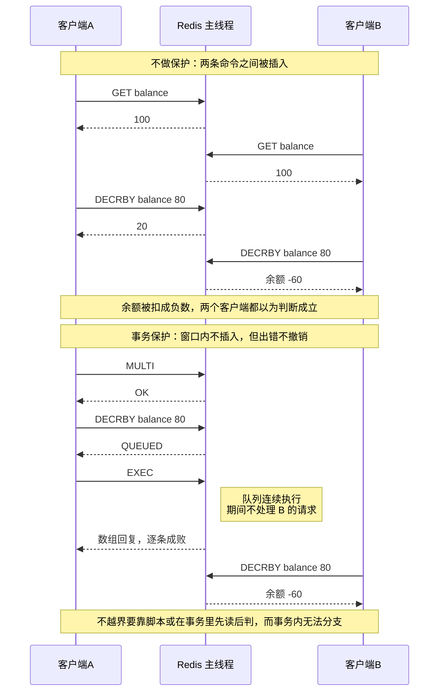
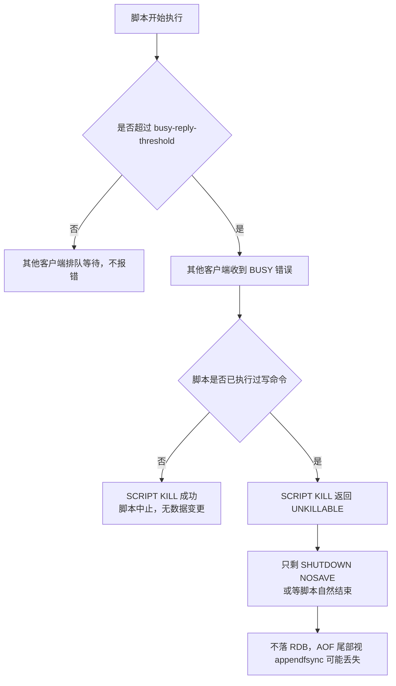
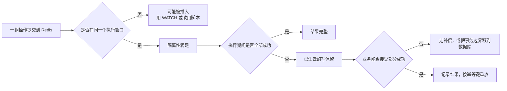

# 03 Redis 事务 Lua 脚本与原子性保证

**摘要：**

Redis 的事务常被一句话概括成「原子操作」，而这个概括丢掉的限定语，正好是生产事故的发生地点。本文把「原子」拆成三种彼此独立的承诺逐项核对：一组命令在执行期间不被别的命令插入，一组命令要么全部生效要么全部撤销，同一个请求重复执行与执行一次等价。MULTI/EXEC、Lua 脚本与 Redis 7 的函数只兑现第一种；第二种三者都不提供——入队阶段的命令错误会让 EXEC 拒绝执行整个事务，这是唯一接近回滚的情形，而执行阶段的错误只让出错的那条命令失败，其余照常生效；第三种从来不属于 Redis 的职责。在这个框架下，本篇讲清 MULTI/EXEC 的两个失败阶段与事务在复制、AOF、Cluster 下的边界，WATCH 作为乐观锁的作用域与清除时机，脚本作为「一条命令」的原子性来源与它换来的阻塞代价，`lua-time-limit` 超时之后只剩 `SCRIPT KILL` 与 `SHUTDOWN NOSAVE` 两条出路的机制细节，`EVALSHA` 缓存在重启与故障转移后失效引发的 NOSCRIPT 风暴，函数与脚本在资产管理上的分工，最后落到脚本的正确写法、反例清单，以及一个具体问题：转账这类需要真正事务语义的操作，能不能交给 Redis。

---

## 第 1 章 「原子」被读成了哪一种原子

先划范围。本章讨论的原子，不是「一条命令在执行器内部不可分割」意义上的原子——那是单线程执行模型的直接结果，`INCR` 的读、加、写三步之间不存在让别的命令插进来的位置，这件事从 Redis 诞生起就成立，不需要任何额外机制（[[05 单线程模型与事件驱动架构]] 把这条路径拆到了事件循环与命令分发的粒度，本篇只取结论，不复述机制）。要讨论的是「一组操作能否被当作一个整体来对待」意义上的原子，以及这个「整体」究竟许诺了什么。

这个区别看起来只是措辞，实际决定了一次事故的性质。设想一个扣库存的场景：脚本先读库存、判断够用、再扣减。工程师相信「Redis 是原子的」，于是把扣库存和写订单分别放进两个 Lua 脚本，默认它们会像数据库事务那样同生共死。等到某次网络抖动让第二个脚本没有发出去，库存已经扣了，订单没有生成，对账要等到第二天早上才把差额翻出来。根因不在 Redis，在「原子」这个词被跨语境搬运时丢掉了限定语。

把限定语找回来需要**三把尺子**。第一把量「不被插入」：一组命令执行期间，有没有别的客户端的命令挤进来。第二把量「全或无」：组内一条失败，已经生效的那些写会不会被撤销。第三把量「可重复执行」：同一份请求到达两次，结果与到达一次是否相同。三件事彼此独立，一个机制完全可能提供其中一项而不提供另外两项，把它们压成一个词，是绝大多数误用的起点。

| 语义 | 要回答的问题 | 关系数据库事务 | MULTI/EXEC | Lua 脚本 / Function |
| :--- | :--- | :--- | :--- | :--- |
| 隔离性 | 执行期间会不会被插入 | 由隔离级别保证 | 单节点内不插入 | 单节点内不插入 |
| 全或无 | 失败是否撤销已生效的写 | 会 | 不会 | 不会 |
| 可重复执行 | 重复执行是否等价于一次 | 靠唯一约束与业务设计 | 不提供 | 不提供 |

这张表里最容易被跳过的，是第一行**单节点内**四个字和第三列、第四列的「不会」：前者是范围限定，后者是否定式结论，都不适合出现在标题和口头传播里，于是最先被磨掉。等到「Redis 事务是原子的」写进面试题、写进客户端库的方法名，它已经和原意相差两层。

「原子」被泛化的路径值得说清楚，因为它解释了为什么纠正起来这么费劲。Redis 单条命令确实是原子的：两个客户端同时对同一个计数器执行 `INCR`，绝不会各自读到旧值再各自加一，最终结果必然是加二。这个性质真实、可观测、每天都在起作用，因此很容易被当成 Redis 的普遍属性；而事务与脚本又确实把多条命令放进了同一个不可插入的窗口，从外部看像是「原子性被保留了」。两件事叠加，结论就变成了「Redis 支持原子事务」，中间那句「只保留了隔离，没有保留回滚」在传播中消失了。

比方的说法或许更容易记住：把 MULTI/EXEC 想成银行柜台一次收下你递进去的一叠单据。柜员不会在处理你这叠单据的中途停下来接别人的单子，这一点是真的；但他逐张办理，办不成的那张当场退回，已经办成的那张不会因为后面一张失败而作废。窗口的**独占**是承诺，整叠单据的**全或无**不是。Lua 脚本则是另一种形态——你把这叠单据交给同一个经办人，他可以边看边决定下一步怎么办，窗口同样独占，同样不负责撤销已办的部分。

本篇的写作分工也要在此说明。Redis 的内部实现——事件循环如何组织、命令如何分发、fork 与 copy-on-write 如何工作、Cluster 的槽位如何分配与迁移——已经在 [[中间件/Redis/Redis设计与实现/00 专栏导览|Redis 设计与实现]] 专栏里逐层拆过，凡是需要机制底稿的地方，本篇只给一句结论并附上双链，不再重讲。这里要处理的是使用与运维视角的问题：这些机制在业务代码里兑现了哪些承诺、没兑现的承诺要靠什么补、补不上时会在哪个环节出事。

行文顺序按「机制 → 边界 → 反例」推进：先划清 MULTI/EXEC 与 WATCH 的边界，再讲脚本的原子性来源、阻塞代价与资产管理，然后逐项对齐三种原子语义，最后落到写法、反例与选型判据。

---

## 第 2 章 MULTI/EXEC：打包执行，以及两个失败阶段

### 2.1 一次事务的四个动作

事务的接口小得不像一个特性：`MULTI` 把一个连接切换进事务状态，之后的命令不做求值而进队列，`EXEC` 一次性把队列里的命令按顺序执行并返回一个数组，`DISCARD` 清空队列并退出事务状态。

```bash
127.0.0.1:6379> MULTI
OK
127.0.0.1:6379> INCR order:count
QUEUED
127.0.0.1:6379> LPUSH order:list 1001
QUEUED
127.0.0.1:6379> EXEC
1) (integer) 1
2) (integer) 1
```

入队回复固定是 `QUEUED`，不带任何求值结果，这一条细节很关键：它意味着事务内的命令在入队时只被检查「服务端认不认这条命令、参数个数对不对」，而不检查「这条命令在这个键上能不能成立」。后者要等到 `EXEC` 真正执行时才知道。于是事务的失败被切成**两个阶段**，两个阶段的后果完全不同。

`MULTI` 之后再次 `MULTI` 会报错，嵌套事务不存在；`EXEC` 一个空队列返回空数组，这在压测和埋点里常被误读成失败；连接在事务状态下断开时，队列被直接丢弃，不会有任何一部分被执行。`DISCARD` 与 `UNWATCH` 的配合放到第 3 章讲，因为它只有在存在监视时才谈得上语义。

### 2.2 入队阶段：唯一像回滚的路径

服务端在入队阶段能发现的错误有两类：命令名不存在，参数个数不对。此时的回复不是 `QUEUED` 而是一个错误，同时这个连接被标记为「事务已脏」，紧接着的 `EXEC` 不再执行队列，而是直接返回：

```bash
127.0.0.1:6379> MULTI
OK
127.0.0.1:6379> SET k1 v1
QUEUED
127.0.0.1:6379> SETX k2 v2
(error) ERR unknown command 'SETX', with args beginning with: 'k2', 'v2',
127.0.0.1:6379> EXEC
(error) EXECABORT Transaction discarded because of previous errors.
127.0.0.1:6379> GET k1
(nil)
```

这是 Redis 里**唯一看起来像回滚**的情形，但它回滚的是「一次尚未开始的执行」，不是「已经生效的写」。两者的差别在观测上立刻可见：真正的回滚需要先有生效、再有撤销，撤销本身还要能被别的客户端观察到（一个读到中间状态的读者会看到值变过又变回去）；而这里 `k1` 从头到尾没有出现过，一条命令都没有跑过。把这种情形叫作回滚，代价是下一次真的遇到部分成功时，会以为同样有兜底。

服务端为什么要做得这么绝，而不是用剩下的命令凑一个残缺队列执行？官方的设计说明给出的理由与流水线有关：客户端通常把 `MULTI`、一串命令和 `EXEC` 一次性发出去，中间回复不回读，只在 `EXEC` 上收结果；若服务端默默执行了残缺队列，客户端会以为整段都做了，而实际上中间少了一条。拒绝执行整个事务，等于把「少了一条命令」强制暴露在客户端会看的那一个回复上。

顺带说一句，入队阶段被拒绝的命令不止语法错误一类。服务端在排队时对任何命令做的拒绝——包括内存超限时被拒绝的写命令——都会把事务标记为脏。这个行为随版本有过调整，不同版本的细节不必逐一记住，需要记住的是原则：凡是在入队阶段被服务端拒绝，整个事务都不会执行。

### 2.3 执行阶段：逐条报错，逐条生效

`EXEC` 真正开始执行之后，错误的意义就变了。命令与键的类型不匹配、整数溢出、命令内部的前置条件不满足，这些都不是入队时能看出来的问题，它们发生在已经进入执行序列之后：

```bash
127.0.0.1:6379> SET k1 hello
OK
127.0.0.1:6379> SET counter 9223372036854775807
OK
127.0.0.1:6379> MULTI
OK
127.0.0.1:6379> LPUSH k1 world
QUEUED
127.0.0.1:6379> INCR counter
QUEUED
127.0.0.1:6379> SET k2 v2
QUEUED
127.0.0.1:6379> EXEC
1) (error) WRONGTYPE Operation against a key holding the wrong kind of value
2) (error) ERR increment or decrement would overflow
3) OK
127.0.0.1:6379> GET k2
"v2"
```

三条命令，两条失败，第三条照常执行，`k2` 被成功写入。整个 `EXEC` 的回复是一个数组，错误只是数组里某个位置上的元素，不影响其他位置。这里没有任何撤销动作，前一条命令的失败对后一条命令没有任何副作用——用数据库的语汇说，Redis 事务里没有「语句级回滚」，也没有「事务级回滚」，只有「**逐条生效或逐条失败**」。

对业务代码而言，`EXEC` 的返回值必须被当作报告来读，而不是成功或失败的信号。很多客户端封装把「没有抛异常」当成事务成功，数组里的错误元素被丢弃，一次部分成功被记成一次成功，数据不一致要等到对账时才浮出来。稳妥的写法是把返回数组的每个元素都与预期类型比对一遍，出现错误元素就走补偿逻辑，而不是重试——重试会把已经生效的那部分再做一次。

| 阶段 | 典型错误 | 检测时机 | EXEC 的行为 | 数据影响 | 像不像回滚 |
| :--- | :--- | :--- | :--- | :--- | :--- |
| 入队期 | 命令名不存在、参数个数不对、服务端拒绝的命令 | 命令入队时 | 拒绝执行整个事务，返回 EXECABORT | 一条都没有执行 | 像，但本质是「没有开始」 |
| 执行期 | 类型不匹配、整数溢出、命令前置条件不满足 | EXEC 逐条执行时 | 该命令报错，其余命令继续 | 部分生效，无撤销 | 不像，没有任何回滚动作 |

### 2.4 为什么不回滚

这个问题问过的人很多，官方给出的论证结构其实很简洁：命令失败只有两类。一类是命令写错了——命令名不存在、参数个数不对，这类错误在入队时就能发现，整个事务不执行，等于已经处理掉了。另一类是命令与持有的数据类型不匹配，比如对一个字符串键执行 `LPUSH`，这类问题不是运行时环境造成的，而是程序缺陷；回滚能让这次调用不留下痕迹，但缺陷还在，下一次照样会错，而且因为「回滚了」而更难被注意到。

站在实现角度，支持回滚要付出的代价是明确的：每条可能修改数据的命令执行之前，都要先把旧值记下来（undo log），记录本身要占内存，撤销逻辑要覆盖所有数据类型与所有编码，`EXPIRE`、`LPOP` 这类自带副作用的命令还要额外定义「撤销」到底是什么意思。这些成本会落在所有正常路径上，而收益只出现在程序有缺陷的那条路径上。Redis 选择把**成本留给使用方**，把实现留在几十行代码的量级里。

不过，除了官方的论证，还有一个更值得注意的后果：回滚能力一旦存在，「部分成功」就从语言层面被抹掉了，而在 Redis 里它一直存在。这不是缺陷，是取舍——它强迫写代码的人面对「事务可能只做了一半」，而不是躲在一个原子块的括号里。真正危险的是反过来：以为有括号，于是不写补偿。

需要强调的是，这条语义在 Redis 7 与 Redis 8 里没有变化。Lua 脚本与函数也没有绕开它——脚本中途报错时，已经执行的写同样留在数据集里。这条结论放到第 4 章再展开，因为它与脚本的「一条命令」身份有一个看起来矛盾、实际并不矛盾的关系。

### 2.5 独占的另一面：没有超时保护的阻塞

`EXEC` 执行期间不会插入其他客户端的命令，这一点是事务隔离性的全部来源。机制底稿在 [[05 单线程模型与事件驱动架构]]：主线程在 `execCommand` 里逐条调用命令实现，不回到事件循环，其他客户端的请求只能在内核缓冲区里等着。这里只取一个推论。

推论的正面是隔离：只要一组命令都进了同一个 `EXEC`，它们之间不存在被插入的可能，也不需要任何锁。推论的背面是独占：`EXEC` 里放多少命令，服务器就要连续占用多久，而事务队列**没有超时保护**，也没有任何外部命令能中止一个正在执行的 `EXEC`。一个塞进十万条 `INCR` 的事务，会让服务器连续阻塞一秒上下（示例推算：按每条命令十微秒计，十万条约一秒），期间所有客户端排队，而运维手上没有 `SCRIPT KILL` 那样的出口——那个工具只对脚本有效。

下一个问题是持久化与复制。事务的多条命令在主从之间、在 AOF 文件里，是被 `MULTI` 与 `EXEC` 成对包裹着传播的，因此从库重放和 AOF 重新加载都不会执行半个事务：要么整段到达并整段执行，要么整段缺失。AOF 尾部如果停在一个未闭合的事务中间，加载时会被截断（`aof-load-truncated` 默认为 `yes`，会记一条警告），RDB 则是 fork 时刻的一致性快照，本身不存在「半个事务」的形态。机制细节见 [[08 AOF 持久化与混合持久化]]。

但**整段到达**不等于**保证到达**。主从复制是异步的：主库执行完事务并给客户端回了成功，传播到从库之前主库宕机，从库上就没有这段数据——它看到的是整段缺失，而不是半段污染。这个区别很重要：原子性在复制这一层能保证的只是「不会出现半段」，不能保证「一定出现」。把这两件事混为一谈，就会得出「Redis 事务在主从切换后仍然可靠」的错误结论，而这正是第 7 章要处理的转账问题的一半。

下面这张时序图把事务窗口与插入的关系放在一起看，同时对比不做保护时的交错：



图里第二段暴露出事务真正的短板：它把「不插入」做到了，却没法在窗口内根据读到的余额做判断，所以两个客户端仍然可能各自扣款成功。要解决这个，必须让判断与写入发生在同一个不可分割的执行体里，而且这个执行体要能读到中间结果——这正是脚本的位置。

### 2.6 Cluster 下的事务边界

事务在 Cluster 里的约束与普通多键命令一致：一个事务涉及的所有键必须落在同一个槽上，跨槽的命令在入队时就会被 `CROSSSLOT` 拒绝，脏标记随即让 `EXEC` 失败。`MULTI` 本身不携带键，槽信息要等具体命令到达才被检查，因此在客户端看来，`MULTI` 总是成功的，错误出现在 `EXEC` 上——而那时业务代码通常已经写完了半个流程。槽位分配、`MOVED` 与 `ASK` 重定向的机制见 [[10 Redis Cluster 分布式架构]]，这里只留一句结论：事务的隔离性作用域是一个节点上的一个数据库实例，跨节点之间没有事务，也没有任何跨节点的原子窗口。

这条边界在实践中经常被忽略，因为客户端库的封装会掩盖它——集群客户端在 `MULTI` 上不做重定向，直到某条命令触发了 `MOVED`，事务才以一条难以解读的错误结束。要避免，只能让相关键天然同槽，或者用哈希标签把它们强制到同一个槽上，写法放在第 8 章。

---

## 第 3 章 WATCH：把冲突检测挪到客户端

### 3.1 乐观锁的形状

事务的命令在入队时并不知道世界已经变了：`MULTI` 之后读到的余额，与 `EXEC` 执行时内存里的余额，中间隔着一段可以任意长的时间。事务本身不检查这段时间里发生了什么，`WATCH` 补的就是这个检查。它记录「这个键被我盯上了」，此后任何客户端对它的写都会把这个连接的事务标记为冲突，`EXEC` 随即返回空回复，队列一条也不执行。

```bash
127.0.0.1:6379> WATCH account:1001
OK
127.0.0.1:6379> GET account:1001
"100"
127.0.0.1:6379> MULTI
OK
127.0.0.1:6379> DECRBY account:1001 80
QUEUED
127.0.0.1:6379> INCRBY account:2002 80
QUEUED
127.0.0.1:6379> EXEC
(nil)
```

最后那个空回复就是「我盯的键在中间被改过，因此我不执行」。注意它给出的信息量很有限：`EXEC` 不会告诉你哪个键被谁改成了什么，也不会告诉你改动是否影响了你关心的条件。它只给一个布尔结果，重试与重判的责任全部回到客户端。

这就是经典的 CAS（Compare-And-Swap，比较并交换）循环，代价随竞争程度上升而急剧恶化，写法上必须显式处理：

```python
for attempt in range(3):
    pipe.watch("account:1001")
    balance = int(pipe.get("account:1001") or 0)
    if balance < 80:
        pipe.unwatch()          # 条件不成立就别开事务，省掉一次往返
        return "余额不足"
    pipe.multi()
    pipe.decrby("account:1001", 80)
    pipe.incrby("account:2002", 80)
    try:
        pipe.execute()          # EXEC 返回 nil 时，客户端库会转成 WatchError
        return "ok"
    except WatchError:
        time.sleep(random.uniform(0.001, 0.01))   # 退避并加抖动，避免同步重试
```

### 3.2 作用域是连接，不是键

`WATCH` 挂在发起它的那个连接上，这是最容易在连接池环境里出错的属性。监视列表是**连接的私有状态**，只影响这个连接自己的 `EXEC`；别的连接即使也在 `MULTI` 里，照样可以随便写这个键。清除监视有三种触发：`EXEC` 执行（无论成功还是返回空）、`DISCARD` 放弃事务、`UNWATCH` 显式取消，以及连接断开时的隐式清除。

由此推出几条使用约束。第一，`WATCH` 与 `EXEC` 必须在同一个连接上，中间不能归还连接池——大部分客户端库的 pipeline 对象已经绑定了连接，所以用 pipeline 是安全的，手写裸连接则要自己保证。第二，`WATCH` 不能在 `MULTI` 内部调用，`UNWATCH` 同样不能，两者在事务状态下都会直接报错。第三，`WATCH` 的粒度是整个键，不只是发生冲突的那一部分数据：一个哈希的某个字段被改，整个键就算被写过；一个键被删了又用同样的值建回来，也算被写过，因为服务端记录的是「这个键被触碰过」的标记，不是值。

这条粒度限制在 Redis 7.4 引入、8.0 沿用的哈希字段级过期之后反而更刺眼了。`HEXPIRE` 一类命令让同一个键内部的字段各自到期，而 `WATCH` 仍然**只认键**——一个与事务毫不相干的字段到了期，也可能让整笔事务作废。键过期的清理机制（过期字典与 `activeExpireCycle`）见 [[06 内存管理与过期淘汰策略]]，字段级过期走的是另一套实现，但两者的共同点是：到期本质上是一次删除，按一次写处理。由此得到一条结论，越细粒度的数据模型，越不适合用 `WATCH` 做并发控制。

同一连接上多次 `WATCH` 不同键是累加关系，重复 `WATCH` 同一个键不会出错也不会额外收费。监视列表的长度是一个容易忽略的成本：监视几十个键的 CAS 循环，每次冲突都要把它们重新 `WATCH` 一遍，重试的上限很快就不是次数而是耐心。

### 3.3 冲突的代价：重试的平方

乐观锁的经济学很简单：冲突概率低时它比加锁便宜（没有获取、释放、超时、死锁，也没有锁服务的可用性问题）；冲突概率高时它贵得多，因为每次失败都意味着整段读判断重做一遍。

把竞争放大到具体数字（以下为示例推算，不构成基准）：假设一万个客户端同时对同一个键做 CAS，每次只有一个能成功，其余九千九百九十九个重试；下一轮再成功一个，如此往复。总执行次数是一加二加到一万的量级，即**五千万次尝试**，而其中真正有效的只有一万次。服务端看到的是近乎自伤式的流量放大，客户端的线程全部堆在重试循环里，尾延迟被拉长到把上游的超时全部引爆。这就是秒杀、抢购这类场景不能用 `WATCH` 的原因，与 Redis 的性能无关，与乐观锁的模型有关。

顺带澄清一个常见的担心：`WATCH` 不存在 ABA 问题。基于值或版本号的 CAS 需要担心「改出去又改回来」，因为两次修改之间的差异被抵消了；`WATCH` 不比较值，它比较的是「有没有被写过」，改回原值同样会让 `EXEC` 返回空。这个语义比基于值的 CAS 更严格，代价是它也更粗糙——任何一个无关的写都会让事务作废，所以它适合保护「本来就只被少数几类命令修改」的键。

### 3.4 与 DISCARD、UNWATCH 的配合

`DISCARD` 与 `UNWATCH` 的分工经常被搞混：前者是「我不做这个事务了」，后者是「我暂时不盯这个键了」。在 `MULTI` 之前发现条件不成立，用 `UNWATCH` 提前收工，省掉 `MULTI` 与 `EXEC` 的两次往返；已经 `MULTI` 了才发现要放弃，则用 `DISCARD`，它同时清空队列与监视列表。表里把四个命令的影响列清楚：

| 命令 | 对命令队列的影响 | 对监视列表的影响 | 备注 |
| :--- | :--- | :--- | :--- |
| `MULTI` | 开始排队 | 保留已监视的键 | 嵌套调用报错 |
| `EXEC` | 执行并清空 | 清空 | 有冲突时队列直接丢弃 |
| `DISCARD` | 清空 | 清空 | 事务状态解除 |
| `UNWATCH` | 不影响（事务外） | 清空 | 事务内调用报错 |
| 连接断开 | 丢弃 | 丢弃 | 不会有部分执行 |

在连接池里，最后一行是硬要求而非礼仪。一个 WATCH 了若干键却没有 `EXEC` 也没有 `UNWATCH` 的连接被归还，下一次借到它的请求会在自己的 `MULTI` 之后收到一个莫名其妙的空 `EXEC`——监视是跟着连接走的，而连接被别人复用了。正规做法是客户端库的 pipeline 在 `reset()` 时补一个 `UNWATCH`，自研封装则要显式处理。

至此，事务这一侧的能力与边界都摆出来了：它能独占窗口，能配合 `WATCH` 做冲突检测，不能做条件分支，不能回滚。要补上「条件分支」这一块，需要另一种执行形态。

---

## 第 4 章 Lua 脚本：把多条命令压成一条

### 4.1 一次调用，一个执行体

Lua 脚本的思路与事务不同。事务是「多条命令排好队、一次执行」，脚本是「**一条命令**内部做了一串事」。`EVAL` 在命令表里就是一个命令，它的执行过程对外部不可见，主线程不会在处理它的中途回到事件循环，因此它天然占据了一个不可插入的窗口；而它内部可以读、可以判断、可以再写，这是事务做不到的。

```bash
EVAL "脚本正文" numkeys key1 key2 ... arg1 arg2 ...
```

参数结构里 `numkeys` 之后是键，再之后是普通参数，在脚本内分别由 `KEYS[1..n]` 与 `ARGV[1..n]` 取得。这个设计并非风格约定，下一小节单独说。先看一个最小但完整的例子，把「读、判断、写」放进同一个执行体：

```lua
-- 库存扣减：KEYS[1] 库存键，ARGV[1] 扣减数量
local stock = tonumber(redis.call('GET', KEYS[1]))
if stock == nil then
    return -1                     -- 键不存在，交给调用方决定是否初始化
end
local amount = tonumber(ARGV[1])
if amount <= 0 then
    return -4                     -- 参数非法，用返回码而不是 error()
end
if stock < amount then
    return -2                     -- 库存不足
end
redis.call('DECRBY', KEYS[1], amount)
return stock - amount             -- 剩余库存
```

这段脚本兑现的是事务兑现不了的那部分：判断与写入之间没有缝隙，两个并发请求不可能都读到「够用」再各自扣减。它没有兑现的是回滚——如果 `DECRBY` 之后还有第三条写命令并且报错，`DECRBY` 的效果留在数据集里。脚本的原子性同样是隔离意义上的，不是全或无意义上的，这一点与 MULTI/EXEC 一致，原因也一样：两者共用同一套没有 undo log 的数据结构。

### 4.2 KEYS 与 ARGV 不是命名习惯

把键放进 `KEYS`、把数据放进 `ARGV`，看起来像代码风格，实际是**路由与访问控制**的前提。Cluster 需要在命令到达时就知道这个脚本要碰哪些槽，它读的是 `numkeys` 后面那一段；如果脚本内部用字符串拼接凭空造出键名，例如 `redis.call('GET', 'user:' .. ARGV[1])`，路由层看到的键集合是空的，脚本被随意发到某个节点上，然后在该节点上访问一个不属于它的键，得到 `Script attempted to access a non local key in a cluster node` 这类错误，或者更糟——在槽迁移的窗口里读到不一致的数据。

```lua
-- 错误：键由 ARGV 拼接，路由层无从判断
local v = redis.call('GET', 'user:' .. ARGV[1])

-- 正确：键由 KEYS 声明，槽在命令到达前就确定
local v = redis.call('GET', KEYS[1])
```

即使在单机部署里也应当坚持这条规范，理由不止「为将来迁集群做准备」。`EVAL_RO` 与 `FCALL_RO` 在只读副本上执行时，服务端同样需要键集合才能判断这个请求是否可服务；代理层若要在 `EVAL` 上做分片，读的也是这一段；槽迁移期间的一致性检查同样以它为准。一个把键藏在脚本内部的实现，在这几处全部失明。

Cluster 的槽位规则与重定向机制由 [[10 Redis Cluster 分布式架构]] 负责，这里只记住两个操作要点：所有键必须落在同一个槽；需要多个键同槽时用哈希标签 `{}` 把参与哈希的部分固定下来，具体写法在第 8 章。

### 4.3 redis.call 与 redis.pcall

脚本内部调用 Redis 命令用 `redis.call`，出错时它抛一个 Lua 错误并终止脚本，错误信息回到客户端；`redis.pcall` 包装后返回一个带 `err` 字段的表，脚本可以继续往下走。

```lua
-- redis.call：出错即中止，已执行的写不会撤销
local ok = redis.call('SET', KEYS[1], ARGV[1])

-- redis.pcall：拿到错误对象，脚本自行决定后续
local r = redis.pcall('INCRBY', KEYS[1], ARGV[1])
if r.err then
    return redis.error_reply('ERR counter update failed')
end
```

用哪一个取决于「出错时前面是否已经写过数据」：已经写过，无论 `call` 还是 `pcall` 都无法让这次执行变成「什么都没发生」；`pcall` 多出来的能力只是失败之后还能做点别的（记日志、回退标记位），而这些补救本身也可能失败，于是脚本里出现了「补偿的补偿」。笔者的倾向是：需要条件容错的地方用 `pcall`，前提是脚本自己维护了「做到第几步」的状态；其余一律用 `call`，让错误尽早暴露，补偿交给调用方。

有一个常见的反模式值得单独点出来：用 `pcall` 包住一条可能失败的写命令，失败时 `return -1`，然后客户端看到 `-1` 就重试整个脚本。如果那条命令失败前脚本已经写过一次，重试就会重复写。错误处理在这里变成了写放大。

### 4.4 沙箱、确定性与随机性

脚本运行在嵌入的 Lua 5.1 解释器里，环境被裁剪过：没有文件系统、没有网络、没有 `os` 与 `io`，写全局变量会报错（要求脚本只能依赖输入与 Redis 数据），阻塞型命令（`BLPOP`、`BRPOP`、`WAIT`、`SUBSCRIBE` 一类）在脚本内不可用——这一点与「脚本独占主线程」是一体两面：既然不能让别人等，也就不能让自己等。

随机性与时间的问题值得单独说，因为它牵扯的是复制，不是原子性。Redis 7 之前，脚本默认按原文复制：主库执行脚本，把 `EVAL` 整段发给从库，从库再执行一遍。这个模型要求脚本是确定性的，否则主从各跑一遍会得出不同结果。3.2 起提供了 `redis.replicate_commands()`，调用后改用效果复制（把命令产生的写入效果传播出去）；Redis 7 起效果复制成为唯一方式，`TIME`、`SRANDMEMBER`、`SPOP`、`RANDOMKEY` 一类非确定性命令可以放心在脚本里使用。在更老的版本上，如果在写命令之前调用了非确定性命令，脚本会被直接拒绝，错误形如 `Write commands not allowed after non deterministic commands`。

不过「允许用」与「应该依赖」是两件事。效果复制让主从数据一致，却没有让时间戳跨节点一致：脚本里取到的时间是主库的时钟，从库与客户端看到的是各自的时钟，把时间当作跨节点的事实来用，迟早会在时钟偏移上出事。更稳妥的做法是把时间由调用方算好，作为 `ARGV` 传进来，脚本只负责在给定时间点上做判断——滑动窗口限流、令牌桶这类实现都应当这样写。

### 4.5 返回值、数字与空值

Lua 与 Redis 协议之间的类型转换有几处不直观的地方，它们不会报错，只会让脚本在边界情况下做出错误判断。

| Lua 侧 | 转成 Redis 回复 | 需要注意的地方 |
| :--- | :--- | :--- |
| number | 整数回复，小数被截断 | 内部是双精度浮点，超过 2 的 53 次方会丢精度 |
| string | 批量字符串 | 二进制安全，可以直接放序列化后的内容 |
| table | 数组回复 | 在第一个 nil 处截断，想返回空数组要 `return {}` |
| boolean false | 空回复（null） | 与「键不存在」的回复同形，容易混淆 |
| boolean true | 整数 1 | 不要用它表达业务状态 |
| table 带 err 字段 | 错误回复 | 由 `redis.error_reply` 或 `redis.pcall` 产生 |

第一个坑是空值。`redis.call('GET', KEYS[1])` 在键不存在时返回的是 `false`，不是 `nil`；`tonumber(false)` 恰好得到 `nil`，所以前面那段库存脚本才写得通，但如果直接把返回值拿去比较 `== nil`，判断永远不成立。第二是精度：Lua 的 number 是双精度浮点，服务端把整数回复交给 Lua 时已经过了一次转换，计数器做到 2 的 53 次方以上就会失真，这种量级的键虽然少见，但在全局序列号、时间戳纳秒拼接这类设计里是真实存在的。需要精确的大整数时，让服务端用字符串返回，在脚本里只做等值判断不做算术。

第三是返回值的语义设计。脚本返回 `-1`、`-2` 这类整数码，比返回错误更可控，因为错误会被客户端库当作异常抛出并可能触发自动重试，而重试一个已经部分生效的脚本是危险的。把「业务上的不满足」用整数码表达、把「程序上的错误」用 `redis.error_reply` 表达，这条约定能让调用方的错误处理简单很多。

---

## 第 5 章 阻塞：脚本最贵的那部分

### 5.1 原子性不是免费的

脚本的隔离性来自一个简单事实：它执行期间主线程不回事件循环，因此不会有第二条命令被处理。这个事实的正面是原子，背面是**独占**，而独占的价格是按时间计的。

把它想成一条只有单车道的隧道：车辆通过隧道时确实不会相撞，也不会有别的车插进来，但只要有一辆卡车在隧道里抛锚，后面的队列就在隧道外一直排下去，而隧道里没有应急车道，也没有拖车能进去。脚本就是那辆卡车，`lua-time-limit` 只是隧道的监控室在超时之后开始对外广播「里面堵住了」，它并不会把卡车拖走。

代价的分布很不均匀：脚本执行一百毫秒，这一百毫秒里所有请求都在排队，而排队时间会沿着调用链向上累加——网关的读超时、上游线程池、连接池的借出等待，任何一环先到阈值就先炸，炸出来的错误与脚本毫无关系，排查方向被带偏很远。

### 5.2 lua-time-limit 之后还剩什么

`lua-time-limit` 的默认值是五千毫秒，Redis 7 起这个配置有了新名字 `busy-reply-threshold`，旧的 `lua-time-limit` 作为别名保留。它的作用常被误解：它**不是脚本的执行时间上限**，而是「开始对外报告忙」的阈值。超过这个时间，Redis 依然不会中断脚本，它只是开始对其他客户端返回：

```text
-BUSY Redis is busy running a script. You can only call SCRIPT KILL or SHUTDOWN NOSAVE.
```

也就是说，从一个脚本写错成死循环的那一刻起，到有人手工干预之间，服务端的实际状态是「一个执行体在跑，其余全部被拒」。可用的干预手段只有两个，而它们的选择取决于一个条件：脚本有没有执行过写命令。



`SCRIPT KILL` 的前提是脚本没有写过数据，这个设计不是保守，而是必然：既然没有 undo log，杀掉一个已经写了一半的脚本等于把数据库留在部分更新的状态，那比让服务端继续卡着更糟。所以已经写过数据的脚本收到的是 `UNKILLABLE`，此时唯一的选择是 `SHUTDOWN NOSAVE`——放弃未持久化的数据，重启进程，从 RDB 或 AOF 里恢复到一个不含这次半截写入的状态。

函数用的是同一套机制，命令名换成 `FUNCTION KILL`。`FUNCTION STATS` 能看到当前正在运行的脚本信息，这在事故现场比翻日志快得多。

### 5.3 量级推算

把阻塞时间换算成排队请求数，能直观看出这条红线的位置。假设单实例的处理能力是每秒十万条命令（示例推算，实际取决于命令复杂度、网络与客户端并发度），那么平均每条命令占用主线程十微秒，脚本占用的每一毫秒大约对应一百个请求的排队。

| 脚本执行时间 | 期间排队的请求（示例推算） | 典型后果 |
| :--- | :--- | :--- |
| 100 微秒 | 约 10 个 | 无感，属于正常命令开销 |
| 1 毫秒 | 约 100 个 | p99 开始抬升，仍在上游超时阈值内 |
| 10 毫秒 | 约 1000 个 | 连接池借出等待变长，慢查询日志开始记录 |
| 100 毫秒 | 约 1 万个 | 上游 RPC 的百毫秒级超时先炸，重试放大流量 |
| 5 秒 | 约 50 万个 | 客户端大面积超时，健康检查与探针开始误判 |

这张表要读的是斜率而不是绝对值。脚本的执行时间每翻十倍，排队长度也翻十倍，而排队带来的重试会再乘一次，所以从一毫秒到十毫秒在指标上不是十倍的恶化，很可能是几十倍。判断一个脚本是否危险，看的是它内部有没有随数据量增长的循环，而不是它平均跑了多久——平均一毫秒、最坏三秒的脚本，比平均三毫秒、最坏五毫秒的脚本危险得多。

五秒那一行还有一层连带风险：主线程被占住期间，集群总线与哨兵的心跳处理同样被推迟，阻塞时间接近 `cluster-node-timeout`（默认十五秒）或 Sentinel 的 `down-after-milliseconds` 时，节点互判失败并触发故障转移是可能的。也就是说，一个写得不好的脚本不只让服务变慢，还可能引发一次没有必要的故障转移，把问题从「一个接口超时」升级成「一次主从切换」。

### 5.4 配置取舍

与事务、脚本相关的几个配置，取舍方向并不一致，调大调小各有各的代价：

| 配置项 | 默认值 | 它管什么 | 调大的代价 | 调小的代价 |
| :--- | :--- | :--- | :--- | :--- |
| `busy-reply-threshold`（旧名 `lua-time-limit`） | 5000 毫秒 | 超时后对其他客户端返回 BUSY 的阈值 | 故障暴露更晚，客户端往往先于它超时，现场证据变少 | 正常的长脚本也会被判忙，运维频繁收到误报；设为 0 则永不报告，等于放弃这项保护 |
| `client-query-buffer-limit` | 1 GB | 单个客户端缓冲区上限，较新版本也用它限制事务队列的规模 | 单个客户端可以占用更多内存，慢客户端拖累整个实例的风险上升 | 命令较多的大事务会被直接拒绝，业务方要在批大小上重新设计 |
| `cluster-node-timeout` | 15000 毫秒 | 节点互判失败的窗口 | 真实故障发现更慢，故障转移时间变长 | 主线程短暂阻塞就可能被判失败，误触发切换 |
| `appendfsync` | everysec | AOF 落盘频率，决定崩溃时丢多少数据 | `always` 最安全但每次写都等磁盘，吞吐显著下降 | `no` 把时机交给操作系统，丢数据窗口不可控 |
| `maxmemory` 与淘汰策略 | 依部署而定 | 内存上限与超限后的行为 | 留出更多余量，成本上升，fork 与淘汰的开销也随之变大 | 更容易触发淘汰，被淘汰的键恰好是事务要用的键时行为难以预期 |

最后一行与事务的关系容易被忽略：内存达到上限时，写命令会被拒绝；在较早的版本里，事务排队阶段被拒绝的写命令会把整个事务作废，较新的版本改为用 `client-query-buffer-limit` 限制队列规模。两种行为指向同一个结论——一个与业务逻辑完全无关的内存水位，足以让一批本应成功的事务集体失败。这类故障的排查线索是 `used_memory` 与淘汰日志，不是事务代码本身。

---

## 第 6 章 EVALSHA 的缓存与 Function 的常驻

### 6.1 每次传全文，还是只传指纹

`EVAL` 的调用协议要求把脚本正文完整传过去，一个几 KB 的脚本乘以每秒上万次调用，带宽的浪费是实在的。Redis 为此给每个脚本算一个四十位的 SHA1 摘要，第一次执行时缓存正文，之后用 `EVALSHA` 只传摘要即可。`SCRIPT LOAD` 可以只缓存不执行，`SCRIPT EXISTS` 查缓存，`SCRIPT FLUSH` 清空。

问题出在「缓存」这个词上：它真的只是缓存，**不随数据持久化**。官方文档把三件事写得很清楚——脚本缓存会在服务器重启时被清空，在副本升级为主库时被清空，在执行 `SCRIPT FLUSH` 时被清空，因此客户端必须随时准备处理 `NOSCRIPT No matching script. Please use EVAL.` 这个错误。

三处细节需要展开。第一，缓存是每个节点各存一份，`SCRIPT LOAD` 只影响被调用的那个节点，Cluster 里其余节点仍然是空的。第二，Redis 7 起脚本按效果复制，从库收到的是脚本产生的写入效果而不是 `EVAL` 原文，脚本缓存不会因为同步而被填满，所以一次故障转移之后新主的缓存是空的，所有走 `EVALSHA` 的调用会在同一瞬间集体收到 `NOSCRIPT`——这不是零零星星的报错，是一个**启动即雪崩**的故障形态。第三，`NOSCRIPT` 是「未命中」而不是「脚本坏了」，处理方式必须是加载后重试，不是把请求判为失败。机制底稿见 [[09 主从复制与 Sentinel 高可用]]。

### 6.2 回退必须写在客户端

成熟客户端库大多内置了这条回退：先发 `EVALSHA`，收到 `NOSCRIPT` 就用 `EVAL` 补一次并把正文缓存下来。自研封装与部分轻量库没有这一层，需要自己补：

```python
def eval_script(conn, script, keys, args):
    sha = hashlib.sha1(script.encode("utf-8")).hexdigest()
    try:
        return conn.execute_command("EVALSHA", sha, len(keys), *keys, *args)
    except NoScriptError:
        # 未命中不等于脚本有问题：补发全文，后续调用回到 EVALSHA
        return conn.execute_command("EVAL", script, len(keys), *keys, *args)
```

回退本身有代价：一次未命中意味着两次往返加一次全文传输，在故障转移后的头几秒，这个代价会被放大到所有请求上。更好的做法是把它前移——应用启动时把用到的脚本逐个 `SCRIPT LOAD` 到每一个相关节点上，或者在客户端记录「本连接已成功加载的摘要集合」，命中集合才用 `EVALSHA`。这两种做法都只是把命中率从零拉到接近一，仍然不能替代回退逻辑，因为 `SCRIPT FLUSH` 与主从切换随时可能重新把命中率清零。

### 6.3 Function：把脚本变成常驻资产

Redis 7 引入的函数（Function）针对的不是原子性，而是脚本的资产管理。一个函数库是一段带 `#!lua name=` 头的 Lua 源码，加载时执行顶层代码、注册若干个具名函数，此后用 `FCALL` 按名字调用：

```bash
127.0.0.1:6379> FUNCTION LOAD REPLACE "#!lua name=stock
local function decr_if_enough(keys, args)
    local stock = tonumber(redis.call('GET', keys[1]))
    if stock == nil then return -1 end
    local amount = tonumber(args[1])
    if stock < amount then return -2 end
    redis.call('DECRBY', keys[1], amount)
    return stock - amount
end
redis.register_function('stock_decr_if_enough', decr_if_enough)
"
127.0.0.1:6379> FCALL stock_decr_if_enough 1 inventory:sku:2001 1
(integer) 9
```

与 `EVALSHA` 相比，差别不在执行模型，在**资产形态**。函数库随数据一起持久化在 RDB 与 AOF 里，随复制同步到从库，因此故障转移之后新主立刻就能被 `FCALL` 调用，不需要预热，也不存在 `NOSCRIPT` 这样的真空期——这是它相对脚本最有价值的一条。函数有名字，`FUNCTION LIST` 能列出当前加载了哪些库与函数，`FUNCTION DUMP` 与 `FUNCTION RESTORE` 可以在实例之间搬运，`FUNCTION DELETE` 与 `FUNCTION FLUSH` 负责清理，`FUNCTION STATS` 能看到正在运行的脚本信息。函数名在所有库之间全局唯一，一个库拥有一套独立的全局环境，库与库之间不会互相污染。

```bash
127.0.0.1:6379> FUNCTION LIST WITHCODE
127.0.0.1:6379> FUNCTION STATS
127.0.0.1:6379> FUNCTION DELETE stock
```

执行语义方面，函数与脚本完全一致，把前面的结论原样搬过来即可：整个函数是一条命令，执行期间不插入其他命令；阻塞的风险一样，`busy-reply-threshold` 一样管它，唯一的干预手段一样是 `FUNCTION KILL`，写了数据一样杀不掉；中途报错一样不回滚。登记时带 `no-writes` 标记的函数可以在只读副本上通过 `FCALL_RO` 执行，这是函数相对脚本多出来的一个能力，脚本侧的对应物是 `EVAL_RO` 与 `EVALSHA_RO`。

| 维度 | 脚本（EVAL / EVALSHA） | 函数（FCALL） |
| :--- | :--- | :--- |
| 标识方式 | 正文摘要（SHA1） | 全局唯一的函数名 |
| 是否随数据持久化 | 否，缓存重启即清空 | 是，随 RDB / AOF 持久化 |
| 故障转移后 | 缓存为空，需要预热或回退 | 立即可调用 |
| 组织方式 | 一段一段独立脚本 | 库内可注册多个函数，各自独立全局环境 |
| 管理命令 | `SCRIPT LOAD / EXISTS / FLUSH` | `FUNCTION LOAD / LIST / DELETE / FLUSH / DUMP / RESTORE / STATS` |
| 只读调用 | `EVAL_RO` / `EVALSHA_RO` | `FCALL_RO`，需登记 `no-writes` 标记 |
| 强制中止 | `SCRIPT KILL` | `FUNCTION KILL` |
| 原子性 / 回滚 / 阻塞 | 隔离有、回滚无、阻塞同 | 完全相同 |

所以选型的判断标准不是「哪个更先进」，而是「脚本作为一种资产由谁负责」。脚本散落在各个服务的代码库里，每个服务各存一份、各自加载、各自处理 `NOSCRIPT`，版本对不齐时线上跑的是哪一版只能靠摘要倒推；函数把这份资产收到 Redis 这一侧，升级变成一次 `FUNCTION LOAD REPLACE`，代价是它被绑定在 7.0 以上的版本上，并且需要一套自己的发布流程来管住「谁能改线上的函数库」这个新问题。把管理权从代码仓库挪到数据实例，收益与风险是同时转移的。

---

## 第 7 章 三种「原子」逐项对齐

### 7.1 隔离性：有，但作用域有限

**隔离性**是 Redis 真正提供的那一项。MULTI/EXEC 与脚本、函数都做到了「执行期间不插入其他客户端的命令」，这一条不需要打折扣，它是单线程执行模型的直接后果。

需要打折的是作用域。隔离只在一个节点、一个数据集内成立：Cluster 下跨槽的键没有共同的执行窗口；主从之间更没有，异步复制只是把主库的执行顺序原样搬到从库，顺序不会错，但可能整段缺失——主库上已经向客户端确认的事务，在切换后的新主上可能根本不存在。把隔离性的作用域误当成「整个 Redis 集群」，是分布式场景下最常见的误判。

还有一层作用域是时间。隔离性保证的是「执行期间不被打断」，不保证「执行前读到的值在执行时仍然有效」——那是 `WATCH` 的职责，而 `WATCH` 只检查键有没有被写过，不检查值是否满足条件。两者叠起来才构成一次完整的 CAS，缺一个就会出现「读到旧值、写入新值、谁都以为自己对」的经典竞态。

### 7.2 全或无：没有，唯一近似的是「没开始」

这一项 Redis 不提供，而且提供不了——没有 undo log，就没有撤销的依据。前面几章分散讲过的事实，在这里收成一句话：Redis 里所有看起来像回滚的情形，本质都是「执行从未开始」，包括入队阶段出错导致的 `EXECABORT`、`WATCH` 冲突导致的空 `EXEC`、以及脚本在第一条写命令之前就报错中止。一旦第一条写命令执行完成，后面的任何失败都不会改变它。

| 判断依据 | 有全或无语义的系统 | Redis |
| :--- | :--- | :--- |
| 失败后如何恢复 | 用日志或版本链撤销已生效的写 | 不撤销，交给调用方补偿 |
| 部分成功可见吗 | 不可见，事务是原子的观测单位 | 可见，读命令随时能读到中间状态 |
| 代价落在哪 | 每条写命令的日志开销 | 落在业务代码的补偿逻辑上 |
| 适用前提 | 需要跨多条写保持一致 | 能接受部分成功并自行对账 |

这里要拆掉一个流传很广的混淆：**单条命令的原子性**是真的，事务的**全或无**是假的，两者被同一个词串了起来。`INCR` 不会丢更新，`SETNX` 的判重不会两个客户端同时成功，这些性质可靠得像石头；但它们成立的原因是「一条命令在主线程里执行完毕」，而不是「Redis 有一套管事务的机制」。把这套性质推广到多条命令，推广链条上缺了一环，而那一环恰好是回滚。

Redis 选择不补这一环，是一个可以辩护的取舍：撤销逻辑与旧值记录的成本会落在每一次正常写入上，收益只出现在程序出错的那条路径上。把成本推给使用方，换来的是极简的实现与可预测的延迟——代价是使用方必须自己写补偿，而这件事在实践中经常被跳过。

### 7.3 可重复执行：只能靠业务设计

第三项与前两项不同，它不是 Redis 该不该提供的问题，而是任何网络系统都无法单方面提供的问题。客户端发出脚本之后连接超时，它无法区分三种情况：请求没到服务端、服务端执行了但回复丢了、服务端还没执行完。此时重试可能重复执行，不重试可能漏执行，选择权在业务语义手里。

幂等的做法是给每次操作一个业务侧生成的唯一标识，让服务端在写入的同时记下「这个标识处理过了」：

```lua
-- KEYS[1] 库存键，KEYS[2] 已处理请求集合，ARGV[1] 扣减数量，ARGV[2] 请求 ID
local done = redis.call('SISMEMBER', KEYS[2], ARGV[2])
if done == 1 then
    return -3                      -- 重复请求，直接返回上次的语义结果
end
local stock = tonumber(redis.call('GET', KEYS[1]))
local amount = tonumber(ARGV[1])
if stock == nil then return -1 end
if stock < amount then return -2 end
redis.call('DECRBY', KEYS[1], amount)
redis.call('SADD', KEYS[2], ARGV[2])
redis.call('EXPIRE', KEYS[2], 86400)   -- 去重窗口必须有边界，否则集合无限增长
return stock - amount
```

这段脚本把「判断、扣减、记录」三件事放进了同一个执行体，这是它能成立的关键——如果去重判断与扣减分开写，两个重复请求可以同时通过判断。但即便这样，它也只能保证「同一请求不会扣两次」，不能保证「扣了款一定有对应的订单」；后者需要事务语义，而事务语义 Redis 没有。

还有一个容量边界要交代清楚。去重集合需要过期时间或容量上限，否则它会随请求量无限增长，最后变成大 key，而大 key 的删除本身也可能带来阻塞（开启 `lazyfree-lazy-user-del` 可缓解）——一个为了幂等而写的脚本，反过来制造了第 5 章讲的那种阻塞。合理的做法是按时间窗口过期（上例的一天），或者按业务分区（每个用户一个集合），让单个集合的规模可控。

### 7.4 转账：为什么不能交给 Redis 事务

把三项语义合起来看，转账这个例子能一次性说清所有边界。需求是：从 A 账户扣八十，给 B 账户加八十，两件事要么都发生，要么都不发生。

第一种方案，用 MULTI/EXEC 包住两条命令。两条都成功时结果正确；如果 B 键恰好是字符串类型（数据被别的代码写坏了，或者初始化脚本建错了类型），`INCRBY` 会在执行阶段报 `WRONGTYPE`，而 A 的 `DECRBY` 已经生效——钱从 A 扣走了，没有到 B。事务的回复会诚实地把这个错误放在数组里，但钱不会自己回去。这个方案的失败模式是最坏的：它需要一次数据类型的意外才暴露，而这类意外通常在系统跑了很久之后才出现。

第二种方案，用脚本把前置检查与两次写放在一起：先确认 A 与 B 都是数字型、A 的余额够，再扣 A、加 B。这样能把「A 扣了、B 失败」的概率压到很低，因为类型检查与写入之间没有缝隙，唯一可能的失败是执行环境本身出问题（进程被 `SHUTDOWN NOSAVE` 杀掉、主库在写入后立刻宕机且数据未同步）。但「很低」不是「零」，而账务系统要求的恰恰是零。

第三种方案，接受 Redis 不是账本，把真正的资金变动交给关系数据库，Redis 只承担前置判断与热点账户的快速扣减，并且由数据库侧的幂等约束与对账来兜底。这不是妥协，而是把每一种保证放在能提供它的那一层。

| 方案 | 加款失败时 A 的钱 | 主从切换后的一致性 | 客户端超时重试 | 适用判断 |
| :--- | :--- | :--- | :--- | :--- |
| MULTI/EXEC 包两条写 | 已扣走，无补偿 | 异步复制可能整段丢失 | 重复扣款 | 只适合失败的代价可以接受的场景 |
| 脚本做前置检查 | 不会发生（检查与写同一执行体） | 仍受复制语义约束 | 仍会重复扣款，需幂等键 | 适合做热点扣减，需对账兜底 |
| 数据库事务 + Redis 前置 | 由数据库回滚 | 由数据库的主从机制保证 | 由唯一约束去重 | 资金类操作的默认选择 |

这张表最值得看的是第二行与第三列交叉的那一格：脚本解决了「**检查与写之间的缝隙**」，解决不了「写与持久化之间的不确定性」。`appendfsync everysec` 意味着崩溃时可能丢最多一秒的写入，异步复制意味着切换时可能丢掉主库已确认但尚未同步的事务。把资金交给一套「可能丢掉最近一秒」的存储，无论如何优化脚本都补不回来。

这也不是在说 Redis 事务一无是处。它的正确位置是「减少往返、压缩竞态窗口的批处理工具」，而不是「保证一致性的边界」。用它做计数器的批量更新、排行榜的批量写入、配置的原子切换，都得其所；用它做资金流转、订单与库存的强一致，都是把一套没有的保证当成有。

---

## 第 8 章 脚本的正确写法与反例

### 8.1 键走 KEYS，同槽用哈希标签

所有被访问的键都要通过 `KEYS` 传入，这条规范在第 4 章说过理由，这里给写法。Cluster 下需要多个键进入同一个执行体时，用哈希标签把参与槽计算的部分固定住——只有花括号里的内容参与哈希，因此下面两个键必然同槽：

```text
{user:1001}:balance
{user:1001}:quota
```

哈希标签的选择要与业务分区一致：按用户分区的键用用户标识做标签，按订单分区的用订单号，不要把不同的维度混着用，也不要用一个全局常量做标签（那等于把所有键塞进一个槽，集群退化成单机，还额外背上迁移的麻烦）。槽位与迁移的机制由 [[10 Redis Cluster 分布式架构]] 负责，这里只保留两条操作纪律：脚本里出现的每一个键都在 `KEYS` 里；需要同槽的键共享同一个标签。

### 8.2 脚本要短，别在里面放大循环

脚本长度的标准不是行数，是「**随数据规模增长的循环**」：四十行没有循环的脚本执行时间是常数，十行但遍历集合的脚本与集合大小成正比，而集合大小是会长的。

反例是这样的：为了批量清理过期的限流记录，在脚本里 `ZRANGEBYSCORE` 取出全部成员再逐个 `ZREM`。数据量小的时候毫无问题，等到某个用户的集合涨到几十万成员，这个脚本就会把服务端卡住几百毫秒，而且它每天都被定时任务调用。正确做法是把清理工作交给 `ZREMRANGEBYSCORE`（一次命令完成区间删除），或者把批量拆成固定大小的分片，用 Pipeline 分批发出——原子性在这里并不需要，需要的是「不要一个人占住窗口」。Pipeline 的用法与代价见 [[08 Redis Pipeline 与客户端性能优化]]。

判断一个脚本是否可以留在生产上，笔者的经验标准是：内部命令数在个位数到十几条、没有任何遍历整个集合的循环、最坏情况下的执行时间能被估算出来。三条里有任何一条不满足，就应该重新设计，而不是调大 `busy-reply-threshold` 去迁就它。

### 8.3 幂等键要有容量边界

上一章的例子已经把写法给出来了，这里补两条容易漏掉的纪律。第一，去重记录必须与业务结果在同一个执行体里写入，分开写等于没有幂等。第二，去重窗口的长度要与业务的重试窗口对齐：客户端重试通常在秒级到分钟级发生，一天的窗口足够；窗口设成永久，代价是集合无限增长；设成几十秒，晚到的重复请求就会漏判。窗口长度的选择没有通用答案，要看上游重试策略的最坏情况。

### 8.4 只读脚本与副本读

读多写少的场景里，把只读逻辑写成脚本放到副本上执行，可以同时拿到「一次往返」与「读的一致性快照」。Redis 7 提供了 `EVAL_RO`、`EVALSHA_RO` 与 `FCALL_RO`，它们拒绝任何写命令，因此可以在只读副本上执行。函数需要登记 `no-writes` 标记，否则 `FCALL_RO` 会拒绝调用。

这条能力有一个前提容易被忽略：副本上的数据是异步复制来的，快照的一致性是「副本当时的状态」，不是「主库此刻的状态」。用它读配置、读排行榜这类容忍秒级延迟的数据是合适的，用它读余额就要先想清楚业务能否接受读到一秒前的值。

### 8.5 释放锁：判断与删除必须在同一个执行体

「锁是不是自己的」这个判断，与「删除这把锁」这个动作，如果分成两条命令，中间就有一段可以被插入的时间：`GET` 返回的 UUID 确实是自己持有的，`DEL` 之前锁恰好到期并被别人拿走，这一条 `DEL` 就删掉了别人的锁。写成脚本，判断与删除合成一条命令，缝隙消失：

```lua
-- KEYS[1] 锁键，ARGV[1] 本次持有的 UUID
if redis.call('GET', KEYS[1]) == ARGV[1] then
    return redis.call('DEL', KEYS[1])   -- 只有仍属于自己才删除
end
return 0
```

这段脚本解决的是误删，不解决锁过期之后业务仍在继续执行的问题；续期、可重入、Redlock 的争议属于 [[06 Redis 分布式锁——从 SETNX 到 Redlock 的争议]] 的范围，这里只用它说明一条原则：任何「先看再改」的操作，只要看与改之间可能被插入，就必须合并进同一个执行体。

### 8.6 反例清单

把前面各章的失败模式收在一张表里，方便在评审时逐条对照：

| 反例 | 现场症状 | 根因 | 正确做法 |
| :--- | :--- | :--- | :--- |
| 以为 `MULTI` 会回滚 | 事务报错后数据只改了一半 | 执行期错误不回滚 | 把 `EXEC` 回复当报告读，失败走补偿 |
| 在脚本里写 `while true do end` | 全实例阻塞，客户端收到 BUSY | 脚本没有超时中断机制 | 上线前审循环，保留 `SCRIPT KILL` 预案 |
| Cluster 下脚本跨槽 | `CROSSSLOT` 或访问非本地键 | 键没有同槽，或用动态拼接造键 | 键全走 `KEYS`，用哈希标签固定槽 |
| `EVALSHA` 不做 `NOSCRIPT` 回退 | 故障转移后大面积报错 | 脚本缓存不随数据持久化 | 客户端实现回退，启动时预热 |
| 脚本里取 `TIME` 做限流 | 限流窗口随节点时钟漂移，切换后行为变化 | 时间戳来自各节点自己的时钟 | 时间由调用方传入 `ARGV` |
| 用 `pcall` 吞掉写错误后重试 | 同一笔业务被扣两次 | 已执行的写不会撤销 | 用返回码表达业务失败，幂等键去重 |
| 大事务当批处理用 | 周期性卡顿，尾延迟尖刺 | 事务没有超时保护 | 拆小批次，或改用 Pipeline |
| 去重集合不过期 | 内存持续增长，删除时阻塞 | 幂等设计没有容量边界 | 按窗口设置过期，按业务分区 |

---

## 第 9 章 落点：把「原子」还给具体的承诺

一组操作从客户端发出，到它在数据集里落定，中间要穿过三道门：能不能独占一段执行时间、执行失败会不会撤销、重发之后会不会重做。三道门对应三种承诺，也标出了三种机制各自能站到哪一步：



行文至此，可以把三种语义与三种机制摆成一张决策表。用它的方式不是从机制出发找场景，而是从「这次操作到底需要哪一项承诺」出发找机制：

| 你真正需要的保证 | 该用的机制 | 需要自己补的部分 | 不该有的期待 |
| :--- | :--- | :--- | :--- |
| 一组命令执行期间不被插入 | `MULTI/EXEC` | 冲突检测（必要时加 `WATCH`） | 失败自动撤销 |
| 判断与写入之间没有缝隙 | Lua 脚本或函数 | 幂等键、脚本长度控制 | 中途失败自动撤销 |
| 全或无 | 关系数据库事务 | Redis 侧的前置判断与缓存失效 | Redis 能替代它 |
| 重复请求只生效一次 | 业务侧幂等键 | 去重窗口与容量边界 | Redis 会自动去重 |
| 降低往返次数 | Pipeline（无需原子时） | 批大小与服务端缓冲控制 | Pipeline 提供原子性 |

这张表的最后一行值得单独说一句：Pipeline 与事务常被混为一谈，因为两者都是「一次发一批命令」。Pipeline 只是把多个请求打包传输，服务端仍然逐条处理，中间完全可能插入别的客户端的命令，它优化的是往返而不是原子性。把一批需要原子性的命令放进 Pipeline 而不放进 `MULTI`，是一个不报错、只出事的经典写法。

三种承诺的关系可以这样收束：隔离性是 Redis 免费给的，因为它来自单线程，不需要额外机制；全或无是 Redis 明确不做的，因为它需要 undo log，而那笔开销会落在所有正常路径上；可重复执行从来不是存储层的职责，它是业务语义的一部分，任何存储都无法替业务决定「同一个请求来两次意味着什么」。把三者混成一个词，问题就从「我需要哪一项」变成了「Redis 应该都有」，接着就会在需要全或无的地方用上只有隔离的机制，而错误只在数据类型不匹配、主从切换、客户端超时这些边缘路径上出现。

回到开头那个扣库存的例子。如果业务只需要「不超卖」，脚本足够；如果业务需要「扣了库存一定有订单」，那么正确答案不在 Redis 的选项里，只能是把订单的创建与库存的扣减放进同一个真正的事务边界（数据库，或者一个支持事务的消息系统），再让 Redis 承担缓存与热点扣减的角色。架构层面没有银弹这句话在这里有一个非常具体的形态：一致性不会因为换了一个更快的存储而消失，它只会转移到另一个组件、另一段代码，或者另一份对账任务里。

---

## 参考资料

1. Redis Documentation - Transactions：https://redis.io/docs/latest/develop/interact/transactions/
2. Redis Documentation - Scripting with Lua：https://redis.io/docs/latest/develop/programmability/eval-intro/
3. Redis Documentation - Redis Functions：https://redis.io/docs/latest/develop/programmability/functions-intro/
4. Redis Documentation - NOSCRIPT error：https://redis.io/docs/latest/develop/reference/errors/common/noscript/
5. Redis 7.0 release notes（效果复制成为默认、Function 引入）：https://github.com/redis/redis/blob/7.0/00-RELEASENOTES
6. Redis 源码 `src/multi.c`、`src/script.c`、`src/function_lua.c`：https://github.com/redis/redis/tree/7.2/src

---

> [!note] 思考题
> 1. `WATCH` 以键为粒度，字段级过期让这个粒度更粗糙。如果业务确实需要「只对某个字段做 CAS」，你会怎么用现有原语拼出来，代价是什么？
> 2. 脚本的隔离与 `MULTI` 的隔离在语义上一致，为什么实践中脚本几乎完全取代了事务？除条件分支之外还有哪些因素？
> 3. 效果复制让脚本可以安全使用随机命令，但时间戳仍然来自各节点。设计一个跨节点的限流器，说明你把「当前时间」放在哪一层计算，为什么。
> 4. 函数把脚本资产的管理权从代码仓库移到 Redis 实例，这会给发布流程与权限模型带来什么新问题？
> 5. 如果业务既需要「扣库存」又需要「订单必达」，你会把事务边界划在哪里？划界之后 Redis 在这条链路里承担什么角色？