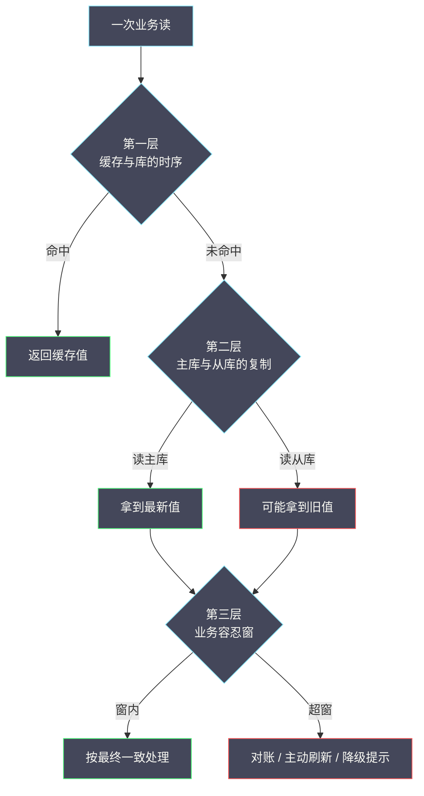
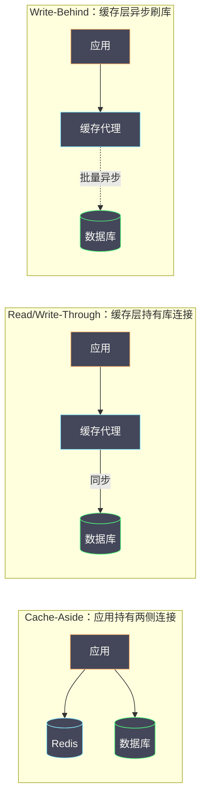
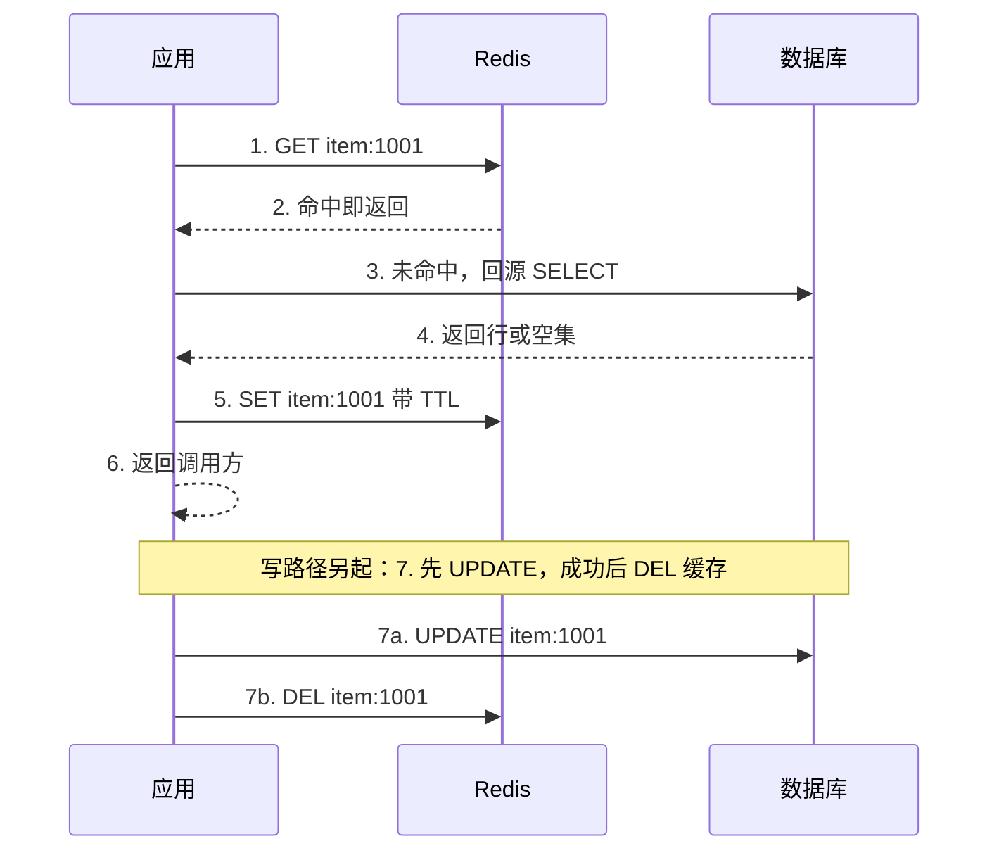
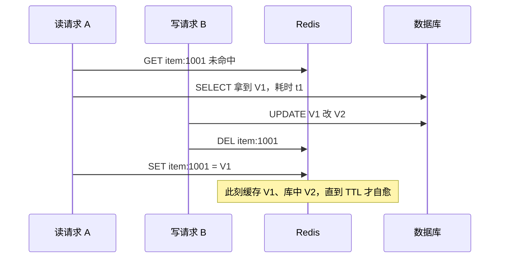
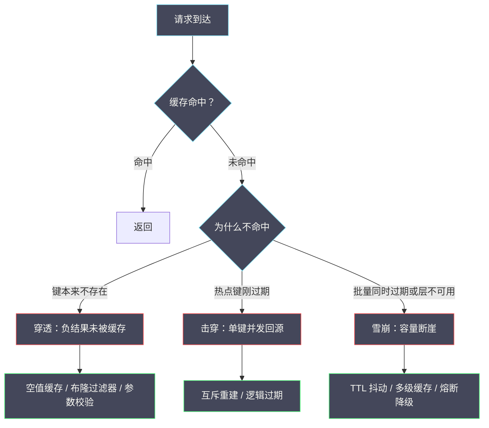
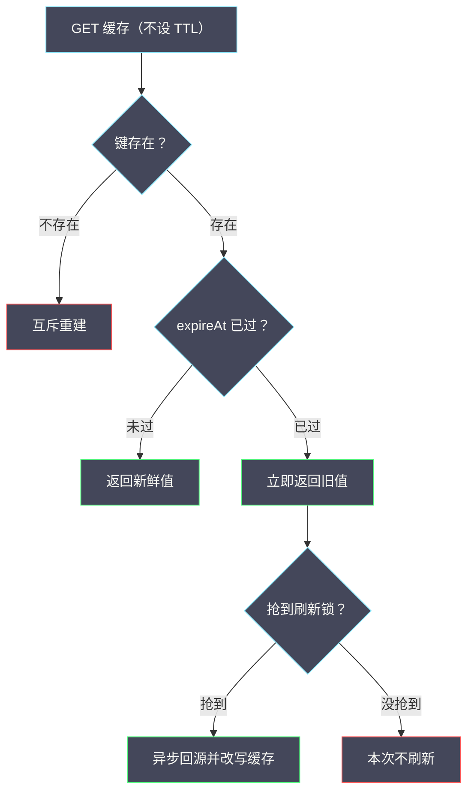

# 04 缓存设计模式与一致性问题

**摘要：**

缓存是 Redis 最普遍的用法，也是技术评审里最容易被一句话带过的部分：查缓存、未命中回源、写库之后删缓存。这三句话本身没错，错在它们把三个性质完全不同的问题压缩进了"一致性"这一个词。缓存与数据库的时序一致，尺度是毫秒级，问的是"更新完成之后新请求何时能看到新值"；多副本之间的一致，尺度是毫秒到秒级，问的是"同一个用户能否读到自己刚写下的东西"；业务语义上的一致，尺度以秒到分钟计，问的是"这段延迟造成的损失业务能不能接受"。三者的判据不同，解法也就不能互换——延迟双删治不了主从延迟，读主库也不解决读回填与写删除的交错。本文先按三种缓存模式（Cache-Aside 旁路、Read/Write-Through 穿透、Write-Behind 异步回写）给出各自的失败窗口与适用判据，再把一致性拆成上述三层逐层推演，随后用"机制对应解法"的方式拆开穿透、击穿、雪崩，最后用一张四写法对照表、一张参数代价表和四个反例收敛判断。本列写使用与运维，复制协议、内存淘汰、槽位迁移这类机制只给结论与双链。

---

## 第 1 章 一个词，三件事

### 1.1 三种用法，三个判据

打开任意一份缓存设计文档，一致性这个词至少出现在三个位置上，而且每次的意思都不一样。

第一种出现在"写库之后删缓存，还是先删缓存再写库"的争论里。这里关心的是**时序一致**：两个独立存储之间的操作顺序，以及在这个顺序造成的窗口里，新来的请求会读到什么。它的尺度由网络往返与提交延迟决定，通常是毫秒级；它的失效形态是"某段时间内读到旧值"，窗口一过自行恢复。

第二种出现在"用户改完昵称刷新页面还是旧名字"的报障里。这里关心的是**副本一致**：主库接受了写，从库还没应用这条 binlog，而这次读请求被路由到了从库。它的尺度由复制积压量与从库负载决定，可能是几毫秒，也可能是几秒；它的失效形态是"写后读不到自己的写"，属于用户能直接感知的那种错误。

第三种出现在"这个字段能不能缓存、能缓存多久"的评审里。这里关心的是**业务一致**：业务能容忍多久的陈旧，超过这个时限该拿什么兜底。它的尺度是业务参数，不是技术参数；它的失效形态是"数据陈旧造成的资损或投诉"，而不是"读到了旧值"这么中性。

三者的判据差得很远。时序一致问的是"更新完成后新请求何时看到新值"，副本一致问的是"同一个客户端能否读到自己的写"，业务一致问的是"最坏情况下陈旧多久、超时怎么办"。笔者见过不少事故报告，把第二层的现象（用户看不到自己的修改）用第一层的解药（延迟双删）去治，改完上线毫无改善——因为延迟双删作用在缓存上，而从库滞后与缓存没有半点关系。

### 1.2 三层的依赖顺序

三层不是并列关系，而是嵌套关系：一次业务读先穿过缓存层（第一层），未命中时回源，回源可能落到从库（第二层），最终结果是否可接受由业务判定（第三层）。



这个嵌套结构解释了一件事：第一层的窗口再短，只要第二层的回源落在从库上，旧值就会沿着回源路径重新流回缓存，把第一层已经修好的窗口重新打开。反过来，第二层即使做到了写后读主，第一层的回填交错仍然能把旧值写进缓存。任何单独一层的"彻底解决"都不成立。

| 层次 | 回答的问题 | 典型尺度 | 失效形态 | 主要解法 | 解法失效条件 |
| :--- | :--- | :--- | :--- | :--- | :--- |
| 时序一致 | 更新后新请求何时看到新值 | 毫秒级 | 短窗读到旧值，窗口过后自愈 | 先写库再删缓存、删除补偿 | 回填交错、删除丢失 |
| 副本一致 | 用户能否读到自己的写 | 毫秒到秒级 | 写后读到旧值，用户可见 | 写后短窗读主、会话粘性 | 多副本跨机房、故障切换丢写 |
| 业务一致 | 陈旧多久可接受、超时怎么办 | 秒到分钟级 | 资损、投诉、口径错乱 | 定 TTL、对账、版本校验 | TTL 设错、无对账 |

### 1.3 与机制专栏的分工

本文只讨论"用哪个模式、窗口在哪、什么时候失效"。凡涉及实现机制的问题——主从复制的积压缓冲区与心跳、过期键的惰性删除与定期删除、内存淘汰的近似 LRU 采样、Cluster 的槽位迁移与 MOVED 重定向——一律给一句结论加一条路由，正文不展开。这些细节在 [[09 主从复制与 Sentinel 高可用]]、[[06 内存管理与过期淘汰策略]] 与 [[10 Redis Cluster 分布式架构]] 里已经逐条校准过阈值与源码路径。

本列相邻几篇的分工也要说清：热 key 与大 key 的检测治理见 [[05 热 Key 大 Key 治理与容量规划]]，分布式锁的正确实现见 [[06 Redis 分布式锁——从 SETNX 到 Redlock 的争议]]，脚本原子性的边界见 [[03 Redis 事务 Lua 脚本与原子性保证]]。本文提到这几个话题时只取结论，不重讲。

---

## 第 2 章 三种模式，一个分歧点

### 2.1 分歧点是"谁持有数据库连接"

缓存模式被分成好几种，名字也换过好几轮，但分歧点其实只有一个：谁负责在缓存未命中时访问数据库。

如果由应用负责，应用就同时持有 Redis 客户端与数据库连接，两侧的调用顺序由业务代码书写，这就是旁路（Cache-Aside）。如果由缓存层负责，应用只与缓存层交互，缓存层内部再连数据库，应用的代码里看不到数据库的影子，这就是穿透（Read-Through 与 Write-Through）。异步回写（Write-Behind）是穿透的一种变体，区别只在于写库这一步是同步还是延后。



请注意这张图里 Redis 的位置。Cache-Aside 的 Redis 是一个被应用显式读写的键值存储，它自己不知道数据从哪来；Write-Through 与 Write-Behind 的"缓存代理"则是一个必须实现数据库访问逻辑的组件，Redis 在这种结构里往往只是代理层的后端存储之一，甚至可由本地缓存加远程缓存拼成。把 Read-Through 与 Write-Through 当成两种彼此独立的模式来罗列，是一处常见的误读——它们本是同一种代理结构的两半，读一半负责自动回填，写一半负责同步落库，缺一半就不成立。

### 2.2 Cache-Aside 的失败窗口

旁路模式的读路径是：先查缓存，未命中回源，把结果回填并设 TTL；写路径是：先写库，成功之后删缓存。它的失败窗口有两个来源。

第一个来源是"删除与回填的竞争"。读请求在未命中之后、回填之前，恰好有写请求完成了写库与删缓存，那么读请求手里那份旧数据会在删缓存之后被写回去，缓存于是长期驻留旧值。这个窗口的长度等于读请求的"回源耗时"，短则几毫秒，长则几秒（慢查询、锁等待、跨机房）。

第二个来源是"删除这一步本身会丢"。删缓存不是数据库事务的一部分，它可能网络超时、可能赶上 Redis 主从切换丢掉刚写入的命令、也可能赶上 Redis 短暂不可用。一旦删失败，旧值会驻留到 TTL 到期为止——这才是旁路模式下唯一可能"长期脏"的路径。

旁路模式的优点是决策权在业务手里：哪个 key 该缓存、TTL 多长、失败怎么降级，都能按业务分别处理。代价是每个写入口都必须记得删缓存，漏一处就漏一处。

### 2.3 Read/Write-Through 的失败窗口

穿透模式把回源与落库的逻辑收进代理层，业务代码只与代理交互。它的读写看起来更"一致"，但写路径上是两个阶段：先更新缓存，再更新数据库，或者反过来。两个阶段之间没有原子性保证，于是失败窗口从"删除与回填的竞争"变成了"两阶段之间的半完成状态"。

具体有两种半完成：缓存已改、写库失败，此时缓存里是一个数据库里不存在的新值，任何读都拿到脏值，必须靠代理层回滚缓存或用版本号作废；写库已改、缓存更新失败，此时缓存里是旧值，行为退化成旁路模式的删除失败。前者比后者更危险，因为脏值看起来是"新的"，监控上的命中率与延迟都正常，只有对账才能发现。

穿透模式还多出一项代价：写延迟。每次写都要等数据库确认才返回，写吞吐的上限就是数据库的写吞吐，代理层再快也放不大。它的适用判据因此很清楚——写少读多、要求缓存与库尽可能贴近、并且有能力实现一个可靠的代理层（或者接受现成框架的语义，譬如 Spring Cache 的注解只是把旁路包装成了声明式，并没有跨系统事务）。

### 2.4 Write-Behind 的失败窗口

异步回写只更新缓存就返回成功，真正的落库由后台批量完成。它的失败窗口是"返回成功"与"真正落库"之间的全部时间，而且这个窗口会叠加两件事：进程崩溃会丢掉尚未刷出的写；批量合并会让后写覆盖前写，中间状态直接消失（对一个计数器做十次自增，合并后只剩最后一次，若落库是覆盖语义而不是增量语义，结果就错了）。

它的性能优势来自两处：写只打内存，延迟由网络往返决定；多次写合并成一次落库，I/O 次数按批大小摊薄。判据也很清楚——业务能接受"最近若干秒的写可能丢失"，且落库操作具备幂等或增量语义。计数器、行为日志、点赞数属于这一类；订单状态、账户余额不属于。

### 2.5 判据三问

面对一个具体业务，笔者通常用三个问题选模式。

第一问：写请求占多大比例、写延迟是否敏感。写多且延迟敏感，只能考虑异步回写；写少读多，前两种都可行。

第二问：能不能接受"最近 N 秒的写丢失"。能接受，异步回写进入候选；不能接受，直接排除。

第三问：团队有没有能力维护一个持有数据库连接的缓存代理。没有，就在应用层用旁路模式把回源逻辑收敛到一个数据访问层里——这不是"退而求其次"，旁路模式的可观测性与可调试性在多数团队里反而更好。

| 维度 | Cache-Aside | Read/Write-Through | Write-Behind |
| :--- | :--- | :--- | :--- |
| 谁回源 | 应用 | 缓存代理 | 缓存代理 |
| 写路径 | 写库成功后删缓存 | 缓存与库同步双写 | 只写缓存，异步刷库 |
| 失败窗口 | 回填竞争、删除丢失 | 两阶段半完成 | 返回成功到落库之间 |
| 写延迟 | 一次库写 | 一次库写 | 一次内存写 |
| 丢数据风险 | 无（库为准） | 低（需回滚） | 有（进程崩溃丢失） |
| 实现复杂度 | 低 | 中 | 高 |
| 适用判据 | 通用、写多入口 | 写少读多、有代理层 | 可丢最近写、批量合并 |

---

## 第 3 章 Cache-Aside 的七步与三个失败点

### 3.1 七步正常流程

把旁路模式拆开数一遍，正常路径上是七步：读请求到达后查缓存；命中则直接返回；未命中则回源查库；数据库返回行（可能是空集）；应用回填缓存并设 TTL；把结果返回调用方；写请求走另一条路，先写库，成功之后删缓存。



七步里任何一步都不是原子的。缓存与数据库之间没有事务，跨系统的原子提交（两阶段提交）在这里不可行——Redis 不支持 XA，为一次缓存作废引入分布式事务，付出的延迟与可用性代价远超收益。所以旁路模式的设计前提是：数据库是唯一的事实来源，缓存是可丢弃的副本。一旦接受这个前提，一致性问题就从"如何让两者同步"退化成"缓存允许陈旧多久、如何保证它最终作废"，难度下降一个量级。

### 3.2 失败点一：回填与作废的交错

第一个失败点在第 3 步到第 5 步之间。读请求查库拿到 V1 之后，写请求完成了"写库 V2 + 删缓存"，然后读请求把 V1 写进缓存。缓存从此驻留 V1，直到 TTL 到期。



这个交错有一个明确的触发条件：读请求的 SELECT 必须在写请求的 UPDATE 提交之前开始，而它的 SET 必须在写请求的 DEL 之后完成，也就是 `t1 > t_update + t_del`。数据库的读通常比写快，所以这个条件在正常情况下几乎不会成立；但当读是慢查询、范围扫描、或者因为行锁等待而阻塞时，`t1` 可以被拉长到几百毫秒甚至秒级，而一次 UPDATE 加一次 DEL 的网络往返只有几毫秒——条件就成立了。

判据因此不是"有没有风险"，而是"这条读路径的耗时分布是否有长尾"。可以直接从慢查询日志与 DB 侧的 P99 采样里读出来：如果某条缓存回源 SQL 的 P99 与 P999 之间差了一个数量级，它就是回填交错的候选。

### 3.3 失败点二：作废丢失

第二个失败点在第七步的 DEL 上。删除失败有三种形态：调用的超时（请求已发出、响应没回来，红黑不明）；Redis 不可用期间的直接失败；命令已写入主库但尚未同步到从库时发生主从切换，新主库上没有这条 DEL。前两种可以被重试捕获，第三种不能——它在客户端看来是成功的，只有核对主从数据才发现命令丢了。

这一点的判据是"删除的可靠性能否用重试保证"。如果 Redis 是单实例或哨兵模式且切换窗口很短，重试加对账足以覆盖；如果业务对陈旧极度敏感，就必须把"删除"从同步路径挪到可靠通道上——消息队列或者 binlog 订阅，后者见第 4 章。

### 3.4 失败点三：miss 分支上寄生的两种故障

第三个失败点不在具体某一步，而在"未命中"这个分支本身。冷启动、集中过期、恶意构造的键，都会让大量请求同时走到第 3 步，此时缓存层等于不存在，数据库直接面对全量流量。穿透、击穿、雪崩三种故障都寄生在这个分支上，区别只是未命中的原因不同：键根本不存在、单个热点键刚过期、大批键同时过期或缓存层整体不可用。第 7 章到第 9 章分别处理。

值得先记住的是量级关系。缓存命中率 99% 时，数据库承担的流量是全量的 1%；命中率掉到 90%，就是 10%；命中率掉到 0（穿透攻击或缓存整体不可用），就是 100%。缓存对数据库的保护是按比例衰减的，不是有或无——这也是为什么"命中率"这个指标比"缓存 QPS"更值得放到看板上。

---

## 第 4 章 第一层：缓存与数据库的时序

### 4.1 四种写法的对照

数据更新到缓存这一侧，能选的写法只有四种，业界关于"先删还是先写"的争论，本质是这四种在错误窗口上的取舍。

| 写法 | 步骤 | 错误窗口 | 会否长期脏 | 适用场景 |
| :--- | :--- | :--- | :--- | :--- |
| 先删缓存后写库 | DEL → UPDATE | 删后写前有读回源，把旧值回填 | 会，直到 TTL | 基本不用，仅在写库失败可重试且 TTL 很短时 |
| 先写库后删缓存 | UPDATE → DEL | 写库完成到 DEL 完成之间读到旧值 | 回填交错与删除丢失时会 | 默认选择，绝大多数读多写少场景 |
| 更新缓存 | UPDATE → SET | 并发写覆盖、多写入口漏更新 | 会，且可能永久 | 写少、值与单表一一对应、有统一写入口 |
| 异步回写 | SET → 异步刷库 | 返回成功到落库之间 | 不脏但会丢 | 可丢最近写、批量合并 |

表格里最关键的一列是"会否长期脏"。先删缓存后写库的错误窗口看起来短（删与写之间），但它在并发下会产生一个**永久**的坏结果：读请求在"删"之后回源，读到的是还没更新的旧值，然后把它回填进缓存；等写库完成，缓存里已经是旧值，且没有任何机制会再去清它。这个过程不依赖任何长尾，只依赖"删与写之间有一个读请求"，在高 QPS 下几乎必然发生。它常被描述为"不推荐"，但在有并发读的场景里，这个判断还可以再进一步：它已经接近"必错"。

### 4.2 为什么是删除而不是更新

"删"与"更新"的分歧，可以从四个角度算账。

并发覆盖。假设两个写请求 A 与 B 同时更新同一条记录：A 把库改成 V1，B 把库改成 V2，然后 B 更新缓存为 V2，A 更新缓存为 V1。最终库里是 V2（由提交顺序决定），缓存里是 V1，两者永久分叉。删除没有这个问题——删除是对"状态"的操作而不是对"值"的操作，谁先谁后都收敛到"不存在"。

计算浪费。很多缓存值是聚合结果：三张表 join 出来的商品详情、按规则算出来的权益标签。每次写入都重算一遍聚合，等于把读时的一次计算挪到了写时，而写请求通常比读请求少，但每次写的计算成本更高。删除把重算推迟到下一次真正的读，只在需要时才付这笔钱。

写入口的完备性。更新缓存要求"所有写入口都知道缓存里存的是什么结构"。一旦有第二条写路径——DBA 手工修数、数据迁移脚本、另一个服务直接写库——它不会去更新缓存，缓存就开始漂移。删除的要求低得多：只要知道 key 的拼法。

幂等性。删除是幂等的，重复执行结果相同，可以在失败后无条件重试、可以通过消息队列至少一次投递。更新不是幂等的：重放一条"把缓存设为 V2"的消息，会覆盖掉在其后发生的 V3。

不过删除也不是没有代价。删除会让下一次读必然回源，如果删的是一个被高频访问的键，就人为制造了一次击穿。这个代价在热点数据上必须额外处理，第 8 章的互斥重建与逻辑过期正是为此准备的。

### 4.3 并发下仍然存在的窗口

即便采用"先写库再删缓存"，窗口也没有消失，只是被压缩到了两处。

第一处是"写库完成到删缓存完成"之间。这段时间里读请求全部命中旧缓存，读到 V1。窗口长度近似为本机到 Redis 的往返（同机房亚毫秒到几毫秒，跨机房几毫秒到几十毫秒），加上应用侧在写库与删缓存之间的处理耗时（序列化、日志、埋点）。**示例推算**：同机房 RTT 0.5ms、应用侧处理 1ms，窗口在 1.5ms 量级；跨机房 RTT 5ms，窗口在 6ms 量级。

第二处就是 3.2 节那个回填交错。它不受"先写库再删缓存"这条规则的保护，因为在这条规则下，删缓存确实发生在写库之后，但读请求的回填发生在删缓存之后——规则管不到它。

还有第三处容易漏掉：删除会与回填互相打断。一次写请求的 DEL 如果走了重试或延迟队列，它可能晚于后续读请求的回填落地，把刚写进去的新值又删掉；写请求密集时，缓存被删得千疮百孔，命中率明显下滑。这不是正确性问题，代价是多一次回源，但这种形态在批量导入、批量状态流转的场景里很常见，缓解办法是把短时间内的同 key 删除请求去重合并。

### 4.4 延迟双删的真实效果

延迟双删是为"先删缓存后写库"打的补丁，流程是：先删缓存，再写库，然后等一段时间，再删一次。

它的真实效果是**缩小窗口，而不是消除窗口**。第一次删除之后回填的旧值，如果回填发生在第二次删除之前，会被第二次删掉——这一部分确实被修好了。但剩下的漏洞一个也没堵上：

回填发生在第二次删除之后。只要读请求的回源耗时超过 sleep 的时间，它的回填就落在第二刀之后，旧值照样驻留。sleep 只能覆盖一个猜测出来的耗时上限，覆盖不了长尾。

第二次删除失败。它与第一次删除面临同样的可靠性问题，而人们往往只给第一次删除做重试补偿。

读的是从库。这一条最隐蔽。延迟双删清理的是缓存，而从库的滞后发生在回源路径上：第一次删除之后，读请求回源到从库，从库还没应用更新，于是把旧值回填；第二次删除把它删掉；但紧接着又有读请求回源到从库，如果从库这时仍然滞后，旧值又被回填。只要主从延迟长于 sleep，这个过程可以无限循环。延迟双删对第二层一致性问题完全无效。

有本地缓存或多级缓存。双删只清 Redis，清不到进程内的 Caffeine，本地缓存的旧值会继续被读，然后可能再回填回 Redis。

sleep 的估算也没有可靠依据。合理的起点是取"回源读的 P999 耗时"与"主从延迟上限"两者的较大值再加余量。**示例推算**：回源 P999 为 80ms，跨机房复制延迟上限 200ms，则 sleep 在 300ms 到 1s 之间取一个值，这个量级只是"大概率覆盖"，不构成保证。sleep 期间同步阻塞还会占用线程；在生产上应改成延迟队列或时间轮异步执行第二刀，避免把不一致窗口换成线程池耗尽。

综合起来，延迟双删的定位应该是：一个在"先删后写"这种本来就错的写法上做的补救，它的天花板很低。既然把顺序改成"先写库再删缓存"就能消掉大部分窗口，就没有理由为了省一次顺序调整去引入一个需要估算 sleep、需要异步化、且对主从延迟无效的补丁。它真正还有价值的地方是"跨系统的写入口无法统一"——比如写操作由另一个团队的服务完成，本方只能收到一个模糊的事件通知，此时延迟双删相当于"收到通知就清一次，过一会儿再清一次"，用重复换取覆盖率。

### 4.5 删除失败的补偿

删除这一步的可靠性，决定了缓存能脏多久。补偿有两条主流路径。

第一条是消息队列。写库成功后，把"删除某个 key"作为消息投递出去，消费者执行 DEL，失败就重试，重试到上限进死信队列人工介入。它的优点是实现简单、与业务代码同源、可以按 key 做去重与限流；缺点是"发消息"这一步本身也可能失败，所以要么把消息写入与数据库写入放在同一个本地事务里（本地消息表/事务消息），要么接受"极小概率漏删 + TTL 兜底"。

第二条是订阅数据库变更日志。应用只写库，binlog 由 Canal 或 Debezium 解析后投递，缓存删除完全由变更流驱动。它的优点是覆盖所有写入口——应用写入、DBA 修数、迁移脚本都走同一条链路，且天然有顺序；缺点是组件多（binlog 解析、消息队列、消费者三件套）、延迟取决于消费速度（通常几十毫秒到几百毫秒，比同步删除慢一到两个数量级）、且下游要按表与字段过滤，避免把无关变更也变成删除风暴。binlog 的格式与位点管理见 [[10 Binlog 与主从复制——数据同步的底层传动链]]。

两条路径共同的兜底是 TTL。它不是补偿机制的替代品，而是"所有补偿都失败时，不一致最多持续多久"的上界。TTL 越长，越省数据库，也越脏。

---

## 第 5 章 第二层：多副本之间的一致

### 5.1 延迟的形状

Redis 的主从复制是异步的：主库执行完命令就把响应返回客户端，同时把命令写进复制积压缓冲区，从库自己来取。这意味着"写成功"只代表主库成功，不代表任何从库已经有这条数据。复制延迟由三件事决定：网络往返、从库应用命令的速度、以及主库写入速率与复制带宽之间的差值。空闲时延迟在毫秒量级，一旦出现大事务（一次 `DEL` 几十万个键、一次 `FLUSHDB`、一次大的 Lua 批量写）、从库在做 RDB 加载、或者从库被大量读请求压满，延迟可以涨到几百毫秒乃至秒级。这些机制细节见 [[09 主从复制与 Sentinel 高可用]]。

读写分离把读请求分给从库之后，延迟就从"看不见的内部细节"变成了"用户能感知的现象"。典型报障是：用户改完收货地址，页面刷新还是旧地址；运营在后台改了商品价格，前台详情页还是原价；用户提交完订单，订单列表里查不到。这些现象有一个共同点——读请求读的是自己刚写下的那条数据。

### 5.2 与缓存的叠加：三层里最坏的一种组合

如果系统同时有"读从库"和"缓存回填"，就会出现一种必须专门记住的组合错误：写请求先写主库、再删缓存；紧接着读请求未命中，回源读到从库的旧值，把它回填进缓存。缓存里于是驻留了一个来自从库的旧值，而且 TTL 通常还很长。此时第一层已经做对了（先写库再删缓存），但第二层的滞后把脏值重新注入了第一层。

这个组合解释了为什么有些团队"代码完全照最佳实践写，脏数据依然出现"。判据很简单：把回源路径的数据库连接池翻出来，看它指向主库还是从库。如果指向从库，那么"先写库再删缓存"的保护在回填这一步就失效了，延迟双删也救不回来——因为脏值是在第二次删除之后由从库回填的，双删只会陷入 4.4 节描述的循环。

### 5.3 判据与解法

判这一层，只需要问三个问题。

有没有"写后立即读同一实体"的路径。有，就必须处理；没有（譬如写入之后跳转到列表页、由异步任务推送最终结果），这一层可以放过。

读请求是否路由到了从库。如果所有读都走主库，缓存层的一致性问题就退化为第一层；读写分离通常是性能压力下的选择，压力不大的业务不必提前引入这一层复杂度。

业务能不能用"处理中"的状态兜住。能，就把一致性问题转化成界面状态问题——提交后显示"正在处理，稍后刷新"，比在存储层追求读到最新值便宜得多。

解法按代价从低到高排：把"写后立即读"的路径临时指向主库（会话级粘性，通常几百毫秒到几秒，覆盖大半复制延迟）；按实体维度记一个本地脏标记，命中标记时读主；对极少数关键实体（余额、订单状态）直接读主，不读写分离；把页面设计从"保存后原地刷新"改成"保存后跳转到确认页"，从需求侧消除问题。

Redis 提供了 `WAIT` 命令，可以阻塞到指定数量的副本确认，看起来像强同步。它的语义是尽力而为：超时之后返回实际确认的副本数，调用方要自己判断是否满足；在 `MULTI` 事务中它不会阻塞，而是立刻返回。所以 `WAIT` 适合在少数关键写之后做一次"确认副本已跟上"的检查，不适合当作全局的同步复制开关。

Cluster 模式下还有另一种窗口：主从切换时异步复制可能丢掉最近若干条写，新主库上不存在这些数据。这不是缓存问题，而是副本问题，机制与处置见 [[10 Redis Cluster 分布式架构]]。

### 5.4 客户端缓存带来的一层新窗口

Redis 6 引入的客户端缓存（tracking）把一部分数据缓存在应用进程内，由服务端在键变更时推送失效通知。它把多级缓存的失效广播做成了协议能力，省掉了应用自己维护的广播通道，但一致性窗口并没有消失：通知是异步投递的，投递完成之前本地缓存仍在服务旧值；客户端断线重连期间的通知会漏，需要重新拉取全量或依赖短 TTL 兜底。

把这一段与前一层放在一起看，可以得到一个有用的结论：**每多一层副本，就多一个窗口**。本地缓存、Redis 从库、数据库备库，层层叠加之后，"最新值"要穿过三四个异步边界才能到达用户。设计时要么显式地为每一层定一个容忍时长，要么就不要引入那么多层。

---

## 第 6 章 第三层：与业务语义的一致

### 6.1 最终一致的时间窗是业务参数

技术上可以算出"缓存最多脏多久"，但"能脏多久"是业务定的。商品详情页的价格陈旧三秒，多数电商可以接受；优惠券剩余数量陈旧三秒，可能超发；账户余额陈旧三秒，直接是事故。同一个技术窗口落在不同业务上，结论完全相反。

所以定 TTL 之前要先问：读到旧值的最大损失是什么。如果是"用户看到过期价格但下单时会重新校验"，损失为零，TTL 可以按缓存压力拉长；如果是"用户按旧价格下单成功"，损失是真金白银，缓存里就不该放这个字段，或者必须在写路径上加校验。

### 6.2 超窗之后怎么兜底

时间窗要配兜底，否则"最终一致"里的"最终"没有兑现机制。可用的手段有四类。

对账。定时任务比对数据库与缓存（或者比对两个数据源），把不一致的 key 修掉并报警。它的价值不在于修得多快，而在于让不一致从"无人知晓"变成"有指标可查"——对账差异数应当是一个上监控的指标。

版本号校验。在缓存值里带上数据的版本号或更新时间，读出来之后与请求方已知的版本比对，低版本触发重读或拒绝。这一步会多一次判断，但不需要多一次 I/O，适合"写后立即读"的关键路径。

主动刷新。写成功之后发一条刷新事件，由专门的消费者重建缓存，而不是等下一次读回源。它把"冷"的时间从"直到有人读"缩短到"事件被消费"，代价是多一条链路。

状态化。把异步过程显式暴露成业务状态（处理中、已受理、待同步），让用户看到的是"正在处理"而不是"值不对"。这是最便宜的一种兜底，因为它把一致性问题转成了产品设计问题。

### 6.3 哪些业务不该以"副本"的方式用缓存

余额、库存扣减、唯一性约束这类需要线性一致性的数据，不适合作为"数据库的副本"放进缓存，因为副本天生允许陈旧。它们可以用 Redis，但用法相反：Redis 里的值是主数据，扣减由 [[03 Redis 事务 Lua 脚本与原子性保证]] 描述的原子脚本完成，落库是异步的（Write-Behind 的正确形态），并配合对账与幂等落库来保证最终正确。此时 Redis 不是加速器，而是账本本身，它的持久化与高可用要求也随之提高到另一个级别。

### 6.4 字段级过期与"半新半旧"的对象

Redis 8.0 提供 Hash 的字段级过期（`HEXPIRE` 一族），可以把一个对象拆成不同新鲜度的字段——价格字段 5 秒过期，描述字段 1 小时过期。这比给整个对象设一个 TTL 更贴近业务语义，也让"热点字段"的刷新粒度变细。

但它引入了一个新的读语义：读出来的对象可能半新半旧。业务代码如果假设"一个 Hash 里的字段来自同一时刻的快照"，这个假设就不再成立。字段级过期适合那些字段之间本来就没有一致性约束的对象（商品的价格与描述），不适合那些字段必须同时刻读取的对象（订单的状态与金额）。

---

## 第 7 章 穿透：不存在的键

### 7.1 机制：负结果不被缓存

缓存的默认行为是"缓存查到的数据"。查不到时，多数实现什么也不写——因为空结果看起来不值得占内存。这个默认在正常流量下完全合理，但它意味着"不存在"这个结论每次都要重新去数据库确认一遍。穿透攻击利用的正是这一点：攻击者不需要猜中有效 ID，只需要构造大量格式合法但根本不存在的 ID，每个请求都会穿过缓存直达数据库。

与击穿的区别要分清：击穿的键数据库里有，只是缓存刚过期；穿透的键数据库里也没有，缓存永远不会命中，除非显式缓存空结果。前者的窗口是瞬时的，后者的窗口是永久的。



判据是三条一起看：键空间是否可枚举（用户 ID 是连续整数，就极易被扫）；缓存的 miss 率是否稳定在一个偏高的非零值（正常业务应该在 1% 以下）；数据库侧是否出现大量"返回零行"的点查。第三条最直接，从慢查询日志或审计日志里按"扫描行数 0 且执行次数高"筛，基本一抓一个准。

### 7.2 空值缓存与它的 TTL

最直接的解法是把负结果也缓存起来，用一个特殊标记表示"确认不存在"。

```bash
# 回源返回空集，写入特殊标记，TTL 必须远短于正常数据
SET item:999999 "__NULL__" EX 45
```

这里有三个细节必须一起做，缺一个就出问题。

TTL 要短，而且要显著短于正常数据的 TTL。原因是空值有"过期的正确性"要求：一旦实体真的被创建，缓存里的空值必须在很短时间内失效，否则会出现"刚注册的用户查不到自己""刚上架的商品显示不存在"。正常数据 TTL 半小时、空值也设半小时，是最常见的配置错误——它把"防穿透"变成了"制造脏读"。**示例推算**：正常数据 TTL 1800 秒，空值 TTL 取 30 到 60 秒，是能兼顾拦截效果与正确性的量级。

空值必须与真实值可区分。用空字符串还是特殊标记，取决于业务能不能存空字符串；用特殊标记时，读取端要有显式的解释逻辑，不能把标记当数据返回给前端。

要有内存上限保护。攻击者可以换着花样构造不存在的键，让空值缓存变成内存炸弹。空值缓存必须与 `maxmemory` 淘汰策略配合，并且最好对"同一来源 IP 的负结果写入速率"做限流。淘汰策略的细节见 [[06 内存管理与过期淘汰策略]]。

空值缓存的适用判据很明确：键空间有限且可枚举（用户 ID、商品 ID 这种范围确定的场景）。如果键空间是无界的（比如用任意字符串拼出来的缓存键），空值缓存只能防住重复攻击，防不住新键洪水。

### 7.3 布隆过滤器与它的假阳性

布隆过滤器（Bloom Filter）用一组哈希函数把键映射到位数组的若干位上。查询时把同样的位都检查一遍：只要有一位是 0，这个键**一定**没被插入过；全是 1，则**可能**被插入过。

这个单向的确定性正是它适合防穿透的原因：它只会把"不存在"误判成"可能存在"，绝不会把"存在"误判成"不存在"。换句话说，假阳性只会让少数不存在的数据漏过防线去查一次库，不会让真实数据被误拒——对业务来说，前者是性能损失，后者是功能故障。

假阳性率由位数组长度 `m`、插入元素数 `n`、哈希函数个数 `k` 决定，量级上 `m/n` 取 10、`k` 取 7 时约在 1% 上下（**示例推算**）。想降到 0.1% 需要把 `m/n` 提到 14 以上，内存翻四成，换来的是九成的假阳性消失。这个账要按"漏过防线的请求量 × 单次库查成本"来算，不是越低越好。

三个工程约束绕不开。第一，布隆过滤器不支持删除，删除一个键不能把对应的位清零（清零会影响其他键）；需要删除语义就换 Cuckoo Filter，或者用双缓冲重建——维护现行与备用两个过滤器，新写入同时进两个，重建完成后整体切换。第二，它需要预加载，把数据库里所有合法键灌进去对一张亿级表是几十分钟量级的任务，通常按批增量加，并且要处理"数据库新增了键但过滤器还没加"的漏窗——这个漏窗正好由空值缓存兜住。第三，它是概率结构，误判率必须被监控，位数组被填满之后误判率会迅速上升，直到失去意义。

在 Redis 上使用布隆过滤器，需要加载 RedisBloom 模块（`BF.RESERVE`、`BF.ADD`、`BF.EXISTS`），它不是核心命令集的一部分。也可以用一个 Bitmap 自己拼，代价是哈希函数与位宽要自己管，且无法利用模块的自动扩容（`BF.RESERVE` 支持 `EXPANSION` 参数，扩容会按倍数增加内存）。

```bash
# 预留容量与误判率，避免过滤器被写满后误判率失控
BF.RESERVE valid:items 0.001 10000000
BF.ADD valid:items "item:1001"
BF.EXISTS valid:items "item:random-uuid"
```

### 7.4 接口层校验与组合顺序

参数校验放在最前面：ID 必须是正整数、必须在合法区间、必须符合格式（如雪花 ID 的位数与时间戳段）。它挡不住合法但不存在的 ID，但能挡掉绝大多数粗糙的构造请求，成本接近于零。

三层组合的顺序应该是：接口校验 → 布隆过滤器 → 空值缓存。**示例推算**：假设恶意流量中 90% 是明显非法的构造（被参数校验拦下），剩下 10% 的合法格式里 95% 是不存在的 ID（被布隆过滤器拦下九成九），最终到达数据库的比例在千分之一量级。三层各管一段，任何单层都不足以独立解决问题。

---

## 第 8 章 击穿：单个热点键的过期瞬间

### 8.1 机制与放大倍数

击穿的条件是两个变量同时成立：键足够热，且它过期了。一个 QPS 两万的商品键，TTL 到期的一瞬间，所有正在读它的请求都未命中，于是同时回源。数据库看到的是一个瞬间的两万 QPS 尖峰，而这个键平常只贡献"每 TTL 周期一次"的查询。

放大的倍数可以估：设键的读 QPS 为 Q，回源重建耗时（查库加回填）为 T，则窗口内积压的并发回源请求量约为 `Q × T`。**示例推算**：Q 为 2 万，T 为 20ms，则约 400 个请求会在同一窗口内打到数据库。这个量级对单条 SQL 不算什么，但如果这个键所在的表还有别的热点、或者回源 SQL 本身要 100ms，量级立刻上到几千并发，连接池先用完，然后整个接口排队。


这张图里有一个正反馈环：重建变慢会拉长窗口，窗口变长会积压更多请求，更多请求让重建更慢。击穿之所以危险，不是因为初始的那 400 个请求，而是因为这个环会自己加速。

### 8.2 互斥重建

最直接的解法是只让一个请求去重建，其余等待。用 `SET NX` 抢锁，抢到的人回源并回填，没抢到的人短暂等待后重查缓存。

```lua
-- 重建锁：必须带过期时间，否则持有者崩溃会锁死整个键的重建
-- KEYS[1] 数据键，KEYS[2] 锁键，ARGV[1] 锁值（请求唯一标识），ARGV[2] 锁存活毫秒
local v = redis.call('GET', KEYS[1])
if v then return v end
if redis.call('SET', KEYS[2], ARGV[1], 'NX', 'PX', ARGV[2]) then
  return nil              -- 抢到锁：由本次请求回源
end
return '__WAIT__'         -- 没抢到：调用方等待后重试
```

四条实现细节决定了这个方案是"能用"还是"又一个坑"。

锁必须带超时。忘掉 `PX` 的互斥锁，在持锁进程崩溃或回源超时之后会永久锁住这个键的重建路径，所有请求都进入等待分支，直到缓存里那个键自己恢复——而键已经被删了，不会自己恢复。这是一个能把局部故障放大成全站故障的错误。

锁值必须唯一，释放时必须比对。否则一个超时后重试的请求可能删掉另一个请求持有的锁，互斥性被破坏。这一点与通用的分布式锁实现是同一个问题，细节见 [[06 Redis 分布式锁——从 SETNX 到 Redlock 的争议]]。

等待侧必须有上限。等待者不能无限轮询，要有最大等待次数与总超时，超时后返回旧值、默认值或明确的失败，而不是继续排队。等待队列本身会占用连接与线程，在高并发下，等待比失败更危险。

持锁者失败要尽快释放。回源抛异常时立刻删锁，让下一个请求有机会重试，而不是让整个键等锁自然过期。

### 8.3 逻辑过期

逻辑过期的思路是不给键设 TTL，让它永不过期，把过期时间搬到值里面，由应用判断。读到的值如果还在逻辑有效期内，直接返回；如果已过，仍然返回旧值，同时异步触发一次刷新。



它的收益是读路径永不阻塞：所有请求都在毫秒内拿到一个值，只是可能略旧。代价有四个，都得提前认。

内存管理方式变了。键没有 TTL，`volatile-*` 一类淘汰策略对它们完全无效（那些策略只淘汰设置了过期时间的键），必须改用 `allkeys-*`。淘汰策略的差异见 [[06 内存管理与过期淘汰策略]]。这是最容易被忽略的一条：方案上线后内存持续上涨，排查半天才发现是淘汰策略没跟着改。

刷新失败会让脏数据永久化。键永远不会因为过期而消失，所以如果刷新任务连续失败又没人发现，这份旧值可以一直服务下去。必须给"逻辑过期已超过 N 倍有效期仍未刷新"的键设告警，并在刷新失败时降级为直接删除键（让下一次读走穿透路径重建）。

一致性比互斥更弱。互斥重建的等待者拿到的一定是新值；逻辑过期的读者拿到的是旧值，可能长达一个刷新周期。

多级缓存下的语义会打架。本地缓存有自己的 TTL，Redis 里的逻辑过期时间与本地 TTL 是两套时钟，读到的组合状态要能解释。

Facebook 在 Scaling Memcache at Facebook 里用的 lease 机制，是这两条路线的合体：读未命中时服务端发一张租约，只有拿到租约的客户端可以去数据库取数并回填，其余客户端短暂等待；如果等待超时，就返回一个"陈旧但可用"的值。它同时解决了击穿的并发回源与"空结果不缓存"带来的穿透，思路值得直接借用。

### 8.4 判据：一致性优先还是可用性优先

| 维度 | 互斥重建 | 逻辑过期 |
| :--- | :--- | :--- |
| 读路径是否阻塞 | 等待者阻塞到重建完成 | 不阻塞，直接返回旧值 |
| 读者拿到的是 | 新值或失败 | 可能是旧值 |
| 数据库压力 | 1 次重建 | 1 次异步重建 |
| 内存管理 | 沿用 TTL 与淘汰策略 | 必须改 allkeys-* 策略 |
| 主要风险 | 锁超时配置错误、等待堆积 | 刷新失败导致永久脏 |
| 适用判据 | 一致性要求高、能接受毫秒级等待 | 可用性要求高、能接受一个周期的旧值 |

选择很直接：价格、库存这类字段用互斥，让读者多等一会儿也不能给旧值；推荐位、榜单、商品描述这类字段用逻辑过期，宁可旧一点也不能让页面卡住。两者也可以叠加：逻辑过期负责"永不空窗"，互斥重建负责"不出现并发回源"，代价是实现复杂度再上一层。

---

## 第 9 章 雪崩：同时过期与整体不可用

### 9.1 两种成因，机制不同

雪崩这个词被用得太宽，实际上它指两种机制完全不同的情况。

第一种是大量键在同一时刻过期。典型场景是活动开始前批量预热：十万个商品键一起写入、TTL 统一设为一小时，一小时后它们一起消失。缓存层本身是健康的，但它的"保护面积"在一秒内从 100% 掉到 0，数据库瞬间承受全量流量。

第二种是缓存层整体不可用。Redis 宕机、网络分区、集群半数节点失联，保护层直接消失。这种情况更严重，因为它没有恢复的中间态——在 Redis 恢复之前，数据库要持续承受全量流量。

两者的判据不同。第一种看"过期时刻的离散度"：如果预热脚本用同一个 TTL 批量写入，离散度就是零，风险确定存在。第二种看"数据库的可用余量"：把数据库能承受的峰值 QPS 除以全量流量，得到的比值就是"缓存全失效时数据库能承接的比例"，只要小于 1 就必然过载，小于多少决定过载到来的快慢。**示例推算**：全量 20 万 QPS，正常穿透 1%（2000），数据库峰值能力 3 万，则缓存全失效时数据库承受 20 万，是能力的 6.7 倍——必然雪崩，且连接池会在几百毫秒内耗尽。

### 9.2 TTL 抖动与它的边界

对第一种成因，最便宜的解法是给 TTL 加随机偏移，把过期时刻打散。

```python
# 抖动区间应与回源承受力匹配，而不是随便取一个数
base_ttl = 1800
jitter = random.randint(0, 300)
# 向下减：区间落在 1500 到 1800 秒，最坏陈旧时限仍是 base_ttl
redis.set(key, value, ex=base_ttl - jitter)
```

**示例推算**：十万个键原本在一秒内全部过期，抖动区间 300 秒之后，同一秒内到期的键数量降到 333 个量级，尖峰被摊平两个数量级。抖动区间的大小不该凭感觉：它应该让"每秒到期的键数 × 单键回源耗时"落在数据库余量之内，按这个反推区间，通常落在基础 TTL 的 5% 到 20%。

抖动有两个副作用要认。第一，TTL 从定值变成区间之后，"最坏陈旧时限"取的是区间上界：如果写成基础 TTL 加随机量，那些键能陈旧到基础值与抖动上限之和，业务的容忍窗必须按这个上界重算，否则抖动会把一个原本合规的 TTL 撑破；想守住原上界，就得像上面那样向下减，代价是一部分键提前过期、回源量略升。第二，它解决不了"冷启动"——如果缓存是空的，抖动无从谈起。冷启动要靠预热：按访问热度排序，分批加载，并对加载过程中的回源做限流。

TTL 抖动只对"同时过期"有效，对"缓存层不可用"完全无效。这是它最常被误用的地方：很多团队做完抖动就认为雪崩问题已经解决，而真正让数据库被打垮的，往往是 Redis 挂掉的那一刻。

### 9.3 多级缓存

在 Redis 之前加一层进程内缓存，可以把"Redis 不可用"的冲击从 100% 降到"穿透本地缓存的那部分"。本地缓存扛的是同进程的读，命中率高、延迟低（微秒级），但代价是三件事。

内存是乘以进程数的。一个 200MB 的本地缓存，在 50 个实例上是 10GB，且每个实例各存一份，缓存利用率远低于集中式 Redis。

失效要靠广播或短 TTL。多实例之间的本地缓存天然不一致，主动失效需要一条广播通道（Redis 的 pub/sub、消息队列、或 tracking 推送），广播本身也会丢；用短 TTL 兜底则意味着本地缓存总是略旧。

本地缓存自己也会击穿。单机热点键过期时，同一个实例上的并发请求会同时回源到 Redis，把 Redis 也压一层。所以本地缓存同样需要互斥或逻辑过期，只是粒度小一些。

判据是"这次雪崩是过期型还是不可用型"。过期型用抖动加预热即可；不可用型必须有多级缓存与降级，而多级缓存的成本要业务自己掂量——为一个每年挂几分钟的依赖，付出全站双份缓存复杂度，未必划算。

### 9.4 熔断降级

熔断的判据要选对。用 QPS 阈值判熔断是错的，因为 QPS 高低本身不代表数据库已经不行；正确的判据是数据库侧的**错误率与排队时长**——连接池等待时间、慢查询比例、主库线程活跃数。这些指标上来之后，继续往数据库放请求只会让它更慢，此时熔断是止损而不是放弃。

降级要分级。第一级是返回缓存里的旧值（哪怕逻辑上已过期），第二级是返回默认值或空列表，第三级是明确的失败提示加限流。分级的意义在于保住核心链路（下单、支付）而牺牲非核心链路（推荐、评论、历史记录）。

恢复要半开。熔断打开一段时间后放少量请求试探，成功率达到阈值再逐步放开，而不是到点全量恢复——否则积压的流量会在恢复瞬间打出第二次雪崩。

### 9.5 缓存层自身的高可用

对"整体不可用"这类成因，根本手段还是让缓存层不要整体不可用：哨兵或 Cluster 做主从切换，多可用区部署避免单机房故障带走整个缓存层，客户端配好超时与重试预算，避免 Redis 变慢时把应用线程全部挂住。这些属于部署与运维话题，复制与故障转移的机制见 [[09 主从复制与 Sentinel 高可用]]，Cluster 的槽位与重定向见 [[10 Redis Cluster 分布式架构]]。

需要强调的是，"高可用"降低的是整体不可用的概率，不能消除。任何把缓存当作强依赖的架构，都必须回答"缓存全挂时数据库能撑多久"，这个问题的答案通常是"撑不住"。所以熔断降级不是可选项，而是与缓存一起上线的必需品。

---

## 第 10 章 参数起点与调整代价

前面几章给出的每个解法都带一个可调参数：TTL、抖动区间、空值存活时间、锁超时、等待上限、布隆过滤器的位宽比。这些参数不是各自独立的，它们之间有硬性关系，调错一个会把另一个的保护抵消掉。

| 参数 | 建议起点 | 调大的代价 | 调小的代价 |
| :--- | :--- | :--- | :--- |
| 正常数据 TTL | 业务容忍窗内取上限 | 陈旧时间变长，删除失败时脏得更久 | 回源量上升，命中率下降 |
| 空值 TTL | 30 到 60 秒（示例推算） | 实体创建后长时间查不到 | 拦截效果变差，负结果反复回源 |
| TTL 抖动区间 | 基础 TTL 的 5% 到 20% | 平均 TTL 缩短，命中率下降 | 尖峰摊不平，集中过期依旧 |
| 互斥锁存活时间 | 回源耗时 P99 的 3 倍 | 持锁者崩溃后键长时间无法重建 | 锁提前失效，并发回源重现 |
| 互斥等待上限 | 回源耗时 P99 的 1.5 倍 | 排队更久，连接与线程被占 | 更多请求降级返回旧值或失败 |
| 逻辑过期有效期 | 业务容忍窗的一半 | 读者拿到的旧值更旧 | 刷新更频繁，回源量上升 |
| 延迟双删 sleep | 回源 P999 与主从延迟的较大者，300ms 到 1s 量级（示例推算） | 写路径占用更久，线程堆积 | 覆盖不到长尾，窗口仍在 |
| 布隆过滤器位宽比 | 10，误判约 1%（量级判断） | 内存成倍增长 | 误判率上升，防线漏过更多请求 |

这些关系里最容易配反的是锁超时与等待上限。等待上限应当略小于锁超时：这样等待者先降级返回，锁略后自然失效，下一个请求还能重新抢；反过来配（等待上限大于锁超时），就会出现"锁已经没了，但所有人都还在等那个永远不会到来的回填结果"的状态——它比直接失败更难排查，因为日志里全是正常等待，没有报错。

TTL 与抖动区间的关系也一样。抖动区间超过基础 TTL 的三分之一，平均 TTL 就会被显著拉低，命中率下滑带来的回源增量可能超过抖动摊平尖峰节省的量。抖动的作用是摊平，不是延长，两者要按"摊平后的每秒到期数 × 单键回源成本 ≤ 数据库余量"这个不等式反推。

---

## 第 11 章 四个反例

### 11.1 先删缓存再写库

这个写法在某些资料里被描述为"缩小窗口的优化"，实际效果相反。删与写之间只要插入一个读请求，它就会回源读到旧值并回填，而写库完成之后没有任何机制再清一次，缓存从此驻留旧值直到 TTL。它的问题不在于窗口长，而在于这个坏结果不依赖长尾、不依赖低概率，只要并发读存在就会发生。

正确的做法是把顺序改成先写库、成功后删缓存，把窗口从"永久"压到"一次网络往返"。如果因为历史原因写路径已经定型，退一步用延迟双删也要配合异步执行与第二次删除的补偿，并且明确知道它对主从延迟无效。

### 11.2 空值缓存不设 TTL

空值缓存的作用是"用一次写入挡住后续所有相同请求"，前提是这个"不存在"的结论在短时间内仍然成立。一旦实体被创建，结论就失效了，所以空值的 TTL 必须显著短于正常数据。把空值的 TTL 设成与正常数据一样长（或者干脆不设），会出现"新建的数据在缓存里查不到"这类看起来像 bug 的现象，而且排查时往往先怀疑写入逻辑，最后才发现是空值没过期。

正确做法是空值 TTL 与正常数据 TTL 分开配置，空值取分钟以内，并对"空值缓存占用的内存比例"设监控。

### 11.3 击穿用互斥锁但锁没超时

抢锁重建这套逻辑里，`SET NX` 忘记带 `PX` 是一个能引发全站故障的错误。持锁请求要么回源失败、要么进程崩溃，锁就一直被占着；其他所有请求进入等待分支，等待上限一到就返回失败。于是这个键在所有实例上都不可用，而它偏偏是热点键——一个本可以自愈的"缓存过期"，被放大成了持续性故障。

正确做法是锁必须带超时，超时值取"回源耗时的 P99 加余量"，并且等待侧要有独立的等待上限，超时后降级返回而不是排队。

### 11.4 雪崩只靠随机 TTL 不做降级

TTL 抖动解决的是"同时过期"，它让过期时刻散开，但不改变"缓存层不可用时数据库会承受全量流量"这个事实。只做抖动就认为雪崩已解决，等于只堵了一个成因。真正需要补的是两件事：对数据库余量做容量评估，明确"缓存全失效时能撑多久"；以及在此基础之上配置熔断与分级降级，让最坏的瞬间有止损手段。

---

## 第 12 章 结语：选错层次比没有解药更糟

缓存语境下的一致性从来不是一个问题，而是三个：时序一致问缓存与库谁先谁后，副本一致问写后能否读到自己的写，业务一致问陈旧多久可以接受、超时怎么兜。三者的尺度差着两三个数量级，判据也完全不同。

把这三层混在一起讲，最常见的后果是拿错解药：用延迟双删去治主从延迟，用读主库去治回填交错，用缩短 TTL 去治缓存层不可用。这些做法都不会报错，甚至会在压测里显示"有改善"，但它们治的不是那个病。分清层次之后，每一层的解法其实都很朴素——第一层靠顺序加补偿，第二层靠路由加容忍，第三层靠定窗加对账。

穿透、击穿、雪崩也不是三个需要背下来的名词，而是同一条未命中分支上的三种触发条件：键不存在、单键刚过期、大批键同时失效或整层消失。机制不同，解法才不同；记名字不解题，记机制才解题。

剩下的就是取舍。缓存是数据库的可丢弃副本，这个前提一旦接受，剩下的问题都是"允许陈旧多久"和"愿意为缩短这个时长付多少"。前者是业务参数，后者是架构成本，两者之间没有标准答案，只有与自己业务匹配的那一个。

---

## 参考资料

1. Cache-Aside Pattern - Microsoft Azure Architecture Center：https://learn.microsoft.com/en-us/azure/architecture/patterns/cache-aside
2. Nishtala R. et al. Scaling Memcache at Facebook (NSDI '13)：https://www.usenix.org/system/files/conference/nsdi13/nsdi13-final170_update.pdf
3. Redis Documentation - Client-side caching：https://redis.io/docs/latest/develop/clients/client-side-caching/
4. Redis Documentation - WAIT command：https://redis.io/docs/latest/commands/wait/
5. RedisBloom - Bloom filter commands：https://redis.io/docs/latest/commands/bf.add/
6. Alibaba Canal - MySQL binlog 增量订阅与消费：https://github.com/alibaba/canal
7. Fowler M. Patterns of Enterprise Application Architecture - Cache（Read-Through / Write-Through / Write-Behind）

---

> [!note] 思考题
> 1. 如果把"先写库再删缓存"改成"先写库、再发一条延迟消息删缓存"，窗口是缩短了还是拉长了？在什么业务下这个交换是值得的？
> 2. 逻辑过期方案要求淘汰策略改成 `allkeys-*`。请推演一下：如果沿用 `volatile-lru`，内存会在什么情况下涨到触发 OOM，而监控上又会看到什么现象？
> 3. 布隆过滤器的误判率随插入量上升而恶化。当数据库新增键的速度超过过滤器更新速度时，防线会退化成什么形态？空值缓存能兜住多少？
> 4. 一个系统同时有读写分离、本地缓存与 Redis 缓存。用户投诉"改了信息看不到"，你如何用最少的信息定位到问题出在哪一层？
> 5. 若业务要求"写后立刻读到自己的写"，而数据库与 Redis 都不提供跨系统强一致，你会选择调整哪个环节——读路由、页面交互，还是干脆改变数据模型？