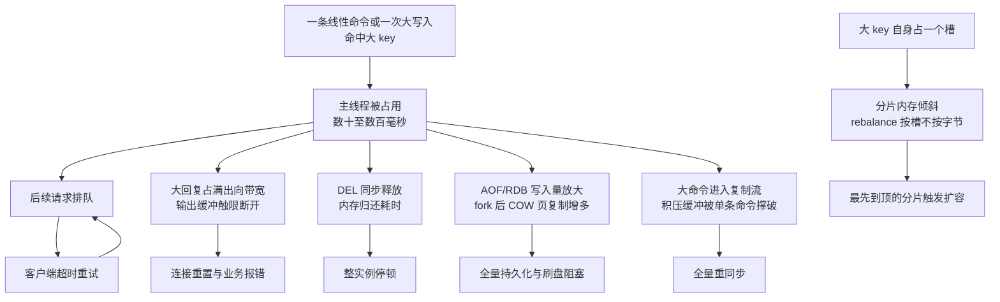
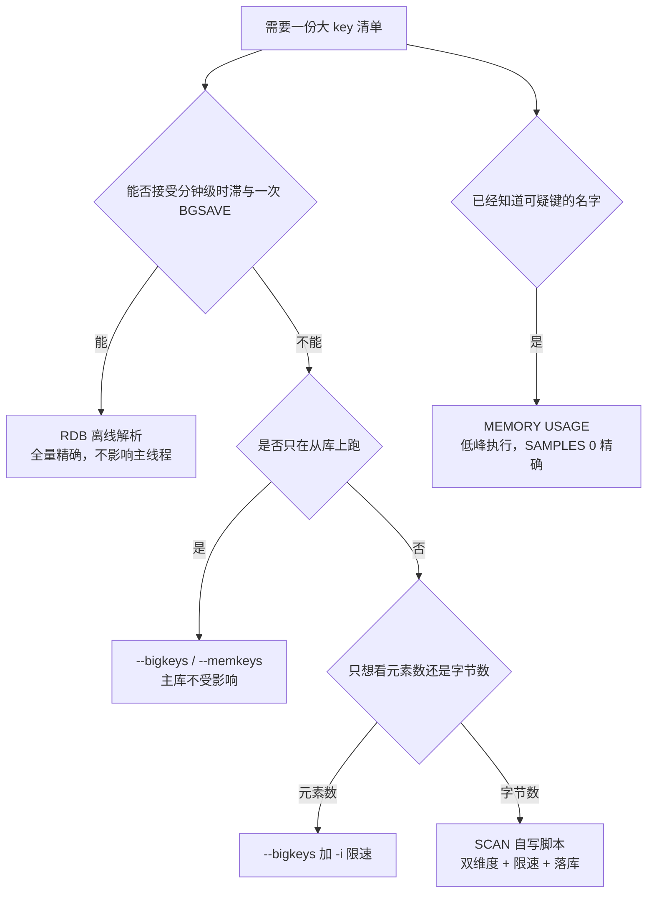
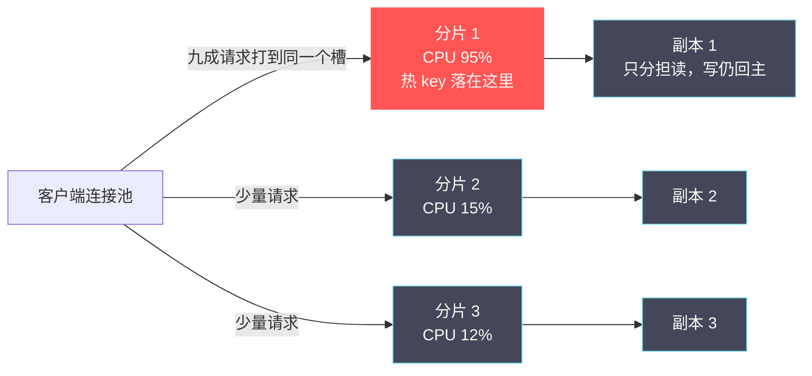
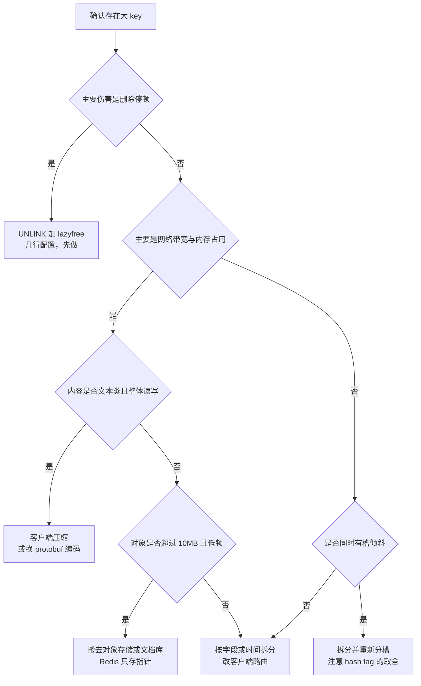

# 05 热 Key 大 Key 治理与容量规划

**摘要：**

热 key 与大 key 常被当成两个话题，实际是同一类事故的两种形状：实例既没宕机也没到内存上限，某个时刻客户端却集体超时。热 key 把流量压到一个槽上，大 key 把主线程占住一段可测的时间，共同点是伤害与“数据总量”无关，只与“访问集中在一个点上”有关。本文不谈概念，只回答两个工程问题：怎么在不停机、不伤业务的前提下把它们找出来，治理到什么程度该收手。前一半给判据与手段——String 超 10KB、集合类元素数超 5000 或总字节超 1MB、单 key 的 QPS 超过单分片能力的一成，随后把每种发现手段的耗时与影响面摊开：`--bigkeys` 是小时级的全键空间抽样，`MEMORY USAGE` 精确但要遍历容器，RDB 离线分析最安全却有时滞，`MONITOR` 与 `KEYS` 在生产上没有可用性。后一半算治理的账：拆分、异步删除、压缩、放别处各自改变什么、不改变什么，本地缓存、复制式多副本、分桶拆分各自换来多大的不一致窗口；最后落到容量的三笔账，用一个四千万键的实例算出机器数。机制细节只给结论并路由到机制专栏。

---

## 第 1 章 从一次没有报警的毛刺开始

设想一个内容社区：商品详情页缓存、用户任务进度 Hash、热门榜单 ZSet 分在三片 Cluster 上，平时 8 万 QPS，p99 在 3 毫秒上下，CPU 各片 35% 左右，内存使用率 62%，监控一切正常。某天下午运营点了一次“导出全部商品点评”，接口内部写的是 `HGETALL product:reviews:1001`，p99 跳到 400 毫秒，十几秒后恢复；第二天做秒杀预热，某个库存 key 的 QPS 从几百涨到 4 万，一片 CPU 打满到 97%，另外两片还在 30%，客户端开始出现超时重试，重试又把它推得更高。

两次事故都不在“容量不足”的范畴里，也没有任何一条告警先响起来，因为监控盯的是实例级的均值：CPU 有富余、内存有富余、错误率为零，只有 p99 和某个分片的 CPU 曲线在尖。热 key 与大 key 就是这样一类问题，它们不改变资源的总量，只改变资源的分布与时间结构。

### 1.1 两个问题与两笔账

把治理拆开，实际只有两个问题。第一个是发现：在不动业务、不重启实例的前提下，能不能把那个 key 指出来，以及指出来要付多少代价。第二个是治理：拆、删、压、搬，四种动作各自要改什么，改完之后哪一类风险消失了、哪一类风险被换成了别的形态。

这两个问题都绕不开代价。发现手段本身可能比问题更伤——`MONITOR` 在 5 万 QPS 的实例上跑十分钟，造成的吞吐下降可能超过一次可预期的热 key 尖峰；`KEYS *` 一次执行就是一次全键空间的线性扫描，在千万级键的库上直接制造一次人为事故。治理手段同样有代价：拆分会把一次原子读变成多次读，多副本拆分会让一次写变成 N 次写，压缩把 CPU 从 Redis 挪到客户端，而“加内存”只是把问题推给下一次扩容。

### 1.2 与机制专栏的分工

本文只谈“怎么判定、怎么发现、改完付什么账”。凡是属于实现的问题——编码阈值是哪几个参数、单线程事件循环如何调度、fork 之后的内存页如何复制、槽位如何分配与迁移——一律一句结论加一条路由，正文不展开。这些内容在 `Redis设计与实现` 那一列已经逐行对照源码校准过，重复讲一遍只会让读者记住阈值而忘掉成本结构。

笔者这么分工的理由很实际：机制知识回答“为什么这样设计”，用来判断某个参数能不能动；使用与运维知识回答“这条命令花了多少、能不能在生产的星期三下午跑”，用来做决策。两件事混在一篇里，最容易出现的后果是把阈值背下来、把代价漏掉，于是照着文档调完参数，性能反而更差。

### 1.3 判据必须先于工具

顺序很重要：**先有判据，工具才有意义**。反过来的做法很常见——先跑一遍 `--bigkeys`，屏幕上列出几十个键名，然后不知道该看哪一个，因为“最大”与“最危险”不是一回事。一个 8MB 的冷 key 可能一年只被读两次，一个 300KB 但每秒被读两万次的 key 才是真正的事故源。

所以本文先立线，再选工具，最后算治理的代价：三条判据分别对应值多大、元素多少、整键多少字节，热 key 的判据再加一个流量占比的维度。

---

## 第 2 章 大 key 的量化界线

“大 key”不是 Redis 的正式术语，也没有引擎层面的硬限制，它是一组工程经验收敛出来的阈值。阈值的作用不是精确分类，而是给巡检脚本一个可以写进代码的比较条件。

### 2.1 三条线

通行口径来自两处。《阿里巴巴 Java 开发手册》要求 String 类型的 value 控制在 10KB 以内、Hash、List、Set、ZSet 的元素个数不超过 5000；运维侧的经验则补了一条兜底：单个键的总字节数不超过 1MB。三条线合起来，覆盖了“值大”“元素多”“整体大”三种形态。

| 类型 | 判据维度 | 阈值 | 触发后首当其冲的命令 |
| :--- | :--- | :--- | :--- |
| String | value 长度 | 10KB | `GET`、`SET` 的整份传输与替换 |
| Hash | 字段数 | 5000 | `HGETALL`、`HSCAN` 全量、`HDEL` 批量 |
| List | 元素数 | 5000 | `LRANGE 0 -1`、`LTRIM` |
| Set | 成员数 | 5000 | `SMEMBERS`、`SINTER`、`SUNION` |
| ZSet | 成员数 | 5000 | `ZRANGE` 全量、`ZREMRANGEBYRANK` |
| 任意类型 | 总字节数 | 1MB | `DEL`、`MIGRATE`、RDB 与 AOF 序列化 |

三条线要一起用，单看哪一条都有漏网的形态。只看大小会漏掉“元素数百万、每个都是短整数”的 Set，它的 `SMEMBERS` 一样能把主线程占住几十毫秒；只看元素数会漏掉“只有 200 个元素、每个是一段 10KB HTML”的 List，1MB 的线专门抓这种。

### 2.2 三条线是怎么定出来的

10KB 这条线的来历与内存优化有关，也与单次操作的传输成本有关。一个 value 从几 KB 涨到几十 KB，`GET` 的复杂度没变，仍然是 O(1)，但主线程要把这块内存写进 socket，内核要把它拷进协议栈，客户端要分配同样大的接收缓冲。经验上 10KB 以内的一次往返在网络与内存拷贝上都不显眼，越过之后单条命令的时间开始与体积成正比，而调用频率并不会因为值变大了就下降。

5000 这条线与编码阈值无关，它是“线性命令还勉强能忍”的上界。一次 5000 元素的 `HGETALL`，若每个字段名加值约 50 字节，回复体积在 250KB 量级，序列化与网络输出在毫秒以内（示例推算），属于可以被慢查询日志观察到、但还不至于让业务超时的范围。再往上，回复体积与耗时同步抬升，5000 就成了一个便宜好记的报警线。

1MB 这条线是兜底，它同时是三件事的临界点：一次 `DEL` 要释放的内存规模、一次 `MIGRATE` 要序列化传输的体积、一份 RDB 里单个键的最大合理长度。越过这条线的键，即便元素数只有几百，也会在删除、迁移、持久化、复制四条路径上同时放大。

### 2.3 判据与编码的交叉

**元素数达标不等于安全**，这句话有两层含义。第一层是元素大小：一个 3000 字段的 Hash，若每个字段值是 2KB，总字节 6MB，三条线里第三条早就破了，但前两条都没报。第二层是编码：Hash 在字段数与字段长度都低于阈值时用 listpack 编码，把全部字段压在一块连续内存里，超过 `hash-max-listpack-entries`（默认 512）或单字段超过 `hash-max-listpack-value`（默认 64 字节）后转成 hashtable，每字段的内存开销从二十字节上下跳到七十字节上下，且转换不可逆。

这就是判据需要与编码知识一起看的原因。一个“只有 800 字段、每个字段值 100 字节”的 Hash，元素数没到 5000，但已经越过 512 与 64 两道闸门，内存按 hashtable 计算，而且删掉超长字段也不会退回 listpack。编码阈值的出处、转换的单向性与 RDB 载入时的重新归一化，在 [[02 SDS 与 Redis 对象系统]] 里逐条对过源码，此处只留结论：判大 key 时，元素数与总字节要给同一个键一起算，别只看一个维度。

还有一类隐藏开销容易被算漏：给键设置过期时间会多一份 expires 字典项。带 TTL 的键在容量账上比不带的贵出二十几字节，四千万个带 TTL 的键就是近 1GB 的差额，这笔钱在第 9 章的算例里单独列一行。

### 2.4 判据的失效场景

判据在三种情况下会给出误导性的结论。

第一种是“元素少但值巨大”。一个 300 元素的 List，每个元素是一段 30KB 的 HTML，第三条线破得很厉害，但 `--bigkeys` 这类按元素数排序的工具会把它排在很后面，因为 List 的度量维度是长度。

第二种是“元素多但值极小”。一个两百万成员的 Set，成员全是 8 位数字 ID，内容合计 16MB，看上去只是“十几兆”；但默认配置下它在 512 个成员时就退出了 intset 编码，每个成员在 hashtable 里要占五十字节上下，实际占用一百多 MB，一次 `SMEMBERS` 要构造两百万个回复对象、序列化十几 MB 的回复，耗时进入几十毫秒。这类键的危险来自元素数，字节数是它的结果：判据按元素数命中，容量却要按分配后的字节算。

第三种是 ZSet 的双索引。ZSet 同时维护字典与跳表，每个成员的开销是 Hash 的两倍上下，一个 4000 成员的 ZSet 在元素数上安全，内存上已经接近两个 4000 字段的 Hash。这类差异无法用一条线表达，只能靠对每元素成本的量级判断来补。

---

## 第 3 章 伤害机制：不是慢，是阻塞

把大 key 的危害写成“操作变慢”，会漏掉最关键的一半。慢是一个请求慢，阻塞是所有请求慢，两者在故障形态上完全不同：前者表现为某个接口的 p99 抬高，后者表现为整个实例在某一秒内不响应任何请求，然后触发客户端的批量超时与重试。

### 3.1 单线程把复杂度翻译成时延

Redis 处理命令的主线程是一条串行流水线，读请求、解析、执行、写回复依次进行，执行阶段在 7.x 与 8.x 依然是单线程的，I/O 多线程只分担 socket 的读写，不改变“同一时刻只有一条命令在执行”这个事实，调度细节见 [[05 单线程模型与事件驱动架构]]。由此得到一个直接换算：一条命令的执行时间，就是它给所有其他客户端造成的延迟增量。

这个换算把复杂度记号变成了物理量。`HGETALL` 的 N 是字段数，`SMEMBERS` 的 N 是成员数，`DEL` 的 N 是元素数，`KEYS` 的 N 是整个键空间。N 等于 100 万时，遍历与构造回复要花几十到几百毫秒（示例推算），这段时间里实例不处理任何其他请求，排队长度按到达速率线性增长。

阻塞还有一层自我放大，这一点常被低估。设实例平时能处理 5 万 QPS，一条命令占住主线程 100 毫秒，这 100 毫秒内到达的 5000 个请求全部延迟；客户端大多配了 100 到 500 毫秒的超时，超时的请求被重试，重试带来新流量，队列进一步变长，于是 100 毫秒的停顿被放大成数秒的服务不可用。慢是局部的，**阻塞会自我放大**，这是两者的分界。

### 3.2 五条放大路径

大 key 的伤害不止于命令执行本身，它沿着五条路径同时放大，按常见程度排列如下。

第一条是**网络带宽**。单条命令的回复体积与网络出向带宽成正比，一个 20KB 的 value 被每秒两万次读取，出向流量就是 400MB/s（示例推算），已经占满万兆网卡的三分之一，单条连接的带宽更早见底。输出缓冲受 `client-output-buffer-limit` 约束，超限的客户端会被直接断开，业务侧看到的是连接重置而不是超时。

第二条是**内存不均与槽倾斜**。Cluster 按槽分片，一个键无论多大只属于一个槽，只落在一个节点上，一个 800MB 的 Hash 足以让所在分片的内存使用率是其他分片的两倍。后果不只是“不好看”：`--cluster rebalance` 按槽数而不是按字节数均衡，搬完槽之后内存依然不均；自动扩缩容的判据通常看节点内存水位，倾斜会让最先到顶的那一片触发扩容，容量买回来之后仍然有一片先到顶。槽与迁移的机制见 [[10 Redis Cluster 分布式架构]]。

第三条是**删除阻塞**。`DEL` 一个 100 万元素的 Hash，要把每个字典项、每个字段字符串逐块还给分配器，释放动作同步发生在主线程上，耗时可达数十到数百毫秒（示例推算）。Redis 4.0 起提供 `UNLINK`，把“从键空间摘除”与“释放内存”拆开，前者同步、后者交给后台线程，这是大 key 场景里最便宜的一次改造。

第四条是**持久化放大**。RDB 快照与 AOF 重写都在子进程里进行，大 key 让这两条路径各自多背一份负担：fork 之后主线程对某页的写入要触发页复制，大 key 被频繁改写时复制量随之抬升；AOF 的 `everysec` 刷盘策略下，一次 5MB 的写入会在 AOF 缓冲区里堆出 5MB，刷盘线程跟不上时主线程被 `write` 阻塞。fork 与 COW 的机制见 [[07 RDB 持久化——快照的 fork 与 COW 机制]]。

第五条是**主从同步延迟**。复制流按命令逐条传播，一次大 key 的写入就是一条大命令。`repl-backlog-size` 默认 1MB，一条 5MB 的 `SET` 单独就超过了积压缓冲的容量，从库一旦断连，重连后无法做部分重同步，只能触发一次全量重同步，而全量重同步又要传一份完整的 RDB，把网络与主库的 CPU 再吃一遍。复制积压与部分重同步的判据见 [[09 主从复制与 Sentinel 高可用]]。

下图把五条路径与它们各自的终局连起来。



### 3.3 量级判断

把常见操作在大 key 上的成本列出来，能帮助判断“这条命令能不能放在请求路径上”。下表全部是示例推算，前提是单机、无网络拥塞、value 为普通内存数据，真实值随硬件与数据分布浮动，量级可靠、精确值不可靠。

| 操作 | 数据规模 | 单次耗时量级 | 阻塞半径 |
| :--- | :--- | :--- | :--- |
| `HGETALL` | 10 万字段 | 数十毫秒 | 全实例，持续到命令结束 |
| `SMEMBERS` | 100 万成员 | 数十毫秒，回复数十 MB | 全实例加网络 |
| `LRANGE 0 -1` | 100 万元素 | 数十毫秒 | 全实例加网络 |
| `DEL` | 100 万元素 Hash | 数十至数百毫秒 | 全实例 |
| `UNLINK` | 同上 | 亚毫秒 | 仅后台线程与内存 |
| `MIGRATE` | 单个 1MB 键 | 十毫秒级 | 源节点与目标节点同时 |
| `GET` | 10MB value | 毫秒级 | 全实例加网络，且随并发叠加 |
| `BITCOUNT` | 12.5MB 位图 | 十毫秒级 | 全实例 |

表里 `UNLINK` 那一行值得多看一秒，它与上一行的数据规模相同、语义相同，耗时差三个数量级，差别只在释放动作发生在哪个线程上。

---

## 第 4 章 发现大 key：四种手段与代价

发现手段的选择，本质是在“精确度”“耗时”“对线上影响”三个维度之间做取舍。没有一种手段三项全优，所以生产上通常组合使用：常态用低成本抽样，周期性用离线精确分析，事故时用单键精确查询。

### 4.1 `--bigkeys`：全键空间的一次抽样

`redis-cli --bigkeys` 走 SCAN 游标遍历整个键空间，对每个键先问类型，再按类型取尺寸：String 用 `STRLEN`、Hash 用 `HLEN`、List 用 `LLEN`、Set 用 `SCARD`、ZSet 用 `ZCARD`，最后按类型各自保留浮出水面时最大的那一个。

```bash
# -i 控制批与批之间的间隔，不让扫描占满主线程
redis-cli -h 10.0.1.2 -p 6379 --bigkeys -i 0.1
```

输出形如：

```text
[00.00%] Biggest string found so far 'session:9f2c' with 52428 bytes
[23.05%] Biggest hash   found so far 'product:reviews:1001' with 103847 fields
[45.12%] Biggest zset   found so far 'leaderboard:global' with 2847103 members

-------- summary -------
Sampled 3987214 keys in the keyspace!
Total key length in bytes is 187336512 (avg len 46.99)
```

它的成本结构需要说清。单条 SCAN 只返回一批游标位置，每条尺寸命令都是 O(1)，所以不会有“一条命令卡住几百毫秒”的长阻塞；代价在总量上——四千万键的实例，每批 100 个键就是四十万批，批之间还要再发尺寸命令，实际往返次数是批数的数倍。按每批 0.2 毫秒的往返估算，不加间隔要几十秒到几分钟；加上 `-i 0.1` 的间隔，四十万批就是十一小时上下（示例推算）。这段时间它持续占用主线程的一部分 CPU，把一个本来余量充足的实例推到延迟曲线的毛刺区间。

盲区有三个。第一，每种类型只报最大的一个，几百个大 key 里只能看见五个，要做排行得自己写 SCAN 脚本。第二，度量维度只有元素数，看不出字节大小，一个 3000 个字段、每个字段值 2KB 的 Hash 会被漏掉。第三，SCAN 是**弱一致遍历**：扫描期间新增的键可能扫不到，删除的键可能重复返回，对“找我漏掉的那个大 key”这种任务够用，对“给出一份精确清单”不够用。

### 4.2 `MEMORY USAGE`：精确，但要遍历

对已经知道名字的键，`MEMORY USAGE` 给出的是分配器视角的字节数，包含对象头、SDS 头部、字典项与对齐开销，而不是“业务数据有多少字节”。

```bash
# 复合类型默认采样若干元素外推，快但有偏差
MEMORY USAGE product:reviews:1001 SAMPLES 5

# SAMPLES 0 表示精确：遍历整个容器，本身就是一次大 key 操作
MEMORY USAGE product:reviews:1001 SAMPLES 0
```

采样与外推的关系要理解：采样 5 个元素，把它们的平均大小乘以元素总数，得到估算值。对一个字段大小分布均匀的 Hash，误差很小；对一个“多数字段 20 字节、少数字段 3KB”的 Hash，采样五次的方差极大，估算值可能偏出一倍以上。**要精确值就必须遍历**，而遍历 100 万元素的 Hash 本身要占住主线程几十毫秒，与一次 `HGETALL` 同级——所以这个命令不能在高峰期对可疑键批量执行，只能挑低峰、挑少量键。

`--memkeys` 是把这套动作批量化：同样走 SCAN，但对每个键调用 `MEMORY USAGE`，按字节排序。它补上了 `--bigkeys` 缺的字节维度，代价是每个键多一次命令往返，同样四千万键的规模下比 `--bigkeys` 更重，且默认采样外推，数量级对、精确值不保证。`--memkeys-samples 0` 可以精确，代价是每个键一次全量遍历，线上基本不可接受。

### 4.3 `SCAN` 加尺寸命令：可控但慢

自己写脚本是第三种选择，好处是可以控制批大小、限速、按业务前缀筛选，并且能同时记录元素数与字节数两个维度，把结果写进时间序列表做趋势对比。

```python
# 自己控制节流与判据：元素数与字节数一起看，结果落库做趋势
import time, redis

r = redis.Redis(host="10.0.1.2", port=6379, decode_responses=True)
LIMIT_KEYS, LIMIT_LEN = 10 * 1024, 5000
hits = []
cursor = 0
while True:
    cursor, batch = r.scan(cursor=cursor, count=200)
    for k in batch:
        t = r.type(k)
        if t == "string":
            if r.strlen(k) > LIMIT_KEYS:
                hits.append((k, "string", r.strlen(k)))
        elif t in ("hash", "list", "set", "zset"):
            n = r.hlen(k) if t == "hash" else r.llen(k) if t == "list" \
                else r.scard(k) if t == "set" else r.zcard(k)
            if n > LIMIT_LEN or r.memory_usage(k, samples=5) > 1024 * 1024:
                hits.append((k, t, n))
    time.sleep(0.05)          # 每批让出主线程，把占用压到可接受区间
    if cursor == 0:
        break
```

它的代价与 `--bigkeys` 同构，只是把“间隔”从固定值换成了脚本里的睡眠，把度量从单维度换成了双维度。真正的问题在耗时：四千万键 × 每键两到三次往返，即便限速到每批 50 毫秒，也要十几小时。所以它适合作为夜间例行任务，而不适合临时救火。

还有一个细节影响结果的可信度：扫描本身是读操作，会触碰键的 LRU/LFU 记录，一个每小时全量扫一遍的巡检脚本，会让淘汰策略看到一份被污染的热度分布。7.4 起的 `CLIENT NO-TOUCH` 可以在扫描连接上关闭这种触碰，老版本只能接受这点偏差，或者对从库扫描。

### 4.4 离线分析 RDB：最安全，有时滞

最不影响线上的一条路是把数据搬出服务进程再分析。做法是在低峰期触发一次 `BGSAVE`，把生成的 RDB 拷到离线机器，用 `redis-rdb-tools`、`rdr` 或 `redis-rdb-cli` 这类工具解析出每个键的类型、元素数与内存占用。

```bash
# 在离线机上解析，线上只承受一次 BGSAVE 的 fork 与 COW
rdb -c memory /data/dump.rdb --bytes 10240 -f memory.csv
sort -t, -k4 -nr memory.csv | head -50     # 按字节排出前 50
```

这条路有三个优势：不占用线上主线程做遍历，因而可以做到全量精确；能拿到完整的排行而不是每类型一个；能对多个时间点的 RDB 做对比，看哪些键在持续变大。代价有三处：`BGSAVE` 本身要 fork，fork 的停顿与随后的页复制开销在写入密集的实例上不可忽略，机制见 [[07 RDB 持久化——快照的 fork 与 COW 机制]]；数据是快照时刻的，与当前状态有分钟级到小时级的时滞；解析 10GB 级的 RDB 需要一台内存足够的机器与几分钟到几十分钟的时间，`redis-rdb-tools` 的解析器在超大文件上内存占用偏高，`rdr` 这类流式实现更省。

### 4.5 发现手段的对照与组合

| 手段 | 覆盖范围 | 耗时量级（四千万键） | 对主线程影响 | 精度 | 生产可用性 |
| :--- | :--- | :--- | :--- | :--- | :--- |
| `--bigkeys` | 全键空间，每类型一个 | 分钟级到十余小时（取决于 `-i`） | 持续 CPU 占用，无长阻塞 | 元素数准确，字节缺失 | 低峰或从库可跑 |
| `--memkeys` | 全键空间，按字节排序 | 比 `--bigkeys` 更重 | 同上 | 采样外推 | 低峰或从库可跑 |
| `MEMORY USAGE` | 单键 | `SAMPLES 0` 数十毫秒 | 一次长阻塞 | 精确 | 仅低峰、少量键 |
| `SCAN` 自写脚本 | 全键空间，双维度 | 十余小时 | 可限速到很小 | 精确，受采样策略影响 | 常驻夜间任务 |
| RDB 离线 | 全量 | 解析分钟级到数十分钟 | 仅 fork 与 COW | 精确，有时滞 | 最安全，周期执行 |

组合的方式取决于目的。常态巡检用低频自写脚本或从库上的 `--bigkeys`，只求“没有超过阈值的新键出现”；月度对账用 RDB 离线分析，给出一份可归因的排行；事故时用 `MEMORY USAGE` 逐个确认可疑键，因为此时需要的是精确值而不是全景。三条线互补，缺一条就会出现“告警响了但没有清单”或者“有清单但没人看”的局面。

选择顺序可以画成一张判定图。



---

## 第 5 章 热 key 的判据

热 key 的判定比大 key 更需要参照系。同一个 2 万 QPS 的键，在 10 万 QPS 的实例里是五分之一，在 60 万 QPS 的集群里只是一个普通热点；脱离了“实例总能力”这个分母，“热”就没有意义。

### 5.1 热是相对量

定义一条：一个键的 QPS 占所在实例或分片总 QPS 的比例，超过某个阈值即为热 key。这个比例之所以比绝对值好用，是因为它把机器规模抽象掉了。绝对值也有用，但它衡量的是“这个键本身有多重”，参照点是单核的处理能力。

单核的处理能力可以给一个量级判断：简单命令（`GET`、`SET` 小 value）在单实例上跑到每秒十万次上下是常见水平（量级判断），具体取决于 value 大小、pipeline 深度与网卡；单次往返的 RTT 在几十到几百微秒，吞吐上限由每条命令的主线程成本与连接上的往返次数共同决定。有了这个基准，1 万 QPS 就相当于单核能力的一成。

### 5.2 四条量化线

| 维度 | 判据 | 参考阈值 | 说明 |
| :--- | :--- | :--- | :--- |
| 流量占比 | 单 key QPS / 实例总 QPS | 10% | 超过即意味着一成的处理能力被一个键吃掉 |
| 绝对压力 | 单 key QPS | 单核实测能力的 10%（约 1 万/秒） | 与实例规模无关的绝对量 |
| 分片离散度 | 最热分片 CPU / 各分片均值 | 1.5 到 2 倍 | Cluster 上最直接的观测面 |
| 客户端画像 | 单 key 延迟与该实例均值 | 2 倍以上 | 需要埋点，但最能定位到业务代码 |

四条线里最好用的是第三条。Cluster 的分片是按槽分的，如果流量均匀，各分片 CPU 应该接近；一旦某个分片的 CPU 长期是平均值的两倍，几乎可以断定有一个或一小批键把流量吸过去了，因为单条命令的连接与内存开销在同一实例内是接近的。

### 5.3 为什么一个键只能落一个分片

Cluster 用 `crc16(key) & 0x3FFF` 把键映射到 16384 个槽，槽再判给节点，键名一旦确定，落点就确定，这个映射没有任何“多副本分摊”的余地。同一批数据可以有主从副本，但副本只承担读的一部分——写仍然打到主节点，且在默认配置下客户端只有显式的读路由才会去从库。槽的分配规则、MOVED 与 ASK 的重定向语义、以及迁移期的读写行为，在 [[10 Redis Cluster 分布式架构]] 里完整拆过，这里只取结论：分片是**按键切、不按请求切**，所以单个键的热度无法靠“多分片”自动摊薄。

### 5.4 倾斜的两种形态

第一种是单键倾斜，前面讨论的都是这种：几万 QPS 集中在一个键上。第二种是小集合倾斜：单个键的 QPS 都不高，但几十个键恰好落在同一个槽，或者落在同一个分片，合起来把一片打满。后者更隐蔽，因为无论按单键看还是按分片平均值看，都找不到“那个键”。

要区分两者，得看键在槽上的分布。`redis-cli --cluster check` 会输出每个主节点的槽数与键数，`CLUSTER COUNTKEYSINSLOT` 可以精确看某个槽有多少键，把这两者与各分片的 `DBSIZE`、`INFO keyspace` 对齐，就能看出是键数倾斜还是访问倾斜。键数倾斜靠重分槽解决，访问倾斜只能靠第 8 章的手段。

下面这张图是常见的倾斜形态：三片集群里，一片承担了九成流量，其余两片近乎空转。



---

## 第 6 章 发现热 key：五种手段与代价

热 key 比大 key 更难发现，原因是它的判定依赖“计数”，而 Redis 默认不按键计数。大 key 至少有尺寸这个可查的属性，热 key 的属性只存在于访问流里，要么在服务端记录，要么在链路上旁路，要么在客户端埋点。

### 6.1 `MONITOR`：生产禁用

`MONITOR` 把实例收到的每一条命令实时推给监控连接，输出形如：

```text
1763688000.123456 [0 10.0.1.9:51234] "GET" "product:1001"
1763688000.123457 [0 10.0.1.9:51234] "HGET" "user:88:tasks" "3"
```

从语义上看它是完美的：能看到每一条命令、每一个键名。代价也在同一处。每条命令都要格式化一遍 RESP 文本、写进监控客户端的输出缓冲，5 万 QPS 就意味着一秒 5 万次格式化与 4MB 级的出向流量（示例推算）。Redis 官方文档对这一点的措辞很直接——`MONITOR` 会显著降低性能，量级上可以让吞吐掉到原来的几分之一。更麻烦的是监控端消费不过来时，输出缓冲持续增长，要么撑爆内存，要么触到 `client-output-buffer-limit` 被断开，而断开之前那段时间主线程仍在为它工作。

结论只有一条：`MONITOR` **不用于生产**。要用，先断开业务流量，或者在一个专门的影子实例上复放。已经开着的监控连接要主动清掉，`CLIENT KILL TYPE monitor` 是收尾动作。

### 6.2 `--hotkeys` 与 `OBJECT FREQ`：依赖 LFU

Redis 4.0 引入 LFU 淘汰策略时，顺带把每个对象的访问计数做成了可查的属性。`--hotkeys` 走 SCAN 遍历键空间，对每个键取一次访问频率，最后按计数给出候选的热点键。

```bash
# 前提：淘汰策略必须是 LFU 家族
CONFIG SET maxmemory-policy allkeys-lfu
redis-cli -h 10.0.1.2 -p 6379 --hotkeys -i 0.1

# 单键查询：返回 0 到 255 的对数计数
OBJECT FREQ product:1001
```

这条路的三个前提要说清。第一，策略必须是 `allkeys-lfu` 或 `volatile-lfu`，在 LRU 策略下 `OBJECT FREQ` 直接报错，`--hotkeys` 也会拒绝执行。第二，计数是对数的，8 位字段饱和在 255，递增概率随计数升高而降低，所以它衡量的是“相对冷热”而不是绝对 QPS，`lfu-log-factor`（默认 10）决定饱和速度。第三，计数会随时间衰减，`lfu-decay-time` 默认 1 分钟，读数反映的是最近一段时间的访问强度：一个每天只热一分钟的键，在它不热的时段读数会掉回很低，能不能被扫到取决于扫描时机，所以这个参数要按业务节奏调。

成本与 `--bigkeys` 同构：全键空间扫描加每键一次命令往返，四千万键是小时级。额外还有一笔隐性成本——切换淘汰策略本身是运维动作，LFU 与 LRU 对“该淘汰谁”的判断不同，切换会让原有的淘汰行为在一段时间内失准；如果实例本来用 `volatile-lru`，还得确认过期键的分布能支撑 LFU 的决策。

### 6.3 客户端埋点：拿得到画像，付得起成本

在客户端 SDK 或业务的数据访问层统计键的访问次数，是唯一能同时拿到“哪个键”“多少 QPS”“延迟多少”“值多大”四个维度的办法。做法通常是采样：每个请求以千分之一的概率进入统计，本地维护一个容量有限的 TopK 结构，定期上报。

TopK 的实现不需要精确计数。Misra-Gries 与 SpaceSaving 这类流式算法用几十到几百个槽就能在长尾分布上给出误差可控的热点清单，内存开销是常数级的。工程上需要注意三点：槽位数量要按“可能的热点宽度”设，设得太小会把热点挤成一个模糊的集合；计数窗口要与业务节奏对齐，秒杀场景需要秒级窗口，内容缓存用分钟级就够；上报本身要有速率限制，否则统计模块自己成为故障源。

代价在客户端：每个请求多一次哈希与计数，CPU 可以忽略，但一个缓存着千万个键名与计数的统计表会直接把应用内存吃光。

### 6.4 代理层统计：集中但多一跳

如果访问链路里已经有代理（Codis、Twemproxy、自研的 Redis Proxy、服务网格里的 Redis 过滤器），统计可以放在代理里做。代理天然看到所有请求，不需要改业务代码，也能按后端实例聚合，是集群规模下最省事的位置。

代价有三处。一是代理自身成为资源瓶颈：每个请求多一次 key 的解析与计数，热 key 恰好是计数表最容易膨胀的场景。二是代理通常只做 TopK 而舍不得存全量，精度取决于取样窗口。三是多一跳意味着多一条延迟路径与一个故障点，这在选型时就要接受，不是治理热 key 时才引入的。没有代理的架构为了统计而引入代理，是典型的用大成本解决小问题。

### 6.5 五种手段的取舍

| 手段 | 需要的前提 | 能给出的信息 | 对线上的影响 | 适用位置 |
| :--- | :--- | :--- | :--- | :--- |
| `MONITOR` | 无 | 每条命令与键名 | 严重，吞吐显著下降 | 仅影子实例 |
| `--hotkeys` | LFU 淘汰策略 | 键的相对热度 | 小时级扫描占用 | 低峰或从库 |
| `OBJECT FREQ` | LFU 淘汰策略 | 单键的计数 | 轻微 | 事故时的定点确认 |
| 客户端埋点 | 改代码 | 键、QPS、延迟、大小 | 客户端 CPU 与内存 | 主路径，推荐 |
| 代理统计 | 链路里有代理 | 键级 QPS 与连接分布 | 代理自身开销 | 大规模集群 |

常态应该靠客户端埋点与代理统计，因为它们给出的是“请求侧的事实”，不受淘汰策略与扫描成本约束；`--hotkeys` 适合在没有埋点的存量系统里做一次盘点；`MONITOR` 只作为最后手段，且必须在隔离环境。这个顺序与直觉相反，直觉总想“先看看 Redis 里发生了什么”，但服务端恰好是最不该被观察行为影响的地方。

---

## 第 7 章 大 key 的四种治理与代价

治理的起点是承认一件事：大 key 不会因为治理动作而消失，它只会被换成另一种形态的开销。拆分成多个键，客户端要多做路由；压缩成字节流，CPU 从服务端挪到客户端；搬到别处，延迟从毫秒变成几十毫秒。选哪种，取决于业务能接受哪一种代价。

### 7.1 拆分：最根本，也最贵

拆分是把一个逻辑容器切成多个物理键，让每次操作只碰其中一小部分。三种拆法对应三种业务语义。

按字段哈希分桶适合无序的大 Hash。一个 10 万字段的 Hash 拆成 100 个键，每键 1000 个字段，路由是 `bucket = crc16(field) % 100`：

```text
原始：product:reviews:1001                         10 万字段
拆分：product:reviews:1001:0    字段 0 到 999
      product:reviews:1001:1    字段 1000 到 1999
      ...
      路由：key = "product:reviews:1001:" + (crc16(field) % 100)
```

按时间切分适合有自然时序的数据。最新 1000 条评论放 `reviews:1001:latest`，历史按月放 `reviews:1001:2026-01`，写入时按当前月份路由，读取时先查 latest 再按需回查历史。8.0 的字段级过期（`HEXPIRE`）让“按时间清理”这件事可以在单个 Hash 内完成，但它改变的是清理时机，不改变同一时刻的单键规模，判据与拆分决策都不变。

按键前缀分片适合“同一个集合被多个业务维度共享”的场景，本质上是把命名空间当分片键，实现简单，但要求业务能接受“一次查询只命中一部分”。

拆分的代价集中在客户端。第一，**原子性没了**：原本一条 `HGETALL` 能拿全的数据，现在要 100 次读再聚合，中间可能读到不一致的快照，需要业务容忍或者引入版本号。第二，代码复杂度上升：读写路径都要带路由逻辑，改一次字段归属要迁移数据。第三，迁移期的双写与回读：老键与新键并存一段时间，写入双写、读取先新后老，直到确认无读老键的流量才能删。第四，Cluster 下要决定是否用 hash tag：不用 tag，拆出来的键散在不同槽，跨桶操作只能由客户端聚合；用 `{1001}` 这样的 tag 强制同槽，又回到了“所有桶压在一个分片”的起点，分散流量的目的落空。后者的取舍在 [[10 Redis Cluster 分布式架构]] 里讲 hash tag 时展开过。

### 7.2 异步删除：最便宜的一次改造

删除大 key 是运维里最高频的动作，也是最容易造成事故的动作。`DEL` 是同步的，释放内存的成本全落在主线程上；`UNLINK` 的解法是**先摘除引用、后释放内存**：在键空间里摘掉键是 O(1)，实际的内存在后台线程里归还。

```bash
UNLINK product:reviews:1001        # 摘除立即返回，内存在 bio 线程里归还
```

对无法改造代码的旧实例，还有一条渐进删除的路子：用 `HSCAN` 分批读出字段，再分批 `HDEL`，每批之间留出间隔，让主线程有机会处理其他请求。

```bash
# 渐进删除：每批 200 个字段，批间让出主线程
cursor=0
while :; do
  reply=$(redis-cli HSCAN big:hash "$cursor" COUNT 200)
  cursor=$(echo "$reply" | head -n 1)
  fields=$(echo "$reply" | tail -n +2 | awk 'NR%2==1')
  [ -n "$fields" ] && redis-cli HDEL big:hash $fields > /dev/null
  [ "$cursor" = "0" ] && break
  sleep 0.01
done
redis-cli UNLINK big:hash
# 字段名含空格时上面的分词会失效，改用客户端库按批处理
```

更重要的是把异步化做成配置而不是个案。`lazyfree` 系列把异步释放扩展到五个内部场景，默认全部关闭。

| 开关 | 默认 | 作用范围 | 开启后的代价 |
| :--- | :--- | :--- | :--- |
| `lazyfree-lazy-eviction` | no | 内存淘汰时选中键的释放 | 释放滞后，本轮淘汰的记账偏低，可能多删几个键 |
| `lazyfree-lazy-expire` | no | 过期删除 | 过期风暴时内存下降滞后，`used_memory` 曲线变缓 |
| `lazyfree-lazy-server-del` | no | 覆盖写、重命名等内部删除 | 写入路径的延迟分布改变，内存峰值得以削平 |
| `lazyfree-lazy-user-del` | no | 客户端 `DEL` 自动按 `UNLINK` 处理 | 语义不变，但内存释放不再即时，容量评估要留余量 |
| `lazyfree-lazy-user-flush` | no | `FLUSHALL`、`FLUSHDB` | 清库不再长时间阻塞，释放变慢，缓冲期内占用仍在 |

开启之后要盯一个指标：`INFO memory` 里的 `lazyfree_pending_objects`，它表示排队待释放的对象数。这个数长期高位，说明后台线程跟不上删除速度，此时该降低单次删除的规模，而不是继续加开关。淘汰、过期与释放的完整机制，包括这五个开关在淘汰循环里的记账偏差，见 [[06 内存管理与过期淘汰策略]]。

### 7.3 压缩：把 CPU 挪个位置

如果大 key 的内容是文本类数据（JSON、XML、日志片段），可以在客户端压缩后再写入。gzip、snappy、lz4、zstd 各有取舍：gzip 压缩比高、CPU 贵；lz4 与 snappy 快、压缩比一般；zstd 在三者之间给出了可调的档位。文本类数据的压缩比通常在 3 到 10 倍之间（示例推算），一个 5MB 的 JSON 压到 500KB 到 1.5MB 是常见结果。

代价有两层。第一层是 CPU：写入压一次、读取解一次，读多写少的场景下成本可接受，读写都频繁的场景下就是把 Redis 省下的时间还给了应用。第二层是访问模式：压缩之后整块数据变成一个不透明的字节流，原本可以 `HGET` 单个字段的访问，退化成“读整块、解压、取字段”，粒度越细的访问亏得越多。所以压缩只适合“整体读写、偶发局部读”的数据。

更彻底的做法是换结构而不是换编码：把 JSON 换成 protobuf，把宽表换成只存必要的列，把“每次都整份读取”的接口改成“按需要字段读”。这些改动落在业务侧，收益是数量级的——一个 500 字节的 protobuf 编码，往往能表达同样一份 2KB 的 JSON。

### 7.4 放别处：认清 Redis 的边界

有些对象本来就不该放在 Redis 里。判断标准可以收敛成三条：单对象超过 10MB、访问频率低于每秒一次、不需要毫秒级延迟。三条中占两条，就该考虑搬走。

搬到哪取决于访问模式。大文本、图片、视频、归档日志放对象存储，客户端拿 URL 而不是内容；需要检索与聚合的文档放搜索引擎或文档库；需要事务与二级索引的结构化数据放关系库。Redis 留在链路里的角色变成“指针与索引”：存 URL、存 ID 列表、存热点摘要。

代价是延迟与一致性。一次对象存储的读在几十毫秒量级，比 Redis 慢两个数量级；两份存储之间要处理一致性，缓存失效与回源逻辑必须写对。这些都是明确的成本，但比让一个 50MB 的值长期占着主线程要便宜——后者付出的代价是不可预期的停顿。

### 7.5 四种手段的对照与顺序

| 手段 | 一次性成本 | 长期成本 | 消除的风险 | 引入的风险 |
| :--- | :--- | :--- | :--- | :--- |
| 拆分 | 改客户端路由与迁移数据 | 跨键原子性丢失，聚合读开销 | 单键阻塞、槽倾斜 | 一致性窗口、迁移期双写 |
| 异步删除 | 改删除语句或加配置 | 内存释放滞后 | `DEL` 停顿 | 释放排队、容量误差 |
| 压缩 | 改编解码 | 客户端 CPU、随机访问失效 | 网络与内存占用 | 解压延迟、CPU 争用 |
| 放别处 | 改存储架构 | 延迟升高、一致性处理 | 主线程长阻塞、容量压力 | 双写不一致、回源风暴 |

顺序上有一条经验：先做最便宜的。异步删除是几行配置的事，先做；拆分成本中等但收益最确定，其次；压缩与搬迁改动面大，放在最后，而且要先确认前两者做完之后问题是否仍然存在。很多所谓“必须拆分”的场景，在开启 `UNLINK` 与 `lazyfree` 之后，剩下的只是网络带宽问题，而带宽问题用压缩就能解决一半。



---

## 第 8 章 热 key 的三种解法与代价

热 key 的治理与大 key 完全不同：大 key 是一个对象太大，热 key 是一个对象的访问太集中。前者可以切分对象，后者只能切分流量，而流量切分必然改变一致性语义与写路径。

### 8.1 本地缓存：把流量挡在进程内

最直接的办法是在应用进程里加一层缓存，热 key 的数据在本地命中，请求根本不发到 Redis。Java 生态用 Caffeine，Go 生态用 bigcache 或 freecache，选择的关键是容量上限与淘汰策略，而不是吞吐。

设计上有四个约束。第一，TTL 必须短，通常 1 到 5 秒，这个时长直接决定了**一致性窗口**——数据在源端更新之后，最坏要等一个 TTL 才在所有实例上可见。第二，容量必须有上限，只缓存确认的热点键，不能把整个 Redis 当数据源复制进 JVM，否则内存问题从服务端搬到了应用侧。第三，命中率来自“热点足够集中”这个前提，若热点是长尾，本地缓存的收益会迅速衰减。第四，要防止失效瞬间的击穿：TTL 到期时大量实例同时回源，回源流量可能比缓存前更高，解决办法是给 TTL 加随机抖动，或者在回源路径上加单飞（singleflight）。

还有一层叠加效应：当 Redis 里的键与本地缓存同时过期，两层的回源一起打到数据库，此时需要的是请求合并，而不是再叠一层缓存。缓存模式的完整讨论见 [[04 缓存设计模式与一致性问题]]。

代价是把“数据一致性”从 Redis 的一个点变成了 N 个进程的 N 个点。对于库存、余额这类强一致数据，本地缓存基本不可用；对于商品详情、文章正文这类可容忍秒级延迟的数据，它是性价比最高的一招。

### 8.2 复制式多副本：写 N 份，读随机

把一个键复制成 N 份，键名加后缀，写入时写全部副本，读取时随机挑一份，流量就自然散到 N 个槽上。

```text
写入：SET hot:sku:1001:0 … 一直到 hot:sku:1001:9      十份
读取：GET hot:sku:1001:{rand(0,9)}                     随机一份
```

N 的取值由“单键 QPS 除以单分片可承受 QPS”决定。一个 4 万 QPS 的键，若单分片能稳稳承受 1 万，N 取 4 到 6 就有余量。副本数不是越多越好：N 越大，写放大越严重，需要维护的键越多，删除与过期也要处理 N 次。

写路径是这套方案的痛点。一次业务写要变成 N 次写，必须用 pipeline 合并，否则一次写变 N 次往返，延迟乘以 N；N 次写之间没有原子性，中途失败会留下不一致的副本。更隐蔽的问题是读取的一致性：客户端随机读，读到哪一份取决于运气，若某次写只成功了一部分，后续读会看到时新时旧，表现为“同一个请求刷新两次结果不同”。

所以这套方案必须配三样东西：一是写失败后的修复机制，通常是后台任务定期比对 N 份的一致性，或者用一个版本号让读取端挑最新的一份；二是过期与删除要覆盖全部副本，漏删一份就会留下永不过期的脏数据；三是避免使用 hash tag，若为了“写起来方便”给副本加同一个 tag，N 份会落进同一个槽，等于没拆。

### 8.3 分桶拆分：语义的改写

复制式多副本适用于“值可以被整体替换”的数据，计数器与库存不适用——把库存复制十份，十份各自扣减，总量就错了。这类数据要换一种拆法：把总量切成 N 份，每份是一个独立的 key，客户端按桶路由，读的时候聚合。

```text
库存 1000 件，拆成 10 个桶：
stock:sku:1001:0 到 stock:sku:1001:9，每桶 100
扣减：先选桶，再 DECRBY；桶扣完再判定全局是否售罄
读取：SUM 十个桶的值，或维护一个近似总量键
```

这套拆法的代价是**语义改变**。原本“单键原子扣减、结果为负即超卖”的判断，变成“桶内原子、全局需要聚合”，判断售罄要么依赖一个异步汇总的计数，要么接受短暂的超卖。写放大没有，但读放大有了：一次查询要 N 次读加一次求和，且求和结果与真实总量之间有窗口误差。

它对业务的要求很高：必须能容忍“桶内超卖但总量不超卖”这种中间状态，或者把售罄判断挪到一个更粗的粒度上。库存、配额、限流计数这类场景有的能接受，有的不能，这个判断不能在技术侧替业务做。

### 8.4 读写分离作为补充

如果热 key 是读多写少，最省事的方案是把读请求分到从节点。集群模式下客户端发 `READONLY` 之后可以在从节点上执行读命令，单机主从则依赖客户端配置的读路由。

它的边界很硬：写仍然全部落到主节点，若热 key 的写比例不低，从库帮不上忙；复制是异步的，读到旧数据的概率随延迟上升，对强一致读不适用；在 Cluster 里，从节点只服务自己负责的那些槽，读分摊的上限就是该分片的副本数。它能缓解读侧压力，但不能替代前三种解法，通常作为组合里的一层。

### 8.5 解法的对照

| 方案 | 适用数据 | 读代价 | 写代价 | 不一致窗口 | 主要风险 |
| :--- | :--- | :--- | :--- | :--- | :--- |
| 本地缓存 | 可容忍秒级延迟的读多写少数据 | 进程内，接近零 | 不变 | TTL 加主动失效延迟 | 实例间不一致、击穿回源 |
| 复制式多副本 | 值可整体替换、写不频繁 | 一次随机读 | N 倍写，需 pipeline | 部分失败时秒级到分钟级 | 副本不一致、漏删脏数据 |
| 分桶拆分 | 计数器、库存、配额 | N 次读加聚合 | 一次写，桶内原子 | 聚合口径与真实值有窗口 | 全局判断失效、可能超卖 |
| 读写分离 | 读多写少且能容忍旧数据 | 一次从库读 | 不变 | 等于复制延迟 | 写侧无缓解、强一致不可用 |

### 8.6 流量侧的手段

三种解法都在“数据侧”做文章，但热 key 的根因是流量形态。价格最便宜的一层其实在流量侧：限流让单键的 QPS 不超过它能承受的量，降级让非核心请求在热点期间返回兜底值，请求合并把同一毫秒内对同一键的重复读合成一次。这些手段不改变数据结构，也不引入一致性问题，缺点是它们让部分请求失败或降级——需要业务确认这是可接受的。

一个常见的组合是：本地缓存挡住九成流量，剩下的回源流量用单飞合并，Redis 侧用复制式多副本摊薄，配额类数据用分桶，最后用限流兜底。五层不是必须全上，但顺序应该是从“不改变语义”的手段往“改变语义”的手段走，因为后者每一次都要业务签字。

---

## 第 9 章 容量规划的三笔账

容量规划最容易犯的错是拿业务数据的字节数当内存需求。一个 400 字节的 value 在 Redis 里实际占用接近 600 字节，再乘上副本数和水位系数，最终落到采购单上的数字可能是业务数据的三到六倍。这一章把三笔账分开算，最后合成一个算例。

### 9.1 第一笔：数据量

第一笔账是“这些键在内存里到底占多少”，它的构成可以拆成五项。

| 组成 | 典型开销 | 说明 |
| :--- | :--- | :--- |
| 字典项 | 24 字节，对齐后 32 | 每个键在主字典里的一项：键指针、值指针、链表指针 |
| 对象头 | 16 字节 | `redisObject`，type、encoding、LRU/LFU、refcount、ptr |
| 键名 SDS | 内容长度 + 3 到 17 字节头部 + 1 | 短键走 sdshdr8，头部 3 字节 |
| value | 头部 + 内容 + 对齐 | String 走 embstr 时与对象头同块分配，超过 44 字节改为 raw |
| 过期字典项 | 24 字节，对齐后 32 | 仅带 TTL 的键有，不重复存键名但有自己的字典项 |

每一项都要再经过分配器的 size class 取整。jemalloc 按固定档位分配，申请 49 字节实际拿到 64 字节的块，这部分差额在千万级键上不是小数。一个键名 10 字节、value 10 字节的 String，逻辑数据 20 字节，实际占用约 80 字节：字典项 32、对象头与 value 同块 32、键名 SDS 16。这就是“小键的开销是数据的四倍”这句话的算术来源。逐项的推导与 `MEMORY USAGE` 每一项如何加回这些开销，见 [[02 SDS 与 Redis 对象系统]]。

集合类还要额外算元素开销，而元素开销取决于编码：listpack 编码下每元素几个字节，hashtable 编码下每元素几十字节，两者差一个数量级。一个存用户 ID 的 Set 在 512 个成员以内是 intset（每成员 2 到 8 字节），一旦越过阈值跳到 hashtable，内存直接涨六倍以上。编码阈值与转换规则见 [[02 SDS 与 Redis 对象系统]]，这里只提醒一句：容量测算必须按“数据会增长到哪个编码档位”来算，而不是按当下的小规模样本外推。

### 9.2 第二笔：副本与冗余

第二笔账是“同一份数据要存几遍”。主从复制意味着每个副本持有一份完整数据，Cluster 的每个分片也可以带副本，三主三从的集群总内存是数据量的两倍，一主两从的单实例组是三倍。

除了数据本身，还有几项与副本和连接相关的常驻开销：

| 项目 | 默认量级 | 说明 |
| :--- | :--- | :--- |
| 复制积压缓冲 | 1MB 起，按写入峰值放大 | `repl-backlog-size`，太小会导致从库断连后无法部分重同步 |
| 从库输出缓冲 | 受 `client-output-buffer-limit replica` 约束 | 从库消费慢时堆积，超限被断开 |
| AOF 缓冲 | 与写入速率和 `appendfsync everysec` 相关 | 峰值出现在刷盘跟不上时 |
| 客户端输出缓冲 | 与大回复和慢客户端相关 | `normal` 类默认不限制，需自行设限 |

这些缓冲的量级通常在几百 MB 以内，但它们是“不设上限就会失控”的那类开销。单实例规划时要给它们留出 5% 到 10% 的空间，尤其在有全量重同步、大 key、慢消费者的环境里。

### 9.3 第三笔：预留

第三笔账是“给不可预期的部分留多少”。三类开销必须留。

第一类是碎片。`mem_fragmentation_ratio` 是 RSS 与 `used_memory` 的比值，1.0 到 1.5 属于正常区间，1.5 以上意味着分配器手里攥着大量暂时用不上的内存。碎片率 1.5 时，10GB 的逻辑数据实际占 15GB，这部分钱必须提前留，因为碎片整理（`activedefrag`）只能缓解、不能清零，而且它自己要吃 CPU。

第二类是 fork 的 COW。RDB 快照与 AOF 重写都要 fork，fork 之后主线程的写入会触发页复制，写入密集的实例在快照期间的额外内存占用可以达到数据量的 10% 到 30%（示例推算）。快照越长、写入越频繁，这部分越高。

第三类是增长。业务数据不会停在规划时的水位，扩容需要采购与迁移的时间，所以水位线要按“多久之后会到线”来定，而不是按今天的使用率。

### 9.4 一个算例

假设一个内容社区，主存储 4000 万个键，平均键名 45 字节，平均 value 400 字节（序列化后的 JSON），全部带 TTL，三主三从部署，每分片带一个副本。所有数字都是示例推算，用来演示算法，不是基准数据。

第一步算单键的实际占用：

| 项 | 计算 | 字节 |
| :--- | :--- | :--- |
| 字典项 | 24 向上取整到 32 | 32 |
| 对象头 | 固定 | 16 |
| 键名 | SDS 3 字节头 + 45 + 1 = 49，取整到 64 | 64 |
| value 对象头 | raw 编码，独立分配 | 16 |
| value 数据 | SDS 5 字节头 + 400 + 1 = 406，取整到 448 | 448 |
| 过期字典项 | 24 向上取整到 32 | 32 |
| 合计 | | 608 |

第二步把单键乘以规模：608 字节 × 4000 万 ≈ 24.3GB，而业务数据的逻辑字节是 400 字节 × 4000 万 ≈ 16GB，放大 1.5 倍上下。

第三步乘副本：三主三从，每个分片的数据 24.3 ÷ 3 ≈ 8.1GB，每个节点都要完整存一份，所以全集群物理内存是 24.3GB × 2 = 48.6GB 的数据分摊，而不是 24.3GB。

第四步加预留：8.1GB 的数据，按碎片 1.2、COW 峰值 20% 估算，安全水位要到 8.1 × 1.2 ÷ 0.7 ≈ 13.9GB。若选 16GB 的机型，`maxmemory` 设 12GB 就能覆盖（12 × 0.7 ≈ 8.4GB 可用作数据），剩下的 4GB 留给操作系统、页缓存与突发缓冲。

第五步落到采购单：6 个 16GB 的节点，合计 96GB 物理内存，承载 16GB 业务数据，放大倍数约 6 倍。这个数字听起来夸张，但它把三笔账都算了进去——单键开销 1.5 倍、副本 2 倍、水位 1.5 倍，再乘上机型取整。如果只看“16GB 数据、选个 32GB 的机器”，扩容会在三个月后重演一次。

### 9.5 改变水位的几个参数

有几个参数直接决定水位与安全边界，默认值都是按通用场景取的，不是按某一种写入形态取的。改它们之前要先知道方向：调大往往换来弹性、付出内存，调小往往换来安全、付出可用性。

| 参数 | 默认 | 作用 | 调大的代价 | 调小的代价 |
| :--- | :--- | :--- | :--- | :--- |
| `maxmemory` | 未设 | 淘汰的触发线 | 逼近物理内存，快照与 COW 峰值时容易 OOM | 淘汰提前发生，命中率随之下降 |
| `repl-backlog-size` | 1mb | 部分重同步的窗口 | 常驻内存增加，按写入峰值放大 | 一条大命令就能撑破，退化为全量同步 |
| `lazyfree-lazy-*` 五个开关 | no | 释放动作异步化 | 内存归还滞后，水位读数偏低 | 删除停顿回到主线程 |
| `activedefrag` 与 `active-defrag-cycle-max` | 关闭与 25 | 碎片回收与它的 CPU 上限 | 高峰期与业务抢 CPU | 碎片压不下来，RSS 长期高位 |
| `client-output-buffer-limit` | 视类别而定 | 慢客户端的保护线 | 缓冲占用变多，内存弹性变差 | 正常客户端被误杀，报错难以归因 |

这张表里最容易被随手改动的是 `maxmemory`：它同时决定淘汰频率、快照风险与扩容节奏，调到贴着物理内存，省下的是机器钱，付出去的是某次快照时整实例不可用。

### 9.6 水位线与扩容触发

`maxmemory` **不是上限承诺**，它是淘汰的触发线，检查发生在命令执行之前，所以一条大命令可以先把上限顶破，机制与三条边界见 [[06 内存管理与过期淘汰策略]]。

水位的经验值是：`used_memory` 稳定在 `maxmemory` 的 70% 以下。超过 70%，碎片与 COW 的余量开始变薄；超过 85%，一次快照就可能把实例推进 OOM 或 swap。扩容不该等到水位报警，而该由四个信号触发：

- `used_memory` 相对 `maxmemory` 的水位连续两周上升且斜率不变；
- `mem_fragmentation_ratio` 持续高于 1.5，且 `activedefrag` 压不下来；
- 分片间的键数或内存差异超过 1.5 倍，说明分布已经失衡；
- 单次 `BGSAVE` 或 AOF 重写期间，`used_memory_rss` 的峰值距物理内存上限不足 20%。

四条中命中两条，就该启动扩容评估，而不是等到告警。

### 9.7 三个常见误算

第一，只算 value 字节。这是最常见的错，忽略字典项、对象头、SDS 头部与对齐，实际占用会被低估三成到一倍。

第二，只算 `used_memory` 不算 RSS。`maxmemory` 约束的是逻辑分配，碎片、客户端缓冲、复制积压不在其中。按 `used_memory` 买机器，买到的是“数据放得下但进程放不下”的配置。

第三，只算当前规模不算编码档位。一个 Set 现在 400 个成员，按 intset 算每成员 4 字节，规划得很省；涨到 600 个成员跳到 hashtable，每成员 50 字节，内存涨十倍。容量规划要按“一年后会长到哪个档位”算。

---

## 第 10 章 四个反例

判据与手段都摆在前面了，真正造成事故的往往不是不知道，而是顺手。四个反例对应四个最常见的顺手动作。

### 10.1 在生产上跑 `MONITOR`

场景：线上出现零星的超时，值班同学想看看“到底谁在读这个键”，于是 `redis-cli MONITOR`，加 `head` 截断。问题是 `MONITOR` 把每条命令都推给这个连接，`head` 只会让管道在下游阻塞，服务端照样要格式化并推送全部命令，输出缓冲堆到上限，连接被断开之前主线程一直在为它工作。

正确做法是在客户端埋点或代理层取样，实在要看，就在从库上看，并且明确知道从库同样会被拖慢。要复盘历史命令，用 `SLOWLOG` 与 `LATENCY HISTORY`，它们只记录样本，代价封顶。

### 10.2 用 `KEYS` 找大 key

场景：想知道某个前缀下有哪些大键，顺手写了 `KEYS product:*`。`KEYS` 的复杂度是 O(整个键空间)，不是 O(匹配数量)，四千万键的实例上一次执行就是几十到几百毫秒的主线程停摆（量级判断），而且执行期间所有其他命令都在排队，包括同一时刻正在跑的 SCAN 巡检。

正确的替代是 `SCAN` 加 `MATCH` 分批遍历，或者在从库上跑。这条规则没有例外：`KEYS` 在任何生产 Redis 上都不该出现，它的存在意义是调试与本地验证。

### 10.3 用 `DEL` 删大 hash

场景：一个活动下线，一个 80 万字段的 Hash 要清理，脚本里写的是 `DEL activity:7:progress`。这条命令在键空间里摘除引用是 O(1)，但紧接着的释放是同步的，80 万个字典项与字符串要在主线程上逐块归还，耗时百毫秒量级（量级判断），期间整个实例停摆，如果同时还有几个这样的键被删，就是秒级不可用。

正确的做法是 `UNLINK`，并且确认 `lazyfree-lazy-user-del` 的状态符合预期。要批量清理多个大键，先 `UNLINK` 再观察 `lazyfree_pending_objects`，避免一次提交太多释放任务把后台线程压垮。

### 10.4 只加内存不看倾斜

场景：分片内存到了 85%，扩容方案是“每片加 8GB”。加完之后水位降到 60%，两周后又到 80%，因为那个 800MB 的 Hash 还在原来的分片上，而新写入的数据按槽分布，本来就均衡。加内存只是把倾斜的分片抬高了天花板，倾斜的根因没有变化。

正确的顺序是先看分布：`redis-cli --cluster check` 看各节点键数与槽数，`CLUSTER COUNTKEYSINSLOT` 看热点槽的键数，`INFO keyspace` 看各分片的 `keys` 与 `avg_ttl`。是键数不均，就重分槽；是大键把单片撑高，就先拆大键。**容量与分布是两个问题**，用容量手段解决分布问题，只会让下一次扩容来得更快。

---

## 第 11 章 收束

热 key 与大 key 的治理，说到底是同一件事的两面：把“访问集中”这个事实，从不可见变成可度量，再从可度量变成可接受。度量这一半靠判据，可接受这一半靠账本。

判据的价值在于把“感觉慢了”翻译成可执行的条件。10KB、5000、1MB 这三条线与热 key 的四条量化线，本身都不神圣——换一个业务、换一种机型，数字都会移动。但它们必须存在，因为巡检脚本需要一个比较条件，而“看起来很大”不能写进代码。

账本的价值在于让治理决策有终点。拆分、异步删除、压缩、搬迁，四种手段没有一种能消灭问题，它们只是把阻塞换成客户端复杂度、把内存换成 CPU、把延迟换成一致性窗口；本地缓存、多副本、分桶三种热 key 解法同理，每一种都在用一个新的不一致窗口换一段流量余量。知道自己**换掉的是什么、换来了多少**、以及这个交换在哪个水位上会失效，才谈得上治理完成。

还有一句不那么技术的话：这些手段的优先级应该由“改动面”决定，而不是由“效果大小”决定。`UNLINK` 与 `lazyfree` 是几行配置，先做；拆分要改代码，次之；本地缓存与多副本要改架构，最后。很多被判定为“必须重构”的问题，在做完前两档之后，剩下的只是一份容量规划没算清。

---

## 参考资料

1. Redis Documentation - MEMORY USAGE：https://redis.io/docs/latest/commands/memory-usage/
2. Redis Documentation - redis-cli 的 `--bigkeys`、`--memkeys`、`--hotkeys` 模式：https://redis.io/docs/latest/develop/tools/cli/
3. Redis Documentation - Memory optimization 与 active defragmentation：https://redis.io/docs/latest/develop/tips/memory-optimization/
4. Redis Documentation - Latency 与 MONITOR 的开销说明：https://redis.io/docs/latest/commands/monitor/
5. Redis Documentation - LFU 相关配置 `lfu-log-factor`、`lfu-decay-time`：https://redis.io/docs/latest/develop/reference/eviction/
6. redis-rdb-tools 与 rdr 离线解析：https://github.com/sripathikrishnan/redis-rdb-tools 、https://github.com/xueqi/rdr
7. 《阿里巴巴 Java 开发手册》Redis 规约：String 类型 value 控制在 10KB 内，集合类元素数不超过 5000

---

> [!note] 思考题
> 1. 一个 4000 万键的实例要每周做一次大 key 盘点。RDB 离线解析、从库 `--bigkeys`、自写 SCAN 限速脚本三条路，你分别要为它们准备多少机器资源与多少小时的时间窗？如果盘点周期缩短到每天，哪一条会先撑不住？
> 2. 判据说 Hash 超过 5000 字段就是大 key，但一个 4800 字段、每字段 2KB 的 Hash 按字节算是近 10MB。巡检脚本该用哪个维度做主判据，另一个维度作为什么角色？把两条判据写成“或”与写成“与”，漏报与误报各会变成什么样？
> 3. 复制式多副本把写放大 N 倍，分桶拆分把读放大 N 倍。在同一个秒杀场景里，库存与商品详情该分别用哪一种？如果两者共用一批 key，hash tag 会让分散策略失效到什么程度？
> 4. 容量算例里“16GB 业务数据落在 96GB 物理内存上”，放大六倍。如果把副本从三主三从改成三主（无副本），省下的一半内存换来的是什么风险？这个风险与六倍放大之间，你会怎么向业务方解释这个取舍？
> 5. `lazyfree-lazy-user-del` 打开之后，`DEL` 的行为变成 `UNLINK`。这会不会让某个依赖“删除后立刻释放内存”的容量脚本失效？你会在监控里加哪两个指标来提前发现释放流程跟不上？