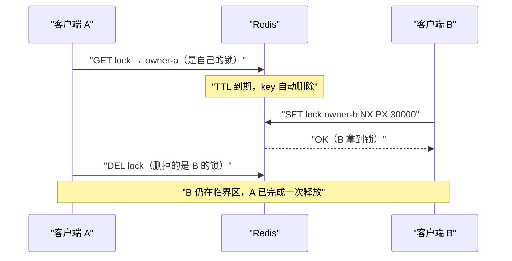
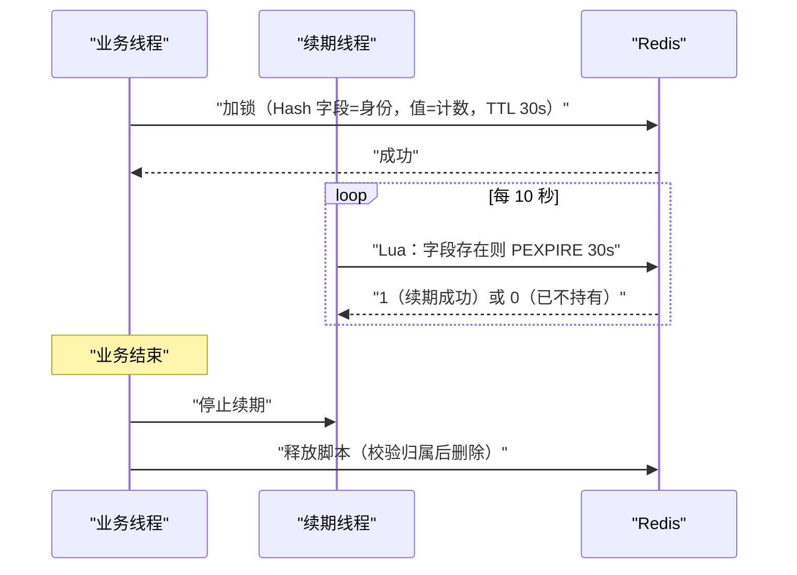
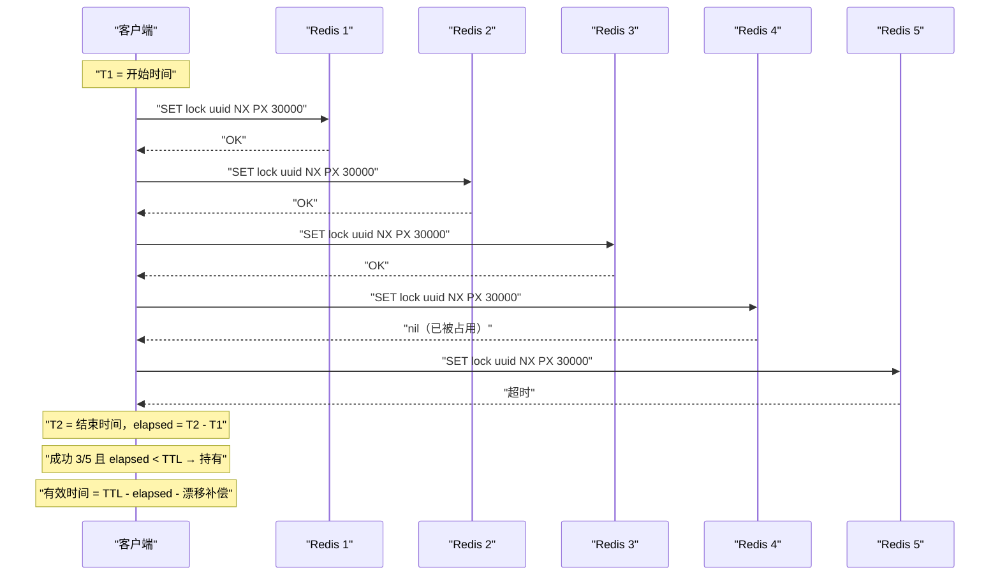
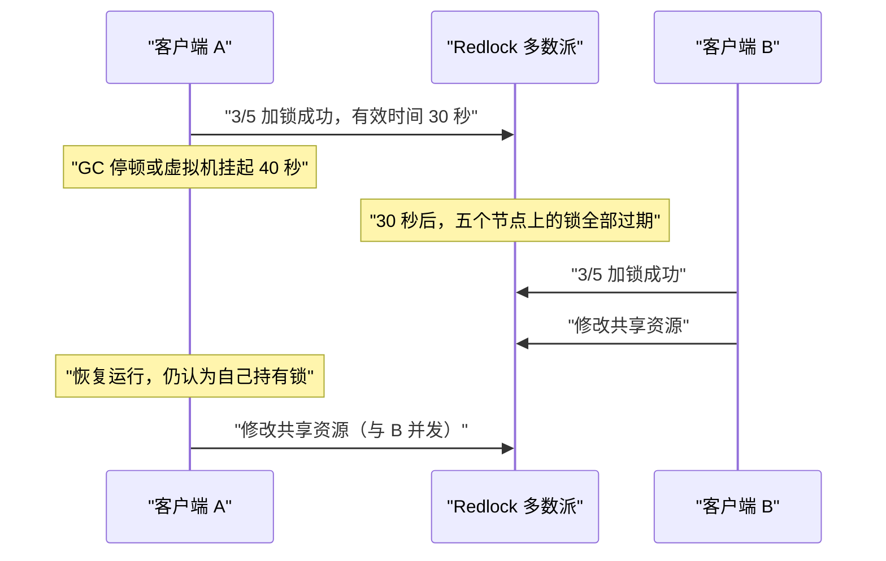
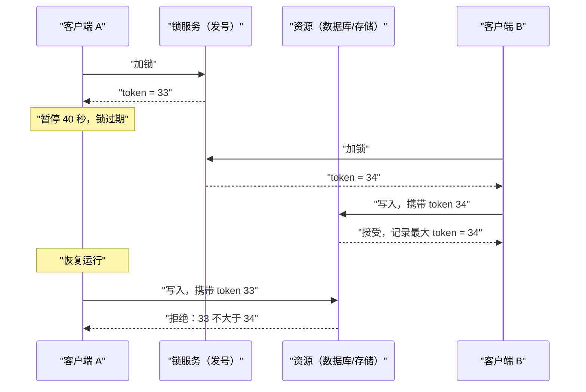

# 06 Redis 分布式锁——从 SETNX 到 Redlock 的争议

**摘要：**

「分布式锁」这四个字在 Redis 语境里通常被当成一条命令，实际指的是一组用时间换活性的约定。本文先把验收标准拆成四条——互斥、不死锁、只被持有者释放、可重入（可选），再用这四条去量五代实现：`SETNX` 加 `EXPIRE` 的两条命令、`SET key val NX PX ttl`、唯一标识加 Lua 释放、看门狗续期、`WAIT` 与 Redlock。每一代解决了哪条属性、又把什么问题留给下一代，逐条对照，并给出单机 Redis 锁真正的适用边界：主从异步复制下的丢锁窗口只能缩小，不能消除。文章的重点不在「Redis 能不能做分布式锁」这个问了很多遍的问题，而在 Redlock 争议的实质：它依赖「进程暂停不超过 TTL」与「时钟漂移有界」两个假设，而 GC 停顿、虚拟机挂起、NTP 跳变都会打破这两个假设。Kleppmann 与 antirez 的分歧不是谁对谁错，而是拿两把不同的尺子量同一件东西，一把量最坏情况下的正确性，一把量常见故障下的可用性。落点是 fencing token 与存储层自己的锁——分布式锁只能降低冲突概率，不能提供强一致保证，正确性必须由被保护的资源来裁决。

---

> [!info] 本篇的分工
> Redis 的内部实现（数据结构、事件循环、持久化、主从与 Cluster 的机制）在 [[中间件/Redis/Redis设计与实现/00 专栏导览|Redis 设计与实现]] 一列里逐篇铺过，本篇只给结论并附双链；主从复制的异步性见 [[09 主从复制与 Sentinel 高可用]]，Lua 脚本的原子性见 [[03 Redis 事务 Lua 脚本与原子性保证]]。这里处理的是使用与运维视角：命令怎么选、参数怎么定、故障长什么样、哪些问题 Redis 锁根本解决不了。

---

## 第 1 章 四个属性：一把锁的验收标准

### 1.1 仲裁者从进程内搬到进程外

单机锁成立的两个隐含前提，一是竞争者在同一块内存里，二是仲裁者由操作系统或语言运行时提供。`synchronized` 有效，是因为所有线程看到的是同一个对象头；`ReentrantLock` 有效，是因为所有线程竞争的是同一个 AQS 状态位。一旦竞争者分散到不同机器，两个前提同时消失：没有共享内存，也没有一个所有进程都认可的调度器。

分布式锁要做的全部事情，是把「谁可以进入临界区」的裁决权交给一个所有参与者都能访问的外部存储，再借助这个存储的原子命令，把「检查并占用」合成一个外部无法插入的动作。这件事没有改变互斥的原理，只是换了一个仲裁者；换仲裁者带来的新问题是仲裁者本身会故障、会过期、会与持有者失联，而单机锁从不需要考虑这些。

从 JVM Monitor 到共享存储的完整推导，在 [[01 分布式锁的本质与设计要求]] 里已经做过，这里只取一个结论：外部存储的故障模型，决定了锁能达到的可靠性上限。Redis 的故障模型是主从异步复制、客户端可能任意停顿、时钟可能跳变，这三条会在后文逐条变成具体的漏洞，而每一条都不是靠「把命令写对」能补上的。

### 1.2 互斥与不死锁：一对互相拉扯的目标

互斥（Mutual Exclusion）要求任一时刻至多存在一个持有者；不死锁（Deadlock Freedom）要求持有者崩溃之后，锁最终能被其他客户端拿到。这两条在单机锁里不冲突：线程死了，内核负责释放它持有的 mutex，这是一条与持有者意愿无关的兜底路径。

跨进程之后，没有任何机制能在持有者崩溃时替它执行 `DEL`，除非引入一个不依赖持有者配合的释放条件。Redis 提供的唯一一种这样的条件是过期时间，于是加锁从「占用一个布尔位」变成「占用一个带截止时间的登记项」，锁的语义也跟着变了：TTL 之内 Redis 认为你在持有，TTL 一到 Redis 单方面宣布锁已释放，不管你是否还活着、是否还在临界区里。

这个转换是后面所有争议的源头。严格意义上的锁与被保护的资源之间没有时间关系，你不释放，它就一直有效；Redis 锁则是一份**租约（lease）**，租约的有效期由服务端的时钟计算，而持有者对自己是否仍持有这件事的认知，停留在自己的进程里。两份认知只要出现分歧——持有者被暂停、网络让响应迟到、服务端时钟跳变——就会出现「服务端认为锁已释放、持有者认为自己仍持有」的状态，而处在这个状态里的持有者，代码还在往下跑。

打个比方，Redis 锁更像酒店前台的房卡授权，而不是卧室门上的那把机械锁。前台把授权写到明天中午，中午一过门锁认下一张卡，你人还在房间里也挡不住同一间房被再卖一次。要做到「我不退房谁也进不来」，需要的是另一种机制，这正是 Redlock 想往那个方向挪一步、而 Kleppmann 认为它挪得不够远的地方。

所以前两条属性不是并列的，它们互相拉扯：越强调不死锁，TTL 就越短，互斥的有效期就越窄；越强调互斥，TTL 就越长，崩溃之后的恢复就越慢。通常说的「设置一个合理的过期时间」，本质上是在这条拉扯线上挑一个点，而不是找到一个两全的值。这一点在第五代实现里会以另一种形式重新出现：Redlock 把「多数派加锁成功」当作更强保证，却没有改变「有效期由本地时间计算」这个事实。

### 1.3 只被持有者释放

第三条常被当成互斥的附属品，其实它是释放路径上的一条独立属性：锁只能由当前持有者释放。单机锁不需要单独要求它，因为释放接口绑定在锁对象上，别人拿不到那个对象；Redis 里释放就是对 key 执行 `DEL`，任何知道 key 名的客户端都能删，而 key 名往往还是可预测的（`lock:order:1001` 这种写法在代码评审里随处可见）。

TTL 让这条变得更要命。设想 A 持有锁、业务卡住、TTL 到期、B 拿到锁；此时 A 的业务恢复，执行 `DEL lock:order:1001`，删掉的是 B 的锁。B 的临界区还在跑，C 又能拿到锁，同一时刻便有两个甚至三个执行者在改同一份数据。整个过程没有报错，Redis 日志干净，监控上只看到锁的获取与释放次数略微偏高。

归属判定要求锁的值不能是一个常量，必须携带本次持有的身份；要让判定与删除不可分割，比较与删除就必须落在同一个原子操作里。这两点合起来构成本文的第三代实现，也是多数生产级 Redis 锁的最小正确形态。缺了它，锁在低并发、短 TTL、业务快的测试环境里一切正常，只在长尾请求与故障切换时暴露。

### 1.4 可重入：可选的第四条

**可重入（Reentrancy）** 允许同一持有者多次获取同一把锁，计数归零时才真正释放。它不是正确性属性，不可重入的锁在语义上完全正确，只是用起来难受：一个已经加锁的方法内部调用了另一个也要加同一把锁的方法，第二次调用会被自己挡在门外，一直等到超时失败。

需要它的场景通常有三类：分层调用（Service 加锁之后调用 Domain，Domain 也加锁）、切面模板（AOP 切面统一加锁，被调方法内部又走同一个切面）、递归或带重试的业务逻辑。三类的共同点是「锁的边界由框架决定，调用链由业务决定」，两者不重合，于是同一个执行流会重复进入。

代价有三项。第一，身份要能区分「同一个执行流」与「另一个执行流」，常见做法是「客户端 ID + 线程 ID」的组合；异步模型里线程会切换，这个组合就失效，需要显式传递上下文。第二，重入计数要和 TTL 一起维护，重入时刷新过期时间，否则外层还没结束、锁先过期。第三，加锁与释放必须严格配对，少一次释放锁不消失，多一次释放会提前放掉，后者在异常路径里非常常见。

可重入的实现顺带解决了另一件事：如果锁的值是一个 Hash，字段存持有者身份、值存计数，那么「判断归属」与「计数」共用同一份结构，续期脚本只要检查字段是否存在，就能知道「我是否还持有」。这个设计上的巧合在第四代续期里会变成一个关键细节。

### 1.5 四属性之外：效率与正确性

四属性是一把量锁服务的尺子，它不量业务。Kleppmann 在批评 Redlock 的文章里先做了一个区分，这个区分比后面的技术争论更重要：锁有两种用途，一种为了效率（Efficiency），一种为了正确性（Correctness）。

效率用途下，锁的作用是避免重复劳动，譬如防止两个定时任务同时处理同一批数据，防止缓存失效的瞬间大量请求同时回源。锁偶尔失效的后果是多做一遍工作，可能把同样的值写两次，或者多消耗一些 CPU，不会造成不可逆的损坏。正确性用途下，锁保护的是不能并发的状态转移，譬如同一个账户的余额扣减、同一个订单的状态推进；锁失效的后果是数据损坏，而数据损坏通常不可逆。

两种用途对四属性的要求完全不同。效率用途里，缺第三条也会出事——双持把重复劳动变成并发写，但通常还能靠幂等兜底；缺第二条是可用性事故，锁卡住意味着任务再也不会执行。正确性用途里，四属性全满足也不够，因为 1.2 节描述的那个状态在四属性框架里根本表达不出来：它不是锁的属性，是「持有者与锁服务之间的时间认知」这个更上层的问题。

所以本文的路线是：先用四属性把五代实现量一遍，再用第 8、9 章说明为什么量完还不够，最后落在 fencing token 与存储层锁上。四属性是必要条件，不是充分条件；把它们当成充分条件，就是「以为 Redlock 提供了强一致」那类反例的起点。

### 1.6 五代实现的全貌

把五代实现摆进同一张表，先看全貌，再逐章拆细节。表里的「部分」表示该属性只在附加假设下成立，具体假设在各章说明；可重入是一条正交属性，理论上可以加在任何一代上，表里标的是各代的典型形态。

| 实现 | 互斥 | 不死锁 | 只被持有者释放 | 可重入 | 解决的核心问题 | 留下的问题 |
| :--- | :--- | :--- | :--- | :--- | :--- | :--- |
| `SETNX` + `EXPIRE` | 是 | 否 | 否 | 否 | 把互斥判断搬到 Redis | 两步之间崩溃即死锁 |
| `SET NX PX` | 是 | 是 | 否 | 否 | 原子加锁与自动过期 | 误删、业务超时、切换丢锁 |
| 唯一标识 + Lua | 是 | 是 | 是 | 否 | 释放时校验归属 | 业务超时、切换丢锁 |
| 续期线程 | 是 | 是 | 是 | 是 | 业务耗时不确定 | 暂停即失效、锁可能永不释放 |
| `WAIT` / Redlock | 部分 | 是 | 是 | 视实现 | 单实例故障丢锁 | 暂停与时钟假设、运维成本 |

这张表有一列值得单独看：第五列。五代实现里只有第四代把可重入当成标配，原因不在技术上，而在使用方式上——自己手写锁的人往往用不到重入，用框架的人拿到的默认就是可重入锁，Redisson 的 `RLock` 就是 Hash 结构加计数。第五代的可重入取决于具体实现，Redlock 的客户端库通常不默认提供。

表里最后一列才是重点。每一代都在解决上一代留下的某个具体问题，同时把问题往更靠近业务的方向推一步：从「命令没写对」推到「TTL 没选对」，再推到「进程会暂停」和「时钟会跳」。推到最后一层时，问题已经不在 Redis 的职责范围内了，这正是第 8 章要展开的内容。

锁的一般性问题——粒度设计、公平性、读写锁、ZooKeeper 与数据库的实现——在 [[分布式架构/分布式锁/00 专栏导览|分布式锁]] 专栏另有系统铺陈，本篇只在需要处引到具体篇目，不重复推导。

---

## 第 2 章 第一代：`SETNX` 与 `EXPIRE` 的两条命令

### 2.1 `SETNX` 的语义

`SETNX` 是 Redis 最早的一批命令，从 1.0 起就存在，语义是「key 不存在时才设置」，返回 1 表示写入成功，返回 0 表示 key 已存在。它是原子的：判断与写入在服务端一次完成，两个客户端同时执行只有一个能拿到 1。用它表示锁，就是「谁拿到 1 谁是持有者」。

`SETNX` 没有过期参数。当时的配套做法是紧跟着执行一条 `EXPIRE`：

```bash
127.0.0.1:6379> SETNX lock:order:1001 owner-a
(integer) 1
127.0.0.1:6379> EXPIRE lock:order:1001 30
(integer) 1
```

`EXPIRE` 返回 1 表示设置成功，返回 0 表示 key 不存在。两条命令分开执行，中间就出现了一个可以被任意事件打断的窗口。

### 2.2 两条命令之间的三种断裂

第一种是客户端崩溃。进程在两条命令之间被 kill、被容器探针重启、被 OOM 杀掉，锁就建成了一笔**没有截止时间**的登记。之后没有人能拿到这把锁，也没有任何机制会替它过期，直到有人手工 `DEL`。

第二种是网络。`SETNX` 到达服务端并执行成功，响应在回程路上超时，客户端重试时拿到 0，于是它无法判断「上一次其实成功了」还是「被别人抢走了」。更糟的是 `EXPIRE` 根本没发出去：客户端在 `SETNX` 返回后网络断开，锁已建立、TTL 未设置，而客户端手里的信息不足以让它知道要补一条 `EXPIRE`。

第三种在服务端。`SETNX` 已被主库确认，`EXPIRE` 还没复制到从库，主库宕机、哨兵提升从库——新主库上这把锁既存在又不会过期。这条与复制有关，机制细节见 [[09 主从复制与 Sentinel 高可用]]，这里只取结论：异步复制让「已确认的写」与「已复制的写」之间存在窗口，任何依赖两条命令的锁都会在这个窗口上再叠一层不确定性。

### 2.3 换个顺序也不成立

有人会想，那就先 `EXPIRE` 再 `SETNX`。`EXPIRE` 对不存在的 key 返回 0，什么都没设置；紧接着 `SETNX` 成功，锁仍然没有 TTL。如果 key 恰好存在（别人的锁），`EXPIRE` 会改掉别人的过期时间，把一把本该很快释放的锁延长，这是另一个方向的误伤。

也有人会想用 `PERSIST`、`RENAME`、`GETSET` 这类命令补救，但它们都不解决「两条命令不原子」这个根本问题。`GETSET` 还有一个额外的坑：它会清掉 key 原有的 TTL，用在一个带过期的锁上等于把锁变成永久的。

### 2.4 这一代留下了什么

互斥成立，因为 `SETNX` 本身是原子的；不死锁不成立，因为加锁与设过期是两步。这一代在 2.6.12 之后基本被 `SET NX PX` 取代，但它的变体仍然活在不少旧代码与自研工具类里，典型的封装长这样：先 `setnx`，成功后再 `expire`，失败就返回 false。这种代码在低并发、短事务、进程稳定的环境里能跑很久，只在部署重启、网络抖动、主从切换时出事，而出事时的现象是「某把锁再也不释放」或「某段时间内同一任务跑了两次」。

---

## 第 3 章 第二代：一条 `SET` 把加锁与过期绑在一起

### 3.1 命令的形状

Redis 2.6.12 起，`SET` 支持 `NX` 与 `EX`/`PX` 选项，加锁可以写成一条命令：

```bash
127.0.0.1:6379> SET lock:order:1001 owner-a NX PX 30000
OK
127.0.0.1:6379> SET lock:order:1001 owner-b NX PX 30000
(nil)
```

`NX` 表示只在 key 不存在时写入，`PX 30000` 表示 30 秒后过期，返回 `OK` 是拿到锁，返回 `nil` 是没拿到。把「判断存在」「写入值」「设置过期」三件事放进一条命令，中间不再有可被打断的位置，第 2 章的三条断裂同时消失。

`SET` 的选项不止这两个，锁的实现里常被问到的那几个列在下面。用错的代价不是报错，而是语义悄悄偏掉。

| 选项 | 语义 | 在锁场景里的用法 | 需要注意的地方 |
| :--- | :--- | :--- | :--- |
| `NX` | 仅当 key 不存在时写入 | 加锁的标准写法 | 与 `XX` 互斥 |
| `XX` | 仅当 key 存在时写入 | 覆盖已有锁的值（少见） | 覆盖会改变归属，几乎不该用 |
| `EX` / `PX` | 相对过期，秒 / 毫秒 | 设置租约长度 | `PX` 精度更高，锁一律用 `PX` |
| `EXAT` / `PXAT` | 绝对过期时间戳 | 跨客户端约定同一个截止时刻 | 依赖客户端时钟，时钟不准会提前或延后过期 |
| `KEEPTTL` | 保留原有 TTL | 改写锁值时不想重置租约 | 锁的归属变了却不重置 TTL，等于给新持有者一个残值 |
| `GET` | 返回旧值 | 拿锁的同时看到上一个持有者 | 返回值不是「是否拿到锁」的判据，必须看命令本身是否成功 |

`EXAT` 与 `PXAT` 是 6.2 加入的，`KEEPTTL` 是 6.0 加入的。它们的存在说明一件事：`SET` 的选项化不是一次设计完成的，而是十几年里按需求长出来的。锁的实现只该用其中一小部分，剩下的选项更适合配置、缓存与迁移场景。

### 3.2 原子性从哪里来

这条命令的原子性来自服务端的执行模型：命令在单线程里执行，执行期间不会处理别的客户端的命令，因此「判断 key 是否存在」与「写入并设置过期」之间不存在插入点。这是单线程模型带来的直接结果，不需要额外机制（[[05 单线程模型与事件驱动架构]] 把这条路径拆到了事件循环与命令分发的粒度，本篇只取结论）。

这里的「原子」要限定在**不被插入**这一层。它不承诺失败回滚，也不承诺命令执行之后业务能安全地跑完——后两件事与命令无关，属于第 4、5 章的内容。[[03 Redis 事务 Lua 脚本与原子性保证]] 把「原子」拆成隔离、全或无、可重复执行三种承诺并逐项核对过，加锁用到的只是第一种。

还有一个容易被忽略的细节：过期时间由服务端在写入时计算并保存为绝对时间戳，之后所有过期判断都在服务端完成。这意味着单机锁的租约长度不受客户端时钟影响，客户端只需要知道自己「大概过了多久」。这个性质在第五代里会反过来——Redlock 把多个独立实例的过期时间拼成一个整体结论时，客户端本地时钟重新变成了计算的一部分。

### 3.3 返回值与客户端的误读

`SET ... NX` 的返回值在不同客户端库里的映射不一样：Jedis 返回 `"OK"` 或 `null`，Lettuce 返回 `Boolean`，Go 的 `go-redis` 返回 `bool` 与 `error`，Redisson 则把加锁包进 Lua 脚本、返回值是 TTL。误读通常有三种。

第一种是把 `null` 当异常吞掉。某些库在连接异常时也返回 `null`，与「锁已被占用」同形；代码如果不区分，会在没拿到锁的情况下继续执行临界区。

第二种是把 `SET ... NX GET` 的返回值当成加锁结果。`GET` 选项返回的是旧值，加锁失败时它返回的是当前持有者的标识而不是 `nil`，于是「返回值非空」既可以表示加锁成功（旧值是上一个持有者的标识），也可以表示加锁失败。判断加锁是否成功只能看命令本身的回复，不能看 `GET` 的返回内容。

第三种出现在超时重试里，也是最隐蔽的一种。客户端发出 `SET NX PX`，服务端执行成功，响应在回程丢失，客户端超时后重试，第二次拿到 `nil`，于是它认为「没抢到锁」，放弃并继续其他逻辑。可锁其实在它名下，直到 TTL 到期才释放。这段时间里没有别人能进入临界区，业务却以为自己在排队——这是锁泄漏（lock leak）的一种，与「忘记释放」不同，它是「持有而不自知」。用唯一的 value 能诊断这种情况（重试前 `GET` 一次看是不是自己的标识），但不能靠 `GET` 恢复持有，因为 `GET` 与后续操作之间仍然没有原子性。

### 3.4 TTL 的两难

第二代把加锁这一侧做对了，剩下最关键的参数是 TTL。设短了，业务还没跑完锁就过期，双持概率上升；设长了，持有者崩溃后锁的滞留时间变长，恢复变慢，热点锁上的排队也会变长。

实践中的起点通常是「业务耗时的分位数乘以一个倍数」。**示例推算**：某接口的锁内耗时 p99 为 120 毫秒、p99.9 为 400 毫秒，取 TTL 3 秒是 p99.9 的 7.5 倍，取 30 秒是 75 倍。前者的风险是长尾请求（GC、慢查询、下游抖动）一旦超过 3 秒就破锁，后者的代价是一次崩溃要让这把锁空置 30 秒。倍数取多少，取决于你能接受哪一种事故：破锁导致的双持，还是滞留导致的排队。

这张表把锁相关的三个参数放在一起，重点看后两列——每个参数调大调小都有代价，没有单向更优的选项。

| 参数 | 建议起点 | 调大的代价 | 调小的代价 |
| :--- | :--- | :--- | :--- |
| 锁 TTL | 业务 p99.9 的 3-10 倍，示例取 30 秒 | 崩溃后锁滞留久，热点锁排队时间变长 | 长尾请求破锁，双持概率上升 |
| 加锁等待时间 | 50-200 毫秒，必须有界 | 请求堆积、RT 上升、线程池被占满 | 加锁失败率高，降级与补偿频繁触发 |
| 重试间隔 | 20-50 毫秒起步，加随机抖动 | 锁空出后长时间没人拿到，吞吐下降 | 失败请求放大，空转的 QPS 上升 |

### 3.5 解决了死锁，留下了三件事

第二代解决了**不死锁**：加锁与设置过期是一条命令，客户端崩溃后锁必然在 TTL 到期时释放。它留下三件事，分别对应后三代实现。

第一是误删。任何客户端都能 `DEL` 这个 key，释放路径没有归属校验，第 4 章处理。第二是业务超时。TTL 是事先猜的，业务耗时是事后才知道的，两者对不上时要么破锁要么滞留，第 5 章处理。第三是主从切换。锁写进主库、还没复制到从库时主库宕机，新主库上没有这把锁，单机（含主从）Redis 在这个窗口里给不出任何保证，第 6 章处理。

这三件事的顺序不是随意的：它们一个比一个更远离「把命令写对」，一个比一个更依赖对系统故障模型的理解。到第三件事为止，问题已经不能靠改客户端代码解决了。

---

## 第 4 章 第三代：唯一标识与 Lua 释放

### 4.1 `GET` 加 `DEL` 的时序反例

第 1.3 节的结论落到代码上，最直观的错误写法是 `GET` 判断值再 `DEL`：

```bash
127.0.0.1:6379> GET lock:order:1001
"owner-a"
127.0.0.1:6379> DEL lock:order:1001
(integer) 1
```

这段代码在「锁没有易主」的前提下是对的，但在锁会过期的前提下，两个命令之间的任何事件都可能让它删错：



时间线复述一遍：A 执行 `GET`，返回自己的标识，判断通过；随后锁到期自动删除；B 用 `SET NX PX` 拿到锁；A 执行 `DEL`，删掉的是 B 的锁。A 从头到尾没有违反任何一条命令的语义，它只是在两件事之间失去了对「锁是否还是自己的」这个事实的掌握。

### 4.2 标识的形状

要让归属可判定，value 必须能唯一标识「这一次持有」。三种常见错误值得逐条排除。

用进程 ID。容器重启后 PID 复用，两个不同进程可能拿到同一个 PID；同一个 PID 在不同主机上也不唯一。

用主机名或 IP。同一台机器上多个线程、多个进程会互相认领对方的锁。

用客户端 ID 而不带尝试序号。客户端重连、超时重试时**复用同一个 ID**，旧请求的释放脚本会删掉新请求的锁——两次持有在服务端看来是同一个身份，归属校验形同虚设。

可用的形状是「客户端唯一 ID + 本次尝试的唯一序号」，客户端 ID 在启动时生成（UUID 即可），尝试序号每次加锁自增或随机。Redisson 的 Hash 结构用「客户端 UUID + 线程 ID」作为字段，线程内的重入共用同一个字段，跨线程则天然隔离。

标识不需要全局有序，只需要在「同一把锁的历史持有者」范围内不重复。这一点与 fencing token 的要求正好相反：fencing token 必须全局单调递增，标识只需要唯一。把两者混为一谈，会在第 9 章付出代价。

### 4.3 释放脚本

释放要用 Lua 把「比较」与「删除」合成一个执行体：

```lua
-- KEYS[1]：锁 key；ARGV[1]：本次持有的唯一标识
if redis.call('GET', KEYS[1]) == ARGV[1] then
    return redis.call('DEL', KEYS[1])
end
return 0
```

脚本在服务端单线程里执行，期间不会插入别的命令，比较与删除之间不存在窗口。返回值 1 表示确实删掉了自己的锁，0 表示锁已不属于自己——后者不是错误，而是一条重要信号：它说明本次持有可能已经过期并被别人接手，调用方应当记录、告警，并检查临界区是否在无锁状态下执行过。

脚本的原子性来源与阻塞代价由 [[03 Redis 事务 Lua 脚本与原子性保证]] 负责，这里只强调两条工程纪律：所有键通过 `KEYS` 传入，不要用字符串拼接构造键名；脚本要短，不要在里面遍历集合。释放脚本只有三条语句，天然满足。

`EVALSHA` 缓存与 `NOSCRIPT` 回退也是这条链路上的一环：脚本第一次执行后服务端缓存其 SHA1，客户端通常先用 `EVALSHA`；主从切换、脚本缓存被清空时 `EVALSHA` 会返回 `NOSCRIPT`，客户端必须能回退到 `EVAL`。不少自研锁实现在这里漏了回退，故障转移之后释放操作大面积失败，锁全部靠 TTL 自然过期。

### 4.4 重试语义：value 必须每次尝试唯一

第 3.3 节提到的「持有而不自知」，在引入唯一标识之后有了诊断手段，但也带来一个新的坑：如果客户端把「客户端 ID」直接当 value，超时重试时两次尝试的 value 相同，那么第一次请求延迟到达的释放脚本，会删掉第二次请求刚刚拿到的锁。

正确的做法是每次加锁尝试生成一个新的 value，释放时只释放本次尝试的 value。重试逻辑要保存「上一次尝试的 value」以便诊断，但不能用它去释放。这条纪律在同步代码里容易遵守，在异步框架、连接池复用、请求上下文丢失的场景里经常被破坏。

### 4.5 解决了误删，留下了业务超时

第三代解决了「只被持有者释放」：释放前校验归属，校验与删除原子，值唯一且每次尝试独立。四属性里已有三条成立（互斥、不死锁、归属），剩下的问题是 TTL 与业务耗时的错配——锁会在业务跑完之前过期，而这一代没有任何机制能感知业务的进度。

还有一个边界要说明：这一代的归属校验只保护释放路径，不保护临界区。A 的锁过期后，B 拿到锁，A 仍在写数据；A 的释放脚本此时会返回 0，但数据已经写脏了。归属校验让锁的状态干净，没让数据干净。这个区分在第 8 章会变成争论的核心：锁的状态正确，不等于被保护的状态正确。

---

## 第 5 章 第四代：续期线程与它的三个陷阱

### 5.1 看门狗的形状

TTL 的两难在第三代之后依然存在，而且更尖锐：业务耗时分布长尾很重，任何固定 TTL 都会被某条长尾突破。解决方向不是把 TTL 设得更大，而是把「租约长度」与「业务是否还在跑」解耦：先用一个较短的租约拿到锁，再由一个后台线程在租约到期前续期，只要持有者还活着，锁就一直有效。

这就是**看门狗（watchdog）**。Redis 侧没有原生支持，它是客户端库的机制，Redisson 的实现最有代表性：默认租约 30 秒，后台线程每 10 秒（租约的 1/3）执行一次续期，续期用 Lua 脚本，先确认锁仍由自己持有，再把过期时间重置为 30 秒。



续期脚本的骨架是这样，注意 `HEXISTS` 那一步——它不是可选的优化，而是安全边界：

```lua
-- KEYS[1]：锁 key；ARGV[1]：租约毫秒；ARGV[2]：持有者字段
if redis.call('HEXISTS', KEYS[1], ARGV[2]) == 1 then
    return redis.call('PEXPIRE', KEYS[1], ARGV[1])
end
return 0
```

Redisson 只在调用方没有显式指定租约时间时才启用看门狗；一旦显式传入 `leaseTime`，续期就不启动，锁按指定时间过期。这个行为差异是很多「明明用了 Redisson 还是破锁」事故的来源：调用方为了「避免锁不释放」，显式传了一个 30 秒的租约，结果看门狗根本没开。

### 5.2 可重入：Hash 表示顺带解决了归属校验

看门狗最常见的搭档是可重入锁，两者共用一份 Hash 结构：字段是持有者身份，值是重入计数。加锁脚本在锁不存在时写入字段并把计数设为 1，在字段已存在时把计数加一，锁被别人持有时返回失败；释放脚本把计数减一，归零才删除 key。

```lua
-- 加锁：KEYS[1]=锁 key，ARGV[1]=租约毫秒，ARGV[2]=持有者字段
if redis.call('EXISTS', KEYS[1]) == 0 then
    redis.call('HSET', KEYS[1], ARGV[2], 1)
    redis.call('PEXPIRE', KEYS[1], ARGV[1])
    return 1
end
if redis.call('HEXISTS', KEYS[1], ARGV[2]) == 1 then
    return redis.call('HINCRBY', KEYS[1], ARGV[2], 1)
end
return 0
```

这个结构让「归属判定」与「重入计数」合并成一次 `HEXISTS`，续期脚本也因此能复用同一份身份信息。代价是锁的值不再是简单的字符串，`GET`/`SET` 这类简单命令不能直接用于诊断，排查时要 `HGETALL`。

可重入的边界要写清楚：计数只在同一个持有者内有效，跨进程、跨线程都不共享；异步编程里上下文切换会让「同一个持有者」的判断失效；计数与 TTL 是两套账，重入时刷新 TTL、释放时不刷新，两套账对不上时锁的状态就会漂移。

### 5.3 陷阱一：续期必须校验自己还持有

续期脚本如果**只续期不校验**归属，会造成两类事故，而且都很难排查。第一类是双持：A 的锁过期、B 拿到锁，A 的续期线程醒来，无条件 `PEXPIRE` 把 B 的锁续上 30 秒，续期返回成功，A 于是认为自己仍持有，可能继续进入临界区——A 与 B 同时写同一份数据。第二类是锁永生：B 崩溃之后，本来该在 30 秒后自动释放的锁被 A 一直续着，永远不会过期，直到 A 的进程退出。

这类事故的现象是「某个 key 的 TTL 一直在 20 到 30 秒之间跳，但没人能拿到锁」，`TTL` 看得到剩余时间在跳，`HGETALL` 看到的是某个客户端留下的字段，而那个客户端已经不在了。排查时容易误判为「客户端泄漏了锁」，实际是另一个客户端的续期线程在替错误的对象续命。

### 5.4 陷阱二：暂停醒来不要盲目续

比「替别人续期」更隐蔽的是「替自己续一个已经不属于自己的锁」。续期线程在 GC 停顿、虚拟机挂起、容器被冻结期间无法运行，醒来时它只知道「该续期了」，不知道「中间过了多久」。如果它醒来后无条件 `PEXPIRE`，就会把一个已经被别人接手的锁重新变成自己的——但业务线程的状态并没有跟着回滚，它可能已经执行到临界区中段。

这里有一个容易含糊的地方：续期脚本校验了归属，是不是就安全了？不是。校验通过说明「此刻这个字段还在」，但字段还在不等于「业务线程在暂停期间没有越过临界区」。真正的安全要求是：续期失败时必须让业务线程感知到「锁已丢失」，并由业务决定是中止、回滚还是继续。多数客户端库只做前者（停止续期、记录日志），把后半段留给业务，而业务代码通常没有处理这个信号。

### 5.5 陷阱三：续期间隔与 TTL 的比例

比例取 1/3 是经验值，含义是「允许连续两次续期失败仍然不丢锁」。取 1/2 时，一次网络抖动就可能导致锁过期；取 1/10 时，续期 QPS 涨三倍多，且给调度抖动的预算过小——JVM 的一次短 GC、容器的一次 CPU 抢占都可能让续期迟到。

| 参数 | 建议起点 | 调大的代价 | 调小的代价 |
| :--- | :--- | :--- | :--- |
| 租约长度 | 30 秒（Redisson 默认） | 崩溃后锁滞留久；续期「永不释放」的窗口更长 | 续期频率上升，抖动容忍度下降 |
| 续期比例 | 租约的 1/3 | 续期 QPS 与调度开销上升 | 一次迟到即过期，双持概率上升 |
| 续期失败容忍次数 | 2 次 | 锁失效的发现被延迟 | 网络抖动即触发锁丢失告警 |

比例这件事没有精确解，因为它本质上是「用多大的时间余量去覆盖调度抖动」。余量要覆盖的是最长的一次暂停，而最长的一次暂停无法事先知道，只能按经验给一个数量级。

### 5.6 续期的代价

看门狗解决了业务耗时不确定的问题，代价有两条。

第一条是**锁可能永不释放**。续期的条件是「持有者进程还活着」，而不是「业务还在正常推进」。业务线程死循环、阻塞在下游、被死锁卡住，只要进程活着，续期线程就会一直续，锁就一直不释放。与没有续期相比，这是把「TTL 到点自动放行」的兜底换成了「依赖进程存活」，方向正好相反。缓解手段是给业务加执行超时，超时后主动停止续期并释放，或者在锁上额外记录一个业务截止时间。

第二条是额外的 QPS。续期频率是租约的 1/3，活跃锁数量为 L 时，续期 QPS 约为 3L 除以租约秒数。举例推算：5 万把活跃锁、租约 30 秒，续期 QPS 约 5000；锁数量翻十倍，续期 QPS 就到 5 万，与很多业务的正常读 QPS 在同一量级。这笔开销通常可以接受，但在锁数量巨大、租约很短的场景里会成为 Redis 的可见负载。

### 5.7 解决了业务超时，留下了暂停

第四代解决了「业务没跑完锁就过期」的常规情形：只要业务在推进、进程没被暂停，锁就会一直有效。它没有解决暂停：续期线程和业务线程在同一个进程里，进程被暂停时两者一起停，锁在暂停期间过期，业务在恢复后继续执行。这个问题在第五代里没有被解决，只是被换了一种形式，最终在第 8 章成为争论的焦点。

---

## 第 6 章 第五代（上）：`WAIT` 与主从切换的窗口

### 6.1 一个必然存在的窗口

前四代都在单实例内部做文章，无论怎么优化，都绕不开一个问题：锁写进了主库，但没到从库时主库宕机。Redis 的主从复制是异步的——主库执行完写命令就向客户端返回成功，复制在后台进行（机制与偏移量、复制积压缓冲区的细节见 [[09 主从复制与 Sentinel 高可用]]，这里只取结论）。当哨兵把某个从库提升为新主库时，新主库上可能没有这把锁，别人就能在新主库上把同一把锁再拿一次。

这个窗口的大小取决于复制延迟，典型值是毫秒级到几十毫秒，主库压力大、网络抖动、从库阻塞时会更长。它无法通过客户端重试或命令优化消除，因为问题出在「确认」与「持久」之间的时间差。

### 6.2 `WAIT` 能做什么

Redis 3.0 提供了 `WAIT numreplicas timeout`：客户端在写完之后调用它，服务端会阻塞到至少有 `numreplicas` 个副本确认收到此前的写，或者超时。用它给加锁加一道同步屏障，写法是把 `SET NX PX` 与 `WAIT` 放在同一个连接上：

```bash
127.0.0.1:6379> SET lock:order:1001 owner-a NX PX 30000
OK
127.0.0.1:6379> WAIT 1 100
(integer) 1
```

返回 1 表示至少一个副本已经确认。加锁之后等一个副本，锁在故障转移后仍然存在的概率会提高，窗口随之缩小。但它只是**缩小而不是消除**，原因有四条。

第一，`WAIT` 保证「至少 N 个副本收到」，不保证「被提升为新主库的那个副本收到了」。哨兵的选择依据是优先级、复制偏移量与运行 ID，通常倾向于偏移量更大的副本，但这不是对某一次具体写的承诺。第二，`WAIT` 返回之后到故障转移完成之间仍有时间，期间的复制可能中断。第三，`WAIT` 只作用于当前连接、当前分片；Cluster 模式下每个分片各算各的，锁 key 所在分片的副本才是相关的。第四，`WAIT` 是阻塞命令，不能在 Lua 脚本里调用；放进事务里执行时阻塞会被禁用，等待退化成「立即返回当前确认数」，语义与单独执行时并不相同。超时设置不当还会让加锁线程被拖住。

### 6.3 `min-replicas-to-write` 的取舍

另一条路是让主库在副本不足时拒绝写：配置 `min-replicas-to-write 1` 与 `min-replicas-max-lag 10`，主库连接到的健康副本少于 1 个、或延迟超过 10 秒时，写命令直接返回错误。这样「写成功」与「至少一个副本有」被绑在一起，锁的丢失窗口被压缩到「副本确认之后、主库宕机之前」的极小段。

代价是可用性。副本全部失联时，主库拒绝所有写，不只是锁——这台 Redis 上承载的全部业务一起受影响。锁服务通常与业务数据共用实例，为一个锁特性打开这个开关，等于让整个实例的写可用性受制于副本状态。这条配置更适合「数据可靠性优先」的场景，不适合当作锁的专用补丁。

### 6.4 Cluster 不改变结论

把锁放进 Redis Cluster，锁 key 只落在一个分片上，加锁、续期、释放都在这个分片上完成。分片的主从切换同样是异步复制，同样存在丢锁窗口；Cluster 带来的是容量与吞吐的水平扩展，不是锁的正确性。跨分片的锁更麻烦：多个 key 不在同一槽时无法用一条脚本原子操作，分布式锁一旦需要保护多个资源，就退化成「多次加锁 + 部分失败回滚」，而回滚本身又没有原子保证。

分片与槽位机制见 [[10 Redis Cluster 分布式架构]]，与锁相关的结论只有一条：分片解决容量问题，不解决一致性问题。

### 6.5 单机 Redis 锁的边界

到这里可以把单机（含主从、Sentinel、Cluster 单分片）Redis 锁的边界写清楚：在租约有效期内、在没有发生主从切换、在没有发生客户端暂停的前提下，它提供互斥；这三个前提中的任何一个被打破，互斥就可能失效，而失效时不会有任何报错。它适合**效率场景**，适合「万一失效靠幂等或对账兜底」的场景；把正确性完全押在锁上的**正确性场景**不适合，除非资源侧有 fencing 兜底。

Redlock 想做的，是把第一个前提（主从切换）也覆盖掉。

---

## 第 7 章 第五代（下）：Redlock 与它的假设

### 7.1 N 个独立实例

Redlock 的思路很直接：既然单实例的问题在于「一个实例的故障会丢锁」，那就用多个互不相关的实例，让锁在多数实例上都存在。它要求 N 个独立的 Redis 主节点，彼此没有主从关系，推荐 N 取 5；客户端依次向每个节点加锁，成功数达到 N/2+1 且总耗时小于 TTL，才算拿到锁。

**独立**是关键。如果五个节点之间有复制关系，多数派就退化成一个主加四个副本，丢锁窗口一点没变。这个要求在实际部署里代价不小：五套互不相关的 Redis，独立的机器、独立的故障域、独立的运维，任何一套出问题都可能影响加锁成功率。



### 7.2 算法的六步

完整流程可以写成六步：记录开始时间；依次向 N 个节点发 `SET NX PX`，每个节点设一个很短的超时，避免被单个故障节点拖住；记录结束时间；计算耗时；成功数过半且耗时小于 TTL 则判定成功；失败则在所有节点上执行释放脚本，包括那些「没成功」的节点——因为超时的那次 `SET` 可能已经执行成功，只是响应丢了。

有效时间的计算是 `TTL - elapsed - 漂移补偿`。漂移补偿是为了覆盖「计算 elapsed 期间本机时钟的漂移」与「锁在其他节点上已经开始计时」这两件事，具体系数由实现取，规范给的是一个经验值。这个减法本身就是 Redlock 脆弱性的说明书：它承认「你以为的有效期」与「实际的有效期」之间有误差，只能扣掉一段来兜底。

### 7.3 假设清单

Redlock 的安全性依赖以下假设，缺一不可。

N 个节点独立，故障不相关。各节点时钟漂移速率有界，且不做大幅跳变；不要求时钟同步，但要求「走时速度大致一样」。客户端的进程暂停时间有界，且远小于 TTL；网络延迟有界。加锁期间不会有节点重启并丢失数据——Redis 的持久化不是每次写都落盘。

把这些假设摊开看，会发现它们不是「实现细节」，而是**故障模型**。Redlock 在一个「时钟近似可靠、进程近似不会长时间停顿」的模型里是安全的；问题在于这个模型与真实系统的差距，正是分布式系统里最难处理的那部分。

### 7.4 代价

Redlock 的工程代价常被低估。五套独立实例的部署与运维；每次加锁要发五次请求，延迟取决于最慢的那个节点；失败要清理五个节点，清理本身也可能失败；客户端库的支持有限，Redisson 已经把 `RedissonRedLock` 类标为废弃，文档把它指向 `RLock` 与 `RFencedLock`；监控与排障要同时看五个实例的时钟、负载与网络。

这些代价换来的是「容忍少数节点故障」，不是「更强的互斥」。如果故障主要来自客户端暂停而不是节点宕机，这笔投入买不到想要的东西——这正是下一章要展开的分歧。

---

## 第 8 章 争议的实质：两把尺子量同一件东西

### 8.1 Kleppmann 的攻击：进程暂停

2016 年 2 月，Martin Kleppmann 发表《How to do distributed locking》，对 Redlock 提出系统性批评。他的第一个反例不需要节点故障，也不需要时钟出错，只需要客户端暂停：



A 没有任何违反协议的动作：它加锁成功，它认为自己还在有效期内，它继续写。问题在于「它认为」这三个字——暂停期间它无法观察时间，也无法观察锁的状态。Redlock 在多数节点上的成功只证明「加锁那一刻锁被建立」，不证明「持有期间锁一直有效」，而后者才是互斥需要的。

这个反例的力量在于它不针对 Redlock 的实现细节，而针对所有「基于过期时间的锁」。Kleppmann 说得很清楚：这不是 Redlock 独有的缺陷，单节点锁、看门狗、ZooKeeper 的会话租约都有同样的问题。区别在于 Redlock 声称自己更安全，而这个声称在暂停场景下不成立。

### 8.2 第二个攻击：时钟

第二个反例针对时钟。Redlock 用开始时间与结束时间的差计算 elapsed，用本机时钟判断锁是否还有效；如果某个节点的时钟被 NTP 向前跳了几秒，那个节点上的锁会提前过期，多数派中就可能出现「一部分节点还有锁、一部分已经没了」的状态。客户端本地时钟的跳变同样会让 elapsed 计算失真。

Kleppmann 的措辞很克制：他不说时钟一定会跳，他说依赖时钟的算法必须把时钟跳变纳入故障模型，而 Redlock 的文档把这个风险归给了运维（配好 NTP、别手工改时间），这在工程上是一种转移，不是一种解决。

### 8.3 更根本的一问：租约能不能承担正确性

把两个反例放在一起，会得到一个更一般的结论：任何带自动过期的锁，安全性都依赖「进程的时钟与真实时间同步」与「进程不会在关键区间内被暂停」。这两条在异步系统模型里都没有保证，因此这类锁只能提供「大概率互斥」，不能提供「确定互斥」。

Kleppmann 由此给出一个判断：如果锁用于效率，Redis 锁够用，因为失效的代价只是重复工作；如果锁用于正确性，那么无论单机还是 Redlock 都不够，需要的是 fencing token——让被保护的资源自己拒绝过期的持有者。

### 8.4 antirez 的回应

antirez 随后写了《Is Redlock safe?》，回应集中在三点。

关于时钟，Redlock 的漂移补偿已经把时钟速率误差算进去了，算法要求的不是时钟同步，而是漂移有界；时钟跳变是运维问题，配好 NTP、不做手工调整即可。关于暂停，这个问题对所有带 TTL 的锁都一样，包括单机锁和 ZooKeeper 的会话；用「进程可能暂停任意长」去否定 Redlock，等于否定所有基于租约的锁。关于 fencing，不是所有被保护的资源都支持 fencing，发一封邮件、往一个只支持覆盖写的存储里写文件，都没有「拒绝旧令牌」的能力；在这些场景里，Redlock 比单实例更可靠，仍然有价值。

这三点回应在各自的框架里都成立。分歧不在事实，在框架。

### 8.5 分歧在哪里

把双方的前提摊开，分歧其实有三层。

第一层是用途。Kleppmann 讨论的是锁用于正确性的场景，antirez 讨论的是锁用于提高可靠性的场景。同一套算法，在前者的标准下不合格，在后者的标准下是改进。

第二层是故障模型。Kleppmann 把「进程任意暂停」「时钟跳变」当作必须覆盖的故障；antirez 把它们当作需要运维控制的前提。这不是技术分歧，是对系统边界的约定不同。把 GC 停顿视为常态还是异常，决定了对同一个算法完全不同的评价。

第三层是「多数派」到底解决了什么。Redlock 的多数派解决的是节点故障这一类问题：少数节点宕机，锁仍然存在。它没有解决「持有者与锁服务失联」这一类问题，因为后者与节点数量无关。两类故障是**正交**的，把多数派当成「更强的互斥」，是把一类故障的容错当成另一类故障的容错。这一层是笔者认为整场争论里最值得记住的部分。

### 8.6 笔者的落点

如果一定要给一个可操作的结论，笔者会这样表述：分布式锁不能提供强一致性保证，它只能降低冲突发生的概率；把这个概率当成保证，事故就会在概率最低的地方发生。需要强一致的场景，要么让被保护的资源自己拒绝旧持有者（fencing token），要么直接用存储层自己的锁（数据库行锁、乐观锁、唯一约束、状态机 CAS）。

Redlock 的位置在这条谱系的中间：它比单实例 Redis 更能容忍节点故障，比 ZooKeeper/etcd 更便宜、更简单，但它没有跨过租约这条线，因此不能承担正确性。把它当成「更强的单机锁」是合适的，把它当成「强一致的锁」是误读。这场争论更完整的还原与双方原文的逐段对照，见 [[03 Redlock 算法正确性争议]]。

---

## 第 9 章 fencing token：把正确性移到资源侧

### 9.1 机制

**fencing token（栅栏令牌）** 的思路，是把「谁有资格写」的裁决权从锁服务移到被保护的资源上。锁服务每次发放锁时附带一个单调递增的编号，客户端拿着编号去写资源，资源记住见过的最大编号，拒绝任何编号不大于它的写。于是即使旧持有者在暂停后醒来、即使锁已经易主，它的写也会被资源拒绝。



这个机制不依赖「锁是否过期」这个判断，只依赖「编号单调」与「资源校验」两件事。它把正确性从时间搬到了顺序，而顺序可以在资源侧持久化。

### 9.2 数据库的版本列

最常见的落地形状是给被保护的表加一列，写入时带上令牌并做条件更新：

```sql
-- 表上增加 fencing 列，记录资源见过的最大令牌
ALTER TABLE account ADD COLUMN fence BIGINT NOT NULL DEFAULT 0;

-- 写入时校验：只有比已见令牌更大的写才被接受
UPDATE account
   SET balance = 900, fence = 34
 WHERE id = 1001 AND fence < 34;
```

影响行数为 1 表示写入被接受，为 0 表示令牌已过期、写入被拒绝。校验与写入在同一个 `UPDATE` 里完成，不存在「先查后写」的窗口，这一点与锁的 Lua 脚本是同一个道理，只是裁决者从 Redis 换成了数据库。

如果业务本来就在数据库里做乐观锁，`version` 列可以承担同样的职责：`UPDATE ... WHERE id = ? AND version = ?` 拒绝的是「版本已被别人改过」的写。两者的区别在于 `version` 由业务自己读、自己带，fencing token 由锁服务发；前者在「读了之后被暂停」的场景里同样会失效，后者不会——因为令牌是单调的，旧令牌天然被拒。

### 9.3 存储与协议层的条件写

支持 HTTP 语义的资源可以用 `If-Match`：客户端带上资源的 ETag，服务端在 ETag 不匹配时返回 412。对象存储的条件写、配置中心的条件更新、Kubernetes 的 `resourceVersion`，本质都是同一件事——把「我期望的版本」与「服务端当前版本」的比较放进一次原子操作里。

etcd 与 ZooKeeper 的天然优势在这里：etcd 的 revision 全局单调递增，ZooKeeper 的 zxid 与节点版本号也是单调的，它们本身就是号源，不需要额外造一个。这也是为什么「需要强一致的锁」时会被推荐用 etcd/ZooKeeper——不是因为它们的锁不会过期，而是因为它们能顺手提供单调的令牌。

### 9.4 号源的单调性：比锁更难的要求

fencing token 最容易做错的地方不在校验，而在**号源**。令牌必须全局单调，且跨故障不回退。用 Redis 的 `INCR` 生成令牌看起来很方便，但主从切换后从库的计数器可能落后，新主库发出来的号可能比旧主库已经发出去的小——一次故障转移就能让 fencing 失效，而这正是它本来要防的场景。

可用的号源通常有三类：数据库的自增序列（注意主库切换时自增序列可能落后于旧主库已发出的值，需要额外的单调性保证）、etcd 的 revision、ZooKeeper 的 zxid。共同点是它们本身有一个跨故障的单调机制，而不是一个可以被复制的计数器。造号源的难度往往超过造锁，这是很多「加个 fencing token」的方案最后没有落地的真实原因。

### 9.5 资源不支持条件写时怎么办

如果被保护的资源不支持条件写——发邮件、调用第三方接口、往一个只认覆盖写的存储里写——fencing 就无处落地。这时能依靠的是另一类机制：幂等键（让重复执行的结果与一次相同）、去重表（把「是否处理过」记录在支持条件写的存储里）、状态机 CAS（把状态迁移做成条件更新）。

antirez 在回应里说的正是这一类场景：不是所有副作用都能被 fencing 拦住。这不是 fencing 的缺陷，而是「正确性必须由某个能记住顺序的地方来保证」这条原则的必然结果——找不到这样的地方，就只能接受「锁失效时靠幂等兜底」的设计。

### 9.6 组合模板

把锁与 fencing 组合起来，典型结构是这样：锁负责减少并发、降低冲突；fencing 负责最终裁决；幂等负责重复执行。

```text
token = lock.acquire()              # 锁可能失效，令牌不会说谎
try:
    rows = db.update(..., fence=token)
    if rows == 0:                   # 令牌过期，说明锁已易主
        abort()
    do_side_effect()                # 副作用要么幂等，要么在同一事务内
finally:
    lock.release()                  # 释放失败靠 TTL 兜底
```

这段模板里最重要的一行是 `rows == 0` 的处理：它不是异常，而是「有人已经越过你」的明确信号，必须中止而不是重试。把它当异常吞掉、继续执行后续副作用，等于把 fencing 又变成了摆设。

---

## 第 10 章 边界、量化与选型

### 10.1 适用边界

单机 Redis 锁适合这些场景：锁内操作可幂等或可对账；锁失效的后果是重复劳动，不是数据损坏；业务能接受极低概率的双持；TTL 与业务耗时的比例稳定；Redis 本身已有高可用，且丢锁窗口在可接受范围内。典型例子是定时任务防重、缓存回源合并、低频配置刷新、非资金类的状态推进。

不适合的场景：资金与库存扣减的正确性、跨系统的不可逆副作用、强一致的状态机迁移。这些场景要么用 fencing token 把裁决权交给存储，要么直接用数据库的行锁、乐观锁、唯一约束，要么用基于共识的锁服务。

### 10.2 争用与吞吐

锁把并发变成串行，单把锁的吞吐上限由持锁时间决定：理论上限约为 1000 除以持锁毫秒数，单位是次/秒。这是算术关系，不是基准测试结果。

| 持锁时间 | 单键吞吐上限（示例推算） | 典型场景 | 备注 |
| :--- | :--- | :--- | :--- |
| 1 毫秒 | 约 1000 次/秒 | 计数、标记位 | 锁本身的开销占比高 |
| 5 毫秒 | 约 200 次/秒 | 短事务、缓存刷新 | 较常见的区间 |
| 20 毫秒 | 约 50 次/秒 | 一次数据库写 | 锁内 IO 是主要成本 |
| 100 毫秒 | 约 10 次/秒 | 跨服务调用 | 必须评估是否该串行 |
| 500 毫秒 | 约 2 次/秒 | 批处理、报表 | 通常应改为异步编排 |

这张表说明一件事：锁的吞吐不是 Redis 的吞吐，是业务持锁时间的倒数。Redis 单实例的命令处理能力在十万 QPS 量级（量级判断），锁操作本身几乎不构成瓶颈；瓶颈永远在「你把多长的临界区放进了锁里」。设计锁的第一件事不是选 TTL，而是量临界区。

### 10.3 重试放大

加锁失败后的重试策略会显著改变系统负载。假设 1000 个请求同时竞争一把锁，持锁时间 20 毫秒，失败者每 20 毫秒重试一次，那么第一个持锁周期内就有约 999 次加锁失败，之后每个周期仍接近 999 次，直到请求超时——一次正常的排队被放大成每秒数万次的无效命令（示例推算，未计入网络与客户端开销）。

缓解手段有三类：指数退避加随机抖动，把重试分散开；有界等待，超过等待时间直接失败并走降级；订阅通知，锁释放时由服务端推送，客户端不再轮询（Redisson 用 Pub/Sub 做这件事，代价是订阅连接与消息丢失时的兜底）。三类手段可以叠加，但都不能改变「单把锁串行」这个事实。

### 10.4 方案对比

| 维度 | 单机 Redis 锁 | Redis + `WAIT` | Redlock | ZooKeeper 锁 | etcd 锁 | 数据库行锁 |
| :--- | :--- | :--- | :--- | :--- | :--- | :--- |
| 互斥来源 | TTL 租约 | TTL 租约 + 副本确认 | 多数派租约 | 临时节点 + 会话 | Lease + revision | 事务与行锁 |
| 主从切换丢锁 | 会 | 窗口缩小 | 多数派容错 | 不涉及 | 不涉及 | 不涉及 |
| 客户端暂停 | 会破 | 会破 | 会破 | 会破（会话过期） | 会破（Lease 过期） | 不会（锁不自动释放） |
| 单调令牌 | 需自建 | 需自建 | 需自建 | zxid 或版本号 | revision | 自增列或版本列 |
| 性能 | 高 | 中 | 中低（五次往返） | 中 | 中高 | 取决于数据库 |
| 运维成本 | 低 | 低 | 高（五套独立实例） | 高 | 中 | 低 |

表格里有一行值得单独看：「客户端暂停」这一行对所有基于租约的方案都是「会破」。这不是实现质量问题，是租约模型的固有属性；只有不自动释放的锁（数据库行锁）不受影响，代价是持有者崩溃后锁不释放，要靠连接断开或事务回滚来清理。

### 10.5 选型判据

| 你的处境 | 建议方案 | 需要自己补的部分 |
| :--- | :--- | :--- |
| 防重复执行、可幂等 | 单机 Redis 锁 | 幂等键、监控 |
| 锁内操作不可幂等，但资源支持条件写 | Redis 锁 + fencing token | 单调号源、资源侧校验 |
| 资源不支持条件写，且要求正确性 | 数据库行锁或状态机 CAS | 事务边界、超时与重试 |
| 已有 ZooKeeper 或 etcd，要求强一致 | 对应锁服务 | 会话或 Lease 参数、监控 |
| 多资源联合保护 | 存储层事务或编排，不用锁拼 | 补偿与对账 |

---

## 第 11 章 反例与落地检查表

### 11.1 四类典型反例

| 反例 | 现场症状 | 根因 | 正确做法 |
| :--- | :--- | :--- | :--- |
| `SETNX` 后单独 `EXPIRE` | 某把锁永不释放，重启后依旧 | 两条命令之间有崩溃或网络窗口 | 改用 `SET NX PX` 一条命令 |
| 释放不校验 value | 两个执行者同时在临界区 | `DEL` 无归属判断，删了别人的锁 | Lua 脚本校验后删除 |
| TTL 短于业务耗时且无续期 | 偶发双持，日志里能看到超时释放 | 固定 TTL 与长尾耗时错配 | 看门狗续期，或把 TTL 与 p99.9 对齐 |
| 以为 Redlock 强一致 | 暂停或时钟跳变后数据错乱 | 把多数派容错当成互斥保证 | 用 fencing token 或存储层锁兜底 |

前两条属于「命令写错」，后两条属于**模型理解错**。前者可以通过代码评审与单测拦住，后者只能通过把故障模型写进设计文档来拦住。

### 11.2 上线检查表

| 检查项 | 判据 | 不通过的处置 |
| :--- | :--- | :--- |
| 加锁是否单命令原子 | 只有一条 `SET NX PX`，没有分步设置 | 改成单命令或 Lua |
| 释放是否校验归属 | 脚本比较 value 后再删 | 补校验，值用唯一标识 |
| value 是否每次尝试唯一 | 重试不复用旧值 | 加尝试序号 |
| TTL 是否有依据 | 与 p99.9 的倍数写在注释或配置里 | 补压测数据 |
| 续期是否校验持有 | 续期脚本含 `HEXISTS` | 补校验，失败时上报 |
| 主从切换是否评估 | 有丢锁窗口的说明与兜底 | 加幂等或 fencing |
| 是否有 fencing 兜底 | 资源侧能拒绝旧写入 | 加版本列或条件写 |
| 监控是否覆盖 | 获取失败率、持锁时长、续期失败数 | 补指标与告警 |

---

## 结语

四属性是起点，不是终点。它们能回答「这把锁的实现有没有明显漏洞」，回答不了「用这把锁保护这份数据是否安全」。前一个问题是代码问题，后一个问题是故障模型问题；五代实现的演进史，就是把前一个问题逐步解决、把后一个问题逐步暴露的过程。

Redlock 的争议之所以值得反复读，不是因为结论重要，而是因为双方把假设摆到了台面上。Kleppmann 问的是「暂停任意长时你还安全吗」，antirez 答的是「在合理的运维前提下它比单实例好」；两个答案都对，取决于你把哪个前提写进系统契约。工程上真正危险的不是选错算法，而是把别人写在文档里的前提当成自己系统里的事实。

由此再看「Redis 能不能做分布式锁」，答案取决于「做什么用」。当协调工具用，它能降低冲突、减少重复、省下重复计算；当一致性原语用，它给不出承诺，承诺必须由能记住顺序的地方来兑现——数据库的版本列、对象存储的条件写、etcd 的 revision，或者一份对账任务。把这两件事分开，选型就变成一道关于故障模型与代价的算术题，而不是关于哪个算法更强的辩论。

---

## 参考资料

1. Redis Documentation - Distributed Locks with Redis：https://redis.io/docs/latest/develop/use/patterns/distributed-locks/
2. Redis Documentation - SET：https://redis.io/docs/latest/commands/set/
3. Redis Documentation - WAIT：https://redis.io/docs/latest/commands/wait/
4. Martin Kleppmann - How to do distributed locking (2016)：https://martin.kleppmann.com/2016/02/08/how-to-do-distributed-locking.html
5. antirez - Is Redlock safe? (2016)：http://antirez.com/news/101
6. Redisson Documentation - Locks and synchronizers：https://redisson.pro/docs/data-and-services/locks-and-synchronizers/
7. Redis Documentation - Replication：https://redis.io/docs/latest/operate/oss_and_stack/management/replication/

---

> [!note] 思考题
> 1. 如果你的锁内要调用一个可能阻塞 10 秒的下游，TTL 与续期怎么配？续期线程在下游阻塞期间能救你吗？
> 2. fencing token 要求号源跨故障单调。在你熟悉的系统里，哪个组件能提供这样的号源，哪个看起来能提供但实际上不能？
> 3. 数据库行锁不依赖时钟，但它有「连接不断则锁不释放」的问题。客户端进程假死而 TCP 连接未断时，行锁会怎样？这个场景与 Redis 锁的暂停问题是不是同一类？
> 4. 把锁从「正确性保证」降级为「效率优化」之后，系统还需要补哪些能力才能保证数据正确？
> 5. 如果业务要求「同一订单同一时刻只有一个线程处理」，你会选锁、唯一约束还是状态机 CAS？说明判断依据。