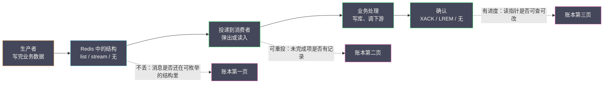
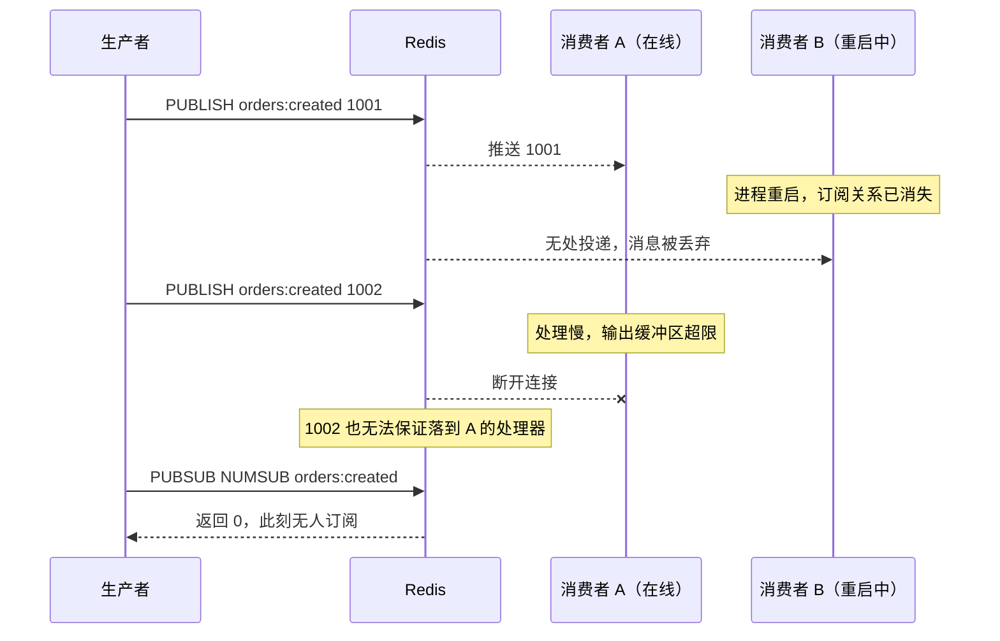
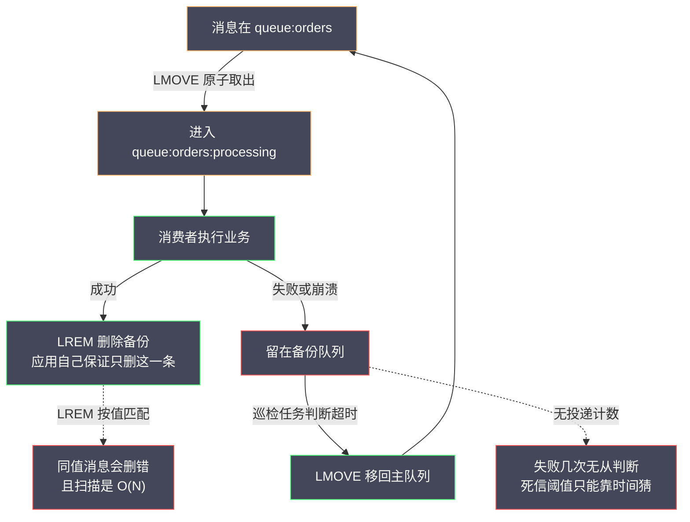
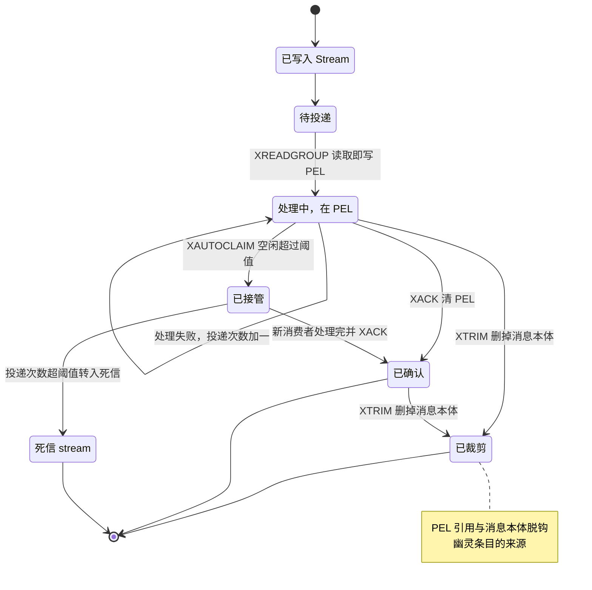
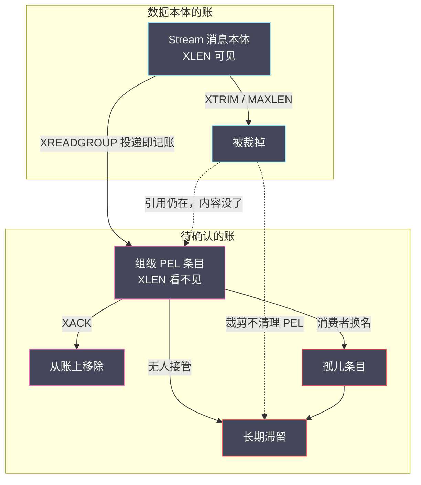

# 07 Redis 消息队列——从 PubSub 到 Stream

**摘要：**

Redis 提供过三种与"消息"有关的东西，它们经常被并列成一张功能对照表，然后按勾选数量选型，这个做法错在把"能不能收到"当成了"能不能当队列用"。本篇换一把尺子，先立起消息队列的三条硬要求——不丢、可重投、有进度，再用它去卡三种机制：PubSub 三项全缺，它只适合通知不适合消息；List 把消息持久化在键里，还能用 `LMOVE` 加备份队列变通出重投，但服务端没有确认语义、没有消费组、没有进度，记账责任全在应用；Stream 把账本写进了数据结构，消费组与 PEL 让"未确认"成为一个可查询、可接管、可回放的对象，至少一次投递由此成立。成立有前提，也有代价：重复不可避免，PEL 与裁剪是两本脱钩的账，`XAUTOCLAIM` 的超时阈值与 Kafka 之间还隔着分区、副本与再均衡三件事。本文按"要求是什么—三种机制各缺什么—落地要付什么代价—边界与反例"推进，所有量化都标注为示例推算或量级判断。内部实现归姊妹专栏，本篇只谈投递语义。

---

## 第 1 章 三条硬要求

### 1.1 一条消息要走完的五段路

设想一个订单履约链路：用户点下确认，交易服务在同一个事务里写下订单，然后把一条"订单已创建"的事件投出去，库存服务据此锁库存，物流服务据此生成面单，通知服务据此发短信。如果这些动作同步串在确认按钮后面，一次下单的耗时就是几个下游的耗时之和，任何一个下游抖动都会把确认页卡住。消息队列买到的正是这段时间上的解耦。

但解耦的价格是"投递的不确定性"。这条消息从产生到被处理完，要在五个位置之间移动：生产者的调用栈、Redis 里的某个数据结构、消费者的调用栈、业务数据库、以及"这条消息已经处理过了"的确认记录。每一次跨越都是一次可能失败的边界。生产者在"已经发出、还没收到应答"的瞬间崩溃，消息可能发过也可能没发；Redis 在收到、尚未落盘的瞬间断电，消息可能没了；消费者在"业务已经写入数据库、确认还没发出去"的瞬间崩溃，这条消息的状态就变得暧昧——业务上做完了，记账上没做完。

消息队列的全部工程复杂度，都来自把这五次跨越的失败窗口一个个收窄，而不是消灭。收窄到可以接受的程度，就叫可靠。

### 1.2 三条要求的判定口径

谈"可靠投递"时最容易被含糊过去的一点，是"可靠"到底指哪一段。业界常用的三个词是**至少一次**（at-least-once）、至多一次（at-most-once）、恰好一次（exactly-once），它们描述的是重复与丢失的组合。但要做选型判断，比这三个词更好用的，是三条可以直接验伪的硬要求。

| 要求 | 判定口径 | 缺失后的症状 |
| :--- | :--- | :--- |
| **不丢** | 生产者收到成功应答之后，无论消费者进程在哪个瞬间崩溃、重启、断连，消息本体仍然留在一个可枚举的结构里 | 重启后订单缺了一条库存扣减，对账时两边差数，只能人工补 |
| **可重投** | 服务端持有"已投递但未完成"的记录，并且有机制能把这条记录重新交给另一个处理者 | 消费者处理失败一次，消息就永久消失，失败只能靠定时全量核对兜底 |
| **有进度** | 消费位置可查询、可指认（谁消费到哪），历史可回放（从某个位置重新读） | 上线新逻辑想补跑三天前的数据，没有起点；出故障想问"卡在哪条"，答不出来 |

这三条之所以叫硬要求，是因为它们互相不可替代。只有不丢没有重投，等于把消息存成了一份只读档案——写入之后没人能重来；只有重投没有不丢，重投的对象本身可能就是残缺的；只有不丢加重投而没有进度，故障恢复时不知道从哪开始补，重复处理的量与漏处理的量都无法计算。

### 1.3 三条要求是同一本账的三个视角

把三条要求拆开看，是三种能力；合起来看，它们描述的是同一件事：消息系统有没有为每条消息维护一份**状态账**。

不丢说的是"数据还在账上"，可重投说的是"未完成项在账上有记录、并且可以被转移给别的处理者"，有进度说的是"账本有一个可以读、可以改的读指针"。一个系统如果只存了消息本体、没存状态，它最多能满足第一条；如果它连消息本体都不存，三条都无从谈起。

用生活里的场景做三个对照：PubSub 像在楼道里喊一嗓子"三零二的外卖到了"，喊的人不记录谁听见了，没人在家就等于没喊；List 像把包裹放在公共货架上，包裹确实存在，但谁拿走了、拿了多久、有没有拆开，货架上没有记录；Stream 像快递柜，每个格口有编号，取件有记录，超时没人取会被标记出来交给别人处理。三者的差别不在"能不能送达"，而在有没有一本账。把这条主线画出来，三条要求各自落在哪一段也就清楚了。



### 1.4 本篇管投递语义，机制归另一列

Stream 的底层是基数树串起来的分段链，每段内部用 listpack 存消息；PEL 是挂在消费组上的另一套结构；`XADD` 之后的持久化走 RDB 或 AOF；一个 stream 键在 Cluster 里只落一个槽。这些机制决定了 Stream 的成本结构与故障形态，但它们的实现细节属于姊妹专栏，本篇一律只给一句结论然后把路由交出去：分段结构与 listpack 见 [[04 跳跃表 压缩列表与 Listpack]]，内存占用与 `maxmemory` 淘汰策略见 [[06 内存管理与过期淘汰策略]]，落盘窗口见 [[07 RDB 持久化——快照的 fork 与 COW 机制]] 与 [[08 AOF 持久化与混合持久化]]，主从复制的丢失窗口见 [[09 主从复制与 Sentinel 高可用]]，单键单槽的约束见 [[10 Redis Cluster 分布式架构]]。Stream 作为数据类型本身的命令面与精度口径，已在 [[02 高级数据类型——HyperLogLog Bitmap Geo Stream]] 里交代过。

本篇要回答的是另外两个问题：这三种机制各自的投递语义边界落在哪，以及在什么条件下可以把它们当成消息队列用。

---

## 第 2 章 PubSub：通知机制被当成了队列

### 2.1 一套只有两个动作的协议

PubSub 的命令面小得不像一个消息系统：订阅端 `SUBSCRIBE channel`，发布端 `PUBLISH channel message`，加上模式订阅 `PSUBSCRIBE channel:*` 与三个查询命令 `PUBSUB CHANNELS`、`PUBSUB NUMSUB`、`PUBSUB NUMPAT`。Redis 7.0 又补了一组分片版本，`SSUBSCRIBE`、`SUNSUBSCRIBE`、`SPUBLISH`、`PUBSUB SHARDCHANNELS`、`PUBSUB SHARDNUMSUB`。

```bash
# 两个订阅者各自阻塞在自己的连接上
SUBSCRIBE orders:created
SUBSCRIBE orders:created

# 发布端
PUBLISH orders:created '{"order_id":1001}'
# (integer) 2

# 查现在的订阅状况
PUBSUB NUMSUB orders:created     # 该频道当前的精确订阅者数
PUBSUB CHANNELS 'orders:*'       # 当前有订阅者的频道列表
```

订阅关系记在服务端的客户端结构里，是一条"这个连接关心这个频道"的登记。消息到达时，Redis 沿着登记把消息写进每个订阅者连接对应的输出缓冲区，然后这条命令就结束了。整个过程没有落盘、没有编号、没有回执，也没有任何结构记得"刚才那条消息发给过谁"。

### 2.2 PUBLISH 的返回值数的是订阅者，不是处理结果

关于 PubSub 最常见的误读，是把这个返回值当作投递凭证。

`PUBLISH` 返回的是一个整数：这条消息被推送给了多少个订阅者。精确订阅按频道登记数计，模式订阅按命中的模式数计，因此一个客户端如果既精确订阅了该频道、又通过 `PSUBSCRIBE` 命中同一频道，它会被计两次——同一条消息在它的连接上也会到达两次。反过来说，返回 0 不是错误，只是"这一刻没有人在听"。

这个数字回答的是"推送动作覆盖了几个连接"，它回答不了"有几个消费者处理成功"，甚至回答不了"有几个消费者收到了"——消息被写进输出缓冲区之后，连接可能在发出之前就断了。把 `PUBLISH` 的返回值当成 ACK 统计，是 PubSub 误用里最典型的一个起点。

> [!warning] 返回 0 是一个正常结果
> 生产者侧看到 `PUBLISH` 返回 0，往往会被当成"投递失败"而重试或告警。它不是失败，它是 PubSub 的语义本身：没有订阅者，消息就被丢弃。想让它变成失败，只能由生产者在发布前用 `PUBSUB NUMSUB` 探一下，但探完到发布之间仍有窗口，这个窗口关不上。

### 2.3 三项全缺，还多一项背压

**不持久化。** 消息不进入任何键，不参与 RDB 快照，也不进 AOF。发布时没有订阅者，消息直接消失；订阅者在线但连接中断，中断期间发布的消息也直接消失。有人会拿"Redis 有持久化"来类推，但 PubSub 的频道不是键，`SAVE` 与 `BGREWRITEAOF` 都不会把消息写进去。

**无法重投。** 重投的前提是存在一个"未完成"的对象。PubSub 在推送完成之后，服务端不再持有任何与这条消息有关的引用，也就没有可以重放的起点。想在应用层补一份记录，等于在 Redis 之外自己造一个队列，那已经不是在用 PubSub。

**没有进度。** 没有游标、没有消费组、没有偏移量。`PUBSUB NUMSUB` 只告诉你"此刻有几个订阅者"，`PUBSUB CHANNELS` 只告诉你"哪些频道有人在听"，它们都不回答"谁消费到哪一条"。新订阅者只能从订阅那一刻开始收，历史消息对它不存在。

**背压还会主动踢人。** PubSub 的推送是写进客户端输出缓冲区的，订阅者写得慢，缓冲区就涨。Redis 为 pubsub 类客户端配了一条独立的输出缓冲限制，默认值形如 `client-output-buffer-limit pubsub 32mb 8mb 60`，意思是硬上限 32MB，或者持续 60 秒超过 8MB，就断开这个连接。被断开之后重连，中间的消息照例全部丢失——这一条让"在线订阅者不会丢消息"这个假设也不成立。把两个失败窗口摆到同一条时间线上：



### 2.4 Cluster 里的广播成本

PubSub 在 Cluster 下的行为经常被忽略。7.0 之前，`PUBLISH` 会在集群内广播：发布到任意节点，消息都会通过集群总线传播到所有节点，再由各节点投给本地的订阅者，哪怕某个节点上根本没有这个频道的订阅者。节点越多、频道越活跃，这条内部流量越可观，而它占用的是集群总线之外的普通连接带宽。

7.0 引入的分片 Pub/Sub 换了一套路由：`SPUBLISH` 的消息只发到拥有对应槽的节点，`SSUBSCRIBE` 也只能订阅落在本地负责槽上的频道。代价是语义变窄——分片频道的订阅者必须与槽同节点，扩容与槽迁移时订阅关系要跟着动，跨槽广播不再是一个命令能解决的事。频道名与槽的映射按频道名做 CRC16，这一点与普通键的槽计算一致（槽位分配细节见 [[10 Redis Cluster 分布式架构]]）。

### 2.5 通知与消息的分界

既然三项全缺，为什么它还留在 Redis 里？因为它的语义本来就与消息队列不同。

一条通知的价值随时间衰减：配置变了、缓存该失效了、某个在线用户的会话收到了新消息，这些事的正确处理方式是"知道此刻发生了"，而不是"三天后补做一遍"。"缓存失效广播"是最贴切的例子——收到通知的节点清掉本地缓存，没收到通知的节点也有 TTL 兜底，漏一次不影响正确性。

一条消息的价值不随时间衰减：订单已创建、库存已锁定、这笔钱该退了，这些事必须被某个处理者做完，没人在线不是作废的理由，三天后补做依然有意义，而且要能说清做没做过。

据此可以给出三条判据，三条同时满足，PubSub 就是合适的选择：其一，消息过期之后无人处理也不产生错误；其二，允许"没人在线就作废"；其三，有一个全量拉取或定时对账的兜底路径。三条里有任何一条不满足，就不该把它当消息用。

换句话说，PubSub 的语义是"此刻有事发生"，不是"这件事必须被处理"。把订单状态变更发到 PubSub 上，等于赌消费者永远在线且永远不会被输出缓冲区踢掉——这个赌注在一个需要重启部署的系统里注定会输，第 8 章会把这个反例摊开算一遍。

---

## 第 3 章 List：持久化有了，语义没有

### 3.1 最小模型与它真实的开销

List 做队列是所有方案里最省心的：`LPUSH` 推入，`BRPOP` 阻塞弹出，两头一进一出就是先进先出。

```bash
# 生产者：一次推三条，注意 LPUSH 的入参顺序与最终顺序相反
LPUSH queue:orders '1001' '1002' '1003'
# list 内部自左向右为 1003 1002 1001，BRPOP 从右端弹出，先得到 1001

# 消费者：阻塞 30 秒等消息，返回 [键名, 值]
BRPOP queue:orders 30
```

`BRPOP` 的复杂度是 O(1)，这是它被大量采用的原因——单条消息的弹出不随队列长度变化，与 `LRANGE` 那类线性命令完全不是一回事。但 O(1) 只描述了 CPU，没描述连接与阻塞：每个消费者为了调用 `BRPOP` 要占用一条连接，阻塞期间这条连接不能做别的事。十个消费者就是十条连接，一百个就是一百条；按每连接几十 KB 的输出缓冲区与客户端结构开销估算（示例推算字段，实际随版本与连接状态浮动），连接本身的内存通常不是瓶颈，客户端连接数与 `maxclients` 的关系才是（连接层面的容量问题在 [[10 Redis 生产运维——监控 告警与故障排查]] 里有更细的口径）。

阻塞还有两处语义要记牢。第一，`timeout` 设为 0 表示永久阻塞，直到有数据或连接断开，客户端库的重连策略必须与之配合，否则一次网络抖动会让消费者卡在一个永远不会返回的调用上。第二，阻塞命令在事务与脚本里不阻塞：进入 `MULTI/EXEC` 之后，`BRPOP` 在空队列上立即返回 nil；在 Lua 脚本里它等同于非阻塞版本。把"阻塞取消息"写进脚本，得到的是一段空转逻辑。

### 3.2 持久化不等于不丢

List 方案最容易被高估的一点，是"消息在 list 里，所以 Redis 的持久化能保住它"。

这句话只对了一半。消息还在 list 里的时候，它确实是键空间的一部分，会随 RDB 快照与 AOF 一起落盘，进程崩溃重启后能读回来。但消息一旦被 `BRPOP` 弹出，它就离开了键空间——Redis 的持久化机制保的是"键里还有什么"，保不了"已经弹出去、还没处理完的东西"。持久化解决的是存储层的可靠性，不丢解决的是投递链路的可靠性，两者不是一回事。

即便是"还在 list 里"这一段，也要带上条件：AOF 的 `appendfsync everysec` 意味着最多一秒的写入会随进程崩溃丢失；主从异步复制意味着主节点故障切换时，最后一段尚未同步的消息会消失（复制窗口见 [[09 主从复制与 Sentinel 高可用]]）。所以 List 方案的"不丢"准确表述是：在消息仍位于 list 中、且已越过落盘与同步窗口的前提下不丢。跨过 `BRPOP` 那一刻之后，不丢的责任就转移给了应用。

### 3.3 备份队列：一条原子命令换来的重投

解决"弹出即消失"的经典做法是备份队列，靠的是 `RPOPLPUSH` 这类"取出并放入"的原子命令。Redis 6.2 起这一对命令（`RPOPLPUSH` 与 `BRPOPLPUSH`）被 `LMOVE` 与 `BLMOVE` 取代，旧命令标记为废弃但仍可用；老代码里看到 `BRPOPLPUSH` 不必惊慌，它只是同一语义的阻塞版本。

```bash
# 从主队列右端取出，同时原子地推入备份队列左端
LMOVE queue:orders queue:orders:processing RIGHT LEFT

# 阻塞版本：主队列为空时最多等 30 秒
BLMOVE queue:orders queue:orders:processing RIGHT LEFT 30

# 处理成功后，从备份队列里删掉这一条
LREM queue:orders:processing 1 '{"order_id":1001}'

# 处理失败要重投：再原子地移回主队列左端
LMOVE queue:orders:processing queue:orders RIGHT LEFT
```

这条命令之所以能把"弹出即丢"补上一半，靠的是原子性：取出与推入在同一条命令内完成，中间没有可被崩溃打断的窗口。消费者在拿到消息之后崩溃，消息仍在备份队列里，重启后由巡检任务把它移回主队列，重投链路就通了。

但它补上的只是"消息本体还在"，没补上"服务端知道这条消息处于什么状态"。备份队列本质上是应用自建的一张表，Redis 只是碰巧提供了一个原子的搬移动作。把这条路径画成图，缺口落在哪两条虚线上会很清楚：



### 3.4 备份队列不等于 ACK

把备份队列与 Stream 的确认机制放在一起看，差别不在"有没有备份"，而在"记账记在哪一层"。

第一处是删除的精度。`LREM key 1 value` 按值匹配删除，取第一个相等的元素。如果队列里出现两条内容完全相同的消息（重投之后很常见，因为重投就是把原消息再放一遍），`LREM` 有可能删掉另一条尚未处理的同值消息，而真正处理完的那条还留着。要避开这个坑，就得给消息加唯一 ID，让值天然不同——这又是应用层的设计负担。同时 `LREM` 是线性扫描，备份队列越长越慢，与 `BRPOP` 的 O(1) 形成反差。

第二处是失败次数的缺失。List 与备份队列里没有"投递次数"这个字段，也没有"空闲时长"。巡检任务只能靠应用自己记录的时间戳判断超时，或者用一份在 Redis 之外的元数据表维护计数。"失败超过五次就进死信"这种判据，在 List 方案里要靠应用自己攒。

第三处是消费者的身份。`LREM` 不区分是谁在处理，备份队列也不记录归属。消费者 A 弹出的消息，B 也能把它删掉；A 崩溃后，B 并不知道哪些消息原属于 A。这不算严重的问题（因为备份队列本来就是共享的），但它意味着不存在"消费组"这个概念——不同业务方要各自完整消费一遍，只能给每条消息写进 N 条队列，写放大的代价由生产者承担。

第四处是进度。`LLEN` 告诉你积压多少条，不告诉你消费到哪一条。想回放上周的消息，List 里已经没有上周的消息了——被弹出、被 `LREM`，或者被 `LTRIM` 裁掉。想"从某条开始重来"，没有任何命令能表达这个意思。

这四处的共同点是同一个姿势：服务端**只保管容器**，不保管状态。备份队列是把状态记账搬到了应用里，搬过去的每一笔都要应用自己写、自己维护、自己保证不丢——而那部分代码同样会崩溃。

### 3.5 它仍然有位置

List 并非一无是处。它的命令面极小，语义一眼看到底，单条消息的存取成本是常数，且不需要任何额外的结构（消费组、PEL）就能跑起来。对于"消费方只有一个组、消息丢失可以接受或有对数兜底、没有回放需求、量级在几千 TPS 以下"的场景，它是最省事的选择。

需要注意的是另一类用法：把 List 当作"待处理任务池"，配合备份队列做轻量可靠投递。这个用法在中小系统里很常见，也确实能跑很久不出事。它的风险不在于立刻出错，而在于出一次故障之后，才发现自己写了一套没有 ACK、没有计数、没有进度的队列，而故障恢复所需的每一条信息都不在服务端。第 8 章会把这套搭法的失效过程拆开讲。

---

## 第 4 章 Stream：把三件事写进数据结构

### 4.1 一条命令带来"还在"

Stream 是 Redis 5.0（2018 年）正式引入的数据类型，antirez 在介绍它时的定位是"Redis 里第一个通用目的的流结构"。对使用者来说，最直观的变化是：写入消息之后，消息本体留在一个可以 `XRANGE` 枚举的键里，直到被显式裁剪。

```bash
# 追加消息，* 表示让服务端生成 ID
XADD orders * action create order_id 1001 user_id 2001
# 返回："1709424000000-0"

# 写入时顺带裁剪：保留最近约十万条
XADD orders MAXLEN ~ 100000 * action pay order_id 1001 amount 99.9

# 按时间点裁剪：保留最近七天的消息
XADD orders MINID ~ 1709337600000-0 * action ship order_id 1001
```

消息 ID 是"毫秒时间戳-序号"的两段式结构，同一毫秒内按序号递增，时钟回退时 ID 也不回退（Redis 会把时间戳钳在已有最大值上）。这个 ID 是后面所有机制的地基：PEL 记的是 ID，裁剪的阈值是 ID，`XRANGE` 的边界是 ID，接管也是按 ID 进行的。

"不丢"在这里的准确表述是：`XADD` 返回成功之后，消息已经位于键空间中，进程崩溃重启可以由 RDB 或 AOF 恢复，集群主从切换可以复制到副本（有窗口）。要它真的不丢，还得把持久化与复制配置对：AOF 的刷盘策略决定了最多丢多少秒，`WAIT` 或 `min-replicas-to-write` 决定了主节点在副本落后时是否拒绝写入（配置口径见 [[08 AOF 持久化与混合持久化]] 与 [[09 主从复制与 Sentinel 高可用]]）。把"Stream 持久化"当成"绝对不丢"，是与"List 持久化等于不丢"同一类的错觉，只是错觉的位置往后挪了一段。

### 4.2 消费组与 PEL：未确认成了一个对象

单靠 `XREAD` 也能消费，但那是"从头读到尾"的日志读取，没有进度、没有归属。要获得队列语义，需要消费组。

```bash
# 建组：0 表示从头消费，$ 表示只消费创建之后的新消息
XGROUP CREATE orders order-processors 0
XGROUP CREATE orders order-processors $ MKSTREAM

# 消费者读新消息：> 表示"给我还没投递过的"
XREADGROUP GROUP order-processors consumer-1 COUNT 10 BLOCK 5000 STREAMS orders >

# 处理成功之后确认
XACK orders order-processors 1709424002000-0

# 重启后想重放自己没确认完的那批：用 0 而不是 >
XREADGROUP GROUP order-processors consumer-1 STREAMS orders 0
```

`XREADGROUP` 与 `XREAD` 的关键差别发生在返回之前：Redis 会把组游标推进到这批消息，并把每条消息写入组级与消费者级的 PEL（Pending Entries List，待确认条目表），记录 ID、归属消费者、投递时间与投递次数，然后才把消息返回给客户端。这一步就是**记账**，此后"这条消息已经发出去了但还没被确认"成为一个服务端可查询的事实。

两个配套语义必须记住。其一，`XACK` 只清 PEL，不删消息——消息本体仍在 Stream 里，与"这条消息处理过了"是两个独立的判断。其二，`XREADGROUP` 里用 `>` 是读新消息，用一个具体 ID（通常写 0）是读这个消费者自己的 PEL 历史，也就是"我手上还没做完的那些"，这是消费者重启后恢复工作的标准手段。

消费者名是一个逻辑身份，不是一个进程。进程重启后沿用同名，PEL 里那些条目仍归它管；随手换个名字（比如把主机名加时间戳当消费者名），旧条目就变成无主的孤儿，永远挂在组级 PEL 里等着别人接管。这条细节造成的内存增长，比大多数人预想的大得多，第 7 章会算这笔账。

还有一个容易被误用的选项：`NOACK`。`XREADGROUP ... NOACK` 表示读入时不写 PEL，语义立刻退化为至多一次——读出去的消息 Redis 不再负责，崩溃就丢。它适合"丢一点无所谓、但不想让 PEL 长大"的场景，用之前要清楚自己交出的是哪条要求。

| 命令 | 记账动作 | 容易踩的地方 |
| :--- | :--- | :--- |
| `XREADGROUP ... >` | 推进组游标，写入组级与消费者级 PEL | 消费者名换来换去会留下无主条目 |
| `XREADGROUP ... 0` | 只读自己的 PEL 历史，不推进组游标 | 读到的是"未确认项"，不含已确认的历史 |
| `XACK` | 从 PEL 移除指定 ID | 不删消息本体，裁剪要另做 |
| `XGROUP DELCONSUMER` | 删除消费者及其 PEL 条目 | 直接丢弃这些条目的未完成状态 |
| `XGROUP CREATECONSUMER` | 只登记消费者，不读消息 | 用于预热消费者身份，避免首读时新建 |

### 4.3 XPENDING：把"未确认"查清楚

PEL 一旦存在，就必须有办法查。`XPENDING` 有三个形态，分别回答三个层次的问题。

```bash
# 形态一：组级概况
XPENDING orders order-processors
# 返回：待确认总数、最小 ID、最大 ID、以及按消费者的分布

# 形态二：区间明细（- + 表示全部，第三个参数是条数）
XPENDING orders order-processors - + 10

# 形态三：指定消费者 + 只看空闲够久的（IDLE 为 6.2+）
XPENDING orders order-processors IDLE 30000 - + 10 consumer-1
```

形态一给的是总量与分布，运维上看的是"待确认总数是不是只涨不落"。形态二给的是明细：每条待确认消息的 ID、归属消费者、空闲毫秒数、投递次数。形态三多了一个空闲时间过滤，用来找"卡住的那批"，也是接管前的预检。

这里有一个必须一起看的对照：`XPENDING` 的最小 ID 与 `XINFO STREAM` 的 `first-entry`。前者的最小 ID 明显小于后者，说明 PEL 里在引用已经被裁剪掉的消息——`XPENDING` 能查到，`XCLAIM` 也能把归属改掉，但 `XRANGE` 拿不到内容，消费者会对着一条不存在的消息反复重试。这类"幽灵条目"是两个动作脱钩的产物：裁剪删数据，确认清账本，两边互不通知。

### 4.4 XCLAIM 与 XAUTOCLAIM：接管要付的代价

消费者崩溃后，PEL 里的条目不会自己消失，也不会自动转给别人，必须有另一个消费者主动接管。

```bash
# 逐条接管：把空闲超过 30 秒的那条转给 consumer-2
XCLAIM orders order-processors consumer-2 30000 1709424002000-0

# 只改归属，不返回消息体，省带宽
XCLAIM orders order-processors consumer-2 30000 1709424002000-0 JUSTID

# 批量接管（6.2+）：从 0-0 起扫，一次最多接管 COUNT 条
XAUTOCLAIM orders order-processors consumer-2 30000 0-0 COUNT 10
```

`XAUTOCLAIM` 与 `XCLAIM` 的关系是"巡检"与"定点"。前者给一个起始 ID 和数量，自己向下扫，返回三样东西：下一次扫描的游标、被接管的消息、以及 PEL 里引用了但消息本体已不存在的 ID 列表。第三个返回值是排查幽灵条目的入口，只取前两个返回值的巡检任务会永远看不见这批数据。扫描不是无限的：一次调用最多检查 `COUNT` 的十倍个 PEL 条目，所以"扫一遍全量"的正确写法是循环调用直到游标回到 `0-0`，中途停下就会漏。

接管本身是有代价的：它把消息重新投递给新消费者，于是重复处理成为必然。这不是实现瑕疵，而是至少一次语义的直接推论——崩溃发生在"处理完成"与"确认发出"之间的概率不为零，落在这个窗口里的消息，业务上做完了，账上没做完，接管者只能再做一遍。

接管还会改动投递计数。`XCLAIM` 的 `RETRYCOUNT` 可以覆盖也可以让其自增，`XAUTOCLAIM` 默认自增。这个计数是死信判据的唯一来源：超过阈值就把消息转到一个专门的死信 stream，再从 PEL 里移除，否则一条永远处理失败的消息会把消费者的重试配额吃光。

### 4.5 XINFO：进度从哪里读

"有进度"在 Stream 里不是一个抽象承诺，而是三个可查询的对象。

```bash
# Stream 本体：长度、首尾条目、已生成条目总数、累计删除量
XINFO STREAM orders

# 组视图：消费到哪（last-delivered-id）、读了多少（entries-read）、差多少（lag）
XINFO GROUPS orders

# 消费者视图：各自的待确认数、空闲时长
XINFO CONSUMERS orders order-processors
```

三个字段值得单独解释。`last-delivered-id` 是组游标，表示"这个组已经把消息投递到了这个 ID"，它只增不减，与确认无关——投递出去但没确认的消息不会让游标回退。`entries-read` 是组累计已读的条目数，Redis 7.0 起提供。`lag` 是累计生成条目数与 `entries-read` 的差，表示"还有多少条没有被这个组读走"，是最接近"消费积压"的指标。

`lag` 的准确性有前提。它依赖 Stream 维护的"累计生成条目数"与组维护的"累计已读条目数"，一旦消息被裁剪、或者有人用 `XSETID` 手工改过游标，这个差值就可能失真甚至返回空。所以监控上不能只信 `lag`，要把它与 `entries-added`、`recorded-first-entry-id` 一起看：前者只涨不落，后者随裁剪前移，两者与 `lag` 的关系能看出"账有没有被裁剪打乱"。

### 4.6 "至少一次"的成立条件

把前面的零件拼起来，"至少一次"这条承诺才能落地。它不是一个开关，而是五个条件的合取，缺任何一条都会退化。

| 条件 | 具体要求 | 缺了会怎样 |
| :--- | :--- | :--- |
| 消息留在结构里 | `XADD` 之后不被过早裁剪，持久化配置对得上 | 接管者拿到 ID 却读不到内容，重投变成重试空指针 |
| 读入即记账 | 用 `XREADGROUP ... >` 且不加 `NOACK` | 不写 PEL 就等于没有"未完成"对象，崩溃即丢 |
| 处理后才确认 | `XACK` 放在业务提交之后 | 先确认后处理，崩溃时消息已从账上消失 |
| 有人接管 | 巡检任务定期 `XAUTOCLAIM`，或人工 `XCLAIM` | PEL 里的条目永远停着，积压变成死账 |
| 处理幂等 | 业务侧对重复处理免疫 | 接管带来的重复会变成重复扣款、重复发货 |

第三条的顺序尤其容易搞反。把 `XACK` 写在业务逻辑之前，看起来"先确认再处理"能减少 PEL 压力，实际是把至少一次降级成了至多一次，而且降级得很隐蔽——平时完全正常，只有崩溃时才丢。第四条则常被当成可选项：没有巡检任务的 Stream，PEL 只进不出，看起来像在"保留现场"，实际是把所有失败都攒成了一笔永远还不上的账。把这些状态与转移画成状态机，至少要成立在哪条边上也就一目了然：



从这张状态图能读出至少一次的边界：只要"处理中"这个状态能被别人接手，承诺就成立；而重复恰好来自"已接管"这条边——同一条消息在业务上可能被处理两次，账本上只记一次完成。至少一次不等于恰好一次，这句话的技术含义就在这里，它不是精度不够，而是接管机制的必要代价（恰好一次的完整路径见 [[中间件/Kafka/07 消费语义——Exactly-Once 的实现路径|Kafka 的恰好一次]]，Redis Stream 没有对应实现）。

---

## 第 5 章 三条要求逐项对照

### 5.1 逐项对照表

前面几章是分别拆解，现在把它们放进同一张表。表格里刻意不写勾叉，写的是判据——同样一个"支持"，判据不同，可靠性的成色差得很远。

| 硬要求 | PubSub | List（含备份队列） | Stream |
| :--- | :--- | :--- | :--- |
| **不丢** | 不成立。消息不进入任何键，发布时无订阅者即丢弃；订阅者断连期间的消息同样丢弃。`PUBLISH` 的返回值是推送覆盖的连接数，不是存档凭证 | 部分成立。消息在 list 中时随 RDB/AOF 持久化；被 `BRPOP` 弹出后离开键空间，此时只剩应用自己维护的备份队列在保管它。判定要看"崩溃点落在弹出之后多久" | 成立，带条件。`XADD` 返回后消息在键空间里，可 `XRANGE` 枚举；是否真不丢取决于落盘策略与复制窗口。被 `XTRIM` 裁掉的消息同样会消失 |
| **可重投** | 不成立。服务端没有"未完成"的对象，推送完成即结束记账，没有可重放的起点 | 靠变通成立。`LMOVE`/`BLMOVE` 把取出与备份合成原子操作，崩溃后由巡检把备份队列里的消息移回主队列。谁算超时、失败几次、何时进死信，全部由应用自己记 | 内建。`XREADGROUP` 读入即写 PEL，未确认的消息留在 PEL 里；`XCLAIM` 定点接管，`XAUTOCLAIM` 批量巡检接管，投递次数由服务端维护 |
| **有进度** | 无。没有游标、没有消费组，`PUBSUB NUMSUB` 只回答"此刻几个订阅者" | 无。`LLEN` 是积压量不是进度；被弹出的消息无法回放，没有"从某条重来"的表达方式 | 有。组游标 `last-delivered-id`、累计已读 `entries-read`、差值 `lag` 由 `XINFO GROUPS` 给出；历史可 `XRANGE` 回放，可 `XSETID` 重置起点 |

这张表最重要的读法，是注意"变通"两个字出现在哪一格。List 那一行的"可重投"是唯一一个靠外部补丁撑起来的格子：补丁本身是一段会崩溃、会漏扫、会删错值的应用代码，它的可靠性不高于写它的团队。其余两格里没有"变通"，PubSub 是明确的"不成立"，Stream 是内建但带条件的"成立"。

### 5.2 读表之后的三个动作

动作一：看格子的主语是谁。Stream 的每一格都能指到一条命令与一个字段：不丢指 `XRANGE` 与 `recorded-first-entry-id`，可重投指 PEL 与 `XAUTOCLAIM`，有进度指 `last-delivered-id` 与 `lag`。List 的"可重投"指不到任何命令，只能指到一段应用代码；PubSub 的三格指不到任何对象。主语的差异，就是运维时能不能用一条命令查出问题的差异。

动作二：把"成立"展开成前置条件。Stream 的"不丢"至少包含四个前置：裁剪阈值要大于 PEL 可能的最长停留时间；AOF 的刷盘策略要接受最多丢一秒；主从复制的丢失窗口要么接受、要么用 `WAIT` 与 `min-replicas-to-write` 收窄；`maxmemory` 与淘汰策略不能让这个键被淘汰。任何一条不满足，"不丢"就退化成"大部分时候不丢"。

动作三：看失效时的症状。三种方案出问题时的表现完全不同：PubSub 丢消息是静默的，没有任何指标能反映"刚才丢了一条"；List 出问题是备份队列堆积，`LLEN` 能看出来，但要人工判断哪些该重投；Stream 出问题是 PEL 只涨不落或者 `lag` 只涨不落，前者的元凶是确认，后者的元凶是消费者数量或处理速度。症状与指标的这一一对应关系，决定了故障能不能在十分钟内定位。

### 5.3 中间态的账

List 加备份队列与 Stream 之间，还有一个"看起来都能做、成本不同"的区间。

命令次数上，List 方案一次消费要两次 Redis 往返：`BLMOVE` 取出，处理完后 `LREM` 删除；重投还要再加一次 `LMOVE`。Stream 方案同样是两次：`XREADGROUP` 读取、`XACK` 确认，接管走单独的巡检通道。两者在往返次数上打平，差异在于状态存在哪、以及由谁负责发现崩溃。

运维负担上，List 方案的巡检脚本要自己写：扫备份队列、比对时间戳、判断超时、原子移回、记录重试次数、超阈值转死信。这六件事在 Stream 里分别对应 `XAUTOCLAIM`、空闲时间、`min-idle-time`、原子接管、`RETRYCOUNT`、死信 stream，服务端已经把语义固定下来，应用只需要决定阈值。

| 维度 | List + 备份队列 | Stream |
| :--- | :--- | :--- |
| 单条消费的命令数 | 取出、删除、失败时移回，共 2-3 次 | 读取、确认，共 2 次；接管单独走巡检 |
| 超时判定 | 应用自己记录时间戳 | `min-idle-time` 由服务端按 PEL 记录判定 |
| 失败计数 | 应用在消息体或外部表里维护 | `RETRYCOUNT` 由服务端维护 |
| 多业务方各自消费 | 一条消息写 N 条队列，写放大 | 建 N 个消费组，各持独立游标 |
| 回放 | 不支持 | `XRANGE`、`XREADGROUP` 指定 ID |
| 消息顺序 | FIFO，重投会打乱 | 按 ID 有序，重投由接管者处理，顺序同样会被打乱 |
| 内存增长 | 队列长度与备份队列都没有自动封顶，靠 `LTRIM` 与巡检脚本收口 | 消息本体可被 `MAXLEN` 封顶，PEL 不受这道约束，要另靠确认收口 |

"重投是否打乱顺序"这一行值得多看一眼：两种方案在这件事上其实一样。Stream 的消息 ID 是有序的，但接管之后处理的时刻不再等于写入的顺序，多个消费者并发处理时整体顺序本来就无法保证。要严格顺序，只能让一个消费者串行处理，或按业务键分到多个 stream 上分别串行——这一点与 Kafka 单分区内的顺序保证是同一套逻辑，只是 Stream 的"分区"要应用自己切。

表里没有 PubSub 那一列，因为它的内存项只有一条：订阅连接的输出缓冲区。它不存储消息，所以没有队列长度可涨；缓冲区涨过头的结果是被服务端断开，风险表现出来是丢消息而不是内存告警。

---

## 第 6 章 Stream 相对 Kafka 缺什么

把 Stream 与 Kafka 放在一起比，最常见的错误是比功能清单：都支持消费组、都支持重放、都有确认，于是得出"差不多"的结论。实际上两者的差距集中在四个结构性维度上，每一个都会在使用半年之后变成必须处理的架构问题。

### 6.1 没有分区，只有一个槽

Kafka 的并行单位是分区，分区数在建 topic 时决定，消费者组内的实例按分区分配，并行度与分区数绑定。Stream 的**并行单位是键**：一个 stream 键在 Cluster 里只落在一个槽、一个分片上，单个 stream 的写入与读取都要经过那个分片的主节点。

扩容因此不能靠"加分片"，只能靠"加 stream"：生产者在应用层按业务键哈希到 `orders:0` 到 `orders:9`，消费者各自订阅一个或若干个 stream，分片与合并的逻辑全在应用里。这套做法可行，也确实有人这么用，但它把 Kafka 由 broker 承担的再分配工作搬到了业务代码里，一旦分片数变化，历史消息的归属、消费进度的合并、巡检任务的扫描范围都要重新对齐。

单分片的吞吐天花板由单线程与内存共同决定。Stream 的写入同样在主线程上完成，`XADD` 本身是均摊 O(1)，但它与所有其他命令排队共享同一个执行线程，分段结构的维护与内存分配也压在这条线程上；量级判断是单分片能撑住万级 TPS，再往上就要分片（分段结构与 `stream-node-max-entries` 的关系见 [[04 跳跃表 压缩列表与 Listpack]]）。

### 6.2 没有 ISR，只有异步复制

Kafka 用 ISR 把"哪些副本跟上了"变成一个可判断的状态：`acks=all` 加上 `min.insync.replicas`，写入在足够多的副本确认之后才算提交，主副本挂掉时已提交的消息不会因为切换而消失（ISR 与 HW 的机制见 [[中间件/Kafka/05 副本机制——ISR、HW 与 Leader Epoch|ISR 与 HW]]）。

Redis 的复制是异步的：主节点把命令写进复制缓冲区就返回，从节点什么时候追上不保证。`WAIT numreplicas timeout` 能让当前连接等一会儿，等到足够多的副本确认收到，但它只是一次同步等待，不改变"提交时没有多数派确认"这个事实；`min-replicas-to-write` 与 `min-replicas-max-lag` 能在副本落后时拒绝写入，代价是可用性下降，而且它检查的是"有几个健康副本"，不是"这条消息有没有落到多数派"。两者合起来只能把丢失窗口收窄，不能给出 Kafka 那种**已提交即不丢**的确定语义。

这是 Stream 与 Kafka 最本质的一条差距。它决定了 Stream 不适合承载"丢了要赔钱"的那类消息，除非业务侧另有对账与补偿。

### 6.3 保留策略是内存裁剪，不是磁盘顺序写

Kafka 的消息落盘，按段滚动，按时间或大小删除，容量由磁盘决定，保留一周是常规配置，读历史打的是页缓存与零拷贝（存储引擎细节见 [[中间件/Kafka/02 日志存储引擎——Segment、索引与零拷贝|Segment 与零拷贝]]）。

Stream 的消息在内存里，容量由 `maxmemory` 决定。`MAXLEN` 与 `MINID` 是两种裁剪表达：前者按条数，后者按 ID（时间点）。裁剪是写入路径的一部分，`XADD ... MAXLEN ~` 在节点边界整段丢弃，成本摊在写入上；`XTRIM` 是显式动作，可以配 `LIMIT` 分批做以免阻塞主线程。

于是"保留多久"这个问题在 Stream 里的答案不是时间，而是内存：给定平均消息体积，能保留多少条是算出来的，不是配出来的。示例推算一下，一条 JSON 订单约 400 字节，加上 field 名、ID 与分段结构的开销按每条 150 字节估，合计约 550 字节；一万条每秒的写入就是每秒约 5.5MB、每小时约 19GB。这个量级下"保留一天"需要四百多 GB 内存，显然不现实——它反而解释了为什么 Stream 的典型配置是保留几万到几十万条、按时间只保留几分钟到几小时。

> [!warning] 队列键不能被淘汰掉
> 承载队列的 stream 键一旦被 `maxmemory-policy` 选为淘汰对象，整条队列连同 PEL 一起消失，这是比丢单条消息严重得多的事故。生产上用 Stream 做队列时，内存策略应当是 `noeviction`，并且给 `maxmemory` 留出余量，让写入在内存不足时失败（生产者能感知并重试），而不是让 Redis 悄悄删掉一条队列（淘汰策略的完整口径见 [[06 内存管理与过期淘汰策略]]）。

### 6.4 消费组没有再均衡协议

Kafka 的消费组由组协调者管理：成员加入、离开、心跳超时、分区重新分配，全套协议在 broker 侧完成，实例扩缩容时分区会自动迁移（Rebalance 的代价与增量协议见 [[中间件/Kafka/04 消费者与消费者组——Rebalance 机制深度剖析|再均衡]]）。

Stream 没有这一层。消费者不是"组的成员"，而是一个在读消息时被登记的名字：`XREADGROUP GROUP g consumer-1` 里的 `consumer-1` 如果不存在就创建，之后一直挂在组的消费者列表里，直到被 `XGROUP DELCONSUMER` 删除或从未再出现。新实例上线，从下一个 `XREADGROUP` 开始分到新消息；旧实例下线，它 PEL 里的条目不会自动转给别人，必须由巡检任务 `XAUTOCLAIM` 接管。也就是说，Stream 的"再均衡"是外部定时任务模拟出来的，而不是协议保证的。

由此派生三个运维后果：消费者列表只增不减，需要定期清理（清理会丢弃其 PEL，要确保先接管）；扩容只影响新消息的分发，不会迁移已有的 PEL，新实例上线初期是"轻载"的；缩容时若直接杀掉实例，它手上的消息要等 `min-idle-time` 到期才可能被接管，这段空窗期就是积压。

### 6.5 缺口的合取，与换掉的判据

把四条放在一起，Stream 的适用边界就清楚了。它不是"小号 Kafka"，而是一个把队列语义做进单键的轻量实现：省掉了独立集群与运维，代价是并行度、副本保证与保留能力都被压在单键与内存上。

| 判据 | Stream 够用 | 必须换 Kafka |
| :--- | :--- | :--- |
| 吞吐 | 单 stream 万级 TPS，可用多 stream 分片 | 十万级以上，且不愿在应用层做分片 |
| 保留 | 分钟到小时级，条数几十万以内 | 按天/周保留，需要按时间回放历史 |
| 丢失容忍 | 主从切换丢最后一段可以接受，或另有对账 | 已提交即不可丢，需要 ISR 级别的保证 |
| 消费并行 | 消费者数量稳定，扩缩容不频繁 | 实例频繁弹性伸缩，依赖自动再均衡 |
| 生态 | 只需要"投递 + 确认 + 重试" | 需要连接器、流处理、Schema 管理 |

中间地带——十万级、需要重试但不需要长期回放——往往最难判断。笔者的建议是先在 Stream 上跑到实测上限，再评估迁移成本：分片的复杂度是应用里的一段哈希逻辑，而 Kafka 的复杂度是一套需要专人维护的集群，两者的量级不同。Kafka 专栏的完整对照见 [[中间件/Kafka/00 专栏导览|Kafka 架构与原理]]。

---

## 第 7 章 三个坑

### 7.1 不设裁剪：无界增长是默认结局

`XADD` 不带 `MAXLEN` 或 `MINID` 时，Stream 只增不减。这不是配置疏漏，而是默认行为——Redis 不知道你的保留策略，它只负责把消息写进去。

增长的速度可以直接算。一条 JSON 订单约 400 字节，加上 field 名、消息 ID 与分段结构的开销，按每条 550 字节估（示例推算），每秒写入两千条就是约 1.1MB/s，一小时约 4GB，一天接近 95GB。这个数字在任何一台以内存为存储介质的机器上都撑不过几天。

撑不住之后有两种死法，都比"写失败"难处理。若策略是 `noeviction`，写入开始报错，生产者的重试把请求堆在应用侧，表现为下单接口大面积超时；若策略是 `allkeys-lru` 之类，Redis 会按淘汰算法挑键删除，承载队列的 stream 键与其他缓存键在同一个池子里竞争，被删掉的那个可能就是整条队列——不是丢一批消息，是丢整条队列连同所有消费组的游标与 PEL。

正确的做法是在写入路径上就把上限带上：

```bash
# 按条数封顶，~ 表示近似裁剪，允许略微超出
XADD orders MAXLEN ~ 200000 * action create order_id 1001

# 按时长封顶更贴近业务承诺：保留最近两小时
XADD orders MINID ~ 1758000000000-0 * action create order_id 1001

# 对存量做一次收口，LIMIT 分批以便不阻塞主线程
XTRIM orders MAXLEN ~ 200000 LIMIT 5000
```

`MAXLEN` 与 `MINID` 的选择取决于业务承诺的形态：承诺"最多积压多少条"用前者，承诺"最多保留多久"用后者。用 `MAXLEN` 表达时间承诺是常见的错配——流量翻倍时，同样条数覆盖的时间窗口减半，回放能力随之缩水，而配置看起来没变。

### 7.2 PEL 无界膨胀：最隐蔽的那笔泄漏

第二个坑比第一个隐蔽得多，因为它的成因不在写入路径，而在确认路径。

`XTRIM` 与 `MAXLEN` 裁剪的是 Stream 里的消息本体，**PEL 里的条目不受裁剪约束**。一条消息被投递出去、写进 PEL，哪怕它的本体已经被裁掉，PEL 里那条记录仍然占着内存，直到有人 `XACK`、`XCLAIM` 转移后确认，或者 `XGROUP DELCONSUMER` 把整个消费者删掉。内存策略对 PEL 也无效——PEL 不是独立的键，它挂在消费组上，随着队列键一起被淘汰或被保留。

于是出现一种极具迷惑性的曲线：`XLEN` 被 `MAXLEN` 稳稳压住，内存却一路向上。运维看到 `XLEN` 正常、`maxmemory` 却持续吃紧，第一反应往往是"内存碎片"或"其他键涨了"，排查方向从一开始就偏了。

膨胀速度同样可以算。假设一个消费者每秒读五百条，其中 1.5% 因为处理超时或异常没有 `XACK`，就是每秒 7.5 条、每天约 65 万条积压进 PEL；每条 PEL 记录要存消息 ID、消费者引用、投递时间与投递次数，加上基数树节点的摊销，按 80 到 120 字节估（示例推算），一天就是 50 到 75MB，一个月 1.5 到 2GB。这还没有算消费者换名造成的孤儿条目——那批条目连"谁在处理"都没有，只能等巡检按空闲时间接管。两本账的生命周期画出来，会看到它们只在一个地方交会：`XREADGROUP` 那一瞬间。



发现它不需要额外埋点，三个现成的查询就够：`XPENDING key group` 的总量趋势、`XINFO GROUPS` 里各组的 `pending` 字段、`XINFO CONSUMERS` 里每个消费者的 `idle` 与 `pending`。判据是"PEL 总量与 `XLEN` 的比值"以及它的斜率：比值长期高于十分之一，或者斜率稳定为正，就说明账在净增，处理速度已经跟不上投递速度。

处置分三层。最直接的是把 `XACK` 放进 `finally`，让异常路径也确认——业务失败该走死信或重试，不该靠不确认来表达。第二层是巡检接管，用 `XAUTOCLAIM` 把超时条目转给活着的消费者，并配合 `RETRYCOUNT` 把反复失败的转入死信 stream。第三层是清理身份，消费者名要稳定可复用（用实例序号而不是随机串），下线实例先接管再 `XGROUP DELCONSUMER`，把孤儿条目在变成陈账之前收掉。

### 7.3 min-idle-time 设得太小：抢别人的活

第三个坑藏在 `XAUTOCLAIM` 的第一个参数里。

这个参数是"最小空闲时间"，语义是"只接管空闲超过这么久的条目"。它设得太小，就会出现这样的场景：消费者 A 处理一条消息用了四十秒（下游慢、GC 停顿、批量任务），阈值设的是三十秒，B 的巡检在第三十一秒把这条消息接管走，开始重复处理；A 在第四十秒完成，然后 `XACK`。

最后这一步是致命的：`XACK` 按组和 ID 生效，**不校验当前归属者**。A 的迟到确认会把这条消息从组级 PEL 里抹掉，而 B 正在处理它。此时若 B 崩溃，这条消息既不在 PEL 里，也没有被 B 确认，它就彻底消失了——至少一次在这条路径上被打破，而且打破的方式很安静：只有"B 崩溃 + A 迟到确认"这个组合才会暴露。

反过来，阈值设得太大同样有问题：消费者崩溃后，它手上的消息要等很久才被接管，这段空窗期全部体现为积压，`lag` 上涨而消费者看起来正常。

可行的口径是让阈值大于处理耗时的长尾，而不是平均值：以 P99.9 的处理耗时为基准再加上一段余量，并根据业务能否容忍重复来调整余量。如果处理耗时分布很宽（有的毫秒级、有的分钟级），单一阈值本来就不合适，可以把慢任务拆到独立的 stream 上，用不同的阈值分别巡检；或者让长任务在处理过程中定期刷新自己的空闲时间（`XCLAIM ... JUSTID` 会重置该条目的空闲计时），用"心跳"证明自己还活着，而不是让阈值去猜。

三个坑放在一起看，会发现它们的结构是同一个：

| 坑 | 表面症状 | 根因 | 处置要点 |
| :--- | :--- | :--- | :--- |
| 不设裁剪 | 内存持续上涨，`XLEN` 同步上涨 | 写入路径没有上限，默认只增不减 | 写入时带 `MAXLEN`/`MINID`，并选对表达方式 |
| PEL 膨胀 | 内存上涨而 `XLEN` 平稳 | 裁剪与确认是两本账，互不清理 | `XACK` 覆盖异常路径、巡检接管、清理消费者身份 |
| 阈值过小 | 同一条消息被处理多次，偶发丢失 | 空闲判定替代了心跳，接管与原归属者并发 | 按 P99.9 定阈值，或处理途中刷新空闲时间 |

共同点在于"记账"与"数据"是两条独立的生命周期：`XADD` 写数据，`XREADGROUP` 写账，`XTRIM` 删数据，`XACK` 清账，四个动作两两之间没有强绑定。Redis 提供了把它们串起来的命令（8.x 的 `XACKDEL`/`XDELEX` 就是为这件事设计的），但默认不会替你串。谁用 Stream，谁负责把这四条线对上。

---

## 第 8 章 反例四则

### 8.1 用 PubSub 做订单状态通知

某订单服务的状态机在每次变更时 `PUBLISH order:status`，下游的积分、风控、消息推送三个服务各自 `SUBSCRIBE`。上线半年相安无事，因为三个订阅者都在同一台机器上、都很少重启。

第一次事故发生在一次滚动发布：积分服务重启的四十秒里，状态变更全部丢失，用户下单后没有积分。第二次事故更隐蔽：消息推送服务因为下游短信网关变慢，处理速度掉到发布速度之下，输出缓冲区涨过 `8mb` 持续六十秒，被 Redis 主动断开；重连之后的消息全部丢失，而监控上只看到"订阅连接数"抖了一下。

这个反例的根因不是选错了命令，而是跳过了第 2.5 节的三条判据：订单状态变更的价值不随时间衰减，也不接受"没人在线就作废"。正确做法是把状态变更写进 Stream 或数据库变更日志，PubSub 只在"通知下游刷新本地缓存"这类可丢弃的场合使用。

### 8.2 用 List 当可靠队列

一个任务队列用 `LPUSH` 加 `BRPOP`，上线后发现偶发丢任务，于是在外面套了一层备份队列：`BLMOVE` 取出、处理、`LREM` 删除，另有一个每分钟跑一次的巡检把备份队列里的消息移回主队列。

三个月后出了问题：巡检是按"备份队列里的消息年龄"判断超时的，而年龄记在消息体的一个时间戳字段里；某次上游改了时间戳格式，巡检把所有消息都判定为超时，一股脑移回主队列，所有任务被重复执行了一遍。又过了一个月，`LREM` 在两条内容相同的消息上删错了目标，一条已完成的消息留在备份队列里被反复重投。

这个方案缺的正是第 3.4 节的四件事：没有服务端维护的投递次数与空闲时间、没有归属、删除靠值匹配、没有进度。要修，得在应用里补齐一套接近 PEL 的结构；补到那个程度，用 Stream 的成本反而更低。

### 8.3 Stream 不裁剪也不 ACK

一个团队把审计事件写进 Stream，用 `XREADGROUP` 消费，读完之后忘记写 `XACK`（代码里 `try` 分支写了，异常分支漏了）。`MAXLEN ~` 设了五十万条，`XLEN` 一直稳定在五十万上下，团队据此认为内存没问题。

半年后内存涨到告警线。排查发现 PEL 里堆了两千多万条记录：消息本体被裁掉了，账本上的引用一条不少。带区间的 `XPENDING` 查一次要几秒，巡检任务的 `XAUTOCLAIM` 按每次最多扫描 `COUNT` 的十倍条目来算，一轮扫完要按月计。

修法是三步：先把 `XACK` 补进所有分支；再用 `XAUTOCLAIM` 分批接管并确认历史条目，把两千多万条逐步消化；最后把 `pending` 与 `XLEN` 的比值做成监控指标。第三件事最便宜也最有用，因为它是唯一能在事后提前半年发现问题的信号。

### 8.4 把 stream 当缓存键一起淘汰

一个集群用 `allkeys-lru` 做淘汰策略，同一个实例上既有缓存也有队列。某天缓存击穿导致写入量暴增，内存接近上限，LRU 挑中了一个活跃度不高的 stream 键——那是通知服务的事件队列，已经积压了三万条。

键被淘汰后，消费组的游标与 PEL 一起消失，消费者重启时 `XGROUP CREATE` 只能用 `$` 重新开始，积压的三万条再也读不回来。

这类事故的共同点是"策略不是按对象配的"。队列与缓存在内存里的地位完全不同：缓存的正确行为是被淘汰，队列的正确行为是写失败并让生产者感知。两者放在同一个实例、同一个策略下，Redis 无法区分，只能按 LRU 一起处理。可行做法是给队列单独实例——内存策略是实例级配置，按库区分不了——并让 `maxmemory` 留出足够余量。

四则反例指向同一件事：三种机制的分界线不在命令，而在**失败时谁来补**。PubSub 没有补的位置，List 靠应用补，Stream 把补的位置做进了数据结构——但只做到"提供工具"，用不用仍然取决于写代码的人。

---

## 第 9 章 参数面：每一处都有代价

前面几章的结论最后都要落到几个参数上。这些参数的特点是"没有中间态"：往一侧调解决一个问题，同时在另一侧制造一个问题。把两侧的代价写在配置旁边，比记一个推荐值有用。

| 参数 | 作用 | 调大的代价 | 调小的代价 |
| :--- | :--- | :--- | :--- |
| `XADD` 的 `MAXLEN` / `MINID` 阈值 | 保留窗口，决定能回放多久 | 内存占用上升；`XPENDING` 与 `XRANGE` 的扫描范围变大 | 回放窗口缩短；PEL 引用的消息更容易被提前裁掉，幽灵条目增多 |
| `stream-node-max-entries`（默认 100） | 每个分段能容纳的条目数 | 分段变少、单段变大；近似裁剪的粒度变粗，`MAXLEN ~` 的偏差变大 | 裁剪更接近精确；分段数量上升，分段本身的内存开销占比升高 |
| `stream-node-max-bytes`（默认 4096） | 每个分段的字节上限 | 分段变少、单段能装下更大的消息，裁剪粒度同步变粗 | 单条大消息可能独占一段，分段数量上升；需与 `stream-node-max-entries` 配合选主控项 |
| `client-output-buffer-limit pubsub` | 订阅者输出缓冲区上限 | 慢订阅者不容易被踢，但缓冲区会吃掉内存，极端情况下拖垮实例 | 慢订阅者更早被断开，断连期间的消息全部丢失 |
| `XAUTOCLAIM` 的 `min-idle-time` | 判定"空闲够久可以接管" | 崩溃消费者的消息迟迟不接管，积压窗口拉长 | 抢活，重复处理增多，迟到确认可能抹掉别人的 PEL 记录 |
| `XAUTOCLAIM` 的 `COUNT` | 单次巡检的接管条数 | 单次调用耗时上升，主线程被长时间占用 | 巡检一轮要多次往返，积压消化得慢 |
| `XREADGROUP` 的 `COUNT` | 单次读取条数 | 一次写进 PEL 的条目变多，处理失败时的重投面变大 | 往返次数增加，吞吐下降 |
| `appendfsync` | AOF 刷盘频率 | 取 `always` 时每次写都落盘，吞吐明显下降 | 取 `no` 时把刷盘交给内核，丢失窗口通常远大于一秒，队列场景需自行评估 |
| `min-replicas-to-write` 与 `min-replicas-max-lag` | 副本落后时是否拒绝写入 | 副本稍有延迟就写失败，可用性下降 | 主从切换时的丢失窗口变大 |
| `maxmemory-policy` | 内存不足时的行为 | — | 队列所在实例应为 `noeviction`，任何淘汰策略都可能让整条队列消失 |

读这张表有一个顺序：先定保留窗口，再定巡检节奏，最后才调吞吐相关的参数。顺序反过来的后果是拿吞吐参数去掩盖保留窗口的错误——比如为了让 `XPENDING` 快一点而调小 `MINID`，实际是在制造幽灵条目，问题会以"消费者反复重试一条不存在的消息"的形式在更晚的时候出现。

参数面之外还有一处常被漏掉的配置：持久化。队列的"不丢"承诺直接由 `appendfsync` 与复制配置兑现，而这部分通常由运维统一配置，业务方并不知情。两侧对齐的做法是在部署清单里把队列实例单独列出，标明它的 `appendfsync`、`min-replicas-to-write` 与 `maxmemory-policy`，并说明这些值为什么与缓存实例不同。

---

## 第 10 章 结语

Redis 的三代消息机制，实际上是一部"记账责任"的迁移史。PubSub 把责任全部推给应用——它只负责把消息推出去，连"有没有人在听"都不保证；List 把数据留在键里，但把状态推给应用，备份队列是应用自己写的一本账；Stream 把两本账都收进了数据结构，游标、未确认条目、投递次数、空闲时间全部由服务端维护。

责任转移到服务端，换来的是三件事：崩溃恢复有了明确的起点，故障排查有了可查询的对象，重复与丢失的边界可以说清楚。代价同样明确：PEL 与裁剪是两本互不清理的账，`XAUTOCLAIM` 的阈值决定重复的量，消息保留受内存而非磁盘约束，分区与副本保证都要让位于单键的形态。

所以选型的判据不是"功能多不多"，而是"这三条要求里，哪几条我必须自己兜住"。兜不住的部分要能在架构上说清楚由谁补：PubSub 丢失的东西只能靠全量对账补，List 丢失的东西只能靠备份队列与巡检补，Stream 丢失的东西（裁剪过头、副本切换、PEL 泄漏）只能靠监控与容量规划预防。把这些补位方案写下来，比在功能表上多勾一个框有用得多。

Kafka 与 Stream 的差距也应当这样理解：不是"能力少一点"，而是两套可靠性模型。前者把提交、副本、分区、再均衡做成集群级的协议，代价是运维；后者把队列语义压进一个键，代价是并行度与副本保证。中间地带的选择没有标准答案，能给出确定答案的只有实测：在 Stream 上跑出自己的写入上限、PEL 增长速率与接管延迟，再拿这三个数去和迁移成本比。

---

## 参考资料

1. Redis Documentation — Redis Streams：https://redis.io/docs/latest/develop/data-types/streams/
2. Redis Documentation — XREADGROUP：https://redis.io/docs/latest/commands/xreadgroup/
3. Redis Documentation — XAUTOCLAIM：https://redis.io/docs/latest/commands/xautoclaim/
4. Redis Documentation — Pub/Sub 与 Sharded Pub/Sub（7.0）：https://redis.io/docs/latest/develop/pubsub/
5. antirez — Streams: a new general purpose data structure in Redis：http://antirez.com/news/114
6. Redis Documentation — LMOVE：https://redis.io/docs/latest/commands/lmove/

---

> [!note] 思考题
> 1. 如果一个消费者处理一条消息的耗时 P99.9 是两分钟、均值是两百毫秒，`XAUTOCLAIM` 的 `min-idle-time` 该按哪个值定？若坚持用单一阈值，重复处理的比例会落在什么量级？
> 2. `XACK` 不校验归属者，这个设计是疏漏还是取舍？如果改成"只有当前归属者能确认"，接管流程会付出什么代价？
> 3. 一个 Stream 的 `XLEN` 稳定在 `MAXLEN` 附近，`XPENDING` 总量却每月翻倍——除了漏写 `XACK`，还有哪些路径会制造这种曲线？
> 4. 用十个 stream 做应用层分片之后，"按业务键的顺序处理"还成立吗？分片键与业务顺序键不一致时，缺的是哪条保证？
> 5. 如果业务要求"消息保留七天且可回放"，Stream 需要多少内存才能满足？算出来的数字与迁移 Kafka 的成本，哪个更小？
