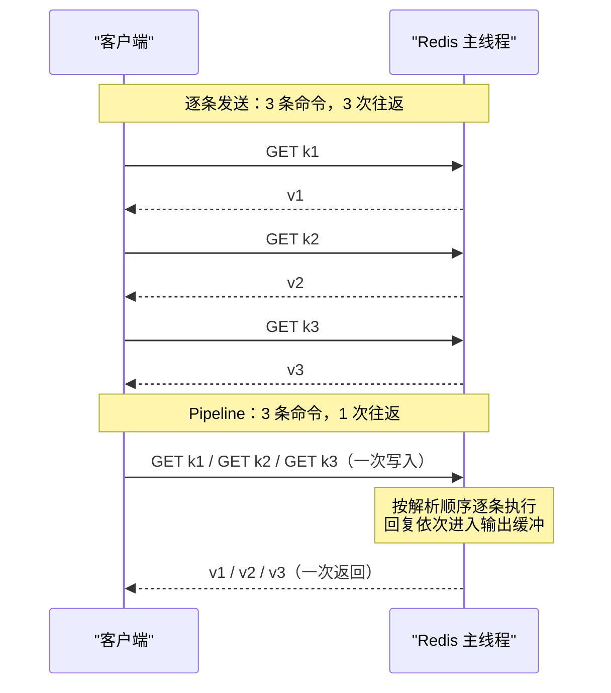
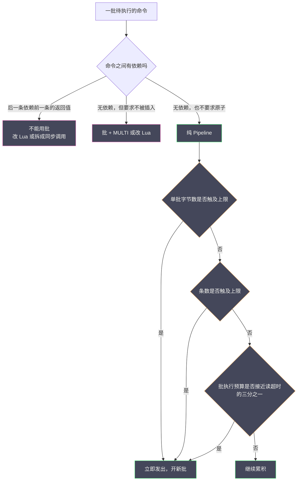
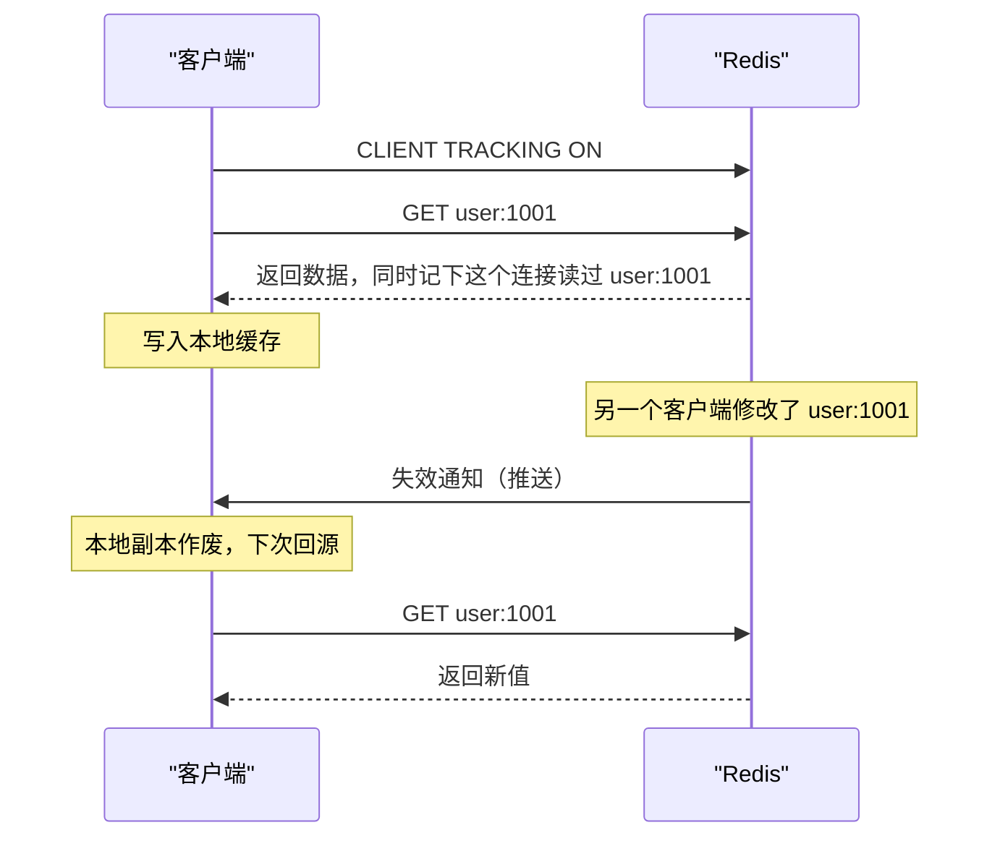

# 08 Redis Pipeline 与客户端性能优化

**摘要：**

Pipeline 常被当成一句性能咒语：把命令攒起来一起发，就能快上几十倍。这句话省掉了两个限定语——省的是哪一段延迟，以及为此付出了什么。本文先把一次命令的端到端时间拆成四段：客户端编码、网络往返、服务端排队、命令执行；再指出 Pipeline 只压缩其中的往返次数，因此它的真实收益完全取决于 RTT 与单条命令执行时间的比值：本机 0.1 毫秒往返与跨机房 1 毫秒往返，在同样的批量深度下得出的加速比相差四倍，而当单条命令本身要花毫秒级时间时，Pipeline 几乎不起作用。省下的这段等待要付三项代价：客户端要同时容纳 N 条请求与 N 条回复；服务端的输出缓冲随回复体积线性增长，而这份内存计入 `used_memory` 并参与淘汰判定，批太大时会把自己业务的数据挤出去；整批里某条命令失败之后，定位、补偿与重试的成本被集中放大，且客户端超时后无法知道服务端已经执行到哪一条。在这个框架下，本篇讲清 Pipeline 与 `MULTI` 的正交关系——前者是传输层打包，后者是服务端执行窗口，两者可以叠加但绝不是同一件事——以及 Pipeline 与 Lua 的取舍判据、按「单批总字节 + 条数上限」双约束定批大小的做法、`redis-benchmark -P` 的结论为什么搬不到生产、Cluster 与代理层下按节点分组后的语义变化，最后落到连接池、超时、keepalive 三个与批处理互相牵制的客户端参数和一组反例。

---

## 第 1 章 一次命令的账：四段与一笔

「用了 Pipeline 之后快了三十倍」这类说法在技术方案里出现的频率很高，但它省略掉的两件事，恰好决定了这个结论在你的系统里成不成立：省掉的是哪一段延迟，以及为此付了什么。第一个问题可以靠拆时间得到答案，第二个问题要靠在客户端与服务端两侧分别记账。

一条 `GET` 命令从应用代码发起，到值被还回来，时间花在四段上。客户端把命令编码成 RESP 协议的字节并写进 socket，这一步包含对象分配与系统调用；字节穿过网络到达服务端，这一段是去程；主线程在事件循环里读出并执行这条命令，这段时间又由排队与真正的执行两部分组成；回复再沿原路返回并在客户端被解析，这是回程。


| 段落 | 典型量级 | 由什么决定 | 谁能优化它 |
| :--- | :--- | :--- | :--- |
| 客户端编码与系统调用 | 数微秒到数十微秒 | 客户端库实现、参数大小、对象分配次数 | 换客户端库、减少无谓分配 |
| 网络去程与回程（RTT） | 本机 Unix socket 数十微秒；同机房 0.1-0.3 毫秒；同城跨机房 0.5-1 毫秒；跨地域十毫秒以上 | 物理距离、链路带宽、中间设备排队 | 只能减少往返次数，不能缩短单次 |
| 服务端排队 | 空闲时几微秒；有慢命令或高负载时可达毫秒以上 | 主线程占用率、前面排着的命令 | 治理慢命令、拆分实例、分片 |
| 命令执行（`proc`） | 简单命令几微秒；复杂命令随数据量增长 | 命令复杂度、集合规模 | 换命令、改数据结构 |

表中数字只用来建立量级感，不同机房、机型、内核版本的实测会落在不同位置，不作基准。但有一个结构性的结论是稳定的：一次简单命令的时间，绝大部分付在了那次往返上。同机房的 RTT 取 0.2 毫秒、命令执行取 5 微秒，往返占了九成以上；即便把链路换成同机 Unix socket，摊到每条命令上的固定开销仍在几十微秒量级，与命令本身微秒级的执行时间不在一个数量级。

### 1.1 RTT 有一个物理下限

网络往返里有一部分是任何软件优化都碰不到的光速成本。光纤中的光速约为每秒二十万公里，北京到上海的直线距离约一千二百公里，光缆实际走向按路由绕行取一点五倍系数，单程约九毫秒，往返接近十八毫秒（示例推算，按光速与绕行系数估算）。这十八毫秒里没有排队、没有拥塞、没有协议栈开销，纯是距离除以速度。

这条下限推出两个结论。跨地域部署时，单次往返的延迟是拓扑属性，不是调参空间；想让它变快，唯一的办法是不发那么多次。这也解释了 Pipeline 为什么在跨可用区、跨地域的架构里收益最大——那些地方的往返本来就贵，把 N 次压成 1 次省下的绝对时间最可观。反过来，当应用与 Redis 同宿主机、走 Unix socket 时，一次往返只有几十微秒，Pipeline 省下的绝对时间小到业务感知不到，此时它更像吞吐工具而不是延迟工具。

### 1.2 停等把服务端的能力锁在往返里

逐条执行时，客户端必须等上一条命令的回复到达，才能发送下一条。这个模式在协议层面叫**停等**（stop-and-wait），它的吞吐上限是一目了然的：单连接每秒最多完成 `1 / RTT` 条命令。RTT 为 0.2 毫秒时，上限是五千条每秒；而一台普通配置的 Redis 实例每秒能执行的简单命令在十万量级（量级判断，随命令与硬件变化）。中间差着一个数量级以上，这段时间里服务端其实是闲着的，客户端也闲着，双方都在等对方的字节。

Pipeline 不是后来添加的特性。RESP 协议本身是流式的，不为单条命令划边界：客户端可以连续写多条命令，服务端按顺序逐条执行、按同样顺序把回复堆进输出缓冲。协议设计成这个样子，Pipeline 就已经成立，客户端库只是把这件本来就允许的事做成了接口。

### 1.3 一次往返贵在哪里

把往返拆开看，除了光速，还有一串与命令内容无关的动作：用户态到内核态的拷贝、`write` 与 `read` 两次系统调用、事件循环的唤醒与 `epoll_wait` 返回、TCP 协议栈的序号与校验计算、对端中断处理与上下文切换。这些动作合起来是**固定开销**：成本与命令携带多少数据几乎无关，只与发生了几次往返有关。

把它想成一通电话就很清楚了：问一件事要拨一次号、等接通、寒暄、挂断；问十件事如果也按这个流程走十遍，讲话本身只占很小一部分时间，剩下的全是流程成本。Pipeline 做的事情相当于在同一通电话里把十个问题一次问完——线路还是那条线路，声音还是那个速度，省掉的是十次拨号里九次的流程。

---

## 第 2 章 Pipeline 省下的是哪一段

### 2.1 机制：N 次等待变成 1 次等待

Pipeline 的机制在客户端与服务端各占一半。客户端把 N 条命令编码后连着写入 socket，服务端读到这一批数据后按解析顺序逐条执行，把 N 条回复依次追加到该客户端的输出缓冲，客户端再按发送顺序从回复流里切出 N 个结果。整个过程中，网络往返只发生了一次（严格说是请求方向一次传输加回复方向一次传输）。



### 2.2 加速比由比值决定，不由 Pipeline 决定

把两段时长写成式子，结论就自己浮出来了。逐条发送的耗时是 `N × (RTT + E)`，其中 E 是单条命令的执行时间；Pipeline 的耗时是 `RTT + N × E`，前提是批内的字节传输时间可以忽略。两者的比值是：

```
加速比 = N × (RTT + E) / (RTT + N × E)
```

这个式子有两个极限。当 `N × E` 远小于 `RTT`，也就是执行时间完全被往返淹没时，加速比趋近于 N；当 `E` 远大于 `RTT`，也就是执行时间主导时，加速比趋近于 1。同一份 Pipeline 代码，放在两个不同的环境里，落在这两个极限之间完全不同的位置。

| 场景 | RTT | 单条执行 E | 批深度 N | 逐条耗时 | Pipeline 耗时 | 加速比 |
| :--- | :--- | :--- | :--- | :--- | :--- | :--- |
| 同机房，小命令 | 0.1 ms | 5 μs | 100 | 10.5 ms | 0.6 ms | 约 17.5 倍 |
| 跨机房，小命令 | 1 ms | 5 μs | 100 | 100.5 ms | 1.5 ms | 约 67 倍 |
| 同机房，单条 1 毫秒的命令 | 0.1 ms | 1 ms | 100 | 110 ms | 100.1 ms | 约 1.1 倍 |
| 同机房，小命令，浅批 | 0.1 ms | 5 μs | 10 | 1.05 ms | 0.15 ms | 约 7 倍 |

四行数字都是示例推算，只用来显示结构性差异，不能当基准。它们要说的事情只有一件：**加速比**由 RTT 与 E 的比值决定，Pipeline 只是把这个比值显形。所以「启用 Pipeline 之后快了三十倍」这种表述缺一个主语——它没说清是在什么网络距离上、对什么命令做的比较。

这也解释了一个常见的现场困惑：在本机开发环境里启用 Pipeline，接口耗时几乎没有变化，于是团队认为这项优化没有价值；换到跨可用区的生产环境，同样的代码把耗时砍掉了大半。代码没变，变的是 RTT 在总耗时里的占比。写进技术方案的性能收益，必须带上这个环境条件，否则评审时无法复核。

### 2.3 收益的三条边界

第一条边界是执行时间主导。若单条命令要花毫秒级时间，譬如对几十万元素的集合做交并、或取一个十几兆的 value，Pipeline 能省的往返时间在总耗时里已微不足道。这时该做的是减少命令数、换更省的命令、拆大 key，而不是加深批量——后者的效果会被 1.1 倍的加速比如实反映。

第二条边界是带宽。Pipeline 不减少任何一个字节的传输量，它只是把多次小传输合并成少数几次大传输。当一批数据的总字节数除以链路带宽所得的时间超过了 RTT，传输时间就成了新的下限。示例推算：一批 1 MB 的数据在千兆链路上需要约 8 毫秒，已经远大于同机房 0.2 毫秒的 RTT，此后继续加批只会让这一批走得更久。

第三条边界是批内排队。批越大，最后那条命令等得越久，因为它前面还有 N−1 条。同步地看，一条命令的延迟等于整批的耗时，这让 p50 好看、p99 变差；批的耗时跨过几十毫秒之后，业务侧的接口超时先于 Redis 报错出现。

### 2.4 顺带省掉的系统调用与 Nagle

还有两笔容易被忽略的收益。一笔是系统调用次数：逐条发送时每条命令至少一次 `write`、一次 `read`，每次系统调用在微秒量级，N 大时合计可观；Pipeline 把 N 次 `write` 合成少数几次，`read` 侧也从 N 次变成一两次。另一笔与 Nagle 算法有关——在未开启 `TCP_NODELAY` 的连接上，如果一个发送方还有未确认的小包，下一个包要被压住等确认，而接收方的延迟确认（delayed ACK）可能再等上几十毫秒，两者撞在一起就是那条著名的四十毫秒停顿。停等模式恰好落在最坏组合里：每条命令都产生一个小包，每个小包都在等上一个的确认。Pipeline 下单次写入的数据量够大，Nagle 的抑制条件不成立，这个坑自然绕开了。

Redis 服务端默认开启 `TCP_NODELAY`，主流客户端库也默认开启，所以四十毫秒这个数字在今天的直连场景里不常见。它仍值得知道，因为链路上任何没配置好的代理、网关或自写的 TCP 转发都可能把这套组合重新引进来；它出现时的症状是「单条命令偶发几十毫秒」，`SLOWLOG` 查不出来，因为服务端那条命令只跑了几微秒。

### 2.5 看起来像原子，但不是

服务端从 socket 读一次数据之后，会把缓冲区里能解析出来的命令连续执行完才回到事件循环，所以一整批命令在观察上常常是连续执行的，中间不插入其他客户端的命令。这个表象正是「Pipeline 很像事务」的心理来源。

它不是承诺，原因至少有四个：整批命令的字节数可能超过内核接收缓冲，「读一次」只拿到一部分，剩下的要等下一轮事件循环，中间自然让出；服务端在接受新命令前要做一串检查，内存上限与客户端驱逐可能提前结束本轮解析；批里夹着阻塞命令时，整批执行就此中断，后续命令要等阻塞解除；客户端因缓冲上限中途 flush 时，往返本来就不止一次。

机制底稿在 [[01 Redis 全局架构——一次请求的完整生命周期]] 的解析与写回两章，以及 [[05 单线程模型与事件驱动架构]] 的事件循环时序，这里只取一句结论：Pipeline 提供的是传输上的打包，不是执行上的独占。把观察到的连续性当成语义来依赖，是后文第 6 章那类事故的源头。

---

## 第 3 章 代价之一：客户端的两个缓冲

### 3.1 请求侧：整批命令的编码字节

一次发出 N 条命令，客户端在发送完成之前必须持有这 N 条命令的编码结果，这份内存就是**请求缓冲**。它不是一个小数目，因为 RESP 为每条命令都带上了类型前缀与长度前缀，一条 `SET key:1 value:1` 编码下来大约三四十字节，有效载荷只占其中一半。示例推算：一万条这样的命令，请求缓冲在数百 KB；如果换成长一点的 key 与业务 JSON，轻松过 MB。

客户端库在这一步有两种做法，代价不同。一类把整批拼成一个大缓冲再一次写入，请求侧内存随 N 线性增长；另一类边编码边写，攒到内部缓冲上限就 flush，内存有界，但中途 flush 会让往返次数不止一次，RTT 收益随之打折。Lettuce 的自动 flush 是后者的变体：它在每轮事件循环结束时 flush 一次，所以同一轮里发出的命令天然攒成一批；手动 `setAutoFlushCommands(false)` 的意义是把跨轮的命令也攒进同一批，代价是这段时间里没有数据被真正发出去。

### 3.2 响应侧：N 条回复的落点

回复侧的内存更容易被算漏。批交出之后，客户端要等到 N 条回复读完（或至少全部落进某个容器）才便于把结果交给调用方，这段时间里回复字节全在客户端内存里，这就是**响应缓冲**。它的体积由回复内容决定，与请求侧可能完全不成比例：一千条 `GET` 小 key 的请求不过几十 KB，回复也是几十 KB；一千条取十 KB value 的 `GET`，回复是十 MB。

客户端库在这里也分两路。返回结果列表的写法（多数同步客户端的默认行为）必然把整批回复保留到 `execute` 返回为止；逐条回调或逐条 future 的写法可以边读边处理，内存有界，代价是调用方要自己组织结果。选择哪一路，取决于业务是「拿一批结果做聚合」还是「逐条消费」，而不是取决于哪一路更快。

### 3.3 结果容器本身也是一笔开销

即便回复很小，容纳它们的容器也不免费。Python 里一万个 `str` 对象加上列表本身，是几 MB 量级的堆占用；Java 里一万个包装对象与一个 `ArrayList`，会产生大量短命对象，抬高年轻代回收频率。这类开销不出现在任何 Redis 指标上，它表现为 GC 时间上升。

### 3.4 连接在批处理期间被独占

同步客户端在 `execute` 期间独占它借来的那条连接，这条连接无法同时服务其他命令。这里有两股方向相反的影响：批处理让每条命令摊到的连接占用时间下降（省下的正是 RTT），却让单次占用时间变长（一次批的时长）。前者减少池的需求，后者让池内排队更不均匀，这笔权衡放到第 12 章一起算。

### 3.5 一笔乘法账

把前面几条乘起来看，批大小从来不是单机局部参数。示例推算：一千个实例、每池五十条连接、每条连接的批携带 100 KB，客户端要同时容纳的批数据就是 5 GB 量级；同一批回复在服务端输出缓冲里还有一份，又是 5 GB 量级。这两个数字都不出现在「我们把批设成 1000 条」这句话里，却决定了扩容时内存先炸在哪一侧。

---

## 第 4 章 代价之二：服务端的输出缓冲

### 4.1 回复在主线程上生产

命令执行完只是产生了「要回什么」，把回复真正变成字节仍是一件在主线程里做的事。`addReply` 系列接口先判断固定缓冲有没有空间，放得下就直接拷贝，放不下就另分配链表块挂上去。这条路径的机制细节与 `omem`、`oll`、`obl` 三个字段的读法在 [[01 Redis 全局架构——一次请求的完整生命周期]] 的写回一章，事件循环如何为写回腾出时间见 [[05 单线程模型与事件驱动架构]]，本篇只取两个结论。

第一个结论：一条命令的回复体积就是批量使用的隐藏上限。Pipeline 不改变任何单条命令的回复体积，但它把 N 条回复同时堆在同一个客户端上，于是 N 乘以单条回复体积，就是这次批处理在服务端留下的水位。第二个结论：这份水位是在主线程上堆出来的，堆的过程中主线程既不能处理其他命令，也无法感知这批回复会不会把内存吃光。

### 4.2 三类限额，以及最反直觉的那一类

服务端用 `client-output-buffer-limit` 按客户端类别设限，每类给出硬上限、软上限与软上限持续时间三个值。超限之后 Redis 会断开这个客户端，客户端看到的是连接被重置，而不是某条命令失败。

| 客户端类别 | 默认配置 | 超限后的处置 | 调大限额的代价 | 调小限额的代价 |
| :--- | :--- | :--- | :--- | :--- |
| 普通客户端 | `0 0 0`，不限制 | 不主动断开 | 慢消费者或超大响应可以把实例内存吃光，转而触发淘汰甚至被系统杀掉 | 批量导出这类合法的慢消费会被误伤，业务侧看到莫名其妙的连接重置 |
| 副本客户端 | 有硬上限与软上限 | 断开复制连接，副本重连后可能触发全量同步 | 用内存换取同步稳定性 | 从库追不上时反复断开，全量同步循环不止 |
| 订阅客户端 | 有硬上限与软上限 | 断开订阅连接 | 用内存换消息不丢 | 订阅端消费稍慢就被踢，消息在重连的空窗里确实会丢 |

最需要留意的是第一行的**不限制**。普通客户端默认不设限，所以「输出缓冲超限被断开」这件事在最常见的部署形态里往往根本不会发生——发生的是更难排查的形态：内存悄悄涨上去，先撞上 `maxmemory` 触发淘汰，没设上限的实例则一直涨到把宿主机内存吃掉。把限额配上去，等于把一个不可控的内存增长换成一个可控的连接断开；配不配，取决于业务更能接受哪一种失败。

### 4.3 输出缓冲参与淘汰判定

接下来这一条是批量使用最容易造成自伤的地方。客户端的输出缓冲计入 `used_memory`，并且**参与淘汰判定**（账内与账外的分层见 [[06 内存管理与过期淘汰策略]] 的相关小节）。于是出现一条完整的回路：某次批太大，输出缓冲把水位顶过 `maxmemory`，Redis 开始按策略淘汰数据键，被淘汰的是业务数据，命中率下降带来更多回源请求，回源又是更多的 Redis 命令，水位继续涨。

在现场，这条回路的表现是「淘汰量涨了但业务量没涨」，监控上看起来像是一次莫名其妙的容量不足，实际原因是一个与数据无关的批。这个形态和慢消费者把内存顶穿是同一类问题，区别只在慢消费者的源头在应用的下游，而批的源头在应用自己的调用方式。

### 4.4 第二道闸：客户端内存驱逐

Redis 7.0 起的 `maxmemory-clients` 提供了另一条限制路径：它不看单个连接的限额，而是把所有客户端的输入输出缓冲按大小分桶，从最大的桶开始踢，日志里留下 `Evicting client:` 一行，`INFO stats` 的 `evicted_clients` 累加。默认值表示关闭，也可以写成百分比。它运行在每条命令执行之前、淘汰数据键之前，所以大缓冲的客户端会先于业务数据被处理。

对批量使用者来说，这道闸有两面：开了它，失控的批会被优先踢掉，牺牲的是一条连接而不是一批数据；不开它，前面那条自伤回路就没有刹车。它的副作用是断连时机由内存水位决定，客户端必须把「连接被踢」当成正常故障来处理并做幂等。

### 4.5 限额的检查是异步的

硬上限的判定不在 `addReply` 的路径上，它由周期任务在事件循环里做，一轮检查一次。于是从超限到断开之间存在一个窗口，窗口里内存继续涨，批越大涨得越快。

所以限额只能当兜底，不能当精确闸门。一个粗略的风险阈值是把单批回复总量压在 100 KB 到 1 MB 之间（示例推算），超过这个量级就该压缩批或换命令，而不是指望限额来兜。

### 4.6 判读信号

`CLIENT LIST` 里的 `omem` 与 `oll`、`obl`，`INFO clients` 里的 `client_recent_max_output_buffer`，是两个层面的信号。批处理的指纹是「`omem` 高且 `oll` 也高」——无数条中等回复堆在链表里；单条大回复的指纹是「`omem` 高而 `oll` 很小」——一个 `KEYS *` 或一次 `LRANGE 0 -1`。两种形态的处置完全不同，看错方向会在错误的地方加限额。

输出缓冲的机制像一个水箱：上游（服务端生产回复）快、下游（客户端消费）慢，水箱就涨。批处理的作用是把上游的瞬时流量放大 N 倍，水箱的容量却没有跟着变。

---

## 第 5 章 代价之三：错误处理与可见性

### 5.1 按序对齐是协议免费给的

RESP 的回复严格**按序对齐**：第 i 条回复对应第 i 条命令，错误也占一个位置，不改变排布。所以「定位整批里是哪条命令失败」这件事在协议层不花钱，客户端只要把结果列表的下标与业务命令列表对齐即可。真正的麻烦都在别处。

### 5.2 四类失败，四种可见性

| 失败形态 | 客户端看到什么 | 已知与未知 | 可做的处置 |
| :--- | :--- | :--- | :--- |
| 单条命令执行错误（类型不匹配、整数溢出、前置条件不满足） | 结果列表对应下标是一个错误对象，其余位置正常 | 知道哪条失败、知道其余已执行 | 按下标映射回业务语义，逐条补偿 |
| 整批被服务端拒绝（内存超限、权限不足、协议错误） | 一条错误回复或连接断开 | 可能全部未执行，也可能只执行了一部分 | 整批按幂等语义重试，并查服务端日志确认 |
| 客户端读超时或连接中断 | 超时异常 | 不知道服务端执行到哪一条 | 只能靠幂等重试或事后对账 |
| 输出缓冲超限被断开 | 连接被重置 | 已经到达服务端的命令很可能全部执行了 | 同上，并回头查 `omem` 与批大小 |

这四类的差别不在「怎么修」，而在「知道多少」。第一类信息最全，第三类信息最少，而第三类恰恰是批处理最容易撞上的——批越大，整批跑完所需的时间越长，越容易越过后端设定的读超时。

### 5.3 超时是唯一真正无解的一类

设想读超时 200 毫秒，一个万条命令的批在服务端要跑 400 毫秒。客户端在第 200 毫秒判超时并抛异常，而服务端照常把每一条执行完、写进数据集。客户端以为失败、服务端认为成功，此时走「失败重试」，同一批写入就被做了两遍。

这个坑不是超时设得不对，而是超时的计量单位与批的度量单位不匹配。超时的语义是「我等这么久还没结果就算失败」，而批的语义是「这一批要花 N 条命令的时间」。两者要能对上，只有两条路：按批的执行预算设定读超时，或者把批的大小限定在超时之内。前一条是配置问题，后一条是设计问题；实践中通常两条一起做——批的执行预算取读超时的三分之一以内，批的字节数与条数据此反推。

### 5.4 三种客户端，三种语义

同一个「批里有命令失败」的事件，在主流客户端上的表现并不一样。redis-py 的 `execute()` 在默认参数下会在整批执行完之后抛出遇到的第一个错误，也就是说错误发生在执行之后而不是执行之中；Jedis 的 `syncAndReturnAll()` 把错误对象作为列表元素返回，本身不抛异常；Lettuce 的每条命令对应一个 future，失败只体现在那个 future 上，整批的其余部分不受影响。

差异本身不是问题，问题在迁移。一段从 Jedis 迁到 Lettuce 的代码，若错误处理逻辑保持原样，就会从「检查列表里的异常元素」变成「什么都不检查」——Lettuce 那边没有列表，只有一个个 future，而 future 不被 `get` 就不会抛。这是一次安静的语义降级，评审很难看出来，只有当某次批量写真的部分失败时才暴露。原则是：换客户端库时，专门给失败路径写测试。

### 5.5 不能中断，只能对账

命令在发出时就已经定稿，服务端会按缓冲区里的顺序执行到底。客户端的「停止」只对后续批次生效，对已开始执行的那一批毫无影响。所以批处理的错误处理天然是事后的：把结果列表按位置映射成业务结果，对失败项走补偿而不是重试。把它当成「一条错了就整批回滚」来设计，会得到一段平时永不生效、异常时做错事的代码。

需要重试时，唯一安全的前提是幂等。读命令天然幂等，写命令不是。让写命令幂等的常见做法有三条：用带版本号或时间戳的条件写，让重复执行自然失败；把「写」设计成覆盖语义而不是累加语义；在批次里携带去重键，由服务端的一段小脚本判重。这三条都要在业务侧做，Redis 不会替你判断「同一个请求来两次意味着什么」。

### 5.6 慢查询日志在这里的失真

`SLOWLOG` 记录的是命令在服务端的执行时间，不含网络传输，也不含回复在服务端输出缓冲里排队等待发送的时间。这让它在批处理场景里的解释力打了折扣：一条 `GET` 在批里可能让调用方等了几十毫秒，而它自己在 `SLOWLOG` 里只占三微秒，永远不会被记录。反过来，`SLOWLOG` 里出现的慢命令，说明问题在命令与数据本身，与批无关。

所以批处理的性能分析要分两条线走：服务端的慢与阻塞用 `SLOWLOG`、`LATENCY` 与 `INFO clients` 看，客户端的等待用应用侧埋点看，两者不能互相替代。完整的诊断手法与配置见 [[10 Redis 生产运维——监控 告警与故障排查]]。

---

## 第 6 章 Pipeline 与 MULTI：传输层与语义层

### 6.1 两件事，各管一层

把 Pipeline 与事务混为一谈，是这一块最常见的错误，根源是两者都是「一次发一批命令」。它们处在两个层：Pipeline 是客户端与传输层的打包手段，改变的是这些命令怎么走到服务端、回复怎么回来；`MULTI`/`EXEC` 是服务端的执行语义，改变的是这些命令执行期间能不能被别人插入。两者**正交**，可以单独使用，也可以叠加。

判断一批命令该不该加 `MULTI`，只看一个问题：这批命令执行期间，允许不允许其他客户端的命令插进来。允许，纯 Pipeline 就够，而且更便宜；不允许，就必须有 `MULTI` 或 Lua，Pipeline 帮不上忙。

### 6.2 三种组合的语义

| 组合 | 往返次数 | 是否保证不被插入 | 失败时的可见性 | 适用场景 |
| :--- | :--- | :--- | :--- | :--- |
| 逐条发送 | N 次 | 每条自身是原子的，但命令之间可以插入 | 每条失败立即可知 | 后一条依赖前一条的结果 |
| 纯 Pipeline | 1 次 | 不保证 | 整批执行完之后按列表下标判定 | 无依赖的批量读写 |
| Pipeline 里嵌套 `MULTI`/`EXEC` | 1 次 | 保证（单实例内） | `EXEC` 返回数组，逐项判定 | 需要原子且要省往返 |

第三行是实践里最常用的形态：`MULTI`、一批命令、`EXEC` 装在同一个 pipeline 里发出去。它成立的原因是 `MULTI` 与 `EXEC` 本身也是命令，同样可以进 pipeline——服务端看到 `MULTI` 就切状态，看到 `EXEC` 就把队列执行掉。

要留意这一行的「单实例内」四个字。Cluster 下的事务边界、故障转移时的复制语义，这些限定语由事务本身携带，不由 pipeline 携带，机制与边界见 [[03 Redis 事务 Lua 脚本与原子性保证]] 与 [[10 Redis Cluster 分布式架构]]。

### 6.3 默认值里的陷阱

客户端库的默认值在这一块很容易被误读。redis-py 的 `r.pipeline()` 默认带事务：不加参数时它会在批的首尾包上 `MULTI` 与 `EXEC`，想要纯 pipeline 必须显式写 `transaction=False`。Jedis 的 `jedis.pipelined()` 则不带事务，需要事务时得在 `Pipeline` 上再调 `multi()`。

实际后果是：同一个「批量写」的函数，在 Python 里写成了事务，在 Java 里写成了纯 pipeline，两个团队对同一段逻辑的原子性预期完全不同。评审这类代码时，第一件事是确认这个默认值。

### 6.4 叠加的代价

把 `MULTI` 放进 pipeline 不是免费的。事务的命令在服务端要排队，队列占的是这个客户端的输入缓冲，批越大占用越多；`EXEC` 执行期间没有超时保护，脚本有 `SCRIPT KILL` 这样的出口，事务没有，一旦批内命令总耗时过长，主线程就被连续占用；`WATCH` 在 pipeline 里的失败重试成本是整批重发，因为 `EXEC` 返回 nil 时你只知道「某个被监视的键变过」，不知道是哪一条命令受影响。

还有一处细节：入队阶段的错误。批里某条命令拼错了名字，服务端在入队时拒绝它并把连接标记为脏，紧接着的 `EXEC` 返回 `EXECABORT` 而不执行任何命令。这个结果会和其他回复一起按顺序回来，客户端要能认出 `EXECABORT` 并解释成「整批事务一条都没执行」——只判断「`EXEC` 没抛异常」的代码，会把一次完全没生效的批量写记成成功。

### 6.5 混淆的代价为什么延迟出现

用纯 Pipeline 替代 `MULTI` 的代码，在开发与测试环境里几乎不会出问题。原因有两个：并发低，中间没有其他客户端可以插入；批内命令往往被连续执行，观察上像是原子的。两个条件在压力上来之后同时失效——并发高了，插入的机会就有了；批被数据量撑开、或者被客户端缓冲拆成多段，连续执行的表象也没有了。

于是它表现为一类只在压测或大促时出现的偶发数据错误，日志里没有任何异常，因为每一方都工作正常。预防成本远低于排查成本：写批量写逻辑时先回答「允不允许插入」，再决定要不要 `MULTI`。

---

## 第 7 章 Pipeline 与 Lua：少往返与买独占

### 7.1 各自省什么、付什么

Pipeline 与 Lua 都能减少往返，但它们换来的能力与付出的代价并不相同。

Pipeline 把 N 条命令的往返压成 1 次，命令本身仍然由主线程逐条执行。逐条执行的意思是，命令与命令之间事件循环有机会轮转，其他客户端的请求可以在缝隙里被处理；这也意味着批内的失败是逐条的、可见的，按结果列表的下标就能定位。

Lua 脚本把 N 条命令变成 1 条命令，往返自然只剩 1 次，而且脚本作为一条命令执行，执行期间不会被打断，这就是它的原子性来源。代价是这整段执行占住主线程，期间所有客户端排队——机制与阻塞的量化见 [[03 Redis 事务 Lua 脚本与原子性保证]] 的脚本一章，本篇只取结论：脚本越接近毫秒级，它对 p99 的影响越是尖刺状的。

两者可以这样类比：Pipeline 是拼车，一趟车捎上若干互不相识的乘客，每个人的目的地分开处理，中途还可以再上人；Lua 是包车，路线由一个人定死，中间不停，好处是不会有人打扰，坏处是这段时间车只服务一个人。

### 7.2 判据表

| 真实需求 | 纯 Pipeline | Lua 脚本 / Function | `MULTI`/`EXEC` |
| :--- | :--- | :--- | :--- |
| 只是减少往返 | 够用，代价最低 | 能用但更贵，独占主线程 | 能用，但引入了不必要的语义 |
| 需要执行期间不被插入 | 不够 | 够 | 够（单实例内） |
| 需要「读到的结果决定下一句写什么」 | 不够，命令发送时已定稿 | 够，这是它最主要的用途 | 不够，事务内也拿不到中间结果 |
| 需要大批量、总耗时较长 | 合适，可分批且条间可轮转 | 不合适，一段独占会制造尖刺 | 不合适，没有超时保护 |
| 需要失败自动撤销 | 都不提供 | 都不提供 | 都不提供 |

表里第三行是区分场景最快的一刀。只要两条命令之间存在「后一条要依据前一条的返回值才能确定」，Pipeline 与事务都做不了：前者的写命令在发送那一刻参数就固定，后者的队列在入队时定稿，服务端都不会把中间结果交回客户端再让它决定下一步。可选的路只剩两条——用 Lua 把判断与写入合成一条命令，或者把这段逻辑放回应用层，接受多一次往返。

### 7.3 混合用法

两种手段并不互斥，最常见的混合形态是在一个 pipeline 里放多条脚本调用：每条脚本内部是原子的，脚本之间不保证原子。它解决的是一类具体问题——有几十个小而独立的原子操作，每个都值得省一次往返，合并成一个大脚本又会让主线程被独占过久。批量清理过期的限流记录就属于这一类：清理不需要与其他操作互斥，只需要不一个人占住窗口。

要注意的是脚本缓存与 pipeline 的配合。用 `EVALSHA` 省掉脚本体传输，在批里每一条都带 `EVALSHA`，一旦遇到 `NOSCRIPT`（实例重启或故障转移之后脚本缓存为空）就需要整批回退到 `EVAL`，这个回退逻辑必须写在客户端而不是靠重试碰运气。

### 7.4 数量级判断

当批内命令的合计执行时间在微秒到几十微秒量级时，Pipeline 与 Lua 的差别主要在于编码与往返的组织方式，两者都能接受。当合计执行时间进入毫秒量级，分歧开始显形：Pipeline 把这毫秒分散在 N 条命令之间，事件循环虽变慢但不停摆；Lua 把它集中成一段，主线程在这段里什么都做不了，所有客户端一起等。

选择哪一种，取决于你更能接受「变慢」还是更能接受「尖刺」。多数在线业务选前者，离线批处理两类都无所谓。

---

## 第 8 章 批大小：两个约束与一个饱和点

### 8.1 饱和点先于最优值出现

批大小同时记在四本账上：客户端内存、服务端输出缓冲、尾延迟、失败重发代价。四者都随 N 上升，收益却不会一直上升——它很快**饱和**。

把 Pipeline 的耗时式子再看一眼：`RTT + max(N × E, Bytes / BW)`。当 `N × E` 或 `Bytes / BW` 追上 RTT，继续加深批只能让这一批走得更久，不能让它更快。示例推算：RTT 0.2 毫秒、单条执行 5 微秒时，`N × E` 追上 RTT 只需四十条左右；千兆链路、每条命令四十字节时，`Bytes / BW` 追上 RTT 只需约 25 KB。在这类环境里，延迟收益从几十条就开始饱和，后面加深批换来的不是延迟，而是吞吐。

吞吐是另一回事。批越深，单连接每秒能完成的命令数越高，直到服务端 CPU 或网络成为瓶颈。所以批大小不是由「加速比最大」决定的，而是由「吞吐目标」加上「内存与延迟预算」共同决定的——前者要求深，后者要求浅，两边一夹，落点在中间。

### 8.2 双约束与定批的五步

实践里比较稳的做法是同时约束两个维度：单批总字节，与单批命令条数。前者管内存与传输时间，后者管服务端的逐条执行开销与批内排队。两者都设上限，取先撞到的那个。

```python
# 批大小的上限来自两个不同来源，取小者
MAX_BATCH_BYTES = 512 * 1024     # 单批字节上限：由可接受的输出缓冲增量 / 并发连接数反推
MAX_BATCH_COUNT = 1000           # 单批条数上限：由批内排队与服务端逐条执行开销决定
AVG_CMD_BYTES = 64               # 单条命令编码后的平均字节，实测得出而不是猜

batch_bytes_limit = min(MAX_BATCH_BYTES, MAX_BATCH_COUNT * AVG_CMD_BYTES)

def flush_if_needed(pending_bytes, pending_count):
    # 两个维度任一触顶就发出；不要只判断条数
    return pending_bytes >= batch_bytes_limit or pending_count >= MAX_BATCH_COUNT
```

定批的五步可以按这个顺序走：

1. 先量单条命令编码后的平均字节与回复的平均字节，两个数字都要实测，因为它们决定「条数」与「字节」的换算比例。
2. 由「可接受的服务端输出缓冲增量 ÷ 连接池并发数」反推单批字节上限，取 100 KB 到 1 MB 这个量级为起点。
3. 由「批的执行预算 ≤ 客户端读超时的三分之一」校验，若超出就压批大小，而不是调大超时。
4. 由「单批失败后整批重发的代价」校验，离线导入可以放宽，在线写要收紧。
5. 上线后按 `omem` 峰值与接口 p99 回调批大小，不按 `redis-benchmark` 的吞吐回调。

### 8.3 决策路径



### 8.4 三档批大小的代价

| 批深度 | 往返节省（相对逐条） | 服务端输出缓冲增量（示例推算） | 失败重发代价 | 适用场景 |
| :--- | :--- | :--- | :--- | :--- |
| 十条量级 | 约九成 | 十 KB 量级 | 极小 | 低延迟接口、批内有少量依赖 |
| 数百到一千 | 约九成九 | 数十 KB 到数 MB | 中等，需幂等兜底 | 在线批量读写的常用起点 |
| 一万以上 | 相对一千条只多省不到千分之一 | 数百 KB 到数十 MB | 高，整批重发的浪费可观 | 离线导入、可控时间窗口内 |

第三行那个「不到千分之一」是这条曲线最容易被忽略的部分。从十条到一千条，往返节省从九成提到九成九，收益是实打实的；从一千条到一万条，往返时间在总耗时里已经可以忽略，剩下的收益只是吞吐，而内存与失败代价继续线性上涨。

### 8.5 单位是字节，不是条数

最后一条容易踩的坑：批大小的度量。一千条取小 key 与一千条取一万元素的 `LRANGE`，字节数差四个数量级，输出缓冲的压力也差四个数量级。「我们的批大小是 1000 条」这句话，在没有单条字节信息的情况下不构成任何约束。

这就像货车载重：按件数装车，轻货时装不满，重货时超载，只有按吨位装才对，件数只是辅助上限。批量命令的「吨位」是**字节**，条数只是防止命令太碎时批被切得过细的辅助约束。

---

## 第 9 章 把 RTT 消掉的那条路：客户端缓存

### 9.1 从压缩往返到取消往返

Pipeline 压缩的是往返次数，客户端缓存取消的是往返本身：如果数据在本地就有，读操作根本**不出网**。Redis 6.0 引入的 Tracking 让这件事在一致性上比「本地缓存加 TTL」更可靠——服务端记录（或按前缀广播）客户端读过哪些 key，key 变更时主动推送失效通知，客户端据此清掉本地副本。



两种模式的差别在记录成本上。默认模式由服务端精确记录每个连接读过哪些 key，通知精准但要维护一张失效表；广播模式让客户端订阅前缀，服务端不记录谁读过什么，只广播匹配前缀的变更，内存开销小，代价是客户端会收到与己无关的通知。读的 key 集中就精确记，分散就按前缀广播。

### 9.2 与 Pipeline 的关系

两者在目标上并不冲突：客户端缓存放大的收益是「读根本不出网」，Pipeline 放大的是「出了网也少几个来回」。它们可以叠加，但要留意一处冲突。

失效通知是服务端主动推送，它会插入这条连接上的回复流。RESP3 有专门的推送类型可以与回复区分，RESP2 下则要靠额外的重定向与订阅通道。把订阅或推送流量与 pipeline 挤在同一条连接上，会破坏「第 i 条回复对应第 i 条命令」这条对应关系，轻则结果错位，重则解析器报协议错误。稳妥的做法是让推送走独立连接（`CLIENT TRACKING ... REDIRECT <id>` 把通知重定向到另一条连接的订阅上），业务命令与 pipeline 留在原来的连接。

### 9.3 判据

客户端缓存不是批处理的替代品：它适合读远多于写、能接受很短不一致窗口的场景，Pipeline 适合命令成批但每条仍要真实执行的场景。命中率高时它省下的延迟比任何批处理都多；失效风暴时它给 Redis 的压力更集中——大量客户端同时回源，而回源恰好可以打包成批，这是两者配合的真实理由。

---

## 第 10 章 redis-benchmark -P 能说明什么

### 10.1 参数与一次典型调用

`redis-benchmark` 内置了流水线深度参数 `-P`，含义是「每个请求里打包多少条命令」，默认值 1，也就是不打包。

```bash
# 每个请求打包 16 条命令，50 个并发连接，共 20 万个请求，值大小 100 字节
redis-benchmark -h 127.0.0.1 -p 6379 -t set,get \
    -n 200000 -c 50 -d 100 -P 16 -q
```

`-c` 是并发连接数，`-n` 是总请求数，`-d` 是 value 的字节数，`-t` 指定命令集合，`-r` 用随机 key 而不是固定 key，`-q` 只输出统计结果。

### 10.2 它测的是上界，不是你的系统

`-P` 越深，报出来的每秒请求数越高，这条曲线确实有参考价值——它告诉你这台 Redis 在极限条件下的命令吞吐上限。但它不能回答「我的接口能快多少」，因为它的运行环境与真实业务在四个地方不同。

| 失真点 | benchmark 的行为 | 生产的行为 | 结论偏差方向 |
| :--- | :--- | :--- | :--- |
| 并发模型 | 每个连接一个独立线程或协程，无池竞争 | 连接池借还、排队、等待超时 | 高估可达吞吐 |
| 数据体积 | 固定或随机的小 value | 大 key、热 key、多类型混合 | 低估输出缓冲风险 |
| 错误路径 | 几乎不产生错误 | 超时、断连、类型错误、驱逐 | 忽略重试与补偿成本 |
| 客户端开销 | 几乎不做业务对象的序列化 | 序列化与反序列化占比可观 | 高估端到端收益 |

四行归到一句话：benchmark 测的是一个干净环境里的命令处理能力，而批处理的收益与代价都出现在不干净的环境里。

### 10.3 一个反向用法

`-P` 有一个不太被用到的用法：反过来测量环境。同一个实例、同样的命令，分别跑 `-P 1` 与 `-P 16`，看每秒请求数的比值。如果比值接近 16，说明这条链路上 RTT 主导，加大批深度收益明显；如果只有两三倍，说明服务端执行时间或者带宽已经开始主导，继续加深批的意义有限。这是用 benchmark **反推**环境，看自己的部署落在第 2 章那张表的哪一行，比直接拿吞吐数字写进方案有用。

它给不出的是批内尾延迟：`-P` 模式报总吞吐，不报「第 N 条命令在批里等了多久」，而后者才是接口 p99 的来源。要测它只能在应用侧埋点，或用固定流量的回放对比。

---

## 第 11 章 Cluster 与代理层下的 Pipeline

### 11.1 一条连接只对应一个节点

Cluster 把键空间切成槽，把槽分给节点，客户端与每个节点之间各有一条（或一组）连接。Pipeline 的「一次往返」只能在一条连接内成立，因此跨槽的一批命令不可能靠一次往返完成——客户端必须先把命令按槽映射到节点，**按节点分组**，再把每个分组各自打包发出。

分组之后，语义上有一处变化：整批命令被切成若干子批，子批之间没有顺序保证，错误与部分失败按子批独立结算。批内若隐含跨 key 的顺序要求，它在 Cluster 上无论如何都不成立，与用不用 Pipeline 无关。

### 11.2 分组之后是否真的只花一次往返

这取决于客户端的并发模型。

异步客户端（基于 Netty 或 asyncio 的实现）可以把 k 个子批几乎同时写向 k 个节点，再等最慢的那个返回，总耗时约等于一次往返加上最慢子批的执行时间。此时 Cluster 不是削弱而是加强了 Pipeline，因为节点之间是并行执行的。

同步客户端就不同了。它在同一个线程里逐节点发送、逐节点读回，k 个子批串行完成，总往返次数是 k 而不是 1。相对逐条发送的 N 次往返，收益依然存在，但已经从「N 到 1」退化成「N 到 k」。集群规模越大，这个退化越明显——三个主节点时还算可以接受，三十二个分片时，一次「批量」几乎等价于三十二次往返。

直接的应用是：同步客户端加上较大的集群规模时，最该优化的可能不是批深度，而是并发的组织方式。

### 11.3 MOVED 与 ASK

分组依据的是客户端缓存的槽映射。映射过期时（扩容、迁移、故障转移进行中），子批里的命令会收到重定向。MOVED 是永久的：更新映射后把这条命令发到新节点即可，同子批的其他命令不受影响。ASK 是临时的：它表示这个槽正在迁移，客户端要先在对端连接上发一次 `ASKING`，再发原命令。

在 Pipeline 里，ASK 的处理比 MOVED 麻烦，因为它要求「先 `ASKING` 再发命令」这样一个两步动作发生在同一条连接上，而原来的批已经发出去了。多数客户端的做法是把这条命令从批里摘出来单独重发，批的边界因此被打散。这也说明一件事：批处理的错误路径比单条命令复杂，而 Cluster 恰好是重定向最多的地方。

### 11.4 代理层：RTT 变贵，透传要验证

在应用与 Redis 之间加一层代理（Twemproxy、Codis、Predixy 以及各类 L7 网关），一笔逻辑命令的往返变成两段：客户端到代理、代理到 Redis。代入第 2 章的式子，逐条发送的耗时从 `N × (RTT + E)` 变成 `N × (2 × RTT + E)`，Pipeline 的耗时是 `2 × RTT + N × E`；往返在总耗时里的占比变大，两者的比值随之变大。

所以代理不会削弱 Pipeline 的相对收益，反而让它更显著。真正的风险在另一处：代理是否真的透传批量。有的代理把客户端的批拆成逐条转发，有的跨分片时重新排队，有的不支持超过某个长度的请求。客户端打包发出去、代理在中间拆开，往返一次没省，还多一层排队与缓冲。上线前要用抓包或代理自己的计数指标确认「一个批到 Redis 时还是一个批」。

代理还有一层自己的内存账：它要缓冲客户端的请求与 Redis 的回复，批越深这两份缓冲越大，而它同样缺少保护机制。

### 11.5 与 MGET 的分工

批量读同一个业务前缀下的多个 key，还有一条路是 `MGET`。它是一条命令，天然原子、天然一次往返，看起来比 Pipeline 更省；但它在 Cluster 上要求所有 key 落在同一个槽，否则直接报 `CROSSSLOT`。

| 维度 | 纯 Pipeline | `MGET`/`MSET` | `MGET` 加 hash tag |
| :--- | :--- | :--- | :--- |
| 往返次数 | 分组后每节点一次 | 一次 | 一次 |
| Cluster 限制 | 无，按槽分组即可 | 所有 key 必须同槽 | 需强制同槽 |
| 执行语义 | 逐条执行，可被插入 | 单条命令，内部原子 | 单条命令，内部原子 |
| 数据分布代价 | 无 | 无 | 强制同槽会导致分片倾斜 |
| 适用 | 异构命令、跨前缀 key | 同前缀、天然同槽的批量读写 | 可接受倾斜的小规模批量 |

三列对比的落点：Pipeline 用「可能被插入」与「多节点的往返组织」换通用性，`MGET` 用「key 必须同槽」换原子性与单次往返。key 天然同槽（前缀相同、规模可控）时用 `MGET`，跨前缀或批里是异构命令时用 Pipeline。用 hash tag 强行把 key 拉到同一个槽也可以，但那等于用分片均衡换一次批量，只在批量很小、倾斜可接受时划算。

---

## 第 12 章 三个客户端参数：池、超时、keepalive

### 12.1 连接池大小与并发的关系

连接池容易被当成一个「越大越好」的参数，其实它更像收费站的窗口数：开多少个窗口，不取决于车流量有多大，取决于每辆车通过要多久。每秒一千辆、每辆两毫秒，两个窗口就够；每辆要十秒，就得上万个窗口，而窗口本身也要占地方。

粗算一下，需要的并发连接数约等于「峰值每秒命令数 × 单次占用时长」。逐条模式下单次占用约是 RTT 加执行时间；批模式下单次占用约是整批的耗时，但一次服务 N 条命令。把整批占用摊到每条命令上，批处理把**单位命令**的连接占用从 `RTT + E` 压到 `E + RTT / N`，池需求随之下降近一个数量级。

这是 Pipeline 最容易被忽略的收益：它不只省延迟，还省连接。连接本身有成本——每条在服务端占一个客户端结构体、一块回复缓冲、一份输入缓冲，量级判断在几十 KB；`maxclients` 默认一万，一万条连接对应几百 MB 实例内存。示例推算：一百个实例、每池五十条连接就是五千条，扩容到三百个实例时变成一万五，直接撞上默认上限。

不过池不能因此设成 1。批处理期间连接被独占，一批慢了，整个应用就在这一个连接上排队；池的大小要能容纳「同时进行中的批」的峰值，而不是平均命令数。经验做法是把批的并发数与池大小对齐，再用 `maxWait` 兜住极端情况。

### 12.2 超时的两层含义与一条联动规则

「超时」在客户端与服务端各指一件不同的事，混起来会踩坑。

客户端侧是 socket 的读超时，语义是「我等这么久还没有字节回来就认为失败」。批处理里它必须按整批的耗时来设：批的执行预算取读超时的三分之一以内，剩下的余量留给网络抖动与排队。反过来，先定批再定超时，很容易得到一个「正常运行时刚好、负载稍有波动就假超时」的配置。

服务端侧是 `timeout` 配置，语义是「客户端空闲这么久就断开它」，默认不主动断开。它有一处容易忽略的相互作用：若服务端断开空闲连接的时间比客户端池回收空闲连接的周期还短，连接会在池里「躺着被关掉」，池子以为它还好，借出来第一条命令就遇到 broken pipe。这类故障表现为低频接口上低概率的首次请求失败，容易被误判成网络问题。

### 12.3 keepalive 与中间设备

长连接还要面对中间设备。NAT、负载均衡、防火墙对空闲连接的超时常常是几分钟到几十分钟量级，超时后它们会静默丢掉连接表项，两侧的 TCP 栈都不知道，直到下一次发数据才发现对端已不可达。

`SO_KEEPALIVE` 的默认探测时间在多数系统上是两小时，太迟；Redis 的 `tcp-keepalive` 是服务端侧的探测周期，默认几百秒，但它管不到客户端到中间设备这一段。所以低频接口的池化长连接通常要靠应用层的定期 `PING` 保活，周期取最保守的那个中间设备超时值的一半以内。

批处理在这里的影响是间接的：它让连接更忙，空窗更短，风险反而小一些。真正危险的是加了批之后被闲置的那部分连接——业务合并了请求，连接数下来了，但每条连接的空闲时间变长了。

### 12.4 三张账放一起

| 参数 | 典型取值 | 调大的代价 | 调小的代价 |
| :--- | :--- | :--- | :--- |
| 连接池上限 | 峰值命令数 × 单次占用时长 × 1.2 到 1.5 | 服务端连接内存与 `maxclients` 压力上升，故障时更多连接同时重连 | 借连接排队，`maxWait` 超时；批处理期间连接被独占，排队更明显 |
| 客户端读超时 | 批执行预算的三倍 | 故障时线程被长时间阻塞，池迅速被打满 | 大批被判超时，命令实际已执行，重试造成重复写 |
| 服务端 `timeout` | 不设，或明显大于客户端空闲回收周期 | 死连接长期占资源 | 与池回收竞争，借出已失效的连接 |
| `tcp-keepalive` | 数十秒到数分钟 | 产生无用的探测流量，容器里可能影响休眠 | 探测太迟，中间设备先丢表项 |
| `maxmemory-clients` | 按实例规模开启 | 缓冲过大的客户端被优先驱逐，断连变多 | 慢消费者与过大的批吃光内存 |

这张表要横着读：每一行里「调大」与「调小」都各有代价，没有单向的正确方向。联动比取值重要——读超时对齐批执行预算，服务端 `timeout` 对齐客户端空闲回收，池上限对齐批的并发数。三个对齐都做对，参数才成立。

---

## 第 13 章 反例清单

把前面各章的失败形态收在一张表里，评审批量代码时逐条对照。

| 反例 | 现场症状 | 根因 | 正确做法 |
| :--- | :--- | :--- | :--- |
| 把 `KEYS *` 放进批里 | 实例卡顿、内存陡涨，客户端被重置 | 一条命令的回复体积就把输出缓冲撑满，而普通客户端默认不设限 | 改用 `SCAN` 分批游标遍历，见 [[05 热 Key 大 Key 治理与容量规划]] |
| 用纯 Pipeline 替代 `MULTI` | 只在压测或高峰出现的数据不一致 | Pipeline 不保证执行期间不被插入 | 需要原子就加 `MULTI` 或用 Lua，见 [[03 Redis 事务 Lua 脚本与原子性保证]] |
| 批大小拍成 10000 | 内存与超时问题随负载波动，难以复现 | 只看条数不看字节，也没校验执行预算 | 字节与条数双约束，按超时反推上限 |
| 批里混入 `BLPOP`、`WAIT` 这类阻塞命令 | 整批延迟暴涨，后续命令长时间不返回 | 阻塞命令会中断本轮处理，后面的命令排在它之后 | 阻塞命令单独走一条连接，绝不与批混用 |
| 用 `execute()` 没抛异常判断成功 | 结果列表里的错误元素被吞掉 | 部分失败在协议层是正常回复，不是异常 | 逐项检查结果列表，按业务语义补偿 |
| 用批实现「先读再决定写」 | 写命令用了过期数据，逻辑错误 | 写命令在发送时参数已固定 | 改用 Lua 把判断与写入合成一条命令 |
| 读超时按单条命令设 | 大批偶发假超时，重试造成重复写 | 超时单位与批的耗时单位不匹配 | 按整批执行预算设超时，或压缩批大小 |
| 代理层没验证批透传 | 加了 Pipeline 却没有延迟改善，反而更慢 | 代理把批拆成逐条转发，多了一层排队 | 抓包或看代理计数，确认批到达时仍是批 |
| 只在本机环境验证收益 | 方案里的「提升倍数」在生产复现不了 | 加速比取决于 RTT 与执行时间的比值 | 在目标网络环境验证，结论标注环境条件 |

九条里有七条的共同点：它们都不会报错。Pipeline 的失败方式很少是一个明确的异常，更多是「结果看起来对、性能看起来还行，直到某个边界条件出现」。批处理的代码因此值得在评审上多花一点时间。

---

## 第 14 章 收束：一笔被借来的时间

Pipeline 的本质是**借时间**。它把 N 次往返里重复支付的那些固定成本借了出来，还给应用一段本可以更快的时间；代价登记在另外三本账上——两侧的内存、失败时的可见性、以及批内排队带来的尾延迟。这三本账不会因为「批大小设得很小」就消失，只是金额变小。

三条判据可以带走。第一，先量 RTT 与单条执行时间的比值，再决定要不要上批；这个比值决定了收益的上限，而它由部署拓扑决定，不由代码决定。第二，批大小按字节定、按超时校验、按失败代价收口，条数只是辅助上限；把 10000 当成一个可以抄的常数，是最常见的错误。第三，一旦批里出现依赖关系、或者出现「读到的结果决定下一步写什么」，Pipeline 就出局了——要么用 Lua 换原子与表达能力，要么老老实实多次往返。

剩下的事情分到别处：输出缓冲与事件循环的机制在 [[01 Redis 全局架构——一次请求的完整生命周期]] 与 [[05 单线程模型与事件驱动架构]]，事务与脚本的语义边界在 [[03 Redis 事务 Lua 脚本与原子性保证]]，Cluster 的槽位与迁移在 [[10 Redis Cluster 分布式架构]]，上线后的监控、告警与故障排查在 [[10 Redis 生产运维——监控 告警与故障排查]]。本篇能给的只是一个框架：看清省的是哪一段，再把代价放到同一张账上比较。

由此可见，批处理没有最优参数，只有与当前拓扑、命令、失败预算相称的参数。部署一改、命令一换、并发一涨，原来的批大小就该重算——它是一次调参的结果，不是一个可以固化的常量。

---

## 参考资料

1. Redis Documentation - Pipelining：https://redis.io/docs/latest/develop/using-commands/pipelining/
2. Redis Documentation - Client-side caching：https://redis.io/docs/latest/develop/clients/client-side-caching/
3. Redis Documentation - Clients（`client-output-buffer-limit`、`maxmemory-clients`）：https://redis.io/docs/latest/develop/reference/clients/
4. Redis Documentation - `CLIENT LIST` 与客户端指标：https://redis.io/docs/latest/commands/client-list/
5. Redis Documentation - `redis-benchmark`：https://redis.io/docs/latest/operate/oss_and_stack/management/optimization/benchmarks/
6. Redis 源码 `networking.c`（`addReply`、`processInputBuffer`、`evictClients`）：https://github.com/redis/redis/blob/unstable/src/networking.c
7. Lettuce Reference Guide（auto-flushing 与连接复用）：https://lettuce.io/core/release/reference/
8. Jedis 源码（`Pipeline` 与 `Transaction`）：https://github.com/redis/jedis

---

> [!note] 思考题
> 1. 同一个批量读接口，在开发机（Unix socket，RTT 约 0.05 毫秒）与跨可用区生产环境（RTT 约 1 毫秒）各测一次，加速比一个是十倍量级、一个是几十倍量级。如果只能在一个环境里做验收，你会选哪个，理由是什么？
> 2. 批里放一条 `HGETALL`，返回一个十万 field 的 Hash。这条命令的回复体积在主线程上生产、在输出缓冲里堆积，而普通客户端默认不设限额。你会先改批大小，还是先改这条命令，判据是什么？
> 3. 同步客户端在三个主节点的集群上分批执行，实测往返次数接近 3 而不是 1。这个退化是客户端实现的问题，还是拓扑决定的必然？如果必须在同步客户端上做，有什么办法把它压回 1 附近？
> 4. 一笔批处理执行了 400 毫秒，客户端读超时是 200 毫秒，重试逻辑把整批又发了一遍。事后怎么判断哪些命令被执行了两次？除了幂等键，还有别的补救设计吗？
> 5. `redis-benchmark -P 16` 报出的吞吐是 `-P 1` 的十四倍，这意味着生产接口的延迟也能降十四倍吗？这个比值实际在说明什么？
> 6. 如果团队决定把所有的批量写都包进 `MULTI`，除了性能之外，还有哪些语义上的变化需要提前告知业务方？在 Cluster 与主从切换的场景里，这些变化会放大还是缩小？