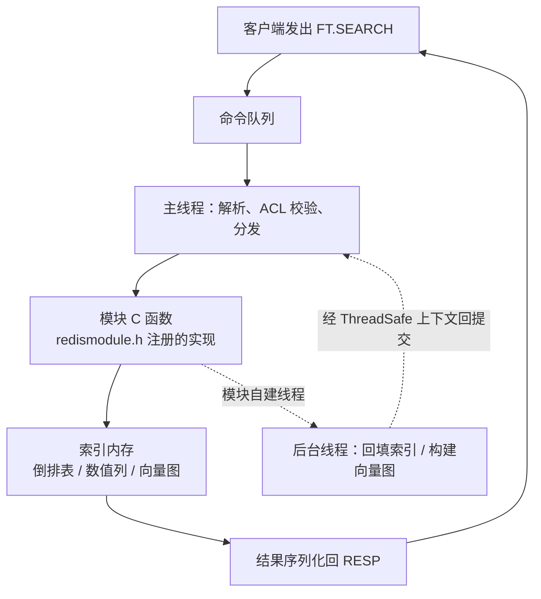
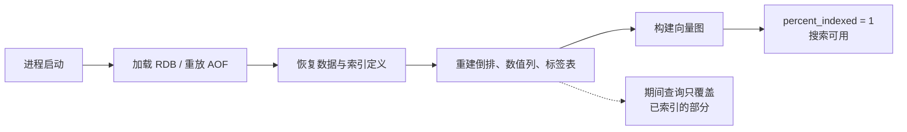
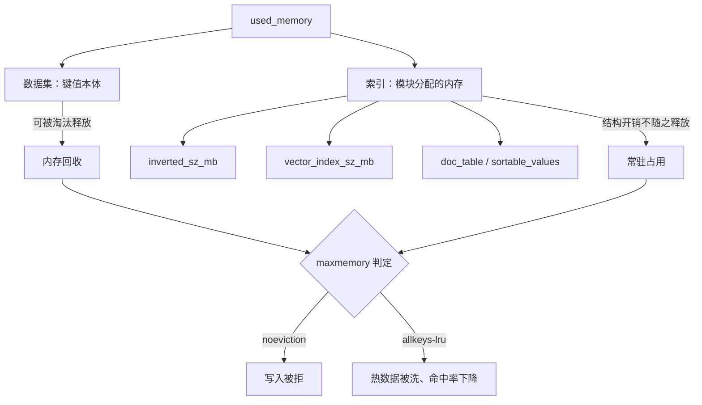
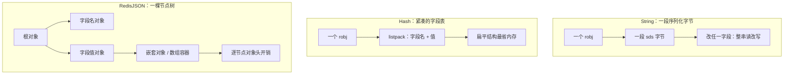
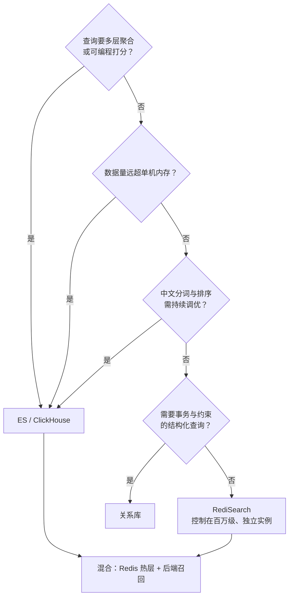

# 09 Redis 与搜索——RediSearch 与 RedisJSON

**摘要：**

把搜索塞进 Redis，是这个中间件最容易被误判的一次能力扩张。键值模型的寻址维度只有"键名"一维，任何按属性检索的需求，本质上是要求数据再存一份，且按属性排好——这第二份副本就是索引，它不是查询的附属品，而是数据模型之外新增的一笔固定资产。Redis 用模块（Module）机制把这份副本塞回了同一个进程：模块以 C API 扩展内核，`MODULE LOAD` 在运行时把 `.so` 挂进去，RediSearch 与 RedisJSON 由此得以在键空间之上维护倒排表、数值列与向量图。但模块也打破了"单线程内核自带命令"的封闭性——模块命令的复杂度不受内核那套经过反复审计的清单约束，一条 `FT.CREATE` 可以是一次全量扫描，一条 `FT.SEARCH` 可以在主线程上跑几十毫秒，代价由使用方而不是内核承担。本文分三段落：先讲模块机制与被打破的封闭性，再分别划 RediSearch 与 RedisJSON 的能力边界与内存账（索引内存、JSON 树的倍数代价），最后给出一张"什么需求该用什么引擎"的判据表和三个反例。落点是边界而非能力：RediSearch 是搜索的补充，不是替代；RedisJSON 是部分写入的解法，不是文档数据库。本列写使用与运维，事件循环、编码转换阈值、fork 与 COW、槽位迁移这类机制只给一句结论加双链。

---

## 第 1 章 键值库为什么要长出搜索

### 1.1 可寻址维度由数据模型决定

Redis 的键空间是一张哈希表，键是字节串，值是不透明对象，从键到值的这一步是 O(1)。全部可寻址信息都压在键名上：`user:1001` 能查到，`user:1001` 的 `city` 字段却查不到，因为 `city` 是值内部的字节，键空间对它一无所知。

于是"按属性查"这个需求在键值库里没有位置。这不是功能缺失，而是数据模型的性质：哈希表的形状只允许等值匹配，想让 `city = Beijing AND age BETWEEN 25 AND 35` 也变成 O(1) 或 O(log N)，就必须再准备一份按 `city`、按 `age` 排好的数据结构。**二级索引**的本质是数据的第二份副本——它不是查询的附属品，而是为了让另一种访问路径成立而付出的存储与写入代价。

这个判断解释了后面所有讨论的走向：搜索能力在 Redis 里从来不是"加个命令"的事，是"多一份副本、多一份维护、多一份内存"的事，而这三份代价正好落在 Redis 最稀缺的资源上。

原生的 `KEYS` 与 `SCAN` 常被当作替代品，但它们的匹配对象是键名而不是值，`KEYS` 还会阻塞主线程（机制见 [[05 单线程模型与事件驱动架构]]），`SCAN` 虽然渐进，代价是全库遍历。即便业务愿意接受全库遍历，它也解决不了"按相关性排序"——因为遍历只回答"有哪些"，不回答"哪个更相关"。

### 1.2 手搓二级索引的三笔欠账

在查询引擎成为模块之前，工程师用基础类型自己拼索引。按字段值精确匹配用一个 Set，按数值范围用一个 ZSet，多条件用集合求交：

```bash
# 按城市建 Set 索引，member 是主键
SADD idx:city:beijing "user:1001" "user:1003" "user:1007"
SADD idx:city:shanghai "user:1002" "user:1005"

# 按年龄建 ZSet 索引，score 是年龄
ZADD idx:age 25 "user:1001"
ZADD idx:age 30 "user:1002"
ZADD idx:age 28 "user:1003"
```

组合条件时，先取范围再求交：

```bash
# 1. 年龄 25-30 落到临时 Set（BYSCORE 表明按 score 而非排名切）
ZRANGESTORE tmp:age idx:age 25 30 BYSCORE
# 2. 与城市索引求交
SINTERSTORE tmp:result idx:city:beijing tmp:age
# 3. 读结果并清理临时键
SMEMBERS tmp:result
DEL tmp:age tmp:result
```

这段代码能跑，但它欠了三笔账。

第一笔是维护成本。数据每次增删改，所有相关索引都要同步跟一遍；字段从三个长到十个，代码里就多出十处更新点，漏一处就是脏索引。第二笔是原子性。数据与索引的更新不在一个原子单元里，即便用 `MULTI` 把几条命令包起来，也无法保证"客户端崩溃在两次重试之间"时索引与数据仍然对齐，因为重试本身不幂等。第三笔是维度上限。Set 只能做等值，ZSet 只能按单一 score 范围，多字段排序（先按销量、再按价格、再按上架时间）在基础类型里没有对应结构，只能靠应用层把结果全量捞回来再排。

此外还有一笔隐性成本：每个索引都是独立的键，都占内存，而 Set 与 ZSet 的紧凑编码只在元素数与长度都小的窗口内有效，越过阈值就换成哈希表或跳表，内存与延迟一起上台阶（编码阈值见 [[02 SDS 与 Redis 对象系统]] 与 [[04 跳跃表 压缩列表与 Listpack]]）。

> [!info] 手搓索引不是错，错在场景
> 维度固定、更新频率低、只做排行或时间分页时，ZSet 索引是恰当解法，`ZADD` 的 O(log N) 与天然有序比任何搜索引擎都省。它失效的地方是维度会变、条件要组合、还要相关性排序——这三件事恰好是搜索需求的常态。

### 1.3 与机制专栏的分工

本篇只回答"该不该用、成本在哪、边界在哪"。凡涉及实现机制的细节——事件循环里命令的执行顺序、主线程为何不能被打断、fork 与 COW 如何放大内存峰值、Cluster 的槽位如何分配与迁移——一律一句结论加一条路由，正文不展开。这些在 [[05 单线程模型与事件驱动架构]]、[[07 RDB 持久化——快照的 fork 与 COW 机制]]、[[06 内存管理与过期淘汰策略]] 与 [[10 Redis Cluster 分布式架构]] 中已经逐条校准过。

邻篇的分工也要说清：容量核算的方法与热大 key 治理在 [[05 热 Key 大 Key 治理与容量规划]]，生产环境的指标与排障流程在 [[10 Redis 生产运维——监控 告警与故障排查]]。本文提到内存与监控时只引用结论。

---

## 第 2 章 模块：内核对外的唯一逃生口

### 2.1 一个 `.so` 如何变成半个 Redis

**模块（Module）** 是一个用 C 写成、编译成共享库的扩展，加载进 Redis 进程后与内核共享同一个地址空间、同一个事件循环、同一份数据。它通过 `redismodule.h` 这一个头文件与宿主对话：`RedisModule_Init` 完成版本登记，`RedisModule_CreateCommand` 往命令表里塞进一条新命令并声明它的名字、实现函数、`write`/`deny-oom` 之类的 flag、首个与末个键的位置，`RedisModule_CreateDataType` 注册一个带版本号的数据类型，模块才能把自己的数据写进 RDB 与 AOF 并被正确读回。

加载有两条路。静态路径是在 `redis.conf` 里写 `loadmodule /path/redisearch.so`，进程启动即加载；动态路径是 `MODULE LOAD`，运行时把 `.so` 挂进已经跑着的实例，`MODULE LOADEX` 还能在加载时带上配置参数。从 Redis 7.0 起，`MODULE` 命令默认被 `enable-module-command no` 关掉，要改成 `yes` 或 `local` 才能用——这条默认值的改动是一次破坏性变更，理由是往运行中的进程注入任意原生代码，等价于给它开了一个后门，而这个后门通常不应该对应用连接开放。

版本分水岭也要写清。RediSearch、RedisJSON、RedisTimeSeries、RedisBloom 曾以独立发行版 Redis Stack 的形式提供，2025 年 5 月的 Redis 8.0 GA 把它们并入了 Redis Open Source 本体——查询引擎、JSON、时序与概率数据结构成为内核的一部分，许可证为 AGPLv3，独立安装 Stack 不再必要。所以"要搜索得先装 Stack"这句话只在 8.0 之前成立，读到旧文档时要留意这层时间差。

反过来，`MODULE UNLOAD` 在有该模块类型的数据存在时会拒绝执行，因为那些键的内存在模块的代码里解释，拔掉代码等于留下无法解析的字节。`MODULE LIST` 列出已加载模块的名字、版本、路径与加载参数，是排查"命令为什么不存在"的第一条命令。

关键在于，加载完成之后，模块命令与内核命令在事件循环里没有区别。客户端发出 `FT.SEARCH`，这条命令进队列、被解析、被分发，然后执行的是模块里的那段 C 代码。单线程的假设依然成立，只是这条命令做什么、做多久，内核不再有发言权。



### 2.2 被打破的封闭性

Redis 之所以敢用一条线程处理所有命令，靠的是一个隐含契约：每条命令都很快，且复杂度是已知的。这个契约在源码里体现为一组被反复审计的复杂度标注——`GET` 是 O(1)，`HGETALL` 是 O(N)，`KEYS` 是 O(N)，`SORT` 是 O(N log N)，大 key 上的 `DEL` 是 O(N)。运维知道哪些命令要禁、哪些要限流、哪些必须拆。

模块把这份清单打散了。`COMMAND INFO` 对模块命令只返回 arity 与 flags，不返回复杂度；复杂度写在模块自己的文档里，甚至只写在代码里；升级一个模块小版本，某条命令的复杂度可能从"扫一遍索引"变成"扫两遍"。这就是**封闭性**被打破的真实含义：不是模块不好，而是原本"内核替你把复杂度兜住"的担保失效了，担保责任转给了使用方。

后果在一个具体数字上显形。假设一个实例在主线程上能处理十万级 QPS 的简单命令（量级判断，随硬件与管道化程度浮动），折算下来每条约十微秒；如果某条模块命令跑五十毫秒，这五十毫秒里主线程积压的命令量就是数千条（示例推算）——所有客户端一起排队，包括那些只做 `GET` 的缓存请求。原来的容量规划是按简单命令做的，一条模块命令就能把它推翻。

内核命令像一条标着限高的隧道，所有车都从同一个洞口进，高度是量过的；模块是路侧突然开的一个岔口，车能从那里进，但没人量过它多高。问题不在于岔口不该开，而在于开完之后，原先按隧道高度做的调度计划必须重做一遍。

### 2.3 模块命令会在哪里阻塞

具体到本篇的两个模块，阻塞点是可以枚举的，笔者按从重到轻的顺序列一遍。

`FT.CREATE` 看着像"建一个定义"，实际默认会对 PREFIX 命中的存量键做一次回填索引。数据量到千万级、字段里有几个 TEXT 时，这是一次长任务；`SKIPINITIALSCAN` 可以跳过回填，代价是存量数据不在索引里，得自己安排重建。很多人第一次遇到"建索引把实例卡住"，就是把它当成了元数据操作。

`FT.SEARCH` 的开销来自候选集与结果集两处。查询先算出候选文档，再排序、再按 `LIMIT` 截断，截断发生在计算之后而不是之前；`MAXSEARCHRESULTS` 这个参数存在的理由，正是给这种"候选集无上限"的行为装一个闸。聚合更重，`GROUPBY` 与 `REDUCE` 要在候选集上再跑一遍管道。

`JSON.SET` 写一份大文档时，一次命令要分配整棵树的节点；文档到几百 KB，单次命令的耗时与内存分配量就都不再是常数级。

向量索引的构建是另一类。HNSW 插入要逐层搜索邻居再连线，平均是对数级但常数不小，批量导入时 CPU 会明显抬起来；首次加载 RDB 后重建索引同样吃 CPU，这段时间里从库同步与主从切换窗口都会变长。结果序列化也不能忽略：返回一万条文档，光是把它们编码成 RESP 就是 O(结果大小)，而这一步无法被 `LIMIT` 之外的任何手段优化。

还有一类代价不在耗时上，而在时序上。主线程被一条模块命令占住的这段时间里，事件循环里那些本该按周期执行的动作都被推后——过期键的定期删除、渐进式 rehash 的增量迁移、`serverCron` 触发的复制心跳与统计更新，全部排队等这条命令让出 CPU。键空间的观感于是出现偏差：过期键突然多了一批、从库的心跳间隔开始抖动、`INFO` 里的采样值跳变。这些动作各自的节奏在 [[05 单线程模型与事件驱动架构]] 与 [[06 内存管理与过期淘汰策略]] 里有推导，此处只记结论：模块命令的代价不止是它自己的响应时间，还有它推迟掉的一切。

### 2.4 版本耦合：模块与内核绑死

模块调用的是 `RedisModule_*` 这一组 C API，这组 API 随内核版本增删。后果是**版本耦合**：升内核之前要先确认模块提供了配套版本，否则现象是启动时报 `Module ... failed to load`，或者更糟——加载成功但某条命令行为变了。

耦合还有一层更硬的约束。模块注册的数据类型会写进 RDB 与 AOF，如果拿这份 RDB 去一个没有加载该模块的实例上恢复，会直接报 `Module type not found`。这意味着三件事同时受限：备份不能随便恢复到纯内核实例，测试环境必须装同样的模块与版本，回滚时旧版本可能读不懂新版本写下的编码。降级不是换个二进制文件那么简单，它要求回滚窗口内没有新数据写入。

监控口径也不统一。内核的指标在 `INFO` 里，模块的指标在它自己的命令里——RediSearch 的内存、索引进度、失败计数全在 `FT.INFO` 的返回里，字段命名是 `inverted_sz_mb` 这种以 MB 为单位的字符串，与 Prometheus 习惯的字节制对不上，接采集时要么额外做一次单位换算，要么在容量报表里留下一个隐蔽的百倍误差。

### 2.5 云托管：版本由厂商决定

自建环境里，模块版本是自己选的；托管环境里，它通常是厂商选的。多数云 Redis 服务禁用 `MODULE LOAD`，`enable-module-command` 不可改，能调的是规格与参数，不是模块版本。于是能力边界被锁定在"厂商这个版本支持什么"上：能不能用 `FT.HYBRID`、向量索引的内存是否计入套餐配额、查询是否走多线程，答案都在厂商的版本说明里，而不在开源文档里。

兼容实现的差异还带来一层隐性风险。若托管实例跑的不是上游 Redis 而是兼容分支（譬如以 Valkey 加搜索模块提供的服务），命令集合大体相同，版本对应关系与边界行为却各自演进——同一段 `FT.AGGREGATE` 在两个平台上可能给出不同的截断行为。跨平台迁移前要按命令逐条对齐，不能只看"都支持 RediSearch"。

| 维度 | 内核自带命令 | 模块命令 |
| :--- | :--- | :--- |
| 复杂度归属 | 内核维护并公开标注 | 模块自行决定，可能随版本变化 |
| 执行位置 | 主线程 | 主线程（模块可另起后台线程） |
| 阻塞风险 | 已知清单，可按命令禁用 | 需按模块文档与实测建立清单 |
| 内存记账 | 计入 `used_memory`，随键淘汰释放 | 计入 `used_memory`，索引结构不随淘汰释放 |
| 升级影响 | 跟随内核版本 | 版本严格对应，可能不兼容旧 RDB |
| 可观测性 | `INFO`、`SLOWLOG`、`COMMAND` | 需模块自有命令（`FT.INFO` 等） |
| 托管可控性 | 参数可调 | 版本多由厂商决定 |

---

## 第 3 章 RediSearch：机制、成本与能力边界

### 3.1 索引定义与跟随写入

RediSearch 的工作方式是"定义 schema + 跟随写入"。`FT.CREATE` 声明索引名、数据源类型（`ON HASH` 或 `ON JSON`）、监控的键前缀、以及每个字段的索引类型：`TEXT` 走分词与倒排，`TAG` 走精确匹配的标签表，`NUMERIC` 走数值列，`GEO` 走地理编码，`VECTOR` 走向量索引。

```bash
FT.CREATE idx:products
  ON HASH
  PREFIX 1 "product:"
  SCHEMA
    name TEXT WEIGHT 5.0
    description TEXT WEIGHT 1.0
    category TAG SEPARATOR ","
    price NUMERIC SORTABLE
    brand TAG
    location GEO
```

定义完成之后，应用侧不需要改代码：写入仍然走 `HSET` 或 `JSON.SET`，模块通过键空间事件通知感知变更并同步更新索引。这是它相对手搓索引最大的优势——索引维护从应用代码里搬进了引擎内部，一致性由同一个线程的同一次命令保证。

两个细节值得单独记。其一，RediSearch 2.0 起索引本身不在键空间里，不能用 `KEYS idx:*` 找索引；列索引要用 `FT._LIST`，看状态要用 `FT.INFO`。其二，`SORTABLE` 不是免费的，它要求额外存一份可排序的值，`FT.INFO` 里的 `sortable_values_size_mb` 就是这笔开销。

JSON 数据源用 JSONPath 指定字段，路径与别名之间用 `AS` 连接：

```bash
FT.CREATE idx:users
  ON JSON
  PREFIX 1 "user:"
  SCHEMA
    $.name AS name TEXT
    $.age AS age NUMERIC SORTABLE
    $.city AS city TAG
    $.tags AS tags TAG
```

`FT.INFO` 里有两项决定索引是否"可用"：`indexing` 表示是否仍在构建，`percent_indexed` 表示完成比例（1 表示完成）。回填期间查询能返回结果，但只覆盖已索引的部分——这个语义比"报错"更危险，因为调用方看到的是一份不完整却格式正常的答案。

集群模式还有一层放大。索引按分片各自维护，同一个 `FT.CREATE` 定义在每个持有相关键的分片上各建一份；`FT.SEARCH` 被分发到所有分片、各自算出前 N 条、再归并成全局结果。这带来两个容易被低估的后果：索引内存要按分片分别核算，每个分片都有自己的倒排表与主键表，不是一份索引切成几份；扩容新增分片时，新分片要从零回填一次索引，而这次回填发生在集群已经在提供服务的时候，与用户的查询争抢同一个主线程。槽位与重定向机制见 [[10 Redis Cluster 分布式架构]]，此处只强调索引跟着数据一起被复制这件事对容量规划的影响。

### 3.2 持久化：索引本身不落盘

这一节是整套方案里最容易在容量评审上被漏掉的一笔。

倒排索引不写入 RDB。按 RediSearch 2.0 重构时的说明，落盘的是索引定义（schema、前缀、字段配置），索引条目在数据加载过程中由数据重建；Redis 6.0.7 之后这次重建在加载期内同步完成，加载结束即可用，更早的版本则是异步重建，加载结束后还要等一段时间，用 `FT.INFO` 的 `indexing` 判断。

AOF 这条路径也一样。`FT.CREATE` 是一条写命令，会被 AOF 重放，索引定义因此得以恢复；但 AOF 里保存的是 `HSET` 这些数据命令，重放它们只恢复数据，索引条目仍要靠重建。换句话说，无论走 RDB 还是 AOF，重启后的第一件事都是**重建索引**，其耗时与数据量成正比，而不是与持久化文件大小成正比。

这条性质带来三个运维后果。

重启的恢复时间被拉长，而且是 CPU 密集型的延长，不是 IO 等待型的延长，所以把 RDB 放到本地 SSD 上也优化不了这一段。主从切换的窗口变长，新主需要重建索引的时间可能远大于普通的数据加载。批量导入的场景要选路线：先写数据再建索引，写入快、索引只建一次，但建好之前搜不到；先建索引再写数据，搜索立即可用，但每次写入都要同步维护索引，导入速度慢一截。



> [!warning] 索引重建不是可选项
> 任何把 RediSearch 放在关键链路上的设计，都要回答"重启后多久能恢复搜索"。答案不是"加载 RDB 的时间"，而是"加载数据 + 重建索引"的时间，后者往往是前者的数倍。不同版本对大索引的持久化路径仍在演进，落地时以目标版本的 `FT.INFO` 行为为准，不要照搬博客里的结论。

### 3.3 索引内存：最容易被低估的账

**索引是内存里的**，这是本篇最该记住的一句。用上 RediSearch 之后，这台实例的总内存等于数据本身加上索引，两部分都要算进容量规划；数据本体一般还是更大的那一头，索引则可能吃掉它的两三成到八成，视字段类型而变。

各索引类型的内存构成不一样：

| 索引类型 | 内存里存什么 | 相对数据量的量级 | 备注 |
| :--- | :--- | :--- | :--- |
| TEXT | 倒排表（词项到文档列表）、位置信息、词频 | 被索引文本的 20%-60%（量级判断） | 与词项重复度、分词粒度强相关 |
| TAG | 标签值到文档列表的映射 | 唯一标签值数量 × 文档数分布 | 标签基数高时显著上升 |
| NUMERIC | 每文档每字段一个数值列 | 每文档每字段十余字节 | `SORTABLE` 另存一份 |
| GEO | 地理编码与索引 | 与 NUMERIC 同量级 | 多用于范围过滤 |
| VECTOR FLAT | 原始向量 | 维度 × 4 字节/条 | 精确但查询为线性扫描 |
| VECTOR HNSW | 原始向量 + 图结构 | 向量本体再加 5%-10%（量级判断） | 邻居表与层级指针的开销 |

向量这一项的绝对值容易算错。一亿条 1536 维 float32 向量，纯向量本体是 1536 × 4 字节 × 1 亿 ≈ 614 GB（算术推算），这还没算索引结构、文档表与主键表。所以"向量规模在百万级"不是一句保守建议，而是内存算术的结果：百万条 1536 维向量约 6 GB，加上索引与文档副本后是一条可以放进单机的量级；再往上就是另一个架构问题。

把这套算法落成一个文本检索的例子，量级会清楚一些（以下全是示例推算）：一百万篇文档，每篇正文约 1 KB，文本本体约 1 GB；倒排表按被索引文本的两三成估，落在 200 MB 到 600 MB 之间；主键表与文档表按每文档几十字节估，几十 MB；再加两个 `SORTABLE` 字段的排序值。合起来，索引大致在 300 MB 到 800 MB 之间，相当于数据本体的三成到八成。这个比例决定了配机器的方式：若按"数据 1 GB、机器给 2 GB"来配，索引一进来就没什么余量；若按"数据 + 索引 + 碎片 + COW 峰值"配到 3 GB 以上，同样的业务就能安稳挺过重启与主从切换。

`FT.INFO` 是唯一能把账算清的地方，关键字段如下：

| 字段 | 含义 | 读它来判断什么 |
| :--- | :--- | :--- |
| `inverted_sz_mb` | 倒排索引占用 | 文本索引是否已成为内存大头 |
| `vector_index_sz_mb` | 向量索引占用 | 向量规模是否超出预期 |
| `doc_table_size_mb` | 文档表占用 | 主键与文档元数据的开销 |
| `sortable_values_size_mb` | 可排序值占用 | `SORTABLE` 带来的额外成本 |
| `total_index_memory_sz_mb` | 索引总内存 | 与 `used_memory` 的比例趋势 |
| `hash_indexing_failures` | 索引失败次数 | 有文档静默未进索引 |
| `indexing` / `percent_indexed` | 构建状态与进度 | 回填是否完成、重启后是否可用 |

其中 `hash_indexing_failures` 这一项值得单独警惕：字段类型不符、文本超长、向量维度与 schema 不一致时，写入不会报错，只是该文档不进索引，表现为"明明写进去了却搜不到"。这是索引类系统里最难排查的一类故障，因为它没有错误码。

内存记账还有一个错位。模块分配的内存计入 `used_memory`，因此会参与 `maxmemory` 的判定，压力上来时内核照常触发淘汰；但淘汰只能删键，键一删，该键对应的索引条目才会跟着删，索引结构本身的骨架（字典、空闲块、向量图的层级结构）并不会因此释放。于是会出现"内存打满却淘汰不动"的形态：`noeviction` 下写请求被直接拒绝，`allkeys-lru` 下热数据被洗掉、命中率崩塌，而索引的基础开销还在那里。淘汰机制的细节在 [[06 内存管理与过期淘汰策略]]，这里只取结论。

查询侧有几个直接换内存与延迟的参数，取舍写在表里：

| 参数 | 作用 | 调大的代价 | 调小的代价 |
| :--- | :--- | :--- | :--- |
| `TIMEOUT` | 单次查询超时（毫秒） | 慢查询占住主线程更久，放大队头阻塞 | 复杂查询更早被截断，返回不完整结果 |
| `ON_TIMEOUT` | 超时后返回还是报错 | 返回可让调用方降级，但结果可能缺项 | 报错语义清晰，但把压力转给调用方 |
| `MAXSEARCHRESULTS` | 单次搜索的候选上限 | 内存峰值与大结果集风险上升 | 深分页与全量导出先撞上限 |
| `MAXAGGREGATERESULTS` | 聚合结果上限 | 同上，聚合并发时内存放大 | 分组数多的报表被截断 |
| `MINPREFIX` | 前缀查询的最小字符数 | 短前缀走索引，查询更快，但索引项更多 | 太短的前缀被拒绝，业务要改查询方式 |

这张表的读法是：RediSearch 的每个保护性参数都在"主线程被占住的时间"和"结果的完整性"之间做交换，没有一项是纯粹的性能开关。



### 3.4 中文与相关性：差距在哪

中文支持从 0.99.0 起就有，做法是词典分词：用 Friso 中文分词库扫描文本，把字符序列与预定义词典比对，按上下文取最可能的切分。索引时在 `FT.CREATE` 上声明语言，查询时在 `FT.SEARCH` 上带 `LANGUAGE chinese`；专业词汇可以通过自定义词典补进去（`FT.DICTADD`/`FT.DICTDEL`）。

这套机制能覆盖大部分常规检索，但它的边界很清楚：分词质量取决于词典，词典没有的新词、品牌名、缩写、口语化短句都会被切错，而切错在倒排索引里的后果是"搜不到"而不是"排得靠后"。ES 侧的分词是可替换插件（IK、HanLP 一类），还能叠加同义词图、停用词表、词性过滤，能针对一个业务域反复调；RediSearch 的调优空间集中在词典与字段权重上，粒度粗一档。

词干与同义词也要分清。词干（stemming）是靠语言选项启用的形态归并，英文场景大致可用；同义词不是自动能力，要显式维护同义词组（`FT.SYNUPDATE`），维护成本落回使用方。

模糊与前缀搜索是另外两个常用语法。前缀搜索写成 `term*`，靠词项字典的前缀遍历完成，短前缀会命中大量词项，所以有 `MINPREFIX` 兜着；模糊搜索写成 `%%term%%`，允许一个**编辑距离**的拼写差异，引擎的做法是把该词项扩展成一批候选变体，再逐个别查倒排。

```bash
FT.SEARCH idx:products "@name:phon*"        # 前缀
FT.SEARCH idx:products "%%iPhon%%"          # 模糊，编辑距离 1
FT.SEARCH idx:products "@name:(蓝牙 耳机)"   # 多词，默认 AND
```

模糊搜索在英文里能救拼写错误，在中文里几乎没有价值——中文的错误形态是同音字与切分错误，不是字母增删；而每扩展一次变体就要多扫一批倒排，候选集放大后排序成本随之上升。语法支持与业务可用是两件事，宣传页上写"支持模糊搜索"通常只说前者。

地理查询的语法是"圆"而不是"多边形"：

```bash
FT.SEARCH idx:products "@location:[116.41 39.92 5 km]"
```

按经纬度加半径过滤，算的是球面距离，坐标约定由写入值与查询共用一套。它适合"附近的门店"这类范围筛选，不适合路径规划或任意多边形相交；需要后者就得把几何运算挪到专门的 GIS 组件里，别指望在检索命令里拼出来。

**相关性排序**的差距更实质。RediSearch 提供 `SCORER` 选择（长期默认是 TFIDF 系，可以换到 BM25 系）与字段级 `WEIGHT`，够表达"标题比正文重要"这类粗粒度偏好。但业务上常见的排序诉求是"标题命中优先 + 销量加权 + 上架时间衰减 + 去重"，这类组合在 ES 里可以用 `function_score` 表达，在 RediSearch 里只能把候选集全量取回应用层重排——而一旦全量取回，检索就从"引擎内排序"退化成"引擎内召回、应用内排序"，延迟与内存的账都要重算。

高亮与摘要两项都有（`HIGHLIGHT`、`SUMMARIZE`），实际效果依赖分词质量：分词切错，摘要的断句位置也会错。

### 3.5 聚合与向量：能做什么、不能做什么

`FT.AGGREGATE` 提供分组、归约、表达式投影、排序与过滤，语法形态接近 SQL 的一段管道：

```bash
FT.AGGREGATE idx:products "*"
  GROUPBY 1 @brand
  REDUCE COUNT 0 AS cnt
  REDUCE AVG 1 @price AS avg_price
  SORTBY 2 @cnt DESC
```

它能做的事和不能做的事一样明确。能做单层的 `GROUPBY` 加多种 `REDUCE`，能做 `APPLY` 派生字段，能链式地再分组。不能做表连接、不能做子查询、不能做窗口函数；跨分片的聚合要在各分片上各算一遍再归并，`AVG` 这类需要全局分母的归约在分片模式下要格外小心——先分组再求平均和在每个分片上求平均再平均，结果不是一回事。ES 的聚合一侧有嵌套聚合与 pipeline 聚合，能表达同比、环比、占比这类派生计算（见 [[05 聚合分析——Bucket、Metric 与 Pipeline]]）。

向量检索的入口是 `FT.SEARCH` 的 `KNN` 子句，语法是把向量相似度作为查询表达式的一部分：

```bash
FT.SEARCH idx:docs "(@category:{技术})=>[KNN 10 @embedding $vec AS score]"
  PARAMS 2 vec "<二进制向量>"
  SORTBY score
  DIALECT 2
```

`DIALECT 2` 不是可选项，`=>[KNN ...]` 这种语法需要它才能解析；Redis 8 起查询引擎只接受 `DIALECT 2`。

两种索引算法的取舍是老话题：`FLAT` 精确、线性扫描、内存只存向量本体；`HNSW` 近似、对数级跳转、内存多出图结构，靠 `M`（每节点连接数）与 `EF_CONSTRUCTION`（构建宽度）调召回率，查询时用 `EF_RUNTIME` 调"多搜一点换召回"。这一组参数的本质是同一个交换：多花内存与构建时间换召回率，多花查询时间换精度。算法本身的来路见 [[02 向量索引——从暴力搜索到 HNSW 与 IVF]]。

过滤与向量的组合有个易被忽略的退化：`(@tag:{x})=>[KNN ...]` 是先按条件过滤再做向量搜索，过滤后的候选集太小或太散时，HNSW 的图优势会消失，查询退化为近似暴力扫描；集群模式下还要面对"每个分片各出 K 条、再归并取全局 K"的召回损失，`SHARD_K_RATIO` 这类参数就是用来在分片上多取一些以提高全局召回的。

关于"聚合里能不能做向量检索"，需要按命令定义纠正一个流传很广的说法：`FT.AGGREGATE` 的参数列表里没有 `KNN` 子句，它接的是普通过滤语法的查询表达式，聚合与向量召回是两条管道；要把全文打分与向量检索融合进一次请求，得用 Redis 8.4 引入的 `FT.HYBRID`（以 RRF 或线性组合融合两路排序）。版本差异在这里很关键，照抄旧示例会写出跑不通的命令，落笔前以目标版本的 `COMMAND DOCS` 为准。

还有一处容易混淆：Redis 8 引入了独立的 Vector Set 数据类型（`VADD`/`VSIM`），它回答的是"给定向量，找出这个集合里最相似的键"，没有 schema、没有结构化字段过滤；而查询引擎的向量索引回答的是"在满足条件的文档里找最相似的"。前者适合去重与近似匹配，后者适合 RAG 与语义检索，两者的适用面不重叠。

### 3.6 判据：它是补充不是替代

把 RediSearch 与 ES 放在一张表里比，比的是"哪一维更契合需求"，而不是"谁更强"：

| 判据 | RediSearch 更合适 | ES 更合适 |
| :--- | :--- | :--- |
| 数据量 | 百万级、能全量装进内存 | 亿级以上、需要磁盘与分片 |
| 延迟要求 | 亚毫秒到毫秒，与缓存同层 | 毫秒到十毫秒，独立层可接受 |
| 查询复杂度 | 单层过滤 + 排序 + 简单聚合 | 多层嵌套聚合、派生指标、复杂打分 |
| 中文要求 | 常规检索、词典可覆盖 | 需要可替换分词、同义词、停用词治理 |
| 相关性调优 | 字段权重级 | 函数打分、学习排序级 |
| 运维成本 | 复用现有 Redis 运维体系 | 独立集群、JVM、分片与段合并 |
| 故障影响面 | 与缓存共用实例时互相拖累 | 独立进程，故障域隔离 |

表里最容易被忽略的是最后一行。RediSearch 的运维成本低，是因为它把搜索放进了已经存在的实例；而这恰好也是它最大的风险来源——搜索慢查询影响的不只是搜索，还有跑在同一个实例上的缓存请求。低成本与低隔离是同一次选择的两个面。

---

## 第 4 章 RedisJSON：部分写入的代价

### 4.1 它解决的到底是什么

在 JSON 类型出现之前，存一份 JSON 有两条路，各有各的残。

第一条是 String 序列化：整份 JSON 当一个字符串存。读一个字段要 `GET` 整串，反序列化，取字段；改一个字段要读整串、反序列化、改、序列化、`SET` 回去。文档几十 KB 时，这次读改写的网络与 CPU 开销都被放大数倍，而且并发下两次读改写会互相覆盖，除非套 `WATCH` 或 Lua（脚本的原子性边界见 [[03 Redis 事务 Lua 脚本与原子性保证]]）。

第二条是 Hash 摊平：顶层字段映射成 field。读改单个字段都很便宜，但 Hash 的 field 值只能是字符串，嵌套对象与数组只能序列化成字符串塞进某个 field，取出后仍然要解析，结构化查询能力也就丢了。

**RedisJSON** 把 JSON 变成一种原生类型：文档在内存里是一棵树，按路径定位节点，单字段写入只动那一个节点。`JSON.SET user:1001 $.address.zip "100081"` 只改嵌套字段，不需要把整份文档读出来。

```bash
JSON.SET user:1001 $ '{"name":"Alice","age":30,"address":{"district":"Haidian","zip":"100080"},"tags":["vip","active"],"score":85.5}'

# 按路径读
JSON.GET user:1001 $.name                 # ["Alice"]
JSON.GET user:1001 $.address.district     # ["Haidian"]
JSON.GET user:1001 $.tags[0]              # ["vip"]

# 按路径写：只动一个节点
JSON.SET user:1001 $.age 31
JSON.SET user:1001 $.address.zip "100081"

# 数值与数组
JSON.NUMINCRBY user:1001 $.score 2.5
JSON.ARRAPPEND user:1001 $.tags '"gold"'
JSON.ARRLEN user:1001 $.tags
JSON.DEL user:1001 $.address.zip
```

这里要分清"原子"的两种含义。单条 `JSON.SET` 是原子的，它不会被其他命令插进中间；但"读出 age、判断是否满 18、再写回 status"这种读改写仍然不是原子的，依然要 `WATCH` 或 Lua。JSON 类型解决的是"不必整份读写"，不是"跨命令事务"。

### 4.2 路径语义与两个坑

JSONPath 的常用子集够用：

| 语法 | 含义 | 示例 |
| :--- | :--- | :--- |
| `$` | 根节点 | `$.name` |
| `.field` | 子字段 | `$.address.city` |
| `[index]` | 数组元素 | `$.tags[0]` |
| `[start:end]` | 数组切片 | `$.tags[0:2]` |
| `..field` | 递归搜索 | `$..name` |
| `[?(@.field > value)]` | 条件过滤 | `$.items[?(@.price > 100)]` |

第一个坑是返回形态。用 `$` 开头的路径查询时，结果会被包成数组，`JSON.GET user:1001 $.name` 返回的是 `["Alice"]` 而不是 `"Alice"`；用旧式路径（不带 `$` 前缀的 `.name`）才返回裸值。两套路径混用是客户端解析出错的高频原因，尤其在多条路径一起查时——多路径返回的是一个键为路径、值为数组数组的对象，形状比单路径更绕。

第二个坑是路径通配的写放大。`JSON.SET key $..a 1` 这类写法会命中所有匹配位置，一次命令改多处，语义上仍然原子，但耗时随匹配数量增长；把它当"批量更新"用，就会在主线程上制造出 2.3 节说的那种长命令。

### 4.3 内存代价：树比字符串贵几倍

String 存的是一段连续字节，Redis 为一个键付一次对象头开销（`robj` 加 `sds`，细节见 [[02 SDS 与 Redis 对象系统]]）。JSON 存的是树：根对象、每个字段名、每个字段值各是一个内存节点，嵌套对象与数组再各带自己的容器，容器里还有哈希或数组的槽位。节点越多、字段名越多，为"结构"付的钱就越多。

下面这组数字是示例推算，用来说明倍数的量级，不是某次基准测试的结论：一份六字段、嵌套一层、序列化后约 180 字节的 JSON，用 String 存大约占 200 字节上下，用 Hash 存在 listpack 编码窗口内大约 250 字节，用 RedisJSON 存则可能落在 400 到 700 字节之间，也就是两倍到四倍的差距。字段名越短、字段数越少，这个倍数越小；嵌套越深、数组元素越多，倍数越大。

差距的来源是三处叠加：每个节点的对象头、每个字符串值的独立分配、以及字段名在每份文档里都存一遍（Hash 的字段名存在紧凑的 listpack 里，JSON 的字段名是独立字符串对象）。这也解释了为什么"扁平小结构用 Hash 更省"——Hash 把字段名与值放在一段连续内存里，省掉的正是节点开销。

核查手段有三条：`MEMORY USAGE key` 看单个键的实际占用，`JSON.DEBUG MEMORY key` 看 JSON 文档自身的内存用量，`FT.INFO` 看该字段在倒排与排序值上的开销。三条一起看，才能把"数据 + 索引"的总账算平。



### 4.4 与 Hash 的取舍

| 维度 | String（序列化） | Hash | RedisJSON |
| :--- | :--- | :--- | :--- |
| 部分读 | 需 `GET` 全量 | `HGET` 单字段 | 按路径读 |
| 部分写 | 读改写整串 | `HSET` 单字段 | 按路径写单节点 |
| 嵌套与数组 | 只能整体处理 | 不支持 | 原生支持 |
| 原子数值操作 | 无 | `HINCRBY` | `JSON.NUMINCRBY` |
| 内存效率 | 中 | 高（listpack 窗口内） | 低（节点开销，2-4 倍，示例推算） |
| 与查询引擎配合 | 不能建索引 | 可按字段建索引 | 可按 JSONPath 建索引 |
| 适用判据 | 只整体存取的小文档 | 扁平、字段固定、读写频繁 | 嵌套、需局部更新、需按路径索引 |

取舍可以压成三句判断。扁平且字段固定，用 Hash，内存最优、命令最简单。需要按嵌套路径读写或要按嵌套字段建索引，用 RedisJSON，接受的代价是内存倍数。文档大到几百 KB 以上，两个都不该用——那是对象存储或独立文档库的场景，放进 Redis 只会把大 key、COW 放大、主线程阻塞三件事一起招来。

---

## 第 5 章 什么时候不该用 Redis

### 5.1 四类需求，四种不该用

章节标题说的是"不该用"，落点其实是"该用别的"。判据分四类。

**复杂聚合与相关性排序**，该用 ES 或 ClickHouse。判据是"查询里有没有多层分组、派生指标、可编程打分"。若系统要求在一次查询里算出"每个品类的销售额、同比、占比，并按综合得分排序"，Redis 的聚合管道表达不了，只能拆成多次查询在应用层拼装，拼装逻辑会随着指标增加而线性膨胀。列存引擎在扫描与聚合上的优势来自存储布局，不是调优能追上的（见 [[05 聚合分析——Bucket、Metric 与 Pipeline]]）。

**全文检索为主、中文要求高**，该用 ES。判据是"召回质量是否可以由业务方持续调整"。中文检索的调优是长期工作：新词要补词典、同义词要维护、停用词要按域收敛、相关性要按点击效果回归。ES 提供了支撑这套工作的接口，RediSearch 提供的是一组粗粒度旋钮。当检索是产品的核心功能而不是附属能力时，选后者等于把长期调优的路堵死。

**强一致与结构化查询**，该用关系库。判据是"有没有约束、事务、连接查询"。Redis 的持久化是"尽力而为的恢复"，不是"保证不丢的事务日志加约束校验"；它没有外键、没有唯一约束、没有多表连接，这些能力缺失不是靠应用层补一段代码就能等价的——补出来的那层代码，就是自己写了一个残缺的数据库。

**数据量远超内存**，该用磁盘型引擎。判据是"数据量除以单机内存超过一个可接受的倍数"。Redis 的所有优势建立在"数据在内存里"这个前提上，越过它只有两条路：淘汰，意味着数据不再是完整的检索源；扩容，意味着成本曲线陡到不可持续。把 Redis 当检索源却不接受"数据要装进内存"这个前提，是最根本的错配。

四类判据在实际项目里往往同时出现，而且指向不同的引擎。处理办法不是打分折中，而是先找那条**硬约束**——通常是数据量或一致性语义。若数据量已经超出单机内存，那么无论延迟要求多低、查询多简单，Redis 都不是答案；若业务要求事务与约束，那么无论数据量多小，Redis 也不是答案。硬约束之外才是权衡空间：延迟可以加机器换，成本可以降规格换，只有"装不下"与"没有事务"这两条，靠调优换不回来。

还有一类不该用，与其说选型错误不如说定位错误：把 Redis 当唯一真相源。RDB 与 AOF 解决的是重启恢复，不是备份与审计；主从复制解决的是可用性，不是一致性（细节见 [[08 AOF 持久化与混合持久化]] 与 [[09 主从复制与 Sentinel 高可用]]）。这条与本列其他篇目有交叉，此处只标位置。

### 5.2 判据表：什么需求该用什么

| 需求特征 | 首选 | 可接受的备选 | 不该用 Redis 的理由 |
| :--- | :--- | :--- | :--- |
| 中文全文检索、相关性需持续调优 | ES | 带插件的 OpenSearch | 分词与打分可调性不足 |
| 多维聚合、派生指标、报表 | ClickHouse / ES | Doris | 聚合管道无连接、无窗口函数 |
| 强一致事务与结构化约束 | MySQL / PostgreSQL | — | 无事务、无约束、无连接 |
| 数据量远超内存的检索 | ES | 磁盘型 KV | 内存成本与淘汰不可控 |
| 千万级以上向量检索 | Milvus / Qdrant | 托管向量库 | 向量内存按维度线性膨胀 |
| 百万级以内、低延迟、查询简单 | RediSearch | — | （适用）与缓存同层，延迟最优 |
| 单键部分更新、计数器、状态机 | Hash / RedisJSON | — | （适用）比整份读写便宜 |
| 热数据加速与查询结果缓存 | Redis + 后端引擎 | — | （适用）作为前置而非替代 |

这张表不妨先按需求特征定位行，再看"不该用的理由"是否成立；若理由成立而仍在用 Redis，那就是在用运维便利换架构债。

### 5.3 三个反例

第一个反例是"为省一个 ES 集群，把中文全文检索塞进 RediSearch"。起因通常是成本：已经有了 Redis 集群，再上一个 ES 集群要多付一份机器与一份运维。上线后的问题按顺序出现——运营反馈"搜'蓝牙耳机'搜不到只有'蓝牙'的标题"，因为词典把词切错了；产品要求"标题命中排在描述命中前面，再按销量加权"，字段权重只能表达前半句，后半句要靠应用层重排，于是每次搜索都要把上千条候选拉回应用；最后某个慢查询把实例 CPU 打满，连带跑在同实例上的缓存请求一起超时。

这个反例的根因不是 RediSearch 不行，而是几个目标互相矛盾：既要千万级数据，又要毫秒级搜索延迟；既要低成本，又要高质量中文召回。把四个要求同时压给一个组件，结果一定是某个要求被悄悄放弃，而放弃的往往是隔离性。

第二个反例是"用 RedisJSON 存超大嵌套结构"。典型形态是把整份订单快照（含明细数组、物流轨迹、优惠明细）塞进一个 JSON 键，单文档几十到几百 KB。短期看很省事：一次 `JSON.GET` 拿到全部。代价在后面显现——每次读都要在主线程上序列化整棵树，网络往返放大数倍；改一条明细要锁整份文档，并发写互相覆盖；RDB 快照时 fork 的 COW 会因这类大对象的写入而放大内存峰值（机制见 [[07 RDB 持久化——快照的 fork 与 COW 机制]]）；在 Cluster 里这种大键还会让槽位分布失衡。

笔者建议按访问模式拆：需要按明细查询的部分放 Hash 或 Stream，顶层文档只保留需要索引与整体读取的字段，历史快照移出 Redis。判断标准是"一次读写实际用到的字段占比"——占比低就该拆。

第三个反例是"不看索引内存，只算数据内存"。容量评审时按数据量算 `maxmemory`，上线两周开始 OOM。根因是排除了索引：文本字段多、`SORTABLE` 多、向量维度大的索引，`total_index_memory_sz_mb` 可以吃到数据量的可观比例；更麻烦的是这部分内存不随淘汰释放，于是内存曲线在没有写入增长的情况下也一路向上，最后 `noeviction` 直接拒绝写请求。

容量核算的正确口径是四项相加：数据本体、索引、内存碎片与复制缓冲、fork 期间的 COW 峰值。前两项用 `MEMORY USAGE`/`FT.INFO` 实测，后两项按复制积压与写入速率估（方法见 [[05 热 Key 大 Key 治理与容量规划]]，分配器与碎片口径见 [[06 内存管理与过期淘汰策略]]）。

### 5.4 混合架构：把边界画在部署图上

划完边界，落地形态通常是分层而不是二选一：Redis 做热层与前置过滤，把高频、结构化的查询挡在前面的毫秒级；ES 或向量库做召回与排序，承担复杂查询与大规模数据。前置过滤的价值不只是省一次查询——它把"绝大多数的重复查询"变成一次键值查找，让后端引擎的压力与数据量解耦。



RAG 场景是这套分层的典型：向量召回交给查询引擎或向量库，会话上下文、用户画像、限流计数留在 Redis 的字符串与 Hash 里；召回规模从百万涨到千万时，把向量部分迁到 Milvus 而保留 Redis 的其余角色（见 [[05 Milvus 在 RAG 场景中的应用]]）。迁移的触发条件应当是内存算术，而不是"感觉撑不住了"。

---

## 第 6 章 落地：上线前的清单

### 6.1 五个必须先回答的问题

引入模块之前，有五个问题要在设计文档里写下答案，缺一项就会在运维阶段补课：

| 问题 | 为什么必须问 | 问错的后果 |
| :--- | :--- | :--- |
| 数据量能否全量装进内存（含索引） | 内存是硬边界 | 上线后被迫缩表或加机器 |
| 重启后搜索多久可用 | 索引要重建 | 故障恢复时间被低估 |
| 单条查询最坏耗时多少 | 主线程是共享的 | 慢查询拖垮同实例的缓存 |
| 模块版本与内核版本的对应关系 | 二者严格耦合 | 升级失败或 RDB 不可恢复 |
| 索引失败如何发现 | 静默丢文档 | 搜不到且无错误码 |

第一个问题要算总账，不是算数据量。第二个问题要按"加载 + 重建"估，不是按 RDB 文件大小估。第三个问题要压测最坏形态——大 `LIMIT`、深分页、高 K 的 KNN、宽 `GROUPBY`，而不是测一条典型查询。第四个问题要写成版本矩阵，随每次升级更新。第五个问题要落实到监控，不能停留在"应该不会失败"。

### 6.2 巡检与监控

模块上线后，运维视角多出三条独立的检查线。

第一条是模块清单。`MODULE LIST` 对照 `INFO server` 的 `redis_version`，确认模块名、版本、路径与预期一致；笔者把这条命令放在升级检查单的第一行，因为加载失败在客户端侧的表现只是"命令不存在"。

第二条是索引健康。`FT.INFO` 的 `indexing` 与 `percent_indexed` 判断回填是否完成；`hash_indexing_failures` 与字段级的 `last indexing error` 找出静默失败的文档；`total_index_memory_sz_mb` 与 `used_memory` 的比例做成趋势图，比例突变通常意味着索引设计变了（新加 TEXT 字段或 SORTABLE）。

第三条是命令耗时。`SLOWLOG` 能抓到模块命令，但阈值要按模块命令的量级重设——默认阈值针对的是微秒级的简单命令，一条 5 毫秒的搜索在搜索语境里不算慢，在缓存语境里已经是灾难。`FT.PROFILE` 用来看查询的执行计划，判断慢在候选集扩展、排序还是结果组装。

指标采集的落点要注意单位：`FT.INFO` 的内存字段以 MB 为单位，`INFO memory` 以字节为单位，两套数据进同一个 Dashboard 时必须统一，否则容量报表里的百倍误差会一直藏着。

### 6.3 升级与回滚

升级路径受版本耦合约束，顺序通常是先升模块再升内核或二者配套升级，具体取决于模块的版本要求；执行上先副本后主库，让新版本先接读流量验证命令兼容性。

回滚的限制比升级更值得提前写清：新版本可能写入旧版本无法解析的模块编码，一旦有写入，旧二进制就未必读得回来。因此回滚窗口要与"是否允许丢写"一起决策，不能默认回滚总是可行。

滚动升级里最容易被低估的是"索引重建与副本切换撞车"。先升级的副本在加载数据时要重建索引，这段时间它的内存占用与 CPU 都会上台阶；若此时主库恰好故障切换，旧主还在重建、新主要承接全部流量，两件事叠加会把恢复窗口拉长到不可预期。稳妥的顺序是先让副本完成加载、确认 `FT.INFO` 的 `percent_indexed` 到 1、再逐个把流量切过去，主库最后动。

托管环境还要多问三个问题：查询引擎的版本号是多少、是否支持 `FT.HYBRID` 与新版本命令、索引内存是否计入实例内存配额。这三个答案决定了能力边界，而它们通常不在控制台上，要翻厂商文档或直接问支持。

---

## 第 7 章 结语

Redis 长出搜索能力，是模块机制的一次成功外延，也是使用方责任的一次扩张。模块让倒排表、数值列与向量图住进了同一个进程，代价是原本由内核兜住的复杂度担保被转交出来：模块命令不受内核命令那套已知复杂度的约束，它可能扫全库、可能跑几十毫秒、可能占住主线程，而这些代价不会出现在 `COMMAND INFO` 里，只出现在 `SLOWLOG` 和告警里。

RediSearch 与 RedisJSON 的边界也因此清晰。前者是搜索的补充，在百万级数据、简单查询、低延迟、复用现有运维体系这几个条件同时成立时，它比 ES 划算得多；一旦要求转向复杂聚合、可调相关性、高要求中文，它的能力天花板就到了。后者是部分写入的解法，把"改一个字段要读写整份文档"变成"改一个节点"，代价是树结构的内存倍数，以及在大文档上重新引入的阻塞问题。

划边界的意义在于，把"能不能"换成"该不该"。判断依据不是组件本身强不强，而是需求落在哪一格：复杂聚合与相关性排序归 ES，强一致与事务归关系库，超内存的数据量归磁盘型引擎，而"毫秒级、结构简单、数据能装进内存"的那一格，才是 Redis 的主场。复杂性不会因为选型而消失，它只会从一处转移到另一处——选型的工作，是把它转移到成本最低、也最容易被看见的地方。

---

## 参考资料

1. Redis 8.0 发布说明（查询引擎与 JSON 等数据类型并入内核）：https://github.com/redis/redis/releases/tag/8.0.0
2. RediSearch 2.0 首个里程碑（索引跟随写入、索引不进入键空间、`FT._LIST`）：https://redis.io/blog/redisearch-2-0-hits-its-first-milestone/
3. RediSearch 持久化行为说明（索引定义落盘、索引在导入时重建）：https://github.com/RediSearch/RediSearch/issues/1802
4. Redis 查询引擎中文支持（Friso 分词、`LANGUAGE chinese`、自定义词典）：https://redis.io/docs/latest/develop/ai/search-and-query/advanced-concepts/chinese/
5. Redis 查询语法方言（`DIALECT 2` 与向量查询）：https://redis.io/docs/latest/develop/interact/search-and-query/advanced-concepts/dialects/
6. `FT.AGGREGATE` 命令参考：https://redis.io/docs/latest/commands/ft.aggregate/
7. `FT.HYBRID` 命令参考（全文与向量融合检索）：https://redis.io/docs/latest/commands/ft.hybrid/
8. Redis 新版本变更（8.4 引入 `FT.HYBRID`）：https://redis.io/docs/latest/develop/whats-new/
9. 向量检索与索引参数：https://redis.io/docs/latest/develop/ai/search-and-query/vectors/
10. `MODULE LOAD` 命令参考（含 `enable-module-command` 约束）：https://redis.io/docs/latest/commands/module-load/
11. `FT.INFO` 输出字段说明：https://redis.io/docs/latest/commands/ft.info/
12. RedisJSON 数据类型文档：https://redis.io/docs/latest/develop/data-types/json/
13. HNSW 原始论文（Malkov & Yashunin）：https://arxiv.org/abs/1603.09320

---

> [!note] 思考题
> 1. 模块命令的复杂度不进入 `COMMAND INFO`，运维就无法像禁用 `KEYS` 那样按清单禁用危险命令。你会用什么手段建立这份"模块命令清单"，并让它随模块升级自动更新？
> 2. 索引在重启后要重建，而重建耗时与数据量成正比。如果业务要求"故障恢复后十秒内搜索可用"，你会选择缩小索引范围、预热副本，还是把搜索迁到独立引擎？
> 3. 中文分词由词典决定，新词与专有名词只能靠词典补充。评估一个中文检索方案时，你会用哪组查询来测召回，而不是只看"能不能搜到"？
> 4. RedisJSON 的内存是 String 的两到四倍（示例推算）。在什么访问模式下，这个倍数换来的"部分写入"仍然划算；在什么模式下用 Hash 摊平反而更好？
> 5. 混合架构里，Redis 做前置过滤、ES 做召回。当两端的数据一致性窗口扩大时，用户会先感知到哪一类错误，你会用哪种校验兜住？