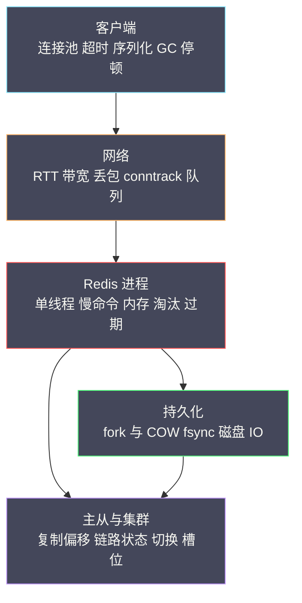
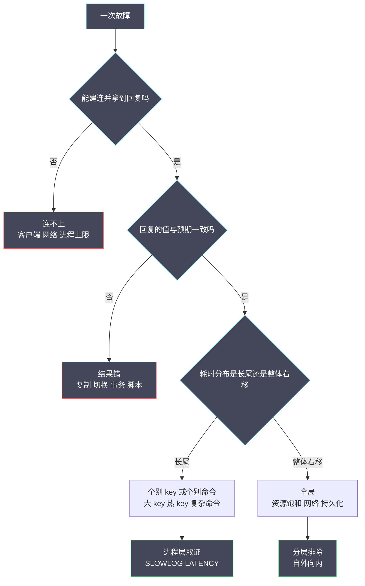
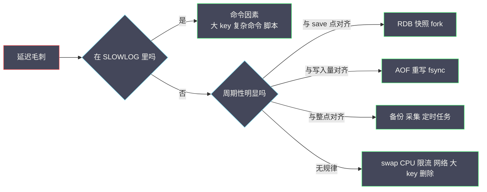
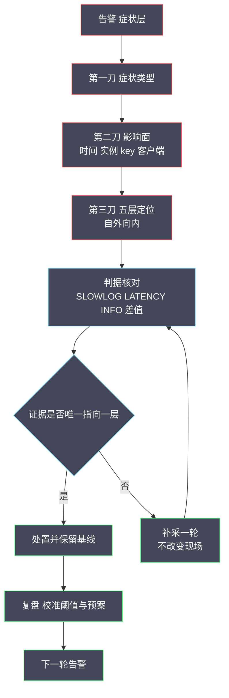

# 10 Redis 生产运维——监控 告警与故障排查

**摘要：**

监控面板上最不缺的是指标，最缺的是判定顺序。一次 Redis 故障里，工程师手里往往已经有几十条曲线，却仍然要靠猜；决定排查效率的不是采集了多少指标，而是先问哪一个问题、先动哪一手。本文不列指标清单，写的是从症状走到根因的顺序：先把症状切成连不上、连上但慢、结果错三类，再分出全局与个别，最后落到客户端、网络、进程、持久化、主从与集群五层；每一步给出判据，并说明顺序颠倒会毁掉哪一类证据。在此基础上把六类典型症状走成完整路径——周期性毛刺、连接数打满、内存持续上涨、复制延迟、切换后数据不一致、Cluster 节点不可用——再给出十项必盯指标的阈值与阈值失效的情形、SLOWLOG 与 LATENCY 和 MONITOR 的分工与代价、INFO 里累计值与瞬时值的读法，以及什么情况可以重启、什么情况绝不能重启。机制细节一律一句结论加双链，本文只负责把判据排成一个可以照着走完的顺序。

---

## 第 1 章 排障失败多半不是缺指标

### 1.1 三个起手动作

凌晨两点的告警电话里，听到的第一句话通常是"Redis 延迟高了"。接下来发生的事情大同小异：有人打开 Grafana 从上往下扫一遍曲线，有人在服务器上敲 `INFO all`，有人直接重启实例期待它自己好起来，也有人顺手把节点规格翻倍。这四件事的共同点是都很快，共同的问题是从第二步开始就已经在破坏现场。

把排障比作问诊更准确。化验单可以一次开几十项，医生的价值在于知道先问哪一句——先问"哪里疼"而不是先抽血，因为结果需要解释，而"哪里疼"决定了解释什么。指标是化验单，判定顺序是问诊；化验单开得越全，越容易在无关的数字上找到"异常"，再顺着它改配置，把真正的线索盖掉。

### 1.2 判据先于工具

本文用"判据"指一件事：能凭它把两种可能区分开的具体观测。`used_memory` 高不构成判据，因为它同时对应"数据真的多""碎片多""客户端缓冲多""从库没在淘汰"四种情况；`MEMORY STATS` 里 `dataset.bytes` 与 `clients.normal` 的占比才是判据，因为它把"存的东西多"和"存的东西之外的开销大"分开了。

判据要满足三条：能砍掉一半以上候选，砍不掉的只是信息；能重复取得，一次就断的链条没有诊断价值；足够便宜，昂贵的判据（`MONITOR`、`--bigkeys`、离线解析 RDB）只在候选收敛到几个时使用。

> [!warning] 先动手的代价
> 排查中每一个改变现场的动作都会让后续判据失效：重启让 `SLOWLOG` 与 `LATENCY` 的内存历史归零，扩容把单位时间的流量摊薄，改配置让前后对照失去意义，杀连接让泄漏画像消失。动手之前先问一句：这个动作会毁掉哪个判据，那个判据是不是唯一还能回答问题的。

### 1.3 五层模型的划分依据

把 Redis 排障分成客户端、网络、进程、持久化、主从与集群五层，不是因为这是拓扑顺序，而是因为这五层各自拥有独立的观测面和独立的失效方式。

客户端层记录完整耗时，从业务线程发起调用到拿到结果，中间包含连接获取、序列化、网络往返、服务端排队与执行；网络层只有 RTT、丢包、带宽与连接跟踪表；进程层的观测面是 `INFO`、`SLOWLOG`、`LATENCY`，失效几乎都归结为单线程被占住多久；持久化层是 fork 耗时、COW 大小、fsync 状态与磁盘 IO；主从与集群层是偏移量、链路状态与槽位归属。五个观测面彼此不能替代：一份客户端 P99 曲线无法回答"是不是 fork"，一份 `latest_fork_usec` 也无法回答"客户端有没有排队"。

### 1.4 与机制专栏的分工

本文只回答"看到什么现象、按什么顺序核对哪几个量"，不解释这些量为什么长这样。请求从 socket 到命令执行的整条链路见 [[01 Redis 全局架构——一次请求的完整生命周期]]；单线程为什么把复杂度直接翻译成时延见 [[05 单线程模型与事件驱动架构]]；`used_memory` 与 RSS 两本账的差别、碎片率的真实定义、淘汰策略的候选池见 [[06 内存管理与过期淘汰策略]]；fork 复制页表而不复制数据、COW 的计量单位是页见 [[07 RDB 持久化——快照的 fork 与 COW 机制]]；AOF 的三种刷盘策略与重写期间 fsync 争用见 [[08 AOF 持久化与混合持久化]]；`lag` 为什么不是数据差、积压缓冲区为什么是能否增量的唯一依据见 [[09 主从复制与 Sentinel 高可用]]；`cluster-require-full-coverage` 如何放大单节点故障见 [[10 Redis Cluster 分布式架构]]。下文凡涉及这些机制，只给一句结论和一条路由。

---

## 第 2 章 五层定位：每层能看到什么

### 2.1 客户端层：唯一记录完整耗时的地方

客户端是唯一知道"用户等了多少毫秒"的一方，服务端只知道"我执行用了多少微秒"。两者的差值装下了执行之外的全部时间：连接池排队、DNS、TCP 建连、TLS 握手、序列化、网络往返、套接字排队、GC 停顿。

因此客户端层的第一个判据是"耗时里有多少花在 Redis 之外"，而不是"Redis 慢不慢"。拆法是把客户端埋点与服务端 `INFO latencystats`（7.0 起的按命令分位数）并排看：服务端 p99 几百微秒而客户端 P99 几十毫秒，中间那段与 Redis 无关，继续在 Redis 侧调参是白费；两者同步抬升，才轮到进程层。

这一类有四类高频失效。**连接池耗尽**最容易被误判：请求在池上等待，Redis 侧 QPS 反而偏低，`latency_percentiles_usec_*` 完全正常，业务侧却成片超时；判据是池的活跃连接数与等待线程数，池配置与 `maxclients` 的算术关系见 [[08 Redis Pipeline 与客户端性能优化]]。**客户端 GC** 的形态相反：JVM 的 STW 停顿让客户端在几百毫秒里完全不发请求，服务端曲线上是 QPS 短暂归零而非延迟升高。**建连风暴**体现在 `total_connections_received` 的斜率上，池未复用、`testOnBorrow`、TLS 握手各贡献一份，而它是累计值，要看增量。序列化与重试把成本记在业务线程账上，重试还会把一次服务端慢命令放大成三到五次请求。

### 2.2 网络层：RTT、带宽与丢包

网络层的判据可以自外向内排成三档。第一档是 RTT，`redis-cli --latency` 与 `--latency-history` 直接量客户端到服务端的往返，同机房常落在亚毫秒量级，跨机房落在几毫秒到几十毫秒量级（量级判断）。第二档是丢包与重传，`netstat -s` 的 `retransmitted` 增量、`ss -ti` 的重传计数，以及同链路上其他协议的延迟，都能把"Redis 慢"与"网络抖"分开。第三档是带宽与队列：Redis 的请求响应普遍很小，瓶颈通常不在带宽而在报文数与连接数，但大 key 的读取会瞬间放大出方向流量，配合交换机或云网络的限速就会出现"偶发几十毫秒"的形态。

有一类网络问题在容器化环境里被显著放大，值得单独记住：连接跟踪表打满。NAT 或 Service 转发依赖 conntrack，表满之后新连接被丢弃，`dmesg` 里出现 `nf_conntrack: table full, dropping packet`，而 Redis 侧看到的是连接数不涨、QPS 不涨，客户端侧是建连超时。这条判据的位置很靠前——它同时解释了"为什么 `connected_clients` 没有变化却连不上"。

同一层里还有 accept 队列。`somaxconn` 太小、瞬时建连速率超过队列深度时，内核会丢掉 SYN，客户端表现为连接超时、服务端毫无记录。这也是一个"服务端指标全绿"的坑。

### 2.3 进程层：单线程把复杂度翻译成时延

进程层的全部问题可以压缩成一句话：主线程被占住了多久。占住它的因素有穷举的可能——复杂命令、大 key 操作、Lua 脚本、过期删除、淘汰、同步删除、fork、fsync 等待、swap、CPU 配额限流、透明大页。这一层的优势是观测面最全：`SLOWLOG` 看命令，`LATENCY` 看事件，`INFO latencystats` 看分位数，`INFO commandstats` 看每条命令的平均耗时，`INFO cpu` 分开看主线程与后台线程的 CPU。

判据的顺序在这里很重要。先看"停顿是否发生在命令之间"：fork 与 fsync 的停顿不会被记进任何一条命令的耗时，`SLOWLOG` 里空空如也，而业务侧确实超时；这一点在 [[07 RDB 持久化——快照的 fork 与 COW 机制]] 里已经拆过，它也是本文 4.1 节整条路径的起点。再看"命令本身的耗时分布"：如果 `SLOWLOG` 里有条目，问题就收敛到具体命令与具体 key。最后看"是否有 swap 与 CPU 限流"：`mem_fragmentation_ratio` 小于 1 是 swap 的经典信号，容器里则要读 cgroup v2 的 `cpu.stat`（`nr_throttled` 与 `throttled_usec`），CPU 配额打满会让一段本来 40 毫秒的 fork 拉长到 200 毫秒量级（量级判断）。

内存问题在这一层有独立读法：`used_memory`、`used_memory_rss`、`used_memory_dataset` 是三本不同的账，`mem_fragmentation_ratio` 衡量的其实是 RSS 总开销，fork 期间的 COW 页会推高它而与碎片无关（结论见 [[06 内存管理与过期淘汰策略]]）；判断内存的第一步是看 `used_memory_dataset` 的占比，而不是绝对值。

### 2.4 持久化层：fork 与 fsync 的两种停顿

持久化层贡献两类停顿，性质完全不同。fork 的停顿发生在快照开始的瞬间，时长随实例 RSS 增长，量级是每 GB 数毫秒到十几毫秒（社区经验值，属量级判断）；fsync 的停顿在 AOF `appendfsync always` 下与每条写命令绑定，在 `everysec` 下与后台重写争用磁盘时出现，表现为主线程的 fsync 被推迟。

这一层的判据是"毛刺与持久化配置是否对得上"。`save` 点、`auto-aof-rewrite-percentage` 与 `auto-aof-rewrite-min-size`、备份脚本、`bgrewriteaof` 的调用，决定了毛刺应当出现在什么时候；若毛刺与它们全部无关，这一层的嫌疑可以先放下。观测量是 `latest_fork_usec`（上一次 fork 的微秒数）、`rdb_last_bgsave_time_sec`、`aof_last_rewrite_time_sec`、`aof_delayed_fsync`（累计值）与 `rdb_last_cow_size`；其中 `aof_delayed_fsync` 增长说明主线程的 fsync 因后台重写写盘而被推迟，`everysec` 的一秒承诺在向两秒滑动（量级判断）。

磁盘是这一层的外部变量。云盘的 IOPS 与突发额度、`iostat -x` 的 `await` 与 `util`、同一块盘上的其他进程，都会改变 fsync 的代价。判据不是"磁盘用了多少"，而是"写入延迟的分布有没有长尾"。

### 2.5 主从与集群层：异步复制的边界

这一层的判据有三个，口径要分清。`master_link_status` 与 `master_link_down_since_seconds`（从库侧字段）回答链路是否活着；`master_repl_offset` 与各从库 `offset` 的差回答落后多少字节；`slaveN` 的 `lag` 只回答"最近一次 ACK 距今几秒"，是新鲜度不是数据差，把 `lag=0` 当数据一致是这一层最常见的误读（机制见 [[09 主从复制与 Sentinel 高可用]]）。

切换之后的判据在另一组字段上：`master_repl_offset` 的继承关系、`master_replid` 与 `master_replid2`、`sync_full` 与 `sync_partial_err` 的增量。集群侧看 `CLUSTER INFO` 的 `cluster_state` 与 `cluster_slots_ok`、`CLUSTER NODES` 的 `fail` 与 `pfail`；`cluster-require-full-coverage` 默认为 `yes` 时，一个主节点失联且无副本接管会让整个集群拒绝服务，见 [[10 Redis Cluster 分布式架构]]。

### 2.6 五层各自的盲区

分层不是为了把责任推给某一层，而是为了记住每一层看不见什么。记不住盲区，就会在错误的层反复找证据。

| 层 | 主要观测面 | 看不见什么 | 典型误判 |
| :--- | :--- | :--- | :--- |
| 客户端 | 端到端耗时、池状态、GC 日志、重试计数 | 服务端排队与执行时间 | 把池等待当成 Redis 慢 |
| 网络 | RTT、丢包、重传、conntrack、accept 队列 | 主线程停顿与命令耗时 | 把 fork 毛刺当成网络抖动 |
| 进程 | `INFO`、`SLOWLOG`、`LATENCY`、`commandstats` | 客户端排队、网络、磁盘 | 服务端全绿，判定为偶发 |
| 持久化 | fork、COW、fsync、磁盘 IO | 进程内存压力与淘汰 | 把 COW 峰值当成内存泄漏 |
| 主从与集群 | 偏移量、链路、槽位、重定向 | 应用侧读写分离与重试逻辑 | 把异步复制的陈旧读当成缓存 bug |

---

## 第 3 章 不可颠倒的判定顺序

### 3.1 第一刀：连不上、连上但慢、结果错

分诊台的价值在于先决定去哪个科室，再决定做哪些检查。Redis 故障的**第一刀**同样只有三个选项，而且必须先切，因为这三类症状的证据链几乎没有交集。

连不上的证据链在客户端与网络：`connect timeout`、`Connection reset`、`max number of clients reached`、`CLUSTERDOWN`、`LOADING`、`MASTERDOWN`。连上但慢的证据链在耗时分布：客户端 P99、服务端 `latencystats`、`SLOWLOG`、`LATENCY`。结果错的证据链在数据本身：读到的值与预期不符、切换后少数据、`MOVED` 与 `ASK` 被当成错误、事务与脚本的失败语义被误解。

三类症状的判据不同，混起来的代价很具体。把"结果错"当"慢"来查，会去抓慢查询、调大连接池、加机器，而真正需要的是切换时间线与偏移量对账；等这些动作做完，现场已经被覆盖了两遍，`master_repl_offset` 的历史、Sentinel 的日志窗口、从库重新全量同步的痕迹都没了。反过来，把"连不上"当"慢"来查，会在客户端重试上找原因，而服务端从未收到请求，`rejected_connections` 与 conntrack 的证据在重试风暴里被迅速放大且难以归因。

| 症状 | 第一判据 | 排除后去哪层 | 不能先做的事 |
| :--- | :--- | :--- | :--- |
| 连不上 | 报错文本：超时、拒绝、`LOADING`、`CLUSTERDOWN` | 客户端连接池、网络与 conntrack、`maxclients` 与 fd 上限 | 不要先重启，`rejected_connections` 与 fd 证据会丢 |
| 连上但慢 | 客户端 P99 与服务端分位数的差值 | 差值大走客户端与网络，差值小走进程与持久化 | 不要先扩容，单位流量被摊薄后基线失效 |
| 结果错 | 写入成功时间点与读取值的时间关系 | 复制与切换、事务与脚本、客户端缓存 | 不要把它当性能问题查，切换证据会被冲刷 |

### 3.2 第二刀：全局与个别

确认了症状类型之后，第二刀决定的是"影响面"，它决定了要采多少现场。四种切分方式各对应一个判据。

按时间切：偶发与持续。偶发的判据是"毛刺在时间轴上孤立"且与某个周期性事件对齐；持续的判据是"整条曲线整体右移"。两者处置方向相反——偶发找周期性诱因，持续找容量与资源；把持续当偶发查会在每一次毛刺上重复同样的动作，把偶发当持续查会误扩容量并掩盖真正的诱因。

按实例切：全部实例同时变差，几乎一定在客户端、网络或共享依赖（DNS、配置中心、代理层）上；单个实例变差才值得进进程层。集群里"某个分片慢"与"整个集群慢"的处理路径完全不同，这条判据尤其重要。

按 key 切：个别 key 慢指向大 key、热 key 与命令复杂度，全量 key 慢指向资源饱和与全局配置；切分靠客户端埋点按前缀聚合，或 `INFO commandstats` 的命令维度对照——只有 `HGETALL` 的平均耗时上升是个别 key，所有命令一起上升是全局。按客户端切则看 `CLIENT LIST` 的 `addr` 聚合与分实例耗时，它能把"某个应用发布后池没关"与"Redis 本身有问题"分开。

### 3.3 第三刀：分层的方向

第三刀要选方向：自外向内，还是自内向外。笔者的主张是自外向内——从离症状最近、记录最完整的一层开始，逐层排除。

理由是证据的可复现性。客户端的端到端耗时是唯一覆盖全链路的量，它先告诉你"问题是否存在于 Redis 之内"。如果客户端 P99 是 50 毫秒而服务端 `latencystats` 的 p99 是 0.2 毫秒，剩下的 49.8 毫秒必然在客户端与网络之间，此时走进程层是纯粹的浪费。反过来，先看服务端 `INFO` 的诱惑很大，因为字段多、看起来专业，但这些字段描述的是"服务端自己觉得怎样"，它对客户端排队、GC、网络丢包一无所知。

自内向外唯一合理的场景是"已经确认问题在 Redis 之内、且需要判断是命令因素还是非命令因素"。这时从 `LATENCY` 与 `SLOWLOG` 入手更快，因为它们是进程内的直接证据。

### 3.4 顺序颠倒会改掉哪类证据

这一节是本文的核心交付，值得逐条对照。所谓"改掉证据"，不是让数据变少，而是让数据变得无法回答原来的问题。

| 颠倒的做法 | 被改掉的证据 | 后果 |
| :--- | :--- | :--- |
| 先重启再排查 | `run_id` 与 `uptime_in_seconds`、`SLOWLOG` 与 `LATENCY` 的内存历史、`INFO` 全部累计计数、PEL 与阻塞队列 | 根因永久丢失，同一故障在流量复原后复发 |
| 先扩容再排查 | 单实例 QPS 与延迟基线、`latest_fork_usec` 与 RSS 的对应关系、倾斜度 | 症状被摊平，大 key 与慢命令仍然存在 |
| 先改 `maxmemory-policy` 或 `appendfsync` | 淘汰与刷盘的原始行为、`evicted_keys` 与 `aof_delayed_fsync` 的对照 | 分不清是配置问题还是容量问题 |
| 先 `CLIENT KILL` 再统计 | `CLIENT LIST` 的 `idle`、`age`、`cmd` 分布与泄漏画像 | 泄漏点消失，同时刻再次复发 |
| 把"结果错"当"慢"查 | 切换时间线、`master_repl_offset` 对账、`sync_full` 增量 | 一致性事故被误诊为性能问题，改错方向 |
| 只看服务端不看客户端 | 客户端排队与 GC 的现场（通常只有当前值可采） | 服务端全绿，结论落到"偶发" |
| 先关告警再排障 | 告警起止时间、抖动次数、受影响实例清单 | 分不清偶发与持续，复盘写成"监控不准" |
| 先按平均值排查 | 分位数形状、长尾比例 | 平均值正常而 P99 已经超时，方向完全错 |

反过来记一遍：判据的采集顺序应当是"先留全量快照，再做破坏性动作，最后才修"。全量快照的清单见第 8 章。

### 3.5 一次完整的走查

用一个贯穿案例把这些步骤串起来。某电商的购物车服务在晚高峰出现下单接口超时，监控显示 Redis 的 P99 从 2 毫秒涨到 180 毫秒，同时 `connected_clients` 从 3000 涨到 9800，`maxclients` 是 10000。

第一刀按报错文本切：业务日志里是读超时，不是连接拒绝，属于"连上但慢"。第二刀按影响面切：所有实例的 P99 同时上升，但 `INFO latencystats` 里只有 `HGETALL` 与 `HMSET` 的分位数上升，`GET` 正常——这是"个别命令"型，不是全局资源饱和。第三刀自外向内：客户端耗时分布是双峰，P50 正常、P99 极高，符合长尾特征；服务端 `SLOWLOG` 里有 `HGETALL` 条目，单次耗时 40 毫秒到 120 毫秒，`usec_per_call` 表明被操作的 key 元素数在万级。

到这里根因已经收敛到"购物车 Hash 变大"。`connected_clients` 的上涨也有了归属：读超时导致业务线程堆积，连接被长期占用，于是池扩大、连接数上升——它是后果而不是原因。如果顺序反过来，先看到连接数接近 `maxclients` 就去调大它并排查泄漏，整个排查会绕一大圈，而 Hash 变大的证据（`MEMORY USAGE`、`OBJECT ENCODING`、`HGETALL` 的耗时）会因为几轮重启和扩容而难以复现。

---

## 第 4 章 六类症状的完整路径

### 4.1 延迟毛刺：周期性

周期性毛刺是最容易被误判的一类，因为"偶发几十毫秒"听起来像网络问题。它的判据只有一个：毛刺的周期与某个会停顿主线程的事件对齐。

第一步是判断毛刺是否进了 `SLOWLOG`。fork 与 fsync 造成的停顿发生在两条命令之间，主线程根本没在执行命令，`SLOWLOG` 里不会有条目；命令层的停顿（大 key 的 `HGETALL`、`DEL`、`KEYS`、Lua 脚本）一定会留下条目。这一个判据就把候选砍成两半。

不在 `SLOWLOG` 里时，按周期继续切。与 `save` 点对齐的，是 RDB 快照；与"写入量累计到某个阈值"对齐的（不是固定周期），是 AOF 重写；与整分钟、整五分钟对齐的，往往是外部因素——备份脚本、监控采集、定时任务里的 `SCAN` 或 `--bigkeys`；完全没有周期的，看 fork、fsync、swap、CPU 限流、网络。在 `SLOWLOG` 里时，看具体命令：`HGETALL`、`SMEMBERS`、`ZRANGE` 大范围、`KEYS`、`FLUSHDB`、`DEL` 大 key，以及执行时间长的 Lua 脚本。

判据对应的观测值要分清口径。`latest_fork_usec` 是"上一次"的结果，采集端要按 gauge 存并在窗口内取最大值，否则低频采集会恰好错过；`rdb_last_bgsave_time_sec` 是快照总时长，包含子进程遍历与落盘，与主线程被冻住的那一段不是一回事，`aof_last_rewrite_time_sec` 同理。要逐次看 fork 停顿，先打开 `latency-monitor-threshold`（默认 0 即关闭），再用 `LATENCY HISTORY fork` 取序列。

几类诱因的处置方向不同。fork 停顿只能靠缩小单实例、降低 RSS、避开高峰做快照来缓解，`lazyfree` 系列开关对它无效——它减少的是主线程释放内存的停顿，而释放本身仍会触发 COW，结论见 [[07 RDB 持久化——快照的 fork 与 COW 机制]]。`appendfsync always` 把每条写命令与磁盘 fsync 绑定，改为 `everysec` 换来最多一秒量级的丢失窗口；`no-appendfsync-on-rewrite yes` 让重写期间的 fsync 争用消失，代价是丢失窗口进一步放大。大 key 用 `UNLINK` 删除，并观察 `lazyfree_pending_objects` 是否长期高位。

透明大页与 swap 是两个容易漏的环境因素。前者会让 COW 的粒度从 4KB 变成 2MB，写入密集时 COW 内存与延迟同时被放大；后者的判据是 `mem_fragmentation_ratio` 小于 1，或直接读 `/proc/<pid>/smaps` 里的 `Swap`。容器环境下还要看 cgroup v2 的 `memory.swap.current` 与 `memory.events` 里的 `oom` 计数。

### 4.2 连接数打满：`maxclients` 与泄漏

`max number of clients reached` 出现时，Redis 已经拒绝连接，这一层的判据必须由两个量共同给出：`connected_clients` 是否贴近 `maxclients`，以及 `rejected_connections` 的增量是否大于 0。后者是累计值，单看绝对值没有意义；很多团队的告警写成"连接数占 `maxclients` 的比例超过 80%"，而这个比例在 `maxclients` 被调大之后会突然"恢复"，拒绝却仍在发生。

第二步分清"连接多"与"**连接泄漏**"。`CLIENT LIST` 的字段够用：按 `addr` 聚合得到每个来源 IP 的连接数，对照应用实例数与池上限；`age` 与 `idle` 的分布区分"长期空闲"与"持续活跃"；`cmd` 是最后一条命令，长期停在 `PING` 或某个读命令上说明连接被借出后没有归还；`sub` 与 `psub` 非零的是 Pub/Sub 连接，每个订阅独占一条、不能复用；`qbuf`、`omem` 与 `tot-mem` 回答"这条连接占了多少内存"，属容量规划而非连接数问题。

第三步才判断为什么涨，常见原因有四类。池泄漏表现为连接数只涨不跌、`idle` 很长的连接占比高、应用重启后骤降；池配置过大表现为"实例数乘以池上限"之和超过 `maxclients`，这道算术在扩容时经常被忘掉；服务端 `timeout` 杀掉空闲连接后客户端池里留下失效连接，下一次借用报错并重连，`total_connections_received` 的斜率里能看到建连风暴；短连接配合 `testOnBorrow` 与 TLS 握手，把一次正常请求变成三次往返。

| 现象 | 首选判据 | 结论方向 |
| :--- | :--- | :--- |
| 连接数缓涨不回落 | `CLIENT LIST` 按 `addr` 聚合 + `idle` 分布 | 池泄漏，找未归还路径 |
| 连接数阶跃式上升 | 应用实例数或池上限变更记录 | 池配置超配 |
| 建连速率高但连接数平稳 | `total_connections_received` 增量 | 短连接、`timeout` 杀连接、网络重置 |
| 连接数不高但被拒绝 | `rejected_connections` 增量 + fd 上限 | `ulimit -n` 不足或 fd 泄漏 |

`maxclients` 本身也有代价。调大它意味着每条连接的输入输出缓冲都要占内存，空闲连接的内存开销按几十 KB 量级估算（示例推算，取决于缓冲与大 key 传输），同时单线程要在 `clientsCron` 里遍历更多客户端。`maxclients` 还受进程 fd 上限约束，Redis 启动时会预留一部分 fd，`ulimit -n` 不够时启动日志会给出明确提示。调小它的代价更直接：拒绝连接。

`CLIENT KILL` 是取证之后的动作。先 `CLIENT LIST` 全量落盘再杀，否则泄漏画像消失；杀的时候按 `ID` 或 `ADDR` 精确指定，避免 `TYPE normal` 这种宽口径把正常客户端一起清掉。

### 4.3 内存持续上涨

内存上涨的排查顺序与直觉相反：先分"数据集之内"与"数据集之外"，再谈具体原因。`used_memory_dataset` 在 `used_memory` 里的占比是第一个判据，`MEMORY STATS` 的分项是第二个。

分项读数要能对上位置。`clients.normal` 与 `clients.slaves` 是客户端输出缓冲，Pub/Sub 慢消费者与全量同步中的从库会把它顶起来；`replication.backlog` 是复制积压，7.x 里它与从库输出缓冲共享内存块，配置值是裁剪水位而不是硬上限，所以"配置 256MB 就应该占 256MB"这种假设会算错；`aof.buffer` 是待落盘的 AOF 缓冲；`lua.caches` 与 `functions.caches` 是脚本与函数缓存；`db.N` 下的 `overhead.hashtable.main` 与 `overhead.hashtable.expires` 是字典本身的骨架开销，键小而多时这一项很可观。

数据集之内上涨有四个常见原因，判据各不相同。

大 key 的特征是"键数不涨、内存涨"，`MEMORY USAGE` 与 `--bigkeys` 能定位，判据是单个 key 的字节数或元素数超出阈值——阈值口径见 [[05 热 Key 大 Key 治理与容量规划]] 收敛出的三条线。

未设 TTL 的特征是"`INFO keyspace` 里 `keys` 与 `expires` 的差距在扩大"，`avg_ttl` 只是估计值，能看趋势不能当精度用。要注意 8.0 起 Hash 字段可以单独设过期，这类过期发生在字段级，`keys` 与 `expires` 仍按整个键计数，判断一个 Hash 的真实存活数据量要用 `MEMORY USAGE` 或 `HLEN` 加业务核对。

淘汰策略失效的特征最隐蔽：`maxmemory` 已经贴线，`evicted_keys` 却是 0，写命令开始报 `OOM command not allowed when used memory > 'maxmemory'`。原因是策略用了 `volatile-lru` 或 `volatile-ttl`，而键空间里没有可淘汰的候选——所有键都没有 TTL。判据因此不是看 `evicted_keys` 而不涨就放心，而是要把 `maxmemory-policy` 与 `expires` 的占比放在一起看。`INFO errorstats` 里 `OOM` 的计数是这条路径的直接证据。

PEL 膨胀与 Stream 未裁剪属于"数据结构内部增长"，特征同样是不涨键数。`XINFO GROUPS` 的 `pending` 与 `lag`、`XPENDING` 的条目数能定位；消费者名漂移会留下无主的 PEL 条目，这些条目永远挂在组级 PEL 里。消息本体与 PEL 是两本独立的账，`XACK` 只清 PEL 不删消息，裁剪要另做——这条路径见 [[07 Redis 消息队列——从 PubSub 到 Stream]]。

数据集之外的上涨有四类。从库单向上涨是最容易误判的一类：从库默认忽略 `maxmemory`，内存释放依赖主库淘汰后传播的 `DEL`，如果复制链路断开，`DEL` 没有传过来，从库就只涨不降。判据是"从库 `master_link_status` 为 down 且 `used_memory` 单调上涨"。客户端输出缓冲膨胀的判据是 `INFO clients` 的 `client_recent_max_output_buffer` 与 `CLIENT LIST` 的 `omem`，`client-output-buffer-limit` 超限会直接断开客户端。模块索引与文档是另一类，RediSearch 的索引、RedisJSON 的文档都算在 Redis 进程内存里，但 `MEMORY STATS` 的常规分项不一定能切开，要看 `INFO modules` 的自定义 section 与模块自己的命令，见 [[09 Redis 与搜索——RediSearch 与 RedisJSON]]。最后是碎片与 COW：`mem_fragmentation_bytes` 的绝对值比比率更有决策价值，而 fork 期间的 RSS 上涨是 COW 不是碎片。

| 上涨形态 | 关键判据 | 常见误判 |
| :--- | :--- | :--- |
| 键数涨、内存涨 | `keyspace` 的 `keys` 增量 | 直接判定为业务增长 |
| 键数平、内存涨 | `MEMORY USAGE`、`XINFO GROUPS` 的 `pending` | 判定为碎片 |
| 贴 `maxmemory` 但无淘汰 | `maxmemory-policy` 与 `expires` 占比、`errorstats` 的 `OOM` | 判定为淘汰策略无效 |
| 从库单向上涨 | `master_link_status` 与 `used_memory` 同向 | 判定为主库淘汰失效 |
| RSS 涨而 `used_memory` 平 | `rdb_last_cow_size`、fork 时间点 | 判定为内存泄漏 |

处置顺序同样有讲究。先确认涨的是哪一份账，再决定清理数据、改策略还是扩容量。删数据用 `SCAN` 加 `UNLINK` 渐进删除，避免一次 `DEL` 大 key 把主线程按住；调 `maxmemory` 之前先确认物理内存与容器 limit 的余量，否则会把 OOM 从 Redis 内部挪到 cgroup 的 OOM killer 上。

### 4.4 复制延迟

复制延迟的第一判据是**偏移量差**，不是 `lag`。`master_repl_offset` 减去从库的 `offset` 得到字节数，换算成时间需要主库的写入速率：用 `total_net_input_bytes` 的增量估算命令流的字节速率，再除以差值，得到"按当前速率还要多少秒追上"（示例推算）。这个换算比 `lag` 可靠，因为 `lag` 只反映 ACK 的新鲜度，一个每秒回 ACK 却落后几十万字节的从库会显示 `lag=0`。

第二判据是从库自己在忙什么。`INFO persistence` 的 `rdb_bgsave_in_progress` 为 1 说明从库正在快照，fork 与落盘挤占它的主线程；从库若开了 AOF，重写同样抢 CPU 与磁盘。第三判据是网络：`repl-timeout`（默认 60 秒）决定链路多久被判死，`client-output-buffer-limit replica` 决定主库在从库消费不过来时是否断链；断链重连时若起点已不在积压缓冲区内，就只能全量同步，这是"复制延迟变成全量同步循环"的机制，见 [[09 主从复制与 Sentinel 高可用]]。

第四个判据常被忽略：从库被读流量打满。从库也是单线程，复制命令与业务读命令竞争同一条主线程，判据是从库的 `instantaneous_ops_per_sec` 与 `latencystats` 同时抬升、`master_link_status` 却是 up、偏移量在高峰期扩大而在低峰期追平。此时增加从库或分散读流量才是解法。

`repl-backlog-size` 的取舍值得写清。默认 1MB 在写入几十 KB/s 时只够几百毫秒的断线窗口（示例推算），稍长的抖动就触发全量同步；调到 256MB 能覆盖更长的断线，代价是常驻内存，而且 7.x 里它是裁剪水位而非硬上限，`repl_backlog_histlen` 可能超过配置值。把 `sync_partial_err` 与 `sync_full` 的增量放在一起看，能判断增量同步尝试失败了多少次，这比任何一次现场抓取的延迟都更能说明积压是否够用。

### 4.5 切换后的数据不一致

这一类症状的根源不在运维动作，而在异步复制的语义：主库执行完写命令就返回成功，命令随后传播到从库，两者之间存在一个窗口。切换点选中的从库如果还在窗口内，就会丢掉一部分已经对客户端返回成功的写入。**异步复制的窗口**不是配置问题，配置只能改变它的长度。

按证据走一遍。先确认切换时间点：Sentinel 日志的 `+switch-master`、`CLUSTER NODES` 里的 role 变化、客户端的连接重建时刻。再确认两侧偏移量：新主的 `master_repl_offset` 继承了哪个值，旧主最后报告的是多少，两者的差就是损失上界（示例推算，实际取决于窗口内被写入的命令量）。再看 `sync_full` 与 `sync_partial_err` 的增量，切换后从库重新挂载走全量还是增量，决定了恢复时长。

`min-replicas-to-write` 与 `min-replicas-max-lag` 常被当成一致性保证，实际是"用可用性买窗口"：配置 `1` 与 `10` 意味着主库要求至少一个从库在 10 秒内回过 ACK，否则拒绝写入。它把窗口压到 10 秒量级，代价是网络抖动或从库故障时主库直接不可写；跨机房场景里这个交换要摆到台面上，RTT 20 毫秒的链路偶尔抖到 5 秒，业务看到的就是"主库挂了"。

`WAIT` 是另一种承诺：在当前连接上阻塞等待 N 个副本确认收到命令，把"写成功"从"主库执行完"改成"至少 N 个副本收到"，但它不保证持久化，7.4 引入 `WAITAOF` 才把落盘纳入确认，代价是每个写请求多一次往返阻塞。

处置底线是"先对账，再决定回滚还是继续"。切换后立即重启或再次切换会把偏移量证据彻底冲掉，损失上界变成未知；对账口径要提前设计，写成功的记录带时间戳落一份日志，切换后按窗口与新主比对。

### 4.6 Cluster 某个节点不可用

集群类故障的判据必须从集群视角取，而不是从单个节点取。`CLUSTER INFO` 的 `cluster_state` 为 `fail` 只是结论，原因要拆成两个分支：`cluster_slots_assigned` 是否等于 16384，以及失联节点是否还有副本可以接管。

槽未分配完，说明集群从来没有配完整或者配置漂移，`CLUSTER ADDSLOTS` 与 `redis-cli --cluster fix` 是修复路径。槽分配完整但 `cluster_state` 仍为 `fail`，说明有主节点被判定为 `fail` 且没有完成故障转移，`CLUSTER NODES` 里的 `fail` 与 `pfail` 标记、`cluster_current_epoch` 的变化能还原选举过程。

**放大效应**是这一节的重点。`cluster-require-full-coverage` 默认为 `yes`，含义是只要有任何一个槽不可服务，整个集群就拒绝所有键的读写——是全部，不是那部分槽。三个主节点的集群里，一个节点失联且无副本接管，失去的是三分之一数据，受影响的是 100% 请求。取舍很清楚：`yes` 保证客户端不会读到部分视图，代价是把单点故障放大为全局故障；`no` 允许可用槽继续服务，代价是客户端必须处理 `CLUSTERDOWN` 与部分键不可用。机制与 `cluster-node-timeout`、`cluster-replica-validity-factor` 的交换见 [[10 Redis Cluster 分布式架构]]。

还有一类容易被当成故障的现象：槽迁移期间的两态。迁移中的槽会对部分键回 `ASK`、对不在源节点的键回 `TRYAGAIN`，客户端要按协议处理而不是当错误重试，`data-keys` 与 `data-access` 的报错计数会一起抬升。判据是"`CLUSTER NODES` 里存在迁移标记 + 重定向率短时上升"，这不是故障而是变更中的正常状态。

### 4.7 六类症状速查

| 症状 | 首选判据 | 常去的那一层 | 主要路由 |
| :--- | :--- | :--- | :--- |
| 周期性延迟毛刺 | 毛刺是否进 `SLOWLOG`；周期与持久化配置是否对齐 | 持久化、进程 | [[07 RDB 持久化——快照的 fork 与 COW 机制]]、[[08 AOF 持久化与混合持久化]] |
| 连接数打满 | `rejected_connections` 增量 + `CLIENT LIST` 分布 | 客户端、进程 | [[08 Redis Pipeline 与客户端性能优化]] |
| 内存持续上涨 | `used_memory_dataset` 占比 + `MEMORY STATS` 分项 | 进程 | [[06 内存管理与过期淘汰策略]]、[[05 热 Key 大 Key 治理与容量规划]] |
| 复制延迟 | `master_repl_offset` 与从库 `offset` 的差 | 主从 | [[09 主从复制与 Sentinel 高可用]] |
| 切换后不一致 | 切换时刻 + 两侧偏移量 | 主从 | [[09 主从复制与 Sentinel 高可用]]、[[04 缓存设计模式与一致性问题]] |
| 集群节点不可用 | `cluster_slots_ok` 与 `CLUSTER NODES` 标记 | 集群 | [[10 Redis Cluster 分布式架构]] |

---

## 第 5 章 必须盯的指标与阈值

### 5.1 阈值是假设

阈值的本质是"在没看到现场的情况下，对异常下的一个统计判断"。烟雾报警器对烟雾敏感、对水蒸气也敏感，Redis 的阈值同样有它认错的对象。因此每一道阈值都应当配一句"它在什么情形下不再成立"，否则告警会从发现问题的工具变成制造问题的工具。

### 5.2 十项指标与建议阈值

下表给出十项必盯指标、建议阈值与阈值失效的情形。阈值给的是起点，不是结论，落到具体部署时应当用一到两周的基线校准。

| 指标 | 来源与口径 | 建议阈值 | 阈值失效的情形 |
| :--- | :--- | :--- | :--- |
| `used_memory` 相对 `maxmemory` 的占比 | `INFO memory`，瞬时值 | 持续 10 分钟 > 80% 警告，> 90% 严重 | `maxmemory` 为 0 时无意义；从库默认忽略 `maxmemory`，比率会长期贴线；`maxmemory` 不含客户端缓冲与 COW，贴线不等于马上淘汰 |
| `mem_fragmentation_ratio` | `INFO memory`，`rss` 除以 `used_memory` | < 1 立即严重（疑似 swap）；> 1.5 关注；> 2.0 警告 | fork 期间 COW 会推高它，与碎片无关；大实例上比率正常而绝对差额很大，应改看 `mem_fragmentation_bytes` |
| `rejected_connections` | `INFO stats`，累计值 | 5 分钟增量 > 0 即警告 | 客户端重试成功后业务无感，计数仍涨；有代理层时拒绝发生在代理侧，Redis 侧恒为 0 |
| `evicted_keys` | `INFO stats`，累计值 | 5 分钟增量 > 0 即警告 | 策略为 `noeviction` 时永远为 0 而写命令报 `OOM`，要改看 `errorstats`；`volatile-*` 且键无 TTL 时也不淘汰；从库不主动淘汰 |
| `keyspace_hits` 命中率 | `INFO stats`，两个累计值相除 | 持续 15 分钟 < 90% 警告 | 低流量时段比率抖动大；空值缓存会人为抬高；多 DB 混合计算稀释局部失效；加权平均掩盖某类 key 前缀的命中率崩塌 |
| `latest_fork_usec` | `INFO stats`，瞬时值（上一次） | > 200ms 关注，> 500ms 警告（延迟敏感业务） | 只反映最后一次，低频采集必然漏；容器 CPU 配额会把停顿放大；要与 `rdb_last_bgsave_time_sec` 区分 |
| `aof_delayed_fsync` | `INFO persistence`，累计值（AOF 开启时存在） | 5 分钟增量 > 0 警告 | 只有 AOF 开启且有重写时才会涨；`no-appendfsync-on-rewrite yes` 会让它归零但放大丢失窗口 |
| `blocked_clients` | `INFO clients`，瞬时值 | 相对基线 3 倍以上或持续 15 分钟高位 | 阻塞型消费者（`BRPOP`、`XREADGROUP`）本身就会让该值长期非零；要结合 `total_blocking_keys` 判断是排队还是正常等待 |
| `master_link_down_since_seconds` | 从库 `INFO replication` | > 10 秒警告，> 60 秒严重 | 主库侧没有这个字段；链路反复 up/down 时该值不断清零，要看断开次数而不是当前时长 |
| `cluster_state` | `CLUSTER INFO` | 非 `ok` 立即严重 | 必须逐节点采集；`cluster-require-full-coverage no` 时 state 可能为 `ok` 而部分槽不可服务，要看 `cluster_slots_ok` 与 `cluster_slots_assigned` 是否相等 |

补充指标不在"必盯"清单里，但定位时省时间：`sync_partial_err` 与 `sync_full` 的增量（积压是否够用）、`total_error_replies` 与 `errorstats` 的分错误码计数（区分真实故障与预期重定向）、`latency_percentiles_usec_<cmd>` 的 p99、`client_recent_max_output_buffer`、`mem_fragmentation_bytes` 与 `activedefrag`（碎片处置）、`rdb_last_cow_size`、`total_forks`、`used_cpu_sys_main_thread` 与后台线程的对照。

### 5.3 阈值失效的五种情形

阈值的失效有五种来源。**低流量**时比率型指标在分母很小时没有统计意义，夜间命中率下跌、连接数占比抖动都属此类，需要最小样本量条件。**批量任务**（导入、预热、对账）会同时改变所有分布，应当打时间窗标记、窗口内降级为记录。**拓扑差异**在于主库与从库、单机与集群、直连与代理之后，同一指标的语义不同，统一阈值会在某类实例上长期误报，而静音是告警体系最危险的失效方式。模块与代理让原生指标失去解释力：Redis Stack 的模块内存不走常规分项，代理后的 `connected_clients` 只反映代理到 Redis 的连接，业务的连接数在代理侧。**口径漂移**来自采集器的字段映射、版本升级后新增或改名的字段、采集间隔的变化，它们让"看起来一样"的曲线不可比，变更采集配置时要记版本。

### 5.4 告警的分层

告警要分层，否则会退化成一堆原因指标的堆砌。可分三层。**症状层**回答"用户是否受影响"，例如端到端 P99、错误率、超时数，这一层决定是否叫人。**资源层**回答"是否接近上限"，例如内存占比、连接数占比、磁盘余量，这一层决定是否要提前扩容。**原因层**回答"哪一类机制可能出问题"，例如 `latest_fork_usec`、`aof_delayed_fsync`、`sync_partial_err`、`evicted_keys`，这一层更适合做趋势与变更观察，不适合直接叫醒人。

很多团队的告警把原因层当成主体，`evicted_keys > 0` 一响就打电话，结果半夜起来发现是容量规划里预期内的淘汰。反过来，症状层缺失的团队会在 Redis 已经拒绝写入时不报警，因为所有资源指标都还在阈值内。

### 5.5 关键配置与调整的代价

配置调整的每一处都有对价，下面这张表把常见项的代价摊开，调大与调小的方向分开写。

| 配置 | 常规取值 | 调大的代价 | 调小的代价 |
| :--- | :--- | :--- | :--- |
| `maxmemory` | 物理内存或容器 limit 的 60%-70% | 逼近 limit 时 cgroup OOM killer 介入，现场比 Redis 内 OOM 更难查 | 提前淘汰、命中率下降，实际数据量大的实例会长期贴线 |
| `maxmemory-policy` 由 `noeviction` 改为淘汰策略 | 缓存场景用 `allkeys-lru` 或 `allkeys-lfu` | 冷却数据被删、命中率下降，`evicted_keys` 上升 | 保持 `noeviction` 则写命令在贴线后直接失败 |
| `appendfsync` | `everysec` | 改为 `always` 后每写一次等 fsync，写吞吐与延迟同步恶化 | 改为 `no` 时丢失窗口由操作系统决定，不可控 |
| `repl-backlog-size` | 64MB-256MB（按写入速率估） | 常驻内存增加，7.x 下可能超过配置值 | 短暂断线即触发全量同步，恢复时间与带宽一起恶化 |
| `client-output-buffer-limit`（replica 与 pubsub） | replica `256mb 64mb 60`；pubsub `32mb 8mb 60` | 慢消费者占用更多内存，挤压数据集 | 全量同步中的从库或慢消费者被提前断开 |
| `slowlog-log-slower-than` | 10000 微秒（10ms） | 阈值调低会让慢日志迅速写满，丢弃真正的慢命令 | 阈值调高会漏掉量级在几毫秒的毛刺 |
| `latency-monitor-threshold` | 0（关闭）或 10-50 毫秒 | 阈值调得过低会记录大量事件，事件表被噪声占满 | 保持 0 则 `LATENCY` 无历史，fork 停顿无从回溯 |
| `hz` | 10（`dynamic-hz yes`） | 过期清理与 cron 更频繁，CPU 占用上升 | 过期 key 堆积，内存释放滞后，`expired_keys` 斜率下降 |
| `timeout` | 0（不主动杀空闲连接） | 设为较小值会杀掉池中的空闲连接，引发建连风暴 | 保持 0 时泄漏连接永不释放，最终打满 `maxclients` |
| `lazyfree-lazy-*` | 视场景开启 | 开启后内存释放滞后，`evicted_keys` 记账偏高 | 全部关闭时大 key 删除与大实例淘汰会阻塞主线程 |

---

## 第 6 章 SLOWLOG、LATENCY、MONITOR 的分工

### 6.1 SLOWLOG：命令粒度

`SLOWLOG` 回答"哪条命令执行久了"。它只统计命令执行本身的时间，不含排队与网络；阈值由 `slowlog-log-slower-than` 控制，默认 10000 微秒，负值关闭，0 表示记录全部。条目是环形队列，长度由 `slowlog-max-len` 决定（默认 128），满了丢最旧的；参数会被截断，单个参数与参数个数都有上限，不能指望从它还原完整的大 key。

开销极小，只有超过阈值的命令才产生记录，因此判断"命令是否慢"时它是首选；盲区也在于此——发生在命令之间的停顿（fork、fsync、swap）完全不会出现。要读的信息不止耗时：`SLOWLOG GET` 返回客户端地址与名称、时间戳、耗时、命令与参数，按客户端聚合能看出"哪台机器在打重命令"，按命令聚合能看出"哪类操作在退化"。

### 6.2 LATENCY：事件粒度

`LATENCY` 回答的是"哪一类事件造成了停顿"。它需要先打开 `latency-monitor-threshold`（单位毫秒，默认 0 即关闭），之后超过阈值的事件会被记录到事件表里，可用的子命令有 `LATENCY LATEST`（各事件最新与最大样本）、`LATENCY HISTORY <event>`（时间序列）、`LATENCY RESET`（清空）、`LATENCY DOCTOR`（一段文字诊断）。

事件名要能对上机制：`fork` 对应快照与重写的 fork 停顿，`aof-write` 与 `aof-fsync-always` 等一组事件对应 AOF 的不同写入路径，`expire-cycle` 对应过期清理，`eviction-cycle` 与 `eviction-del` 对应淘汰，`command` 与 `fast-command` 对应命令执行。这套事件表的价值在于覆盖了 `SLOWLOG` 覆盖不到的非命令停顿。

它的代价是"需要事先打开"。默认关闭意味着事故现场打开它只能拿到之后的数据，所以生产上应当长期以较高阈值（例如 20 到 50 毫秒）运行，事故时再临时调低。`LATENCY RESET` 会清空历史，是个破坏性动作，取证前不要执行。

### 6.3 MONITOR：为什么生产禁用

`MONITOR` 把每一条被执行的命令实时推给监控客户端。它的诊断价值很直观——能看到这一瞬间到底发生了什么——但代价在三个方向同时放大。

第一是主线程成本：每条命令都要在服务端格式化成文本再写进监控客户端的输出缓冲，这段开销与 QPS 成正比且全部落在单线程上，高 QPS 实例打开它等于给每条命令加一次格式化与网络写。第二是输出缓冲：监控客户端本身是普通连接，缓冲随 QPS 增长，超过 `client-output-buffer-limit` 会被断开，断开之后还容易被误认为"命令没打出来"。第三是数据泄漏：输出的是完整命令与参数，包含 `AUTH` 的密码、`SET` 的值与业务数据，它受 ACL 约束，但一旦打开，日志与终端就成了新的泄漏面；加上无法限速、无法采样，一次误操作足以把生产数据灌进终端历史。

结论是：只在已经隔离的实例、或者秒级的短窗口里使用，用 `timeout` 限制时长、`head` 限制行数，事后立即断开，生产上默认禁用并在 ACL 层收回权限。热 key 的发现手段里 `MONITOR` 排位靠后，理由见 [[05 热 Key 大 Key 治理与容量规划]]。

### 6.4 三者的对照与使用顺序

| 工具 | 回答的问题 | 粒度 | 主要成本 | 使用时机 |
| :--- | :--- | :--- | :--- | :--- |
| `SLOWLOG` | 哪条命令执行久了 | 命令 | 极低，仅超阈值时记录 | 常态开启，毛刺排查第一步 |
| `LATENCY` | 哪类事件造成了停顿 | 事件 | 低，但需事先设阈值；`RESET` 会清历史 | 常态以高阈值开启，事故时调低 |
| `MONITOR` | 这一瞬间发生了什么命令 | 请求 | 高，与 QPS 成正比且有泄漏风险 | 只在隔离实例或秒级窗口使用 |
| `INFO latencystats` | 各类命令的服务端分位数 | 命令统计 | 低 | 常态观测，判断是否命令因素 |
| `INFO commandstats` | 各类命令的调用次数与平均耗时 | 命令统计 | 低 | 常态观测，配合分位数看 |

使用顺序可以固定下来：先看 `INFO latencystats` 判断命令耗时是否整体抬升；抬升则用 `SLOWLOG` 找具体命令与客户端；未抬升而业务超时，用 `LATENCY LATEST` 看非命令事件；仍无线索再回到客户端与网络层，`MONITOR` 留到最后。

服务端执行时间与用户感知延迟之间隔着一整条链路，这条链路的观测只能由客户端提供：端到端耗时的分位数、连接池的等待时间与活跃连接数、重试次数。三项都缺时，复盘会反复出现同一句话——"服务端指标正常，可能是偶发"。埋点的基数成本要提前评估，按 key 前缀或按命令打点会带来基数膨胀，合理做法是默认只打少数关键接口、排查时再临时打开明细。

---

## 第 7 章 INFO 的读法

### 7.1 四类字段

`INFO` 的字段看起来同名，用法完全不同，混用会得出相反的结论。

第一类是**累计计数**（counter），只增不减，重启归零，例如 `total_commands_processed`、`rejected_connections`、`evicted_keys`、`expired_keys`、`keyspace_hits`、`keyspace_misses`、`sync_full`、`total_error_replies`、`aof_delayed_fsync`、`total_forks`。这类字段必须做差或求速率，绝对值只能说明"实例运行以来发生了什么"。

第二类是**瞬时值**（gauge），每次采样都是当下的状态，例如 `used_memory`、`used_memory_rss`、`connected_clients`、`blocked_clients`、`mem_fragmentation_ratio`、`instantaneous_ops_per_sec`、`repl_backlog_histlen`。其中 `instantaneous_ops_per_sec` 是"上一秒"的采样值，不是平滑值，短窗口内抖动很大。

第三类是"上一次事件的结果"，例如 `latest_fork_usec`、`rdb_last_bgsave_time_sec`、`rdb_last_bgsave_status`、`aof_last_rewrite_time_sec`、`aof_last_bgrewrite_status`、`rdb_last_cow_size`。它们既不是累计也不是当前状态，而是某个动作最后一次执行时的度量；要发现"曾经发生过多长的停顿"，采集端必须在时间窗口内取最大值。

第四类是派生比例，`INFO` 里往往没有现成字段，需要自己算，例如命中率、内存占比、连接占比、复制落后量。派生比例的分母选择决定了它是否可信，这一点在 5.3 节已经说过。

| 字段 | 类型 | 正确用法 | 常见误用 |
| :--- | :--- | :--- | :--- |
| `total_commands_processed` | 累计 | 求速率得到 QPS 的另一种口径 | 直接读绝对值 |
| `instantaneous_ops_per_sec` | 瞬时 | 粗看趋势 | 当成稳态 QPS |
| `latest_fork_usec` | 上次结果 | 窗口内取最大值 | 低频采集后取平均 |
| `used_memory` | 瞬时 | 与 `maxmemory` 比、与自身历史比 | 当成数据集大小 |
| `keyspace_hits` 与 `keyspace_misses` | 累计 | 同一窗口增量相除 | 用总量算历史命中率 |
| `master_link_down_since_seconds` | 瞬时（从库） | 判断当前断开时长 | 在主库上找这个字段 |
| `uptime_in_seconds` | 瞬时 | 配合 `run_id` 判断是否重启 | 用时间戳时间判断重启 |

### 7.2 累计值要做差

做差要满足三个条件。窗口内的采样不能跨越重启，否则差值为负或被截断，`run_id` 的变化是最好的判据；窗口要与告警的评估窗口一致，5 分钟的告警不要用 1 分钟的差值；分母要匹配，求"每秒"速率时除数应当是两次采样的真实间隔，而不是配置的采集周期——采集失败重试会让后者失真。

命中率还有一层陷阱：两个累计值相除，"总量命中率"会被历史稀释。一个实例运行三个月后总量命中率是 99.2%，最近一小时实际只有 78%，用总量算出的曲线完全看不出来。因此命中率必须用增量算，并按时间窗与业务维度切分。

### 7.3 `INFO everything` 的开销

`INFO` 可以按 section 取，也可以一次取全部。默认调用返回常用 section，`INFO all` 返回全部 section 但不含模块生成的 section，`INFO everything` 连模块 section 一起返回。差异在模块上：模块 section 的内容由模块自己实现，可能包含遍历索引、统计文档量这类动作，成本不可预估。

单次 `INFO everything` 的开销由两部分构成：主线程组装与序列化，以及各 section 自己的计算。前者与字段数量成正比，一次返回几十到上百 KB 的文本（量级判断）；后者在原生 section 里基本是读内存计数器，成本很低。要警惕的是采集频率与模块：秒级全量采集叠加模块 section，会在高 QPS 实例上形成可观测的额外负载。合理的做法是分层采集——基础 section 每分钟一次，`commandstats` 与 `latencystats` 只取需要的命令，模块 section 按需单独取，`INFO everything` 只在排障时手动执行一次并落盘。

### 7.4 采集端的口径

`redis_exporter` 这类采集器把 `INFO` 字段映射成 Prometheus 指标，映射会引入几处常见误读。`redis_memory_used_bytes` 是逻辑分配而不是数据集大小，与 `maxmemory` 的比例才是容量信号。`redis_evicted_keys_total` 是 counter，告警要用 `increase` 而不是看当前值。`redis_keyspace_hits_total` 与 `redis_keyspace_misses_total` 都是 counter，比率要用同一窗口的 `rate` 相除，直接相除得到的是历史命中率。`redis_connected_slave_lag_seconds` 只对主库有值，从库侧为空，用 `absent` 或默认值处理。连接数占比的表达式里分母是 `redis_config_maxclients`，`maxclients` 为 0 的实例会让表达式产生 `NaN` 或 `Inf`，告警要么永不触发要么永远触发。

还有一处容易被忽略：采集器本身也是客户端。它占用连接、执行命令，在 `CLIENT LIST` 里能看到；为它单独设连接名与用户，排障时才能把它从业务连接里排除掉。

### 7.5 从 `INFO` 复现一次毛刺

把 4.1 节还原成一次读数。假设每晚 2 点出现 100 到 300 毫秒毛刺、`SLOWLOG` 为空：先读 `INFO persistence`，`rdb_last_bgsave_status` 为 `ok`、`rdb_last_bgsave_time_sec` 在两到四秒、`rdb_changes_since_last_save` 在毛刺时刻清零，说明毛刺与一次快照对齐；再读 `INFO stats` 的 `latest_fork_usec`，采集端做了窗口取最大值时能看到那一分钟的峰值在 200 毫秒量级；再读 `used_memory_rss` 与 `rdb_last_cow_size`，COW 在快照期间增长数 GB 说明毛刺与内存压力叠加；最后看 `save` 点，若其中有 `300 10` 这类条件，写入量在低峰期也能触发快照，毛刺就落在意料之外的时刻。

反向的读数同样能下结论：`SLOWLOG` 里有一条 150 毫秒的 `HGETALL`、`latest_fork_usec` 只有 30 毫秒、`rdb_changes_since_last_save` 在毛刺时刻没有清零，结论就是命令因素而非 fork，处置方向完全不同。

---

## 第 8 章 处置的底线

### 8.1 三类动作

处置动作按"是否改变现场"分成三类，分类决定了执行顺序。

第一类不改变现场，可以立即做：业务侧限流与降级、把可缓存的读切到本地缓存、增加只读副本（不影响主库）、打开 `latency-monitor-threshold`、采集 `INFO all` 与 `CLIENT LIST` 快照、保存日志与内核证据。

第二类改变现场但可逆，取证后再做：`CLIENT KILL` 精确断开指定连接、`CONFIG SET` 调整策略或阈值（先记录原值，必要时 `CONFIG REWRITE` 固化）、`CLIENT PAUSE` 暂停写以便受控切换、`SCRIPT KILL` 终止未写入的脚本、`CLUSTER FAILOVER` 主动切换。

第三类改变现场且不可逆，必须确认没有更好的选择：重启、`SHUTDOWN NOSAVE`、`FLUSHALL`、删除数据、扩大 `maxmemory` 到接近机器上限。

### 8.2 可以重启的情形，以及重启会丢什么

可以重启的判据是三条同时成立：数据可以重建或可接受丢失、根因已经定位或重启是唯一恢复手段、现场已经取全。典型情形是实例进入不可恢复状态（AOF 文件损坏导致启动失败、内存被外部进程挤爆且无法在线释放），或者修复方案本身就是带新配置重启。

重启会丢的东西要列全。内存里的 `SLOWLOG`、`LATENCY` 事件表、连接画像全部清空；`INFO` 累计计数归零，`run_id` 变化，历史基线断档。未落盘的写会丢：`everysec` 最多丢一秒量级，`always` 更少但不为零，RDB 模式下自上次快照以来的写入全丢。阻塞客户端拿不到结果，Pub/Sub 未投递的消息消失。`CONFIG SET` 过但没 `CONFIG REWRITE` 的参数回退。主从关系重建，从库按积压是否够用选择增量或全量。集群节点的 `nodes.conf` 与数据不一致时，节点可能带着过期槽表回来。

### 8.3 不能重启的情形

有几类现场一旦重启就彻底查不清，属于**绝不能重启**的情形。

内存暴涨与 OOM 现场首当其冲。分配器碎片、客户端输出缓冲、复制积压、模块索引、COW 峰值，这些证据都只存在于进程内，重启后只剩一条"内存高"的告警记录。复制链路异常同理：断开的时刻、积压与偏移量的关系、从库重连走的是增量还是全量，重启会把这条时间线清零。切换后不一致更不能用重启处理，偏移量对账需要新旧两侧的现场。集群状态异常要先看 `nodes.conf` 与槽表，重启可能让节点带着旧配置回来，把一次可修复的故障变成数据错位。

慢命令造成的阻塞也不适合用重启解决。`SLOWLOG` 与 `INFO commandstats` 都在内存里，重启之后你不知道是哪条命令、哪个 key、哪个客户端。正确的做法是先把大 key 与调用方找到，再决定改代码还是改数据。

### 8.4 重启前的取证清单

| 项 | 命令或文件 | 用途 |
| :--- | :--- | :--- |
| 全量状态 | `INFO all`（模块多时用 `INFO everything`） | 所有累计计数与瞬时值的最后快照 |
| 连接画像 | `CLIENT LIST` | 泄漏、来源分布、缓冲占用 |
| 慢命令 | `SLOWLOG GET 128` | 命令与客户端归因 |
| 延迟事件 | `LATENCY LATEST` 与 `LATENCY HISTORY <event>` | fork、fsync、过期周期等非命令停顿 |
| 内存分项 | `MEMORY STATS`、`MEMORY DOCTOR` | 数据与开销的拆分、官方诊断建议 |
| 复制状态 | `INFO replication`（主库与每个从库各取一份） | 偏移量、链路、积压长度 |
| 集群状态 | `CLUSTER INFO`、`CLUSTER NODES`、`CLUSTER SLOTS` | 槽覆盖、节点标记、epoch |
| 配置快照 | `CONFIG GET *`（脱敏后保存） | 与重启后的配置对照，识别未固化的改动 |
| 服务端日志 | Redis 日志文件最后若干行 | 启动失败、MISCONF、同步异常的直接记录 |
| 内核与容器证据 | `dmesg`、`/proc/<pid>/status`、`/proc/<pid>/smaps`、cgroup v2 的 `memory.events` 与 `cpu.stat` | OOM、swap、CPU 限流 |

清单的价值在于"事后无法补采"。少存一项，复盘时就少一条判据。

### 8.5 止损的顺序

止损与排障是两条线。止损让业务恢复，动作要不破坏证据：业务限流、本地缓存、读写分离、增加只读副本、把非关键流量切走。排障找根因，动作要信息量大：采集快照、取事件历史、对照配置。

两条线交织时，优先级是"先止住扩大面，再保留现场，最后修根因"。恢复时间只能给量级：客户端限流与降级是秒级；增加从库并切读流量是分钟级；改回过期或内存策略是分钟级但要观察一个淘汰周期；重启与主从重建是分钟到十分钟量级（取决于数据集与全量同步带宽）；扩分片与数据迁移是小时级。把这些量级写进预案，事故时才不会被"再等五分钟"拖住。

---

## 第 9 章 反例与这套顺序的边界

### 9.1 延迟高就加机器

**加机器**看起来是万能解，实际同时做了三件坏事：把单位时间的流量摊薄，让持续性问题表现得像偶发；扩大 fork 的固定成本，因为 fork 与 RSS 成正比；在集群里把数据重新分布，可能触发迁移期间的重定向与两态。它的直接后果是症状缓解、根因留存，下一次流量上来时以更大规模复发。

正确的做法是先完成第 3 章的三刀。若根因是大 key 与慢命令，加机器只能把同样的阻塞搬到更大的实例上；若根因是客户端池等待，加 Redis 机器完全无效；若根因确实是容量，扩容才是解，此时应当同时记录扩容前后的单位流量基线，供下次判断使用。

### 9.2 内存涨就加 `maxmemory`

内存一涨就把 `maxmemory` 往上推，相当于把压力从 Redis 内部转移到操作系统。进程的实际占用不只看 `maxmemory`，还包括客户端缓冲、复制积压、AOF 缓冲、fork 的 COW 与分配器碎片；`maxmemory` 调到接近容器 limit，下一次快照的 COW 峰值就会撞上 cgroup 的 OOM killer，进程被信号杀死，日志里只有一行 `Killed`。这种事故的排查难度远高于 Redis 自己的 OOM 拒绝。

判断是否该加之前，先回答"涨的是哪一份账"。数据集在涨，加容量是合理的；缓冲在涨，要修的是消费者与限制；碎片在涨，要做的是碎片整理或重建；从库在涨，要修的是复制链路。

### 9.3 用 `MONITOR` 找慢命令

`MONITOR` 回答的是"这一刻有哪些命令在跑"，不是"哪条命令慢"；把它当慢查询工具的代价与收益不成比例（6.3 节的三项成本）。替代品是 `INFO latencystats` 的分位数、`SLOWLOG` 的超阈值命令与 `INFO commandstats` 的平均耗时，三者都低成本且常态可开。

### 9.4 不区分偶发与持续

偶发与持续的处理方式相反，混为一谈会让两个方向都做错。偶发要找周期性诱因：快照点、重写阈值、备份任务、定时采集、CPU 限流的节流窗口。持续要找容量与资源：内存水位、连接数、每秒命令数、从库负载。判据是时间轴上的形状，以及"毛刺之间的基线与历史基线是否一致"。

### 9.5 把原因指标当告警主体

`evicted_keys`、`rejected_connections`、`aof_delayed_fsync` 描述的是机制在运转，不是用户受影响；直接接成电话告警，要么噪声太多被静音，要么真正出事时因为"指标还在阈值内"而没人知道。5.4 节的三层分工在这里同样成立。

### 9.6 这套顺序失效的场景

顺序本身也有边界。代理层在前时，Redis 侧的 `connected_clients` 只反映代理到 Redis 的连接，建连风暴、池耗尽、重试全在代理侧，五层模型里要插一层代理。客户端运行时差异大时，"客户端层"的证据要按语言取，JVM 的 GC 日志与 Go 的调度延迟不是一回事。托管服务观测面被裁剪，许多 `INFO` 字段不暴露、`MONITOR` 与 `CONFIG` 受限，判据要换成服务商指标，阈值不能照搬。多级缓存让"命中率"失真，`keyspace_hits` 只统计到达 Redis 的请求。模块化部署让内存分项不完整，模块统计要单独取。最后是时钟：多机排查依赖时间对齐，NTP 漂移会让"毛刺时刻与快照时刻对齐"这个判据失效。

---

## 第 10 章 收口：一张判定图与三个权衡

### 10.1 把各篇判据合起来

本列各篇各自收敛出了一组判据：[[01 Redis 数据类型全景——五大基础类型的进阶用法]] 给了命令复杂度与访问模式的三条代价轴，[[02 高级数据类型——HyperLogLog Bitmap Geo Stream]] 给了概率结构与位图的空间公式，[[03 Redis 事务 Lua 脚本与原子性保证]] 给了脚本的阻塞代价与 `lua-time-limit` 之后只剩两条出路，[[04 缓存设计模式与一致性问题]] 把一致性拆成时序、副本、业务三层，[[05 热 Key 大 Key 治理与容量规划]] 收敛出大 key 的三条线与热 key 的三条量化线，[[06 Redis 分布式锁——从 SETNX 到 Redlock 的争议]] 讲清了锁的过期与续期窗口，[[07 Redis 消息队列——从 PubSub 到 Stream]] 把 PEL 与裁剪两本账分开，[[08 Redis Pipeline 与客户端性能优化]] 把 RTT 与连接池成本摊开，[[09 Redis 与搜索——RediSearch 与 RedisJSON]] 让模块内存有了归属。

这些判据的位置不同：复杂度与编码决定"命令会不会慢"，一致性与复制决定"结果会不会错"，容量与 PEL 决定"内存会不会涨"，RTT 与池决定"客户端会不会等"；放到第 3 章的三刀之后，完整的判定图就出来了。

### 10.2 三个权衡

第一是观测成本与精度。`SLOWLOG` 与 `commandstats` 几乎免费，`latencystats` 便宜，`LATENCY` 要事先开阈值，`MONITOR` 昂贵且危险，全量 `INFO everything` 在模块多时也不便宜；观测精度越高，成本越接近被观测对象本身。

第二是证据保留与恢复速度。取证越全恢复越慢，恢复越快复盘越难，可操作的分界是"先落快照再动手"。

第三是自动化与人工判断。自动扩容、自动重启、自动切换能把恢复压到分钟以内，但它们都会在故障瞬间改变现场，并把"为什么"留给下一次；合理的分工是恢复动作可以自动、取证动作必须自动且先于恢复执行、根因判断留给人。

### 10.3 落点

Redis 的运维能力不体现在采集了多少指标或写了多少条告警规则，而体现在从症状走到根因需要几步、每一步的**判据**是否站得住。故障不会因为监控完善而消失，能缩短的只是"从发现到定位"的那段距离，办法是让判据采集先于动作、让顺序固定下来、让每次处置都留下可对照的基线。

---

## 参考资料

1. Redis Documentation - INFO command：https://redis.io/docs/latest/commands/info/
2. Redis Documentation - Latency monitoring：https://redis.io/docs/latest/operate/oss_and_stack/management/optimization/latency/
3. Redis Documentation - SLOWLOG：https://redis.io/docs/latest/commands/slowlog-get/
4. Redis Documentation - MONITOR：https://redis.io/docs/latest/commands/monitor/
5. Redis Documentation - CLIENT LIST：https://redis.io/docs/latest/commands/client-list/
6. Redis Documentation - Diagnosing latency issues：https://redis.io/docs/latest/operate/oss_and_stack/management/optimization/latency-monitor/
7. redis_exporter（Prometheus Exporter）：https://github.com/oliver006/redis_exporter
8. Redis Documentation - Replication：https://redis.io/docs/latest/operate/oss_and_stack/management/replication/
9. Redis Documentation - Cluster specification：https://redis.io/docs/latest/operate/oss_and_stack/reference/cluster-spec/

---

> [!note] 思考题
> 1. 一个实例的客户端 P99 在 40 毫秒、`INFO latencystats` 里 `get` 的 p99 在 0.3 毫秒、`SLOWLOG` 为空。按第 3 章的顺序，接下来该采哪三项证据，各能砍掉哪些候选？
> 2. 某实例每晚 2:05 出现一次 200 毫秒毛刺，`save` 配置是 `900 1 300 10 60 10000`，`rdb_last_bgsave_time_sec` 为 6 秒。毛刺与快照点对不上时，还有哪些周期性因素会造成同样的形状？
> 3. `maxmemory` 设为 8GB、`maxmemory-policy` 为 `volatile-lru`、`INFO keyspace` 显示 `keys` 有 6000 万而 `expires` 为 0。此时内存贴线会发生什么，判据是什么，应该改策略还是补 TTL？
> 4. 主库 `master_repl_offset` 为 10 亿，从库 `offset` 为 9.98 亿，`lag` 为 0。这两个数字分别说明什么，`lag=0` 为什么不能推出"数据一致"？
> 5. 切换后业务对账发现少了 300 条写入，运维手上只有切换后的 `INFO`。要还原损失上界，还需要哪些在切换前就该留下的证据？
> 6. 如果只能保留三个告警，你会选症状层、资源层还是原因层的指标？给出理由，并说明另外两层的指标用什么方式观察。