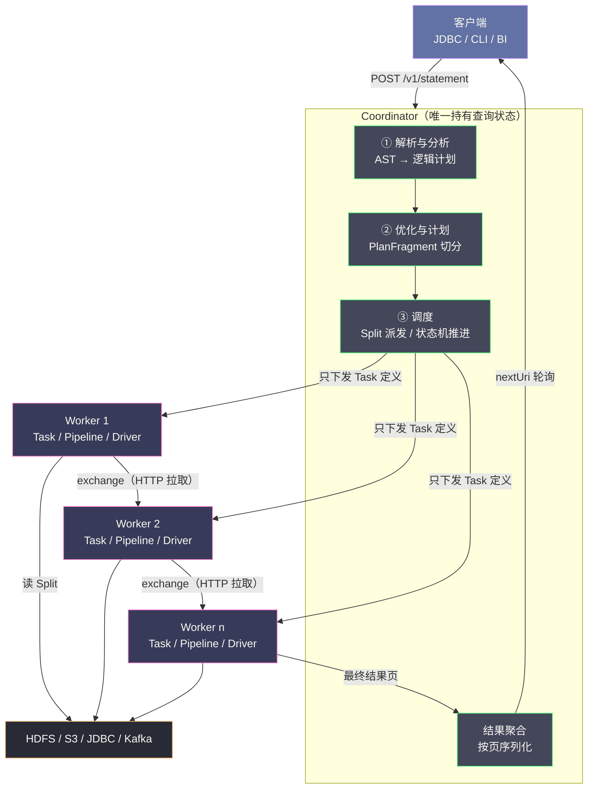
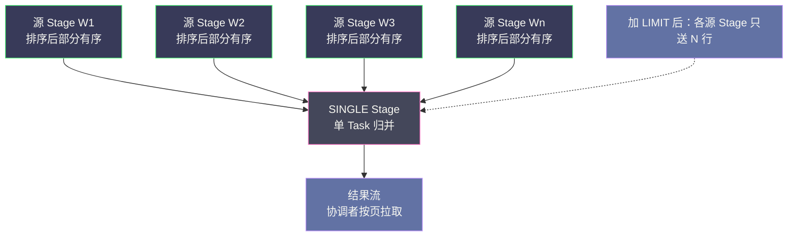
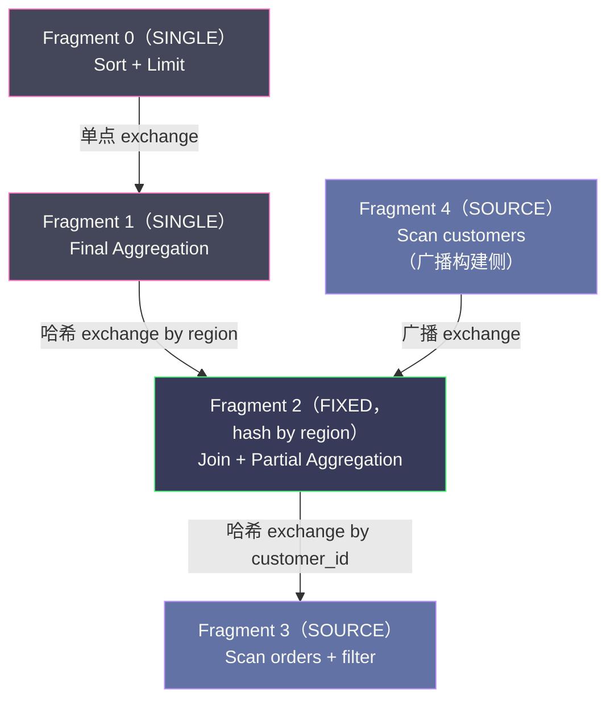
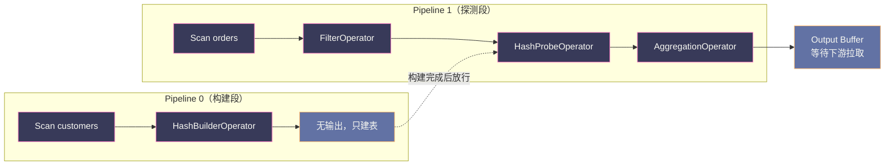
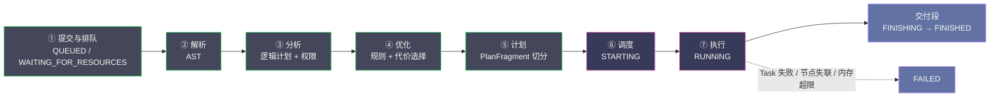

# Trino 全局架构——Coordinator Worker 与 MPP 执行

**摘要：**

2013 年 Presto 从 Facebook 内部走向开源时，它要解决的问题很具体：让分析师改一个 WHERE 条件之后，不必再等十几分钟才看到结果。Trino（PrestoSQL 在 2020 年底更名后的延续）沿用一套主从式的 MPP 结构来兑现这个承诺，而结构的每一个折衷都会沿着执行路径向下传导，最终落在某一条 SQL 的耗时、内存与失败方式上。本文先用一条贯穿全文的日报查询交代三段旅程，再依次拆解 Coordinator 的三项职责与它的单点属性、Worker 的有限职责与 `task.concurrency`、MPP 三条隐含假设失效时全局有序与全局去重如何退化成单点、Stage 按 exchange 切分的依据、Pipeline 与 driver 的并行结构，以及一条查询从提交到结果拉取的七个阶段各自能看见什么。后半程把视角换成资源账本：一个查询占多少 task、并行上限由谁决定、协调开销在什么规模下开始压过收益，最后收在三类反例和换引擎的判据上。文中的判断尽量落到可核对的位置，配置项给默认值与出处，行为对照源码里的状态机与类名，量级推算一律标注口径，避免把经验数字写成事实。全篇反复回到的那句话是：并行度可以买，单点吞吐买不到。读完之后，看到 `EXPLAIN` 里的 `Fragment` 编号或 Web UI 上的 Stage 树时，应当能立刻判断出这条查询的钱花在哪一段。

---

## 第 1 章 MPP 的三条隐含假设

### 1.1 一条日报 SQL 的三段旅程

任何架构讨论一旦离开具体查询就会失焦，所以先给出一条不算复杂、但足够覆盖主要执行形态的 SQL。它来自一个典型的运营日报场景：从订单事实表按地区汇总 GMV 与去重用户数，关联客户维表拿到地区名，最后取前 20 名。

```sql
SELECT c.region,
       count(DISTINCT o.user_id) AS uv,
       sum(o.amount)             AS gmv
FROM hive.sales.orders o
JOIN hive.crm.customers c ON o.customer_id = c.id
WHERE o.dt = DATE '2026-11-18'
GROUP BY c.region
ORDER BY gmv DESC
LIMIT 20;
```

这条查询在 Trino 里会被切成五段执行。第一段扫 `orders`，按日期过滤并在本地做部分聚合；第二段扫 `customers`，构建哈希表；第三段把订单侧数据按 `customer_id` 重分布，完成 Join 并做按 `region` 的部分聚合（这里会做一次本地重分区与一次跨节点重分布）；第四段把各节点的部分聚合结果汇到一处做最终聚合，因为 `count(DISTINCT)` 与 `sum` 的合并必须看到所有分片；第五段在拿到全部地区行之后排序并截断。五段之间靠网络传递中间结果，每段内部又由若干台机器并行推进。

把这条查询的三段旅程抽出来看：**计划由一处产生，执行由多处并行，结果由一处收口**。这正是 MPP（Massively Parallel Processing，大规模并行处理）的全部骨架，剩下的细节都是这三句话在工程上的展开。

### 1.2 假设一：数据是可切分的

MPP 引擎的第一条隐含假设是输入可以被切成足够多的、彼此独立的片。Trino 把这件事交给 Connector：切分产物叫 Split（数据分片），Hive Connector 通常以文件块或文件为粒度，MySQL Connector 以主键区间为粒度，Kafka Connector 以 Topic Partition 的一段 Offset 为粒度。协调者并不读数据，它只从 Connector 拿到一批 Split 的元数据（位置、长度、可选的权重与首选节点），再把这些元数据分发给 Worker。

这条假设在大数据栈里几乎总成立，但在两类存储上会变得昂贵：一是小文件密集的表，Split 数量以十万计而每个只有几 MB，协调者光是把 Split 元数据排进队列就要吃掉可观的 RPC 与内存；二是不支持并行读的源，譬如单机 MySQL 上的一次全表扫描，切得再细也绕不开存储侧的串行瓶颈。前者可以用 `query.schedule-split-batch-size`（默认 1000）与惰性分发来缓解，后者只能靠把过滤条件下推给源端，或者干脆换一条路径。

### 1.3 假设二：算子可以全并行

第二条假设是算子本身可以被拆成互不依赖的实例。过滤、投影、部分聚合天然满足；Join 与聚合则需要先按 key 把数据分到同一个执行实例上，才有「本地」可言。Trino 的做法是把每个算子的并行度交给三个层次共同决定：Stage 决定跨节点分布，Task 决定单节点上的执行单元，Pipeline 与 Driver 决定单个 Task 内部能同时跑多少个算子实例。

这条假设的代价是**并行度与数据分布绑死**。一旦某个 key 的值域极窄（譬如只按 `region` 分组而 `region` 只有十几个取值），哈希分区的效果就退化成少数几个执行实例扛住绝大部分数据，其余实例空转。Trino 不会自动把这种倾斜再拆开，它只保证每个 Task 至少有 `task.min-drivers-per-task`（默认 3）个 driver 在跑，防止饿死，倾斜本身要由使用者在 SQL 层面对付。

### 1.4 假设三：exchange 比落盘便宜

第三条假设最有 Trino 特色：Stage 之间的中间结果通过 HTTP 在内存里流式传递，而不是先写共享文件系统或本地磁盘再读回来。Trino 把这个动作叫 exchange，它由生产者一侧的 Output Buffer 与消费者一侧的 Exchange Client 组成，两边都是内存里的分页队列，默认单个 buffer 32MB（`sink.max-buffer-size` 与 `exchange.max-buffer-size`）。

与 MapReduce 式的物化相比，这条路径省掉了「写盘、等落盘、再读盘」的三次开销，代价是整条链路对网络与内存更敏感：网络抖动会直接变成查询尾延迟，内存不足会直接变成查询失败，而不会像批处理引擎那样退化成「慢但能跑完」。正因为如此，Trino 的容错能力长期弱于 Spark——标准执行模式下 Task 失败就意味查询失败，直到 `retry-policy=TASK` 的容错执行模式（Fault-tolerant Execution，FTE）成熟，才有了 Task 级重试。

### 1.5 假设失效时，代价记在谁头上

三条假设一旦某条不成立，代价不会停在被违反的那一层，而是沿执行路径向下传导。数据不可切分，代价记在扫描 Stage 的并行度上，表现为只有少数 Task 在跑；算子不可并行，代价记在单点归并上，表现为一个 Task 成为全局瓶颈；exchange 不再便宜（数据量大到需要落盘或网络带宽打满），代价记在查询时间与失败率上，表现为 Spill 或 `REMOTE_TASK_ERROR`。

理解这个传导方向，比记住任何一个默认值都重要。下面三章按「计划—调度—执行」的顺序把这条路径拆开。

---

## 第 2 章 Coordinator 的三项职责

在拆开三项职责之前，先看一张只有职责、没有数据流的图。它刻意把「数据」画成绕过协调者的路径，因为这张图里最重要的信息恰恰是「哪条线不存在」。



图里能读出三条边界：协调者与存储之间没有线，Worker 与 Worker 之间只有 exchange，客户端与 Worker 之间没有线。这三条边界就是后面三节要解释的内容。

### 2.1 职责一：解析与计划

协调者的第一段工作是纯计算，与数据无关。SQL 文本先被解析成抽象语法树（AST），再做语义分析与类型检查，把表名解析到具体的 Catalog、Schema、Table，把列名解析到具体类型，同时完成视图展开、权限校验与会话属性合并。这一步的输出是逻辑计划。

随后优化器接手：谓词下推、投影裁剪、Join 重排序、公共子表达式消除、动态过滤等一系列规则在逻辑计划与物理计划之间反复应用，最后 `PlanFragmenter` 把物理计划切成若干 `PlanFragment`，每个 fragment 对应一个 Stage，fragment 之间的边对应一次 exchange。整个过程都在协调者所在的同一个 JVM 里完成，CPU 与堆内存都来自同一份资源。

这条路径解释了一个常见现象：一条语法复杂但数据量很小的查询，可能把协调者 CPU 打高，而所有 Worker 都在空闲。执行计划本身也是内存对象，Trino 为此设了 `query.max-initial-plan-nodes`（默认 100,000）与 `query.max-planning-time`（默认 10m），视图层层嵌套或 CTE 反复展开时，前者的错误比后者更早出现。

### 2.2 职责二：调度——把 Split 递给会跑的人

计划产生之后，协调者的工作从「算」变成「派」。派发的单位是 Split，接收方是 Worker 上的 Task。调度器（Node Scheduler）在候选节点里挑一个目标节点，挑选依据是该节点已分配的 Split 数量与拓扑距离，候选集大小由 `node-scheduler.min-candidates`（默认 10）控制，单节点 Split 上限由 `node-scheduler.max-splits-per-node`（默认 256）控制，策略则用 `node-scheduler.policy`（默认 `uniform`，按数据本地性尽量贴源，同时保持均衡）。

调度不是一次性动作。源 Stage 的 Split 是惰性分发的：协调者先给每个 Task 一小批，Task 消费掉一批再补一批，批次大小受 `query.schedule-split-batch-size` 与 `query.min-schedule-split-batch-size` 约束。这样做有两个好处，一是不必把十万级 Split 元数据一次性压进协调者内存，二是调度器能根据 Task 的实际消费速度动态补货。代价是协调者必须持续跟踪每个 Task 的消费进度，而它看到的信息本身有延迟：`task.info-update-interval`（默认 3s）决定了调度所用的 Task 状态能有多陈旧，调大能降低协调者 CPU 负载，但会让 Split 分配偏离真实负载。

派发的同时还有一套状态机在跑。查询级状态由 `io.trino.execution.QueryState` 定义，取值为 `QUEUED`、`WAITING_FOR_RESOURCES`、`DISPATCHING`、`PLANNING`、`STARTING`、`RUNNING`、`FINISHING`、`FINISHED`、`FAILED`；Stage 级状态由 `StageState` 定义，取值为 `PLANNED`、`SCHEDULING`、`RUNNING`、`PENDING`、`FINISHED`、`ABORTED`、`FAILED`；Task 级状态由 `TaskState` 定义，取值为 `PLANNED`、`RUNNING`、`FLUSHING`、`FINISHED`、`CANCELING`、`CANCELED`、`ABORTING`、`ABORTED`、`FAILING`、`FAILED`，其中 `FLUSHING` 表示已不再产生新 driver、输出缓冲至少进入 no-more-pages 状态，只等下游把数据消费完。三套状态机都由协调者推进，Worker 只上报事实。

### 2.3 职责三：聚合与结果拉取

最后一段工作是把结果交回客户端。这里有个容易被误解的细节：最终的输出 Stage 默认跑在 Worker 上，不在协调者上。协调者做的是从那个 Stage 的 Output Buffer 里按批拉取 Page，序列化成客户端协议要求的格式，再挂到 `nextUri` 上等着客户端来取。分布式排序的文档写得很直白：各 Worker 上部分排序的结果「被流式送到单个 Worker 做最终归并」，归并发生在那台 Worker 上，协调者只负责转发。

结果拉取是流式的，客户端 `GET nextUri` 一次拿一页，拿到就渲染，拿完再要下一页，因此超大结果集不会在协调者堆里堆成一座山。但协调者仍然要为每次请求做序列化与协议编解码，这一段的成本与结果行数成正比，与计算量无关：一条 `SELECT * FROM 大表 LIMIT 1000000` 的查询，计算部分可能几秒结束，结果传输却要花几分钟，期间协调者的网络与 CPU 一直在为它服务。

### 2.4 为什么协调者不扫描数据

把数据处理排除在协调者之外，是四条理由叠加的结果，而不是单纯的「职责清晰」。

第一条是单点放大。整个集群只有一份协调资源，它同时承担计划、调度、状态机推进、结果聚合四件事，任何一件被大查询挤占，受影响的是集群里所有查询。让协调者扫描数据，等于把一个本该水平扩展的工作压到唯一不能扩展的节点上。

第二条是数据本地性。协调者通常独立部署，既不是 DataNode 也不在对象存储的就近网段，它读一个 Split 的代价比 Worker 高得多。调度器考虑拓扑距离时，协调者往往是最差的那个候选。

第三条是故障域。协调者的失效会让所有在跑的查询一起失败，这是它最不愿意发生的故障；如果它还在参与计算，故障发生时已经有部分中间结果产生在它身上，恢复语义会更难定义。

第四条是流量路径。客户端只连协调者，所以「结果」这条数据流必须经过它；而「中间结果」这条数据流没有这个约束，能让它绕开就绕开。输出 Stage 留在 Worker 上，正是为了让协调者只碰最终结果，不碰 shuffle 数据。

代价是配置上留了一个历史包袱：`node-scheduler.include-coordinator` 的文档默认值仍是 `true`，允许调度器把工作派给协调者，方便单机试用。生产集群应当显式设为 `false`，否则某个大查询的任务可能落到协调者上，把它变成全集群的性能瓶颈。

### 2.5 单点属性：它一停，查询就停在内存里

协调者不是无状态的调度器，它是查询状态的唯一持有者。一条正在执行的查询，其 `QueryInfo`、每个 Stage 的 `StageInfo`、每个 Task 的 `TaskInfo`、Split 的消费进度、内存预留、状态机位置，全部活在协调者的堆里。`query.max-history`（默认 100）与 `query.min-expire-age`（默认 15m）只决定这些对象在结束后还能留多久，不改变它们在执行期间不可持久化的事实。

由此可以推出两个明确结论。其一，协调者进程重启，正在执行的查询全部丢失，客户端拿到的是连接失败或 404，而不是「继续等一会儿」。其二，多个协调者之间没有状态同步，一条查询提交到 A 之后无法在 B 上接着跑，所以 Trino 的高可用只能是「入口层容错」，不是「查询级容错」。

> [!warning] 生产避坑：Coordinator 没有内置的主备切换
> Trino 至今没有内建的 Coordinator 高可用（Active-Standby 自动切换）机制，也没有共享的查询状态存储。官方给出的部署形态是：多个协调者各自独立，前面挂一个路由层（官方项目 Trino Gateway，或自建 L7 负载均衡），由入口层把新查询按规则分给某个协调者。这套形态能让「新提交」在某个协调者故障后仍然成功，但故障瞬间正在跑的查询一定会失败——它们的状态在故障节点内存里，没有第二份。社区里流传的「某个版本之后已经提供官方 Coordinator HA」并不成立，选型与容量规划应当按「故障即丢查询」来设计。

这也解释了 `QueryState` 里为什么有一个 `DISPATCHING` 状态：在网关加多协调者的部署里，查询可能先在入口被接收，再被派发到某个具体协调者，状态机的这一段正是为这条路径留的。

---

## 第 3 章 Worker 只做两件事

### 3.1 没有全局视图的执行者

Worker 收到的指令里没有「查询全貌」，只有属于自己那一份的 Task 定义：要执行哪几个 Pipeline、每个 Pipeline 的算子链长什么样、要处理哪些 Split、输出往哪个缓冲区写、下游是谁。它不知道同一条查询在别的节点上跑到哪一步，也不需要知道，这种「局部信息 + 协议约定」的设计让 Worker 可以随时增减而不影响拓扑。

Worker 对外的能力可以归纳成两件事：**执行 Task**，以及**为上游提供可拉取的输出**。前者包括从 Connector 读 Split、跑算子链、把结果写进 Output Buffer；后者包括响应下游的 HTTP 拉取请求。除此之外它还要上报状态，但那是配合协调者的观测需求，不是执行本身。

「Worker 无状态」这个说法需要限定。它确实不持久化任何数据，Task 的中间结果全在内存，进程崩了就没了；但「无状态」不等于「可任意替换」——在标准执行模式下，一个 Task 失败会让所属 Stage 失败，进而让查询失败，因为已经写进 Output Buffer 的页不会被重算。只有开启 `retry-policy=TASK` 的容错执行模式，Task 才真正变成可重试的执行单元，此时中间结果被写到外部 exchange 存储，重试才能从断点续上。

### 3.2 Task 的三种输入与输出

Task 的输入来源只有三种。源 Task 从 Split 读，数据来自外部存储；中间 Task 从上游拉，数据来自其他节点上 Output Buffer 暴露的 exchange 端点；还有一种特殊输入是本地缓存或广播的构建侧数据，典型场景是 Broadcast Join 里小表的哈希表被复制到每个节点。

输出同样只有一条路：写进本 Task 的 Output Buffer，等下游来拉。这个缓冲区是按分区组织的队列，哈希分布时按 key 的哈希值分到不同下游队列，单点分布时只有一个下游。缓冲满时 Task 进入阻塞，不再向上游要数据，背压沿链路自然传回去。

这里有一个容易被忽略的设计后果：**Output Buffer 是内存的，所以「慢消费者」会直接变成「内存压力」，而不是「磁盘写满」**。一个 Stage 的下游因为数据倾斜处理不过来，上游 Task 的 Output Buffer 会先填满（默认 32MB，广播场景 200MB），上游 Task 随即被 `isBlocked()` 标记，driver 让出线程。整条链路会稳定在「下游处理多快，上游就产出多快」的节奏上，但如果下游一直慢，内存不会自己消失，只会一路顶着上限走。

### 3.3 task.concurrency：一个 Task 内部的并行度

`task.concurrency` 控制的是 Task 内并行算子的本地并发度，官方默认值取节点的物理核数，最小 2、最大 32，且必须是 2 的幂；在容错执行模式下默认降为 8。它的作用点不是「一个节点上跑多少 Task」，而是「一个 Task 内部同时激活多少个算子实例」，因此会与节点上的 Task 数量相乘，共同决定一个 Worker 上真正在跑的 driver 数量。

这个参数该往哪个方向调，取决于集群的查询并发形态。跑大量并发小查询的集群，单查询本身已经耗尽机器，再提高本地并发度只会增加线程切换与内存占用，应当调小；跑少量大查询的集群，机器有大片空闲，调大才能吃满 CPU。文档给出的定位很清楚：这个值要跟着「查询并发度」与「Worker 资源利用率」两个观测量一起看，而不是拍一个核数值。

与之相邻的还有三个参数，容易混在一起调坏。`task.max-worker-threads` 默认是核数的两倍，决定 Task 执行器线程池大小；`task.min-drivers` 默认是 `task.max-worker-threads` 的两倍，是每个 Worker 上目标运行的叶子 Split 数量，并且保证每个叶子 Task 至少有 3 个 Split 在跑，非叶子 Task 也保证能跑起来以防死锁；`task.max-drivers-per-task` 默认几乎不限制，只有在同节点混跑大量查询时才需要下调。把 `task.concurrency` 调到 32 而 `task.max-worker-threads` 不动，通常只会得到更多阻塞的 driver，而不是更高吞吐。

### 3.4 心跳、状态回报与判死

Worker 与协调者之间的通信分两类，两类的失效语义完全不同。一类是节点级存活，Worker 周期性向 Discovery Service 注册并上报状态，协调者维护活跃节点列表，节点失联后不再向它派新 Split。另一类是 Task 级状态回报，这条更关键：协调者靠它推进 Stage 状态机，也靠它判断 Task 是否卡死。

判死的阈值是可配的。若协调者在 `query.remote-task.max-error-duration`（默认 1m）内收不到某个远程 Task 的更新，就按失败处理，Stage 随之进入失败路径。这个窗口与 `task.info-update-interval`（默认 3s）是两个不同的东西：后者影响调度决策的新鲜度，前者影响故障判定的灵敏度。把前者调大以提高网络抖动容忍度，会同时延长真实故障的发现时间；调小则会让网络瞬断直接变成查询失败。

---

## 第 4 章 MPP 的代价：全局性操作的退化

### 4.1 分区分布的语义

Stage 之间的数据流动由分区语义（partitioning）描述，Trino 的物理计划里常见三类语义：**SINGLE**，所有数据汇到一个执行实例；**FIXED**，按 key 哈希或广播分到固定数量实例；**SOURCE**，没有上游，直接从存储读。写入路径上还有一类按 writer 数动态扩展的分布，服务于分区表写入的 writer 数量伸缩。有些资料会把「数据量小、动态决定 Worker 数」也列为一种 Scaled Stage 并与前三类并列，那其实把写入侧的分配策略混进了数据分布语义，两者不在同一个维度上。

三类语义的差别直接决定并行度上界。SOURCE 与 FIXED 的 Task 数可以随节点数增长，SINGLE 的 Task 数恒为 1。一条查询里只要出现 SINGLE Stage，这条查询就必然有一个只能由一个 Task 负责的收口环节。

### 4.2 exchange 就是 shuffle

`ExchangeNode` 在计划层、`ExchangeOperator` 在运行层共同承担了 Spark 里 shuffle 的角色，区别在于传输介质：Spark 把 map 端输出写成磁盘文件，reduce 端按 key 拉取；Trino 把 Page 留在内存队列里，消费方通过 HTTP 批量拉，默认每个 exchange 客户端缓冲 32MB、单次响应上限 16MB、客户端拉取线程 25 个，并发请求数还受「可用缓冲空间 × 3」这个启发式约束（`exchange.concurrent-request-multiplier` 默认 3）。

这套机制的好处是延迟低、无需临时目录、不需要额外的 shuffle 服务；坏处是**网络带宽与内存成为硬约束**，且没有「落盘缓一缓」的中间态。集群网络打满时，Trino 不会变慢一点然后继续，而是 exchange 请求排队、超时、Task 失败，这条路径上的典型报错是 `Max requests queued per destination exceeded for HttpDestination`。

### 4.3 ORDER BY 的 merge 退化为单点

排序是检验 MPP 边界最干脆的例子。Trino 的分布式排序默认开启（`distributed-sort` 配置属性，会话属性 `distributed_sort`），做法是各 Worker 先各自排序，再把部分有序的数据流送给单个 Worker 做最终归并。官方文档对这条路径的评价毫不含糊：**性能会有改善，但不会随节点数线性扩展，因为数据最终要由单个节点归并**。

这个单点任务的负担是「行数 × 列宽」的归并计算加上「全部中间数据」的网络入口带宽。归并本身是流式的，内存压力不大，但入口带宽是硬上限：一个 Worker 的网卡吃进多少字节，归并就能做多少。数据量到 TB 级时，这一步常常占掉整条查询一半以上的时间（量级判断，随数据量与列宽变化），`EXPLAIN ANALYZE` 里会看到那个 SINGLE Stage 的输入行数等于前面所有 Stage 的输出之和。

加上 `LIMIT` 之后情况完全不同。带 limit 的排序在计划里是「局部 Top-N + 单点归并 N 行」：每个源 Stage 先各自算出本地前 N 名，SINGLE Stage 只归并「节点数 × N」行，单点入口流量从「全量」降到「可忽略」。这也是为什么 `ORDER BY ... LIMIT n` 与 `ORDER BY ...` 的耗时常常差出一个数量级以上（量级判断，取决于数据量与 N），而 SQL 文本里只差一个词。



### 4.4 DISTINCT 与全局聚合的退化

`count(DISTINCT x)`、`SELECT DISTINCT`、以及所有需要全局去重的语义，在计划里都会落到聚合算子上。Trino 的处理方式是两段式：先在每个 Stage 做部分聚合，把「key → 部分状态」压小，再把部分结果送到 SINGLE Stage 合并。部分聚合的本地状态大小受 `task.max-partial-aggregation-memory`（默认 16MB）约束，超出就提前 flush 出去。

这套机制的效果取决于去重 key 的基数（cardinality）。低基数去重（譬如按地区去重用户）几乎不产生压力，部分聚合把数据压到很小；高基数去重（譬如千万级 user_id 的精确去重）则会把几乎全部 key 搬到 SINGLE Stage，单点要维护全部 key 的状态，内存与 CPU 都压在一个 Task 上。此时 `count(DISTINCT)` 的耗时往往由「去重 key 的数据量 / 单点处理速度」决定，与集群有多少 Worker 关系不大。

同一个道理适用于 `GROUP BY` 高基数、全局窗口函数（`OVER (ORDER BY ...)` 需要全局有序流）、以及多个结果集 `UNION ALL` 之后的统一排序。它们共用一个判据：**只要语义要求「看到全部数据才能给出下一行」，物理计划里就必然出现 SINGLE Stage，单点吞吐就是这条查询的上限**。

### 4.5 算子退化表与判据

| 算子或语义 | 为什么会退化 | 判据（`EXPLAIN` 可见） | 缓解方式 |
|---|---|---|---|
| `ORDER BY` 无 `LIMIT` | 需要全局有序，最后归并只能单点 | 计划里出现 SINGLE fragment，输入行数等于前面输出之和 | 加 `LIMIT`，或改成分区内排序后再合并 |
| `count(DISTINCT)` 高基数 | 精确去重需要单点持有全部 key | SINGLE Stage 的输入行数接近明细行数 | 改近似去重，或先在子查询里降基数 |
| `GROUP BY` 高基数 | 合并阶段需要看到全部分组 | SINGLE Stage 输出行数与输入行数同量级 | 提高部分聚合的保留率，减少 flush |
| 全局窗口函数 | 排序与框架计算需要全局有序流 | 窗口算子位于 SINGLE fragment | 改成 `PARTITION BY` 的分区内窗口 |
| `UNION ALL` 后再排序 | 归并点仍然只有一个 | 顶层 SINGLE fragment | 把排序下推到各分支后取前 N |
| 小表广播 Join | 不是单点，但构建侧被复制到每个节点 | BROADCAST 分布，各节点内存同增 | 小表足够小才广播，否则改用哈希分布 |

> [!info] 判断一条查询是否被单点卡住
> 打开 `EXPLAIN (TYPE DISTRIBUTED)`，看有没有 `Fragment 0 [SINGLE]`；再打开 `EXPLAIN ANALYZE`，看那个 fragment 的输入行数与「累计 CPU 时间」。如果它的输入行数与整条查询的扫描输出同量级，而前面各 Stage 的 CPU 时间都很短，那么瓶颈就是这个单点，而不是 Worker 不够。Web UI 的 Stage 视图里，同样的信号表现为一个 Stage 的 `input rows` 等于所有上游 Stage 输出之和。

---

## 第 5 章 Stage 按 exchange 切分

### 5.1 从逻辑计划到 PlanFragment

优化器产出的是物理计划，物理计划里有两种特殊节点标记了数据流的中断：一种是跨节点的 exchange（`ExchangeNode` 加 `RemoteSourceNode` 的组合），另一种是本地重分区（`LocalExchangeNode`）。`PlanFragmenter` 从根节点向下遍历，每遇到一个跨节点 exchange 就切一刀，把计划分成父 fragment 与子 fragment，父 fragment 通过 `RemoteSourceNode` 引用子 fragment 的输出。

切分是递归的，所以一条有多次 shuffle 的查询会得到一棵 fragment 树，树的每个节点对应一个 Stage，根节点是输出 Stage。fragment 的编号不是执行顺序：编号小的靠近根，执行顺序与之相反，源 Stage 最先跑起来。



这张图对应第 1 章那条日报 SQL。可以数出两个 SINGLE fragment，正好对应「最终聚合」与「排序截断」两个必需要看到全量才能继续的动作。

### 5.2 切分点为什么是 exchange

把 exchange 当切分点，是因为 exchange 是「数据不能再往下游流、必须换一批执行者」的唯一位置。在 exchange 之前，上游可以持续产出，下游可以边收边处理，一条 Pipeline 就能贯通；在 exchange 之后，下游必须换节点，两个执行者之间的生命周期无法再用同一个调度单元管理。

这条规则带来两个工程后果。其一，Stage 是调度的最小单位，一个 Stage 的所有 Task 必须等依赖的 Stage 产出之后才能跑，所以「Stage 越多，调度轮次越多」。其二，Stage 边界必须物化到「可被远程拉取」的程度，也就是 Output Buffer 要给下游准备好端点，这解释了为什么 Stage 之间的依赖不是靠消息通知，而是靠「下游来拉，拉到 no-more-pages 为止」。

Stage 也会在不同时刻进入不同状态，`StageState` 里的 `PLANNED` 与 `SCHEDULING` 对应「已切出来但依赖未就绪」与「正在派 Task」两个阶段，`PENDING` 表示「现有 Task 都跑完了，但后续还可能派新 Task」——后者在惰性 Split 分发与 writer 缩放场景下很常见。

### 5.3 与 Spark 宽依赖切分的对照

Spark 的 DAG 调度按宽依赖（wide dependency）切 Stage，与 Trino 按 exchange 切 Stage 是同一思路的两个实现：两者都在「数据需要跨分区重分布」处断开，都靠父 Stage 完成后才能启动子 Stage。区别在实现细节，也在失败语义。

Spark 的 shuffle 落盘，所以父 Stage 的输出可以在失败后被重新拉取，Stage 重算有明确的落点；Trino 的 exchange 在内存，父 Stage 一旦失败，子 Stage 已经拉走的数据无法追溯，只能整条查询重来。Spark 的 Task 失败只影响一个分区，重算该分区的 map 输出即可；Trino 标准模式下 Task 失败即查询失败，除非启用 FTE。

这个差异解释了为什么 Trino 的并行度必须一次性给足：它没有「先少给点、失败再补」的余地，SINGLE Stage 尤其如此，一个归并 Task 就是全部。

### 5.4 四类分区语义的代价

| 分区语义 | 含义 | 典型触发 | Task 数上界 | 主要代价 |
|---|---|---|---|---|
| SINGLE | 全部数据汇到一处 | 全局排序、最终聚合、全局去重 | 1 | 单点吞吐即全查询上限 |
| FIXED（hash） | 按 key 哈希分到固定分区 | Join 的 probe 侧、分组聚合 | 参与节点数 | 倾斜时单分区过载 |
| FIXED（broadcast） | 数据复制到每个节点 | 小表构建侧 | 参与节点数 | 各节点内存同增，构建侧带宽放大 |
| SOURCE | 无上游，直接读存储 | 扫描 Stage | 参与节点数 | 受存储与 Split 粒度限制 |

这张表里的 Task 数上界是「同一 Stage 内」，不是整条查询：一条查询的 Task 总数是各 Stage Task 数之和，量级为「非单点 Stage 数 × 参与节点数」，这一点在第 8 章会算一次具体账。

### 5.5 stage 数量是有上限的

Stage 不是免费的调度单元。每个 Stage 都要在协调者上维护状态、为每个 Task 维护 `TaskInfo`、追踪 Split 队列、处理状态机回调。Trino 为此设了两道线：`query.stage-count-warning-threshold`（源码默认 50）超过之后发警告，`query.max-stage-count`（默认 150）超过之后直接以 `QUERY_HAS_TOO_MANY_STAGES` 终止查询。

官方对这个上限的注释值得记住：把上限调得很高，会让 Stage 数量巨大的查询拖垮集群，导致其他无关查询以 `REMOTE_TASK_ERROR` 失败，报错内容正是 `Max requests queued per destination exceeded for HttpDestination`。Stage 数量的上限因此不是为了保护单条查询，而是为了保护协调者与节点间的 RPC。

---

## 第 6 章 Pipeline：Task 内的并行算子链

### 6.1 为什么要 pipeline

Stage 内部仍然有「物化 vs 流水线」的选择。假设一个 Task 要「扫描 → 过滤 → 聚合」三步，如果按物化方式做，扫描要把全量数据写进中间结果，再启动过滤读它、写第二份中间结果，再启动聚合读它；三次遍历、两份物化，延迟与内存都翻倍。流水线把这三次遍历合并成一次数据流动：一个 Page 进来，依次穿过三个算子，出去就是聚合状态更新，中间结果从不落地。

Trino 的算子接口是拉取式的 `getOutput()`，下游要数据时才触发上游计算，因此背压天然存在：下游处理不过来，就不调 `getOutput()`，上游的产出自然停住。这与推送式模型需要显式限流形成对照，也是 Trino 不必为每个算子实现流量控制的原因。

### 6.2 pipeline 怎么切

一个 Task 内部不是一条流水线，而是若干条，不妨按阻塞点来数。切分的依据正是「阻塞点」：需要看到全部输入才能产出第一个结果的动作，会把流水线截断成前后两段。典型阻塞点有两个，一是哈希表的构建（Join 的 build 侧必须先读完），二是排序（必须先收全才能确定第一行）。

于是带 Join 的查询在一个 Task 里至少有三段。构建段从维表读数据、建哈希表，不产出任何 Page；探测段从事实表读数据、探测哈希表、输出结果；如果 Join 之后还有聚合，聚合通常与探测段串在同一个 Pipeline 里，因为它不阻塞。图里演示的就是这种结构。



Pipeline 之间的同步靠 LocalExchange 完成，它把上游 Pipeline 的输出在节点内部重分区并交给下游 Pipeline，代价是节点内的内存拷贝与队列切换，收益是避免一次不必要的网络 hop。

### 6.3 driver 与 operator

Pipeline 定义的是算子链的「形状」，Driver 是这个形状的一个运行实例。一个 Task 的某个 Pipeline 里如果有 50 个待处理 Split，就会有 50 个 Driver 共享同一套算子定义，各自持有独立的算子状态与缓冲区。Driver 不独占线程：它被 TaskExecutor 以时间片方式调度，跑一小段时间就让出，这让一个线程池能驱动远多于线程数的 Driver。

Operator 是链条上的一个环节，接口只有三个动作：`addInput` 接收上游 Page，`getOutput` 产出下游 Page，`isBlocked` 报告是否阻塞。所有的并行、背压、内存管理最终都作用在这三个动作上。Driver 与 Operator 的内部结构、`LocalExchange` 的三种模式、以及算子级的内存计量，在 [[02 查询执行引擎——Stage、Task 与 Pipeline]] 里有完整展开，本章只保留它们在架构中的位置。

### 6.4 阻塞算子把 pipeline 截断

阻塞点会带来调度上的硬约束。哈希构建段必须先完成，探测段才能出第一行；而构建段本身可能读一个几百 GB 的表，这会成为查询的「冷启动」阶段——在这段时间里，下游节点已经在等待，集群的并行度处于闲置状态。这类等待在 `EXPLAIN ANALYZE` 里表现为探测段 `wall time` 之前的一段空白，在 Web UI 的 Live plan 里表现为构建侧 Stage 一直在 `RUNNING` 而下游 Stage 停在 `PLANNED`。

缓解手段都在计划层，不在执行层：把小表放到构建侧以缩短冷启动，用动态过滤在构建完成后反向削减探测侧的扫描量，或者干脆把查询拆成两步先落一张临时表。执行层能做的只有 `query.execution-policy`（默认 `phased`）——按依赖顺序一段一段地调度，避免所有 Stage 一起排队造成互相阻塞；改成 `all-at-once` 会让初始资源占用很高，但 Stage 之间的依赖反而拖长了整体墙钟时间。

### 6.5 三者的乘法关系

把三个层次放在一起，可以写出一个粗糙但有用的并行度公式：**集群总并行度 ≈ 参与节点数 × 每节点活跃 Task 数 × 每 Task 并行 driver 数**。Trino 的默认值把这三项分别锚在 `node-scheduler.max-splits-per-node`（256）、`task.min-drivers`（默认等于 `task.max-worker-threads` 的两倍，随核数线性增长）、`task.concurrency`（默认核数）上，三者的乘积远大于机器实际能同时运行的线程数，多余的部分靠阻塞与队列消化。

这个「超额订阅」是有意为之：不是所有 driver 都在同时可运行，有的在等网络、有的在等构建完成，多备一些才能让 CPU 不空转。但代价是内存：每个 driver 都可能持有一部分算子状态，driver 越多，同一时刻的内存峰值越高，这也解释了为什么调大并发度之后第一个出问题的地方通常是内存而不是 CPU，内存相关的机制与阈值在 [[04 内存管理与资源调度]] 里展开。

---

## 第 7 章 查询的七个阶段

一条 SQL 在 Trino 里要穿过七个阶段才变成结果，每个阶段的可观测手段都不同：前四个阶段只发生在协调者内存里，第五个阶段第一次产生可以下发的结构，第六、七阶段才碰数据。下图把七个阶段与 `QueryState` 的取值对齐，末尾的交付段不在七阶段之列，却决定着客户端看到的总耗时。



### 7.1 提交与排队

客户端向 `/v1/statement` 发一个 `POST`，请求体是 SQL 文本，若干 `X-Trino-*` 头携带用户、会话属性、资源组标签等信息。协调者收到之后先建查询 ID 与 `QueryStateMachine`，此时查询进入 `QUEUED` 或 `WAITING_FOR_RESOURCES`。

排队不是一个可有可无的环节。协调者要确认有足够的活跃 Worker 才开工（`query-manager.required-workers` 默认 1，最长等待 5 分钟），资源组可能限制同一组内的运行查询数，集群也可能因为内存水位拒绝新查询。这一段耗时在 `QueryStats.queuedTime` 里单独记账，与执行时间分开。

如果前面有网关，查询可能先被接收再被派发，此时状态机会经过 `DISPATCHING`。这个状态在单协调者部署里几乎见不到，它是为多协调者架构留的位置。

### 7.2 解析

SQL 文本被词法与语法分析成 AST。这一阶段只关心语法是否合法，不关心表和列是否存在，因此报了语法错误就说明查询还没进入集群的内部世界。耗时通常在毫秒级，大 `IN` 列表或超长 SQL 会因为词法处理而变慢，`query.max-length`（默认 1,000,000 字符）是这一层的护栏。

### 7.3 分析

AST 被转成逻辑计划，同时完成语义校验。这一步要展开视图、解析列与类型、检查聚合与分组是否匹配、做隐式类型转换、校验权限。很多「计划阶段就失败」的错误来自这里，譬如分组列与选择列不一致、子查询返回多列、无权访问某张表。

分析阶段还会做常量折叠与部分改写，所以 `EXPLAIN` 看到的表达式往往已经被化简过。这个阶段的时间同样记在 `QueryStats.analysisTime` 里，在复杂视图嵌套的场景下它可能占到计划总时间的一半以上。

### 7.4 优化

逻辑计划进入优化器，经历若干轮基于规则的改写与基于代价的选择。规则类的工作包括谓词下推、投影裁剪、`LIMIT` 下推、`JOIN` 消除；代价类的工作包括 Join 顺序与 Join 方式（广播还是哈希分布）、聚合策略（是否两段式）、以及动态过滤的生成。代价模型的输入是 Connector 提供的表与列统计信息，这也是为什么统计信息缺失或过期时，优化器会选出明显更差的计划。

`EXPLAIN` 与 `EXPLAIN ANALYZE` 都能看到优化后的表达式与过滤条件，但看不到「为什么选了这个 Join 顺序」——代价估算的中间结果不对外暴露，这一层属于 [[05 查询优化——CBO、动态过滤与索引下推]] 的主题。

### 7.5 计划

优化后的物理计划被 `PlanFragmenter` 切成 fragment 树，每个 fragment 带上分区语义与执行描述，形成可以下发给 Worker 的 `PlanFragment`。这一步的产物是 `EXPLAIN (TYPE DISTRIBUTED)` 能看到的全部内容：fragment 编号、分区方式、每个 fragment 里的算子、以及 exchange 的类型。

到这一步为止，集群还没有碰过任何数据。所以「计划很久但一行没读」是正常现象，视图层层嵌套或 `UNION ALL` 分支极多时，计划时间可以从几十毫秒涨到几十秒，`query.max-planning-time`（默认 10m）是这道门槛。

### 7.6 调度

Stage 树按依赖倒序启动，源 Stage 先被创建，调度器开始为它派 Split。每个 Stage 创建一个 `SqlStageExecution`，每个被选中的节点创建一个 `SqlTask`，Task 内部按 fragment 定义装配 Pipeline 与算子。协调者在这期间持续做三件事：补 Split、推进状态机、处理失败与重试。

这一阶段的可观测信号最密集：Web UI 的 Stage 树会显示每个 Stage 的 `SCHEDULING`、`RUNNING` 状态与 Task 分布，JMX 里能看到排队与运行中的 driver 数。若某个 Stage 长时间停在 `SCHEDULING` 而没有 Task，通常不是资源问题，而是没有足够的候选节点，或者依赖的上游还没有产出。

### 7.7 执行

Task 在 Worker 上跑，协调者通过周期性的状态回报观察进度。这一段的主要事件是「数据流过」，可观测的指标是字节数、行数、CPU 时间、阻塞比例。任何一次 Task 失败、节点失联、内存超限、Stage 数量超限，都在这一段触发终止或重试。

执行阶段最容易被误读的指标是「CPU 时间」。`EXPLAIN ANALYZE` 里的 CPU 时间是累加值，一个大 Stage 的 CPU 时间是各 Task 之和，除以墙钟时间才是平均并行度；当这个比值远小于节点数时，说明并行度没有吃满，瓶颈可能在扫描、可能在网络、也可能在单点 Stage 的上游等待。

### 7.8 结果拉取与收尾

输出 Stage 完成后，协调者从它的 Output Buffer 拉 Page，序列化后通过 `nextUri` 交给客户端。客户端循环 `GET`，直到响应里没有 `nextUri`。文档特别提醒，响应里的 `status` 字段「仅供人阅读」，不能用来判断查询是否结束——判断依据只有 `nextUri` 是否存在。

收尾还包括提交语义：自动提交的写查询要在 `FINISHING` 阶段完成元数据提交，这一步可能比执行更慢，因为要等 Hive Metastore 或对象存储的确认。客户端断开时查询不会立刻停，协调者会等 `query.client.timeout`（默认 5m）之后才取消，这段时间查询仍占着资源。

### 7.9 每个阶段能看见什么

| 阶段 | 典型耗时 | `QueryState` | 主要观测手段 | 能看到 / 看不到 |
|---|---|---|---|---|
| 提交与排队 | 毫秒到分钟 | `QUEUED`、`WAITING_FOR_RESOURCES` | Web UI 查询列表、`QueryStats.queuedTime` | 看到排队原因与资源组；看不到具体资源缺口 |
| 解析 | 毫秒 | `PLANNING` | 客户端错误信息 | 看到语法错误位置；看不到表是否存在 |
| 分析 | 毫秒到秒 | `PLANNING` | 客户端错误、`analysisTime` | 看到语义与权限错误；看不到执行代价 |
| 优化 | 毫秒到秒 | `PLANNING` | `EXPLAIN` 的输出 | 看到改写后的计划；看不到代价估算中间值 |
| 计划 | 毫秒到秒 | `PLANNING` | `EXPLAIN (TYPE DISTRIBUTED)` | 看到 fragment 与分区语义；看不到运行时数据量 |
| 调度 | 毫秒到分钟 | `STARTING`、`RUNNING` | Web UI Stage 树、JMX | 看到 Task 分布与 Split 分配；看不到调度器内部评分 |
| 执行 | 秒到小时 | `RUNNING` | `EXPLAIN ANALYZE`、Live plan、Operator 指标 | 看到每个算子的行数与 CPU；看不到线程级等待原因 |
| 收尾 | 毫秒到分钟 | `FINISHING` | `QueryStats.finishingTime` | 看到提交耗时；看不到元数据服务内部状态 |

> [!note] 三个观测入口的分工
> `EXPLAIN` 回答「计划长什么样」，`EXPLAIN ANALYZE` 回答「每个算子实际处理了多少数据、花了多少时间」，Web UI 与 JMX 回答「此刻集群在做什么」。三者不能互相替代：`EXPLAIN ANALYZE` 会真正执行查询，用它排查线上慢查询要谨慎；Web UI 的 Live plan 是执行中唯一能看到 Stage 级进度的地方，但它的历史只在 `query.max-history`（默认 100）与 `query.min-expire-age`（默认 15m）的窗口内可查，超出窗口的查询要靠 event listener 落到外部系统。

---

## 第 8 章 资源视角：一个查询占多少

### 8.1 task 数的量级

把前面的结构合起来，可以估算一条查询的 Task 数：**Task 总数 ≈ Σ 各 Stage 的 Task 数**，其中非单点 Stage 的 Task 数约等于参与节点数，单点 Stage 恒为 1。第 1 章那条日报 SQL 有 5 个 Stage，其中 2 个单点、3 个非单点，若集群有 50 个 Worker，Task 总数约为 3 × 50 + 2 = 152 个（示例推算）。

这个数不需要猜，`QueryStats` 里就有 `totalTasks` 与 `totalDrivers` 两个字段，Web UI 的查询详情页也会给出。真正需要判断的是它是否合理：152 个 Task 对应 152 份 `TaskInfo` 与全部 Split 的队列状态，协调者维护这些对象的成本是可估的；如果一条查询的 Task 数到了几千，通常意味着 Stage 数过多或参与了全部节点，需要回头看计划。

### 8.2 CPU 视角

Task 数不等于并行度。真正决定 CPU 占用的是「同时处于可运行状态的 driver 数」，它受三层约束：节点上能同时跑的线程数（`task.max-worker-threads`，默认 2 × 核数）、每个 Task 的内部分并发（`task.concurrency`，默认核数）、以及调度器给每个节点分配的 Split 数（`node-scheduler.max-splits-per-node`，默认 256）。

三层约束里最容易成为实际瓶颈的是最后一个：Split 分得少，driver 就没有活干，CPU 空转；Split 分得多，内存与上下文切换成本上升。文档对 `node-scheduler.max-splits-per-node` 的取舍写得很清楚——理想状态是「始终至少有一个 Split 在排队等处理，但不要更多」，因为太少会饿死节点，太多会浪费内存并让 Split 在节点间失衡。

### 8.3 并发与排队

单条查询的并行度之上，还有集群级的并发控制。历史版本用 `query.max-concurrent-queries` 限制同时在跑的查询数（旧文档或口头常写作 `query.max-concurrency`；源码里这个属性已被标记为废弃，默认 1000），当前版本的正确做法是用资源组（Resource Group）声明每个组的并发上限与排队上限，让不同业务线共享集群而不互相踩踏。

并发控制的粒度决定了排队形态。按组限制时，一个组的突发放量只会让自己的查询排队；全局限制时，一个大客户的批量任务可能让所有人在 `QUEUED` 里等待。协调者侧还有一层更细的调度节流：同一个查询最多同时挂起一定数量的待执行 Task，同一个节点上也有限额，避免一次调度把协调者的 RPC 队列打爆，触发前面提到的 `HttpDestination` 报错。

### 8.4 一次推算

| 观察量 | 设定（示例推算） | 推算结果 | 口径与含义 |
|---|---|---|---|
| 扫描数据量 | 10TB，Split 128MB | 约 80,000 个 Split | 协调者要维护这些 Split 元数据并分批下发 |
| 单节点 Split 上限 | `max-splits-per-node` 256，50 节点 | 并行约 12,800 个 Split | 80,000 / 12,800 ≈ 7 个批次才能扫完 |
| Task 总数 | 5 个 Stage（2 单点 + 3 非单点），50 节点 | 约 152 个 Task | 与 `QueryStats.totalTasks` 对照 |
| 单 Task 并行度 | `task.concurrency` = 16（16 核节点的默认值） | 单 Task 最多 16 个并行算子实例 | 实际受 `task.max-worker-threads` 与阻塞制约 |
| 协调开销 | 小查询计划 30ms，1000 条/分钟 | 每分钟 30s 的协调 CPU | 约半个核被计划与调度吃掉，尚未计结果序列化 |
| 单点归并 | 归并行数 2 亿行，全部经一个 Task 处理 | 单点吞吐决定查询下限 | 与集群规模无关，加机器无效 |

表里第一行与最后一行是理解整套架构的关键：**并行度可以买，单点吞吐买不到**。前者随节点数线性增长直到存储或网络饱和，后者只随那一个 Task 所在的机器变快。

---

## 第 9 章 边界与反例

### 9.1 小查询走 Trino

Trino 的协调开销包括计划、调度、状态机、结果序列化四段，即使查询只扫一行，这四段也要走完。在千条每分钟的量级上，这些开销是可以接受的；到了万条每秒的点查场景，协调者先成为瓶颈，查询还没开始执行就已经在排队。

判断标准不在查询本身多小，而在「协调开销 / 有效计算」这个比值，笔者倾向于把它当作是否该路由到 Trino 的第一判据。一条扫 1GB 的聚合查询，计划 30ms 相对总耗时 2s 可以忽略；一条主键点查，计划 30ms 相对总耗时 50ms 就占了大头。这类负载应该交给支持点查的系统，Trino 只在需要跨源联邦或做批量分析时才有价值。

### 9.2 ORDER BY 无 LIMIT

这是最典型的「写得出来但跑不动」的形态。查询本身语法正确，`EXPLAIN` 也只是一个普通的 SINGLE fragment，但它的成本是「全部中间结果过一次单点」。在 4.3 节算过，带 `LIMIT` 与不带 `LIMIT` 的差别是入口流量从「全量」降到「节点数 × N」。

> [!warning] 反例：`ORDER BY` 无 `LIMIT` 的全量归并
> 一个常见的误用是「先排序看看数据长什么样」——`SELECT * FROM 大表 ORDER BY ts DESC` 只为了看最近几条。这条查询会把整表数据搬到单个 Worker 归并，耗时可能从几秒变成几十分钟，而且很容易因为单节点内存或网络打满而失败。正确写法是加 `LIMIT`，或者加时间范围过滤后分页。排查这类查询的信号很直接：`EXPLAIN ANALYZE` 里 SINGLE Stage 的输入行数等于扫描行数。

### 9.3 把 Trino 当 OLTP

Trino 没有事务隔离级别的完整语义，没有主键约束、没有行级锁、没有更新热点，也没有为短事务优化的提交路径。用 `UPDATE`、`DELETE`、高频 `INSERT` 支撑在线业务，得到的是「每次写都要重写文件」和「并发写互相冲突」。它没有能力承担 OLTP，设计上也没有这个意图。

与之相邻的误用是「把 Trino 当成实时写入管道」。Trino 支持 `INSERT` 到 Hive 或 Iceberg，但每次写入都是一次分布式写文件动作，小批量高频写入会产生大量小文件，反过来拖慢后续查询。写入路径的正确形态是批量、按分区、低频。

### 9.4 把无状态当无代价

「Worker 无状态，挂了换一台就行」这句话在容量规划里经常被误读成「查询可以任意重启」。标准执行模式下 Task 失败即查询失败，协调者不会自动把整条查询挪到别的节点重跑；开启 FTE 之后 Task 可以重试，但代价是 exchange 数据要写到外部存储，延迟与成本都会上升。

节点故障的影响面因此与「查询处在哪个阶段」强相关：处在扫描阶段的查询，丢了几个 Task 就失败；处在收尾阶段的查询，可能只差最后一次元数据提交，同样失败。真正能承受节点故障的部署，要么接受失败重试（应用层幂等重发），要么把长查询交给 FTE。

### 9.5 该换引擎的判据

| 场景特征 | Trino 的问题 | 更适合的选择 |
|---|---|---|
| 毫秒级点查、每秒数千次 | 协调开销与排队压过计算 | 键值存储或行式数据库 |
| 单查询中间结果远超集群内存 | Spill 之后尾延迟不可控，失败率高 | Spark 一类可物化落盘的批处理引擎 |
| 需要事务、约束、频繁更新 | 无 OLTP 语义，写入即重写文件 | 事务型数据库 |
| 全局排序/去重占主导且无 LIMIT | 单点归并，加机器无效 | 预聚合、预排序的存储层 |
| 数据源单一且已高度优化 | 联邦能力用不上，只承担调度与翻转成本 | 自带计算的原生引擎 |
| 跨多源联邦分析、交互式探索 | 这正是设计目标 | Trino |

这张表不是「谁更好」的排名，而是把各系统的约束摆在一起看：Trino 的强项恰好是别人的弱项——它不拥有存储，所以能把多个源拼在一起；也正因为不拥有存储，它无法替你做预聚合与索引。选择的依据是负载形态，不是基准测试数字。

---

## 第 10 章 小结：约束如何传导到查询

回到开头那条日报 SQL。它的五段执行、两个单点、约 150 个 Task，没有一个数字是随意的：Stage 数来自 exchange 的位置，Task 数来自节点数与分区语义，单点数来自「必须看到全量」的语义，并行度来自三层并发参数的乘积。架构的每一处约束，最终都落在了这条查询的某一段耗时上。

反过来看，这条传导链也给了排查的抓手。查询慢，先看 `EXPLAIN ANALYZE` 里哪个 Stage 的输入行数异常大——如果它在 SINGLE 上，问题在语义（排序、去重、全局窗口），改 SQL 才有用；如果它在 SOURCE 上，问题在扫描（Split 粒度、谓词下推、小文件），改表或改 Connector 才有用；如果各 Stage 都正常而墙钟时间很长，问题在调度与排队，看协调者与资源组才有用。

Coordinator 与 Worker 的分工之所以稳定，是因为它把「不可扩展的部分」与「可扩展的部分」用一条清晰的边界分开：计划、调度、状态、收尾这些工作天然是全局的，只能由一处做；扫描、过滤、聚合、Join 这些工作天然是局部的，越分散越好。这条边界的位置决定了 Trino 的能力上限，也决定了它的故障形态——单点故障时整条查询失败，单点任务慢时整条查询变慢。设计上没有消除这个代价，只是把它从「每个查询都付」挪到了「只有全局语义才付」。

行文至此，Stage 与 Task 的内部结构、Split 的分配细节、Pipeline 与 Driver 的调度算法都还只是轮廓，这些是 [[02 查询执行引擎——Stage、Task 与 Pipeline]] 要展开的内容；Connector 如何把一条 SQL 的谓词变成存储层的过滤条件，见 [[03 Connector 体系——Hive、Iceberg 与联邦查询]]；内存池与 Spill 的阈值如何决定一条查询能不能跑完，见 [[04 内存管理与资源调度]]。整个系列的阅读顺序与依赖关系见 [[00 专栏导览]]。

---

## 参考资料

1. Trino 官方文档，*Properties reference*（Task / Exchange / Query management / Resource management / Node scheduler 各分页），Trino 4xx（撰写时官方文档版本为 484）。https://trino.io/docs/current/admin/properties.html
2. Trino 官方文档，*Trino client REST API*，`/v1/statement` 协议、`QueryResults` 字段与 `nextUri` 轮询语义。https://trino.io/docs/current/develop/client-protocol.html
3. Trino 官方文档，*Distributed sort*，分布式排序的单节点归并与 FTE 互斥关系。https://trino.io/docs/current/admin/dist-sort.html
4. Trino 源码，`io.trino.execution.QueryState`、`io.trino.execution.StageState`、`io.trino.execution.TaskState`，查询、Stage、Task 三套状态机的取值与终态判定。https://github.com/trinodb/trino
5. Trino 源码，`io.trino.execution.QueryManagerConfig`，`query.max-stage-count`、`query.stage-count-warning-threshold`、`query.schedule-split-batch-size` 等属性的默认值与废弃标记。https://github.com/trinodb/trino/blob/master/core/trino-main/src/main/java/io/trino/execution/QueryManagerConfig.java
6. Trino 官方文档，*Release 351*（2021 年 1 月 3 日），项目更名与客户端协议头改为 `X-Trino-*` 的说明。https://trino.io/docs/current/release/release-351.html
7. Trino 官方文档，*Fault-tolerant execution*，`retry-policy` 的 `NONE`、`QUERY`、`TASK` 三档语义与 exchange 存储要求。https://trino.io/docs/current/admin/fault-tolerant-execution.html
8. Trino 官方文档，*Resource groups*，并发上限与排队上限的配置模型。https://trino.io/docs/current/admin/resource-groups.html
9. Trino 官方文档，*Trino Gateway*，多协调者部署下的入口路由与负载均衡。https://trino.io/docs/current/client/trino-gateway.html
10. Facebook Engineering，*Presto: Interacting with petabytes of data at Facebook*（2013），Presto 开源时的设计目标与交互式查询定位。

---

> [!note] 思考题
> 1. 如果一条查询的瓶颈在 SINGLE Stage 的归并上，把 Worker 数量翻倍为什么不会有帮助？在什么情况下增加 Worker 仍能改善这条查询的端到端时间？
> 2. 协调者的状态全部在内存里，那么「重启协调者」与「重启一个 Worker」对正在执行的查询分别意味着什么？Trino Gateway 的存在改变了哪一个，又没有改变哪一个？
> 3. `task.concurrency` 调大之后查询吞吐没有提升，可能的三个瓶颈分别在哪一层？如何用 JMX 或 `EXPLAIN ANALYZE` 逐一排除？
> 4. 一条 `GROUP BY` 高基数聚合的查询，部分聚合的本地状态受 `task.max-partial-aggregation-memory` 限制。把这个值调大，收益与风险分别落在哪个 Stage 上？
> 5. 若把 `ORDER BY` 改写成「各分区内排序 + 应用层归并」，Trino 侧省掉了什么，应用层又新增了什么成本？这个交换在什么数据规模下划算？
> 6. Stage 数量的上限（`query.max-stage-count`）为什么会被设计成保护「其他无关查询」的机制，而不是保护当前这条查询？