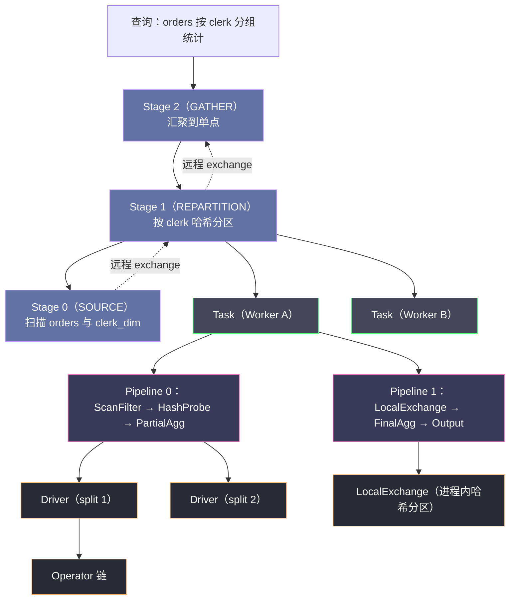
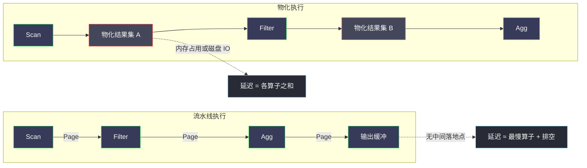
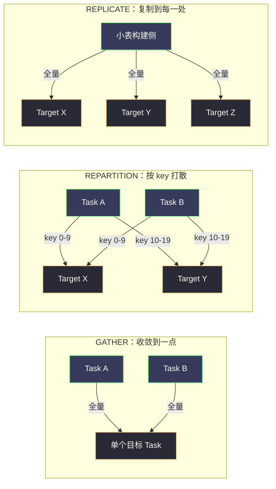
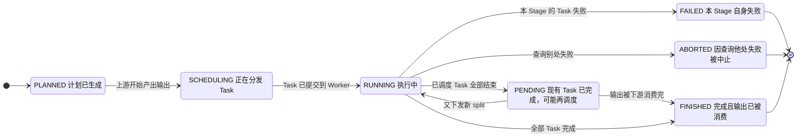
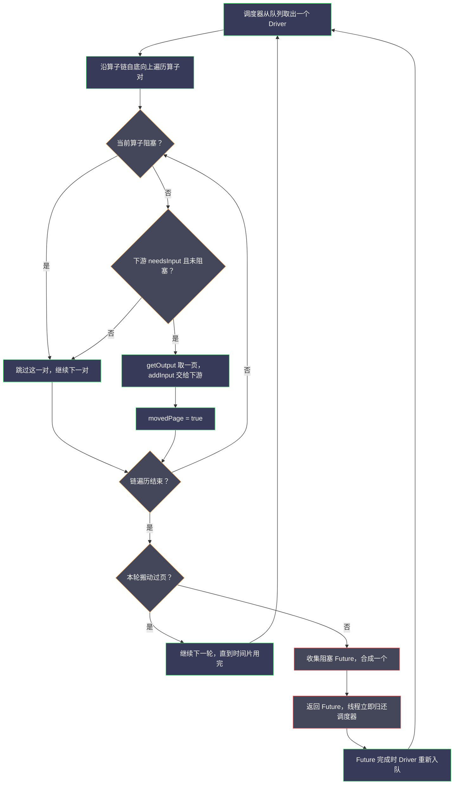
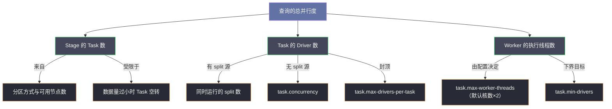

# 查询执行引擎——Stage、Task 与 Pipeline

**摘要：**

一条 SQL 在 Trino 里会被切开三次：按数据交换切成分段执行的 Stage，按节点切成分散到各 Worker 的 Task，再按可并行的算子链切成 Pipeline。本文不按"六层抽象"平铺直叙，而是把这三层当作三把不同刻度的尺子，追问每把尺子量的是什么、并行度从哪里来、彼此如何嵌套。核心论证有两条：其一，Pipeline 的存在理由不在于"分层好看"，而在于它取消了算子之间的物化点——上游产出的一个 Page 直接被下游消费，中间不落内存队列、不落磁盘，这才是 Trino 把交互式查询压到秒级的机制基础；其二，Trino 的执行模型是协作式拉取，Driver 循环从算子链上一页一页地搬数据，搬不动就交回一个 Future 让出线程，而不是每个算子独占一个线程去推数据。围绕这两条主线，文章拆开 Task 的生命周期、exchange 的三种类型、`task.concurrency` 一类并行度参数的真实含义、内存池与阻塞原因的四分法，并给出一套逐行读 `EXPLAIN ANALYZE` 的方法。最后一章收在反例上：把 Stage 数当并行度、不看 blocked 原因就调并发、以为 `task.concurrency` 越大越好，这三种误判在真实集群里反复出现。

---

一条带 `GROUP BY` 的统计查询提交之后，Coordinator 并不是把整条 SQL 甩给某个 Worker 去跑，它先要把计划切成若干段，让每一段能在集群范围内并行，再把每段分给若干 Worker，最后在每个 Worker 内部让若干条算子链同时推进。这套动作对应三个不同粒度的概念：Stage、Task、Pipeline。

多数资料把 Trino 的执行结构描述成"六层"——Query、Stage、Task、Split、Pipeline、Driver、Operator。层次列出来没错，但这么列有个副作用：七样东西看着一边高，读者容易误以为它们都是同一种"层"，进而误以为 Split 数、Driver 数、Stage 数都能当并行度用。笔者更愿意换一种说法：真正构成调度层次的只有三层，Stage 是计划层的切分，Task 是部署层的切分，Pipeline 是执行层的切分；Split 是数据单元，Driver 与 Operator 是运行时的实例，它们不是"层"，而是被这三层装进去的东西。

本文用一个贯穿案例把它讲透：`orders` 表一点五亿行，按营业员 `clerk` 分组统计，并与一张几十万行的营业员维表 `clerk_dim` 做一次哈希连接。这个查询里既有扫描、过滤，也有 join 与两阶段聚合，三层结构在它身上都能看出形状。

---

## 第 1 章 三层刻度：从查询计划到算子实例

### 1.1 Stage 是按 exchange 切出来的

Trino 的查询计划在 Coordinator 上先被翻译成逻辑计划，再做代价优化，最后由 `PlanFragmenter` 切成一个个执行片段（fragment）。切分的判据只有一条：**数据是否需要跨节点重分布**。凡是需要把数据打散到别的 Worker 上的地方，就必须插一个远程 exchange，**交换即边界**，exchange 的位置就是 Stage 的边界。

这条判据的物理含义很直白：同一个 Stage 内的所有 Task 只读自己手里的数据，不与别的 Worker 交换；一旦某个算子要求"相同 key 的行必须落到同一个执行实例上"——哈希聚合、哈希连接、全局排序都属于此类——局部性就维持不住了，必须开一个新的 Stage，让上一段把数据按分区规则发过来。所以计划树里有几个 exchange，就有几个 Stage 边界，Stage 本身构成一棵树，根 Stage 负责汇聚最终结果。

`PlanFragmenter` 的输出并不是最终形态。计划里的 fragment 还要经过一轮 fragment 合并优化，把不必要的边界抹掉——典型场景是 `LocalExchange`（Worker 进程内的重分布）和某些单分区的小片段，它们被并进相邻片段，避免为了一点点本地重排就新开一个 Stage，凭空多出一次 HTTP 传输。Coordinator 侧如何维护节点列表、如何按资源组排队、如何把 Task 派到具体机器上，在 [[01 Trino 全局架构——Coordinator Worker 与 MPP 执行]] 里已经展开，本文只关心切完之后的三层结构各自如何运转。

### 1.2 Task 是一个 Stage 在一个 Worker 上的一份

Stage 本身不执行。Coordinator 把 Stage 实例化成若干个 Task，每个 Task 落在某个 Worker 上，持有该 Stage 计划的一份完整拷贝和一批数据分片（split）。

Task 的数量由 Stage 的分区方式决定，这一点后面还会展开：源 Stage 的 Task 数与 split 的分布有关，哈希分区的 Stage 的 Task 数通常等于可用 Worker 数，汇聚型 Stage 只有一到两个 Task。Task 是 Worker 视角的最高调度单位，也是内存、并发、失败重试这些机制真正挂靠的对象——Coordinator 看到的进度、Web UI 上那个树状展开的执行图，节点就是 Task。

### 1.3 Pipeline 是 Task 内可并行执行的最长算子链

进到 Task 内部，算子并不是一条从头串到尾的直线。只要遇到两类东西，算子链就被截断：一类是交换（远程 exchange 或本地 exchange），一类是不产出流的阻塞型算子（哈希构建、排序）。截断之后每一段连续可流的算子链就是一个 Pipeline。

Pipeline 的并行实例叫 Driver。一个 Driver 持有一份完整的算子实例集合，从源的 `getOutput` 一路搬到汇的 `addInput`。同一个 Pipeline 可以同时存在很多个 Driver，它们共享同一份算子工厂定义，但各自持有独立的算子状态与缓冲。

三层之间的关系可以用一张图收束，图中把 exchange 边界与 Pipeline 的切线画在同一处，读者可以看出"一条切线，三种意义"：对计划它是 Stage 边界，对部署它是跨 Worker 的数据流，对执行它是 Pipeline 的分隔。



### 1.4 三层的并行度各由谁决定

把三层并排看，能立刻发现一个常被混淆的事实：三层各有各的并行度来源，彼此不是简单的倍数关系。

| 层次 | 切分依据 | 并行度来源 | 上限或约束 | 观测手段 |
|---|---|---|---|---|
| Stage | 数据是否需要跨节点重分布 | 计划形状决定，优化器与 `PlanFragmenter` 产物 | 由计划决定，不随集群规模线性增长 | `EXPLAIN` 的 fragment 列表、Web UI 执行图 |
| Task | 一个 Stage 部署到哪些 Worker | 分区方式（源 / 固定 / 单点）与可用节点数 | 受节点数与 split 分布约束 | 查询详情的 Task 列表、`StageInfo` 的 task 计数 |
| Pipeline | Task 内算子链在何处被截断 | 交换与阻塞型算子的位置，计划决定 | 与集群规模无关 | `EXPLAIN` 中的 `LocalExchange`、`EXPLAIN ANALYZE` 的 `Input` 行 |
| Driver | Pipeline 的并发实例 | 有 split 的流水线按 split 建；无 split 的按 `task.concurrency` 建 | `task.max-drivers-per-task` 封顶 | `Active Drivers`、`queuedDrivers` 指标 |

把这张表记住，后文关于调参的讨论才有着力点。举例来说，一个查询要跑满一千个核，靠的从来不是 Stage 多，而是源 Stage 的 split 够多、每个 Task 里的 Driver 够多、`task.concurrency` 允许的分区驱动够多——这三个数字分别由数据、调度与配置决定。

---

## 第 2 章 没有 Pipeline 会怎样

### 2.1 反事实：算子串行且逐个物化

要理解 Pipeline 为什么存在，最省力的办法是设想它不存在。

没有 Pipeline 的执行模型，就是教科书上最朴素的"算子串行 + 中间结果落地"：先跑扫描算子，把结果完整写进一个中间结果集；再跑过滤算子，从中间结果集读、往新结果集写；再跑聚合算子，依此类推。Hive 在 MapReduce 时代就是这个形态，每个 MapReduce 作业的边界处都要把中间结果刷到磁盘，下一个作业再读回来。Spark 在 shuffle 边界上也是这个样子——stage 之间必须有屏障，前一个 stage 全部落盘完成，后一个才能开始。

这个模型的好处是简单：每个算子独立、可单独重跑、失败恢复的粒度清楚。代价则分布在三个地方。

第一是延迟。一条五个算子的链，串行执行的总时间是各算子耗时之和；流水线执行的总时间约等于最慢那个算子的耗时加上尾部的排空时间。若每个算子处理一批数据都要两百毫秒，串行是整整一秒，流水线在稳态下只需要两百毫秒出头。

第二是内存与带宽。物化意味着中间结果必须有个存放的地方。放内存，就要在任意时刻同时容纳两个完整结果集；放磁盘，就要付出一次写加一次读的 IO。这里做一次示例推算：中间结果十个 GB，落盘再读回，按本地 SSD 每秒五百 MB 的顺序吞吐估算，光这一次往返就是四十秒量级——这个数字足以把交互式查询拖成批处理。

第三是并行度被切断。物化点上，下游必须等上游全部写完；上游写完之后，下游才开始预热。整条链上任何时刻只有一个算子群在真正吃 CPU，其余要么在等，要么在准备。

### 2.2 流水线的做法：一页一页地推过去

Trino 的选择是让数据**以页（Page）为单位**在算子之间流动。源算子从连接器拿到一页，交给过滤算子；过滤算子算出过滤后的位置集合，交给聚合算子；聚合算子更新哈希表；链条末端的算子把结果页放进输出缓冲，等下游 Task 来拉。整个过程里没有任何一步要求"上游全部完成"，只有交换与阻塞算子这两处例外。

页是列式的：一页通常包含几千到上万行，按列组织成若干 block。选页而不选行，是为了让过滤、哈希计算、表达式求值这些操作在一整列上批量进行，减少虚函数调用与分支预测失败，也为 SIMD 留出空间。页的大小不是固定配置，它由连接器与算子自行决定——扫描侧受文件格式的批读大小影响，聚合侧受每次输出行数影响，但量级都在千行以上。

下面这张图把两种执行形态并排放，读者可以直观看出物化点在何处消失。



### 2.3 Pipeline 的切线落在哪里

一条算子链不是随便切的。切点有两类：

一类是交换。远程 exchange 必然切断算子链，因为它要求数据先出去、再从别的节点进来，链在这里断开，下游是另一个 Task 的源。本地 exchange 同样切断链——同一个 Task 内的哈希分区把上游多个 Driver 的输出按 key 路由到下游固定数量的 Driver 上，路由需要缓冲，链在这里断开。

另一类是阻塞型算子。哈希构建算子（`HashBuilderOperator`）是一个特殊的存在：它有输入，但没有输出。它把构建侧的数据全部吃进内存里的哈希表，直到收到 `finish()` 才通过 `LookupSourceFactory` 把查找结构交出去。既然它不产出页，下游就没有东西可拉，算子链只能在这里断开。

由此得到一个可以在 `EXPLAIN` 里直接验证的规律：`EXPLAIN` 输出里每出现一个 `LocalExchange`，就意味着 Task 内部多了一条 Pipeline。一个带哈希连接的聚合查询，典型形状是四条 Pipeline：构建侧的扫描与哈希构建（两条，构建侧可能还要先做一次本地分区）、探测侧的扫描加连接、连接后的本地重分区加最终聚合。

### 2.4 消费式的水槽：不产出也要占内存

哈希构建算子是理解 Pipeline 边界的关键样本，值得多看两眼。它把"物化"压缩到了最小：不把构建侧的数据写成文件或中间结果集，而是写成一个哈希表；不落盘，但确实在内存里完整驻留。所以它既是流水线的断点，又是流水线思想的极限——数据只被消费一次，但消费者的形态从"逐页处理"变成了"全量驻留"。

也正因为这一点，构建侧的规模直接决定了这个 Task 的内存水位。构建侧撑不住，就只能走溢出磁盘或者让查询失败，这两条路的细节归到内存那一篇去讲，这里只需记住结论：Pipeline 消除的是"**算子间**"的物化，不能消除"**算子内**"的状态。聚合的哈希表、连接的构建表、排序的缓冲区，都是算子内状态，都会在流水线内部形成内存压力，这是两种不同性质的开销，混为一谈会得出荒谬的调参结论。

---

## 第 3 章 Exchange 的三副面孔与 Stage 的边界

### 3.1 三种类型对应三种数据量级

远程 exchange 在计划里的类型只有三种：`GATHER`、`REPARTITION`、`REPLICATE`。这三个名字分别回答三个问题：汇聚到一处、按 key 打散到多处、复制到所有处。

| 类型 | 语义 | 数据量级 | 主要代价 | 什么时候用 | 失效场景 |
|---|---|---|---|---|---|
| `GATHER` | 所有上游数据汇聚到单个 Task | 等于上游输出总量 | 单点成为吞吐瓶颈，下游只能单机消费 | 全局排序、`LIMIT`、最终聚合 | 输出过大时单点内存与网络被打爆 |
| `REPARTITION` | 按分区键哈希打散到固定数量的 Task | 等于上游输出总量 | 一次全量网络传输加序列化 | 哈希聚合、哈希连接、按 key 分组的窗口 | key 分布倾斜时部分 Task 成为长尾 |
| `REPLICATE` | 上游数据复制到所有下游 Task | 上游输出量 × 下游 Task 数 | 网络放大倍数等于下游 Task 数 | 小表广播连接 | 构建侧不够小，广播量呈倍数放大 |

三种类型的数据流向与放大倍数各不相同，下面这张图把三者的数据走向并排列出，注意 `REPLICATE` 那条边的条数是随目标 Task 数增长的，而 `GATHER` 是把所有边收敛到一点。



三种类型的代价结构完全不同，用一个具体的量级判断来说明会更清楚。假设 `clerk_dim` 维表压缩后两百 MB，集群有五十个 Worker，查询计划选择广播连接（`REPLICATE`）：网络上的总传输量约等于两百 MB 乘五十，也就是十 GB 量级；同样的查询若改成按 key 重分布（`REPARTITION`），传输量约等于两侧数据量之和。这个对比解释了 Trino 优化器为什么对广播连接设了一条"构建侧必须足够小"的隐形门槛——门槛由会话属性 `join_max_broadcast_table_size` 一类参数控制，并且与统计信息的准确性直接挂钩。统计信息陈旧时优化器可能把一个实际三 GB 的表判定为两百 MB，广播出去的网络流量就放大十五倍。代价估算如何取数、广播与重分布之间如何取舍，属于 [[05 查询优化——CBO、动态过滤与索引下推]] 的内容。

反方向也有代价。`GATHER` 看起来最省钱，因为只有一个 Task 接收数据，但那个 Task 所在节点要独自承受全部上游流量，且下游算子在该节点上以单机并行度运行。这就是为什么"全局排序"在大数据量上天然昂贵——它的最后一跳必然是 `GATHER`，无论前面并行度多高，末端都收敛到一处。

### 3.2 Stage 的分区方式与 Task 数量

exchange 的类型与 Stage 的分区方式是一体两面：exchange 说的是"数据怎么走"，Stage 分区方式说的是"目标有几个 Task"。Trino 用 `PartitioningHandle` 表达后者，系统内置的几种取值如下表。

| 分区方式 | 目标 Task 数 | 数据路由 | 典型触发 |
|---|---|---|---|
| `SINGLE` | 1 | 全部发往同一节点 | 根 Stage、`LIMIT`、全局排序的末段 |
| `FIXED` 配哈希函数 | 固定数量，通常等于可用 Worker 数 | 按 key 哈希路由 | 哈希聚合、哈希连接 |
| `FIXED` 配广播函数 | 固定数量 | 每个 Task 收到全量 | 广播连接 |
| `SOURCE` | 由连接器决定 | 按数据本地性分配 | 扫描 Stage |
| `ARBITRARY` | 不约束 | 任意节点 | 不需要 key 局部性的中间段 |

这张表也顺带澄清一个流传很广的说法：把 Stage 分成 `SINGLE`、`FIXED`、`SOURCE`、`BROADCAST` 四类。Trino 的枚举里并没有独立的 `BROADCAST` 分区方式，广播是 `FIXED` 分区配上广播函数、再由 `REPLICATE` 类型的 exchange 来实现的；另外还有 `ARBITRARY` 与 `COORDINATOR_ONLY` 两种取值在特定计划里出现。分类方式关系到排查时的判断路径——看到一个 `FIXED` 分区，还要看它的分区函数是哈希还是广播，才能判断这条边是重分布还是放大。

### 3.3 本地 exchange：为什么不切 Stage

Worker 进程内的重分布走本地 exchange，不产生新的 Stage。原因很实在：跨节点交换的成本是序列化、网络、反序列化三笔，进程内交换的成本只是把 Page 引用放进一个内存队列。前者是毫秒到秒级，后者是微秒级，两者差着两三个数量级，没有任何理由为后者付一次 Task 创建、进度上报、状态同步的调度开销。

本地 exchange 同样按分区方式组织，`FIXED_HASH_DISTRIBUTION` 做哈希分区，`FIXED_PASSTHROUGH_DISTRIBUTION` 做直通，`SINGLE_DISTRIBUTION` 做进程内汇聚。哈希分区时，上游 Driver 产出的每一页会按 key 的哈希值切成若干份，分别投递给下游对应的 Driver；直通时不做切分，页原样传递。

关于"零拷贝"的说法需要打个折扣。本地 exchange 确实不序列化，投递的是 Page 引用，但哈希分区时要按目标分区生成新的 Page 视图，基础 block 大多仍被共享，只有跨分区交错的位置需要重组。所以准确的表述是"拷贝量为常数级或可忽略"，而不是绝对零拷贝——真正的零拷贝只发生在直通场景。

### 3.4 Stage 多不等于并行度高

到这里可以把最常见的一个误判摆出来：把 Stage 数量当作并行度指标。

Stage 数量衡量的是**串行依赖的段数**，它反映查询里有几次"必须等数据重分布"的停顿，与并行度是两个维度。一个只有两个 Stage 的大扫描查询，可以跑满两百个核；一个二十个 Stage 的多表连接查询，可能每一步只有四个 Task 在跑。看 Stage 数判断快慢，等于看楼层数判断电梯速度。

真正该看的是每个 Stage 的 Task 数与每个 Task 的 Driver 数。`EXPLAIN ANALYZE` 的输出里，fragment 头部那行 `Input: 1500000 rows (18.17MB); per task: avg.: 1500000.00 std.dev.: 0.00` 就是把 Task 数与数据量一起报出来的地方：`per task` 的均值告诉你每个 Task 分到多少活，标准差告诉你分得均不均。均值偏大而 Task 数偏小，说明并行度不足；标准差偏大，说明有倾斜。

---

## 第 4 章 Task：Worker 上的一份拷贝

### 4.1 状态机比想象中细

Task 并不是简单的"运行中、完成、失败"三态。以 Trino 4xx 的实现为准，Task 状态包含计划、运行、冲刷、完成，以及取消与中止各自的两段式状态：取消先进入 `CANCELING`，等所有 Driver 真正退出后才进入 `CANCELED`；中止同理先 `ABORTING` 再 `ABORTED`。多出来的 `FLUSHING` 状态容易被忽略——它的语义是"计算已经结束，但输出还没被下游取完"，一个查询看起来"卡在最后"，往往就是某个 Task 停在 `FLUSHING` 等下游拉走输出。

Stage 的状态机同样需要校正。实际取值是计划、调度中、运行、待定、完成、中止、失败，其中"待定"（`PENDING`）的含义是"现有 Task 都跑完了，但未来还可能再调度新的 Task"——这在源 Stage 里很常见，因为 split 是惰性下发的；而"中止"（`ABORTED`）与"失败"（`FAILED`）的区别在于失败归属：`FAILED` 是这个 Stage 自己失败，`ABORTED` 是查询里别处失败导致它被连带中止。Stage 层没有单独的"已取消"状态，用户取消查询会体现为整条查询的取消。

这张状态表的价值在于排查时的定位：一个查询挂在 `RUNNING`，说明还有 Task 在算；挂在 `PENDING`，说明在等新 split；挂在 `FLUSHING`，说明计算完了但在搬输出，此时该看的是网络与下游消费速度，而不是 CPU。



### 4.2 Split 的惰性下发

源 Stage 的数据单元是 split。以 Hive 连接器为例，一个 split 往往对应一个文件或文件中的一个分片，规模在百 MB 量级；以关系型数据库连接器为例，一个 split 可能是一段主键区间。split 怎么切、切多细，由连接器说了算，不同数据源的切分策略与下推能力见 [[03 Connector 体系——Hive、Iceberg 与联邦查询]]。

Coordinator 不会一次性把几十万个 split 全塞给 Task。它分批下发：先给每个 Task 少量 split，Task 消费完之后再补。这套做法有三重好处——Coordinator 内存里不必驻留全部 split 元数据；调度器可以根据 Task 的实际消费速率动态调整分配；某个节点变慢时，未下发的 split 可以转给别的节点。代价是状态机多出一个"待定"态，以及调度决策变复杂。

下发时还考虑数据本地性。连接器会告诉 Coordinator 每个 split 的候选节点，调度器优先把 split 放到数据所在的机器或机架上。本地性带来的差别在对象存储与远端 HDFS 场景里很直接：跨机架读与本地读的带宽差可以达到数倍，尤其当扫描侧是查询瓶颈时。

### 4.3 输出缓冲与拉取式消费

Task 之间传数据靠 Task 的输出缓冲。上游 Task 把产出的页放进缓冲，下游 Task 通过 exchange 客户端来拉。缓冲是分区化的，每个下游 Task 对应一个分区，各自独立消费。

缓冲大小由 `sink.max-buffer-size` 控制，默认 32 MB；广播场景另有一个 `sink.max-broadcast-buffer-size`，默认 200 MB，因为广播连接的构建侧要同时供所有下游探测侧 Task 拉取，缓冲太小会限制探测侧的扩展。

拉模型配合有界缓冲，构成了一套不需要显式流量控制的背压：下游拉得慢，缓冲很快填满，上游那个写缓冲的算子就阻塞，Driver 随之阻塞，线程让出来，CPU 被让给还能干活的 Driver。这套机制里没有任何"发送速率调节"的逻辑，速率由消费者决定，这是拉模型相对推模型最省心的地方。

不过要说清楚一点：背压不是"拉"这个动作本身带来的，而是"拉 + 有界缓冲 + 阻塞信号"三者合起来的结果。若缓冲无界，拉模型照样会把内存吃光。

### 4.4 两类 Driver 与它们的数量来源

Task 里的 Driver 分成两类，数量来源完全不同，这是理解并行度的关键细节。

一类是 split 生命周期的 Driver：流水线里含扫描源算子，每个 split 生成一个 Driver，跑完这个 split 的 Driver 就销毁。源 Stage 的并行度完全由这类 Driver 决定——有多少 split 同时跑，就有多少并行。

另一类是 task 生命周期的 Driver：流水线里没有扫描源（数据从本地 exchange 或远程 exchange 进来），Driver 的数量在 Task 启动时一次性建好，个数由流水线定义里的 `driverInstances` 决定；若没有显式指定，就取会话属性 `task_concurrency`。

这个区别解释了一个长期让人困惑的现象：为什么调整 `task.concurrency` 对某些查询毫无影响，对另一些查询影响明显。源 Stage 的扫描与过滤段由 split 驱动，`task_concurrency` 管不着；聚合的最终段、连接后的分区段由 task 生命周期的 Driver 驱动，`task_concurrency` 直接决定并发。

---

## 第 5 章 Driver 与 Operator：协作式拉取的调度模型

### 5.1 Operator 接口回答的六个问题

Trino 的算子接口很薄，六个核心方法加上一对内存回收钩子，就把"一个算子需要回答什么问题"讲完了。

```java
// 摘自 io.trino.operator.Operator，注释为原文要点，省略 getOperatorContext 与 close
public interface Operator extends AutoCloseable {
    // 阻塞状态用 Future 表达：返回未完成的 Future 表示当前不能推进
    default ListenableFuture<Void> isBlocked() { return NOT_BLOCKED; }

    // 还能不能再吃一页输入
    boolean needsInput();

    // 吃一页输入，只在 needsInput() 为真时被调用
    void addInput(Page page);

    // 产出一页输出，没有可产出的就返回 null
    Page getOutput();

    // 上游结束，把内部状态冲刷出来
    void finish();

    // 是否彻底完成，不会再产出
    boolean isFinished();

    // 内存回收：接到信号的算子要主动释放可撤销内存
    default ListenableFuture<Void> startMemoryRevoke() { return NOT_BLOCKED; }
    default void finishMemoryRevoke() {}
}
```

接口里有两处设计值得停留。其一，阻塞用 `ListenableFuture` 表达，而不是 `Thread.sleep` 或者阻塞队列的 `take`：算子不阻塞线程，它只是告诉 Driver"我现在推不动，等这个 Future 完成再来"。其二，`getOutput` 允许返回 `null` 表示"暂时没有输出"，这与"完成"是两件事，靠 `isFinished` 区分。

### 5.2 Driver 的一轮循环：一次只搬一页

Driver 的执行循环比多数人想的要克制。它并不是"从最后一个算子反复 `getOutput`"，而是沿算子链自底向上一对一对地搬页，**每轮每对算子最多搬一页**，搬不动的算子对就跳过去。

```java
// 摘自 Driver#processInternal，省略内存回收与算子清理分支
boolean movedPage = false;
for (int i = 0; i < activeOperators.size() - 1 && !driverContext.isTerminatingOrDone(); i++) {
    Operator current = activeOperators.get(i);
    Operator next = activeOperators.get(i + 1);

    // 当前算子阻塞就跳过，不影响链上其它算子对
    if (getBlockedFuture(current).isPresent()) {
        continue;
    }
    // 上游没结束、下游没阻塞、下游要输入，才搬一页
    if (!current.isFinished() && getBlockedFuture(next).isEmpty() && next.needsInput()) {
        Page page = current.getOutput();
        if (page != null && page.getPositionCount() != 0) {
            next.addInput(page);
            movedPage = true;
        }
    }
    if (current.isFinished()) {
        next.finish();   // 上游结束，通知下游收尾
    }
}
if (!movedPage) {
    // 整轮一页都没搬动，才认为这个 Driver 阻塞，返回 Future 让出线程
    return getBlockedFutureOfDriver();
}
```

把一轮循环画成流程图，"搬动即继续、搬不动即让出"这条主线会更清楚：整条链的推进状态不是二值的，而是逐段收敛的。



这段代码有三处值得停留。

第一，一轮只搬一页，保证了算子链上不会出现"某个算子吞掉整批数据"的情况。若某轮把上游所有可用页都搬给下游，下游的哈希表可能在一轮之内胀到超出内存限额，而内存检查是在轮与轮之间做的，反应就来不及。

第二，阻塞判定以"整轮一页未动"为准。链上某一段阻塞，不代表整条 Driver 阻塞——前面几对算子照样可以推进数据。这带来了一个 5.x 版本之后一直有效的性质：一条算子链上不同段可以处于不同的推进状态，阻塞是段级的，不是 Driver 级的。

第三，`movedPage` 为假时，Driver 收集所有阻塞算子的 Future，用 `firstFinishedFuture` 合成一个，交给调度器，然后线程立刻归还。调度器在 Future 完成时把 Driver 重新入队。整个过程没有任何线程被挂起等待，这是"协作式"三个字的实际含义。

### 5.3 阻塞原因的四种分类

Trino 把 Driver 的阻塞原因归成四类，这个分类是排查问题的第一把钥匙。

| 阻塞原因 | 含义 | 典型场景 | 调参方向 |
|---|---|---|---|
| `SOURCE` | 流水线的源算子等输入 | 扫描等连接器返回下一页、exchange 客户端等上游发数据 | 查上游与网络，不是查 CPU |
| `OPERATOR` | 中间算子等前置条件 | 哈希连接的探测侧等构建侧完成、算子等内存里的异步结构 | 看构建侧进度与数据倾斜 |
| `OUTPUT` | 流水线的汇算子等消费者 | 输出缓冲满，下游 Task 拉得慢 | 看下游消费能力与分区数 |
| `MEMORY` | 算子等内存或等内存回收 | 用户内存池打满、可撤销内存被要求回收 | 看内存池水位，调大并发只会更糟 |

这四类的区分意义在于指向性。看到大面积 `OUTPUT` 阻塞，说明瓶颈在下游消费端，此时去调 `task.concurrency` 是打偏了；看到大面积 `MEMORY` 阻塞，说明查询已经触到内存红线，加大并发会让更多 Driver 同时抢内存，把查询更快地推向失败；只有 `SOURCE` 与 `OPERATOR` 阻塞里的一部分，才与并行度设置有关。

### 5.4 与"每个算子一个线程"的推模型对比

常见的另一种执行模型是推模型：每个算子一个线程（或者每个算子的一个实例一个线程），上游算子把页推给下游，中间用有界队列连接，队列满时上游线程阻塞在 `put` 上。

两种模型的差异不只是"谁主动"，而是资源归属与可观测性的差异。

| 维度 | 协作式拉模型（Trino） | 每算子一线的推模型 |
|---|---|---|
| 线程数与什么相关 | 与核数相关，Worker 上 `task.max-worker-threads` 默认是 CPU 核数乘二 | 与算子实例数相关，活跃 Driver 数越多线程越多 |
| 阻塞的代价 | 返回 Future、让出线程，线程立刻去跑别的 Driver | 线程被 `put`/`take` 挂起，虽有唤醒机制但栈与上下文仍在 |
| 背压的实现 | 缓冲满 → 算子阻塞 → Driver 阻塞 → 调度器换人 | 队列满 → 上游线程挂起 |
| 公平性 | 由调度器统一决定下一个跑谁 | 由操作系统调度决定，难以做查询级公平 |
| 观测 | 每个算子有独立的阻塞时间、输入输出行数统计 | 需要额外埋点才能分离"在等"与"在算" |

协作式的代价是调度器变成了热点。Worker 上所有 Driver 的推进都要经过同一个执行器，执行器的队列与调度策略直接决定了 CPU 利用率。这也解释了为什么 Trino 有一整套与调度权重相关的参数（`task.min-drivers`、`task.min-drivers-per-task` 等）——它们不是并发上限，而是"保证有足够多的 Driver 在跑，避免调度器空转"的调节旋钮。

### 5.5 内存回收也不阻塞线程

`startMemoryRevoke` 这一对方法揭示了一个容易被忽略的设计：内存回收是异步信号，不是同步调用。内存池压力上来时，内存管理器向算子发出回收请求，算子返回一个 Future，等它把可撤销内存（典型是连接的构建侧数据）释放完，这个 Future 才完成；期间该算子的其它处理入口被禁用，但线程不会被占用。

对连接算子来说，这意味着"构建侧数据可能被要求回吐"是一条常态化路径，而不是异常路径。这也解释了为什么构建侧的数据结构要设计成可撤销的：哈希表如果无法收缩，内存紧张时唯一的出路就是让查询失败。

---

## 第 6 章 并行度：三层各自的旋钮

### 6.1 task.concurrency 到底管什么

文档对 `task.concurrency` 的表述是"并行算子的默认本地并发度，譬如连接与聚合"。拆开来说，它影响两件事：本地 exchange 的分区数，以及没有 split 源的流水线创建的 Driver 数。

它的默认值经常被误记成"等于 CPU 核数"。以 Trino 4xx 的文档为准，默认值取节点的物理 CPU 核数，下限 2、上限 32，并且必须是 2 的幂；在容错执行模式下默认值为 8。上限 32 这条约束比"等于核数"重要得多——一台 64 核的机器，默认值也只有 32，不会跟着核数线性增长。

会话属性 `task_concurrency` 可以按查询覆盖。覆盖时要注意"必须是 2 的幂"这条限制，写 12 会被拒绝，只能写 8 或 16。

### 6.2 三个 Driver 数量相关的参数

其余三个参数容易被混用，各自的位置不一样。

| 参数 | 默认值 | 作用位置 | 调大的代价 | 调小的代价 |
|---|---|---|---|---|
| `task.concurrency` | 物理核数，限 2–32，须为 2 的幂；容错模式 8 | 本地并发度：本地 exchange 分区数与 task 生命周期流水线的 Driver 数 | 内存碎片与上下文切换增加，小查询受益、多查询并发时反而变慢 | 并行度不足，单查询吃不满 CPU |
| `task.max-drivers-per-task` | 2147483647（实际上不设限） | 单个 Task 同时运行的 Driver 上限 | 单个大 Task 可能占满 Worker，拖慢同机其它查询 | 大 Task 用不满 CPU，调度器频繁换人 |
| `task.min-drivers` | `task.max-worker-threads` 的两倍 | Worker 上期望同时运行的叶子 split 数，属于调度器的下界目标 | 内存占用上升，新任务响应变慢 | 资源利用率不足 |
| `task.min-drivers-per-task` | 3 | 单个 Task 至少保证运行的 Driver 数 | 与上一条同理 | Task 可能长时间拿不到执行机会 |

`task.max-drivers-per-task` 这个参数最容易被误当成"并发度旋钮"。它默认值是整型最大值，等于不限制；把它调小，语义是"不允许单个 Task 一次性霸占太多 Driver"，属于多查询混跑时的公平性手段，跟"提升单查询速度"方向相反。把它调小之后抱怨查询变慢，是把油门当刹车踩了。

### 6.3 三层叠加之后的活性算术

把三层的数量乘起来，可以估算一个查询在集群上的活跃 Driver 总数，这是判断"并行度够不够"的粗略办法。

假设集群 20 个 Worker，每个 Worker 32 个物理核，`task.concurrency` 取默认的 32，`task.max-worker-threads` 取默认的 64，那么全集群可同时运行的执行线程是 20 乘 64，一千二百八十个。一个三 Stage 的查询：源 Stage 有 40 个 Task 分布在 20 个 Worker 上，每个 Task 分配 20 个 split；中间 Stage 是哈希分区，Task 数约等于 Worker 数，二十个；根 Stage 只有一个 Task。

源 Stage 理论上可同时运行的 Driver 数是 40 个 Task 各 20 个 split Driver，八百个；中间 Stage 是 20 个 Task 各 32 个分区 Driver，六百四十个。两个数字都小于集群线程总数，说明这个量级下线程不是瓶颈，Driver 数才是上限。把 split 加厚到每 Task 一百个，源 Stage 的理论 Driver 数就变成四千，超出线程总数三倍有余，此时真正决定瞬时并行的是那一千二百八十个线程，四千个 Driver 里的大部分在队列里等。这组数字要说明的结论是：三层乘出来的 Driver 数决定**排队的规模与长尾的形态**，瞬时并行由执行器线程数封顶。以上是量级判断，用来建立直觉，具体数值随版本与配置而变。

### 6.4 task.concurrency 与 CPU 的关系

调大 `task.concurrency` 不必然提升吞吐，原因有两层。

第一层是物理上的：Worker 的并行执行线程数由 `task.max-worker-threads` 决定，默认是核数乘二。一台十六核的机器，`task.concurrency` 默认 16、执行线程 32；把它调到上限 32，只是让每个 Task 愿意并发出 32 个分区 Driver，可同时能跑的线程并没有变多，多出来的 Driver 在队列里排队，收益接近于零，而每个 Driver 都要维护自己的算子实例与缓冲，内存开销实打实增加。

第二层是算法结构上的：本地哈希分区把聚合的哈希表切成 `task.concurrency` 份。份数越多，每份越小，哈希表的定长数组在容量规划上以 2 的幂增长，小表的浪费比例更高；同时每份哈希表都有固定的对象头、扩容阈值等开销。对聚合来说，总内存会随份数小幅上升；对连接探测侧来说，各份共享同一个构建表，内存几乎不增，但缓存局部性会变差。

反过来，调小也有代价。多查询混跑的集群上，调小 `task.concurrency` 通常是正确的，因为集群本来就被并发查询占满，再加分区只是增加上下文切换；但如果一个集群平时只跑一两个大查询，把这个值压到 4，就等于主动放弃了单查询的并行度。

### 6.5 并行度的三层来源汇总

把并行度问题归结为一张对照图会更清楚：三个数字分别来自数据量、节点数与配置，各自的调法不同。



---

## 第 7 章 内存、阻塞与 Pipeline 的停顿点

### 7.1 内存的记账维度

一个常见的误解是"Pipeline 内的算子共享 Task 的内存池"。更准确的说法是：内存池按**查询 × 节点**计量，Task、Pipeline、Operator 只是这笔账上的三个统计维度。同一个查询在同一个 Worker 上的所有 Task、所有 Pipeline、所有算子，申请的都是同一个池子里的额度。

这个区分的实际意义在于判读指标。如果按"每个 Pipeline 一个池"来理解，看到某个 Pipeline 内存高就会以为别的 Pipeline 有余量；实际上一荣俱荣、一损俱损，池子满了，所有 Pipeline 一起阻塞。相对的约束值也落在查询级：节点级用户内存上限 `query.max-memory-per-node` 默认取堆的 30%，集群级上限 `query.max-memory` 默认 20 GB，总内存（含可撤销内存）`query.max-total-memory` 默认是前者的两倍。另外还要给 JVM 留出 `memory.heap-headroom-per-node`，默认也是堆的 30%，两条加起来必须小于堆大小，否则配置本身就埋了 OOM 的雷。内存池的分级、可撤销内存的回收顺序、以及资源组之间的配额约束，在 [[04 内存管理与资源调度]] 里有完整的机制展开，本节只讨论它与 Pipeline 停顿之间的关系。

算子级还有自己的一层软约束，譬如部分聚合结果在本地最多缓冲 `task.max-partial-aggregation-memory`，默认 16 MB，超出就先冲刷出去。这类限制不是硬墙，而是"别让单个算子把池子吃光"的阀门。

### 7.2 isBlocked 的常见原因谱系

把所有阻塞原因摊开，可以汇成一张从现象到根因的谱系：

- 源算子等输入：扫描等连接器的下一页，或者 exchange 客户端等上游发数据。判据是 `Blocked` 时间集中在 `Input` 段，且上游 Task 的 `Output` 段同样在阻塞。
- 中间算子等前置条件：最典型的是哈希探测等构建完成。判据是构建侧 Pipeline 的 Driver 数少、单 Driver 输入巨大，探测侧全段 `OPERATOR` 阻塞。
- 汇算子等消费者：输出缓冲满。判据是下游 Task 拉取速率低于上游产出速率，`Blocked` 集中在 `Output` 段，或者上游 Stage 的 Task 数量与下游 Task 数量严重不匹配。
- 等内存或等回收：判据是内存池水位贴近上限，`MEMORY` 阻塞时间随查询推进单调上升。

四种原因对应四种完全不同的处置，把它们混成一句"查询阻塞了"，排查就没有起点。

### 7.3 长尾与卡住的 split

还有一类阻塞不属于上述四种，因为它根本不在 Trino 的账上：某个 split 的处理线程卡在第三方库里。正则表达式库 Joni 是历史上的重灾区，单个灾难性回溯的正则能让一个 split 跑上几十分钟。

Trino 为此提供了检测与中断机制：`task.interrupt-stuck-split-tasks-enabled` 默认开启，超过 `task.interrupt-stuck-split-tasks-timeout`（默认 10 分钟）的阻塞线程会让对应 Task 失败；`task.interrupt-stuck-split-tasks-warning-threshold` 默认 10 分钟，超过阈值的 split 会在 `/v1/maxActiveSplits` 端点打出调用栈并生成 JMX 指标。这类机制的存在本身说明一件事：在协作式调度里，"一个线程卡住"会被放大成"一个 Task 卡住"，因为 Driver 搬不动页、Task 就永远等下去。

---

## 第 8 章 读 EXPLAIN ANALYZE

### 8.1 输出结构与 Stage 的对应关系

`EXPLAIN ANALYZE` 会真正执行查询，把每个算子的实测统计连同执行计划一起打出来。它是诊断 Trino 的第一工具，因为它把三层结构里"计划层"与"运行层"的数据放在同一个视图里。

输出的顶层是查询级信息，接着按 fragment 分段，每个 fragment 对应一个 Stage。fragment 头部那行给出该 Stage 的整体统计，包括 CPU、Scheduled、Blocked、输入输出行数与数据量，以及 `per task` 的均值与标准差。fragment 之后是一棵按缩进组织的算子树，每个算子挂在它实际执行的 fragment 里。

一个容易被忽略的细节：`EXPLAIN` 只给计划，`EXPLAIN ANALYZE` 给计划加实测；想在不执行的前提下看 fragment 划分，用 `EXPLAIN (TYPE DISTRIBUTED)`，它会把每个 fragment 的边界与 exchange 类型都列出来，正好对应本文第 3 章的结构。

### 8.2 一行统计的四个字段

每个算子下面都有一行形如 `CPU: 8.00ms (3.51%), Scheduled: 63.00ms (15.11%), Blocked: 0.00ns (0.00%), Output: 1000 rows (28.32kB)` 的统计。四个字段要配合着读。

`CPU` 是真正消耗处理器的时间。`Scheduled` 是该算子被调度执行的时间，包含在算子内部等待的时间。二者之比反映"在被调度的时间里有多少是真的在算"：比值高说明计算密集，比值低说明大量时间花在算子内部的等待上（加锁、分配、拷贝），或者被抢占。把两者混为一谈是常见误读，尤其不能拿 `Scheduled` 当并行度的证据。

`Blocked` 是该算子让出线程的累计时间，括号里的百分比是相对同级总额的占比。在算子行上只有总阻塞时间；在 fragment 头部那行，阻塞被拆成 `Input` 与 `Output` 两段，这个拆分是判断背压方向的关键。

`Output` 是该算子产出的行数与数据量，配合 `Input` 能算出过滤率。

### 8.3 逐算子字段与异常判据

| 字段 | 含义 | 异常判据 |
|---|---|---|
| `CPU` / `Scheduled` | 实耗与占用的时间 | 比值持续低于一半，说明在算子内部空等或争抢，而非算得慢 |
| `Blocked`（含 `Input` / `Output`） | 让出线程的时间与方向 | `Input` 为主是等上游，`Output` 为主是下游消费不动 |
| `Output` | 本算子产出行数与字节数 | 与 `Estimates` 差一个数量级以上，说明统计信息失真 |
| `Input avg.` | 每个算子实例平均输入行数 | 均值本身偏大说明并行度不足 |
| `Input std.dev.` | 各实例输入行数的相对标准差 | 超过百分之几十基本可以判定倾斜 |
| `LocalExchange[partitioning = HASH]` | 进程内哈希分区点 | 其 `Blocked` 高说明下游消费慢或分区不均衡 |
| `RemoteSource` | 远程交换的接收端 | `Blocked` 高说明上游生产慢或网络成为瓶颈 |
| `ScanFilterProject` 的 `Filtered` / `Physical Input` | 过滤率与物理读取量 | 过滤率高而物理读入量大，说明下推没生效 |

### 8.4 一段真实输出的逐行拆解

下面这段输出取自 Trino 官方文档的示例（查询为按营业员分组计数），结构照原样保留，数字来自该示例查询，不代表任何业务基线。它恰好覆盖了 `REPARTITION` 与 `GATHER` 两种交换，适合作为读法示范。

```text
Trino version: version
Queued: 374.17us, Analysis: 190.96ms, Planning: 179.03ms, Execution: 3.06s
Fragment 1 [HASH]
    CPU: 22.58ms, Scheduled: 96.72ms, Blocked 46.21s (Input: 23.06s, Output: 0.00ns), Input: 1000 rows (37.11kB)
    Output partitioning: SINGLE []
    ...
    └─ Aggregate[type = FINAL, keys = [clerk], hash = [$hashvalue]]
       │   CPU: 8.00ms (3.51%), Scheduled: 22.00ms (5.28%), Blocked: 0.00ns (0.00%), Output: 1000 rows (37.11kB)
       │   Input avg.: 15.63 rows, Input std.dev.: 24.36%
       └─ LocalExchange[partitioning = HASH, hashColumn = [$hashvalue], arguments = ["clerk"]]
          │   CPU: 2.00ms (0.88%), Scheduled: 4.00ms (0.96%), Blocked: 23.15s (50.10%), Output: 1000 rows (37.11kB)
          │   Input avg.: 15.63 rows, Input std.dev.: 793.73%
          └─ RemoteSource[sourceFragmentIds = [2]]
                 Blocked: 23.06s (49.90%), Output: 1000 rows (37.11kB)
Fragment 2 [SOURCE]
    CPU: 210.60ms, Scheduled: 327.92ms, Blocked 0.00ns (Input: 0.00ns, Output: 0.00ns), Input: 1500000 rows (18.17MB)
    Output partitioning: HASH [clerk][$hashvalue_2]
    ...
       └─ ScanFilterProject[table = hive:sf1:orders, ...]
           CPU: 180.00ms (78.95%), Scheduled: 298.00ms (71.46%), Output: 818058 rows (12.98MB)
           Input: 1500000 rows (18.17MB), Filtered: 45.46%, Physical Input: 4.51MB
```

逐段读下来，可以得出四层结论。

其一，Plan 与执行时间的关系。`Planning` 约一百八十毫秒，`Execution` 约三秒，`Queued` 只有几百微秒，说明查询没有被资源组排队，时间几乎全在执行。若 `Queued` 占大头，问题在资源组配额，不在执行引擎。

其二，fragment 一累计阻塞四十六秒，整条查询的执行时间却只有三秒，两个数字并不矛盾——`Blocked` 是同一 Stage 内多个 Driver 的墙钟时间累加，Driver 之间彼此重叠，总和可以超过查询时长。有意义的读法是把四十六秒拆成两段：`Input` 段二十三秒全部落在 `RemoteSource` 上，说明这个 Stage 的 Driver 在等上游发数据；`Output` 段为零，说明下游没有背压。再回头看 fragment 二，它处理了一百五十万行、十八 MB，总 CPU 只有二百一十毫秒，耗时主要不在计算上。两边合起来的结论是"瓶颈在数据搬运与上游分批产出，不在聚合"。

其三，`LocalExchange` 的 `Input std.dev.` 高达百分之七百九十三，而它自己的 `Input avg.` 只有十五点六三行。这个组合说明分区的粒度极小、分布极不均——每份只有十几行，标准差却是均值的八倍。行数少到这个量级时，标准差本身就被放大了，判读意义有限，但若在百万行量级上出现这种比例，倾斜就是主因。

其四，扫描算子的 `Filtered: 45.46%`、`Physical Input: 4.51MB` 与 `Input: 18.17MB` 的对比，说明过滤下推生效了，物理读取只有逻辑输入的约四分之一。若两个数字接近而 `Filtered` 很高，就说明过滤发生在读取之后，该检查连接器的下推支持。

### 8.5 三种典型形态

把常见查询归纳成三种形态，判读会快很多。

第一种是并行不足。特征是某个 fragment 的 `per task: avg.` 输入行数远大于其它 fragment，`Scheduled` 与 `CPU` 都很高，阻塞很低。此时的处置方向是增加源 Stage 的 Task 数或让 split 更细，而不是改 `task.concurrency`。

第二种是倾斜。特征是 `Input std.dev.` 显著偏大，且伴随部分 Task 长时间停留在 `RUNNING`。哈希分区的 Stage 出现倾斜，通常源于分区键基数低或有热点值，譬如按省份分组时某个省份占了绝大多数行。处置方向是检查分区键、考虑加盐或改用更均匀的分布方式。

第三种是背压。特征是上游 Stage 的 `Blocked` 集中在 `Output` 段，下游的 `Blocked` 集中在 `Input` 段，两端时间近似相等。这说明数据在链路上"堵住"了，堵点在下游的消费能力。此时的处置方向是调下游的并行度或减少需要汇聚的数据量，而不是给上游加 CPU。

### 8.6 误读的三种情形

`EXPLAIN ANALYZE` 也会骗人，原因有三。

一是统计采样。文档明确提示，执行很快的查询统计可能不准，因为统计是按算子实例聚合的，采样窗口太短时偏差被放大。对秒级以下的查询，不要过度解读单个算子的毫秒级差异。

二是时间归属。`Blocked` 时间是让出线程的墙钟时间，多个 Driver 并发时这些时间会重叠，把各算子的 `Blocked` 直接相加会得到远超查询总时长的数字。判读要看比例与方向，不要看绝对值相加。

三是缓存与预热。第一次执行与第二次执行的差异可能很大，对象存储冷读、页缓存、JIT 预热都会影响结果。要比较两个计划，最好在相同预热状态下各跑几次。单条查询的判读怎么落成集群层面的巡检与告警，见 [[06 Trino 运维——集群部署、慢查询分析与调优]]。

---

## 第 9 章 流水线失效的地方与常见误判

### 9.1 三种反模式

第一种反模式是**把 Stage 数当并行度**。前文已拆过这个错误：Stage 数是串行段数，与并行度无关。它的危害在于把人引向错误动作——看到 Stage 多就以为并行度高，于是去减少 Stage（比如手工改写 SQL 合并聚合），结果并没有提速，反而丢失了并行聚合的收益。

第二种反模式是**不看 blocked 原因就调参**。看到查询慢，直接把 `task.concurrency` 从 32 调到 64，或者把 `task.max-worker-threads` 翻倍。若真实的阻塞原因是 `OUTPUT`（下游消费不动）或 `MEMORY`（内存打满），这两个动作都不会改善，后者还会让问题更快暴露成失败。

第三种反模式是**以为 `task.concurrency` 越大越好**。上一章算过：Worker 线程数固定，调大只是增加排队与内存占用；而且这个值必须是 2 的幂且上限 32，超出范围的配置会被拒绝，很多"调参无效"的案例其实是写了个非法值被静默回退。

还有第四种，属于较隐蔽的一类：**把 max-drivers 当并发上限**。它的默认值是不限制，调小是公平性手段。把它当性能旋钮，方向正好相反。

### 9.2 流水线在哪里失效

流水线不是万能的，它有三处失效点。

第一处是阻塞型算子。排序、哈希构建、需要全量输入才能输出的算子，一律是物化点。查询里这类算子越多，流水线的收益越小。排序的最后一跳必然是 `GATHER`，此时无论前面并行度多高，末端都退化成单机。

第二处是溢出磁盘。内存压力触发溢写之后，算子把状态写到本地磁盘再读回，流水线在这一段名存实亡——所有优化都让位给 IO 带宽。这也是为什么溢写被定位成"保命机制"而不是"优化机制"：`spill-enabled` 默认关闭，开启后还要配 `spiller-spill-path`、`query-max-spill-per-node`、`max-spill-per-node` 等参数，配错的典型表现是溢写到系统盘，然后 JVM 日志盘被写满导致长时间的 GC 停顿。

第三处是容错执行的物化。开启容错执行后，exchange 数据被写到外部存储做检查点，Worker 挂掉可以从检查点恢复。这是用物化换容错，把流水线的内存直传改成了落存储再读回。两套模式的关键差别可以列成一张表。

| 维度 | 标准执行 | 容错执行（FTE） |
|---|---|---|
| 中间数据 | 在 Worker 内存与网络缓冲中流动 | 溢写到外部存储（S3、HDFS、本地文件系统）作检查点 |
| Task 失败的处理 | 整个查询失败，重新提交 | 只重跑失败的 Task，从检查点恢复输入 |
| 延迟 | 更低，没有存储往返 | 更高，多一次写与读 |
| 内存占用 | 更高，中间结果驻留内存 | 更低，可及时释放 |
| 适用查询 | 交互式，分钟以内 | 长跑批处理，分钟到小时 |
| 开启方式 | 默认 | 配置 `retry-policy=QUERY` 或 `retry-policy=TASK` |

需要提醒的是版本口径。早期版本的容错执行是一个实验性的总开关（`fault-tolerant-execution-enabled`），后续版本改为按重试策略配置（`retry-policy`），并且要求配置交换数据的外部存储管理器。同一个概念在不同版本里的配置项名字不同，照抄旧文档会得到"未知配置项"的启动报错。容错执行模式下 `task.concurrency` 的默认值也从核数改成 8，这条连带影响在调参时最容易漏。

### 9.3 什么规模不该用流水线

流水线的收益来自"上游产出立即被下游消费"，这个前提在两种规模上不成立。

一是极小的查询。数据量只有几百行，扫描、过滤、聚合各自只要几毫秒，流水线省下的时间与调度、序列化、HTTP 往返的固定开销相比微不足道。此时查询时间主要花在分析、规划与协调上，`Queued`、`Analysis`、`Planning` 三段加起来可能超过执行段，优化执行引擎是抓错方向。

二是超大 shuffle 的批处理。当中间结果总量达到数十 GB 甚至更大，内存中流水线传输的收益被内存压力抵消：算子不断阻塞等内存，Driver 不断让出，实际吞吐由内存池水位决定。这类负载的正确形态是开容错执行让它落存储，或者干脆换一个为批处理设计的引擎。Trino 的定位是交互式分析，把它当 ETL 引擎用，会遇到流水线模型的结构性上限。

---

## 第 10 章 回到取舍本身

把三层结构、Pipeline、协作式调度串起来看，Trino 的执行引擎做的其实是一组相互咬合的取舍。

它选择了以 exchange 为 Stage 边界，换来的是"每个 Stage 内部无跨节点依赖"，代价是每次交换都要付一次全量网络传输；它选择了 Pipeline 而非物化，换来的是低延迟与低内存占用，代价是内存压力无法通过落盘缓冲，只能在算子内部用哈希表与排序缓冲硬扛，扛不住就溢写；它选择了协作式拉取而非每算子一线程，换来的是线程数不随并发实例膨胀、阻塞不占用线程，代价是全局调度器成为热点，调度参数变得重要且难调。

这三组取舍之间还有牵连：正因为是流水线，内存压力才会以"阻塞"的形式暴露在驱动层，而不是在物化点排队；正因为是协作式调度，阻塞才能被表达成 Future 而不是线程挂起，调度器才有机会把 CPU 让给能推进的 Driver；也正因为如此，"阻塞原因分类"才成为一等的诊断信息，而 `EXPLAIN ANALYZE` 里那些 `Blocked` 时间才有意义。

由此得到一个不太讨巧但可靠的结论：调 Trino 的执行参数，顺序应该是先读阻塞原因，再判断瓶颈落在哪一层，最后才动对应的旋钮。三层结构给出的正是这个顺序——Stage 层看数据怎么分布，Task 层看并行够不够，Pipeline 层看阻塞在哪一段。顺序反了，参数调得越多，离问题越远。

架构上的东西很少是"更好"，多数是"换了一种代价"。流水线把延迟换给了内存，把并行换给了调度器，把可观测性换成了对 `EXPLAIN ANALYZE` 的阅读能力。理解了这三笔交换，才算真正接手了这套执行引擎。

---

## 参考资料

1. Trino 官方文档《Trino concepts》——Stage、Task、Split、Driver、Operator、Exchange 的权威定义：https://trino.io/docs/current/overview/concepts.html
2. Trino 官方文档《Task properties》——`task.concurrency`、`task.max-drivers-per-task`、`task.min-drivers`、`task.min-drivers-per-task` 等参数的默认值与语义：https://trino.io/docs/current/admin/properties-task.html
3. Trino 官方文档《Exchange properties》——`sink.max-buffer-size`、`sink.max-broadcast-buffer-size`、`exchange.max-response-size` 等：https://trino.io/docs/current/admin/properties-exchange.html
4. Trino 官方文档《Resource management properties》——`query.max-memory-per-node`、`memory.heap-headroom-per-node`、`exchange.deduplication-buffer-size`：https://trino.io/docs/current/admin/properties-resource-management.html
5. Trino 官方文档《EXPLAIN ANALYZE》——输出格式与示例，本文第 8 章示例输出的出处：https://trino.io/docs/current/sql/explain-analyze.html
6. Trino 官方文档《Fault-tolerant execution》——`retry-policy` 与交换数据存储配置：https://trino.io/docs/current/admin/fault-tolerant-execution.html
7. Trino 官方文档《Spill to disk》——`spill-enabled`、`spiller-spill-path`、`query-max-spill-per-node` 等：https://trino.io/docs/current/admin/properties-spilling.html
8. Trino 源码 `io.trino.operator.Driver`——`processInternal` 的算子对搬运逻辑与阻塞判定：https://github.com/trinodb/trino/blob/master/core/trino-main/src/main/java/io/trino/operator/Driver.java
9. Trino 源码 `io.trino.operator.Operator`——算子接口的六个方法与内存回收约定：https://github.com/trinodb/trino/blob/master/core/trino-main/src/main/java/io/trino/operator/Operator.java
10. Trino 源码 `io.trino.execution.SplitRunner`——`BlockedReason` 的四种分类与含义：https://github.com/trinodb/trino/blob/master/core/trino-main/src/main/java/io/trino/execution/SplitRunner.java
11. Trino 源码 `io.trino.sql.planner.plan.ExchangeNode`——`GATHER`、`REPARTITION`、`REPLICATE` 三种交换类型：https://github.com/trinodb/trino/blob/master/core/trino-main/src/main/java/io/trino/sql/planner/plan/ExchangeNode.java
12. Trino 源码 `io.trino.execution.SqlTaskExecution`——split 生命周期与 task 生命周期两类 Driver 的创建逻辑：https://github.com/trinodb/trino/blob/master/core/trino-main/src/main/java/io/trino/execution/SqlTaskExecution.java
13. Trino 论文《Presto: SQL on Everything》——执行模型的设计动机：https://trino.io/paper.html

---

> [!note] 思考题
> 1. 一个带两级聚合的查询只有两个 Stage，另一个带五个连接的查询有十一个 Stage。能否据此判断后者的并行度更高？如果不能再补充哪些观测才能判断。
> 2. 哈希构建算子既是流水线的断点，又是内存压力的源头。若把构建侧改成"边构建边溢出"，能否消除这个断点，代价是什么。
> 3. `Blocked` 时间在多个 Driver 之间会重叠，因此不能相加。那么在只看 `EXPLAIN ANALYZE` 的前提下，如何判断"整条查询里 CPU 到底有没有被吃满"。
> 4. 协作式调度把线程数固定在核数量级，代价是全局调度器成为瓶颈。如果集群上有一千个并发查询、每个查询有数百个 Driver，这个调度器会遇到什么问题。
> 5. 容错执行把内存直传换成了落存储再读回。在什么数据规模与 SLA 下，这笔交换是划算的，判据应该看哪几个指标。