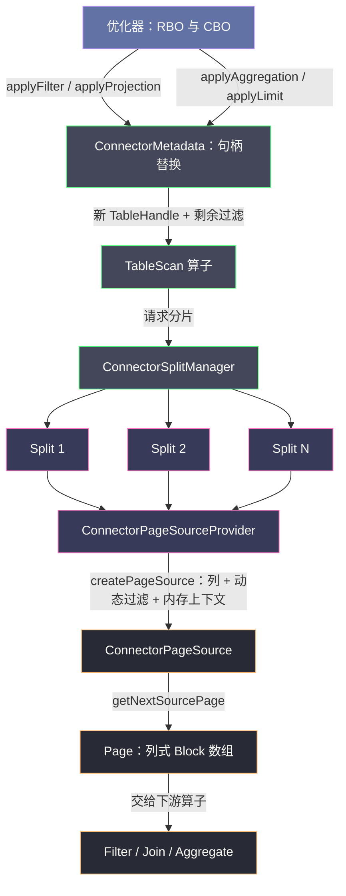
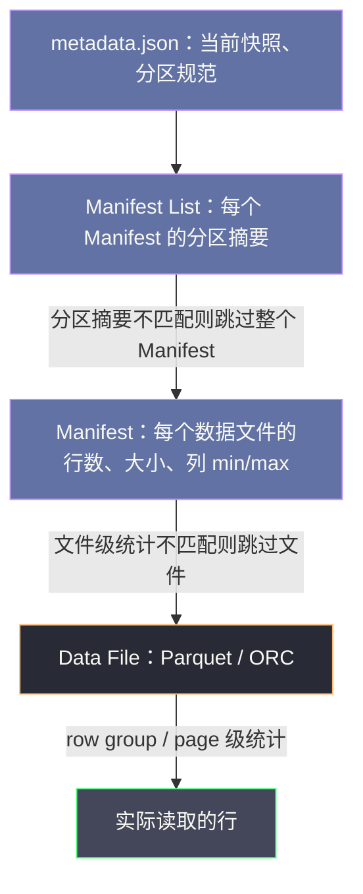
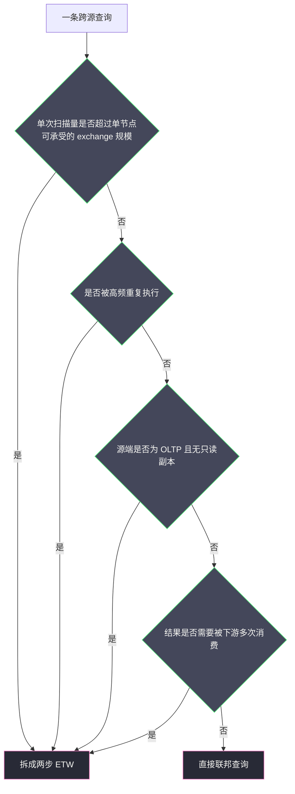
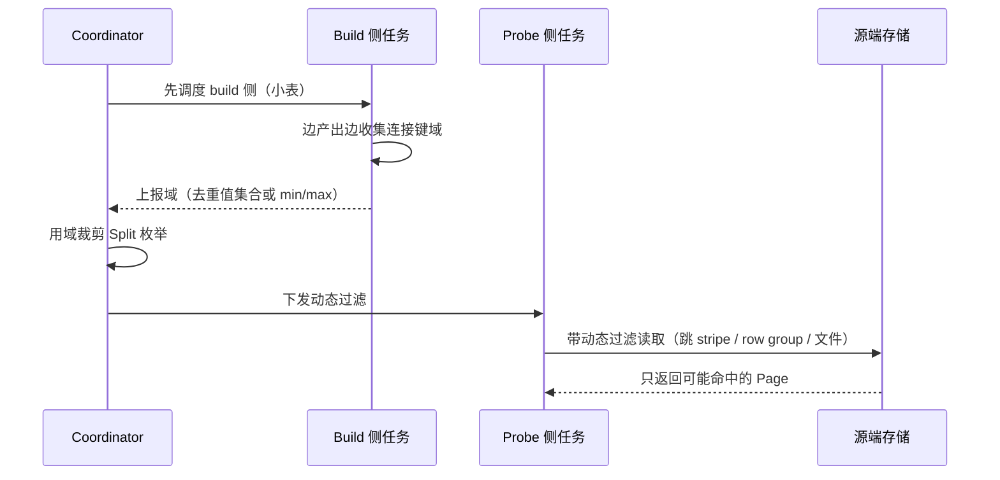

# Connector 体系——Hive、Iceberg 与联邦查询

**摘要：**

Trino 的查询快慢，很大程度上不取决于算子写得有多精巧，而取决于 Connector 愿意把多少工作留在源端完成。本文以四类下推（谓词、投影、聚合、Limit）为骨架，沿着 `TableScan` → `ConnectorSplit` → `ConnectorPageSource` → `Page` 的路径，讲清数据究竟怎样进入引擎：Split 怎么划分决定并行度，Page 怎么编码决定内存与网络开销，而 Connector 返回的每一个 `Optional.empty()` 都在把成本推回 Trino 自己。在此基础上对比 Hive 与 Iceberg 两套元数据结构——前者靠 Metastore 加目录列举，后者靠 Manifest 树加文件级统计——以及统计信息质量如何反过来约束 CBO 的选择空间。联邦查询被拆成三笔代价：跨源数据必须经过 exchange、下推在 join 边界上天然残缺、源端并发无法与 MPP 并行度对齐，并给出什么时候该把一次联邦查询拆成两步 ETW 的判据。最后落到 join 的广播与重分布选择、动态过滤如何把 build 侧的结果变成 probe 侧的扫描条件，以及三类高频反例。四类下推的边界并不对称：谓词与投影几乎人人支持，聚合与 Limit 则取决于源端能否翻译，这也决定了同一条 SQL 在不同 Connector 上的代价可以相差几个数量级。全文以 Trino 484 的官方文档与源码为口径，其它版本请以对应版本文档为准。

---

## 第 1 章 下推才是 Connector 的主战场

### 1.1 引擎真正省不掉的是什么

把 Trino 的加速手段按收益从大到小排，排在最前面的并不是代价模型，也不是向量化算子，而是**下推**（Pushdown）。这个判断听上去有点反直觉，因为教科书式的数据库优化总把 CBO 放在舞台中央；但 CBO 能做的只是换一种执行方式，它改变不了"这些字节已经被读出来"这个事实。一个 100 列、10 亿行、单行压缩后 200 字节的 ORC 表，全表约 200 GB（示例推算），按天分区三年；查询只要 7 天、3 列、外加一个等值条件。CBO 无论怎样重排计划，都不可能把读取量压到分区裁剪加列裁剪之后的水平——决定这次读取是 200 GB 还是 2 GB 的，是 Connector 在生成 Split 与 Page 时愿不愿意用上元数据。

Trino 的执行模型里，外来数据只有一个入口，就是 `TableScan` 算子；它在运行时被实例化为 `ScanFilterAndProjectOperator`，从一个 `ConnectorPageSource` 里循环取 `Page`，每取一页就把行交给下游。这条路径的上游全部属于 Connector，引擎看不见文件、分区、索引、shard，也看不见远端数据库的执行计划。因此引擎侧的优化只有两种：少做无用的计算（提前过滤、下推聚合、剪掉不需要的列），以及少搬无用的数据（减少 exchange、选择广播或重分布）。两种优化都依赖同一个前提——Connector 必须把"哪里可以少读"的信息交出来。

> [!info] 版本口径
> 本文涉及的接口签名、配置默认值、行为描述，均以 Trino 484 的官方文档与 master 分支源码为准。Trino 没有 LTS 概念，接口在小版本之间仍会调整，例如读路径的 `getTableLayouts()` 已从 SPI 中移除，分区裁剪改为落在 `HiveMetadata.applyFilter()` 里完成；照抄旧版本文档里的类名与方法名，很容易写出对不上号的分析。

不这样会怎样，可以用一次反事实推算看清。若谓词、投影都不下推，Connector 必须把 200 GB 压缩数据全部读出来、解压、把 100 列都解码成 Block、拼成 Page 送进引擎，再由 `FilterOperator` 丢掉九成的行；这部分 IO、解压、解码、Page 分配与 GC 都是净浪费。若谓词能下推到文件统计层，跳过一半文件后可能只读 100 GB；投影再砍掉 97% 的列，实际读取落在 1 到 2 GB（示例推算）。引擎优化在这里贡献的是常数因子，下推贡献的是数量级。

### 1.2 Connector SPI 的三层契约

Connector 这套抽象之所以能同时容纳 HDFS 上的 ORC 文件、MySQL 里的行、Kafka 的字节流和 Elasticsearch 的倒排索引，是因为它把"读数据"拆成了三个彼此独立的契约。第一层是元数据（`ConnectorMetadata`），回答有哪些 schema、表、列，以及某个过滤条件下还剩哪些数据；第二层是分片（`ConnectorSplitManager`），把"剩下的数据"切成可以并行调度的 `ConnectorSplit`；第三层是读取（`ConnectorPageSourceProvider`），为每个 Split 造一个 `ConnectorPageSource`，把字节变成 `Page`。

下推的钩子全部挂在第一层，形态高度统一：每一个方法都接收一个 `ConnectorTableHandle`，返回一个 `Optional<XxxApplicationResult<ConnectorTableHandle>>`。返回 `Optional.empty()` 表示"这次调用没有产生任何效果"，返回非空则表示 Connector 接受了下推，并交出一个替换用的新句柄。源码注释明确要求：没效果时必须返回空，否则优化器会反复调用同一个规则直到死循环。这条约定是理解下推边界的第一把钥匙——下推不是"通知源端去过滤"，而是"Connector 声称约束已由我承担，引擎可以把对应的 Filter 摘掉"。

| 下推类别 | SPI 方法 | 返回结果携带的信息 | 引擎侧的直接后果 |
|---|---|---|---|
| 谓词下推 | `applyFilter` | 新句柄、剩余过滤条件、是否重新估算统计 | 命中部分从执行计划中消失，未命中部分仍留在 `Filter` 节点 |
| 投影下推 | `applyProjection` | 新句柄、新的输出列集合 | `TableScan` 只保留需要的列，列存格式只读对应 column chunk |
| 聚合下推 | `applyAggregation` | 新句柄、聚合结果映射、分组列映射 | 计划里的 `Aggregate` 节点被整体摘掉，返回行数从明细级降到分组级 |
| Limit 下推 | `applyLimit` / `applyTopN` | 新句柄、是否保证行数不超过上限 | 有 `guaranteed` 标记时 `Limit` 节点可摘，否则仍需引擎兜底 |

这四类方法构成了本篇讨论的主干。严格说还有第五类——`applyJoin`，它允许 Connector 把两张表的连接整体下推到源端执行，但 SPI 明确标注这是实验性接口，且通用前提是"参与连接的表必须来自同一个 Catalog"，所以它在联邦查询里帮不上忙，只能算单源优化的补充。

下图给出从优化器到下推、再到数据进入引擎的完整链路：下推发生在计划阶段的元数据层，而数据搬运发生在执行阶段的分片与读取层，两者之间只通过"句柄里携带的信息"耦合。



### 1.3 下推是一次"句柄替换"

以谓词下推为例，引擎传下去的 `Constraint` 包含 `TupleDomain`（列到 `Domain` 的映射）与 `ConnectorExpression`（承载无法规约成区间的表达式）。Connector 若接受下推，就要返回 `ConstraintApplicationResult`，里面除了新句柄，还必须有 `remainingFilter` 与 `remainingExpression`——引擎会把这些"没被吃掉"的部分拼回计划。

这套设计有一个容易被忽略的细节：`ConstraintApplicationResult` 还带一个 `precalculateStatistics` 布尔位。它解决的是下推之后统计信息可能变差的问题——Connector 换了句柄，引擎未必还能从新句柄上估算出准确的基数，于是让计划在替换之前先按旧计划算一遍统计。Hive 与 Iceberg 都返回 `false`，说明它们认为下推后的句柄仍能提供可用的统计；但如果自己写 Connector，这一位值不值得设成 `true`，取决于新句柄是否真的还能回答"这张表现在有多少行"。

下推成功的证据最终落在 `TableScan` 的 `enforcedConstraint` 上，在 `EXPLAIN` 里表现为 `ScanFilterProject` 节点的 `filterPredicate = true`。这句话的含义比它看起来要强：它不是说"源端执行了过滤"，而是说"引擎认为这个过滤条件已经被完全承担，不再需要在这一层求值"。凡是 `filterPredicate` 后面还挂着一串表达式的地方，都是下推只完成了一部分的证据。

### 1.4 Connector 也有拒绝权

下推之外，SPI 还给了 Connector 一个反向的权力：`validateScan`。它在计划阶段被调用，允许 Connector 直接拒绝一次扫描。Hive 用它实现"必须带分区过滤"的治理策略——当 Catalog 打开 `hive.query-partition-filter-required=true`，而查询的过滤条件与任何分区列都不相交时，`validateScan` 会抛出 `QUERY_REJECTED`，错误信息会明确指出"至少需要一个分区列的过滤条件"。

这条机制在联邦场景里格外重要：跨源查询的过滤条件按业务写，用户很容易在 JOIN 超大分区表时忘了带时间分区，而引擎不会因为"可能扫全表"拒绝，只有 Connector 知道这张表有多少分区。把治理规则放在 Connector 而不是 SQL 审核平台，好处是它跟着 Catalog 走、无论从哪个入口发起都逃不掉；代价是只能拒绝、不能改写，存量报表仍需人工改 SQL。

---

## 第 2 章 Split 与 Page：数据进入引擎的路径

### 2.1 并行度由 Split 决定

在 Trino 的执行层次里，`Split` 是调度与并行的最小单位：一个 Split 通常对应一个 Driver，一个 Driver 就是一条算子流水线的一个执行实例。因此一次扫描的并行上限几乎完全由 Split 的数量决定——Split 太少，Worker 再多也只能干瞪眼；Split 太多，Coordinator 要维护的分片状态、要下发的分片描述、要跟踪的完成事件都会线性膨胀。Trino 为此设了背压参数：`hive.max-outstanding-splits` 限制每个扫描在队列里缓冲的 Split 数（默认 1000），`hive.max-outstanding-splits-size` 限制这些 Split 描述占用的内存（默认 256 MB），`hive.max-splits-per-second` 则可以直接限制生成速率，用来保护元数据服务与对象存储。

Split 的粒度同时决定了下推能落到多细。谓词下推发生在计划阶段，作用在表句柄上；而"这个 Split 到底要不要读"是分片阶段的决策。只有当 Connector 愿意在分片阶段继续使用约束与动态过滤时，下推才真正变成"少读文件"；否则它只是把过滤从行级提前到了"读完之后立刻丢"，省下的是 CPU 而不是 IO。

| Connector | Split 的物理含义 | 默认粒度 | 并行度来源 |
|---|---|---|---|
| Hive | 文件的一个连续区段 | 64 MB；Parquet 120 MB 以对齐 row group | 文件数 × 每文件区段数 |
| Iceberg | 一个数据文件（外加其删除文件） | 单文件；`iceberg.max-split-size` 只是目标值 | 文件数，按权重调度 |
| JDBC（MySQL 等） | 一条 SQL 查询 | 每个表扫描通常一个 Split | 基本为 1，靠谓词下推压数据量 |
| Kafka | 某分区的一段 offset 区间 | `kafka.messages-per-split` 默认 100000 条 | Topic 分区数 × 区间数 |
| Elasticsearch | 一个 search shard | 由索引的 shard 数决定 | shard 数 |

### 2.2 Hive 的 Split 生成过程

Catalog 只是 Connector 的一个挂载点，`etc/catalog/` 下每个 `.properties` 文件对应一个 Catalog，读取行为由其中参数决定：

```properties
# etc/catalog/hive.properties
connector.name=hive
hive.metastore.uri=thrift://metastore-host:9083
hive.max-split-size=64MB
hive.max-partitions-per-scan=1000000

# etc/catalog/iceberg.properties
connector.name=iceberg
iceberg.catalog.type=hive_metastore
iceberg.dynamic-filtering.wait-timeout=1s
```

Hive Connector 读一张分区表要经过两次"从元数据到物理位置"的收敛。第一次发生在计划阶段：`HiveMetadata.applyFilter()` 调用分区管理器，用约束从 Metastore 里筛出候选分区，把结果写进新的 `HiveTableHandle`，同时把分区列从"未下推约束"里剔除——因为分区列的条件已经在挑选分区时用掉了。第二次发生在分片阶段：`HiveSplitManager` 对每个候选分区列举目录下的文件，再按 `hive.max-split-size` 把文件切成区段。

这个顺序解释了 Hive 性能模型里最经典的一条规律：分区裁剪是数量级的优化，文件统计是常数级的优化。一个按天分区、保留三年的表有 1095 个分区，查询只覆盖 7 天时，分区裁剪把候选集压到 7 个（约 0.64%），这一步的收益与文件大小、列数都无关；而之后的 ORC stripe 统计、Parquet row group 统计只能在"已经选中的文件"内部再跳过一部分数据，跳过率高度依赖数据是否按过滤列聚簇。

```text
/warehouse/behavior_log/
    dt=2024-01-01/
        part-00000.orc   128 MB
        part-00001.orc   128 MB
        ...
    dt=2024-01-02/
        part-00000.orc
        ...
```

每个 Split 描述里除了路径、起始偏移、长度，还带着分区键、Bucket 信息、列类型强制转换信息，以及一组 `HostAddress` 作为首选节点。这组地址来自 HDFS 的块位置，调度器会尽量把 Split 分给持有副本的 Worker，这就是**数据本地性**（Data Locality）；`hive.force-local-scheduling` 可以进一步要求"只能在同一节点执行"，代价是当 Trino 与 DataNode 不同址时会把 Split 卡在队列里空等。

分片阶段还有一个常被忽视的成本：列举目录。对象存储的 LIST 请求按次计费且有速率上限，一个分区几千个文件、几千个分区被选中时，列举可能比读取还慢。Hive 用文件状态缓存（`hive.file-status-cache-tables`，默认过期 1 分钟）把目录列表缓存在 Coordinator 内存里，默认保留上限 1 GB；缓存对重复查询友好，对高频写入的实时表却可能返回过期列表。

### 2.3 Iceberg 的 Split：从元数据树直接得到文件

Iceberg 不做目录列举。它的扫描计划从当前快照的 Manifest List 出发，用分区摘要裁掉无关的 Manifest，再读 Manifest 里的文件条目，得到一组 `FileScanTask`，每个任务对应一个数据文件以及挂在该文件上的删除文件。`IcebergSplitSource` 把这些任务逐一转成 `IcebergSplit`，字段包括路径、起始位置与长度、文件大小、记录数、分区规范 ID、分区值、删除文件列表、文件级统计域、数据序列号，以及一个 `splitWeight`。

`splitWeight` 是 Iceberg Connector 与 Hive Connector 在调度上的关键差异。Hive 的 Split 大小基本均匀，调度器按个数分配即可；Iceberg 的文件大小差异可以很大，而且删除文件会放大读取代价，于是 Trino 按**权重**而不是按个数来分配工作：基础权重是"文件长度 ÷ 目标分片大小"，文件上挂了位置删除（position deletes）时权重翻倍，因为每一行都要去位图里查一次；挂了等值删除（equality deletes）时，权重还要按删除条数乘以数据权重，因为每一条删除记录都要与文件里的所有行比对。这套加权直接决定了并行任务之间的负载是否均衡，`iceberg.minimum-assigned-split-weight`（默认 0.05）则给小文件设了一个下限，避免海量小文件被分配得过于零碎。

| 维度 | Hive Split | Iceberg Split |
|---|---|---|
| 文件列表来源 | 列目录（LIST） | Manifest 元数据 |
| 切分粒度 | 按块大小切文件 | 一个文件一个 Split，大小由写入端决定 |
| 删除处理 | 无独立删除文件（ACID 表走 delta 目录） | 携带 delete files，权重按删除类型放大 |
| 调度依据 | Split 个数 | Split 权重 |
| 元数据放大点 | 目录列举与 Metastore 分区查询 | Manifest 读取与 Manifest 缓存 |

### 2.4 Page 与 ConnectorPageSource

Split 决定"读哪里"，Page 决定"怎么进来"。`Page` 是 Trino 的列式内存格式：一个 Page 有固定的行数，内部按列存成若干个 `Block`，同一个 Block 里的值类型一致、编码紧凑。把数据组织成列式而不是行式，是为了让下游算子（过滤、聚合、哈希连接）能够按列做向量化处理，也为了让"只读需要的列"这件事在内存里继续成立——不需要的列根本不会出现在 Page 里。

`ConnectorPageSource` 是生产 Page 的接口。从 Trino 473 起，它的取数方法从 `getNextPage()` 换成了 `getNextSourcePage()`，返回类型也从 `Page` 换成了 `SourcePage`。这个变化不是改名游戏：`SourcePage` 允许**延迟物化**，可以只给出位置数而不立刻解码所有 Block，等下游真正访问某一列时才加载；它还提供 `trySelectPositions()`，把"只保留这些行"的选择下推给读取器，让 ORC/Parquet 在解码阶段就跳过不需要的行。对于宽表加高选择性过滤的组合，这一层能省掉相当一部分解码与内存分配。

创建 PageSource 的入口签名把三件事一次性确定下来：`createPageSource(transaction, session, split, table, tableCredentials, columns, dynamicFilter, memoryContext)`。`columns` 是投影下推的结果，决定读哪些列；`dynamicFilter` 是动态过滤的结果，决定哪些行根本不可能命中；`memoryContext` 则把这次读取的内存记到查询的内存池里。换句话说，四类下推里除了聚合与 Limit 之外，最终都要通过这个入口变成"少读列、少读行"的具体行为。

---

## 第 3 章 谓词下推：从 TupleDomain 到分区裁剪

### 3.1 applyFilter 的三种结局

谓词下推的结果可以分成三类：完全下推、部分下推、未下推。完全下推的证据是 `remainingFilter` 变成 `all`，计划里的 `ScanFilterProject` 显示 `filterPredicate = true`；部分下推是 `remainingFilter` 里只剩下引擎必须自己算的那部分；未下推则是 `applyFilter` 返回 `Optional.empty()`，Filter 原样保留。三类结局决定了同一条 SQL 在不同 Connector 上的代价可以差出几个数量级。

Hive 的实现把分区列与数据列分开处理：分区列的条件在 `applyFilter` 里就用于挑选分区，因此可以被完全"吃掉"；数据列的条件只记录进"紧凑有效谓词"，作为后续文件统计过滤的输入，同时原样出现在 `remainingFilter` 里。这解释了一个常见困惑——为什么 Hive 上 `EXPLAIN` 里明明看到了 `filterPredicate` 表达式，扫描量却确实下降了：因为分区裁剪发生在 Split 生成之前，而数据列的过滤发生在 PageSource 内部，二者不在同一个层级上。

Iceberg 的实现更细，它把约束拆成"可强制"与"不可强制"两类。可强制的条件是能被分区规范判定的，例如按 `days(ts)` 分区时对 `ts` 的日期范围条件，这类约束进入 `enforced`，用于裁剪 Manifest 与文件；不可强制的条件是普通数据列上的条件，进入 `unenforced`，交给文件级统计和读取器进行行组级过滤；还有一类域根本无法转换成 Iceberg 表达式，则原样退回给引擎；分区演进之后，只有所有分区规范都能判定的条件才会被强制。

### 3.2 三层过滤：分区、文件、行

把 Hive 的过滤拆开看，一共有三层，越往后越细，收益越小。

第一层是**分区裁剪**，作用在目录级别，跳过的是整块数据，收益通常是数量级。第二层是文件内部统计，ORC 的 stripe（默认 64 MB 一个）带有每列的 min/max，stripe 内部再按约一万行一个 row group 建索引；Parquet 的 row group 统计与 page index 同理。这一层能跳过多少，取决于数据在文件内是否按过滤列有序或聚簇——如果 `user_age` 在写入时是随机分布的，每个 stripe 的 min/max 都会覆盖整个取值范围，跳过率接近零。第三层是 Trino 的 `FilterOperator` 或 `ScanFilterProject` 里的残留表达式求值，它只能省下下游算子的计算量，省不了 IO、解压和解码。

前两层之和，业内常说的"文件格式统计过滤"，其实是把第三层的过滤提前到了读取器内部；它能不能发挥作用，一半取决于查询的写法，一半取决于写入时的数据布局。这也是为什么在 Hive 表上做排序或分桶写入的收益常常大于换更快的文件格式：统计信息的有效性来自聚簇，而不是来自格式本身。

### 3.3 Iceberg 的多级裁剪与隐藏分区

Iceberg 的裁剪路径比 Hive 多一级，而且每一级用的元数据都不同。



第一级是 Manifest List：每个 Manifest 条目携带分区字段的摘要，分区条件不匹配的 Manifest 整个跳过。第二级是 Manifest 内的文件条目：每个数据文件记录行数、文件大小、每列的 lower bound 与 upper bound、null 计数，数据列上的范围条件可以在这里裁掉整个文件。第三级才是读取器内部的 row group 或 page 级过滤。与 Hive 相比，前两级都不需要列目录，也不依赖文件是否按列排序——文件级 min/max 是写入时记录的，只要文件本身内部有序（或至少取值范围收敛），裁剪就有效。

**隐藏分区**（Hidden Partitioning）是 Iceberg 相对 Hive 的另一个结构性优势。Hive 的分区是显式的：表按 `dt` 分区，查询必须写 `dt = '2026-11-19'`；如果用户写的是时间戳列 `ts`，分区裁剪完全失效。Iceberg 允许按变换分区，例如 `days(ts)`、`bucket(16, user_id)`、`truncate(4, url)`，用户查询时照常写 `ts >= TIMESTAMP '2026-11-19 00:00:00'`，连接器负责把条件转换成对分区字段的判定。用户不需要知道分区怎么定义，分区策略也可以随写入需求演进。

分区演进带来一个边界：一次查询可能同时覆盖多个分区规范的文件。可强制的条件需要"所有规范都能判定"，只要有一个老规范无法判定，这个条件就退化成不可强制，只能依靠文件级统计。这不算缺陷，而是格式演进必须付出的兼容成本；理解这一点，才不会在"明明按天分区了、为什么这次查询还是扫全表"的现场里迷失方向。Iceberg 的快照元数据还支撑时间旅行，查询可以直接落到某个历史版本：

```sql
SELECT * FROM iceberg.my_db.my_table
FOR TIMESTAMP AS OF TIMESTAMP '2024-01-15 12:00:00';

SELECT * FROM iceberg.my_db.my_table
FOR VERSION AS OF 8439729893128120;
```

### 3.4 下推不完整时，Trino 要自己算多少

下推失败的成本可以拆成五段：读 IO、解压、解码成 Block、表达式求值、Page 的内存分配与回收。分区裁剪失败放大的主要是第一段；列裁剪失败放大的是第一段到第三段；谓词只到引擎层则放大的主要是第三段与第四段。这个拆分决定了该往哪儿优化：瓶颈在解压与解码，换文件格式（ORC 换 Parquet、开 ZSTD）比重写 SQL 更有效；瓶颈在表达式求值，说明谓词没能下推，该改写法。

常见的下推失效写法有五类。第一类是函数包裹列，譬如 `date_format(dt, '%Y-%m-%d') = '2026-11-19'`、`substr(cast(ts AS varchar), 1, 10) = '2026-11-19'`，分区列被函数包住之后就不再是分区列，优化器无法把条件映射回分区字段。第二类是隐式类型转换，分区列是字符串而字面量是日期，或者反过来，Connector 与 Iceberg 表达式转换器对转换的支持不一致时，条件会退化为不可强制。第三类是跨列的 `OR` 与 `NOT IN` 混用，无法规约成每列的区间。第四类是用户自定义函数与正则，引擎根本不知道它的语义，只能整行算。第五类是离散值过多。Hive 与 Iceberg 的 Catalog 都有 `domain-compaction-threshold`，默认 1000：当 `IN` 列表的取值数超过阈值，Trino 会把它压成覆盖这些值的最小范围集合。动机是控制谓词体积，代价是过滤精度从"精确集合"退化为"范围"，本该跳过的文件可能因为落在范围内而被读进来。这在联邦查询里尤其敏感，因为跨源的 `IN` 列表往往来自另一侧的结果。

### 3.5 用 EXPLAIN 做一次下推审计

判断一条查询在某个 Connector 上下推得好不好，不需要读源码，`EXPLAIN` 的输出里已经有足够证据。按顺序看五处：`TableScan` 的 `Layout` 是否只剩需要的列（投影是否生效）；`ScanFilterProject` 的 `filterPredicate` 是否为 `true`（谓词是否全被承担）；同一节点上是否出现 `dynamicFilters`（动态过滤是否接上）；`Aggregate` 节点是否还在扫描之上（聚合是否下推）；以及 `Limit` 节点是否还存在（Limit 是否有保证）。再往上，看 `Exchange` 的数据量与位置：如果一个本该早过滤的查询在中途仍然搬运着全量数据，问题多半在谓词而不是在网络。

---

## 第 4 章 投影、聚合、Limit：三类"减法"

### 4.1 投影下推：列存格式的物理红利

**投影下推**（Projection Pushdown）是最朴素、也最容易被低估的一类下推。列存格式的物理布局决定了"只读需要的列"能带来近乎线性的 IO 下降：ORC 的每个 stripe 按列分开存储，Parquet 的每个 row group 按 column chunk 分开存储，读取器可以只请求需要的 column chunk，其余数据连解压都不需要。一个 100 列的表读 3 列，理论读取量是 3%，加上文件头、stripe footer、索引等固定开销，实际读取量通常仍能落在 5% 以内（量级判断，取决于列宽分布）。

非列存格式没有这个红利。CSV、JSON、TextFile 必须整行解析，即使只查一列也要整行读出再丢弃——投影下推只省内存与网络，不省 IO。Kafka 同理，消息体只能整条反序列化。Elasticsearch 稍好，`_source` 可按字段过滤，一旦禁用，谓词下推与投影都会失效。

还有一类更细的下推叫解引用（Dereference Pushdown），专门针对 `ROW` 类型的嵌套字段：只访问 `payload.user_id` 时，读取器只读嵌套结构里的这一个字段，而不是整个 `payload`。它对半结构化数据（事件日志、埋点数据）的收益很大，支持程度因 Connector 而异，Iceberg 侧由 `iceberg.projection-pushdown-enabled` 控制。

投影下推也有救不了的场景。典型的是 `SELECT *` 一路透传到最外层才裁剪，但中间的 JOIN 或窗口函数需要全部列参与计算；再典型的是视图层层嵌套，每一层都扩大了列集合。这两种情况在 `EXPLAIN` 里表现为 `TableScan` 的 `Layout` 出奇地宽，而最终输出只有几列——看到这种形状，优化的方向是改查询结构，而不是调 Connector 参数。

### 4.2 聚合下推：条件比想象中苛刻

**聚合下推**（Aggregation Pushdown）的收益上限最高：明细级数据在源端聚合成几十行，网络传输量可以下降几个数量级。但它的生效条件也最苛刻。SPI 层面，`applyAggregation` 接收聚合函数列表、列映射与分组集合，返回结果必须给出聚合结果与分组列的映射关系；Connector 只有在"函数语义完全可翻译"时才应该返回结果。

通用限制包括：不支持 `ROLLUP`、`CUBE`、`GROUPING SETS` 这类复杂分组；不支持聚合函数内部带表达式，譬如 `sum(a * b)`；不支持参数类型强转，譬如对整型列做 `sum` 时引擎可能引入的隐式转换；不支持聚合函数内部的 `ORDER BY` 与 `FILTER`。满足这些条件之后，还要看具体 Connector 支持哪些函数。MySQL 与 PostgreSQL 支持 `avg`、`count`、`max`、`min`、`sum`、`stddev` 系列与 `variance` 系列；Elasticsearch 支持的范围窄得多，`count` 与数值类型的 `avg`、部分 `min`/`max`、`sum` 可以下推，`REAL`/`DOUBLE` 参与的分组与 TopN 则回到 Trino 计算；Hive 与 Iceberg 不支持聚合下推。

聚合不下推，并不意味着代价一定不可接受，这里有一个容易混淆的层次。即使 `Aggregate` 节点留在 Trino 里，引擎也会把它拆成 Partial 与 Final 两段：每个 Worker 先在本地做局部聚合，把明细压成"分组键 + 部分聚合值"再走 exchange 上浮。所以不下推时真正多付的成本是"源端到 Trino 的明细传输 + 引擎侧的解码与局部聚合"，而不是"把全部明细搬到最终节点"。分组基数低（几百个键）时局部聚合压缩比通常过千，exchange 不是瓶颈；基数高（几十万键）时压不下去，聚合下推的收益才凸显。

### 4.3 Limit 下推：并行扫描的陷阱

`LIMIT` 下推看起来简单，实际上语义最微妙。`applyLimit` 返回的 `LimitApplicationResult` 带一个"是否保证行数不超过上限"的标记：如果 Connector 只是把上限当成提示（例如读文件时提前停），它必须把这个标记设为 `false`，引擎仍然保留 `Limit` 节点兜底；只有 Connector 能确定性地保证输出行数时，才能把 `Limit` 整个摘掉。这个标记决定了"少读"到底发生在哪一层，也决定了结果正确性。

更值得警惕的是并行扫描下的收益递减。假设一次扫描被切成 20 个 Split，每个 Split 有 100 万行，查询要 `LIMIT 100`。每个 Split 都要从头读起，才能保证"全局前 100"里可能出现的行不会被漏掉；因此除非 Connector 能把"前 100"的语义转换成一个全局有序的扫描（例如按主键或时间戳有序的文件），否则 Limit 下推只能让每个 Split 少读一点尾部数据，无法真正把扫描量降到 1%。这就是为什么 `LIMIT` 下推在 JDBC 连接器上效果最好——它只有一个 Split，`LIMIT` 直接翻译成 SQL 的 `LIMIT`，源端数据库会自己用索引找前 N 行；Hive 干脆不实现 Limit 下推，Iceberg 只把它当提示（`guaranteed=false`），多 Split 扫描上的收益都很有限。

`TopN` 下推（`ORDER BY ... LIMIT N`）是 Limit 的升级版，要求源端能按排序键返回有序结果。Elasticsearch 与 MySQL 支持得比较好，前者还能利用索引做 TopN；Hive 与 Iceberg 会返回空，`TopN` 节点留在引擎侧执行。这也是一个典型的取舍：把 `TopN` 下推到 OLTP 数据库，可能让数据库为一次分析查询做一次全表排序；不下推，Trino 侧做堆排序的代价又随数据量线性增长。判断依据是数据量与索引情况，而不是"能下推就下推"。

### 4.4 下推能力矩阵

把四类下推在不同 Connector 上的实际支持情况放到一张表里，比背文档更直观。表中"部分"意味着只在特定写法、特定类型、特定配置下生效，实际生产里必须用 `EXPLAIN` 确认。

| Connector | 谓词 | 投影 | 聚合 | Limit / TopN | 动态过滤 |
|---|---|---|---|---|---|
| Hive | 分区裁剪 + 文件统计，数据列不完全承担 | 支持（ORC/Parquet，含解引用） | 不支持 | 不支持，Limit 由引擎侧兜底 | 支持分区裁剪与 stripe/row group 剪枝 |
| Iceberg | 强制分区条件 + 文件统计 | 支持（含解引用） | 不支持 | Limit 只作提示、不保证行数；TopN 不支持 | 支持分区裁剪与文件统计剪枝 |
| MySQL / PostgreSQL | 翻译成 SQL `WHERE` | 支持 | 支持指定函数集合 | 均支持 | 读取阶段可作附加谓词 |
| Kafka | 只用于按分区与时间戳裁剪 offset | 不支持（需整条反序列化） | 不支持 | 不支持 | 不支持数据列 |
| Elasticsearch | 部分类型与场景 | 支持 `_source` 过滤 | 支持少量函数 | 均支持 | 文档未承诺 |

---

## 第 5 章 Hive 与 Iceberg：统计信息质量决定 CBO 的上限

### 5.1 Hive 的元数据与统计

Hive 的元数据由 Metastore 持有：表的 schema、分区列、每个分区的存储路径。这些信息足以支撑分区裁剪，但不足以支撑代价估算——CBO 需要行数、列的基数（NDV）、空值比例、min/max，而这些要靠在表或分区上执行 `ANALYZE` 才能得到。Hive Connector 的 `hive.table-statistics-enabled` 默认 `true`，但它只表示"允许使用统计"，不代表"统计已经存在"。

Trino 写入时会顺带收集列级统计（`hive.collect-column-statistics-on-write` 默认 `true`）；但 Hive 表往往由 Spark、Hive 或 Flume 写入，这些引擎不一定回写统计，大量存量表的统计因此是空的或过期的。表级统计还有一层间接性：当分区数很多时，Trino 会按 `hive.partition-statistics-sample-size`（默认 100）抽样若干分区来推算表级统计，抽样误差会直接传导到 CBO 的估算里。

一个容易被误用的开关是 `optimizer.optimize-metadata-queries`，默认关闭。打开之后，`count(*)`、`min`/`max`、`approx_distinct` 这类对分区键的聚合可以直接用分区元数据回答，不必扫描数据；代价是如果 Metastore 里存在空分区（其它引擎可以创建空分区，Trino 不行），查询结果会与真实数据不一致。统计在 Hive 里始终是外挂的，维护好坏直接体现在计划上。

### 5.2 Iceberg 的统计

Iceberg 的统计分两层。第一层是写入即得的文件级统计：Manifest 条目里记录行数、文件大小、每列 lower/upper bound 与 null 计数，不依赖谁写入。第二层是表级、列级的扩展统计（NDV 等），由 `ANALYZE` 触发，或写入时由 `iceberg.extended-statistics.collect-on-write`（默认 `true`）顺带写入统计文件。

这两层经常被混为一谈。文件级统计解决的是"这个文件要不要读"，属于扫描优化；表级与列级统计解决的是"这个表有多大、这个连接该谁做 build 侧"，属于计划优化。CBO 需要的是后者，而后者在 Iceberg 上同样依赖 `ANALYZE`。把"文件统计写入即得"误解成"统计信息完整"，是选型讨论里最常见的偏差之一：Iceberg 的真正优势是文件统计永远与数据一致、且裁剪不需要列目录，而不是 CBO 不需要统计。

Iceberg 的元数据读取也有成本，只是形态不同：Manifest、快照与分区规范多时，规划阶段的 Avro 读取会变得可观。Trino 用 `iceberg.metadata.parallelism`（默认 8）、`iceberg.planning-threads`、`iceberg.split-manager-threads` 控制并行度，并默认开启元数据缓存（`iceberg.metadata-cache.enabled`）。与 Hive 的"列目录 + 查 Metastore"相比，一个瓶颈在读元数据，一个在打对象存储与 HMS。

### 5.3 统计缺失怎样让 CBO 退化

CBO 的所有决策都建立在统计之上，**统计缺失**时它的退化路径是明确写进文档的。`join-distribution-type` 默认 `AUTOMATIC`，由代价决定广播还是重分布；当表没有统计、代价算不出来时，Trino 会退回到哈希重分布（partitioned）。同样，`optimizer.join-reordering-strategy` 默认 `AUTOMATIC`，会枚举连接顺序并按代价选择；统计缺失时退回到 `ELIMINATE_CROSS_JOINS`，也就是只消除笛卡尔积、其余保持 SQL 里的书写顺序。

两条退化叠加，后果是连锁的。假设用户按"小表在前"的习惯写 SQL，但小表实际有 5000 万行而大表只有 200 万行（示例推算），CBO 若无统计就保持书写顺序，把 5000 万行当成 build 侧去做广播；广播的判定又会因为估算失真而失效——`join-max-broadcast-table-size` 默认 100 MB，估出来 90 MB 就广播，实际却是几十 GB，于是每个 Worker 都试图在堆里建一个巨大的哈希表。现场表现通常不是"慢"，而是 `Query exceeded per-node user memory limit` 之类的硬失败。

统计准确时，CBO 会交换左右输入让真正的维表做 build 侧，按过滤后的基数选择广播或重分布，并据此决定动态过滤能否生效；上游失真，下游优化全部跟着误判。这套代价模型的细节见 [[05 查询优化——CBO、动态过滤与索引下推]]。

### 5.4 两种表格式的结构差异

| 维度 | Hive 表格式 | Iceberg 表格式 |
|---|---|---|
| 元数据载体 | Metastore 中的表与分区记录 | 元数据 JSON + Manifest List + Manifest |
| 分区裁剪依据 | 分区列的字面值 | 分区字段的转换结果（隐藏分区） |
| 文件级统计 | 无，只能靠列目录后的读取 | Manifest 中记录每列 min/max、null 计数 |
| 表级/列级统计 | `ANALYZE` 写入 Metastore | `ANALYZE` 写入统计文件，或写入时收集 |
| 分区演进 | 不支持，改分区方式要重写表 | 支持多分区规范并存 |
| 拆分方式 | 列目录后按块大小切 | 元数据直接产出文件级任务 |
| 并发写入 | 依赖外部协调 | 乐观并发，快照隔离 |

同一份 Parquet 数据放进 Iceberg 后查询更快，原因不在文件格式，而在"哪些信息可以在不读数据的情况下被使用"：文件级统计、分区变换与快照信息都是可查询的元数据，Trino 能在生成 Split 前排除大部分文件；Hive 下只能依赖分区列或读取时的统计。

---

## 第 6 章 联邦查询的三个代价

### 6.1 代价一：exchange 是绕不开的

联邦查询的定义很简单：一条 SQL 里出现两个及以上 Catalog 的表。它的实现方式也很简单：Trino 分别从每个源读数据，在引擎内部完成连接与聚合。问题在于，"在引擎内部完成"这句话的执行含义是——数据必须离开源端，进入 Trino 的 Stage 边界，通过 `Exchange` 重新分布。

Trino 的 Stage 以 Exchange 为边界切分。上游 Stage 的每个 Task 把输出写进 `OutputBuffer`，下游 Stage 的 Task 通过 `RemoteSource` 拉取；这中间是序列化、网络传输、反序列化、内存缓冲与背压。Exchange 的压缩默认关闭：`exchange.compression-codec` 默认 `NONE`。对于宽行、文本型、重复度高的中间数据，打开 LZ4 压缩通常能把网络量压到原来的一半到三分之一（量级判断，取决于数据特征），代价是 CPU 与序列化开销。

一笔 exchange 的量可以这样估：一次 1 亿行的中间结果，每行包含两个 BIGINT 与一个时间戳，加上 Block 的 null 位图与偏移量，Page 里的编码开销按每行 40 字节计，就是 4 GB（示例推算）。如果这次结果是跨源 JOIN 的输出，它还要再经过一次重分布才能进入下一个 JOIN，量就翻倍。联邦查询之所以容易崩，往往不是因为某一处特别慢，而是因为整条链路上散落着若干个 4 GB 级别的 exchange，任何一个环节的背压都会把上游拖住。

### 6.2 代价二：join 边界上天然残缺的下推

跨源查询里，谓词下推其实是正常工作的：每个源都会收到属于自己的 `WHERE` 条件，Hive 做分区裁剪，MySQL 把条件翻译成 SQL，Iceberg 做 Manifest 裁剪。真正残缺的地方在 JOIN 上。`applyJoin` 的通用前提是"参与连接的表来自同一个 Catalog"，跨 Catalog 的连接根本无法进入 Connector 的视野，只能在 Trino 里完成。

更麻烦的是，join 条件下推的缺失会连带削弱谓词下推。`a.user_id = b.user_id` 这个条件本身不包含任何常量，它无法在计划阶段转换成对 `a` 或 `b` 的过滤；只有当一侧先执行、产出了实际的键集合，另一侧才可能据此过滤。这正是动态过滤要解决的问题，也是联邦查询里唯一能"跨源"的通道：MySQL 侧的小表先跑完，把键集合交给 Hive 侧的扫描，从而在不支持 join 下推的前提下获得接近下推的效果。这条通道是否通畅，取决于 build 侧大小、键类型、连接符，以及 probe 侧 Connector 是否愿意在分片与读取阶段使用动态过滤——后文会展开。

| 代价 | 具体表现 | 根因 | 判据 | 处置 |
|---|---|---|---|---|
| exchange | 中间结果在网络与内存之间反复搬运 | 跨源 JOIN 必须在 Trino 内完成 | `EXPLAIN ANALYZE` 中各 Exchange 的输出行数与数据量 | 减少 JOIN 层级、提前聚合、落表 |
| 下推残缺 | 扫描量大、过滤只发生在引擎层 | join 条件无法下推到任一侧 | `ScanFilterProject` 的输入行数远大于输出 | 依赖动态过滤，或拆成两步 |
| 源端并发 | 单源成瓶颈、拖住整个 Stage | JDBC 单 Split、连接池、限流 | 源端监控与慢查询日志 | 只读副本、预聚合、限速 |

### 6.3 代价三：源端并发无法对齐 MPP 并行度

MPP 引擎的并行度由 Split 数决定，而不同 Connector 能提供的 Split 数差异极大。Hive 与 Iceberg 可以轻松切出上千个 Split，让几十个 Worker 同时读；JDBC 连接器对一个表扫描通常只生成一个 Split，意味着这张表的读取只能在一个 Worker 上用一条连接完成；Kafka 的并行度等于 Topic 分区数乘以区间数；Elasticsearch 的并行度等于 shard 数。联邦查询把这几类源拼在一起，Stage 的完成时间就由最慢的那条腿决定——**木桶效应**在这个场景里格外明显。

更要紧的是，Trino 的并发查询会放大这个不对称。一条联邦查询打向 MySQL 时可能只是几条连接，十条查询同时跑就是几十条连接与几十次全表扫描；OLTP 数据库的连接池与 IO 能力很快被占满，业务侧的响应时间随之抖动。这也是为什么"用 Trino 直接查生产 MySQL"在生产环境里通常被禁止，而要求先把数据同步到 Hive 或 Iceberg：不是 Trino 不能查，而是查询的代价不该由在线业务承担。

### 6.4 什么时候该拆成两步 ETW

**两步 ETW** 指的是把一次联邦查询拆成两个阶段：先把跨源需要的数据抽取（Extract）、按目标形态转换（Transform）、写入（Write）到同一张湖表，再在单一 Catalog 内完成连接与聚合。它不是"性能不好就拆"的口号，而是一组可以判定的条件。



第一个判据是量。跨源 JOIN 两侧经过下推过滤后，只要有一侧仍超过"单次 exchange 可承受规模"，就应该拆。这个规模可以按集群内存反推：假设 20 个 Worker、单节点可用内存 64 GB，中间结果在重分布时要全量驻留，可承受规模在几百 GB 量级；再叠加并发查询，实际安全线还要往下压（示例推算）。

第二个判据是频次。同一条查询每天被调度一次以上，源端就要被重复扫描一次以上；落表之后后续查询只读湖表，源端压力归零。报表类查询几乎都满足，探索式即席查询通常不满足。

第三个判据是源端性质。源端是 OLTP 数据库且无只读副本时，无论数据量大小都应拆——全表扫描对在线业务的影响不能只用查询耗时衡量。第四个判据是复用性：结果要被多个下游消费或长期留存时，落表天然优于每次现算。

中间形态也值得认识。不必一上来就建调度任务：`CREATE TABLE AS` 可以把一次联邦查询的结果直接写成 Iceberg 表，物化视图可以在 Trino 内维护"定义 + 存储"的组合，定时任务则适合有明确时间窗口的批量场景。三者的共同点是"把跨源动作限制在一个可控的时间点上"，区别只是刷新由谁触发、存储由谁管理。

---

## 第 7 章 Join 重分布与广播：一次选择，两种代价

### 7.1 两种分布方式的成本结构

Trino 的 Hash Join 有两种数据分布方式。**重分布**（PARTITIONED）把两侧数据都按连接键做哈希，把相同键的行送到同一个 Worker，然后在各 Worker 上独立完成连接；广播（BROADCAST）把 **build 侧**（通常是右表）完整复制到每个持有 probe 侧数据的 Worker 上，probe 侧不重分布，每个 Worker 用本地的哈希表做查找。

两种方式的代价结构完全不同。重分布的网络量约等于两侧数据量之和（压缩后），内存需求是分摊到所有节点的；广播的网络量等于 build 侧大小乘以持有 probe 数据的节点数，内存需求是每个节点各存一份完整 build 侧。用一个具体例子：probe 侧 100 GB、build 侧 100 MB、20 个节点，广播需要复制 100 MB × 20 = 2 GB 网络与每节点 100 MB 堆内存（示例推算）；重分布需要搬运 100 GB 级别的数据，但每节点只持有哈希后的一部分。两个数量级的差距，解释了为什么小表广播几乎是默认正确的选择。

| 维度 | 广播（BROADCAST） | 重分布（PARTITIONED） |
|---|---|---|
| 网络量 | build 侧 × 持有 probe 数据的节点数 | 两侧数据量之和 |
| 内存 | 每个节点一份完整 build 侧哈希表 | 按哈希分散，单节点压力小 |
| 适用规模 | build 侧远小于 probe 侧，通常差两个数量级以上 | 两侧都很大，或 build 侧无法放入单节点内存 |
| 主要风险 | build 侧估算失真导致内存溢出 | 网络放大与数据倾斜 |
| 倾斜敏感度 | 低（probe 侧本地查找） | 高（同一键落到同一节点） |

### 7.2 join-distribution-type 的三个取值

`join-distribution-type` 有三个取值：`AUTOMATIC`（默认）、`PARTITIONED`、`BROADCAST`。`AUTOMATIC` 让 CBO 按估算代价选择，并且允许交换左右输入——也就是说，用户在 SQL 里写的左右顺序不一定是执行时的 build 与 probe。`PARTITIONED` 强制哈希重分布，适合两侧都很大、或者 build 侧统计不可信的场景；`BROADCAST` 强制广播，适合确定 build 侧很小、想绕开 CBO 误判的场景，但它同时把内存风险也强制打开了。

`join-max-broadcast-table-size` 默认 100 MB，是广播的规模闸门：估算大小超过这个阈值的表不会被选为广播侧。它约束的是"估算大小"而非真实大小：估算偏小，广播会挑中实际很大的表，撞上内存限制；估算偏大，小表被迫重分布。调大等于放宽门槛，收益是更多查询走快路径，代价是内存峰值；调小则相反。

### 7.3 并行度、分区数与倾斜

重分布的并行度不是一个固定值。Trino 用 `query.min-hash-partition-count`（默认 4）与 `query.max-hash-partition-count`（默认 100）框定哈希分区数的上下界，再根据 `optimizer.min-input-size-per-task`（默认 5 GB）与 `optimizer.min-input-rows-per-task`（默认 1000 万）估算"每个任务至少处理多少数据"来定具体分区数。这个设计的目标是让大查询获得足够并行度，同时让小查询不要把小集群的并发槽位占满。

倾斜是重分布绕不开的问题。哈希分区的语义决定了同一个连接键的所有行必然落到同一个分区，如果某个键占了总行数的很大比例（譬如默认值、空值、或者某个超大客户），那个分区就会成为长尾。广播对这种倾斜不敏感，因为 probe 侧在原地查找；重分布则会把倾斜放大成"一个 Worker 跑十分钟、其余十九个跑十秒"。处置手段是先做局部聚合压掉重复键、对热点键加盐打散、或者把查询改写成"先过滤再连接"。

### 7.4 广播的内存账

广播的内存开销经常被低估。100 MB 的 build 侧数据，在内存里不是 100 MB：行要变成 Block，Block 有对象头、偏移数组、null 位图，哈希表本身还有桶数组与链表指针，再加上 JVM 的对象对齐，实际占用通常是原始大小的两到五倍（量级判断）。也就是说，一张 100 MB 的广播表可能让每个 Worker 多占 300 到 500 MB 堆内存；十个并发查询同时广播，单节点就是几个 GB 的额外压力。

广播阈值与内存管理必须放在一起看。查询内存池在分配时记账，超过单查询或节点上限会触发 spill 或直接失败；广播的哈希表属于难以 spill 的部分，更容易成为"最后压垮节点"的那一块。只把 `join-max-broadcast-table-size` 当性能参数调、不看并发度与堆大小，是生产里很常见的一类错误；内存池的记账与 spill 机制见 [[04 内存管理与资源调度]]。

---

## 第 8 章 动态过滤：把 build 侧结果变成 probe 侧的扫描条件

### 8.1 静态下推的天花板

静态谓词下推只能使用查询文本里写出的条件。典型的事实表与维表连接：事实表 10 亿行、按天分区，维表 200 万行、带高选择性过滤；查询只写了维表条件，事实表侧没有常量条件。静态下推只能把维表条件下推到维表扫描，事实表仍要全量扫描，再在 JOIN 时丢掉 99% 的行。

这个浪费是结构性的：在计划阶段，引擎并不知道维表过滤之后剩下哪些键；只有在执行阶段，维表先跑完，键集合才会出现。动态过滤（Dynamic Filtering）的全部意义，就是把"执行阶段才知道的信息"变成"扫描阶段可以使用的条件"。

### 8.2 机制的完整时间线

动态过滤的执行过程可以拆成五个动作。第一步，CBO 或启发式规则选出 build 侧（通常是小表）；第二步，build 侧先被调度执行，边产出边收集连接键的取值——如果键的基数在阈值内，就收集去重值集合；超过阈值则退化为收集每列的 min/max；第三步，收集到的集合被压缩成 `TupleDomain`，通过 Coordinator 广播给所有 Worker，同时 Coordinator 自己也拿它去裁剪 Split；第四步，probe 侧的扫描在枚举 Split 时用这个域排除不可能命中的分区与文件；第五步，Worker 上的 `TableScan` 把动态过滤传给 `ConnectorPageSource`，读取器用它跳过 stripe、row group 甚至 page。



这条链路上有两个**关键证据点**。`EXPLAIN` 里，`InnerJoin` 节点会出现 `dynamicFilterAssignments`，把 build 侧的键映射到一个动态过滤 ID；扫描节点上会出现 `dynamicFilters = {列 = #df_N}` 的谓词。`EXPLAIN ANALYZE` 与 QueryInfo 里，`dynamicFiltersStats` 会记录每个动态过滤的简化域与收集耗时，扫描算子的 `dynamicFilterSplitsProcessed` 则记录有多少 Split 是在动态过滤生效之后处理的。这几个字段是把"看起来有动态过滤"和"动态过滤真的生效了"区分开的唯一办法。

SPI 层面对应的接口是 `DynamicFilter`：它暴露 `getCurrentPredicate()` 返回当前域，`isComplete()` 表示是否还能继续收窄，`isAwaitable()` 表示是否值得等。`ConnectorPageSourceProvider.createPageSource` 的参数列表里就有它（`dynamicFilter`，其后的 `memoryContext` 才是最后一个），这意味着动态过滤不仅能影响 Split 枚举（Connector 层），还能直接影响读取器（PageSource 层）——这是它能"穿透到 Connector"的制度保证。

### 8.3 阈值、降级与配置代价

动态过滤不是免费的。收集去重值要占 build 侧的 CPU 与内存，把集合下发给每个 Split 要占网络与 Worker 内存，因此 Trino 用一组阈值控制"什么时候值得收集、收集到多细"。

| 配置项 | 默认值 | 作用 | 调大的代价 | 调小的代价 |
|---|---|---|---|---|
| `dynamic-filtering.max-distinct-values-per-driver` | 50000 | 广播连接下，每个 Driver 收集去重值的上限 | build 侧 CPU 与内存上升，下发体积变大 | 更早退化为 min/max，过滤精度下降 |
| `dynamic-filtering.max-size-per-driver` | 4 MB | 广播连接下单个 Driver 收集结果的大小上限 | 同上 | 同上 |
| `dynamic-filtering.range-row-limit-per-driver` | 100000 | 退化后 min/max 模式可收集的行数上限 | 收集开销上升 | 直接放弃收集，动态过滤失效 |
| `dynamic-filtering.partitioned.max-distinct-values-per-driver` | 20000 | 重分布连接下（build 侧已分区）的去重值上限 | 每个分区的过滤体积变大 | 精度下降 |
| `dynamic-filtering.partitioned.max-size-per-driver` | 200 KB | 重分布连接下单个 Driver 的收集上限 | 内存与网络上升 | 精度下降 |
| `dynamic-filtering.max-size-per-filter` | 10 MB | 单个动态过滤的总体积上限 | Coordinator 与 Worker 内存上升 | 大基数场景直接不收集 |

> [!warning] 生产避坑
> 动态过滤的降级是静默的：超过阈值就从精确集合退化为 min/max 范围，再超就放弃收集，`EXPLAIN` 里看不出来，只能靠 `EXPLAIN ANALYZE` 的 `dynamicFiltersStats` 与扫描量对比判断。把阈值调大之前，先确认真实收益是否抵得上 build 侧多付的 CPU 与内存。

阈值体系里最值得理解的是**降级**。当去重值超过 `max-distinct-values-per-driver` 或体积超过 `max-size-per-driver`，Trino 不再维护精确集合，而是收集每列的 min/max，用范围过滤替代集合过滤。范围过滤的效果取决于键的分布：如果键是自增 ID 或时间戳，范围过滤的裁剪率依然很高；如果键是哈希值或随机字符串，范围几乎覆盖全域，动态过滤就退化成"没有过滤"。这一步降级是静默的，`EXPLAIN ANALYZE` 里只能从 `dynamicFiltersStats` 的简化域形状看出来。

这两个等待参数控制"扫描开始前最多等动态过滤多久"：`hive.dynamic-filtering.wait-timeout` 默认 `0s`，`iceberg.dynamic-filtering.wait-timeout` 默认 `1s`。等待换扫描量，交互式查询窗口宜小、批处理可以放长。Hive 侧还有一层内部机制：按批拉取分区元数据时，`HiveSplitManager` 会在批次之间等待动态过滤（最多 20 秒的轮询窗口），用当前域过滤掉不匹配的分区，再向 Metastore 请求分区元数据。这意味着动态过滤对 Hive 的收益不仅是"少读文件"，还包括"少查 Metastore"。

### 8.4 生效条件与失效场景

动态过滤的生效条件可以归纳成四条：连接类型必须是内连接、右连接或半连接（`IN`），连接条件必须是等值或范围比较；build 侧必须真的被选为 build 侧，也就是 CBO 没有把大小表搞反；build 侧的键必须可收集（类型可比较，`DOUBLE`/`REAL` 的 min/max 收集不支持）；probe 侧 Connector 必须愿意在 Split 枚举或 PageSource 阶段使用它。

联邦查询里，动态过滤是唯一能**穿透源边界**的优化，但它只在"一侧小、一侧大"的形态下有效。如果两侧都是大表，build 侧收集的集合会迅速超过阈值，退化成 min/max，甚至完全放弃；如果连接键是随机分布的长字符串，范围过滤几乎没有裁剪效果。更隐蔽的一种失效是 build 与 probe 颠倒：CBO 把大表当成了小表，动态过滤就会从"用小结果裁剪大表"变成"用大结果去裁剪另一张大表"，不仅没有收益，还额外付出了收集与下发的成本。

还有一类失效与类型有关。`IS NOT DISTINCT FROM` 在 `DOUBLE`/`REAL` 上不支持动态过滤，`DOUBLE`/`REAL` 的 min/max 收集本身也不支持；连接键存在隐式转换时，只有少数方向的支持是完整的。这些限制在文档里有明确列表，遇到"动态过滤没生效"的现场，先排查类型，往往比排查配置更快。

### 8.5 一笔动态过滤的收益账

假设一张 10 亿行、10 TB、1 万个文件的事实表，按天分区，与一张 200 万行的维表连接，维表过滤后剩 5 万个键（示例推算）。没有动态过滤时，事实表要扫全部 10 TB；有了动态过滤，Coordinator 先按文件级 min/max 排除掉键范围不相交的文件，假设排除 80%，则只需读 2 TB；再叠加 stripe 级过滤，假设又跳过一半，实际读取 1 TB。按单节点每秒 200 MB 的扫描吞吐、20 个节点并行计算，10 TB 需要约 42 分钟，1 TB 约 4 分钟。这个量级差异，就是动态过滤在事实表与维表连接场景里被视为关键优化的原因。

不过这笔账有两个前提：一是维表的过滤要在事实表扫描之前完成，二是事实表的文件统计要对连接键有效。如果事实表按 `dt` 分区而连接键是 `user_id`，文件级 min/max 对 `user_id` 的覆盖率取决于写入时 `user_id` 的分布——随机分布时每个文件的 `user_id` 范围都接近全域，跳过率接近零。要让动态过滤真正生效，写入侧聚簇（按连接键排序或分桶）与查询侧分区裁剪同样重要。

---

## 第 9 章 反例与判据

### 9.1 反例一：大表 JOIN 大表，全靠 exchange

两个十亿行级别的表连接，两侧都没有高选择性过滤条件，唯一的执行方式就是重分布。假设两侧各 10 TB，中间结果按 3 TB 计，要搬运约 6 TB 数据（示例推算），还要在内存中维持哈希表；即使集群网络是 25 GbE，仅传输就要半小时以上，背压、spill、GC 会把耗时拉得更长。

没有任何 Connector 能救场：Hive 与 Iceberg 不支持 join 下推，联邦的跨源连接更不可能下推。可行方向只有三个——写入侧打成宽表或分桶表，查询侧先局部聚合把参与连接的行数压下来，或者改写成"半连接 + 回表"的两步。判据很直接：`EXPLAIN ANALYZE` 里 Exchange 的输出行数与输入同量级，说明过滤没起作用。

### 9.2 反例二：一条查询跨三个源

跨三个源的联邦查询，执行计划里至少有两层 JOIN、两次 exchange，中间结果的规模还取决于前一次连接的输出。它的风险不在单点，而在叠加：每个源都要被扫一次，每个 JOIN 都要搬运一次，任何一个源的抖动都会传导到整条链路。更现实的问题是优化空间被压缩——CBO 能重排连接顺序，却无法改变"每个源的数据都必须来 Trino 一趟"这个事实。

诊断这类查询，先看每个源的扫描量是否被下推压到合理范围，再看中间结果的 exchange 量是否出现"放大"：一次 JOIN 之后行数不降反升（一对多连接），紧接着又是一次大 exchange，基本可以判定计划形态有问题。处置方式是把中间结果落表，或者把"一对多"的连接拆成"先聚合再连接"。

### 9.3 反例三：让分区裁剪失效的写法

分区裁剪失效的写法在真实仓库里非常常见，而且往往藏在视图或 BI 工具生成的 SQL 里。函数包裹是最典型的一类：`date_format(dt, '%Y-%m-%d') = '2026-11-19'`、`substr(cast(ts AS varchar), 1, 10) = '2026-11-19'`、`year(dt) = 2026 AND month(dt) = 11`。这些写法在语义上等价于对分区列的过滤，但在优化器眼里，分区列已经被函数包住，条件无法映射回分区字段，分区裁剪直接失效。

第二类是隐式转换与类型不匹配。分区列是字符串、条件写成日期，或者分区列是日期、条件写成带时区的时间戳，转换是否可下推取决于 Connector 与格式转换器的支持；在 Iceberg 上，无法转换成 Iceberg 表达式的域会退回引擎，在 Hive 上，不在分区列上的域根本不会参与分区裁剪。

第三类是把分区条件写在 JOIN 的 `ON` 里而不是 `WHERE` 里。对 Inner Join 而言优化器通常能推导出等价条件，但对 Outer Join 就不一定；一旦推导不出来，分区裁剪就只剩下"另一侧"的条件。

第四类是干脆不写分区条件，指望引擎"自己知道"。Hive 的 `hive.query-partition-filter-required` 就是为这类查询准备的：开启后，缺少分区过滤的扫描会直接被 `validateScan` 拒绝，报错信息会指明需要至少一个分区列的条件。

### 9.4 一份可执行的排查清单

遇到"查询慢"的现场，按下面的顺序排查，通常能在十分钟内定位到问题层级。

1. `EXPLAIN` 看扫描：`TableScan` 的 `Layout` 是否包含多余列；`ScanFilterProject` 的 `filterPredicate` 是否为 `true`；是否有 `dynamicFilters`。
2. `EXPLAIN` 看聚合与 Limit：`Aggregate` 是否还压在扫描之上；`Limit` 是否还存在；`ORDER BY` 是否伴随 `TopN`。
3. `EXPLAIN` 看交换：`Exchange` 出现在哪一层、其上游输出行数是多少；`Partitioned` 与 `Replicated` 的分布方式是否符合预期。
4. `EXPLAIN ANALYZE` 看实际量：扫描算子的 `physicalInputDataSize` 与 `inputPositions`；Exchange 的实际输出行数与数据量；`dynamicFilterSplitsProcessed` 是否非零。
5. 会话级 A/B：`SET SESSION join_distribution_type = 'BROADCAST'` 对比广播与重分布；`SET SESSION allow_pushdown_into_connectors = false` 对比下推开关前后的扫描量。
6. 源端：MySQL 慢查询日志、Hive Metastore 调用量、对象存储的 LIST 请求量、Kafka 消费延迟。

第 5 步的 A/B 是最有价值的习惯：很多"下推没生效"的判断其实是错的，用开关对比一次，就能把"下推省了多少"变成可量化的数字。

### 9.5 其他 Connector 的下推能力

Delta Lake 与 Iceberg 定位接近，元数据用 `_delta_log` 下的事务日志记录；Trino 里的下推能力也类似：谓词与投影下推支持，聚合、join、Limit 都不支持，动态过滤可用（有 `delta.dynamic-filtering.wait-timeout`）。差异更多在生态与写入协议，而不在读取路径。

JDBC 类连接器（MySQL、PostgreSQL 等）的下推是"翻译成 SQL"：谓词变 `WHERE`，Limit 与 TopN 变 `LIMIT` 与 `ORDER BY ... LIMIT`，聚合下推只覆盖文档列出的函数，join 下推需要显式打开（`join-pushdown.enabled=true`）且只对同库表生效。共同短板是并行度——一个表扫描通常只有一个 Split，再多的 Worker 也只能排队。Kafka 则只把约束用于按分区与时间戳裁剪 offset 区间，`applyFilter` 把完整条件原样交回引擎，消息体字段一律回到 Trino 过滤，于是扫描代价与消息条数成正比、与查询选择性无关。Elasticsearch 是少数支持聚合与 TopN 下推的存储型连接器，但谓词下推依赖 doc values 与未禁用的 `_source`；它的 Split 是 search shard，并行度由索引的 shard 数决定。

### 9.6 自己写 Connector 时的下推

如果团队要接入自研存储，最小实现需要覆盖三件事：注册 `Plugin` 与 `ConnectorFactory`、实现 `ConnectorMetadata`、实现 `ConnectorSplitManager` 与 `ConnectorPageSourceProvider`。三个核心类之外，下推的正确姿势是"能承担多少就认领多少"，而不是"能返回非空就返回非空"。

```java
public class MyConnectorPlugin implements Plugin {
    @Override
    public Iterable<ConnectorFactory> getConnectorFactories() {
        return ImmutableList.of(new MyConnectorFactory());
    }
}

// Connector 负责把三件套装配起来
public class MyConnector implements Connector {
    @Override
    public ConnectorMetadata getMetadata(ConnectorSession session, ConnectorTransactionHandle transaction) {
        return new MyMetadata();
    }

    @Override
    public ConnectorSplitManager getSplitManager() {
        return new MySplitManager();
    }

    @Override
    public ConnectorPageSourceProvider getPageSourceProvider() {
        return new MyPageSourceProvider();
    }
}
```

`applyFilter` 的写法尤其要克制。只有在 Connector 确实能保证"这个约束被完全执行"时，才应该把对应的列从 `remainingFilter` 里去掉、把剩下的条件原样回传；如果只是把它当查询下推的提示，就必须保留完整的 `remainingFilter`，让引擎继续过滤。反过来，如果 Connector 支持把约束转成索引查询，就应该像 Hive 那样，把"已经被分区/索引承担的部分"从剩余条件里剔除，让引擎知道不必重复求值。这两者的区别不是风格问题，而是结果正确性问题。

---

## 第 10 章 边界与取舍

### 10.1 一张表看清选择

| 场景 | 建议路径 | 理由 |
|---|---|---|
| 查询一张 Hive 分区表，条件在分区列上 | 直接查询，确认分区裁剪生效 | 分区裁剪的收益是数量级的，其它优化都是次要 |
| 查询 Iceberg 表，条件在隐藏分区上 | 直接查询，确认 Manifest 裁剪 | 元数据树可以让大部分文件不进入扫描 |
| 小维表 JOIN 大事实表 | 依赖广播与动态过滤 | build 侧先跑、结果反哺 probe 侧，收益最大 |
| 大表 JOIN 大表，无高选择性过滤 | 先聚合/宽表/分桶，再连接 | exchange 量无法靠参数解决 |
| 跨源查询，数据量小、执行频次低 | 直接联邦 | 拆表带来的调度与存储成本不划算 |
| 跨源查询，数据量大或高频重复 | 拆成两步 ETW | 源端扫描与 exchange 只付一次 |
| 直接查询生产 OLTP | 改走只读副本或同步到湖表 | 并发与扫描压力不该由在线业务承担 |
| 聚合查询，分组基数很低 | 不必强求聚合下推 | 局部聚合已能把 exchange 压到很小 |
| 宽表只查少数列 | 确认投影下推生效 | 列存格式下 IO 可以降一到两个数量级 |

### 10.2 复杂性不会消失，只会转移

把过滤交给产地，省下的是引擎 IO，代价是源端压力；把连接留在引擎，省下的是源端计算，代价是网络与内存；把跨源动作收进一次落表，省下的是重复扫描，代价是调度、存储与新鲜度。三条路径对应三种代价，没有哪一种更优，只有"在这个场景下更合适"。联邦查询常被当作 Trino 的标志性能力来宣传，但它的适用边界其实很窄：数据量不大、需要实时关联、且源端能承受扫描时，它是最省事的选择；一旦跨过某个规模或频次阈值，它就是最贵的选择。

这也解释了为什么 Connector 生态里最活跃的永远是湖表格式而不是联邦连接器：湖表把"数据集中"这件事做在了写入侧，查询侧就能获得最好的裁剪与统计；联邦连接器则把"数据集中"推迟到查询时，用网络与 CPU 换取数据的"不移动"。两者不是替代关系，而是分工——探索与联调走联邦，生产与报表走湖表。

### 10.3 收尾

下推的边界由三样东西共同决定——Connector 愿意承担多少（SPI 的返回值）、源端能承受多少（并发与限流）、查询实际需要多少（过滤后的数据量）。三者关系不是静态的，同一个查询在数据量增长一个数量级之后，正确的选择可能完全反转。判断依据不是"哪种技术更先进"，而是"哪一层承担这次查询的代价最合适"。

---

## 参考资料

1. Trino 官方文档：[Hive connector](https://trino.io/docs/current/connector/hive.html)（分区裁剪、动态过滤、split 配置、统计信息）
2. Trino 官方文档：[Iceberg connector](https://trino.io/docs/current/connector/iceberg.html)（元数据、分区变换、split 权重、统计与缓存配置）
3. Trino 官方文档：[Pushdown](https://trino.io/docs/current/optimizer/pushdown.html)（谓词、投影、解引用、聚合、join、Limit 与 TopN 下推）
4. Trino 官方文档：[Dynamic filtering](https://trino.io/docs/current/admin/dynamic-filtering.html)（机制、EXPLAIN 证据、阈值与限制）
5. Trino 官方文档：[General properties](https://trino.io/docs/current/admin/properties-general.html)（`join-distribution-type` 等）
6. Trino 官方文档：[Cost-based optimizations](https://trino.io/docs/current/optimizer/cost-based-optimizations.html) 与 [Statistics](https://trino.io/docs/current/optimizer/statistics.html)
7. Trino 源码：[ConnectorMetadata](https://github.com/trinodb/trino/blob/master/core/trino-spi/src/main/java/io/trino/spi/connector/ConnectorMetadata.java)（四类下推方法的契约与注释）
8. Trino 源码：[ConnectorPageSource](https://github.com/trinodb/trino/blob/master/core/trino-spi/src/main/java/io/trino/spi/connector/ConnectorPageSource.java) 与 [DynamicFilter](https://github.com/trinodb/trino/blob/master/core/trino-spi/src/main/java/io/trino/spi/connector/DynamicFilter.java)
9. Trino 源码：[IcebergSplit](https://github.com/trinodb/trino/blob/master/plugin/trino-iceberg/src/main/java/io/trino/plugin/iceberg/IcebergSplit.java)（删除文件、权重与文件统计域）
10. Apache Iceberg 规范：[Iceberg Table Spec](https://iceberg.apache.org/spec/)（Manifest、分区变换与统计信息）

---

> [!note] 思考题
> 1. 一条查询在 `EXPLAIN` 里显示 `filterPredicate = true`，扫描量却依然很大——可能的原因有哪些？请从分区裁剪、文件统计、Split 枚举三个层面分别给出一个假设与验证方法。
> 2. 动态过滤的阈值把"精确集合"降级为"min/max 范围"，什么形状的连接键会让这次降级几乎不损失裁剪率？什么形状会让它完全失效？
> 3. 如果让你在自研存储上实现 `applyFilter`，你会选择完全承担、部分承担还是不承担？请给出判断依据，并说明 `remainingFilter` 写错的后果。
> 4. 广播与重分布的取舍在并发查询很多时会发生什么变化？为什么 `join-max-broadcast-table-size` 不能只看单条查询的最优解？
> 5. 同样一份 Parquet 数据，放在 Hive 表与 Iceberg 表下查询性能差异主要来自哪几层元数据？如果只能改一处，你会改哪里？