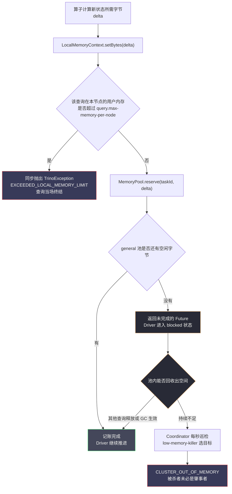
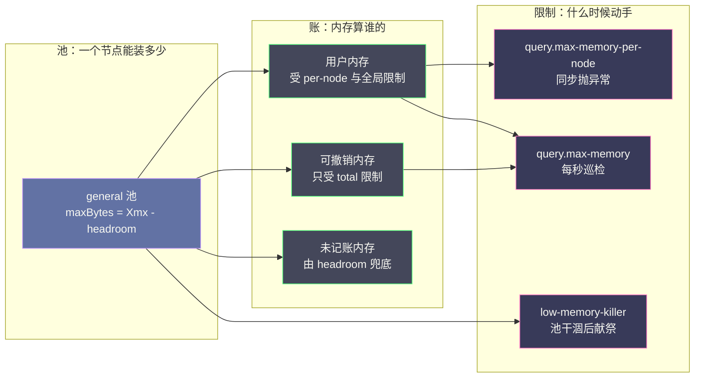
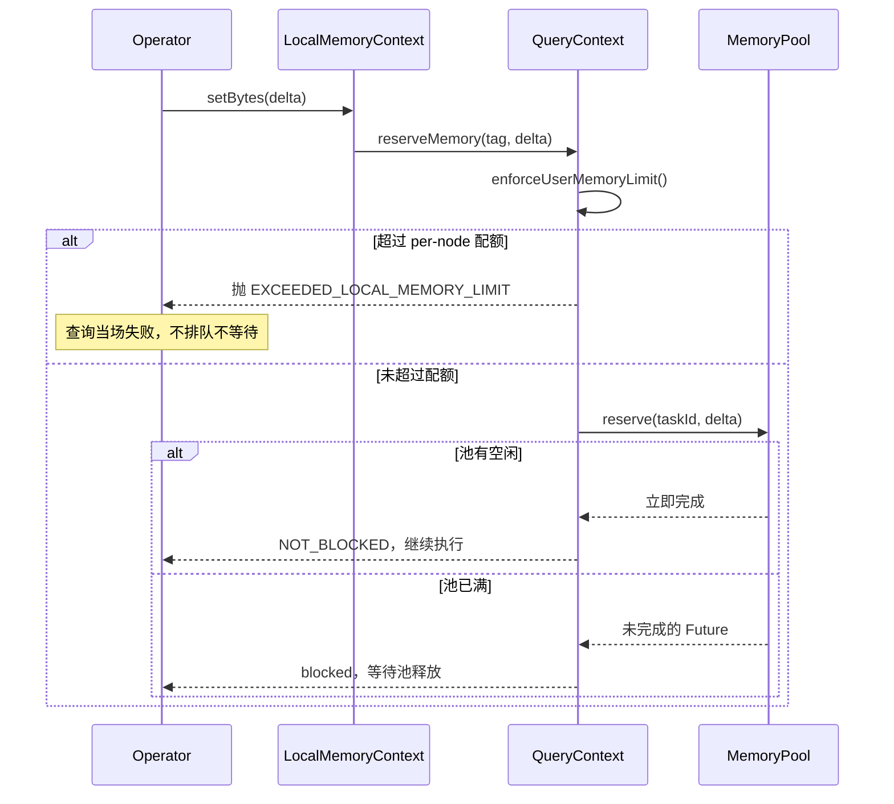
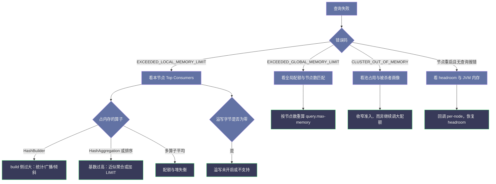
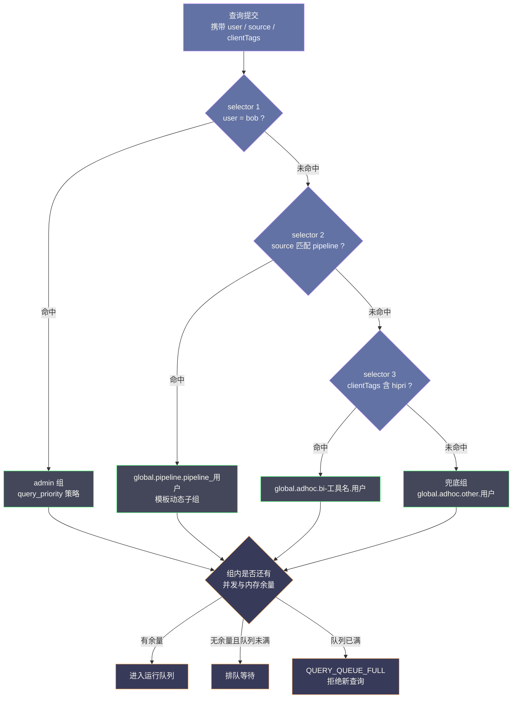
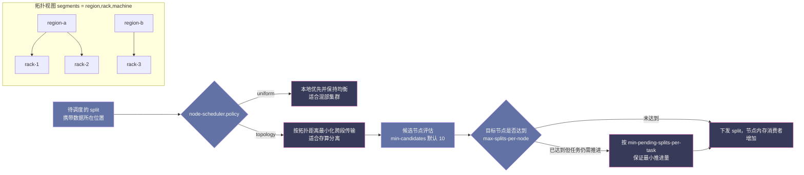

# 内存管理与资源调度

**摘要：**

Trino 的执行状态全部驻留内存，中间结果默认不落盘，因此资源管理不是"调优项"，而是决定集群能不能活下来的约束条件。生产事故里最常见的错误码 `EXCEEDED_LOCAL_MEMORY_LIMIT`，几乎从不单独出现，它背后是一套由内存池、两本内存账、分层配额、溢写机制、资源组准入和时间兜底共同构成的漏斗。本文先解剖一条真实的超限异常，说明为什么这个 kill 发生在内存申请路径上而且是同步的；再把"三层内存池"这个流传甚广但容易误读的说法拆成池、账、限制三个维度，逐一核对 Trino 4xx 的现状（reserved pool 早在 372 就被删除，`query.max-total-memory-per-node` 已标为废弃）；随后讨论 `EXCEEDED_LOCAL_MEMORY_LIMIT` 的五种成因、Spill 的可用前提与性能代价、资源组如何只做准入而不做终止、调度参数如何影响 task 落点，以及 `query.max-run-time` 一类时间限制为什么有时杀不死查询。读完本文，你应当能回答两个问题：一条查询是在哪一步、被谁、以什么依据杀掉的；以及把同样的配置放到你的集群规模上，它会不会成为下一个事故的伏笔。

---

## 第 1 章 一个错误码牵出的三层结构

### 1.1 异常文本里其实已经写好了答案

多数人第一次遇到这个错误，看到的是一行像天书的输出：

```
Query exceeded per-node memory limit of 19.20GB
[Allocated: 19.18GB, Delta: 51.20MB,
 Top Consumers: {HashBuilderOperator=17.40GB, HashAggregationOperator=1.62GB, ExchangeOperator=0.14GB}]
```

这行文本由 worker 侧的 `ExceededMemoryLimitException.exceededLocalUserMemoryLimit` 拼装，错误码是 `EXCEEDED_LOCAL_MEMORY_LIMIT`（131079，类别 `INSUFFICIENT_RESOURCES`）。它至少透露了四件事：配额是**单节点**口径而非集群口径；配额的具体数值是 19.20GB；触发时刻已经分配到 19.18GB，本次申请追加 51.20MB；以及最关键的——内存被谁吃掉了，按算子类型排了序。

如果集群里 worker 的堆是 64GB、`query.max-memory-per-node` 保持默认，那么 19.20GB 正好是堆的 30%，这不是巧合。数值对得上，说明配置确实生效了，查询确实只是"太贪"。但真正需要追问的是三个更基础的问题：为什么限制的单位是"节点"而不是"查询总量"；为什么是失败而不是等一等；为什么等待和溢写在这个场景里没有先发生。这三个问题的答案分别藏在配额的传导链、内存申请的调用链和溢写的前提条件里。

还有一个容易被忽略的细节：这条异常是 worker 抛的，不是 coordinator。也就是说，报错节点就是当场被撑爆的节点，其他节点可能还很空闲。凡是看到这个错误码，第一反应应当是"某台机器上的某个查询份额到顶了"，而不是"集群内存不够了"。

### 1.2 四个错误码各管一段

Trino 的资源类错误码并不都是同一件事，它们由不同的组件在不同的时机抛出，混为一谈会让排查方向完全跑偏。

| 错误码 | 编号 | 抛出位置 | 触发时机 | 消息大意 | 真正含义 |
|---|---|---|---|---|---|
| `EXCEEDED_LOCAL_MEMORY_LIMIT` | 131079 | worker 的 `QueryContext` | 内存申请路径上同步 | `Query exceeded per-node memory limit of ...` | 单条查询在某节点的用户内存超过 `query.max-memory-per-node` |
| `EXCEEDED_GLOBAL_MEMORY_LIMIT` | 131073 | coordinator 的 `ClusterMemoryManager` | 每秒巡检 | `Query exceeded distributed user/total memory limit of ...` | 单条查询的集群累计内存超过 `query.max-memory` 或 `query.max-total-memory` |
| `CLUSTER_OUT_OF_MEMORY` | 131076 | coordinator 的 low-memory-killer | 集群池干涸后 | `Query killed because the cluster is out of memory` | 池子已经空了，必须挑一条查询献祭；被杀的不一定是罪魁 |
| `EXCEEDED_SPILL_LIMIT` | 131078 | worker 的 `QueryContext` | 溢写预留时 | 超出本地溢写空间上限 | 落盘这一步也被限额卡住了 |
| `QUERY_QUEUE_FULL` | 131074 | coordinator 的资源组 | 入队时 | 队列已满 | 资源组拒绝新查询，与内存无关 |

这张表把失败的层次划分得很清楚：前三条都与内存有关，但责任方不同。`EXCEEDED_LOCAL_MEMORY_LIMIT` 是"你自己太大"，`EXCEEDED_GLOBAL_MEMORY_LIMIT` 是"你整体太大"，`CLUSTER_OUT_OF_MEMORY` 是"大家一起太大，得死一个"。第一种是自伤，第二种是自伤，第三种是他伤——排查时如果拿着第三种错误的日志去找"哪个查询写错了 SQL"，方向就错了，因为被杀的往往是当时占用内存最大的那条，而不是引发问题的那条。

> [!warning] 归因陷阱
> `CLUSTER_OUT_OF_MEMORY` 的受害者与责任人经常不是同一个查询。默认策略 `total-reservation-on-blocked-nodes` 选择的是"在已经内存不足的节点上占用最多的查询"，这是一种基于当前状态的处置，而不是历史过错的追溯。

### 1.3 簿记不是分配

理解 Trino 内存管理的第一道坎，是接受一个事实：Trino 并不能真的控制 Java 对象什么时候被分配、什么时候被回收。它能做的只是**在应用层记账**——算子每次扩大状态之前，通过 `LocalMemoryContext.setBytes()` 把预计新增的字节数报给上层，上层把这些数字累加、和配额比较、超了就抛异常。真实的字节分配仍然由 JVM 完成，真实的释放仍然由 GC 完成。

这种设计带来三个必须承认的偏差。其一，记账值不等于物理占用：HashMap 的桶数组、对象头、装箱对象、字符串副本，账本上往往只按粗略公式估算，误差方向大多数时候是低估。其二，释放不同步：算子调用 `setBytes(0)` 只是把账本减掉，物理内存要等 GC，所以账本上空出来的空间，不一定马上能被新分配用上。其三，记账有粒度：部分算子使用 `CoarseGrainLocalMemoryContext`，只有累计变化超过阈值才同步一次，于是账面数字会在短时间内滞后于真实分配。

正因为存在这些偏差，Trino 才需要 `memory.heap-headroom-per-node` 这块"不记账的保留地"，把 JVM 自身、Netty 缓冲、GC 结构、记账误差一起兜住。所谓"堆内存被切走 30%"，切的不是浪费，而是为上述偏差付的保险费。下面的图把一次内存申请的全部可能结局画在一起，后文的讨论都围绕它展开。



## 第 2 章 内存池的分层：池、账、限制是三件事

### 2.1 一个池：general 池的 maxBytes 从哪来

每个 worker 启动时会创建一个 `LocalMemoryManager`，它实际持有的内存池只有一个（`MemoryPool`），池的上限由一行减法决定：

```java
// LocalMemoryManager 构造逻辑（节选）
DataSize memoryPoolSize = DataSize.ofBytes(availableMemory - config.getHeapHeadroom().toBytes());
memoryPool = new MemoryPool(memoryPoolSize);
```

其中 `availableMemory` 取的是 `Runtime.getRuntime().maxMemory()`，也就是 `-Xmx` 指定的值，不是容器 limit、不是物理内存、更不是 `/proc/meminfo` 里的数字。这一点在容器化部署里经常被搞错：如果 Pod 的 memory limit 是 80GB 而 JVM 的 `-Xmx` 是 64GB，Trino 的账本只认 64GB，剩下的 16GB 既不在池里也不在 headroom 里，属于纯粹的浪费。

同一次构造里还有一道校验，专门防止配置互相打架：

```java
// 校验：headroom 与 per-node 配额之和不能超过堆
if (heapHeadroom < 0 || heapHeadroom + maxQueryTotalMemoryPerNode > availableMemory) {
    throw new IllegalArgumentException("Invalid memory configuration. ...");
}
```

注意这里用的是 `query.max-memory-per-node` 的值（变量名沿用了历史上的 `maxQueryTotalMemoryPerNode`），也就是说，Trino 要求 `query.max-memory-per-node` 与 `memory.heap-headroom-per-node` 之和**不超过 `-Xmx`**，否则 worker 直接起不来。这是一条硬约束，也是后文反例的基础：想通过把 per-node 抬到堆的 90% 来"给大查询开口子"，如果不相应压低 headroom，第一关就过不去；如果压低了 headroom 强行启动，第二关（JVM 与操作系统的 OOM）会以更难看的形态出现。

按默认值推算一下规模感（示例推算，非实测）：worker 堆 64GB 时，headroom 为 19.2GB，池上限为 44.8GB，单查询单节点配额为 19.2GB；堆 128GB 时，三个数字分别是 38.4GB、89.6GB、38.4GB。可以看出池上限恒为堆的 70%，单查询份额恒为堆的 30%，两者之间差出的 40% 堆空间，是留给"多条查询并存"的缓冲带——按 44.8GB 的池上限与 19.2GB 的单查询份额算，够两条各自跑到配额的查询并存，还余下约三分之一份额的空间。

### 2.2 两本账，加一本兜底账

池是容器，容器里的内存要分门别类记账。Trino 4xx 的每个 task 只有两本账（`MemoryTrackingContext` 里就是 `userAggregateMemoryContext` 与 `revocableAggregateMemoryContext`），加上一块不记账的兜底区域。

| 记账类别 | 典型占用者 | 是否计入 per-node 用户限制 | 是否计入全局限制 | 能否被撤销或落盘 |
|---|---|---|---|---|
| 用户内存（user） | HashBuilder 的 build 表、HashAggregation 的分组状态、排序缓冲、窗口分区缓冲 | 计入 | 计入 `query.max-memory` | 只有支持溢写的算子才会把这部分转为可撤销配额 |
| 可撤销内存（revocable） | 溢写算子的 build 表、聚合中间态、排序中间结果 | 不计入 | 计入 `query.max-total-memory` | 可以，由内存回收机制触发落盘 |
| 未记账内存（untracked） | JVM 自身结构、Netty 缓冲、page 序列化临时对象、记账误差 | 不计入 | 不计入 | 不可控，由 headroom 兜底 |

这张表最关键的一行是第二行：可撤销内存在申请路径上**根本不检查配额**。`QueryContext.updateRevocableMemory` 的实现里只有 `memoryPool.reserveRevocable`，没有任何 `enforce` 调用。这不是漏洞，而是设计意图——可撤销内存的语义是"我先借着用，你需要的时候我随时吐出来"，既然要随时能吐，就不该因为配额把它提前掐死。代价是它对池子的压力依然真实存在：池占满了，所有查询一起 blocked，这时候表现为集群整体变慢而不是某条查询报错。

第三行解释了为什么必须留 headroom。凡是不归任何一本账管的内存，一律由 headroom 兜住；headroom 不够，JVM 就会开始 Full GC 甚至被操作系统杀掉进程。譬如一条查询把 build 表撑到 17GB，账面记的是 17GB，但哈希表扩容过程中的临时数组、装箱后的 key 对象、序列化缓冲加起来往往还要多出几个 GB，这部分只能由 headroom 吸收。这里也能顺带纠正一个流传很广的说法：把内存分成"用户内存"和"系统内存（exchange buffer、page 处理）"两类，在 4xx 的实现里已经没有对应的记账载体了，`query.max-total-memory` 这个"total"覆盖的是用户内存加可撤销内存，而不是用户内存加系统内存。exchange 缓冲这类结构性开销在 4xx 里不再有独立的第三类记账，要么并入上述两本账之一，要么由 headroom 承担；把"系统内存"当成一个受 total 限制保护、可以按需扩大的独立配额，是没有依据的。

### 2.3 "三层内存池"的说法从哪来

中文资料里最常见的画法是把内存池分成 `user`、`reserved`、`general` 三层，并解释为"查询用、预留、系统用"。这张图承载的历史信息有一部分是对的，但三个名字被混在了同一个维度上。

`general` 和 `reserved` 是**池**的名字。Trino 早期确实有两个池：所有查询默认在 general 池里跑，当 general 池耗尽时，内存管理器会挑出当前最占内存的那条查询，把它连人带账迁移到 reserved 池继续执行，以免集群在高压下把所有查询都杀掉。这个设计意图听起来很合理——保住"最大的那条"，让它跑完，集群才能腾出空间。但实际效果与直觉相反：集群越紧张，被保住的越是那个把内存吃光的查询，而那些规规矩矩的小查询反而先死。加之迁移与配额逻辑复杂，这个池在 2022 年 3 月发布的 372 版本中被整体删除，配置项 `experimental.reserved-pool-disabled` 也随之作废；更早的 system 池则在 Presto 时代就消失了。今天的 Trino 里，每个 worker 只有一个池。

`user` 则是**账**的名字，与它并列的是 revocable，不是 reserved。

所以更准确的"三层"不是三种池，而是三个维度：池决定一个节点能同时装多少内存（容量问题），账决定内存归属哪条查询、算不算进哪条限制（归因问题），限制决定什么时候开始杀查询（策略问题）。搞混维度的后果很实际：有人以为调大 `query.max-memory-per-node` 就能让更多查询并发跑，实际上它只放宽了单条查询的份额，池上限一点没变，结果是从"查询被杀"变成"查询卡住"。



## 第 3 章 限制的传导：谁覆盖谁

### 3.1 有效参数与失效参数

Trino 4xx 里与查询内存直接相关的有效配置只有五个，另有几个常被写在旧文档里的名字已经废弃。

| 配置项 | 默认值 | 作用域 | 调大的代价 | 调小的代价 |
|---|---|---|---|---|
| `query.max-memory-per-node` | 堆的 30% | 单条查询在单节点 | 单查询可以吃更多内存，池更容易被一两条查询占满，并发查询集体 blocked | 大 join、大聚合更早失败，`EXCEEDED_LOCAL_MEMORY_LIMIT` 频率上升 |
| `memory.heap-headroom-per-node` | 堆的 30% | 单节点 | 池变小，同节点可容纳的内存总量下降 | GC 压力与 JVM/Netty 内存挤占，进程被杀风险上升 |
| `query.max-memory` | 20GB | 单条查询全集群（用户内存） | 单查询可以跨节点吃更多，集群整体压力上升 | 分布式大查询提前触发全局超限 |
| `query.max-total-memory` | `query.max-memory` × 2 | 单条查询全集群（含可撤销） | 溢写查询可以占用更多池与外存带宽 | 溢写查询提前失败，丢失 spill 带来的容错空间 |
| `query.max-cpu-time` | 约等于无限 | 单条查询全集群 CPU 时间 | 长跑查询不再被 CPU 时间截断 | 计算密集型查询被误杀 |

三个已经失效、但在旧文里仍被当作有效配置的名字值得单独点出来：`query.max-total-memory-per-node`（per-node 的 total 口径，在 4xx 已标记为废弃配置，写进 `config.properties` 会被当作非法配置拒绝启动）、`query.max-memory-per-task`（随容错执行的 task 级重试体系一并废弃）、以及 `query.low-memory-killer.delay`（低内存杀查询的延迟参数，早已移除）。第一次接手旧集群时，先在配置文件里搜这几个键，能省掉不少"为什么我配了没用"的困惑。

### 3.2 两层限制谁先咬到

单节点配额和集群总量配额是一对容易被混淆的约束。前者的分母是节点，后者的分母是集群，二者并不存在"后者一定等于前者乘以节点数"的关系——这个等式只在内存按节点完全均匀分布时成立，而倾斜恰恰是最常见的故障形态。

把默认值代入一个 10 节点、每节点 64GB 堆的集群，会出现一个反直觉的结论：单节点配额是 19.2GB，全局用户内存配额是 20GB，若查询在十个节点上均匀分布，每节点只用掉 2GB 就撞上了全局配额，此时**先触发的是全局限制**，报的是 `EXCEEDED_GLOBAL_MEMORY_LIMIT`；只有当内存集中在少数节点（倾斜、广播 join、单点聚合）时，才会先撞单节点配额。这解释了一类常见的困惑："我每个节点的内存都没到 30%，为什么查询还是被杀？"因为杀它的不是节点，是总量。

反过来说，如果想让单节点配额真正成为第一道闸门，`query.max-memory` 至少要按 `per-node 配额 × 节点数 × 0.8` 的量级设置（示例推算），10 节点场景下就是 150GB 以上。但把全局配额抬到这么高，池的压力会同步上升：一旦多条查询同时接近各自的 per-node 份额，节点上的 general 池会先耗尽，集群进入"人人 blocked"的状态，这比杀掉一条查询更难处理。

### 3.3 会话级覆盖与 overcommit

除了静态配置，查询还可以通过会话属性覆盖一部分限制，`query_max_memory`、`query_max_total_memory`、`query_max_run_time`、`query_max_execution_time` 都有对应的会话属性。会话属性的作用是单条查询级别的，不影响集群里其他查询；对内存类限制，coordinator 巡检时取的是配置值与会话值中的较小者（`min(maxQueryMemory, sessionLimit)`），也就是说会话属性只能把限制调**更严**，不能用来突破配置文件的上限，这一点常被误解为"客户端可以自己申请更高配额"。

真正能突破的是 `resource_overcommit` 会话属性，但它的语义与"提高上限"完全不同：开启后，该查询在单节点上不再受 `query.max-memory-per-node` 约束，`maxUserMemory` 会被直接设成池的上限；全局层面也不做总量检查，只有集群池真的干涸时才把它杀掉，而那时抛出的消息里会明确带上 `resource_overcommit=true`。换句话说，overcommit 换来的是"平时不管、出事必死"，它适合那些宁可失败也要赌一把的大查询，不适合当作容量规划的手段。

## 第 4 章 申请路径：为什么这个 kill 是立即的

### 4.1 调用链

内存申请不是由一个统一的内存管理器代发的，而是每个算子在需要扩容时主动上报，一层层向上传递，直到落在 `QueryContext` 上。



对应到代码，`QueryContext.updateUserMemory` 里只有两种反馈：

```java
// QueryContext.updateUserMemory（节选，注释为笔者所加）
if (delta >= 0) {
    // 先查配额：这里抛异常，调用栈直接断掉，没有重试、没有等待
    enforceUserMemoryLimit(memoryPool.getQueryMemoryReservation(queryId), delta, maxUserMemory);
    // 配额通过后才做池预约；池满时返回一个未完成的 Future
    ListenableFuture<Void> future = memoryPool.reserve(taskId, allocationTag, delta);
    return future.isDone() ? NOT_BLOCKED : future;
}
memoryPool.free(taskId, allocationTag, -delta);
```

这段代码同时解释了两件事。第一，配额检查在字节数增加的那一瞬间完成，同步、无延迟、无退避，所以"立即"不是一个形容词而是实现事实：不存在"先记着、稍后再说"的分支。第二，池满与配额超限走的是两条完全不同的分支，前者让 driver 挂起等待，后者让查询立刻结束。生产上把这两种表现区分开，能省掉大量误判——同样的"慢"，可能是 blocked 在等池，也可能是 spill 在等磁盘，判断依据完全不同。

### 4.2 秒级巡检与同步检查的分工

单节点配额是**同步**的，全局配额不是。coordinator 侧由一个固定延迟一秒钟的定时任务驱动：`QueryManager` 在启动时用 `scheduleWithFixedDelay(..., 1, 1, TimeUnit.SECONDS)` 注册了内存、CPU、扫描字节、写入字节、输出大小五类限制的检查，其中内存检查进入 `ClusterMemoryManager.process`，遍历所有处于 RUNNING 状态的查询，用当前的内存预留量和 `query.max-memory`、`query.max-total-memory` 比较，超了就 fail 掉。

这三条失败路径的差别值得列成一张表：

| 失败路径 | 检查者 | 时机 | 延迟量级 | 错误码 | 是否可挽回 |
|---|---|---|---|---|---|
| 单节点配额 | worker 的 `QueryContext` | 申请路径同步 | 微秒级 | `EXCEEDED_LOCAL_MEMORY_LIMIT` | 否，配额是硬的 |
| 全局配额 | coordinator 的巡检线程 | 每秒一次 | 最多约 1 秒 | `EXCEEDED_GLOBAL_MEMORY_LIMIT` | 否，但这一秒内允许小幅超额 |
| 池干涸 | coordinator 的 low-memory-killer | 巡检时发现池已空 | 取决于目标是否已消失 | `CLUSTER_OUT_OF_MEMORY` | 部分是，可挑最小的代价杀 |

"最多约 1 秒"这个延迟有一个容易忽略的副作用：全局限制实际上允许瞬时超额。一条查询在两次巡检之间可以继续申请内存，只要有节点还供得起，它的账面值可能短暂超过配置值。所以看到实际峰值比 `query.max-memory` 高几个百分点，不必怀疑配置没生效，这是巡检式检查的固有特性。

### 4.3 立即 kill 的工程含义

把这个机制放到集群尺度上，会得到一个有点悲观的结论：Trino 对"内存超限"的处理是**放弃该查询**，而不是**为它争取资源**。没有排队重试，没有降级执行，没有"等 GC 一下再试"。原因不复杂——一次内存申请发生在 driver 线程推进算子的过程中，此时算子状态可能已经改了半截，退回去重试的语义成本远高于直接失败重来；而分布式查询的失败重试由客户端或容错执行负责，引擎本身不承担这个责任。

由此可以推出两条实践规则。其一，凡是"可以慢但不能死"的查询，必须让它的内存在可撤销区间里，也就是依赖 spill，而不是依赖调大配额。其二，凡是"宁可死也要快"的查询，才适合 overcommit。两者的分界线不在配额大小，而在内存是否可被回收。

## 第 5 章 `EXCEEDED_LOCAL_MEMORY_LIMIT` 的五种成因

### 5.1 join 的 build 侧过大

hash join 把其中一侧建成哈希表放进内存，另一侧流式探测。Trino 的代价模型一般会选较小的表做 build 侧，但"较小"是统计意义上的，不是事实意义上的：统计信息过期、过滤条件不可下推、或者查询里带了 `OR` 导致估算失真，都可能让 build 侧选错。广播 join 更危险——它会把 build 侧复制到每个 worker，单个节点的内存占用与 build 表大小同阶。

判断这一成因的标志很直接：异常的 `Top Consumers` 里 `HashBuilderOperator` 占绝对多数，且报错节点往往不止一个（广播时是所有节点）。处置手段按代价从低到高排列：修正统计信息让 CBO 选对 build 侧；用 `join_distribution_type=PARTITIONED` 强制分区式 join，避免广播；在查询层改写，把小表先聚合到更小；最后才是调大配额。执行计划层面的判断依据与 `EXPLAIN` 的读法，见 [[05 查询优化——CBO、动态过滤与索引下推]]。

### 5.2 聚合与排序超过限制

聚合的内存与分组基数成正比，而不是与输入行数成正比，这一点最容易被低估。`count(distinct user_id)` 会在每个分组里维护一个去重集合，一亿个不同的 user_id 在一个分组里就是上 GB 的哈希结构；`ORDER BY` 不带 `LIMIT` 要全量排序，排序缓冲随数据量线性增长；窗口函数按分区缓存，超大分区等同于隐式排序。

这类查询的典型特征是"数据量不大但基数高"。判据是 `Top Consumers` 里 `HashAggregationOperator` 或排序算子占多数，同时 `EXPLAIN` 显示估计行数远小于实际分组数——统计信息缺失导致优化器完全没有预警。处置上，近似聚合（`approx_distinct`）是最有效的手段，它以可控的相对误差换取常数级内存；其次是改写为两阶段聚合，先按高基数键去重再聚合；再次是给排序加 `LIMIT` 并让它真正下推到 connector。

### 5.3 spill 未开启或不可用

这是最容易被"配置看起来对"掩盖的一种成因。`spill-enabled` 的默认值是 `false`，`spiller-spill-path` 没有默认值且必须在开启溢写时显式设置，两项缺一不可。很多人只开了前者，结果启动日志里没有溢写目录的报错，但查询照样溢出——因为可撤销内存根本没有产生，溢写算子退化成普通算子。

第二层不可用来自算子能力。即便溢写开启，也不是所有算子都支持：join 的内连接与外连接支持，但部分 join 类型不支持；聚合在带 `ORDER BY` 或 `DISTINCT` 的聚合函数上会直接忽略溢写开关，源码里的判断是"只要有一个聚合函数不可溢写，就走内存路径"；窗口函数在单个窗口极大时也无法溢写。第三层不可用来自部署模式：在容错执行（`retry-policy=TASK`）下，内存限制与 low-memory-killer 的行为都与普通模式不同，官方文档已经把传统 spill 标为遗留能力，推荐用容错执行配合 exchange manager 承接大查询。

判据是查询详情里溢写字节数为零，而内存峰值恰好等于配额。处置顺序是：先确认溢写路径与开关，再确认算子在支持列表内，最后确认当前部署模式是否让溢写失效。

### 5.4 数据倾斜

倾斜的特征是"局部超限、全局健康"。同一个 stage 的其他 task 可能只用了几个 GB，偏偏有一两个 task 因为某个 key 的基数或体量异常大而撞上配额。报错集中在少数 worker，`Top Consumers` 里单一算子的占比高得离谱，把查询的内存分布按 task 画出来会看到明显长尾。

倾斜的代价在 join 与聚合上被放大：分区式 join 按 hash 分桶，同一 key 必然进同一个桶；聚合按分组键分布，热门商品的订单量可能是长尾商品的上万倍。处置手段包括：确认分区键选择是否合理、对倾斜键做单独处理（拆分后再 union）、临时提高 per-node 配额让长尾跑完（治标）、以及在写入侧做预处理避免热点键。

### 5.5 per-node 配额与堆的关系失衡

这一种成因不来自查询，来自配置。前面已经论证过 `query.max-memory-per-node` 与 `memory.heap-headroom-per-node` 之和不能超过堆，所以"把 per-node 设成堆的 90%"这条路要么直接启动失败（headroom 仍为 30% 时），要么迫使你把 headroom 压到极低（譬如 5%）才能起来——而后者等于把 JVM 自身、Netty、记账误差全部暴露在无保护状态，典型表现是 worker 进程被操作系统的 OOM killer 杀掉、节点反复重启，而不是某条查询报错。

这两种故障的排查入口完全不同：查询报 `EXCEEDED_LOCAL_MEMORY_LIMIT` 时看查询；节点无故重启、`dmesg` 里有 OOM kill 时看配置。把二者混起来，就会出现"把 per-node 继续调大试图减少报错"的恶性循环——报错确实少了，因为进程先死了。

| 成因 | 错误码分布 | 节点分布 | `Top Consumers` 特征 | 溢写状态 | 首要处置 |
|---|---|---|---|---|---|
| build 侧过大 | LOCAL 为主 | 广播时全节点，分区时少数 | `HashBuilderOperator` 绝对多数 | 可能已溢写但桶过大 | 修正统计、改 join 分布方式 |
| 聚合/排序超限 | LOCAL 为主 | 与分组分布一致 | 聚合或排序算子占多数 | 带 DISTINCT/ORDER BY 时无效 | 近似聚合、两阶段、加 LIMIT |
| spill 不可用 | LOCAL 与 GLOBAL 混合 | 分散 | 单一算子阶跃式增长 | 溢写字节为零 | 查开关、查算子、查部署模式 |
| 数据倾斜 | LOCAL | 集中在少数 worker | 单算子占比畸高 | 溢写后仍单桶超限 | 拆键、改分区、预处理 |
| 配额失衡 | LOCAL 与进程重启并存 | 全集群 | 各算子平均分布 | 与被杀无关 | 回调 per-node 与 headroom |



## 第 6 章 Spill：机制、前提与代价

### 6.1 可撤销内存与回收

溢写的触发不发生在"内存已经不足"的时刻，而发生在池压力达到阈值时。池里可撤销内存的比例超过某个阈值，worker 侧的回收调度就开始要求算子把这些内存落盘，直到回收到目标比例为止；这套机制的调节参数是 `memory-revoking-threshold` 与 `memory-revoking-target`，官方 spill 文档在讨论加密开销时提到过前者，但这两个参数在属性参考页里长期没有条目，社区曾有 issue 专门指出文档缺口。实践中如果发现"开了溢写却几乎不触发"，把这两个阈值调低往往比继续加内存更有效——触发得越早，单次溢写的量越小，对查询延迟的冲击也越平缓。

回收的语义是**通知而非强制**：回收调度只发出请求，算子在下一次被调度时把可撤销内存的内容写成 spill 文件，转成用户内存或直接释放。因此溢写不是瞬时的，它需要一个可被打断的执行点。这也是为什么溢写只在支持它的算子上有效——不支持溢写的算子没有"把状态写到文件再读回来"的实现，收到回收请求也无从响应。

### 6.2 支持范围与一个关键耦合

官方文档明确列出了支持溢写的操作：join（内连接与外连接）、聚合、排序、窗口函数。其余 join 类型不在此列，窗口函数在单个窗口极大时也无法溢写，带 `ORDER BY` 或 `DISTINCT` 的聚合会忽略溢写开关。

join 的溢写机制与 `task.concurrency` 有一个强耦合，值得单独记住：build 表在 task 并发度大于 1 时会被分成 `task.concurrency` 个桶，接近内存上限时只会把其中一部分桶刷到磁盘。于是峰值内存的理论下界是"最大一个桶的大小"，在没有倾斜的前提下大约是 build 表总量的 `1 / task.concurrency`。把 `task.concurrency` 从 8 调到 16，等于把溢写后的内存下界减半，但代价是并发度上升、上下文切换与协调开销增加。这个参数在溢写场景里的地位，比在普通场景里重要得多。

### 6.3 配置与代价

| 配置项 | 默认值 | 说明 | 调大/调小的代价 |
|---|---|---|---|
| `spill-enabled` | `false` | 全局开关，也可按会话覆盖 | 开启后大查询可活，但整体 IO 压力上升 |
| `spiller-spill-path` | 无默认值 | 溢写目录，可逗号分隔多盘 | 多盘提升吞吐；写系统盘会拖死 JVM |
| `spiller-max-used-space-threshold` | `0.9` | 单盘使用率超过阈值后不再参与溢写 | 调低更安全，但可用盘变少 |
| `spiller-threads` | 溢写目录数 × 2，最少 4 | 溢写线程数 | 提高可压满多盘；过高引发 IO 争抢 |
| `max-spill-per-node` | 100GB | 单节点所有查询的溢写总量 | 调大有撑爆磁盘风险 |
| `query-max-spill-per-node` | 100GB | 单查询单节点溢写上限 | 调小会让大查询提前撞 `EXCEEDED_SPILL_LIMIT` |
| `aggregation-operator-unspill-memory-limit` | 4MB | 单个聚合算子回读时的内存上限 | 调大减少回读次数，代价是内存占用上升 |
| `spill-compression-codec` | `NONE` | 可选 `LZ4`、`ZSTD` | 换 IO 为 CPU，压缩率高但额外 CPU 开销 |
| `spill-encryption-enabled` | `false` | 每个 spill 文件独立密钥加密 | 增加 CPU 与延迟，换取落盘数据安全 |

溢写的代价不是一个可以精确给出的数字，只能给量级判断。官方文档的措辞是：被迫溢写的查询，执行时间可能比全内存执行长一个数量级。这个判断的合理性来自机制本身——spill 路径上每一次状态迁移都包含序列化、写盘、后续回读、反序列化、重新构建哈希结构，而重新构建往往比首次构建更贵，因为要按桶回放。在磁盘 IO 成为瓶颈时，溢写查询之间还会互相争抢，多个查询同时溢写会把吞吐压到单盘的极限。

磁盘容量也要算账（示例推算）：一个节点配两块 NVMe，默认单节点溢写上限 100GB，`spiller-max-used-space-threshold` 为 0.9，意味着两盘各留出 10% 余量后，理论上可用空间约等于盘容量的 1.8 倍。如果同时有三条查询各自接近单查询上限，总量就会触及节点上限，此时后来的查询会开始撞 `EXCEEDED_SPILL_LIMIT`，而不是内存错误——这个错误码在生产上常被误读成内存问题。

### 6.4 它不是万能的

把溢写当作"内存不足的解决方案"，是一种常见的期待错位。它解决的是"能不能跑完"，不是"跑得多快"，而且在三种情况下连"跑完"都保证不了：单个桶或单个窗口过大，落盘后回读时依然装不进内存；算子不支持溢写；溢写空间本身不足。官方文档对此说得很直白：开启溢写不保证所有内存密集查询都能执行，仍然可能出现把中间数据分块后每块都装不进内存的情况。

更值得注意的定位变化是：4xx 的官方文档已经把传统 spill 标为遗留能力（legacy），推荐用容错执行配合 exchange manager 承接大查询。这不意味着溢写在新集群里没有位置，而是说它的角色从"集群的常规保命机制"退回了"特定场景的兜底"，新部署在规划容量时不该把它当作默认的内存扩容器。

几个明确的禁忌：不要把溢写目录放到系统盘，尤其不要放到 JVM 日志所在盘，磁盘饱和会让 JVM 出现长时间停顿，查询会以更奇怪的方式失败；不要把多个溢写目录做成 RAID，Trino 把每个路径当作独立磁盘使用（JBOD 语义），RAID 会让并发写退化成单盘写；不要在开启溢写的同时把 `query.max-total-memory` 压得很低，可撤销内存腾挪的空间会被压缩到无法生效。

## 第 7 章 资源组：只做准入，不做终止

### 7.1 语义边界

资源组最容易误解的一点是它**不杀查询**。官方文档的表述是：除了排队数量这一项，资源组耗尽某项资源时不会让正在运行的查询失败，而是让新查询进入队列。资源组真正会造成"失败"的只有一种情形——队列本身满了（`maxQueued`），新查询被直接拒绝，错误码 `QUERY_QUEUE_FULL`。

这条边界决定了资源组在内存治理里的位置：它管的是"能不能进来"，不是"进来之后用多少"。想让某个租户的查询在内存上受限，靠的是给它的查询设置更小的 `query_max_memory` 会话属性，或者给它单独的集群；指望 `softMemoryLimit` 去限制一条已经跑起来的查询，必然会失望。

另一个约束是结构性的：一个组要么有子组，要么接受查询，不能两者兼有。

### 7.2 属性清单

| 属性 | 是否必填 | 语义 | 常见误用 |
|---|---|---|---|
| `name` | 是 | 组名，支持 `${USER}`、`${SOURCE}` 及自定义命名变量的模板 | 模板变量写错导致所有查询落进同一个组 |
| `maxQueued` | 是 | 最大排队数，超过则拒绝新查询 | 设得过大，用户以为"卡住"而不是"被拒" |
| `hardConcurrencyLimit` | 是 | 最大并发运行数 | 只算数量不算内存，多个大查询仍能压垮节点 |
| `softConcurrencyLimit` | 否 | 软并发阈值，运行数超过后仅在同级组都不满足、或同级组都已超过软限制时才继续启动 | 与 `hardConcurrencyLimit` 混淆 |
| `softMemoryLimit` | 否 | 该组分布式内存上限，可为绝对值或集群内存的百分比，超过后新查询排队 | 误以为会终止运行中的查询 |
| `softCpuLimit` / `hardCpuLimit` | 否 | CPU 时间配额，按 `cpuQuotaPeriod` 周期结算，超过后并发上限受罚 | 只配其中一个导致启动失败 |
| `hardPhysicalDataScanLimit` | 否 | 周期内可扫描的物理数据量，超过后新查询排队 | 与 `query.max-scan-physical-bytes` 作用域混淆 |
| `schedulingPolicy` | 否 | `fair`、`weighted_fair`、`weighted`、`query_priority` | 顶级组用 `query_priority` 造成饥饿 |
| `schedulingWeight` | 否 | 同级组之间的权重，默认 1 | 权重设置与真实业务量脱节 |
| `jmxExport` | 否 | 是否导出该组统计到 JMX | 未开启导致无法监控分组排队 |

这里要纠正一个流传较广的说法：资源组里没有"硬内存限制"这个东西。`hardMemoryLimit` 并不是当前版本的属性，内存侧只有 `softMemoryLimit` 一个口径，"hard"只出现在并发、CPU 时间和扫描量上。把内存也理解成硬限制，会得出"超过就拒绝进入该组"的错误结论。

### 7.3 selector 与匹配顺序

查询落到哪个组由 selector 决定，字段是正则或枚举匹配：

| 字段 | 匹配对象 | 备注 |
|---|---|---|
| `user` | 会话用户名 | 可被 `SET SESSION AUTHORIZATION` 改变 |
| `originalUser` | 改变前的原始用户名 | 防止借切换用户绕过路由 |
| `authenticatedUser` | 认证用户名 | 不会随会话切换变化 |
| `userGroup` | 用户所属组 | 与身份系统联动 |
| `source` | 客户端声明的来源串 | JDBC 的 `source` 属性或 CLI 的 `--source` |
| `queryText` | SQL 文本正则 | 能力强但脆弱，谨慎使用 |
| `queryType` | `SELECT`、`INSERT`、`DATA_DEFINITION` 等 | 按语句类型分流 |
| `clientTags` | 客户端标签列表 | 要求全部包含才算匹配 |
| `group` | 目标组名 | 必填 |

同一 selector 内的多个字段是逻辑与的关系，全部满足才命中；selector 之间按顺序匹配，第一个命中的生效。这里同样需要纠正旧文档里的错误写法：字段名不是 `userRegex`、`sourceRegex`，也不存在通过会话属性 `resource-group=critical` 指定资源组的通道，一些旧资料里的这类示例在真实 Trino 上并不会生效。真正可行的方式是客户端设置 source 或 client tags，由 selector 在服务端完成路由。

### 7.4 配置的加载与刷新

资源组配置由"管理器"承载，`resource-groups.configuration-manager` 取 `file` 或 `db`。

文件方式下，`resource-groups.config-file` 指向 JSON 文件，路径可以是绝对路径或相对于 Trino 数据目录的路径，且只需要存在于 coordinator。数据库方式下，配置从 MySQL、PostgreSQL 或 Oracle 的三张表读取（`resource_groups_global_properties`、`resource_groups`、`selectors`），表不存在时会在启动时自动创建；配置每秒重新加载一次，变更对到达的新查询立即生效，`selectors` 表按 `priority` 降序处理。数据库方式还有一个容错参数 `resource-groups.max-refresh-interval`（默认 1 小时），在刷新持续失败时，集群会在这段时间内继续用旧配置提供服务，超过之后才停止接受查询。

热加载的承诺只给了数据库方式，官方文档里没有任何关于 JSON 文件被监听的说明，文件管理器在启动时读入配置，改动后需要重启 coordinator。这一点在多租户环境里经常造成事故：运维改完 JSON 以为即时生效，实际旧规则还在跑，新租户的查询继续落在默认组里，直到某次重启才突然改变行为，反而更像一次故障。

### 7.5 反例

只限并发不限内存是最典型的一种。`hardConcurrencyLimit` 设成 20，看起来"最多二十条查询"，但如果每条都能申请到几 GB，二十条同时开跑足以把池抽干，表现为全集群 blocked 甚至 `CLUSTER_OUT_OF_MEMORY`。并发数与内存配额必须成对设置，只设前者等于只设了一半的闸门。

第二种是百分比之和越界。子组的 `softMemoryLimit` 之和超过 100% 并不违反配置校验，但它意味着所有组同时满载时一定会有组拿不到自己声明的份额，"软限制"变成了一张空头支票。合理的做法是留出至少 20% 的余量给突发与系统开销。

第三种是模板组 + 优先级的组合陷阱。`${USER}` 能为每个用户生成独立子组，隔离性很好，但用户数量多时会生成大量动态组，每组的 `softMemoryLimit` 百分比是相对集群总量计算的，用户越多，单个组的份额被切得越碎，实际可用内存反而更少。`query_priority` 策略在顶级组上使用则会造成饥饿——只要高优先级查询源源不断，低优先级的查询永远轮不到。



## 第 8 章 调度层：并发、CPU 与 task 落点

### 8.1 两处并发上限

Trino 有两处并发控制，作用域不同，名字也常被写错。coordinator 侧是 `query.max-concurrent-queries`（默认 1000）与 `query.max-queued-queries`（默认 5000），前者限制同时运行的查询数，后者限制排队数；进入排队还是直接拒绝由这两者共同决定。资源组侧是每个组的 `hardConcurrencyLimit` 与 `maxQueued`，是租户粒度。旧文档里常见的 `query.max-concurrency` 并不是有效的配置名，写上去不会报错但也不会生效，属于隐性失效。

这两处的关系是"先全局后分组"：查询先受 coordinator 的总量约束，再受目标资源组的约束。调整时应当先定资源组的分配，再让全局上限略大于各组之和，否则全局上限会变成事实上的瓶颈，资源组配置形同虚设。

### 8.2 `task.concurrency` 与溢写分桶

`task.concurrency` 控制本地并行算子的默认并发度，必须是 2 的幂，默认值是节点物理核数（下限 2、上限 32），容错执行模式下默认 8。它对内存的影响是双面的：并发度高，单个算子的状态被切成更多份，单份更小，溢写的内存下界更低；但并发度高同时意味着同一时刻活跃的 driver 更多，池的瞬时压力更大，`task.min-drivers` 与 `task.max-worker-threads` 的乘数效应也会放大内存占用。

| 参数 | 默认值 | 作用 | 调大的代价 | 调小的代价 |
|---|---|---|---|---|
| `task.concurrency` | 物理核数（2 至 32） | 本地并行度，join/聚合分桶数 | 瞬时内存压力大，上下文切换开销上升 | 溢写后单桶更大，大查询更易超限 |
| `task.max-worker-threads` | 节点 CPU × 2 | 处理 split 的线程数 | 堆占用上升，可能因切换反而变慢 | CPU 利用不足，查询变慢 |
| `task.min-drivers` | `task.max-worker-threads × 2` | 节点上运行中的 leaf split 目标数 | 资源利用率高但内存占用上升 | 新任务响应快但吞吐下降 |
| `task.max-drivers-per-task` | 无限制 | 单 task 的 driver 上限 | 无 | 限制后可改善并发查询体验 |

这几个参数在"多查询并发"与"单大查询"两种负载下的最优值几乎是相反的，这也是集群调优里最难两全的地方：白天 BI 并发高，应当压低并发度；夜间跑批时单查询资源利用率更重要，应当提高。真正可行的做法是按时间与资源组分别设置会话属性，而不是找一组万能配置。

### 8.3 node-scheduler 与网络拓扑

任务落点由 split 调度器决定。`node-scheduler.policy` 有两个取值：`uniform` 试图把 split 调度到数据所在的节点，同时保持全局均衡，适合存储与计算混部的集群；`topology` 则按**拓扑距离**调度，适合存储与计算分离的集群，能显著减少跨机架、跨可用区的数据搬运。

拓扑信息有三种来源：`flat`（默认，只有一个层级，相当于不区分机架）、`file`（从文本文件读主机名到网络位置的映射，每 5 分钟重载一次）、`subnet`（按 IP 网段前缀推导层级）。层级由 `node-scheduler.network-topology.segments` 定义，默认是 `machine`，可以改成 `region,rack,machine` 这样的多级描述。

| 参数 | 默认值 | 语义 |
|---|---|---|
| `node-scheduler.max-splits-per-node` | 256 | 单 worker 上可同时运行的 split 目标数，按标准权重计 |
| `node-scheduler.min-pending-splits-per-task` | 16 | 单 task 在节点上的最小排队 split 数，防饥饿与死锁 |
| `node-scheduler.max-adjusted-pending-splits-per-task` | 2000 | 动态调整后的排队上限 |
| `node-scheduler.max-unacknowledged-splits-per-task` | 2000 | 已发送但未确认的 split 上限，防止大请求压垮 task 更新 |
| `node-scheduler.min-candidates` | 10 | 选择落点时评估的候选节点数下限 |
| `node-scheduler.include-coordinator` | `true` | 是否允许 coordinator 承担计算 |

`max-splits-per-node` 与内存的关系容易被忽略：它直接决定了单个 worker 上同时活跃的 split 数量，而每个活跃 split 都对应一组算子实例与缓冲。把这个值调大能提升短查询的吞吐，但如果 split 很重（大文件扫描 + 大聚合），它会同时抬高该节点的内存峰值。调参时应当把它与 `task.concurrency`、`task.min-drivers` 一起考虑，因为它们共同决定了"一个节点上同时活着多少个内存消费者"。



## 第 9 章 时间维度的兜底：为什么有些查询杀不掉

### 9.1 五个时间口径

内存管不住的时候，最后一道防线是时间。Trino 提供了多个语义各不相同的时间限制，混淆它们的代价是"该杀的没杀、不该杀的杀了"。

| 配置项 | 默认值 | 计时起点 | 是否包含排队 | 会话属性 | 适用场景 |
|---|---|---|---|---|---|
| `query.max-run-time` | 100 天 | 查询创建 | 包含 | `query_max_run_time` | 兜底"这条查询不该存在这么久" |
| `query.max-execution-time` | 100 天 | 开始执行 | 不包含 | `query_max_execution_time` | 兜底"跑得太久"，不受排队干扰 |
| `query.max-planning-time` | 10 分钟 | 开始规划 | 不包含 | `query_max_planning_time` | 兜底优化器失控 |
| `query.client.timeout` | 5 分钟 | 客户端最后一次联系 | 不包含 | 无（服务端配置） | 客户端已放弃则停止为其工作 |
| `query.max-cpu-time` | 近似无限 | 查询创建 | 不包含 | `query_max_cpu_time` | 兜底"计算量爆炸" |

默认值几乎等于不设限（一百天、十亿天），这说明 Trino 的设计立场是：超时是运维自己该定的策略，引擎不替用户做主。真正有效的超时往往来自会话属性由客户端显式设置，或者在资源组层面用 CPU 时间配额间接实现。

### 9.2 五条"杀不掉"的原因

第一条是阶段不可中断。规划阶段的某些操作无法被及时取消，文档对此的表述是"部分操作不容易取消，可能不会立即终止"。元数据操作、连接器初始化、权限检查都属于这一类，`query.max-planning-time` 到期后 coordinator 会尽力停止，但尽力与一定之间是有距离的。

第二条是阻塞在连接器里。查询的线程可能卡在等待 Hive metastore 响应、等待对象存储建立连接、等待 JDBC 源的 `socket read`，这些调用不响应中断标记。查询状态会被标记为失败，但阻塞的线程仍然挂着，占用的内存与连接不会立刻归还。判断依据是查询已进入失败状态但 worker 上的线程数、内存迟迟不降，`jstack` 能看到卡在 socket 读。

第三条是卡住的 split 检测覆盖面有限。Trino 有一个专门的机制处理"线程卡住"的 split，相关参数是 `task.interrupt-stuck-split-tasks-enabled`（默认开启）、`task.interrupt-stuck-split-tasks-timeout`（默认 10 分钟）与检测间隔（默认 2 分钟），但它只针对被第三方正则库 Joni 阻塞的线程，不是通用的线程看门狗。

第四条是用错了参数。排队时间计入 `query.max-run-time`，但不计入 `query.max-execution-time`。用执行时间做 SLA 兜底的集群，会遇到一条查询在队列里排了两个小时却"未超时"的情况；而用运行时间兜底，则可能把在高峰期排队的正常查询误杀。

第五条是结果集未被消费。查询完成计算但客户端不读取结果时，查询保持运行状态，输出缓冲占用内存；内存限制对这部分通常没有感知，而时间限制是否生效取决于有没有显式配置，默认的超时几乎是无限，于是查询会一直挂在那里。保护手段是 `query.max-output-data-size`，它限制单条查询的输出数据量，超过即终止。

还有一个操作层面的坑：需要手动杀掉一条排队的查询时，`system.runtime.kill_query` 本身也是一条查询，它会被资源组规则路由。如果 kill 语句落进同一个拥挤的组，它会跟着一起排队，等它执行时目标查询早就跑完了。官方文档对此给的建议是把 `DATA_DEFINITION` 类型的查询单独路由到一个专用组，让管理类操作绕过业务队列。

## 第 10 章 落地：堆分段、监控与排查

### 10.1 堆内存的分段建议

把前面几章的约束汇总成一张可执行的分配表（示例推算，具体比例需按查询画像调整）：

| 堆大小 | headroom（30%） | 池上限（70%） | per-node 配额（30%） | 池余量（40%） | 说明 |
|---|---|---|---|---|---|
| 64GB | 19.2GB | 44.8GB | 19.2GB | 25.6GB | 单节点约可容纳两条接近配额的查询 |
| 128GB | 38.4GB | 89.6GB | 38.4GB | 51.2GB | 适合中等并发，注意全局配额同步上调 |
| 256GB | 76.8GB | 179.2GB | 76.8GB | 102.4GB | 大节点，headroom 绝对值已足以覆盖 GC 峰值 |

这张表想说明的是 headroom 与 per-node 之间那段"池余量"的作用：它不是闲置，而是用来吸收多查询并发的波动。把 per-node 一路抬到接近池上限（例如把 per-node 设为堆的 60%），池余量只剩 10%，第二条查询一开始就会撞池，表现为大面积 blocked。

JVM 层面的两个配套约束也值得写进部署清单。其一，`-Xmx` 必须与容器 limit 拉开差距，Trino 的账本只认 `-Xmx`，容器 limit 之外的部分对 Trino 不可见，堆外内存（Netty direct buffer、压缩库的 native 内存）会落在容器 limit 与 `-Xmx` 的差里。其二，GC 选择影响簿记的可靠性：面对大堆，低延迟收集器能把"账本已释放、物理未回收"的窗口压得更短，从而减少池满导致的 blocked；但收集器不能替代 headroom。

### 10.2 监控指标

下面这些指标名来自官方 JMX 文档，可以直接配到监控系统里：

| 指标 | 含义 | 建议阈值（量级判断） |
|---|---|---|
| `trino.memory:type=ClusterMemoryPool:name=general:FreeDistributedBytes` | 集群 general 池剩余总量 | 持续低于池总量的 20% 时预警 |
| `trino.memory:name=ClusterMemoryManager:QueriesKilledDueToOutOfMemory` | 因集群内存不足被杀查询累计数 | 出现增长即需复盘，按每小时计数告警 |
| `trino.execution:name=QueryManager:RunningQueries` | 运行中查询数 | 与资源组并发上限对照 |
| `trino.execution:name=QueryManager:WaitingForResourcesQueries` | 等待资源的查询数 | 持续大于零说明准入过紧或容量不足 |
| `trino.execution:name=QueryManager:WaitingForResourcesMaxAgeInSeconds` | 最长等待时长 | 结合 SLA 设定，例如超过 5 分钟告警 |
| `java.lang:type=Memory:HeapMemoryUsage.used` | 堆使用量 | 长期贴近 `-Xmx` 说明 headroom 不足 |
| `trino.failuredetector:name=HeartbeatFailureDetector:ActiveCount` | 活跃节点数 | 突降通常意味着节点被 OOM killer 杀掉 |

这组指标要配套使用：池剩余下降而 `QueriesKilledDueToOutOfMemory` 不涨，说明集群在"卡"而不是在"杀"；`WaitingForResourcesQueries` 长期大于零而池还有余量，说明瓶颈在资源组配额而不是内存；活跃节点数突降而查询错误以 `CLUSTER_OUT_OF_MEMORY` 为主，说明问题已经下沉到容器或操作系统层面。

### 10.3 排查五步

第一步看错误码，确定责任层：`EXCEEDED_LOCAL_MEMORY_LIMIT` 在 worker，`EXCEEDED_GLOBAL_MEMORY_LIMIT` 与 `CLUSTER_OUT_OF_MEMORY` 在 coordinator，节点重启则是配置或运行时问题。

第二步看异常里的 `Top Consumers`，确定责任算子：`HashBuilderOperator` 指向 join 的 build 侧，聚合或排序算子指向基数，多算子平均分布则回头查配置。

第三步看节点维度分布，区分倾斜与普遍超限：报错集中在少数 worker 是倾斜或落点问题，全节点同时报错是配额设置问题。

第四步看溢写状态：查询详情里的溢写字节为零，说明溢写没有生效，回到开关、算子支持、部署模式三项逐一确认。

第五步才是调参，而且优先调准入与分布，而不是配额：先确认资源组的并发与内存配比合理，再确认 join 分布与统计信息正确，最后才考虑抬高 `query.max-memory-per-node` 或增加节点。

### 10.4 三个反例

**配额越界**：把 per-node 设成堆的 90%。 若 headroom 保持 30%，worker 启动直接失败，因为两者之和超过 `-Xmx`；若把 headroom 压到 5% 强行启动，进程会在高峰时段被操作系统杀掉，故障从"查询失败"升级为"节点反复重启"。

**溢写缺位**：不开溢写却跑大 join。 build 表全部落在不可撤销的用户内存里，一旦撞上 per-node 配额就是同步抛异常，没有任何等待与回退的余地。这类事故的复盘结论常常写成"集群内存不足"，实际根因是"溢写没开，且没人确认过 build 侧有多大"。

**准入残缺**：资源组只限并发不限内存。 并发数达标只是数量的闸门，二十条各吃几 GB 的查询同时运行，池照样被抽干。资源组的价值在于把"数量"和"内存"两个维度一起约束住，只配一半等于没有配。

| 反例 | 表面现象 | 真实机制 | 修正方向 |
|---|---|---|---|
| per-node 90% + headroom 30% | worker 启动报内存配置非法 | 启动校验直接拒绝 | per-node 与 headroom 之和留出余量 |
| per-node 90% + headroom 5% | 节点周期性重启，查询大面积失败 | 堆外与未记账内存无保护，被 OS 杀掉 | 恢复 headroom 至 20% 至 30% |
| 不开溢写跑大 join | 必现 `EXCEEDED_LOCAL_MEMORY_LIMIT` | build 表不可撤销，同步抛异常 | 开溢写并设置多盘路径 |
| 资源组只限并发 | 集群缓慢、大面积 blocked | 池被并发查询占满 | 并发与 `softMemoryLimit` 成对配置 |

## 第 11 章 小结

Trino 的内存管理可以归纳成一句不太讨喜的话：它不管理内存，它管理的是"关于内存的承诺"。池划定了承诺的总额度，两本账划定了承诺的归属，分层限制划定了承诺被撤销的条件，溢写则提供了把承诺兑现成磁盘的退路。理解了这一点，`EXCEEDED_LOCAL_MEMORY_LIMIT` 就不再是一个随机的错误，而是"某个算子在某个节点上把承诺用完了"的必然结果。

两类失败必须分开理解：单节点配额在申请路径上同步检查，超过即死，没有等待；全局配额由 coordinator 每秒巡检，池干涸后再由 low-memory-killer 挑选牺牲者。前者指向查询本身的设计问题——build 侧过大、基数过高、溢写不可用；后者指向容量与准入的规划问题——配额与节点数不匹配、资源组只限并发不限内存、多条大查询同时放行。

资源组与调度参数的位置也要摆正：资源组在 coordinator 上做准入，管的是"谁能进来"；调度参数决定 task 落在哪、并发多高，管的是"进来之后怎么摊"。把两者混为一谈，常见的结果是用调大配额的办法去解决准入问题，最终把集群推向"节点反复重启"这种更难收拾的状态。

最后是权衡。把 headroom 压低、把 per-node 抬高，能换来更高的单机利用率与更少的大查询失败，代价是节点级故障的概率上升；把溢写全量开启、把资源组配额收得很紧，能换来集群的稳定与可预期，代价是大查询变慢、排队变长。没有哪一组参数是普适的，只有与自己的查询画像、节点规模、SLA 相匹配的那一组。至于执行计划层面的内存影响——join 顺序、广播选择、动态过滤带来的扫描削减——那是另一个维度的问题，见 [[05 查询优化——CBO、动态过滤与索引下推]]；而 Pipeline 的 blocked 原因、task 的重调度细节，见 [[02 查询执行引擎——Stage、Task 与 Pipeline]]。

---

## 参考资料

1. Trino Documentation, Resource management properties（`query.max-memory-per-node`、`query.max-memory`、`query.max-total-memory`、`memory.heap-headroom-per-node` 的默认值与校验说明）：https://trino.io/docs/current/admin/properties-resource-management.html
2. Trino Documentation, Spill to disk（溢写支持范围、磁盘与压缩配置、遗留能力提示）：https://trino.io/docs/current/admin/spill.html
3. Trino Documentation, Spilling properties（`spiller-spill-path`、`max-spill-per-node`、`query-max-spill-per-node` 等默认值）：https://trino.io/docs/current/admin/properties-spilling.html
4. Trino Documentation, Resource groups（属性语义、selector 字段、文件与数据库管理器、刷新周期）：https://trino.io/docs/current/admin/resource-groups.html
5. Trino Documentation, Query management properties（`query.max-run-time`、`query.max-execution-time`、`query.max-planning-time`、`query.low-memory-killer.policy`）：https://trino.io/docs/current/admin/properties-query-management.html
6. Trino Documentation, Task properties（`task.concurrency`、`task.max-worker-threads`、`task.min-drivers` 等默认值）：https://trino.io/docs/current/admin/properties-task.html
7. Trino Documentation, Node scheduler properties（`uniform` 与 `topology` 策略、网络拓扑配置）：https://trino.io/docs/current/admin/properties-node-scheduler.html
8. Trino Documentation, Monitoring with JMX（`ClusterMemoryPool`、`QueriesKilledDueToOutOfMemory`、`WaitingForResourcesQueries` 等指标名）：https://trino.io/docs/current/admin/jmx.html
9. Trino Release 372（2022 年 3 月）：移除 reserved memory pool，`experimental.reserved-pool-disabled` 失效：https://trino.io/docs/current/release/release-372.html
10. Trino 源码：`MemoryManagerConfig`、`NodeMemoryConfig`、`LocalMemoryManager`、`MemoryPool`、`QueryContext`、`ClusterMemoryManager`、`QueryManager`（配额、巡检周期与异常消息的原始依据）：https://github.com/trinodb/trino/tree/master/core/trino-main/src/main/java/io/trino/memory
11. Trino issue #16524, Spill is not easily triggered when enabling spill（说明 `memory-revoking-threshold` 与 `memory-revoking-target` 对溢写触发的影响及文档缺口）：https://github.com/trinodb/trino/issues/16524

---

> [!note] 思考题
> 1. 在 10 节点、每节点 64GB 堆的集群里，若 `query.max-memory` 保持默认 20GB，一条均匀分布的查询会先撞到全局限制还是单节点限制？把这个结论推广，什么样的节点规模下默认值才是自洽的？
> 2. 为什么可撤销内存在申请路径上不检查配额？如果加上配额检查，溢写机制会遇到什么逻辑矛盾？
> 3. 你的集群里 `EXCEEDED_LOCAL_MEMORY_LIMIT` 集中在三台节点上，同一 stage 其他 task 内存正常，最可能的原因是什么？你会先用哪个数据去证实它？
> 4. 资源组不杀正在运行的查询，那么当某个租户的查询已经把池抽干时，最终执行终止的是谁？这个设计把复杂度推给了哪个层面？
> 5. `query.max-execution-time` 与 `query.max-run-time` 的差别只在排队时间是否计入，为什么这个差别会让同一套 SLA 策略在高峰期失效？
