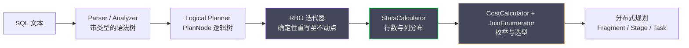
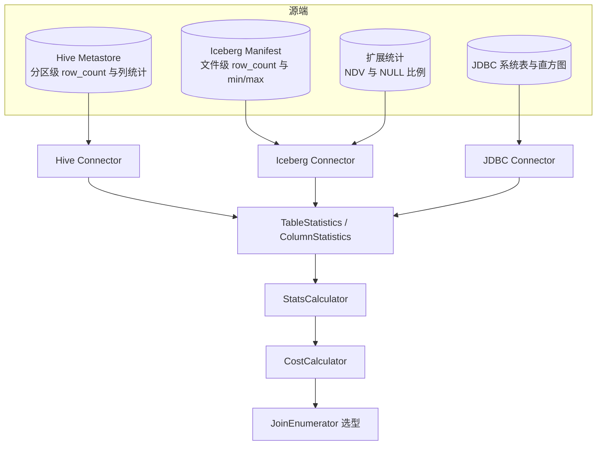
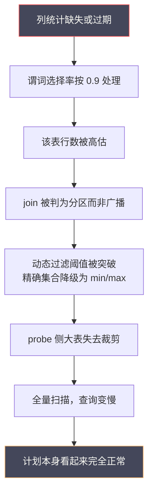
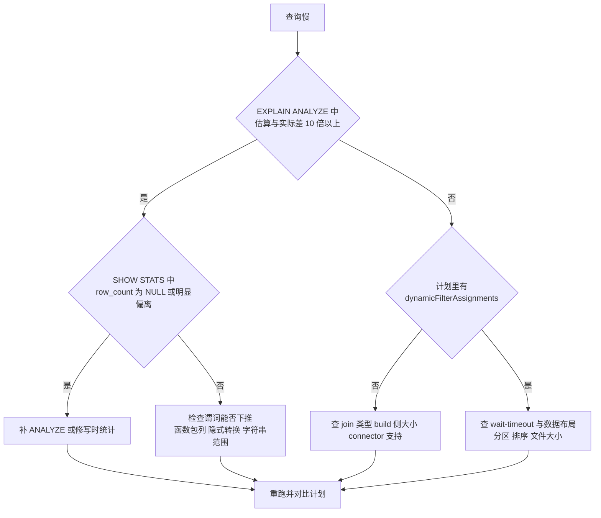
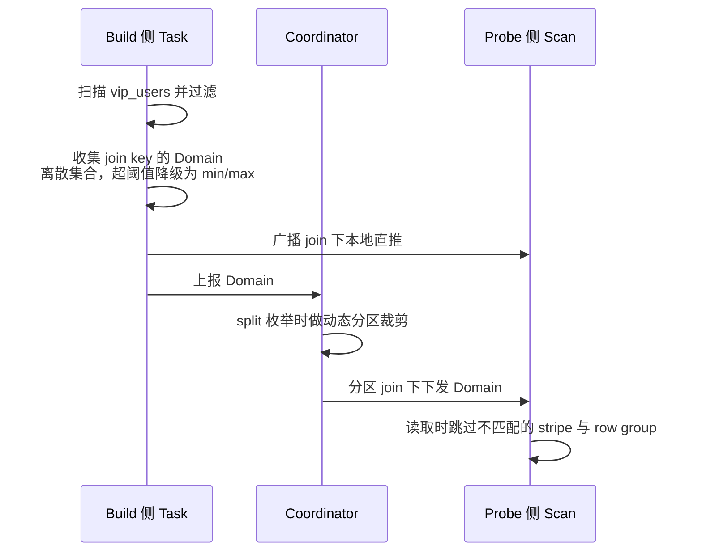
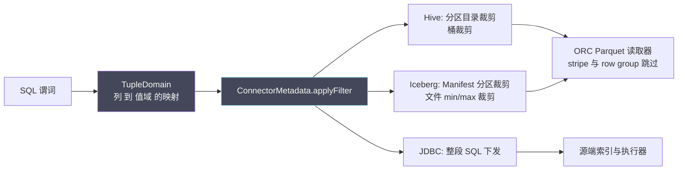

# 查询优化——CBO、动态过滤与索引下推

**摘要：**

1979 年 System R 的论文把"选哪条执行路径"变成一道代价题，1995 年 Graefe 的 Cascades 框架把这道题的解法固化成可复用的搜索器，Trino 的规划器就是这条脉络上的当代实现。本文不讨论 SQL 怎么写更快，而是把镜头对准优化器自己：它究竟拿什么信息做判断，这些信息从 Connector 的哪个角落来，缺失、过时或称"大概"时，它会以怎样的方式选错 join 顺序、join 分布与聚合阶段，以及这些错误如何表现为内存打爆、Shuffle 放大和扫描量下不去。沿这条线索，动态过滤（Dynamic Filtering）的收集与等待策略、`ANALYZE` 的代价账、Hive 分区裁剪与 Iceberg 文件裁剪同 JDBC 谓词下推的差异、`EXPLAIN` 与 `EXPLAIN ANALYZE` 的分工，都会落到可观测的判据上；文末再收束成一组反模式——不做 `ANALYZE` 就调 join 顺序、把等待时间调大、依赖 `SELECT *`，它们的共同特征是在下游动手、在上游出错。读完之后，应当能回答两个问题：一条慢查询该先动统计还是先动参数；以及为什么"把等待时间调大一点"往往是最坏的直觉。

---

## 第 1 章 优化器是台机器，它的输入叫数据画像

一条 SQL 从文本到执行，中间隔着一次完整的翻译，翻译质量取决于译员手上的词典。Trino 的"词典"由两部分组成：一部分是死的，即代数等价变换的规则；另一部分是活的，即数据本身的统计画像。前者保证语义不错，后者决定跑得快不快。多数调优失误的根子，是把后者当成了常量。

### 1.1 从 SQL 文本到可执行的分片

Trino 的规划流程可以拆成五段，每段的输出形态都不一样。Parser 与 Analyzer 先把文本变成带类型信息的语法树，中途完成名字解析、隐式类型转换的插入、权限与视图展开。Logical Planner 把语法树翻译成由 `PlanNode` 构成的逻辑树，此处的树只表达"算什么"，不表达"在哪算"。接着进入规则优化阶段，`IterativeOptimizer` 反复套用一批确定性规则，直到计划不再变化为止。再往后才是代价阶段：`StatsCalculator` 给每个节点算行数与列分布，`CostCalculator` 把行数折算成 cpu、memory、network 三个无量纲数字，join 枚举器在这套数字上挑一个它认为最便宜的形状。最后是分布式规划，把逻辑树切成 Fragment，进一步落成 Stage 与 Task，这才是真正会在 Worker 上跑的东西。

这个顺序有讲究。规则在前，是因为代数变换的正确性不依赖数据；代价在后，是因为只有形状稳定了，估算才有意义。反过来说，如果在规则还没跑完时就去估算，所有数字都会被后续的重写推翻。把这条流水线画出来，三处着色的环节恰好对应本文的三条主线。



图里被着色的是三段与本文直接相关的环节：规则优化决定"哪些谓词能下推"，统计计算决定"每个节点有多大"，枚举与选型决定"怎么摆这些节点"。三者串联，任何一环给出错误前提，后面的结论都会"正确地错下去"。

### 1.2 规则优化器能做什么，不能做什么

RBO（Rule-Based Optimizer，基于规则的优化器）这个名字容易让人低估它。Trino 的规则集有几十条，覆盖的能力相当硬：谓词下推把过滤条件压到叶子节点，列裁剪砍掉不被引用的列，常量折叠在规划期算完 `1 + 1` 与 `DATE '2024-01-15'`，子查询展开把 `IN (SELECT ...)` 改写成 semi-join，`LIMIT` 尽量往数据源方向推。这些变换与数据量无关，只与语义等价性有关，所以执行起来又快又稳。

但 RBO 有一个结构性盲区：凡是"需要知道数据有多少才能决定"的问题，它都答不了。join 顺序就是最典型的例子。给定三张表 A、B、C，`A ⋈ B ⋈ C` 与 `A ⋈ C ⋈ B` 在代数上完全等价，规则无法判断哪一个中间结果更小，因为"更小"是个数量问题，不是结构问题。同理，join 该广播还是该重分区、聚合该不该拆成两阶段、`DISTINCT` 该走哪条实现路径，都依赖行数。

于是 Trino 把这类决策整体切给 CBO（Cost-Based Optimizer，基于代价的优化器）。切分的边界很清晰：RBO 负责"形状合法"，CBO 负责"形状便宜"。这不只是工程分工，也是一种风险隔离——统计信息出错时，受影响的只有 CBO 那部分决策，语义正确性由 RBO 兜着。

| 维度 | RBO | CBO |
|---|---|---|
| 判断依据 | 代数等价性与模式匹配 | Connector 提供的表与列统计 |
| 输出确定性 | 相同 SQL 必得相同计划 | 统计一变，计划就变 |
| 覆盖决策 | 谓词下推、列裁剪、常量折叠、子查询展开、Limit 下推 | join 顺序、join 分布、聚合阶段、部分算子选择 |
| 失效方式 | 规则未覆盖的模式（如函数包列导致无法下推） | 统计缺失或失真，输出一个自信的错误计划 |
| 可观测性 | 看计划形状即可判断 | 必须对比估算值与实际值才能判断 |

表里最后一行是本文反复要用的抓手。规则优化的失效是"看得见"的：谓词卡在 `Filter` 节点上没进 `TableScan`，一眼就能认出。代价优化的失效是"看不见"的：计划本身完全合法，`Estimates` 数字也印得理直气壮，只是那个数字错了。

### 1.3 为什么 CBO 只接管少数决策

一个自然的疑问是：既然代价模型这么好用，为什么不让它决定一切。答案是搜索空间。N 张表的 join 有 N! 种连接顺序，8 张表就是 40320 种，10 张表是 362 万种，再往上就失去枚举的意义。Trino 用 `optimizer.max-reordered-joins` 给这头野兽套了笼头，默认值是 8，含义是"一次参与代价枚举的 join 数量上限"，最小 2、最大 62。超过上限的查询不会被整体枚举，而是被切成若干组，组内枚举、组间维持相对顺序。

这个默认值的设计意图是保守：8 张表的子集枚举规模在 2^8 量级，规划耗时可控；一旦调到 20 以上，规划阶段的 CPU 会先于执行阶段成为瓶颈，官方文档对此的措辞是"可能引起严重的性能问题"。笔者见过把该值调到 30 以"让 CBO 更聪明"的配置，结果是复杂报表在规划阶段就耗尽 Coordinator 的 CPU，查询还没开始跑就先超时。

更关键的是，**代价模型（Cost Model）**本身也有精度上限。`CostCalculator` 输出的 cpu、memory、network 是无量纲的相对值，只用于在同一查询的不同候选计划之间排序，跨查询比较没有意义。它也假设算子成本与行数近似线性、假设数据在 Worker 之间均匀分布、假设 join key 无倾斜。这些假设在真实数据上经常不成立，CBO 依然只能照着假设算。理解这一点，才不会把 CBO 当成预言机。

---

## 第 2 章 统计信息：CBO 眼里的表长什么样

官方文档对**统计信息（Statistics）**的定义只有一句话的份量：它是对已存数据的估计，由 Connector 提供给查询规划器。这句话里有两个关键词值得展开："估计"意味着它允许不精确，"由 Connector 提供"意味着 Trino 自己并不生产这些数字。后一点决定了统计质量的上限在数据源一侧。

### 2.1 一份统计里到底有什么

Trino 的统计分两层。表级只有一个数字：`row_count`，即表的总行数。列级有四项：`data_size`（该列数据的总字节数）、`nulls_fraction`（NULL 值占比）、`distinct_values_count`（**NDV**，不同值的个数）、以及 `low_value` 与 `high_value`（列的最小值与最大值）。这些字段在内部由 `TableStatistics` 与 `ColumnStatistics` 承载，每个数值都是 `Estimate` 类型，允许取"未知"，未知在 `EXPLAIN` 里显示为 `?`。

`SHOW STATS FOR <table>` 是把这份内部结构直接摊开给人看的命令，返回的列与上面一一对应，外加一行 `column_name` 为 NULL 的表级汇总。文档特意交代了一句：任何未被填充或在数据源上不可得的统计都返回 NULL。这句话是排查的起点——看到 NULL，就不要指望 CBO 在那里做出正确判断。

有两个容易忽略的限制。第一，`low_value` 与 `high_value` 只对 `DATE`、整数、浮点与精确数值类型可得，字符串列没有 min/max。这意味着 `user_id` 若是 VARCHAR，范围谓词 `user_id BETWEEN 'a' AND 'm'` 的选择率无法用值域计算，只能退回 NDV 与均匀假设。第二，Hive Connector 目前不提供列级 `data_size`，于是变长列的平均行宽只能靠猜测，涉及内存估算的代价会出现系统性偏差。

### 2.2 统计从哪里来：三条完全不同的供应链

统计的产地决定了它的新鲜度与粒度。Trino 的三类主力 Connector 走的是三条路。

Hive 这条路最曲折。数据文件在 HDFS 或对象存储上，元数据在 HMS（Hive Metastore）里，统计以分区为单位存放在 Metastore 的 `PARTITION_PARAMS` 与 `TAB_COL_STATS` 中。Trino 读取时按分区汇总：分区数在 `hive.max-partitions-for-eager-load`（默认 100000）以内时，Coordinator 会把这些分区的元数据提前加载，据此算出表级行数与列分布；分区数超过这个量级，提前加载被放弃，某些依赖完整分区信息的优化随之失效——官方文档的说法是"没有提前加载就无法进行某些优化"，具体表现是估算退化为表级粗值甚至未知。

Iceberg 这条路最短。表的元数据本身就是一棵清单树，Manifest 里逐文件记录了行数与每列的 min/max，Trino 在规划期读清单就能得到相当精确的行数与值域，不需要扫任何数据文件。但清单只提供 min/max 这类"值域"信息，NDV 与 NULL 比例要靠扩展统计（extended statistics），后者需要 `ANALYZE` 或者写时收集（`iceberg.extended-statistics.collect-on-write` 默认开启）。这意味着 Iceberg 让"表有多大"几乎免费，但"某一列有多少个不同值"仍要付账。

JDBC 这条路最依赖对方。统计来自源库的系统表或优化器统计信息，MySQL 还可以通过 `ANALYZE TABLE ... UPDATE HISTOGRAM` 建立直方图。Trino 读到多少算多少，缺 NULL 比例时还有一个兜底：如果 Connector 给了 NDV 却没给 nulls fraction（文档点名的例子是 MySQL 与 Delta Lake 的部分列），Trino 会按 10% 猜一个值，好让 CBO 至少能算下去，而不是直接放弃。

三条供应链并排画出来，边界比单看文字清楚得多。



图的上半截是源端的地盘，下半截才是 Trino 自己的地盘。这条分界线解释了为什么同一份 SQL 在 Hive 与 Iceberg 上会拿到不同的计划：不是优化器偏心，是上游给的数字不一样。

| 能力 | Hive | Iceberg | JDBC（以 MySQL 为例） |
|---|---|---|---|
| 表级行数 | 分区级统计汇总，需 `ANALYZE` 或写时收集 | Manifest 自带，规划期可读 | 源库统计，精度取决于引擎 |
| 列 min/max | 数值与日期类型有，VARCHAR/CHAR 没有 | Manifest 逐文件记录，覆盖全类型 | 取决于源库统计 |
| 列 NDV | `ANALYZE` 时计算，或写时按文件统计聚合 | 需扩展统计，`ANALYZE` 或写时收集 | 源库统计或直方图 |
| NULL 比例 | 随列统计提供 | 需扩展统计 | 部分源缺失，Trino 按 10% 兜底 |
| 列级数据大小 | 不提供 | 可由文件大小推算 | 一般不提供 |
| 新鲜度控制权 | 在 ETL 侧，Trino 只能事后补 | 写入即更新，外部写入退化 | 在源库侧 |

### 2.3 统计缺失时，优化器拿什么顶替

CBO 不会因为统计缺失就停下来，它会用几个写死的常数把式子算完。

最要紧的一个在 `FilterStatsCalculator` 里，名为 `UNKNOWN_FILTER_COEFFICIENT`，取值为 0.9。当某个谓词的选择率无法估算时，优化器假设它保留 90% 的行——也就是说，几乎不筛除。这个假设的方向非常保守：宁可把下游估大，也不冒险估小。后果是，一个真正能筛掉 99.9% 数据的高选择性谓词，如果因为列统计缺失而落入"未知"，它在上游的估算里就变成了"只筛掉 10%"，所有基于此的 join 决策随之走偏。

第二个是 NDV 缺失时的处理。等值谓词的选择率是 `1 / NDV`，NDV 未知则整个选择率未知，于是回到上一段的 0.9。对 join 基数估算来说，两个 join key 的 NDV 都未知时，join 输出行数直接变成未知，`EXPLAIN` 里该节点的 `rows` 显示为 `?`，上游的枚举事实上退出，退化到只消除笛卡尔积的策略。

第三个是 join 分布的缺省。`join_distribution_type` 的默认值是 `AUTOMATIC`，但当两侧都算不出代价时，Trino 的选择是 hash 分区（partitioned），而不是广播。原因是广播要求 build 侧真的小，没有把握时不能赌；分区的代价是多一次 Shuffle，但至少不会把内存打爆。这个缺省方向是对的，代价是失去了广播可能带来的大额网络节省——在没有统计的库上，Trino 的计划会普遍偏"重"。

最后一个在文档里明说：`optimizer.join-reordering-strategy` 设为 `AUTOMATIC` 时，若统计不可得或代价算不出来，实际执行的是 `ELIMINATE_CROSS_JOINS` 策略，也就是"只消除笛卡尔积，其余保持查询里的书写顺序"。很多人以为 `AUTOMATIC` 等于"优化器会帮我重排"，实际上在缺统计的环境里它等于"基本不重排"。这条规则解释了一个高频困惑：为什么把策略调成最"聪明"的那一档，计划却和手写顺序一模一样。

---

## 第 3 章 估算：一行数字是怎么算出来的

统计是原料，估算是烹饪。同样的原料，不同的火候，出来的味道差很远。这一章把 Trino 的几个关键估算式摊开，目的不是让人背公式，而是知道偏差会往哪个方向走。

### 3.1 选择率：一切估算的起点

**选择率（Selectivity）**指谓词过滤后保留的行数比例。等值谓词 `col = value` 的选择率按 `1 / NDV` 算，隐含假设是值在列内均匀分布。范围谓词 `col > value` 则先用 min/max 判断值在值域中的相对位置，再按均匀分布折算比例；若该列有 NDV，还会用 NDV 修正区间内的不同值个数。

均匀假设是全部误差的源头之一。真实数据几乎从不均匀：`order_status` 这一列，`PAID` 可能占 95%，`REFUNDED` 只占 0.1%，而 CBO 会认为两者都是 `1/NDV`。当查询条件恰好命中那个 95% 的值，估算出来的行数会比实际小一个数量级；命中 0.1% 的值时则反过来。这类偏差不会自愈，只能靠定期重建的直方图缓解，而 Trino 本身并不维护直方图，直方图的能力取决于源库。

NULL 也要单独处理。选择率算的是"非 NULL 行中的比例"，最终行数要乘上 `1 - nulls_fraction`。缺失 NULL 比例时，Trino 会做两步推断：先看 NDV 是否大于等于行数，若是则认定没有 NULL；若否，把"行数减 NDV"当作 NULL 的上界，再与 10% 的猜测值取小。这套推断在低基数、高 NULL 率的列上会明显高估非 NULL 行数。

### 3.2 合取谓词：为什么不直接相乘

`WHERE a = 1 AND b = 2 AND c = 3` 的选择率，最朴素的做法是三项相乘。若三个谓词各自保留 10%、10%、10%，相乘得到 0.1%，即十万分之一的保留率。这个结果在列之间相互独立时是对的，但现实中列高度相关：`province = '广东' AND city = '深圳'` 的两个谓词，第二个几乎不提供额外过滤能力，相乘会把结果低估一个数量级，进而让 CBO 误以为这张表"超级小"，把它选成 build 侧。

Trino 的处理方式是给独立性假设加一个可调系数，即 `optimizer.filter-conjunction-independence-factor`，默认 0.75。语义上，取 1 表示完全独立（各谓词选择率相乘），取 0 表示完全相关（只有最具选择性的那个谓词起作用），0.75 偏向独立一侧但留了折扣。同一族参数还有 `optimizer.join-multi-clause-independence-factor`，默认 0.25，专门用于多子句 join 的基数估算——join 条件通常比过滤条件更相关，所以折扣打得更狠。源码注释写得很直白：join 等式子句之间"通常是相关的"，逐条独立计算会让估算"错得离谱"。

> [!info] 一个贯穿案例
> 后文反复使用同一组表：`behavior_log` 是 10 亿行的事实表，按 `dt` 日期分区，写入时按 `user_id` 排序；`user_profile` 是 100 万行的用户维表；`vip_users` 是 1 万行的高价值用户名单。查询形态是典型的星型 join：事实表按维表过滤后聚合。三张表的数量级固定，便于比较不同决策带来的差异。

### 3.3 join 基数：从交叉积一路折下来

两表 inner join 的估算从交叉积出发。`crossJoinStats` 先算左侧行数乘右侧行数，这是最坏情况的上界；然后每个等值 join 子句按 `1 / max(NDV_left, NDV_right)` 折算，也就是"较小的一侧决定能匹配上多少"。若有多个子句，Trino 先按单子句分别估算，再用 `join_multi_clause_independence_factor` 合并，同时对 join key 的统计区间取交集：两侧值域重叠部分的比例决定有多少 NDV 真正参与匹配，保留下来的 NDV 取两侧区间内 NDV 的较小值。

外连接另有一套逻辑。`LEFT JOIN` 的右侧可能匹配不上，未匹配部分的行数用两侧 NDV 的比较来估算，源码里用一个 0.5 的系数来近似"未匹配 NDV"的规模。这个近似很粗，所以外连接的输出行数估算天然比内连接更不可靠。当一个查询里既有外连接又有聚合，误差会一路累乘，最后 `EXPLAIN` 上的 `rows` 数字已经只能当参考。

保守估计会连锁：如果在链条早段把行数估大了，后续的 join 会倾向于选择分区而不是广播（因为广播有 100MB 的上限），Shuffle 的网络量随之放大；反过来，早段估小了，广播会被放行，但真实 build 侧可能撑爆每节点的内存。

### 3.4 聚合输出：NDV 的下一个战场

`GROUP BY` 的输出行数估算，本质是估分组键的组合基数。单列分组时取 `min(输入行数, 该列 NDV)`；多列分组时按各列 NDV 的乘积估算，再与输入行数取小，同样受独立性假设的影响。这一步估错的后果不像 join 那么显眼，但会直接影响后续 Stage 的并行度与内存预算。

聚合的执行策略在 Trino 里分得比很多人的印象更细。基础形态是两阶段：每个 Driver 先做 partial 聚合，按分组键 Hash 重分区，再做 final 聚合。`optimizer.prefer-partial-aggregation` 默认为 true，即默认就走这条路。`enable_intermediate_aggregations` 是另一回事，它在 partial 与 final 之间再加一级中间聚合，默认关闭，只在"partial 之后行数仍然很大、且分组键基数不高"的场景才有正收益。还有一个运行时的自适应开关 `adaptive_partial_aggregation_enabled`，默认开启，阈值是 `adaptive_partial_aggregation_unique_rows_ratio_threshold`（默认 0.8）：当 partial 聚合的输出行数与输入行数之比高于这个比例，说明聚合几乎没压缩数据，运行时会把 partial 阶段关掉，避免白花 CPU。

这三层机制说明一件事：聚合策略的选择并非全部由 CBO 完成，有一部分是运行时根据实测比例动态决定的。把"聚合选错"完全归罪于统计失真，是把责任划错了地方。

### 3.5 代价：三个无量纲数字

有了行数，`CostCalculator` 把每个节点折算成 cpu、memory、network 三项。`EXPLAIN` 里的显示格式是 `{rows: 22 (1.69kB), cpu: 6148.25, memory: 0.00, network: 1734.25}`，`rows` 后面括号里的字节数是该节点输出的数据量估算。cpu 与 network 的数字没有单位，只能在同一个查询的候选计划之间比较大小。

当某个值算不出来时，显示为 `?`。一个计划里若出现大量 `?`，说明统计供给严重不足，此时 CBO 实际上处于"半盲"状态，计划更多由规则与书写顺序决定。识别这一点比纠结某个数字差多少更重要。

---

## 第 4 章 信息不准的三种后果

统计失真不是抽象的"计划不优"，它有具体的物理形态。这一章把三种典型后果拆开，每一种都给出可观测的症状。

### 4.1 join 顺序错：build 侧变成大表

hash join 的内存账取决于 **build 侧**。build 侧的行要全部装进哈希表，probe 侧只需要流式扫过。若 CBO 因为行数估错，把 10 亿行的事实表放到了 build 侧，哈希表就再也装不进单节点的内存池，查询进入 `WAITING_FOR_MEMORY`，或者触发 spill 把数据写到磁盘，延迟从秒级跳到分钟级。

用贯穿案例算一笔账（示例推算）：`behavior_log` 10 亿行，每行参与 join 的列加哈希开销按 100 字节算，全量哈希表约 100GB；`vip_users` 1 万行，同样口径下约 1MB。两者相差五个数量级。若 CBO 把前者当 build 侧，即使集群有 20 个 Worker、每节点 64GB 堆，也放不下；此时 Trino 不会立刻失败，而是反复申请内存、等待、部分 spill，表现为查询长时间卡在 RUNNING 但 `physicalInputDataSize` 不再增长。

顺序错误的另一半代价在中间结果。早做的 join 若产生巨大中间结果，后续每个 Stage 都要搬运这份数据，网络与磁盘都会被放大。文档里对此的描述很克制："产生大量数据的 join 若在早期执行，后续阶段就要在更长时间里处理大量数据"，翻译成工程语言就是：错误的顺序不会让某一处特别慢，而是让整条流水线都变慢，且慢得很均匀，反而不容易被定位。

### 4.2 join 类型错：广播与分区的两种灾难

join 分布只有三种取值：`AUTOMATIC`、`BROADCAST`、`PARTITIONED`。`AUTOMATIC` 下由代价模型逐个 join 决定，判断依据是 build 侧的估算数据量是否在 `join-max-broadcast-table-size` 之内，默认上限 100MB。

这个上限是一道**防呆阀**，但它防的是"估算出来的大小"，不是"真实大小"。若统计把 build 侧报小了 10 倍，50MB 的估算对应 500MB 的实际，阀门照样放行广播，于是每个 Worker 都要建一份 500MB 的哈希表。20 个 Worker 就是 10GB 的驻留内存（示例推算），而且这份内存是"每节点各一份"，无法通过增加节点缓解——节点越多，浪费越多。这是广播错误的第一种形态：不是 OOM，而是把集群的可用内存按节点数成倍吃掉，并发度随之崩塌。

反方向的错误同样昂贵：build 侧实际很小，却因为估算偏大被判为分区 join，两侧数据都要按 join key 重分布，网络传输量约等于两侧数据之和。对 1TB 的 probe 侧来说，这意味着一次不必要的 TB 级 Shuffle，而广播本可以把这部分全省掉。

还有一个不那么直观的副作用。`optimizer.join-partitioned-build-min-row-count` 默认为 1000000：当 build 侧估算行数低于这个阈值时，即使选了分区 join，Trino 也会用单线程查表而不是并行查表，理由是建表开销大于并行收益。这个优化本身合理，但它意味着"把 build 侧估小"会同时改变执行细节，而不只是改变分布方式。调优时若发现某个 join 的 `Input avg.` 很小却 CPU 利用率异常，值得回头看看这个阈值。

### 4.3 聚合策略错：不压缩的 partial 与不加的中间层

聚合的典型错误是"partial 聚合开着但没有压缩效果"。当分组键基数很高（譬如按 `user_id` 分组，NDV 接近行数），每个 Driver 的本地哈希表几乎每个 key 只出现一次，partial 阶段既不减少行数，又白做了一次哈希与聚合。Trino 对此的应对是运行时自适应关闭，阈值 0.8——输出输入比超过 0.8 就有资格被关掉。所以这个错误在较新版本里会自我修正，代价是浪费了一小段执行时间。

真正需要人干预的是另一类：分组键基数不高，但 partial 之后的数据量依然很大（譬如按 `province` 分组，只有 34 个值，但事实表有 10 亿行，partial 输出仍有数亿行）。此时该加的是中间聚合（`enable_intermediate_aggregations`），在 partial 与 final 之间再压一次，把重分区的数据量降下来。这个开关默认关闭，因为它的收益高度依赖数据形态，默认开启会在不需要的场景增加一次额外 Stage。

### 4.4 失真传导：一个谓词如何拖垮整条计划

把上面三种后果串起来，会看到一条完整的传导链。起点往往是某个列统计缺失，导致该列的谓词按 0.9 处理；这个谓词所在的表因此被估大；该表参与的 join 因为一侧估大而被判为必须分区；分区 join 让动态过滤的收集阈值被突破，过滤能力从精确值集合降级为 min/max 区间甚至完全不收集；probe 侧的大表失去裁剪能力，全量扫描；最后查询变慢，而计划看起来完全正常。这条链画出来，每一环的因果关系会更清楚。



这条链最危险的地方在于，每一环单独看都是"合理决策"。没有人把 `enable_dynamic_filtering` 关掉，没有人写出笛卡尔积，也没有人把广播上限调到 1TB，但结果就是慢。调优时如果只在最后一环（扫描慢）上加资源，方向从一开始就偏了。

---

## 第 5 章 判据：怎么知道统计已经过期

"统计不准"不能靠感觉，得有判据。Trino 恰好提供了几个互相补位的手段，分工明确。

### 5.1 四个工具的职责边界

`EXPLAIN` 看的是计划与估算：每个节点的形状、`Distribution`（REPLICATED 还是 PARTITIONED）、`Estimates` 的行数、以及动态过滤是否已经挂到计划上（`dynamicFilterAssignments` 与 `dynamicFilters`）。它不执行查询，所以看到的是规划器的"信念"，不是事实。

`EXPLAIN ANALYZE` 执行查询并打印实际统计，同一棵树上同时有 `Estimates` 与实际输出（`Output: N rows`、`CPU`、`Scheduled`、`Input avg.`、`Filtered`）。这是唯一能直接比较"计划以为的"与"实际发生的"的工具，也是判断统计失准的主战场。

`EXPLAIN (TYPE IO)` 把视角聚焦到输入侧：每个扫描节点枚举读了多少行、多少字节、过滤掉多少百分比。谓词下推是否生效、下推后源端过滤率如何，看这个比看分布式计划清楚。

`SHOW STATS FOR <table>` 看的是统计本身：`row_count`、`distinct_values_count`、`nulls_fractions`、`low_value`、`high_value`。它与 CBO 读到的是同一份数据，所以它是"原料质检"，前三个是"成品检验"。

### 5.2 数量级判据：差十倍就是失准

官方文档对 `EXPLAIN ANALYZE` 的格式有明确说明，估算与实测并存。判据可以定得很机械：同一节点上，`Estimates` 的 `rows` 与实际 `Output` 的行数相差一个数量级（10 倍）以上，就应当认定该节点所在子树的统计不可信。差 2 到 5 倍属于正常误差范围，代价模型本来就允许这种粗糙度；差 100 倍以上则说明上游某个统计是 NULL、过期，或者谓词根本没被估算（落到了 0.9 的兜底）。

判断偏差方向同样重要，它指向不同的根因。估算远大于实际，通常意味着统计过期（表变小了而统计没更新）、或者选择性被 0.9 兜底、或者合取谓词被独立性假设低估。估算远小于实际，通常意味着统计过期（表变大了）、或者均匀假设失效（谓词命中高频值）、或者 join 的一侧有大量重复 key 导致行数膨胀。前者会让广播被拒、计划偏重；后者会让广播被放行、内存承压。

偏差倍数与后果之间有一个大致的对应关系（经验量级判断，非精确阈值）。把它列出来不是为了机械套用，而是为了让"这条查询到底该不该动统计"有个初判。

| 估算偏差 | 计划层面通常的表现 | 该不该动统计 |
|---|---|---|
| 2 倍以内 | 决策不变，属于代价模型的正常粗糙度 | 不必，先看别的 |
| 2 到 10 倍 | 广播与分区的边界开始翻转，边缘查询时快时慢 | 视查询重要性决定 |
| 10 到 100 倍 | build 侧选错，动态过滤降级，计划形状明显偏离 | 应当修统计 |
| 100 倍以上 | 出现 `CrossJoin`、广播大表、全量扫描、OOM | 必须修统计，调参无效 |

`EXPLAIN ANALYZE` 的输出形态支持这种比对。下面是贯穿案例的一段计划摘录（形态示例，数字只用于说明读法），扫描节点估算 12 万行，实际输出 1.18 亿行，差三个数量级：

```text
InnerJoin[("user_id" = "user_id_1")][$hashvalue, $hashvalue_4]
│   Estimates: {rows: 1200000 (120MB), cpu: 8.84M, memory: 3.19MB, network: 3.19MB}
│   Distribution: PARTITIONED
│   dynamicFilterAssignments = {user_id_1 -> #df_370}
│   Right (build) Input avg.: 1250000.00 rows, Input std.dev.: 12.30%
├─ ScanFilterProject[table = hive:web:behavior_log, dynamicFilters = {"user_id" = #df_370}]
│      Estimates: {rows: 120527 (12.05MB), cpu: 1017.64k, memory: 0B, network: 0B}
│      Output: 118000000 rows (11.8GB)
│      Dynamic filters:
│          - df_370, [ SortedRangeSet[type=varchar, ranges=3] ], collection time=4.12s
```

这三处要连起来读。扫描节点估 12 万行、实际 1.18 亿行，说明过滤条件的选择率完全失真，最可能是那列统计缺失、谓词被 0.9 兜底；join 输出估 120 万行，是沿这个失真数字折下来的；build 输入 125 万行、`collection time` 4.12 秒，说明收集本身已变贵，这个 join 却仍被判成 `PARTITIONED`。三处指向同一个根因：先补统计，再谈分布与阈值。

### 5.3 计划层面的五个症状

除了数字对比，计划形状本身也会泄露信息，有五类症状可以按顺序过一遍。

第一，出现 `CrossJoin`。这说明两表之间已经没有可用的等值关联——条件或者没写，或者写了但被类型不匹配吃掉。除了极少数确实需要笛卡尔积的场景，这一定是 SQL 或统计的问题。

第二，`Distribution: REPLICATED` 但 build 侧的输出行数看着不像小表。广播的判断依据是估算，若估算与直觉冲突，先查统计再查 SQL。

第三，`ScanFilterProject` 的 `Filtered` 为 0.00%。这说明谓词虽然在计划里，但没有筛掉任何行；结合 `EXPLAIN (TYPE IO)` 看 `Input` 行数是否等于表行数，就能判断是分区裁剪没生效，还是谓词压根不该下推到那里。

第四，`dynamicFilters` 没出现，或者出现了但 `collection time` 很长。前者说明动态过滤根本没生成（join 类型不支持、build 侧超阈值、connector 不支持）；后者说明 build 侧太大，收集本身成了负担。

第五，`queryStats.blockedReasons` 里出现 `WAITING_FOR_MEMORY`，或某个 Stage 的 `blockedReasons` 长时间非空。这多半是 build 侧内存估算失准的直接后果。

| 症状 | 证据位置 | 常见根因 | 处置顺序 |
|---|---|---|---|
| 估算与实际差 10 倍以上 | `EXPLAIN ANALYZE` 的 `Estimates` 与 `Output` | 统计从未收集或已过期 | 先 `ANALYZE`，再谈参数 |
| `row_count` 为 NULL | `SHOW STATS FOR t` | Hive 表从未分析，或列为外部写入 | 补分析，或改用元数据推导 |
| `CrossJoin` | `EXPLAIN` 计划树 | join 条件缺失或类型不匹配 | 修 SQL，不看参数 |
| 广播了不该广播的表 | `Distribution: REPLICATED` 与 build 侧 `Output` | build 侧估算偏小 | 修统计，或用 session 强制分区 |
| 动态过滤未生成 | 计划无 `dynamicFilterAssignments` | LEFT JOIN、build 侧过大、connector 不支持 | 改查询形态或调阈值 |
| `Filtered: 0.00%` | `EXPLAIN (TYPE IO)` | 函数包列、隐式转换导致裁剪失效 | 重写谓词，不动统计 |

### 5.4 校正顺序：先原料，后参数，最后改 SQL

统计是输入，参数是权重，SQL 是问题本身。统计错了却去调 `join-max-broadcast-table-size`，本质是用一个错误的阈值去补偿一个错误的估算，两者相乘的不确定性更大；而如果统计是对的、只是默认阈值不适合当前集群规模，那调参数就是正解。判断的方法很简单：先跑一次 `ANALYZE`，重跑查询，看计划是否变化。变化了，说明问题在统计；没变化，才轮到参数与 SQL。把这套判断画成决策树，排查时可以照着走。



这棵树不能覆盖所有情况，但它把最常见的误诊挡住了：在统计还是一片空白时去调等待时间，或者在谓词被函数包住时去调内存，都是在错误的层面努力。

---

## 第 6 章 ANALYZE：必要性与代价

`ANALYZE` 是 Trino 里唯一一条"专门为优化器服务"的 DDL。它不改变数据，只改变优化器看世界的方式。

### 6.1 谁必须显式收集

Hive 表是典型的需要方。Hive Connector 在写数据时总会收集基础统计（文件数、行数、原始数据大小、总大小），列级统计则由 `hive.collect-column-statistics-on-write` 控制，默认开启。所以"Trino 写进去的数据"通常有统计。问题出在别的写入路径：Spark、Flink、Hive 本身、以及直接往 HDFS 放文件再 `MSCK REPAIR` 的作业，它们不会更新 HMS 里的列统计，表在 Trino 眼里就停留在上一次的画像上。这类表必须显式 `ANALYZE`，或者接受估算长期失真。

Iceberg 的账要分开算。行数与每列的 min/max 由写入方在 Manifest 里维护，`ANALYZE` 不是必需品；但 NDV 与 NULL 比例属于扩展统计，要么在写入时收集（`iceberg.extended-statistics.collect-on-write` 默认开启，条件是通过 Trino 写入），要么事后 `ANALYZE`。也就是说，Iceberg 表"看起来统计齐全"，实际可能只齐了一半——值域齐全、基数缺失，而基数恰恰是 join 估算最依赖的那一项。

JDBC 连接器把这件事交给源库。Trino 侧的 `ANALYZE` 对 MySQL 之类通常没有意义，源端的统计由源端的优化器维护，DBA 该做的是在源库上跑 `ANALYZE TABLE` 或建立直方图。

### 6.2 范围控制：不要全表全列地分析

`ANALYZE` 的完整语法支持两个有用的属性。`partitions` 指定分区列表，每个元素是一个按分区键顺序排列的数组；`columns` 指定只分析哪些列。两者可以组合，于是可以做到"只分析最近七个分区的 `user_id` 与 `dt`"这种精确操作。

宽表上这一点尤其关键。文档说得很直接：全列分析既昂贵又通常没必要，真正有价值的统计只落在 join key、谓词列、分组键上。还有一个容易踩的坑：如果此前已经做过全列分析，想改成只分析部分列，必须先 `CALL system.drop_stats(...)` 把旧统计清掉，否则新旧统计会混在一起，`SHOW STATS` 里看到的是两套画像的缝合。

### 6.3 代价：读多少数据，花多少时间

`ANALYZE` 的代价与"读这些列的数据"等价。以列存格式为例（示例推算）：一张 1000 个分区、每分区 10GB、共 500 列的表，只分析 6 个列，实际读取量约为总数据量的 6/500，即每分区 120MB、全表 120GB。20 个 Worker、每个有效扫描吞吐 200MB/s 的话，理论下界约 30 秒；考虑到小文件、元数据请求与分区列举开销，实际耗时通常在 2 到 5 分钟量级。若改成全列分析，读取量放大两个数量级，时间也放大两个数量级。

还有一个隐藏的成本来源：`hive.partition-statistics-sample-size` 默认为 100。在未指定 `partitions` 时，Hive Connector 计算表级统计只抽样 100 个分区。这意味着即使刚跑完 `ANALYZE`，如果分区之间的数据量差异很大（譬如大促期间的分区是平日的二十倍），表级行数依然可能偏差数倍。抽样是为了控制代价，代价就是"统计是新的，但不一定准"。这个参数的存在本身说明：统计的准确性、新鲜度与收集成本三者在 Hive 上无法同时最优。

### 6.4 替代路径与它们的前提

并非所有场景都值得跑 `ANALYZE`。高频写入的表，分析刚结束统计就过期了，收益很短暂；超宽表全列分析的成本可能超过它节省的查询时间。

一是依赖写时收集，前提是所有写入都经过支持统计的引擎；一旦有旁路写入，画像立刻失真。二是依赖元数据推导，`optimizer.optimize-metadata-queries` 默认关闭，打开后可以让 `max`、`min`、`approx_distinct` 这类聚合直接读分区元数据，把查询变成常数时间。文档对此有一个明确的正确性警告：如果某些分区是空的（由其他系统创建），Hive Connector 可能返回这些"没有行的分区"的元数据，结果就会错。省时间与保正确，在这里是硬取舍。

三是把统计当作查询的一部分来做：在 ETL 末尾追加一条 `ANALYZE`，让"写完即分析"成为流水线的固定工序。它把不确定性从查询侧前移到加工侧，代价是 ETL 变长，收益是计划稳定。

| 收集方式 | 覆盖范围 | 成本 | 时效性 | 前提 |
|---|---|---|---|---|
| `ANALYZE` 全表 | 全部分区与列 | 高，随列数与分区数线性增长 | 分析那一刻准确 | 无 |
| `ANALYZE` 指定分区与列 | 局部 | 低 | 局部准确，其余仍旧 | 需知道热点分区与关键列 |
| 写时收集（Hive） | Trino 写入的数据 | 几乎零，随写放大 | 与写入同步 | 写入必须经过 Trino |
| 写时收集（Iceberg） | Trino 写入的文件 | 低 | 与写入同步 | 同上，且只覆盖扩展统计 |
| 元数据推导 | 分区键上的极值聚合 | 极低 | 实时 | `optimize_metadata_queries` 开启且无空分区 |

---

## 第 7 章 动态过滤：把 build 侧的结果变成 probe 侧的谓词

静态下推的盲区很具体：join 条件里的值在规划期根本不存在。`WHERE v.vip_level >= 3` 能筛出多少个 `user_id`，只有跑起来才知道。**动态过滤（Dynamic Filtering）**要解决的正是这段时差。

### 7.1 机制：一次收集，两处消费

动态过滤的起点在 build 侧。当 join 算子开始处理 build 侧数据时，它会顺便把 join key 上出现的值收集起来，形成一个 Domain（值域）。这个 Domain 有两种形态：值个数不多时用精确的离散值集合，个数超过阈值后退化为每列的 min/max 区间。收集完成的速度取决于 build 侧多大、多分散，这也是为什么 build 侧必须是小表——收集本身要花 CPU。

收集到的 Domain 有两个消费者。第一个是同一台 Worker 上 probe 侧的本地扫描：广播 join 下 build 与 probe 在同一节点，Domain 可以直接推进 `TableScanOperator`，在读到数据行时就地过滤，避免把这些行送进 join。第二个是 Coordinator：build 侧各 Task 把 Domain 上报，Coordinator 汇总后在枚举 split 时就用它做裁剪，Hive 上表现为动态分区裁剪——不匹配的分区根本不会生成 split。分区 join 下，Coordinator 还会把汇总后的 Domain 再分发给 probe 侧的 Worker。把这条链路按时序排开，两个消费者的先后关系就清楚了。



需要纠正一个流传很广的说法：Trino 的动态过滤传递的是值域（Domain），不是 BloomFilter。计划里的 `dynamicFilters = {"ss_sold_date_sk" = #df_370}`、统计里的 `SortedRangeSet[...]` 都指向同一个事实——这是一组区间或离散值，不是概率数据结构。BloomFilter 在 Trino 里也确实存在，但位置不同：它是 ORC 文件内部的索引，由表属性 `orc_bloom_filter_columns` 指定给哪些列建索引、`orc_bloom_filter_fpp` 控制假阳性率（默认 0.05），属于读取器层面的优化，与动态过滤是两套机制。

### 7.2 生效条件：一半取决于查询，一半取决于配置

文档列出的支持范围是：inner join 与 right join，join 条件为等值或 `<`、`<=`、`>`、`>=`、`IS NOT DISTINCT FROM`；semi-join 的 `IN` 条件也支持。LEFT JOIN 不在其中，原因不难理解——左表要保留所有行，用右表的值域去裁剪左表会直接丢结果。

Connector 侧的支持要分两层看。一层是"能不能把 Domain 用到 split 枚举"，Hive 与 Iceberg 都支持，这决定了动态分区裁剪能否发生；另一层是"能不能把 Domain 推进读取器"，Hive 的 ORC/Parquet 读取器支持 stripe 与 row group 级的跳过，但文档限定了一个条件：这一层只对广播 join 生效。从执行时序看，分区 join 下 Domain 到达 Worker 时读取器已经在跑，能做的只剩 split 级过滤。

还有一条容易被忽视的限制，来自 Hive 的分桶表：动态桶裁剪只对桶表、且只在广播 join 下生效。这意味着"分桶 + 动态过滤"的组合在分区 join 上拿不到两边的收益，选型时需要先想清楚 join 分布。

### 7.3 阈值家族：从精确集合到 min/max 的降级

收集是有成本的，所以 Trino 用一组阈值控制"值得收集多少"。以 Trino 484 的文档口径，涉及的配置项是 `dynamic-filtering.max-distinct-values-per-driver`、`dynamic-filtering.max-size-per-driver`、`dynamic-filtering.range-row-limit-per-driver`，以及带 `partitioned` 前缀的三个同名变体。前两项定义"离散值集合"的上限：某个 Driver 收集到的不同值个数或总字节数超过阈值，Trino 就切换到每列 min/max 的模式，因为继续维护精确集合的开销会吃掉收益。第三项定义 min/max 模式自身的数据量上限，超过之后连 min/max 也不再收集。

`partitioned` 与否，取决于收集发生在什么时候：广播 join（以及开启容错执行时）在 build 侧按 join key 分区之前收集，用不带前缀的那组；分区 join 且未开启容错执行时，在分区之后收集，用带前缀的那组。同一个查询在不同 join 分布下适用的配置不是同一套，这一点在调参时经常被忽略。

版本差异需要单独说明——Trino 没有 LTS 分支，参数名以部署版本的文档为准。在 Trino 440 前后的文档里，这组参数是另一套命名：`dynamic-filtering.small.*` 与 `dynamic-filtering.large.*` 两档，各带 `-partitioned` 变体，并由 `enable-large-dynamic-filters` 切换大小档。到了 484，文档里只剩 `dynamic-filtering.*` 与 `dynamic-filtering.partitioned.*` 两组，大小档与那个开关都不见了。照抄旧博客里的参数名，在新版本上大概率静默失效——Trino 对未知 catalog 配置通常只报个警告，不报错。升级前把配置项对着目标版本文档核一遍，比事后排查"为什么动态过滤没效果"便宜得多。

| 配置项（484 口径） | 作用对象 | 调大的后果 | 调小的后果 |
|---|---|---|---|
| `dynamic-filtering.max-distinct-values-per-driver` | 离散值集合的基数上限 | 收集更多精确值，CPU 与内存上升 | 更早降级为 min/max，裁剪精度下降 |
| `dynamic-filtering.max-size-per-driver` | 离散值集合的字节上限 | 广播的数据量变大 | 大基数 key 上几乎立刻降级 |
| `dynamic-filtering.range-row-limit-per-driver` | min/max 模式的行数上限 | 更多场景能拿到区间裁剪 | 超过后完全不收集，退回全量扫描 |
| `dynamic-filtering.partitioned.*` | 分区 join 下的同名阈值 | 同上，但影响的是分区后的收集阶段 | 同上 |
| `hive.dynamic-filtering.wait-timeout` | 扫描等待动态过滤的时长 | 每个 source 阶段起步更晚 | 可能错过过滤窗口，收益减少 |
| `iceberg.dynamic-filtering.wait-timeout` | 同上，Iceberg 侧，默认 1s | 同上 | 同上 |

### 7.4 等待策略：等多久才是赚

`wait-timeout` 的语义经常被误解成"动态过滤最多能跑多久"，实际是"probe 侧的扫描最多愿意等动态过滤多久"。Hive 侧这个参数的历史名字更能说明问题：`hive.dynamic-filtering-probe-blocking-timeout`，直译就是"probe 阻塞超时"。Hive 的默认值是 0，也就是默认不等待；Iceberg 的默认值是 1s。这个差异与两者的 split 枚举方式有关：Iceberg 要读清单，等待期间仍有裁剪可做；Hive 的分区裁剪多在规划期完成，等下去边际收益有限。

把等待时间调大，收益不是单调增加的。动态过滤的价值取决于"能裁掉多少数据"，而等待的成本是"整条 source 流水线的起步延迟"。对一条 4 秒的查询，1 秒等待占 25%；如果动态过滤只能裁掉 10% 的 split，节省的时间远小于等待，净亏。反过来，对一条扫描 1TB 数据的查询，等待 2 秒换来 80% 的 split 被裁掉，这笔账就非常划算。

判断该不该等，最直接的办法是看 `dynamicFiltersStats`。QueryInfo 的 `queryStats` 里有一段专门记录动态过滤：`totalDynamicFilters` 表示计划里挂了几个，`dynamicFiltersCompleted` 表示完成了几个，每个过滤器的 `collectionDuration` 表示收集耗时，`dynamicFilterDomainStats` 里能看到化简后的值域。若 `collectionDuration` 已经是秒级，而 probe 侧还在等，说明 build 侧太大，等待只会等来一个迟到的、也没什么用的过滤器；此时该做的是修正 build 侧的选择，而不是加时间。Worker 侧还能看 `dynamicFilterSplitsProcessed`，它记录有多少 split 是在动态过滤已经下推之后才被处理的——这个数字若为 0，说明过滤来得太晚，等于没生效。

### 7.5 收益边界：布局比阈值更重要

动态过滤的收益高度依赖数据在文件里的物理分布，这一点比任何阈值都关键。文档对维表布局的结论是：当表的 key 与列相关时（譬如日期维表的代理键随日期单调递增），即使从维表里选出的行很多，动态过滤依然有效，因为 key 的区间能对应到数据文件的区间。

事实表这一侧同理。若 `behavior_log` 按 `user_id` 排序写入，同一个 `user_id` 的行聚集在连续的 stripe 里，那么"只需要 5000 个 user_id"这件事就能转化为"跳过 99% 的 stripe"。若数据写入时完全随机打散，同样的 5000 个 user_id 会散落在每一个 stripe 里，stripe 级裁剪几乎失效，只剩下读取后的行级过滤——那时动态过滤节省的是 join 算子前的行数，而不是 IO。

量化只能给量级判断（示例推算）：在数据与 join key 高度相关、且 build 侧过滤后只剩千分之一 key 的场景，扫描量下降 90% 以上是常见的；在数据完全随机、build 侧过滤后仍保留 30% key 的场景，扫描量下降可能只有个位数百分比，查询提速 1.1 到 1.5 倍。同一套配置，两种布局，两个数量级的差异。所以"动态过滤能提速 10 倍"这类说法没有意义，除非同时说明数据布局与选择性。

---

## 第 8 章 索引下推：Trino 没有索引，只有谓词翻译

用关系库的经验来读 Trino，最容易犯的错是找索引。Trino 没有索引的概念，Connector 层也没有"建索引"这个动作。它做的是另一件事：把谓词翻译成源端能理解的形式，让源端用它自己的机制（分区目录、文件统计、数据库索引）去筛。

### 8.1 为什么 MPP 引擎不建索引

索引的价值在于把随机点查变成少量块读取。分析型查询的访问模式恰好相反：扫大量行、只取少数列、聚合。列存格式下，顺序扫描一个分区比走索引再回表快得多，因为前者是连续 IO、可并行、可裁剪，后者会产生大量随机 IO。Trino 的设计假设就是"顺序扫描足够快"，所以它把优化重心放在减少扫描量上——分区裁剪、文件裁剪、行组裁剪，三者都是"不读"，而不是"读得更快"。

### 8.2 谓词的三层翻译

一条谓词从 Trino 走到源端，要经过**三次翻译**。第一次是从表达式变成 `TupleDomain`：把 `WHERE` 里的条件拆成"列 → 值域"的映射，能表示为区间的表示成区间，能表示为离散集合的表示成集合，表示不了的（譬如 `col1 = col2`、函数调用）标记为"不可下推"。第二次是从 `TupleDomain` 变成 Connector 的 `Constraint`，经 `ConnectorMetadata.applyFilter` 交给连接器；连接器在这里判断哪些谓词它可以处理，并把处理结果反映到 split 生成上。第三次是连接器把剩下的谓词翻译成源端语言：Hive/Iceberg 翻译成目录与文件清单的过滤条件，JDBC 翻译成 SQL 文本。三次翻译的路口画在一起，三类连接器的能力差异一目了然。



三层翻译的分工决定了一个现象：同一句 SQL 在 Hive、Iceberg、MySQL 上能下推的部分完全不同，慢的原因也完全不同。

### 8.3 Hive：目录、桶与文件统计

Hive 的裁剪能力按粒度分三层。最粗的是**分区裁剪（Partition Pruning）**：分区列的值直接映射到目录路径，规划期就能把不匹配的目录排除，`dt = '2024-01-15'` 只留下一个分区目录。这一层效果最大，也最容易失效——谓词一旦被函数包住（`date_format(dt, '%Y') = '2024'`），或者类型不匹配（字符串分区列与 DATE 字面量比较），分区列就不再是"裸列"，裁剪退化为全表扫描。

中间一层是桶裁剪（bucket pruning）。桶表按 `hash(分桶列) % 桶数` 组织文件，谓词若能确定落在哪几个桶，就可以跳过其余桶。Trino 只支持动态桶裁剪，且只在广播 join 下生效，这个限制前面提过。

最细一层是文件内部统计。ORC 的 stripe、Parquet 的 row group 都带每列的 min/max，读取器可以先看统计再决定是否解码这一块。这里有一个 Hive 特有的短板：Hive 的列统计不给 VARCHAR 与 CHAR 提供 min/max，所以字符串列上的范围谓词没法靠统计裁剪；而 ORC/Parquet 文件内部的 min/max 是文件自己写的，与 Hive 的列统计是两套东西，字符串列在文件层反而可能有裁剪能力。理解这个区别，就不会因为 `SHOW STATS` 里 `low_value` 是 NULL 就断定裁剪一定失效。

另外两个 Hive 属性值得记住。`hive.partition-projection-enabled` 默认开启，支持 Athena 风格的分区投影，让分区枚举不必逐个问 Metastore；`hive.max-partitions-for-eager-load` 默认 100000，超过这个数量就放弃提前加载，而提前加载是很多裁剪优化的前提。分区特别多的表上，后一个限制会悄悄把优化关掉。

### 8.4 Iceberg：清单即索引

Iceberg 把裁剪信息写进了元数据。Manifest List 记录每个 Manifest 覆盖的分区范围，查询时先裁 Manifest；Manifest 里记录每个数据文件的行数与每列 min/max，读数据文件之前再裁文件。这一层比 Hive 的"目录 + 文件统计"更结构化，也更可靠，因为它不依赖 HMS 的列统计是否被更新。

Iceberg 的分区是隐式的，分区列通常是对数据列的变换（`days(event_time)`、`bucket(16, user_id)`），所以谓词要能被翻译成对变换函数的判断。`WHERE event_time >= TIMESTAMP '2024-01-15 00:00:00'` 能被翻译成"分区日期 >= 2024-01-15"，但 `WHERE date_trunc('hour', event_time) = ...` 这类表达式就未必。变换函数越复杂，可翻译的比例越低。

排序（sort order）对裁剪的影响在 Iceberg 上尤其明显。写入时若按某列排序，该列在文件内的 min/max 区间会变窄，文件之间的重叠会减少，即使是范围谓词也能裁掉大量文件。这也是为什么"写入时排一次序"经常比"查询时调一个参数"更有效——它改变的是数据布局，而不是优化器的猜测。

Iceberg 上还有一个容易被忽略的读放大：Merge-on-Read 模式下，数据文件旁边还有删除文件，读取时要合并。裁剪做得再好，删除文件该读还得读。对频繁更新的表，这部分开销可能抵消掉分区裁剪的收益。

### 8.5 JDBC：把整段 SQL 交给对方

JDBC 连接器的下推最"重"：它不是翻译谓词，而是把整段 SQL 塞给源库，让源库的优化器去决定用不用索引。MySQL Connector 支持谓词、limit、Top-N、聚合（`avg`、`count`、`max`、`min`、`sum`、`stddev` 系列、`variance` 系列）以及同源两表之间的 join 下推。

join 下推有一个开关值得单独说：`join-pushdown.strategy` 的默认值是 `AUTOMATIC`，含义是"按代价决定是否下推"，而代价来自表统计。文档明确写道：没有表统计可用时，join 下推不会发生。也就是说，统计缺失不仅影响 Trino 自己的 CBO，还会让 JDBC 放弃一个本可以更快的机会。另一档 `EAGER` 会在没有统计时也强行下推，文档给它的定位是"仅建议用于测试与排障"，因为它可能把一个大 join 压给单机数据库。

谓词下推在 JDBC 上有一条硬边界：`CHAR` 与 `VARCHAR` 列上的谓词不下推，原因是源库可能按大小写不敏感的方式比较字符串，下推会改变语义。文档给的理由是"保证结果正确"，代价是字符串过滤全部回到 Trino 侧做。这也是"为什么 MySQL 上的字符串过滤看起来没走索引"的常见答案。

还有一个参数值得知道：`domain-compaction-threshold` 默认 256。当谓词的值域包含超过 256 个离散值时，Trino 会把它压缩成一个区间再下发，避免 SQL 文本爆炸。压缩对源端索引不友好（区间往往用不上等值索引），但对 Hive/ORC 的 min/max 裁剪影响不大。大 `IN` 列表或大动态过滤下推到 JDBC 时，这个阈值决定了"下推的是精确集合还是粗略区间"，文档也提到提高它可以改善大动态过滤的下推效果。

| 能力 | Hive | Iceberg | JDBC |
|---|---|---|---|
| 分区裁剪 | 目录级，分区列必须是裸列 | Manifest List 级，支持隐式分区与变换 | 无，交给源库 |
| 文件级裁剪 | ORC/Parquet 文件统计 | Manifest 内逐文件 min/max | 无 |
| 行组级裁剪 | ORC stripe、Parquet row group | 由文件格式决定 | 无 |
| 动态过滤下推 | 分区裁剪 + 读取器（广播 join） | 清单裁剪 + 文件裁剪 | 作为谓词随 SQL 下发 |
| 字符串列范围谓词 | 统计无 min/max，依赖文件层 | 支持 | 谓词不下推 |
| 聚合下推 | 不适用（本身就是存储层） | 不适用 | 支持常见聚合函数 |
| join 下推 | 不适用 | 不适用 | 同源两表，`AUTOMATIC` 需统计 |

### 8.6 共同失效点：谓词被包住的那一刻

三类连接器的失效原因高度一致，都指向"谓词不再是列与常量的比较"。函数包列（`upper(city) = 'SHENZHEN'`、`date_format(dt, ...)`）、隐式类型转换（字符串列与数值比较）、列与列比较（`t1.a = t2.b` 在 join 之外）、`OR` 连接的非同一列条件、以及非确定性函数（`now()`、`random()`），都会让值域无法表示，下推链在最前面就断了。断掉之后，Trino 只能在读取后过滤，IO 一点没省。

`SELECT *` 是另一个常被低估的失效点。投影下推的前提是"知道需要哪些列"，`SELECT *` 意味着全列，宽表上会把本可以只读 3 列变成读 500 列。在 ORC/Parquet 上这不是算法问题，是 IO 问题——读的字节数直接乘上列数比例。很多"这条查询为什么慢"的答案，就在 `SELECT *` 这四个字符里。

### 8.7 谓词推导与子查询：能推到哪一步

下推之前还有一步更基础的工作：把谓词推导出来。查询里显式写出的条件只是原料，`EffectivePredicateExtractor` 会为每个节点推导出一组"对该节点输出恒成立"的有效谓词，覆盖过滤、join、投影、聚合、排序与窗口等节点。这层推理带来三类实际收益：跨 join 的等值传递（`a.id = b.id` 且已知 `b.id = 100`，则两侧都能拿到 `id = 100`，扫描与动态过滤同时受益）、投影后的符号重写（条件穿过 `Project` 不丢失）、以及聚合节点上分组键的等值推导（`GROUP BY` 之后分组键的等值仍可作为谓词使用）。

与推导配套的是一组"反解"规则，专把函数包列的谓词还原成裸列比较。`UnwrapYearInComparison` 把 `year(dt) = 2024` 改写为 `dt BETWEEN DATE '2024-01-01' AND DATE '2024-12-31'`；`UnwrapDateTruncInComparison` 处理 `date_trunc`；`UnwrapCastInComparison` 处理比较两侧的 cast。这三条规则解释了为什么有些"函数包列"的查询依然能裁剪分区——不是规则没生效，而是规则在 CBO 之前就把谓词解开了。反过来，只要函数不在这份名单里，`date_format(dt, '%Y%m%d') = '20240115'` 这类写法就只能老老实实全表扫。

子查询是另一条战线。非相关子查询（不引用外层列）走改写路线：`IN (SELECT ...)` 变成 semi-join，`EXISTS` 变成 semi-join，`NOT IN` 因涉及 NULL 语义通常更保守。相关子查询要先做**去相关（decorrelation）**，把逐行执行改写成一次 join 加聚合，Trino 用一批 `TransformCorrelated*` 规则完成，典型形态是标量聚合子查询改写成 outer join 加聚合。

去相关有前提：相关条件要能表达成等值 join，子查询里的聚合要可分解，子查询不能带无法消除的 `LIMIT`、`ORDER BY` 或窗口函数。满足前提的会被改写，改写后的 join 顺序又回到 CBO 手里；不满足前提的，轻则退化为逐行执行（保留 `Apply` 形态，性能极差），重则在分析阶段直接报"相关子查询不被支持"一类错误。这也解释了为什么同一条"看起来一样"的查询，换个写法就从秒级变成分钟级。

| 形态 | Trino 的处理 | 边界 |
|---|---|---|
| 非相关 `IN` / `EXISTS` | 改写成 semi-join 或 anti-join | `NOT IN` 需额外处理 NULL 语义 |
| 相关标量子查询（聚合） | 去相关为 outer join 加聚合 | 相关条件须为等值，聚合须可分解 |
| 相关子查询带 `LIMIT` / `ORDER BY` | 多数无法去相关 | 退化逐行执行或直接报错 |
| 多层嵌套 `EXISTS` | 逐层改写 | 嵌套越深，改写成功率越低 |
| 函数包列的分区谓词 | `Unwrap*` 规则反解为区间 | 只覆盖名单内的函数 |

这张表给出一条务实的写法建议：想让 Trino 的推导能力发挥作用，相关条件尽量落在等值上，函数尽量选被 `Unwrap*` 覆盖的那几个（`year`、`date_trunc`、cast）。名单之外的变换，优化器帮不上忙，只能改 SQL 或改数据模型。

---

## 第 9 章 边界与反例

前面几章讲的是机制，这一章讲人容易做错的动作。反例的价值在于，它们都"看起来有道理"。

**不做 ANALYZE 先调 join 顺序**。这是最普遍的一种。看到 join 慢，就去改 `join_reordering_strategy`、去写带括号的 SQL 强制顺序、去调 `join-max-broadcast-table-size`。问题在于，join 顺序是 CBO 的输出，而 CBO 的输入没变，输出凭什么变好。正确顺序是先确认 `SHOW STATS` 有数、`EXPLAIN ANALYZE` 的估算与实际同量级，再谈要不要用 `NONE` 做兜底。把 `join_reordering_strategy` 设成 `NONE` 也不是"安全牌"，它意味着完全按书写顺序执行，而 Trino 的语法顺序最优写法是从大表到小表（文档的原话是"把表按从大到小排列以最小化内存使用"），与多数人"小表放前面"的直觉相反。

**把 wait-timeout 设得很大**。直觉是"多等一会儿，动态过滤总能收到更多东西"。实际是每个 probe 侧的扫描都要多等这么久，而动态过滤的收益上限由选择性与数据布局决定，与等待时长无关。等待只在"过滤器本来会很快到、只是被调度延误"的窗口里有意义，超过这个窗口就是在给所有查询统一加延迟。文档里这个参数的前身叫"probe 阻塞超时"，名字本身就在提示：这是一段阻塞，不是一段计算。

**依赖 `SELECT *` 让投影下推失效**。这条前面说过，这里补充它的变体：`SELECT *` 加上 `LIMIT` 更糟，因为 LIMIT 下推会努力让扫描提前停止，而宽表的读取器要解码所有列才能产出一行，提前停止省不下解码成本。

**等值 join 上滥用函数**。`ON cast(a.id as varchar) = b.id_str` 这类写法在语义上没错，但它同时干掉了三件事：join key 的统计可比性（两侧 NDV 无法对齐）、动态过滤的收集（文档提到有限场景下支持隐式 cast，但显式 cast 往往直接出局）、以及可能的裁剪下推。把类型在写入时就对齐，收益远大于查询期的任何参数调整。

**迷信 hint**。Trino 的 SQL 语法里没有 hint 子句，`SqlBase.g4` 里连 `HINT` 这个 token 都没有。网上流传的 `/*+ USE_BROADCAST_JOIN(...) */` 在 Trino 上不会报错，但它只是注释，不产生任何效果——这比报错更糟，因为它让人误以为干预生效了。真正的干预手段只有两个：session 属性（`join_distribution_type`、`join_reordering_strategy`、`join_max_broadcast_table_size` 等）与改写 SQL 形态。前者作用于整个会话，后者作用于单条查询，按影响面选。

**全局设 `join_distribution_type = 'BROADCAST'`**。这等于把所有 join 的防呆阀拆掉，任何一侧稍大的 join 都会变成每节点一份哈希表。这个设置在某些数仓团队里被当作"提速偏方"流传，实际效果是把 OOM 从偶发变成必然，只是发生的位置从 Coordinator 转移到了 Worker。

| 反模式 | 表面症状 | 真实原因 | 正确干预点 |
|---|---|---|---|
| 未分析就调 join 顺序 | 顺序改了但仍慢，或时快时慢 | 输入统计未变，CBO 输出无理由变好 | 先补 `ANALYZE`，再评估策略 |
| `wait-timeout` 调大 | 所有查询统一变慢 | 每个 source 阶段都多等一段 | 用 `collectionDuration` 判断是否值得等 |
| `SELECT *` | 扫描字节数远超所需列 | 投影下推没有列可裁 | 列出实际需要的列 |
| 函数包 join key | join 前出现大 `Filter`，动态过滤缺失 | 值域无法表示为 TupleDomain | 写入时对齐类型，查询时用裸列 |
| 写 hint 注释 | 计划毫无变化 | Trino 不解析 hint | 用 session 属性或改 SQL |
| 全局强制广播 | Worker 内存持续高位，并发下降 | 防呆阀被拆，大表也广播 | 按 join 单独控制，配合阈值 |

这些反例的共同结构是：动作发生在下游，原因在上游——统计、SQL 形态、数据布局，都属于上游。Trino 的优化器足够聪明，聪明到它会为任何输入都给出一个确定的答案；问题在于，输入错了，答案只会错得更确定。

---

## 第 10 章 取舍与收束

把全篇压成一张优先级清单，顺序是从"改变读多少数据"到"改变怎么算"：分区与文件裁剪最优先，因为它直接决定 IO；动态过滤次之，因为它在运行时把维表的结论灌进事实表的扫描；再往后是 join 顺序与分布，这是 CBO 的主场，前提是统计可信；然后是文件内部的行组裁剪，由格式与读取器负责；最后才是聚合阶段与算子级调整，这一层的收益通常是百分比级，而不是数量级。

这条清单也解释了资源该往哪里投。给集群加内存，解决的是最后一个环节的容量问题；给 ETL 加一步 `ANALYZE`，解决的是第一个环节的判断问题。后者便宜得多，也稳定得多。

三条路由留给后续：Connector 的下推能力、Split 生成与元数据层次，在 [[03 Connector 体系——Hive、Iceberg 与联邦查询]] 里展开；join 的内存账、内存池与 spill 的细节，在 [[04 内存管理与资源调度]] 里；慢查询的分层定位与监控指标，在 [[06 Trino 运维——集群部署、慢查询分析与调优]] 里。

如果要给这篇留一句结论，笔者愿意这样表述：优化器不可能比它的输入更聪明，所以调优的第一动作永远是**检查输入**，而不是调整优化器。统计、数据布局、谓词形态这三样东西决定了计划的上限，参数只是在这个上限之内做微调。把参数当成万能旋钮，得到的往往是一个"看起来被优化过"的计划，以及一条依然很慢的查询。

---

## 参考资料

1. Trino Documentation, *Table statistics*（统计字段、`SHOW STATS`、Connector 供给关系）, https://trino.io/docs/current/optimizer/statistics.html
2. Trino Documentation, *Cost-based optimizations*（join 枚举、join 分布、`join-max-broadcast-table-size` 默认 100MB）, https://trino.io/docs/current/optimizer/cost-based-optimizations.html
3. Trino Documentation, *Cost in EXPLAIN*（`{rows (bytes), cpu, memory, network}` 格式与 `?` 的含义）, https://trino.io/docs/current/optimizer/cost-in-explain.html
4. Trino Documentation, *Dynamic filtering*（Domain 收集、阈值、`dynamicFiltersStats`、限制条件）, https://trino.io/docs/current/admin/dynamic-filtering.html
5. Trino Documentation, *Optimizer properties*（`join-reordering-strategy`、`max-reordered-joins` 默认 8、`filter-conjunction-independence-factor` 默认 0.75 等）, https://trino.io/docs/current/admin/properties-optimizer.html
6. Trino Documentation, *Hive connector*（写时统计、`ANALYZE`、`partition-statistics-sample-size`、动态过滤与桶裁剪）, https://trino.io/docs/current/connector/hive.html
7. Trino Documentation, *Iceberg connector*（清单层统计、`ANALYZE` 与扩展统计、`dynamic-filtering.wait-timeout` 默认 1s）, https://trino.io/docs/current/connector/iceberg.html
8. Trino Documentation, *MySQL connector*（join/聚合/谓词下推、`join-pushdown.strategy`、字符串列不下推）, https://trino.io/docs/current/connector/mysql.html
9. P. G. Selinger et al., *Access Path Selection in a Relational Database Management System*, SIGMOD 1979（代价模型与 join 枚举的源头）
10. G. Graefe, *The Cascades Framework for Query Optimization*, IEEE Data Engineering Bulletin, 1995（Volcano/Cascades 优化框架）

---

> [!note] 思考题
> 1. 如果一个 Hive 表的统计永远滞后一天，你会选择每天定时 `ANALYZE`，还是在关键查询里改用带 `ANALYZE` 的物化中间表？判断依据是什么？
> 2. 动态过滤的收益依赖数据布局。如果写入侧无法改变排序，你会从阈值、等待时间还是查询形态入手，为什么？
> 3. `join_distribution_type` 设成 `AUTOMATIC` 在缺统计时会退化为分区 join。这种"保守缺省"是否总是对的？什么场景下你宁愿它赌一次广播？
> 4. Iceberg 的清单自带 min/max 却没有 NDV。哪些查询会因此受影响，能否用 `ANALYZE` 之外的路径补上？
> 5. 当 `EXPLAIN ANALYZE` 显示估算与实际差 100 倍，但补了 `ANALYZE` 之后计划仍然不变，你会怀疑哪几个环节？