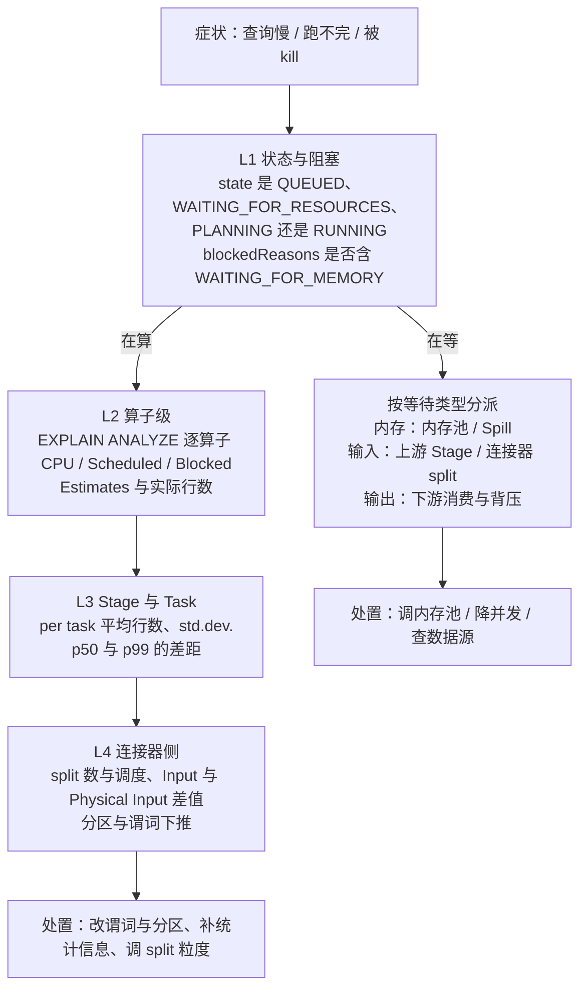
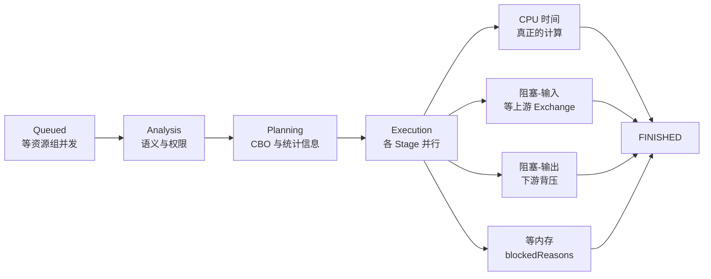
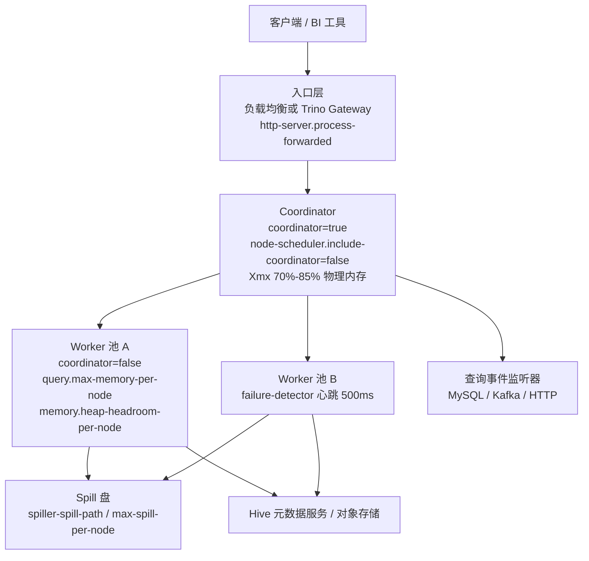
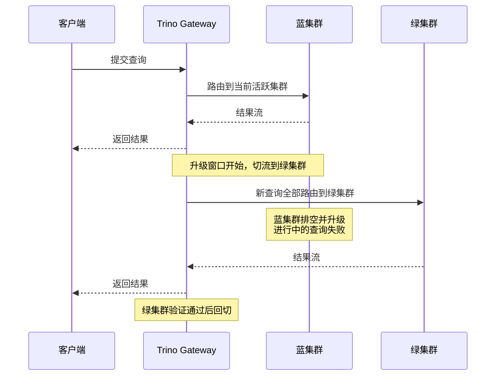
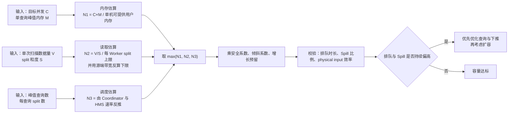

# Trino 运维——集群部署、慢查询分析与调优

**摘要：**

生产环境里，Trino 的运维事件绝大多数可以归结为两种形态：一条查询慢得没有道理，一次变更打乱了整片集群。这两件事看起来一个在查询层、一个在部署层，实则共用同一套判定语言——排队、阻塞、倾斜、下推。本文先把慢查询分析拆成四层判定路径：先看阻塞原因（内存、输入、输出背压）而不是耗时，再看算子级的输入行数与实际耗时，再看 Stage 之间各 Task 的行数分布，最后追到连接器侧看 split 数与下推是否生效；四层顺序不可颠倒，因为每层要回答的问题互斥，方向错了调参只会放大代价。随后讨论 `query.max-run-time` 一类时间上限如何区分"真的慢"与"卡在某个阻塞状态"，Web UI 与 `system.runtime.queries`、`system.runtime.tasks` 的真实列与查询写法（含与旧版文档不符之处），集群部署中 Coordinator 堆比例、`query.max-memory-per-node`、`node-scheduler.*` 与 HTTP 线程池的连带影响，以及升级与排空：Trino 集群是单版本集群，Worker 无状态但查询不可迁移，能滚动的是重启而不是升级，Coordinator 至今没有内置高可用。文末给出常见故障判据表与容量规划的算术示例。

---

## 第 1 章 运维的入口是一条说不清的慢查询

本章讨论的 Trino 运维，范围限定在生产集群里的两类高频事件：一条查询慢得没有道理，一次变更打乱了集群。安装步骤、目录（Catalog）配置、连接器参数属于安装文档的领地，本文只在它们影响判定路径时提一句。

把**判定路径**放在部署之前，是有意为之。运维现场最常见的错误并不是不会配参数，而是把参数配在了错误的平面上：补内存、加 Worker、把 `query.max-run-time` 调到一天，这三件事都能让监控曲线好看一阵子，但如果慢查询的真实原因是分区裁剪失效，补内存只是把"扫一百多个分区"的成本摊到更多机器上，钱花了，根因还在，下一次数据量翻倍时同样的会再来一遍。

急诊**分诊**是个贴切的比喻：急诊科医生接手病人的第一件事不是治病，而是分流，把需要立刻止血的、需要慢慢查的、需要转科的区分开，因为三者的处置动作互相排斥。慢查询分析同理——先判断它是在等（等内存、等上游数据、等数据源的 split）、在算（CPU 打满）、还是在读得太多（IO 过量）。这三种情况的动作方向彼此矛盾，先把方向定错，越用力越糟。

### 1.1 任何慢查询都在三张账上留痕

时间账、内存账、IO 账，是 Trino 暴露给运维的三组正交口径，也是官方文档与 `system` 表共同覆盖的部分。三张账互相印证：只看其中一张，几乎必然会误判。

- **时间账**：排队（Queued）、分析（Analysis）、计划（Planning）、执行（Execution）四段。执行段内部再拆成 CPU 时间与阻塞时间，阻塞时间又分输入侧与输出侧。EXPLAIN ANALYZE 的头部与 `system.runtime.queries` 的列名是同一套口径。
- **内存账**：用户内存（User Memory）峰值与系统内存（System Memory），加上溢写（Spill）到磁盘的字节数。前两者决定查询会不会被 kill，后者决定它会不会慢十倍。
- **IO 账**：逻辑输入（Input：引擎读到的行数与字节）、物理输入（Physical Input：连接器真正从存储读到的字节）、过滤比例（Filtered）。三者的差值，是下推是否生效的直接证据。

| 维度 | 观测口径 | 数据来源 | 最典型的误判 |
|---|---|---|---|
| 时间账 | Queued / Analysis / Planning / Execution 四段，执行段拆 CPU 与阻塞 | EXPLAIN ANALYZE 头部、`system.runtime.queries` 的 `queued_time_ms` / `analysis_time_ms` / `planning_time_ms` | 把排队时间当成执行时间，去优化 SQL |
| 内存账 | 用户内存峰值、Spill 字节、`blockedReasons` | Web UI 查询详情、`system.runtime.tasks` 的 `split_blocked_time_ms` | 峰值内存高就加内存，忽略倾斜导致的单点尖峰 |
| IO 账 | 逻辑输入行数、物理读字节、Filtered 比例 | EXPLAIN ANALYZE 扫描节点末行、`system.runtime.tasks` 的 `processed_input_rows` / `physical_input_bytes` | 认为扫描量大是"集群不够快"，而非裁剪失效 |

### 1.2 四层判定路径

四层路径按"排除代价从低到高、结论从粗到细"排序：先确认它到底有没有在跑，再看它在哪类算子上花掉了时间，再看时间是不是被少数 Task 拖住，最后才回到数据读取的源头。图 1 给出完整的分诊流程。



路径的价值不在于步骤本身，而在于它规定了"在看到什么之前不许动手"。看到查询慢就给 Worker 加内存，相当于看到病人发烧就上退烧药，症状可能暂时压住，病因没有变化。Trino 的执行模型里，一条查询的时间可以几乎全部消耗在等待上——等待内存池的配额、等待上游 Stage 的交换数据、等待连接器把 split 生成出来——这些时间与 CPU 快慢、内存大小并不构成单调关系。

这条路径与执行引擎的分层是同一套结构：Stage、Task、Pipeline、Driver、Operator 的切分见 [[02 查询执行引擎——Stage、Task 与 Pipeline]] 的推导，本文只关心切分之后各实例的负载分布如何反推根因。

### 1.3 一条贯穿全文的报表查询

为了让四层路径有具体的承载，本文反复回到同一条查询：每天 09:00 由调度系统提交的销售宽表报表，扫描 Hive 上的 `sales.orders` 与 `crm.users`，按用户所在省份聚合，正常情况下 40 秒出结果，出问题那天跑了 6 分钟才失败。

```sql
SELECT u.province, count(*) AS orders_cnt, sum(o.amount) AS gmv
FROM hive.sales.orders o
JOIN hive.crm.users u ON o.user_id = u.id
WHERE o.dt = DATE '2026-11-18'
GROUP BY u.province;
```

这条查询的每一个症状都能在四层路径上找到位置：它在 L1 表现为 `RUNNING` 但 `blockedReasons` 含 `WAITING_FOR_MEMORY`；在 L2 表现为 `HashBuild` 节点的内存与输入行数远高于估算；在 L3 表现为某个 Task 的处理行数是平均值的几十倍；在 L4 表现为扫描节点的 `Filtered` 比例接近零、物理输入接近全表。四个观察彼此不冲突，它们是同一条因果链在不同平面上的投影。

## 第 2 章 第一层：先看状态与阻塞，而不是先看耗时

慢查询分析的第一刀切在这里，理由很朴素：Trino 的查询状态机里，有些状态根本不消耗执行资源，它们的"慢"与 SQL 写得好不好无关。把这类情况先排除掉，后面所有关于算子与统计信息的讨论才不至于建立在错误前提上。

### 2.1 九个状态里，只有三个在执行

当前版本的 `QueryState` 枚举共九个取值：`QUEUED`（已接受、等待执行）、`WAITING_FOR_RESOURCES`（等待资源，文档标注为 beta）、`DISPATCHING`、`PLANNING`、`STARTING`、`RUNNING`（至少一个 Task 在跑）、`FINISHING`、`FINISHED`、`FAILED`。`system.runtime.queries` 的 `state` 列输出的就是这些枚举名，所以一条被投诉"跑了半小时"的查询，第一步是看它停在 `QUEUED` 还是 `RUNNING`：前者连资源组（Resource Group）的并发准入都没通过，问题在并发上限与队列长度；后者才轮到执行层。`PLANNING` 卡住通常是元数据服务慢或统计信息缺失让 CBO 在搜索空间里打转，`query.max-planning-time`（默认 10 分钟）的兜底并不保证立即生效。

### 2.2 阻塞原因只有一个枚举值

真正表示"在执行但被挡住"的字段是 `blockedReasons`，类型是 `BlockedReason` 集合。翻开源码会看到一个反直觉的事实：这个枚举至今只有一个取值——`WAITING_FOR_MEMORY`。Trino 只把"等内存"显式建模为阻塞原因，等上游数据、等下游消费、等连接器吐 split 都不进入这个字段，而是散落在另外两处统计里，因此完整的等待画像要三处拼起来：

- 查询与 Task 级别的 `blockedReasons`，回答"是否在等内存"；
- EXPLAIN ANALYZE 里每个算子的 `Blocked` 及其 `Input` / `Output` 分量，回答"等待是上游没给还是下游不收"；
- `system.runtime.tasks` 的 `split_blocked_time_ms` 与 `queued_splits` / `running_splits`，回答"等待发生在 split 调度的哪一段"。

官方文档给了一段可以直接借用的示例输出，它把阻塞的分解讲得比任何文字都清楚：

```text
Fragment 1 [HASH]
    CPU: 22.58ms, Scheduled: 96.72ms, Blocked 46.21s (Input: 23.06s, Output: 0.00ns), Input: 1000 rows (37.11kB)
    ...
    └─ LocalExchange[partitioning = HASH, hashColumn = [$hashvalue], arguments = ["clerk"]]
          CPU: 2.00ms (0.88%), Scheduled: 4.00ms (0.96%), Blocked: 23.15s (50.10%), Output: 1000 rows (37.11kB)
          Input avg.: 15.63 rows, Input std.dev.: 793.73%
```

读法是这样的：Fragment 1 的总阻塞 46.21 秒被拆成输入侧 23.06 秒与输出侧 0 秒，说明它一直在等上游，而不是被下游堵住；`LocalExchange` 节点的 `Input std.dev.` 高达 793.73%，远超均值，这已经是倾斜的明确信号，只是出现在第一层，还没到第三层的定量判断。

### 2.3 三类等待的签名

把上面的口径按"等什么"归类，可以得到一张可操作的签名表。三类等待在指标上的形状差别很大，混淆它们的代价是把不同科室的病人送进同一间诊室。

| 等待类型 | 关键签名 | 常见于 | 误判后果 |
|---|---|---|---|
| 等内存 | `blockedReasons` 含 `WAITING_FOR_MEMORY`；Spill 字节增长；各 Task 行数持平而 Task 数不再增加 | HashBuild、HashAggregation 内存需求超过 `query.max-memory-per-node`；资源组 `softMemoryLimit` 触顶 | 误判为"集群太小"，扩 Worker 后查询更慢（并行度上升，单查询分到的内存反而更少） |
| 等输入 | `Blocked` 的 `Input` 分量占主导；`RemoteSource` 节点阻塞占比高；上游 Stage 的 `Output` 行数增长缓慢 | 上游 Stage 倾斜或上游被内存阻塞；连接器 split 生成慢 | 误判为算子性能差，去调 `task.concurrency`，结果只是把等待摊薄 |
| 等输出 | `Blocked` 的 `Output` 分量占主导；`Output buffer` 满；下游 Task 的输入速率低于上游产出 | 下游聚合或写出慢；单点 Task 成为消费瓶颈 | 误判为上游计算慢，重复优化上游算子 |

三类的共同点是：它们在 Web UI 上的样子都是"查询在 RUNNING，CPU 不高"。区别在于把同一条查询的两次采样对比之后，谁的数字在变——在等内存的查询，Spill 与内存池的占用在变；在等输入的查询，上游 Stage 的输出行数在变；在等输出的查询，`Output` 分量的阻塞时间在变。

### 2.4 第一层的判定为什么必须先做

有一个反例几乎人人踩过：为一条"跑不完"的查询把 `query.max-run-time` 从 30 分钟调到 8 小时，它仍然在 50 分钟时被杀。杀它的不是 run time 上限而是内存上限——两者是独立的终止路径，调长前者只是让它在被后者杀死前多占两小时的内存池配额，把同资源组其他查询的排队一起拉长。第一层的作用就是把"被谁挡住"先钉死：在等内存，算子级分析要回答"哪个算子的内存需求被估错了"；在等输入，要回答"上游为什么慢"。

## 第 3 章 第二层：算子级的输入行数与实际耗时

确认查询确实在执行之后，视角从查询整体下移到算子（Operator）粒度。这一层的工具是 EXPLAIN ANALYZE：它会真正执行查询，并把每个算子的运行时统计打印出来。与不执行查询的 EXPLAIN 相比，它给出的不是估算而是观测，因此可以用来校验估算。

### 3.1 EXPLAIN ANALYZE 的三段结构

输出可以分成三段来看。第一段是查询级的时间拆分：`Queued: 374.17us, Analysis: 190.96ms, Planning: 179.03ms, Execution: 3.06s`，四个数字与 `system.runtime.queries` 的四列一一对应，这一段的用处是回答"时间花在哪个阶段"，与第 6 章的时间账直接衔接。

第二段是 Fragment 头：每个 Stage（在输出里叫 Fragment）都有一行 `CPU`、`Scheduled`、`Blocked`（再分 `Input` 与 `Output`）、`Input: N rows (bytes); per task: avg.: ..., std.dev.: ...`、`Output: ...`。这一行是第二层与第三层的交界处——它既有算子级的时间分解，又有 Task 级的分布统计。

第三段是逐算子的细节：每个节点打印 `CPU: 8.00ms (3.51%), Scheduled: 63.00ms (15.11%), Blocked: 0.00ns (0.00%), Output: 1000 rows (28.32kB)`，下面一行 `Input avg.: 15.63 rows, Input std.dev.: 24.36%`，再下面 `Estimates: {rows: ?, cpu: ?, memory: 0B, network: 0B}`。百分比的分母是同一 Fragment 的总耗时，因此它能直接告诉你"这个 Stage 的时间主要花在哪个节点上"。

### 3.2 CPU、Scheduled、Blocked 的三角关系

三个时间口径容易混。`CPU` 是该算子真正消耗的处理器时间；`Scheduled` 是它被调度、在 Driver 线程上停留的墙钟时间；`Blocked` 是它在等输入或等输出时被挂起的时间。三者的关系决定了解读方式：

- `CPU` 高、`Scheduled` 接近 `CPU`、`Blocked` 低：计算密集，优化方向是算法与表达式（减少函数调用、避免隐式类型转换、用近似函数替代精确去重）。
- `CPU` 低而 `Scheduled` 高：这个算子大部分时间在"被调度但没算"，常见于小批量 Page 的频繁调度，或者被其他 Driver 挤占线程池。
- `Blocked` 占主导：回到第一层，按 `Input` / `Output` 分量判断等待方向。

这里有一处容易误读：算子行里的百分比是相对本 Fragment 的，跨 Fragment 比百分比没有意义。判断"全局最贵"要看绝对时间，而绝对时间受并行度影响——同样是 8 秒的 Stage，32 个 Task 并行与 1 个 Task 单跑，后者的"贵"更值得处理。

### 3.3 Estimates 与实际行数的对照

`Estimates` 是优化器在规划时给出的预测，`Output` 与 `Input avg.` 是运行时观测。两者的比值是判断统计信息质量的直接指标：超过一个数量级的偏差，基本可以判定统计信息过期、缺失，或者被函数包裹的谓词让优化器无法推导选择率。

为什么这件事归运维管？因为优化器的行为本身在 [[05 查询优化——CBO、动态过滤与索引下推]] 里讲透了——CBO 依据统计信息在 JOIN 顺序与 JOIN 类型之间做代价比较，估算错了，决策就会错到数量级。运维侧要做的只有两件事：发现偏差，然后触发统计信息的重新收集（`ANALYZE`），或者给这个查询加提示（Hint）绕过错误的自动决策。

扫描节点的 `Estimates` 会分三段给出，官方示例里是 `{rows: 1500000 (41.48MB), ...}/{rows: 816424 (22.58MB), ...}/{rows: 816424 (22.58MB), ...}`，可以直接与同一节点底部的实际值对照：示例里实际 `Input` 是 1,500,000 行、`Output` 是 818,058 行，与 816,424 行的估算只差 0.2%，这就是一次"估算可信"的典型形状。反过来，如果估算只有几万行而实际输出几百万行，JOIN 的 Build 侧选择与 Broadcast/Repartition 的选择都会跟着错。

### 3.4 扫描节点末行的三个数字

`ScanFilterProject`、`TableScan` 这类扫描节点的最后一行是下推效果的体检报告，形如 `Input: 1500000 rows (18.17MB), Filtered: 45.46%, Physical Input: 4.51MB`。

三个数字的关系要拆开看：`Input` 是引擎从连接器收到的行数；`Filtered` 是引擎侧过滤掉的比例（连接器没过滤掉、被引擎算子过滤掉的部分）；`Physical Input` 是连接器真正从存储读到的字节。`Physical Input` 远小于 `Input` 折算出的字节数，说明列裁剪与谓词下推在工作；`Filtered` 很高而 `Physical Input` 没降下来，说明过滤发生在引擎侧而不是存储侧，下推没生效。这条判据是第四层的入口。

| 算子签名 | 最可能的根因假设 | 下一步验证动作 |
|---|---|---|
| `HashBuild` 内存高、`Input avg.` 与 `Estimates` 差一个数量级 | 统计信息过期，Build 侧选错了表或选错了 JOIN 类型 | `SHOW STATS FOR` 对照，重跑 `ANALYZE`；必要时用 JOIN 提示固定策略 |
| `RemoteSource` 的 `Blocked` 占比高，`Input` 增长极慢 | 上游 Stage 被内存阻塞或严重倾斜 | 回到 L1 看上游 `blockedReasons`，再到 L3 看上游 Task 分布 |
| `LocalExchange` / `RemoteSource` 的 `Input std.dev.` 超过 100% | 分区键分布不均，单点 Task 吃掉了大部分数据 | 进 L3 用 `system.runtime.tasks` 按 `stage_id` 聚合确认 |
| `ScanFilterProject` 的 `Filtered` 高、`Physical Input` 不降 | 谓词没有下推到连接器（类型不匹配、函数包裹、非分区列） | 进 L4 核对分区列类型与 `$partitions` 元数据表 |
| `Aggregate[type = FINAL]` 的 `Blocked` 与内存双高 | 高基数 GROUP BY，哈希表放不下 | 检查 key 基数、评估 `query.max-hash-partition-count` 与 Spill |
| `TableWriter` 的 `Blocked` 高、`physical_written_bytes` 增长缓慢 | 写出端被对象存储或 Hive 元数据服务限流 | 查连接器日志与目标存储的限速配置 |

### 3.5 这一层的边界

算子级分析的前提是查询数量少、单条可独立诊断。集群同时跑几百条查询时，逐条 EXPLAIN ANALYZE 不现实，正确的顺序是反过来：先在 `system.runtime.tasks` 上聚合，找出最贵的查询与最异常的 Stage，再对少数候选复核。另外 EXPLAIN ANALYZE 会真正执行查询，对写语句意味着真的写入，诊断生产查询应当在只读副本或小分区上重放，不要拿生产表当实验台。

## 第 4 章 第三层：Stage 之间的数据倾斜

如果第二层发现某个 Stage 的绝对耗时最贵，第三层要回答的是"这个 Stage 的时间是被均匀分摊的，还是被少数 Task 拖住的"。这两种情况的处置完全不同：均匀慢是资源不足或算法问题，被拖住是分布问题。

### 4.1 分布统计在哪里看

三个来源各有侧重。Fragment 头的 `per task: avg.: 1500000.00 std.dev.: 0.00` 是最粗的：平均行数与标准差百分比，标准差远大于均值时基本可以确认倾斜。算子级的 `Input std.dev.` 更细，能定位到具体是哪个算子收到的输入不均。

`EXPLAIN ANALYZE VERBOSE` 会额外输出分布指标，官方示例里是 `'Input rows distribution' = {count=1.00, p01=..., p50=..., p95=..., p99=..., min=..., max=...}` 这样的百分位结构，可以直接读出 p50 与 p99 的比值。最后是 `system.runtime.tasks` 按 `stage_id` 分组聚合，这是生产环境最实用的方式，因为它能按节点、按 Stage 拉出完整的分布，不依赖单次输出。

```sql
SELECT stage_id,
       count(*)                          AS task_cnt,
       avg(processed_input_rows)          AS avg_rows,
       max(processed_input_rows)          AS max_rows,
       approx_percentile(processed_input_rows, 0.99) AS p99_rows,
       max(processed_input_rows) * 1.0 / nullif(avg(processed_input_rows), 0) AS skew_ratio
FROM system.runtime.tasks
WHERE query_id = '20261118_010203_00045_abcde'
GROUP BY stage_id
ORDER BY skew_ratio DESC;
```

### 4.2 倾斜的三种几何形状

倾斜不是一个问题，而是三类问题的共同表象。按几何形状分类，判据与处置都不一样。

第一种是键热点：GROUP BY 或 JOIN 的分区键上存在超级值，譬如某个省份贡献了 40% 的订单，或者某个商户的流水是其余商户的总和。判据是"单 Task 行数远超均值，且各 Task 的 key 集合差异极大"。

第二种是空值集中：`user_id` 为 `NULL` 的记录在 JOIN 时全部落到同一个分区（哈希函数对 `NULL` 要给它一个确定的位置），于是一个 Task 拿到全表所有脏数据。判据是"热点 Task 的输入行数恰好等于源表中某列的 `NULL` 计数"，用一条 `count(*) WHERE user_id IS NULL` 就能验证。

第三种是 split 粒度不均：连接器生成的 split 大小差异过大，大文件对应大 split，调度器再均匀地分也分不匀。判据是热点 Task 的 `physical_input_bytes` 远高于均值，但行数比例没那么夸张——字节与行数的不一致，指向的是数据块而不是键。

| 倾斜形状 | 判据 | 处置手段 | 代价 |
|---|---|---|---|
| 键热点 | 单 Task 行数 / 均值 > 5，且 key 集合差异大 | 两阶段聚合（先加随机桶再合并）、把热点键单独拉出来处理 | SQL 变复杂，多一次 Shuffle，数据量小时不划算 |
| 空值集中 | 热点 Task 行数 ≈ 该列 `NULL` 计数 | 谓词里先过滤 `NULL`，或用 `coalesce` 映射到独立桶 | 语义要确认，`NULL` 参与 JOIN 的业务含义必须澄清 |
| split 粒度不均 | `physical_input_bytes` 离散度远高于行数离散度 | 调小 `hive.max-split-size`（默认 64MB）或对文件做重写合并 | split 变小会增加调度开销与连接器压力，Coordinator 的 split 队列也会变长 |
| 假倾斜 | Task 数很少（少于 8）时比值天然大 | 不做处置，先增加并行度或再看一层 | 误判会导致对 SQL 的无意义改写 |

表格最后一行是笔者踩过的坑：一个只有 4 个 Task 的 Stage，最大值除以平均值很容易到 2 以上，这时候的"倾斜"只是样本太少的统计噪声。判断是否真倾斜，要同时看 Task 数、绝对行数、以及 key 的分布，单看比值会把小 Stage 全部判成异常。

### 4.3 倾斜并不是越均匀越好

把倾斜打散本身有成本：两阶段聚合多一次 Shuffle，网络与序列化开销上升；加盐（salt）改造会让部分聚合失效，最终聚合的数据量反而变大；把小 split 调大能减少调度开销，却降低并行度。判断要不要治理，看两个比值：热点 Task 的耗时占 Stage 总耗时的比例，以及治理后能回收多少墙钟时间。若热点 Task 只占 Stage 的 20%，收益上限就是 20%，不如去看别的 Stage。

## 第 5 章 第四层：连接器侧与 split

走到第四层，问题已经从"引擎怎么算"变成"数据怎么读"。Trino 的性能优势大部分来自"少读"，而不是"读得快"，这条判断决定了下推与 split 粒度在这一层的位置。

### 5.1 下推的四个层次

下推分层发生，每一层的放大倍数不同。分区裁剪发生在连接器拿到分区清单之前，一次谓词类型写错就可能让一百多个分区全部进入扫描；文件与行组（Row Group）级过滤依赖列存统计信息；谓词下推把过滤条件下推到存储侧；聚合、JOIN、LIMIT 下推则把整个算子交给数据源。四层的机制与失效条件在 [[03 Connector 体系——Hive、Iceberg 与联邦查询]] 里逐层拆过，这里只保留读数法：一是 `Input` 与 `Physical Input` 的差值（引擎收到的数据量 vs 存储真正读出的字节），衡量谓词与列裁剪；二是 `Physical Input` 与表总大小的差值，衡量分区裁剪。两者都接近零，说明读的就是全部数据，剩下的只能改 SQL 或改表结构。

### 5.2 split 数与调度约束

split 是 Trino 调度的基本单位，split 的数量与粒度同时影响并行度、调度开销与倾斜。调度侧有几个互相约束的参数，默认值都是官方给出的起点：

- `node-scheduler.max-splits-per-node`，默认 256：单 Worker 上同时运行的 split 目标数。调大能提高排队批次型负载的吞吐，代价是内存占用上升、split 在 Worker 间均衡变差。
- `node-scheduler.min-pending-splits-per-task`，默认 16：单 Task 保证能拿到的待处理 split 下限，用来防止饥饿与死锁。它必须小于等于 `max-adjusted-pending-splits-per-task` 与 `max-splits-per-node`。
- `node-scheduler.max-adjusted-pending-splits-per-task`，默认 2000：动态调整的上限，仅在 `uniform` 策略下生效。
- `node-scheduler.max-unacknowledged-splits-per-task`，默认 2000：已经在 Coordinator 排队但还没送达 Worker 的 split 上限，用来避免过大的 Task 更新请求把查询打挂。
- `node-scheduler.min-candidates`，默认 10：挑选目标节点时的候选数。调小会让分布不均，调大会增加 Coordinator 的 CPU 开销。

这些参数的共同特征是"调大几乎总能缓解吞吐问题，但代价都记在 Coordinator 与内存上"。split 太小（文件数极多）时，症状是 Coordinator 的调度 CPU 高、`queued_splits` 长、Task 的 `split_scheduled_time_ms` 占主导；split 太大时，症状相反，并行度不足、单 Task 的 `physical_input_bytes` 巨大、倾斜放大。

数量级估算的方法见第 11 章：10TB 数据按 64MB 切分约 16 万个 split，与"每 Worker 256 个在跑"的默认约束相乘，就能算出排满一轮需要多少 Worker，以及为什么大扫描的瓶颈通常不在 split 而在源端带宽。

### 5.3 连接器侧的等待

连接器造成的等待常伪装成"算子慢"：HMS 慢时 split 生成停滞，`PLANNING` 拖长，Task 拿不到 split；对象存储限流时扫描节点的 `Blocked` 涨而 `CPU` 很低，`physical_input_bytes` 增速掉下来。判据是"split 的生成速率与消费速率是否匹配"——`queued_splits` 长期为 0 而 `running_splits` 也上不去，说明源头供给不足；反过来 `queued_splits` 堆积而 `running_splits` 打满，说明 Worker 侧不够，两者处置方向相反。

### 5.4 四层路径的判据汇总

把四层的观察合成一张表，作为现场排查时的速查卡。每一行的"下一层看什么"是有序的，按顺序走完还得不到结论，说明问题可能不在查询本身，而在集群的某个基础服务上。

| 层 | 观察对象 | 判定问句 | 是则下一步 | 否则下一步 |
|---|---|---|---|---|
| L1 状态与阻塞 | `state`、`blockedReasons` | 是否在排队、是否在等内存 | 查资源组并发与内存池 | 进 L2 |
| L2 算子 | EXPLAIN ANALYZE 逐算子 CPU / Scheduled / Blocked | 时间集中在算还是在等 | 按 `Input` / `Output` 分量定方向 | 进 L3 |
| L3 Stage 与 Task | `per task` 分布、`skew_ratio` | 是否被少数 Task 拖住 | 治理倾斜或调整并行度 | 进 L4 |
| L4 连接器 | `Input` vs `Physical Input`、split 数 | 读的量是否等于全部数据 | 改谓词、分区、split 粒度 | 查基础服务与集群容量 |

## 第 6 章 query.max-run-time 与"查询跑不完"

"跑不完"是用户能给出的最模糊的反馈。它可能意味着查询真的在算、算得慢，也可能意味着查询根本没开始算、或者早就被某个上限判了死刑。区分这两种情况，靠的是把时间口径拆开，而不是把上限调大。

### 6.1 四段时间的口径

Trino 对一条查询的时间有四段记录：排队、分析、计划、执行。EXPLAIN ANALYZE 头部按 `Queued` / `Analysis` / `Planning` / `Execution` 打印，`system.runtime.queries` 用 `queued_time_ms`、`analysis_time_ms`、`planning_time_ms` 三列加上 `created` 与 `started` 的差值表达同一组事实。

两个上限的口径差就在这四段上：`query.max-run-time` 从查询被创建算起，包含分析、计划与排队，默认 100 天；`query.max-execution-time` 只算真正执行的那一段，不含分析、计划与排队，默认同样是 100 天。两者都支持 Session 级别覆盖（`query_max_run_time`、`query_max_execution_time`），而且触发时的错误码都是 `EXCEEDED_TIME_LIMIT`。

默认值给到 100 天，说明这两个参数的设计意图是"防止僵尸查询永久占用资源"，而不是限制正常查询。生产上真正起作用的往往不是它们，而是客户端超时 `query.client.timeout`（默认 5 分钟，指客户端失联多久后集群放弃该查询）、资源组准入与内存上限。

### 6.2 真的慢与卡在阻塞的区分

一条查询的墙钟时间等于四段之和，其中执行段又等于各 Stage 的耗时叠加，而每个 Stage 的耗时里包含 CPU 时间与阻塞时间。因此"跑不完"可以拆成三种：

- **真慢**：执行时间在涨，`processed_input_rows` 在涨，`CPU` 时间在涨，查询有实际进展，只是需要的总时间长。这类查询要么等它，要么改它的数据量。
- **卡在阻塞**：执行时间在涨，但 CPU 时间几乎不涨，`blockedReasons` 含 `WAITING_FOR_MEMORY`，或者 Stage 的 `Blocked` 占比超过一半。它在等，不在算。
- **卡在非执行阶段**：`state` 长期停在 `QUEUED`、`WAITING_FOR_RESOURCES`、`PLANNING`。它在等准入、等资源、等元数据。

图 2 把一条查询的时间轴按这四段拆开，标注了每段的观测点与常见堵塞位置。



判据可以用一条简单的不等式表达：若 `execution_time` 中 `CPU` 的占比低于三成，而查询仍在推进，那么优化方向是等待而不是计算。这个比例不需要精确统计，团队里跑几次 EXPLAIN ANALYZE 对照 Web UI 的 CPU 时间与墙钟时间就能形成手感。

### 6.3 终止链：谁在杀查询

生产环境里查询被终止有六条路径，错误码各不相同，`system.runtime.queries` 的 `error_code` 列会直接给出答案：

| 触发源 | 错误码 | 典型触发条件 | 处置方向 |
|---|---|---|---|
| 单节点用户内存超限 | `EXCEEDED_LOCAL_MEMORY_LIMIT` | 单查询在某 Worker 上的用户内存超过 `query.max-memory-per-node` | 降并发、调参数、治理倾斜 |
| 集群级用户内存或总内存超限 | `EXCEEDED_GLOBAL_MEMORY_LIMIT` | 超过 `query.max-memory` 或 `query.max-total-memory` | 同上，并检查资源组的软内存限制 |
| 执行时间或总时长超限 | `EXCEEDED_TIME_LIMIT` | `query.max-execution-time` 或 `query.max-run-time` | 拆查询、优化数据量，不要盲调上限 |
| 集群内存不足时的兜底击杀 | `CLUSTER_OUT_OF_MEMORY` | 低内存杀手（`query.low-memory-killer.policy`，默认 `total-reservation-on-blocked-nodes`） | 查资源组隔离与单查询内存配置 |
| 人工或系统 kill | `ADMINISTRATIVELY_KILLED` | `CALL system.runtime.kill_query(...)`，或运维脚本按用户/资源组清理 | 追溯提交方，检查资源组配额 |
| Spill 空间耗尽 | `OUT_OF_SPILL_SPACE` | `max-spill-per-node` 或 `query-max-spill-per-node` 触顶 | 扩 Spill 盘、清历史文件、重新评估内存 |

需要强调的一处细节：单节点超限用的是 `EXCEEDED_LOCAL_MEMORY_LIMIT`，不是 `EXCEEDED_GLOBAL_MEMORY_LIMIT`。这两个错误码在源码里对应不同的异常构造函数，消息文本也不同——单节点是 `Query exceeded per-node memory limit of X [Allocated: ..., Delta: ...]`，集群级才是 `Query exceeded distributed user memory limit of X`。看到前者去调 `query.max-memory`（集群级）不会有效果，这是笔者见过最常见的一次"调错参数"。

另外，`kill_query` 是异步的：调用返回只代表请求被接受，查询的终止依赖 Coordinator 的清理流程，内存统计要等终止完成后才回落。清理期间同资源组的新查询仍按旧配额排队，所以"杀了查询但内存没降"是正常现象，不需要再补一刀。

### 6.4 反例：把上限调大之后

把 `query.max-run-time` 从 1 小时调到 24 小时，是应对"跑不完"最省事也最危险的做法。它至少带来三个连带后果：一是僵尸查询的存活时间乘以 24，一个死循环式的查询会占用内存池一整天，把同资源组的其他查询挤进排队；二是资源组的内存软限制被长期占用，排队时间上升，用户体感是"整个集群都慢了"；三是故障排查的难度上升，因为"被杀"这个信号本身消失了，只剩下"一直慢"。

正确的顺序是反过来的：先用第 2 章的阻塞判据确认它没有在等资源，再用 6.1 节的时间账确认它在推进，然后才考虑放宽上限，并且只对特定资源组或特定来源的查询放宽（通过 Session 属性），而不是全局放开。

## 第 7 章 Web UI 与 system.runtime.queries

线上排查时，工具的选择比理论更重要：EXPLAIN ANALYZE 适合单条查询的深挖，Web UI 适合扫视，`system` 表适合批量统计。三者覆盖的时间窗口与成本各不相同，混用会让排查变成无用功。

### 7.1 Web UI 的三层视图

Web UI 的第一层是查询列表：查询 ID、提交用户、来源、状态、时间与资源消耗，窗口由 `query.max-history`（默认 100 条）与 `query.min-expire-age`（默认 15 分钟）决定。第二层是详情页：概览、实时计划（Live plan，Stage 间的数据流与完成状态）、Stage 性能（输入输出、CPU、阻塞时间）、Task 列表与 split 列表；标签页名称随版本变化，以对应版本文档为准，但信息层次稳定，从查询到 Stage 再到 Task，正对应本文的第二层与第三层。第三层是全局视图：节点列表、活动查询、资源组排队，它回答的是"集群整体是否健康"，而不是"这条查询为什么慢"。

### 7.2 system.runtime.queries 的真实列

很多二手资料在这一点上会误导人。当前版本的 `system.runtime.queries` 只有十五列：`query_id`、`state`、`user`、`source`、`query`、`resource_group_id`、`queued_time_ms`、`analysis_time_ms`、`planning_time_ms`、`created`、`started`、`last_heartbeat`、`end`、`error_type`、`error_code`。

也就是说，`peak_memory_bytes`、`spilled_bytes`、`physical_input_bytes` 这些字段并不在这张表里，它们要么通过 Web UI 查看，要么从 `system.runtime.tasks` 聚合得到，要么依靠查询事件监听器（Event Listener）落到外部存储。二手资料里常见的 `SELECT query_id, spilled_bytes, total_cpu_time FROM system.runtime.queries` 在 4xx 上会直接报列不存在——这不是语法问题，而是这张表的列一直很窄。

`resource_group_id` 是数组类型，取值形如 `[global, adhoc, alice]`，统计时要用数组操作而不是字符串比较。`last_heartbeat` 由 Task 更新驱动，长时间不更新而 `state` 仍是 `RUNNING`，基本可判定查询挂死或被网络隔离。

### 7.3 system.runtime.tasks 才是资源明细的来源

资源维度的问题几乎都要落到 `system.runtime.tasks` 上。它每个 Task 一行，包含 `node_id`、`task_id`、`stage_id`、`query_id`、`state`，以及 `splits`、`queued_splits`、`running_splits`、`completed_splits`、`split_scheduled_time_ms`、`split_cpu_time_ms`、`split_blocked_time_ms`、`internal_network_input_bytes`、`processed_input_bytes`、`processed_input_rows`、`output_bytes`、`output_rows`、`physical_input_bytes`、`physical_written_bytes`，加上 `created`、`start`、`last_heartbeat`、`end` 四个时间戳。

这张表的分布是 `ALL_NODES` 的——查询它会扫描集群中所有节点上的 Task 信息，因此在几百个 Worker 的集群上要加过滤条件（按 `query_id` 或 `stage_id`），不要裸查。与之相对，`system.runtime.queries` 的分布是 `ALL_COORDINATORS`，在非协调节点（Worker）上查不到数据；用 Trino Gateway 挂多个集群时，这条差异会让人困惑。

### 7.4 三个可以直接抄的查询

最贵的查询（按 CPU 与输入量排序），用 Task 表聚合：

```sql
SELECT query_id,
       count(DISTINCT stage_id)      AS stage_cnt,
       count(*)                      AS task_cnt,
       sum(split_cpu_time_ms)        AS cpu_ms,
       sum(processed_input_rows)     AS input_rows,
       sum(physical_input_bytes)     AS physical_bytes
FROM system.runtime.tasks
GROUP BY query_id
ORDER BY cpu_ms DESC
LIMIT 20;
```

按资源组统计失败与排队（结合 `error_code` 定位是谁在被杀）：

```sql
SELECT resource_group_id,
       error_code,
       count(*)                       AS query_cnt,
       avg(queued_time_ms)            AS avg_queued_ms,
       max(queued_time_ms)            AS max_queued_ms
FROM system.runtime.queries
WHERE created > now() - INTERVAL '1' DAY
GROUP BY resource_group_id, error_code
ORDER BY query_cnt DESC;
```

找掉线或正在停机的节点，用节点表而不是日志：

```sql
SELECT node_id, http_uri, node_version, coordinator, state
FROM system.runtime.nodes
WHERE state <> 'ACTIVE'
ORDER BY node_id;
```

第三条查询的 `node_version` 列还有一个额外用途：核对全网版本是否一致。集群升级到一半时，这一列是唯一不需要登录机器就能看到的版本视图。

### 7.5 历史查询的边界

Web UI 与 `system.runtime.queries` 都基于 Coordinator 内存里的查询历史，受 `query.max-history` 与 `query.min-expire-age` 约束，重启后全部丢失，"昨天的慢查询"在这两处根本查不到。要保留更长历史只有一条路：配置查询事件监听器（Event Listener），把 `QueryCompletedEvent` 落到外部存储。MySQL 监听器会在目标库建 `trino_queries` 一类的表，Kafka 与 HTTP 监听器把事件推给外部管道；写入的内容包含 CPU、内存、输入字节、访问的表与列。代价是 Coordinator 多一条写链路与外部存储的运维成本，所以它属于部署时就要规划好的组件。

| 观测窗口 | 覆盖范围 | 保留时长 | 适用场景 |
|---|---|---|---|
| Web UI 查询列表 | 最近 `query.max-history` 条 | 受 `query.min-expire-age` 约束，重启即失 | 现场扫视、找当前可疑查询 |
| `system.runtime.queries` | 同上，含历史与活跃 | 同上 | 按状态、资源组、错误码批量筛 |
| `system.runtime.tasks` | 当前与近期查询的 Task 明细 | 节点内存中，Coordinator 与 Worker 重启即失 | 倾斜、split、节点级分布 |
| 事件监听器落库 | 全量查询事件 | 由外部存储决定 | 事后复盘、容量趋势、账单口径 |

## 第 8 章 集群部署的关键配置

部署阶段的每一个参数，都会在运维阶段变成一种症状。这一章不罗列配置项，而是挑出四组会互相牵连的参数：JVM 与堆、单查询内存上限、split 调度、HTTP 线程池，并给出它们的连带后果。

### 8.1 JVM：先确认版本，再谈参数

当前版本（4xx）的 Trino 要求 64 位 Java 25，最低 25.0.1，Java 8、11、17、21、24 都不能用。这个事实会淘汰掉大量从旧文档抄来的 `jvm.config`：`-XX:-UseBiasedLocking` 这类选项在移除偏向锁之后已不再有意义，写进配置文件只会得到一条 JVM 警告；`-XX:+UseG1GC` 则属于冗余，G1 本来就是默认收集器。

官方给出的起点是这样的：

```text
-server
-Xmx16G
-XX:InitialRAMPercentage=80
-XX:MaxRAMPercentage=80
-XX:G1HeapRegionSize=32M
-XX:+ExplicitGCInvokesConcurrent
-XX:+ExitOnOutOfMemoryError
-XX:+HeapDumpOnOutOfMemoryError
-XX:-OmitStackTraceInFastThrow
-XX:ReservedCodeCacheSize=512M
-XX:PerMethodRecompilationCutoff=10000
-XX:PerBytecodeRecompilationCutoff=10000
-Djdk.attach.allowAttachSelf=true
-Djdk.nio.maxCachedBufferSize=2000000
--add-modules=jdk.incubator.vector
```

`-Xmx` 要按机器内存调整，官方建议取物理内存的 70% 到 85%，并给了一个具体例子：64GB 的机器用 `-Xmx54G`（84%）。剩下的内存要留给操作系统与堆外内存（Netty 缓冲区、压缩库、JNI 调用），因此堆不是越大越好，超过节点内存的 85% 会把风险从"GC 压力"转移到"系统 OOM Killer"。

把 `-Xmx128G` 与 `-XX:MaxRAMPercentage=80` 同时写进 `jvm.config` 是个典型的冲突：两者并存时 `-Xmx` 是硬上限，百分比只在容器里没有显式 `-Xmx` 时才有意义，混写会让人误以为堆能自动跟随容器内存变化。要么用 `-Xmx` 显式固定，要么用百分比让容器决定，不要两套并存。

GC 选择上，官方起点不指定收集器，等于把选择留给默认的 G1。当堆接近或超过百 GB 量级、且对停顿敏感时，可以评估分代 ZGC（Java 21 起成为默认形态，Trino 4xx 要求的 Java 25 自然可用），代价是并发 GC 线程持续占用 CPU、吞吐略降。这是一条量级判断：中小堆用 G1 的吞吐更划算，超大堆上停顿对 P99 的伤害往往大于吞吐损失。

### 8.2 Coordinator 的堆与职责边界

Coordinator 不参与计算（`node-scheduler.include-coordinator=false`），但它的内存消耗与查询数线性相关：每个活跃查询的计划对象、每个 Task 的状态更新、查询历史里的 `QueryInfo`、事件监听器的缓冲，都压在堆上。它的瓶颈通常不是数据量，而是并发查询数与计划复杂度。

估算可以这样算（示例推算）：峰值 100 条查询同时处于计划或执行阶段，每条在 Coordinator 上的状态对象约 2MB，合计 200MB；查询历史保留 100 条 `QueryInfo`，按每条 5MB 计约 500MB；再给事件监听器与元数据缓存留 2GB 到 4GB，合计在 5GB 量级。这个静态数字不大，但计划阶段的对象生命周期短、分配速率高，年轻代压力明显高于它，所以 Coordinator 的堆按物理内存的 70% 到 80% 配，让 GC 有空间吸收分配速率。

真正的风险来自失控的计划：一条包含几十个 JOIN 的查询、或者带超长 `IN` 列表的查询，会把计划对象撑大一个数量级。`query.max-length`（默认 1,000,000 字符）与 `query.max-stage-count`（默认 150）是两道兜底，后者在文档里明确警告：调高它可能让大量 Stage 的查询引入不稳定，导致无关查询以 `REMOTE_TASK_ERROR` 失败，消息是 `Max requests queued per destination exceeded for HttpDestination`。这条警告值得贴在运维手册的第一页。

| 判据 | 倾向混部 | 倾向分离 |
|---|---|---|
| 集群规模 | 少于 3 台 Worker 的测试或小规模集群 | 5 台以上 Worker 的生产集群 |
| 查询形态 | 低频、短查询、以验证为主 | 高频并发、含大 JOIN 与高基数聚合 |
| 故障半径 | 单机故障即可接受 | 一次 Coordinator 抖动会影响全部业务 |
| 资源余量 | 单机内存足够留出 30% 以上余量 | 查询已把内存吃到 70% 以上 |

混部的代价不是"慢一点"，而是故障半径放大：Coordinator 一旦因某个大查询的 HashBuild 触发长时间 GC，心跳检测、Task 调度、split 分配会一起停摆，Worker 侧看起来像"集群卡住"。官方默认 `node-scheduler.include-coordinator=true` 是为单机测试留的口子，大集群一律分离。

### 8.3 单查询内存上限与堆的关系

`query.max-memory-per-node` 的默认值是节点最大堆的 30%，`memory.heap-headroom-per-node` 的默认值同样是堆的 30%。两者之和必须小于堆大小，这是文档里用警告标出的**硬约束**：超了不是"配置不生效"，而是运行期出现无法归因的 OOM。

在 128GB 物理内存、`-Xmx96G` 的 Worker 上，默认值给出的是 28.8GB 的单查询单节点上限与 28.8GB 的余量，两者合计 57.6GB，占堆的 60%，剩下 40% 留给 Trino 未追踪的分配。这个余量看起来浪费，实际上是被连接器缓冲、Exchange 缓冲、压缩与序列化临时对象吃掉的，把它们归零会让 OOM 从"可预测的查询级失败"变成"不可预测的进程级崩溃"。

内存池的三级配额、资源组的软硬限制、Spill 的触发条件在 [[04 内存管理与资源调度]] 里已经拆细，这里只需要记住一条部署侧的推论：单查询上限不是越大越好，它同时决定了"单查询能跑多大"和"同节点能并行几条查询"，把上限拉到接近堆大小，等于把集群退化成单查询执行器。

### 8.4 部署形态与拓扑

一个典型的生产拓扑由四部分组成：入口层（负载均衡或 Trino Gateway）、Coordinator、Worker 池、外部依赖（Hive 元数据服务、对象存储或 HDFS、Spill 盘）。图 3 给出它们的连接关系与关键配置落点。



Worker 侧还有两个常被忽略的配置组。其一是 HTTP 与内部通信：`http-server.http.port` 是服务端口，`internal-communication.http2.enabled` 默认开启 HTTP/2（只在排查协议问题时关闭），`internal-communication.https.required` 默认关闭，安全集群里要与共享密钥一起配。其二是响应线程：`task.http-response-threads` 默认 100，`task.http-timeout-threads` 默认 3；前者不足的症状是响应排队，后者可在 JMX 的 `AsyncHttpExecutionMBean:TimeoutExecutor` 里观察到 `ActiveCount` 长期等于 `PoolSize`。

| 配置项 | 默认值 | 调大的代价 | 调小的代价 |
|---|---|---|---|
| `query.max-memory-per-node` | 堆的 30% | 并行查询数下降，单查询失败换来的收益有限 | 大查询频繁 `EXCEEDED_LOCAL_MEMORY_LIMIT`，Spill 比例上升 |
| `memory.heap-headroom-per-node` | 堆的 30% | 可用于查询的内存减少，等价于缩小集群 | 未追踪分配挤占堆，GC 压力与进程级 OOM 风险上升 |
| `node-scheduler.max-splits-per-node` | 256 | Worker 内存与 split 均衡变差 | 批次型负载的 Worker 利用率下降、延迟上升 |
| `node-scheduler.min-pending-splits-per-task` | 16 | 单 Task 占用的 split 配额变多，公平性下降 | 可能饥饿甚至死锁（文档明确说明该值用于防饥饿） |
| `task.concurrency` | 物理核数，夹在 2 到 32 之间，必须是 2 的幂 | 高并发场景下上下文切换与内存竞争加剧 | 单查询并行度不足，大查询变慢 |
| `task.http-response-threads` | 100 | 线程增多带来内存与切换开销 | 高并发响应排队，客户端超时 |
| `shutdown.grace-period` | 2 分钟 | 单节点下线变慢，滚动重启窗口拉长 | Coordinator 来不及感知停机，Task 被派到即将退出的节点 |

表里 `task.concurrency` 那一行的口径值得单独说明：早期文档把它描述为"等于 CPU 核数"，4xx 的默认值实际是"物理核数，下限 2、上限 32，在容错执行模式下默认 8"，并且必须是 2 的幂。在 64 核的机器上写 `task.concurrency=32` 是合法的，写 `=48` 会启动失败。

## 第 9 章 升级、重启与排空

把 Trino 当作无状态服务是运维直觉里最贵的一条误解。Worker 进程确实不持有持久数据，但一条正在执行的查询把它的一半生命周期绑在了特定节点上：Task 落在哪台机器，交换数据就从哪台机器发出，节点消失，查询就失去了一半的身体。因此"无状态"只意味着进程可以被替换，不意味着**运行中的查询**可以。

### 9.1 集群是单版本的

Trino 集群的所有节点必须运行**同一个版本**，这一点与"无状态所以能滚动升级"的直觉直接冲突。版本不一致的 Worker 不会被 Coordinator 当作可用节点纳入调度，因此不可能"先升一半节点，让新版本接流量"。`system.runtime.nodes` 的 `node_version` 列可以用来核对全网是否一致，这也是升级后第一件该做的事。

能滚动的只有重启：同一版本内逐台重启 Worker，让查询在重启间隙重新规划。升级则是另一回事——它需要一个新版本的集群整体替换，或者干脆两套集群并存（第 9.4 节）。

### 9.2 无状态但查询不可迁移

标准执行模式下 Task 与节点绑定，Worker 消失时 Coordinator 把查询判为失败，错误码通常是 `REMOTE_TASK_ERROR` 或 `REMOTE_TASK_FAILED`。这不是调参能绕过的设计，而是 MPP 引擎的固有代价：中间结果在内存与本地盘上，没有第二份副本。

容错执行（Fault-Tolerant Execution）改变的就是这一点：把 Stage 之间的交换数据暂存到外部存储，Worker 失败时重新调度 Task 并从暂存处重读。开启方式是把 `retry-policy` 设为 `TASK` 或 `QUERY`（默认 `NONE`）；`TASK` 要配交换管理器（`exchange-manager.properties` 的 `exchange.base-directories`），`QUERY` 整条重试且受 `exchange.deduplication-buffer-size`（默认 32MB）约束，结果集超过这个缓冲的查询默认不做容错。

| 场景 | 推荐策略 | 理由 |
|---|---|---|
| 大量小查询、交互式分析 | `retry-policy=QUERY` | 重试成本低于单条长查询的损失，不必维护交换存储 |
| 长时间批量 ETL | `retry-policy=TASK` + 交换管理器 | 单 Task 重试比整条重跑便宜，长查询对节点抖动最敏感 |
| 无法接受额外存储与延迟 | `retry-policy=NONE` + 严格排空 | 靠排空与维护窗口规避，而不是靠重试 |
| 使用不支持容错的连接器 | `retry-policy=NONE` | 文档明确说明部分连接器会报"不支持查询重试" |

需要提醒的是，容错执行只覆盖"节点故障"这类基础设施问题，不覆盖查询本身的错误。文档的原话是容错不会为写错的 SQL 浪费资源重试——这一点在评估要不要开容错时经常被忽略。

### 9.3 优雅停机：排空的正确姿势

Trino 提供了**优雅停机**（Graceful Shutdown）接口，只对 Worker 生效。调用方式是对 Worker 的 `/v1/info/state` 发一个 PUT：

```bash
curl -v -X PUT -d '"SHUTTING_DOWN"' \
  -H 'Content-type: application/json' \
  -H 'X-Trino-User: ops' \
  http://worker:8081/v1/info/state
```

调用成功后，Worker 的日志里会出现 `Shutdown requested`。之后的行为是文档写明的四步：进入 `SHUTTING_DOWN` 状态；睡一个 `shutdown.grace-period`（默认 2 分钟），这段时间用来让 Coordinator 感知并停止向它派发新 Task；然后阻塞等待现有 Task 全部完成；再睡一个 grace period，确认 Coordinator 已经看到全部完成；最后退出。

这个流程解释了为什么"排空"不能省：如果不调用这个接口直接停进程，Coordinator 要等故障检测器把节点判死，期间派发过去的 Task 全部失败，一条查询只要有一个 Task 落到这台机器上就整体失败。两种做法的差别不是"优雅一点"，而是"失败与不失败"。

有两个坑。其一是权限：默认的系统访问控制不允许优雅停机，要改用 `allow-all`，或用文件系统访问控制/ Ranger 授予"写系统信息"权限，且配置必须下发到所有 Worker。其二是时长：grace period 只保证 Coordinator 感知停机，不保证长查询跑完——等待现有 Task 完成这一步没有超时上限，运维脚本必须自己加超时与兜底 kill。

Kubernetes 上的排空则要把这一步写进 `preStop` 钩子，并把 `terminationGracePeriodSeconds` 设为大于"两个 grace period 加上最长查询残余时间"的值：

```yaml
lifecycle:
  preStop:
    exec:
      command: ["/bin/sh", "-c", "curl -s -X PUT -d '\"SHUTTING_DOWN\"' -H 'Content-type: application/json' http://localhost:8081/v1/info/state && sleep 240"]
terminationGracePeriodSeconds: 600
```

这里的算术值得算清楚（示例推算）：`shutdown.grace-period` 取 2 分钟，两段就是 4 分钟；假设该节点上最长查询还剩 3 分钟，则从调用接口到进程可退出的时间约 7 分钟；`sleep 240` 加上容器收到 SIGTERM 后的等待，把 `terminationGracePeriodSeconds` 定为 600 秒是留了约 3 分钟余量。若把这个值设成默认的 30 秒，Kubernetes 会在 Worker 还在等 Task 完成时直接 SIGKILL，排空形同虚设。

### 9.4 Coordinator 没有内置高可用

Coordinator 是集群的单点，这一点在当前版本没有改变：它持有查询的解析、计划、调度与状态，进程消失时正在执行的查询全部失败，集群在重启完成前无法接受新查询。社区与厂商的共识做法是在外部解决，而不是期待引擎自己长出主备。

现实中有三条路径，代价各不相同。

第一条是快速重建：把 Coordinator 的配置与目录定义版本化，进程挂掉后由编排系统在几十秒内拉起，靠外部负载均衡把连接重定向到新实例。代价是重建期间全部查询失败，MTTR 取决于镜像拉取、JVM 启动与目录初始化，通常是分钟级。

第二条是双集群加路由网关：部署两套完整集群（蓝绿），前置 Trino Gateway 做查询路由、健康检查与粘性转发。网关本身是无状态多实例加共享数据库，可被负载均衡；升级时先切流到绿集群再升蓝集群，用户无感。代价是资源翻倍，以及跨集群一致性——两套集群的目录配置、资源组、权限必须同步，否则切流时会暴露差异。

第三条是 DNS 切换：保留两套集群，用 DNS 记录指向当前活跃的 Coordinator，切换时改记录并等待 TTL 过期。它比第二条便宜，但切换窗口内新旧连接混用，长查询的结果读取会中断，只适合能接受分钟级抖动的场景。图 4 给出第二条路径（蓝绿切换）的时序，注意旧集群的排空与升级同切流是并行的。



三条路径没有优劣，只有适用条件：单集群规模小、能接受分钟级不可用，第一条足够；对可用性有 SLA 要求、且负担得起双份资源，第二条是标准答案；第三条介于两者之间，适合过渡期。

### 9.5 升级与重启的检查清单

无论走哪条路径，动手前的检查项是固定的，缺一项都可能把一次维护变成一次事故。

| 检查项 | 命令或位置 | 通过标准 |
|---|---|---|
| 全网版本一致 | `SELECT DISTINCT node_version FROM system.runtime.nodes` | 只有一行 |
| 无正在执行的写查询 | `SELECT query_id, state FROM system.runtime.queries WHERE state = 'RUNNING'` | 或已确认可中断 |
| 资源组队列已清空 | 资源组视图或 `system.runtime.queries` 的 `state = 'QUEUED'` | 队列为 0，或已通知提交方 |
| 已开启排空接口权限 | 系统访问控制配置 | 目标 Worker 上 PUT 返回成功 |
| 停机宽限期已覆盖最长查询 | `shutdown.grace-period` 与 `terminationGracePeriodSeconds` | 两者之和大于最长查询残余时间 |
| 交换存储可用（启用容错时） | `exchange.base-directories` 路径可写 | 写入探测通过 |
| 回滚路径可执行 | 旧版本介质与配置已就位 | 能在同一维护窗口内回滚 |

## 第 10 章 常见故障判据表

故障排查的效率取决于判据的锐度。下列五类故障覆盖了生产环境里绝大多数 Trino 事件，每一类都给"症状、判据、根因、处置"四段，判据尽量落在可执行的动作上，而不是描述性语言。

### 10.1 五类故障的统一入口

| 故障 | 症状 | 判据 | 根因 | 处置 |
|---|---|---|---|---|
| 查询被 kill | 用户报"查询失败"，错误信息带内存或时间字样 | `error_code` 是 `EXCEEDED_LOCAL_MEMORY_LIMIT` / `EXCEEDED_GLOBAL_MEMORY_LIMIT` / `EXCEEDED_TIME_LIMIT` / `ADMINISTRATIVELY_KILLED` / `CLUSTER_OUT_OF_MEMORY` / `OUT_OF_SPILL_SPACE` | 六条终止路径之一 | 按错误码分流，见 10.2 |
| Worker 掉线 | Web UI 节点数减少，查询成批失败 | `system.runtime.nodes.state` 出现 `INACTIVE`；Coordinator 日志有节点失联记录 | 进程崩溃、GC 长停顿、网络分区、机器故障 | 查 Worker 日志与 GC 日志；确认是否 OOM 退出 |
| Coordinator OOM | 全集群不可用，新查询提交即失败 | Coordinator 堆日志里有 `OutOfMemoryError` 与堆转储 | 计划阶段对象过大、查询历史过多、事件缓冲堆积 | 限计划复杂度、迁出事件监听器、加堆 |
| exchange 失败 | 查询在中途失败，错误指向远程 Task 或数据完整性 | `REMOTE_TASK_ERROR`、`REMOTE_TASK_MISMATCH`、`Max requests queued per destination exceeded` | 网络抖动、Stage 数过多、下游缓冲被打满 | 调 Stage 上限、检查网络与 HTTP/2、评估容错执行 |
| 连接器超时 | 查询长期停在 PLANNING 或扫描无进展 | split 生成速率停滞；连接器日志有超时；`physical_input_bytes` 不涨 | HMS 过载、对象存储限流、文件清单爆炸 | 扩元数据服务、调 split 粒度、减少小文件 |

### 10.2 查询被 kill 的分流

六条终止路径的处置方向完全不同，混在一起会导致"越处理越乱"。内存类错误先看是单节点还是集群级：单节点超限通常是倾斜或单查询太大，集群级超限通常是并发失控或资源组隔离不足。时间类错误先看是执行段还是总时长：执行段超限说明查询本身太大，要拆；总时长超限而执行时间很短，说明它大部分时间在排队，要查资源组准入。

`ADMINISTRATIVELY_KILLED` 往往被忽略：它意味着有人或某个脚本主动杀了查询，而失败信息里会带上 kill 的用户与消息文本。看到这个错误码，应该先追溯提交方与清理脚本，而不是研究内存配置。

`OUT_OF_SPILL_SPACE` 是唯一与磁盘相关的终止路径，症状很有辨识度：查询在内存压力上来之后开始 Spill，磁盘写满，然后失败。它的处置不是加内存，而是先看 `max-spill-per-node` 与 `query-max-spill-per-node` 的配置是否与磁盘容量匹配，再看是否有历史 Spill 文件没有被清理。

### 10.3 Worker 掉线的机制与判据

节点是否存活由故障检测器（Failure Detector）判定，参数都可调：`failure-detector.enabled` 默认开启，`failure-detector.heartbeat-interval` 默认 500 毫秒，`failure-detector.threshold` 默认 0.1（源码注释称在默认心跳下约 6 秒的失败窗口），`failure-detector.warmup-interval` 默认 5 秒，`failure-detector.expiration-grace-interval` 默认 10 分钟（节点从发现服务消失后多久被彻底遗忘）。这组参数解释两类表象：一是"节点闪断"，GC 停顿超过约 6 秒即被判失效，调度停止派发，恢复后重新加入；二是"节点彻底消失"，进程崩溃后 10 分钟内它可能仍以失效状态留在列表里。

判据是"节点失联时，查询是失败还是重试"。标准执行模式下，Task 在失效节点上无法完成，查询整体失败；容错执行模式下，`retry-policy=TASK` 会把 Task 重新调度到其他节点。这也是评估"要不要开容错"时最实际的依据：如果集群每月都有节点抖动，容错省下的重跑成本会超过它的存储成本。

### 10.4 Coordinator OOM 的特殊性

Coordinator 的 OOM 与 Worker 的 OOM 根因不同。Worker 的 OOM 多是执行期内存超限，有查询级配额兜底；Coordinator 的 OOM 多数发生在解析与计划阶段——这个阶段的对象没有查询级配额约束，一个超长 `IN` 列表、一段递归展开的视图定义、一个几十张表的 JOIN，都能把计划对象撑到几百 MB 甚至 GB 级。可用的闸门有三个：`query.max-length` 挡超长 SQL，`query.max-stage-count` 挡 Stage 爆炸（默认 150，文档警告调高的连带风险），`query.max-planning-time`（默认 10 分钟）在超时后"尽力"终止计划，但文档也承认计划阶段某些操作不易取消。三者都不是硬保证，Coordinator 的堆要按"最坏单查询的计划对象 + 并发计划数"配，而不是按平均值。

事件监听器是另一个常被忽视的内存来源：它把查询完成事件发往外部存储，外部存储不可用时事件会在 Coordinator 内存里堆积，直到超时或被丢弃。部署它必须同时配监控与背压策略，否则一次外部数据库故障会连带把 Coordinator 拖死。

### 10.5 exchange 与网络

Stage 之间的数据交换走 HTTP，默认启用 HTTP/2。交换失败的表象有三类：连接层的 `REMOTE_TASK_ERROR`（对端不可达或超时）、协议层的 `REMOTE_TASK_MISMATCH`（Task 状态不一致）、数据完整性的校验失败。第三类有专门开关：`exchange.data-integrity-verification` 默认 `ABORT`，可改为 `RETRY` 让引擎重试；`ABORT` 把问题暴露出来，`RETRY` 把问题掩盖过去，生产上宜保持默认并用监控盯住这类失败，它们往往指向网络设备的静默错误或内存位翻转。

`Max requests queued per destination exceeded for HttpDestination` 通常意味着单节点向某个下游并发发起的请求过多，根源可能是 Stage 数过多或 `query.max-stage-count` 被调大。遇到它先看 Stage 数量与集群规模是否匹配，而不是直接调网络参数。

### 10.6 连接器超时

连接器侧的超时在 Trino 内部表现为"查询没有失败，但也没有进展"：HMS 响应慢时 `PLANNING` 拖长，对象存储限流时 `physical_input_bytes` 停滞，文件清单巨大时 split 生成本身会吃掉 Coordinator 大量 CPU 与内存。判据是两次采样之间 `split_scheduled_time_ms` 与 `queued_splits` 的变化；Task 拿不到 split 时 `queued_splits` 长期为 0 而 `running_splits` 也上不去，此时该查连接器日志与元数据服务，而不是继续在引擎侧找原因。

## 第 11 章 容量规划

容量规划在 Trino 上不是一道纯算术题，因为瓶颈会在内存、网络与源端存储之间迁移。但有三个入口能把"拍脑袋"变成"可校验的估算"，每个入口都给出公式、代数量级与校验指标。

### 11.1 内存入口：并发数乘以单查询峰值

第一个入口回答"集群要能同时扛住多少查询"。公式很直接：集群可提供的用户内存总量，等于各 Worker 可用用户内存之和；需求等于目标并发数乘以单查询峰值用户内存。

集群侧的可提供量可以用 04 篇的约束反推：单 Worker 的 General Pool 约为堆的 70%（`memory.heap-headroom-per-node` 默认 30%），`query.max-memory-per-node` 建议不超过 General Pool 的 70%。以 128GB 物理内存、`-Xmx96G` 的 Worker 为例（示例推算）：堆 96GB，headroom 28.8GB，General Pool 约 67.2GB；单查询单节点上限最多约 47GB，但生产上取 16GB 到 24GB 更常见；取 16GB 时单 Worker 可同时容纳 4 条满内存查询；目标 50 并发、单查询峰值 8GB，总需求 400GB，需要 7 台 Worker 才能"刚刚装下"。

"刚刚装下"不是可用的容量。实际配置要乘一个**安全系数**，因为单查询峰值不是同时到达的，倾斜会让单节点占用高于平均。经验上取 1.5 到 2 倍余量，即 11 到 14 台。这个数字可以和 `query.max-memory`（集群级上限）交叉校验：它通常设成 `query.max-memory-per-node × Worker 数 × 0.8` 左右，若两者差距过大，说明某一侧的假设不自洽。

### 11.2 读取入口：数据量除以 split 粒度

第二个入口回答"一次大扫描能排多满"。Trino 的读取并行度由 split 数量与调度上限共同决定，公式是：并行 Task 数上限 ≈ Worker 数 × `node-scheduler.max-splits-per-node`。

以 10TB 扫描、`hive.max-split-size` 取默认 64MB 为例（示例推算）：split 数约 10TB ÷ 64MB ≈ 163,840 个。若 Worker 数为 20、每 Worker 256 个在跑，则瞬时并行度约 5,120 个 split，需要约 32 轮才能扫完。每轮的时间由单 split 的处理时间决定，若单 split 约 2 秒，理论扫描时间在 64 秒量级。

这个估算常常比实际乐观，因为瓶颈会先转移到源端带宽：10TB 在 64 秒内读完，需要约 160GB/s 的聚合吞吐，远超任何机群的网卡总量。以单机 10GbE 实测 1GB/s 计（示例推算），160GB/s 需要 160 台 Worker 同时跑满网卡。结论不是"要建 160 台的集群"，而是"这条查询的时间下限由源端带宽决定，split 数与 Worker 数再怎么加也突破不了它"——这正是第 1 章说的"读得太多"必须先于"算得慢"被处理。

### 11.3 第三个入口：Coordinator 与元数据

第三个入口最容易被漏掉：Coordinator 的容量与元数据服务的容量。Coordinator 侧的约束是并发查询数（每条查询的状态对象与计划对象）与 split 调度速率（split 越多，调度压力越大）；元数据侧的约束是 split 生成速率，HMS 每秒能返回的分区与文件数量是硬上限。

估算方法同样是代数量级：若每查询 100 个 split、峰值 100 并发，则 Coordinator 每秒要处理上万次 split 调度请求；若 HMS 每次 `getPartitions` 需要 50 毫秒，单次查询要读 128 个分区，那么仅元数据调用就要 6 秒以上。这两个数字决定了"加 Worker"在这类集群上是否有效——如果瓶颈在 Coordinator 或 HMS，加 Worker 只会让排队更长。

### 11.4 三条估算的合并与校正

三个入口给出三个不同的"需要的 Worker 数"，取最大值后再乘三个校正系数：安全系数（应对峰值并发，1.5 到 2）、倾斜系数（应对热点，1.2 到 1.5）、增长预留（应对半年内的数据增长，1.3 左右）。三者连乘会得到 2.3 到 3.9 倍，这个数字看起来夸张，但它对应的是"集群在峰值时段仍然不排队"这个目标；如果业务能接受排队，系数可以降下来，代价是尖峰时段的体验。

图 5 把三条估算的输入、公式与校验指标串成一条流程。



校验指标比估算公式更可靠。三个指标能立刻说明容量是否真的够：资源组的平均排队时长（持续高于业务 SLA 的等待就说明容量不足）、Spill 字节占总输入的比例（持续偏高说明内存不足或查询太大）、`physical_input_bytes` 与 `processed_input_bytes` 的比值（偏高说明下推没生效，扩容是在为无效读取买单）。第三个指标尤其重要，它把"该扩容"与"该改 SQL"分开。

| 估算入口 | 输入 | 公式 | 校验指标 | 常见误用 |
|---|---|---|---|---|
| 内存 | 并发数、单查询峰值 | 需求内存 / 单机可提供用户内存 | Spill 比例、`EXCEEDED_LOCAL_MEMORY_LIMIT` 次数 | 用平均值代替峰值，忽略倾斜 |
| 读取 | 数据量、split 粒度 | split 数 / 每 Worker 上限，再用带宽反算 | `physical_input_bytes` 增速、扫描墙钟时间 | 只算 split 数，忽略源端带宽与元数据速率 |
| 调度 | 峰值查询数、每查询 split 数 | Coordinator 与 HMS 的每秒处理能力 | 排队时长、`split_scheduled_time_ms` | 把 split 调度当成零成本 |

## 第 12 章 收口：六篇文章的坐标

把这个专栏读完，回头看运维这件事，会发现它的难点从来不在参数表上。参数是可查的，默认值是可读的，真正需要判断的是"此刻该看哪一层"以及"这个改动会把代价推到哪里"。

### 12.1 六篇的分工

- **[[01 Trino 全局架构——Coordinator Worker 与 MPP 执行]]**：解释为什么 MPP 的内存流水线能比 Hive 的磁盘物化快一个量级，以及 Coordinator 与 Worker 的职责边界从哪里来。
- **[[02 查询执行引擎——Stage、Task 与 Pipeline]]**：给出六层执行结构的切分逻辑，本文第二层与第三层的观察对象全部由它定义。
- **[[03 Connector 体系——Hive、Iceberg 与联邦查询]]**：说明下推的分层与失效条件，本文第四层的读数法以它为前提。
- **[[04 内存管理与资源调度]]**：展开三级内存配额、资源组隔离与 Spill 的触发机制，本文第 8 章的单查询上限与堆的关系由它推导而来。
- **[[05 查询优化——CBO、动态过滤与索引下推]]**：讲清优化器如何在统计信息上做代价比较，本文第 3 章的 `Estimates` 与实际的偏差由此获得意义。
- **本文**：把上面五篇的结构知识组织成一套判定路径，并补上部署、升级、排空与容量这四件只有运维才会遇到的事。

### 12.2 三条可以带走的直觉

判定路径优于参数调优：先归到"等、算、读"三类，再决定动哪个参数，归类的成本是几分钟，归错类的成本是几小时的无效调参。排空优于停止：Worker 无状态而查询绑节点，这个不对称决定了重启与缩容都必须先排空，优雅停机加宽限期是唯一能把"滚动重启会失败"翻转过来的手段。容量是算术加校正：三个入口取最大值再乘系数，最后用排队时长、Spill 比例、下推效率反校验，这套方法不保证估得准，但保证估错时能被发现。

### 12.3 边界

Trino 不是万能的。查询形态是"单表、超大规模、聚合简单"时，列式数据库或预聚合物化视图的性价比更高；需求是"分钟级延迟的持续写入"时它也不合适——MPP 引擎的强项是交互式与批式的只读分析，这个边界在 [[01 Trino 全局架构——Coordinator Worker 与 MPP 执行]] 的横向对比里交代过。运维判断的一部分，是识别出"这不是 Trino 该干的活"，而不是把集群调到一个它注定跑不好的负载上。

---

## 参考资料

1. Trino 文档，[Query management properties](https://trino.io/docs/current/admin/properties-query-management.html)（`query.max-run-time`、`query.max-execution-time`、`query.max-planning-time`、`query.client.timeout`、`query.max-history`、`query.max-stage-count` 的默认值与语义）
2. Trino 文档，[Resource management properties](https://trino.io/docs/current/admin/properties-resource-management.html)（`query.max-memory-per-node` 与 `memory.heap-headroom-per-node` 的默认值及其与堆大小的硬约束）
3. Trino 文档，[Node scheduler properties](https://trino.io/docs/current/admin/properties-node-scheduler.html)（split 调度相关参数的默认值与相互约束）
4. Trino 文档，[HTTP server properties](https://trino.io/docs/current/admin/properties-http-server.html) 与 [Task properties](https://trino.io/docs/current/admin/properties-task.html)（内部通信、响应线程池、`task.concurrency` 的默认值）
5. Trino 文档，[Spilling properties](https://trino.io/docs/current/admin/properties-spilling.html)（`max-spill-per-node`、`query-max-spill-per-node`、溢写目录与压缩）
6. Trino 文档，[Graceful shutdown](https://trino.io/docs/current/admin/graceful-shutdown.html)（`/v1/info/state` 接口、`shutdown.grace-period` 默认 2 分钟与停机四步）
7. Trino 文档，[Fault-tolerant execution](https://trino.io/docs/current/admin/fault-tolerant-execution.html)（`retry-policy`、交换管理器、`exchange.deduplication-buffer-size`）
8. Trino 文档，[EXPLAIN ANALYZE](https://trino.io/docs/current/sql/explain-analyze.html)（输出格式中文中引用的示例均出自该页）
9. Trino 文档，[System connector](https://trino.io/docs/current/connector/system.html)（`runtime.queries`、`runtime.tasks`、`runtime.nodes` 与 `kill_query` 过程）
10. Trino 文档，[Deploying Trino](https://trino.io/docs/current/installation/deployment.html)（Java 25 要求、`jvm.config` 起点、`-Xmx` 取值建议）
11. Trino 文档，[Resource groups](https://trino.io/docs/current/admin/resource-groups.html)（`maxQueued`、`hardConcurrencyLimit`、`softMemoryLimit` 与调度策略）
12. Trino 文档，[MySQL event listener](https://trino.io/docs/current/admin/event-listeners-mysql.html) 与 [Web UI](https://trino.io/docs/current/admin/web-interface.html)（查询历史落库与 UI 视图）
13. Trino Gateway 文档，[Routing logic](https://github.com/trinodb/trino-gateway/blob/main/docs/routing-logic.md)（多集群路由与健康检查）
14. trinodb/trino 讨论，[How do trino clusters rolling upgrade](https://github.com/trinodb/trino/discussions/17515)（全节点同版本与 DNS 切换的实践）

---

> [!note] 思考题
> 1. 一条查询在 `system.runtime.queries` 里显示 `state = 'RUNNING'`，但 `last_heartbeat` 十分钟没有更新，`blockedReasons` 为空。你会先怀疑 Worker 侧的网络分区，还是先怀疑查询本身挂死？两条排查路径的判据分别是什么？
> 2. 集群的 Worker 从 20 台扩到 40 台之后，同一批查询的 P99 反而变长。请用本文四层路径中的第三层与第四层给出至少两种可能的解释，并说明各自的验证方法。
> 3. 你的集群没有配置事件监听器，某天早上用户投诉"昨晚 2 点的报表跑了两个小时"。在不重启 Coordinator、也不改配置的前提下，你还能拿到哪些证据？这些证据的时间窗口受什么限制？
> 4. 如果团队决定用双集群加 Trino Gateway 实现升级无感，那么两套集群之间哪些配置必须严格同步？一旦不同步，切流时会以什么形式暴露出来？
> 5. 容量估算里"安全系数 × 倾斜系数 × 增长预留"连乘会得到 2 到 4 倍的结果。在预算受限的情况下，你会优先削减哪个系数？削减它的后果由谁来承担，如何用监控提前发现？