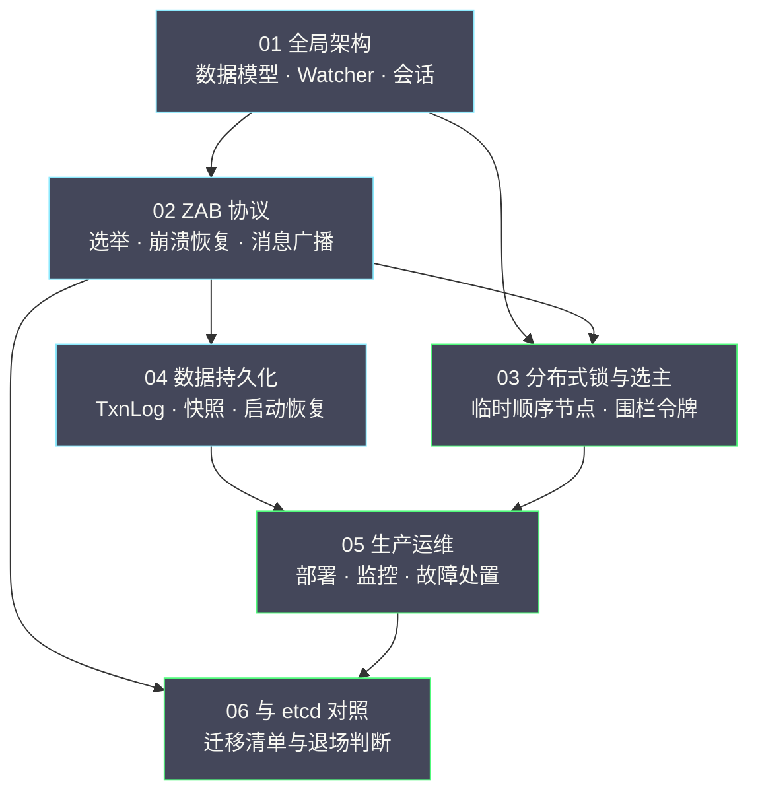

# ZooKeeper 核心原理 专栏导览

## 专栏定位

本专栏聚焦 Apache ZooKeeper 分布式协调服务的核心原理——从 ZNode 树形数据模型和 Watcher 通知机制，到 ZAB 协议的崩溃恢复与消息广播，再到分布式锁、配置中心、服务发现等典型应用场景。ZooKeeper 是 [[中间件/Kafka/00 专栏导览|Kafka]]、[[中间件/Dubbo/00 专栏导览|Dubbo]]、HDFS、HBase 等众多分布式系统的基础设施——理解它的内部机制，是理解整个分布式生态的起点。

## 目标读者

- 使用依赖 ZooKeeper 的中间件但希望理解其底层原理的后端/大数据工程师
- 需要设计分布式锁、配置中心等协调服务的架构师
- 对分布式共识协议（Paxos/ZAB/Raft）感兴趣的技术爱好者

## 专栏目录

| 序号 | 标题 | 核心内容 |
| :--- | :--- | :--- |
| 01 | [[01 ZooKeeper 全局架构——数据模型与会话机制]] | ZNode 树形数据模型（持久/临时/有序）、Watcher 机制的一次性通知、Session 的生命周期与心跳、ACL 权限控制 |
| 02 | [[02 ZAB 协议——Leader 选举、崩溃恢复与消息广播]] | FastLeaderElection 的投票包字段与比较规则、崩溃恢复三阶段与 DIFF/TRUNC/SNAP 分支、消息广播的两阶段与 ZXID 分配、epoch 推进与旧 Leader 隔离 |
| 03 | [[03 分布式锁与 Leader 选举的工程实现]] | 三种锁形态（抢注/临时顺序/容器节点）的取舍、监听前驱与羊群效应、会话超时窗口与围栏令牌、三种选主模式、Curator 四原语语义 |
| 04 | [[04 数据持久化——事务日志与快照]] | 事务日志（WAL）的写入机制、快照的 Fuzzy Snapshot 策略、启动时的数据恢复流程、磁盘 IO 对性能的影响 |
| 05 | [[05 生产运维——部署、监控与故障处理]] | 部署形态与奇数节点取舍、tickTime/initLimit/syncLimit 的对账关系、mntr 指标与四字命令判读、滚动升级与扩缩容、故障处置顺序与演练分级 |
| 06 | [[06 ZooKeeper vs ETCD——架构对比与去 ZooKeeper 化趋势]] | 以 ZK 能力模型为基准的三分判定（平替/取舍/无对应物）、通知与租约的语义落差、迁移清点与灰度策略、仍应留在 ZK 的场景 |

## 知识图谱

## 推荐阅读路径

- 核心原理路径：01 → 02 → 04（数据模型 → 一致性协议 → 持久化与恢复）
- 工程落地路径：03（锁与选主，依赖 01 的临时顺序节点与 02 的会话失效语义）
- 生产运维路径：05（部署、监控、排障，需先读 01/02/04）
- 选型与退场路径：06（以 01-05 的能力认知为前提，讨论与 etcd 的取舍）

## 前置知识

- 分布式系统基础概念（CAP 定理、一致性模型）
- 建议对比阅读 [[中间件/ETCD/00 专栏导览|etcd]] 专栏了解 Raft 协议（与 ZAB 形成对照）

---

## 关联专栏

- [[中间件/ETCD/00 专栏导览|etcd]]：Raft vs ZAB 的对比选型
- [[分布式架构/分布式系统原理与协议/00 专栏导览|分布式系统原理与协议]]：ZAB 协议的理论基础
- [[分布式架构/分布式锁/00 专栏导览|分布式锁]]：ZK 实现分布式锁的方案
- [[中间件/Kafka/00 专栏导览|Kafka]]：Kafka 早期依赖 ZK 做元数据管理
- [[中间件/Dubbo/00 专栏导览|Dubbo]]：Dubbo 默认注册中心
