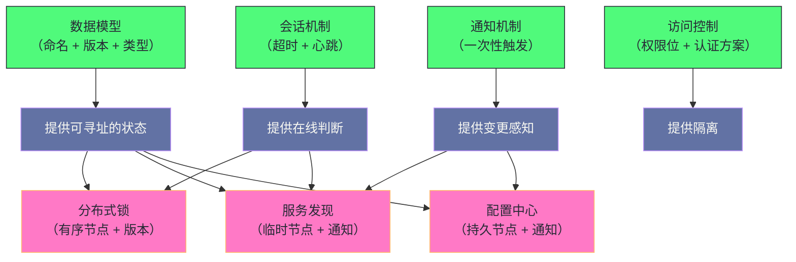
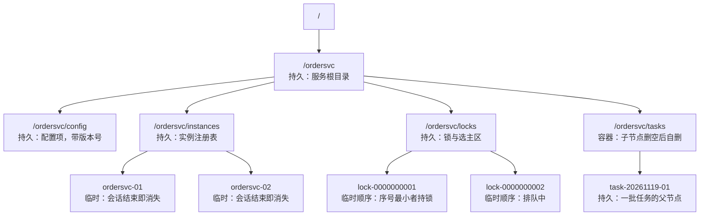
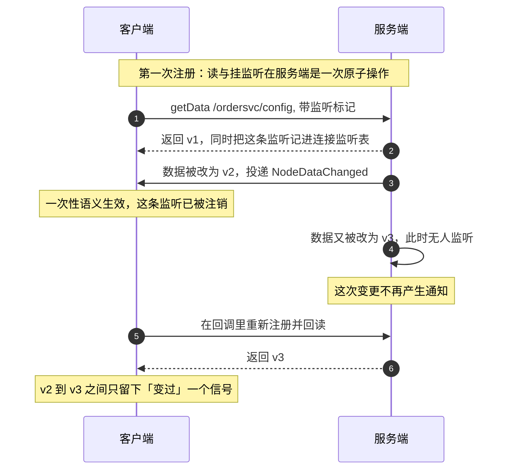
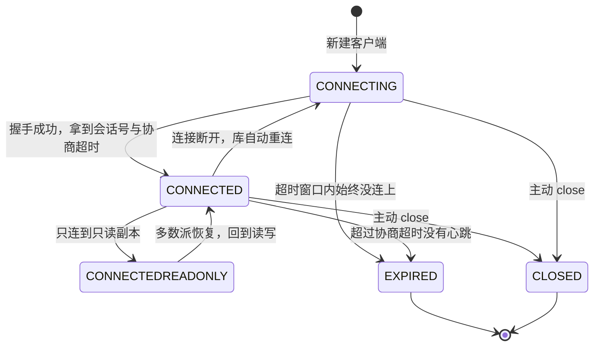
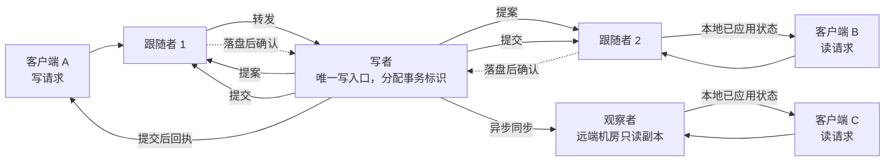

# 01 ZooKeeper 全局架构——数据模型与会话机制

**摘要：**

ZooKeeper 常被当成一个存配置的小数据库，可在 2006 年前后 Yahoo! 研究院启动这个项目时，它要解决的并不是存储问题，而是分布式系统里反复出现的一类协调问题：谁在岗、谁说了算、配置改了什么、谁先排队。围绕这四个问题，它给出四件东西：一棵带版本号的树（ZNode）、一次性的变更通知（Watcher）、与会话绑定的临时节点，以及一套按路径粒度划分的访问控制（ACL）。本文按五问推进：协调服务是什么、为什么数据库与文件系统顶不上、抽掉这些机制会退化成什么样、四件东西各自如何落地、以及它们在哪里失效。中段用五张图拆开 ZNode 树与节点类型、Watcher 的触发与重注册、会话状态机与集群读写路径，并用表格把 stat 结构、ACL 权限位、节点数量的算术逐项列清。全文的落点不在特性清单，而在两处取舍：一次性通知，以及随会话一起消失的临时节点。读完应当能回答两个问题：为什么临时节点是这个系统里最优雅也最危险的机制；以及会话超时这个参数，究竟在替谁承担误判的后果。

---

## 第 1 章 一栋写字楼里的协调问题

### 1.1 从十个订单实例说起

笔者先摆一个贯穿全篇的场景。ordersvc 部署了十个实例，跑在三台机器上，其中对账任务只允许一个实例执行，配置项要在不重启的前提下热更新，上游要能查到当前活着的实例地址，另有一段扣减库存前的校验需要互斥。这四件事拆开看都很朴素，单机时代它们分别对应配置文件、进程锁、注册表和一个定时任务开关，可一旦把进程铺到多台机器上，原本由操作系统与内存在背后兜住的东西，就全都要重新找一个落脚点。

缺的东西可以归成三样：一块所有实例都能读到、且读到的是同一份的状态；一套变更发生之后能及时传到相关实例的机制；一个能判断某个实例此刻还在不在的可靠信号。三样东西听起来都不难，难的是它们必须在网络会断、机器会挂、进程会卡住的前提下同时成立。

ZooKeeper 把这三样东西做进了一个独立进程。2006 年前后，Yahoo! 研究院内部的一批系统各自实现着同一套协调逻辑，从选主到成员管理，重复且难以复用，项目因此立项；2008 年它开源并捐给 Apache 基金会，最初挂在 Hadoop 名下，2010 年 11 月升为顶级项目，同年的 USENIX ATC 论文给它定了一个准确得有点拗口的位置——面向互联网规模系统的无等待协调服务（wait-free coordination）。无等待这个词说的是客户端不必阻塞在某个原语上等人释放，它拿到的是一组事件与回调，怎么组合由使用方自己决定。

### 1.2 四类需求，一个共同形状

四类需求在生产系统里反复出现。共享配置要求某个键变化后所有关心它的进程都能在秒级感知；选主要求多个候选者中只有一个能拿到授权，且授权可以被下一个候选者接走；分布式锁要求同一时刻只有一个执行体进入临界区，持有者崩溃后锁能自动失效；服务发现要求消费方随时能拿到当前提供方的地址列表。这四类需求各自都有朴素解法，也各自都在规模化之后失效。

把它们摆在一起，会发现形状是同一个：都需要一个全局唯一的、可被多方读取的状态，都需要这个状态变更时能通知到关心它的人，都需要所有人对变更的先后有同一个看法。前两条是功能，第三条是正确性前提。

第三条最容易被忽略。两个实例同时抢锁，如果集群对两次写入的先后没有统一答案，那么两个实例各自连到不同节点、各自看到自己先写，就都会认为自己拿到了锁。所以协调服务提供的不只是共享状态，而是一份**带顺序的共享状态**。顺序是免费的加量吗？恰恰相反，它是整套设计里最贵的一部分，后面关于写路径、ZXID 与多数派的所有权衡，都是在为它付账。

### 1.3 数据库与文件系统为什么顶不上

最常见的反驳是用数据库不就行了。数据库确实能存状态，但它在三处不合用。其一是写入被单点收束，主库再强也只是一台机器的写能力，而协调数据的特点是单条极小、频率不高、却要求任何时刻都能写。其二是变更通知只能靠轮询，轮询间隔就是感知延迟，间隔调小则绝大多数请求都在问一句没有变化吧，白白消耗连接与服务端算力。其三是锁的语义不一样，数据库的行锁活在事务里，事务一提交锁就没了，而协调场景要的锁往往要跨越多次请求、持续几十秒，还得在持有者进程消失后自动释放。

第四处不合用更隐蔽：数据库为多行、多表的批量操作设计，协调场景要的却是一个极小状态的原子替换加一次通知，两边的优化方向相反，塞进同一个引擎只会互相拖累。

文件系统的问题更直接。变更通知（inotify）只在本机有效，跨机器的进程收不到；NFS 上的锁与缓存一致性历来是事故高发区，语义弱到不足以承载选主；更要紧的是文件系统没有会话这个概念，它不知道这个客户端还活着吗，也就没法把文件存在与进程在岗绑定起来。而后者恰恰是分布式协调里最值钱的一条能力。

Chubby 在 2006 年的 OSDI 论文里给过一条参照路径：Google 用一个带 Paxos 的锁服务管理 GFS 与 Bigtable 的选主和元数据。ZooKeeper 参考了它，但没有照搬。Chubby 交付的是一把锁和一套句柄，使用方按它规定的方式加锁解锁；ZooKeeper 交付的是一组原语——顺序节点、临时节点、监听器，锁要自己拼。这个差别决定了后者的适用面更宽，也决定了后者被误用的面更宽：原语不会替你检查用法。

### 1.4 四条被写进代码里的边界

定位一旦确定，参数就跟着确定。ZooKeeper 有四条边界，它们不在文档的显眼处，却写进了每一处实现细节。

| 边界 | 具体约束 | 直接后果 |
| :--- | :--- | :--- |
| 数据量小 | 全量数据常驻内存，磁盘只承担持久化 | `jute.maxbuffer` 默认 1MB 的单节点上限；实际使用多在几 KB |
| 读多写少 | 写要经过单一写者与多数派确认，读可在任意节点本地完成 | 读吞吐随节点数扩张，写吞吐被写者单机卡住 |
| 顺序一致 | 所有写由写者串行分配全局事务标识 | 所有客户端看到的更新顺序一致，代价是写路径必须串行 |
| 只给原语 | 不提供现成的锁、选举、配置中心 | 使用方要自己用节点类型与监听器组合，误用空间也随之变大 |

四条边界不是缺陷清单，而是使用说明书。越过任何一条，出问题的形式都不是报错，而是性能或语义**悄悄退化**：数据塞大了不会写失败，只会让快照与网络同步变慢；写频率上去了不会拒绝服务，只会让写延迟从毫秒爬到几十毫秒；把监听器当成事件流用不会报错，只会悄悄漏掉中间几次变更。这类退化最难排查，因为它没有明确的失败点。

### 1.5 一栋写字楼的比喻

把 ZooKeeper 想成一栋写字楼的公共设施，会更容易记住四件东西的分工。树形数据模型是走廊里的公示栏，每份通知有固定位置，位置就是它的名字；监听器是关注了某块公示栏的人，公告一换，关注者收到一条某处有更新的提醒，提醒本身不带内容，要看还得自己走过去；会话是每天早晚的签到，签到簿由前台保管且只有一份，谁先到谁先写；临时节点是工位牌，人走了牌就摘，摘牌不需要谁批准，只看签到记录。

比喻要跟一句限定，否则容易失真。公示栏只能贴摘要，贴不下合同全文；换公告比看公告费事，所以它适合写得少、看得多的信息；不同楼层的副本更新有先后，站在不同位置看到的版本可能差一版。这三处限定，恰好对应上文的四条边界，也预告了后文所有权衡的位置。

### 1.6 四个概念怎么配合

把四件东西的关系画在一起，能看清它们各自承担哪一部分，也方便后文按图索骥。



图里最值得停一眼的是三个上层机制都落在数据模型上：锁要顺序与版本，服务发现要临时节点与通知，配置中心要持久节点与通知。数据模型是地基，通知与会话是两根承重柱，一个管变化怎么被看见，一个管活着怎么被判定。

这张图还有一处实用价值：设计新的协调机制时，先问它需要哪几类能力，再从四件东西里挑对应原语。譬如只跑一个实例的定时任务，要的是在线判断加唯一性，临时节点加选主就够了。

---

## 第 2 章 数据模型：一棵可寻址的树

### 2.1 节点既是目录也是文件

数据组织成一棵树，每个节点既能存数据，又能有子节点。这处设计与文件系统不同：文件系统里目录和文件是两类对象，权限、行为、API 都不一样；这棵树里所有节点都是同一类，一个节点既是目录又是文件，路径既可用来定位内容，也可用来划分命名空间。

统一带来的收益是结构简单。读写、监听、权限判定都只有一套代码，客户端也不需要区分两种对象的行为。代价是不能靠类型表达意图：你没法从类型上看出某条路径是一个配置项、一个分组，还是一个注册表目录，因此这套模型里的语义几乎全靠命名约定承载——`/ordersvc/config` 约定为配置区，`/ordersvc/instances` 约定为注册表，`/ordersvc/locks` 约定为锁区。

这类**用约定替代类型**的做法很常见，它把语义责任推给了使用方，换来的是内核足够薄。薄的好处是能承载各式各样的上层机制，坏处是任何团队都可能发明一套自己的约定，跨团队共享同一个集群时，命名空间治理往往比技术问题更难。

### 2.2 四种节点类型

节点类型在创建时指定，之后不能修改。四种基本类型按两个维度组合而成：生命周期是持久还是临时，命名是普通还是顺序。

| 类型 | 生命周期 | 命名 | 典型用途 |
| :--- | :--- | :--- | :--- |
| 持久节点（PERSISTENT） | 显式删除才消失 | 调用方给出 | 配置、命名空间骨架 |
| 临时节点（EPHEMERAL） | 随创建它的会话结束而删除 | 调用方给出 | 实例注册、持锁声明 |
| 持久顺序节点（PERSISTENT\_SEQUENTIAL） | 显式删除才消失 | 服务端追加十位序号 | 任务队列、全局递增编号 |
| 临时顺序节点（EPHEMERAL\_SEQUENTIAL） | 随会话结束而删除 | 服务端追加十位序号 | 公平锁、选主 |

ZooKeeper 3.5 之后又补了一种容器节点（Container Node），它没有数据，子节点被删空之后由服务端择机自行删除，适合做批量任务的父目录，免得留下大量空壳；ZooKeeper 3.6 再补了带存活时间的 TTL 节点，节点在指定时长无人访问后由服务端清理。这两种是为解决运维痛点打的补丁，不属于最初的四类，但在用容器做任务分组时很有价值。

把这棵树摊开，结构大致是下图这样：路径承担命名，类型承担生命周期，两者合起来表达在线状态与排队顺序。



一处限制必须提前说明：临时节点不能有子节点，结构上它就是**叶节点**。因此若想在实例注册节点下再挂健康检查、权重之类的信息，正确做法是把这些信息序列化进节点的数据里，而不是创建子节点；违反这条限制的操作会直接失败，报错信息也不会委婉。

### 2.3 顺序号从哪里来

顺序节点的序号不是随机数，也不是全局计数器。服务端在创建节点时取父节点的子节点版本号加一，格式化成十位、左侧补零的十进制串，接在调用方给出的路径后面。这个实现细节决定了两件事：序号只在同一个父节点下单调，换个父节点会从零重新数；十位补零让字典序与数值序一致，因此客户端可以直接按字符串排序得到排队顺序。

十位是格式化宽度，序号本身来自父节点的整型计数器，上限在二十一亿上下，实际场景触不到；真触到了，说明这个父节点下的子节点已经多到不该再用顺序节点组织。

顺序节点的价值在于**把并发变成可排序**。十个实例同时创建子节点，会得到十个互不相同、可比较的序号，此后所有判断都退化成一次本地比较：谁最小谁持锁、谁第二小谁排队、谁是最后一个谁负责触发下一轮。这类把并发控制转化为序号比较的手法在分布式系统里反复出现，它的好处是比较是纯本地操作，不需要再引入一轮协调。

不过序号本身不携带语义。它只告诉你谁先谁后，不告诉你前一个是否还活着；后者要靠临时节点的会话绑定来回答。两件事叠在一起，才构成一把公平锁。

### 2.4 stat 结构与三类版本号

每个节点除数据之外还带一组元数据，客户端读数据时通常会一并拿到。这组元数据在 Java 客户端里对应 `Stat` 结构，字段不多，但每一个都有明确用途。

| 字段 | 含义 | 用途 |
| :--- | :--- | :--- |
| `czxid` | 创建该节点的事务标识 | 追溯节点何时被创建 |
| `mzxid` | 最后一次修改节点数据的事务标识 | 判断数据的新旧与归属 |
| `pzxid` | 最后一次修改子节点列表的事务标识 | 判断子节点集合是否变过 |
| `ctime` / `mtime` | 创建时间与最后修改时间 | 运维排查、TTL 判定 |
| `version` | 数据被修改的次数 | 数据写入的乐观并发控制 |
| `cversion` | 子节点列表被修改的次数 | 顺序号来源、子节点集合的并发控制 |
| `aversion` | ACL 被修改的次数 | 权限变更的并发控制 |
| `ephemeralOwner` | 临时节点所属的会话标识，持久节点为 0 | 判断节点是否临时、属于哪个会话 |
| `dataLength` / `numChildren` | 数据长度与子节点数量 | 容量监控、巡检 |

三类版本号分工很明确：`version` 管数据，`cversion` 管子节点列表，`aversion` 管权限。三者互不干扰，这个切分不是随手分的，而是因为这三类修改的冲突模式不同——两个客户端同时改数据要互斥，同时增删子节点要互斥，同时改权限也要互斥，但改数据与加子节点之间没必要互斥。

`ephemeralOwner` 为零表示持久节点，这个约定很朴素，代价是读的人必须知道这条约定才能正确解读。

### 2.5 使用版本号做乐观并发

**版本号参与写入准入**，这是无锁并发控制的落地方式。写操作可以携带一个期望版本，只有当前版本恰好等于期望值时才允许写入，否则返回版本不匹配的错误；传入 `-1` 表示跳过检查，等同于放弃这层保护。删除节点时同理，可以带数据版本号做校验。

这处机制让多个客户端可以先读后写，而只有一个能成功，其他客户端的期望版本在读完之后已经过期。它避免了加锁的开销：没有真正的锁，就没有获取、释放、超时与死锁这一整套问题。代价是失败方必须自己重试，而且重试必须在读到新值之后进行，否则会一直撞在同一个版本上。

```python
# 版本号是服务端判定的唯一凭据，客户端只负责重读与重试
while True:
    stat, data = zk.get("/ordersvc/config")          # 先读，连带拿到版本号
    new_value = transform(data)                       # 在本地算出新值
    result = zk.set("/ordersvc/config", new_value, version=stat.version)
    if result is not None:                            # 版本吻合，写入成功
        break                                         # 版本不吻合时返回空，回到循环重读
```

这段循环有两处工程约束值得注意。其一是重试要有上限与退避，否则高竞争下会退化成忙等，把服务端 CPU 吃在无效请求上；其二是 `transform` 必须只依赖读到的数据，若它还依赖外部状态（譬如本机时间、另一个节点的内容），重试时算出的新值可能已经不同，语义就从比较并交换变成了最后写入者赢。

乐观并发适合冲突少的场景，冲突多的场景应当换悲观手段，这个判断在协调数据上通常成立：配置与注册表的写入频率很低，冲突概率小，乐观控制的重试成本可以忽略；而高频抢锁的场景冲突密集，顺序节点那种排队式的悲观方案反而更合适。

### 2.6 事务标识：纪元与计数器

`czxid`、`mzxid`、`pzxid` 里装的是事务标识（ZXID），它是每个写操作的全局唯一递增编号，结构是高位纪元、低位计数器。纪元在每次写者换届时加一，计数器在任期内从零开始单调递增，于是任意两个写操作都能比较先后，且新写者产生的编号一定大于旧写者的编号。

这个结构解决的是一个很具体的问题：写者换届时，旧写者可能还有提案在路上，新写者要能让所有节点识别并丢弃这些残留。只靠一个单调整数做不到，因为换届后计数器要重新计数，整数不允许回退；把时期单独拎出来做高位，等于给重新计数找了一个合法入口——**低位归零，整体序不回退**。

对使用方来说，ZXID 最实用的一处用途是当版本号用。需要判断某个状态是不是比另一个新，比较两个 ZXID 即可；需要给下游一把防重放的令牌，ZXID 也是一个现成的单调量。后文讲会话超时的风险时会用到这一点。

### 2.7 一兆字节的天花板

数据全量放在内存里，磁盘只承担持久化，因此单节点数据量有上限，集群总容量受单机内存限制。单个节点的数据还有一层更硬的限制：序列化之后的大小不能超过 `jute.maxbuffer`，默认 1MB，超过就写不进去，客户端与服务端两侧的这个参数还必须一致，否则会出现服务端能写、客户端读不了的怪现象。

全内存这处选择的收益是读极快且延迟稳定，读不需要访问磁盘，延迟只受网络与内存访问限制。这处取舍是**用容量换延迟的确定性**，适合元数据类的小数据，因为元数据的价值在于读取频繁、要求低延迟，而不是容量大。

一旦有人想把几兆的配置、或者整张订单快照塞进来，正确回应不是调大 `jute.maxbuffer`。参数调大之后，快照体积、节点同步的数据量、内存占用会同步放大，而这个系统根本没有为这类负载设计过。

---

## 第 3 章 通知机制：Watcher 的一次性语义

### 3.1 轮询的三笔账

在没有通知机制的世界里，感知变更只能靠轮询，而轮询有三笔账要付。第一笔是实时性，变更到感知之间隔着固定的延迟，延迟等于轮询间隔。第二笔是资源，绝大多数轮询都在问没有变化吧，这些请求不携带任何信息，却要消耗连接、带宽与服务端处理能力。第三笔是语义，轮询只能告诉你数据不同了，无法区分是数据被改、子节点新增、还是节点被删除，使用方只能按最坏情况处理。

第二笔账在协调场景里尤其刺眼，因为协调数据的特点恰恰是变更很少。一个配置项一天改两次，按十秒轮询，一天要问八千多次，其中八千次是无效的。轮询的固有缺陷无法靠优化消除，它只能靠把方向反过来——让服务端在变更发生时主动通知。

### 3.2 注册与触发

监听器的注册与读取在服务端是一次原子操作。客户端调用 `getData` 并带上监听标记时，服务端在同一个处理序列里完成读与挂监听，因此不存在读完到挂上之间变更被漏掉的窗口。这一点比先读再订阅的做法优雅得多，后者在两步之间必然有一个空窗，只能靠重读兜底。

触发之后的行为，是这套机制里最需要说清的部分：监听器只触发一次，**触发即注销**。下图把一次完整的注册、触发、遗漏与重注册画成时序，中间那段空窗是关键。



图里那段空窗有个名字，叫变更遗漏窗口。它的形态是：在收到通知与重新注册完成之间发生的变更会被遗漏，具体可能漏掉一次，也可能漏掉很多次。因此处理通知的代码必须基于全量状态，读到什么就按什么处理，而不能假设上次通知以来只发生了一次变更。

### 3.3 为什么只触发一次

一次性语义常被当成设计缺陷，其实它是一处精算过的取舍，代价的落点在**服务端内存**。服务端为每条连接维护一张监听表，若监听是持久的，一个高频变更的节点配上大量监听者，表项会随监听时长持续累积：客户端每注册一次就多一条，只要不撤销，服务端就没有回收的理由。一次性把每条监听的生命周期压到一次事件，服务端的内存开销与监听时长脱钩。

第二处代价在一致性上。通知不携带变更内容，只给一个「变过」的信号，于是客户端在收到信号后必须回读，回读拿到的必然是当时的最新状态。如果通知携带内容，服务端就要为每条通知准备一份数据快照，并且保证这份快照与通知顺序一致；在这套读不经过多数派的架构里，这等于要把读也纳入共识，代价立刻上一个量级。轻量通知把这个责任推给了客户端的一次读取，服务端因此不必保存变更历史。

第三处代价在慢客户端上。每条连接只有一个事件队列，若监听持久，一个迟迟不处理事件的客户端会让队列无限增长；一次性语义天然给了队列一个上界，因为每条监听最多贡献一个事件。

三处代价合起来，换来的是客户端的一点额外负担：收到事件后重读、重注册、按全量处理。这类把成本从服务端挪到客户端的做法在分布式系统里很常见，理由也一致——客户端数量多但每个负担小，服务端只有一个而负担集中。不过这笔账并非永远划算，监听密集、路径复杂的场景里，客户端的重注册风暴本身就会变成问题，这也是 ZooKeeper 3.6 补上持久递归监听的原因。

### 3.4 能监听什么，不能监听什么

不同读操作能挂的监听不同，能触发的事件类型也不同，这张对应关系值得记清。

| 操作 | 可触发的事件 | 说明 |
| :--- | :--- | :--- |
| `getData` | 数据变更、节点被删除 | 最常用，用于配置与状态 |
| `exists` | 节点被创建、数据变更、节点被删除 | 能监听尚不存在的节点 |
| `getChildren` | 子节点列表变更、节点被删除 | 用于注册表与队列 |

表里第三行最容易被忽略：子节点列表变更只通知一次，但一次变更可能对应新增一批或删除一批，通知不告诉你增删了哪些、增删了几个。这与前文说的一致——**事件是触发器，不是数据**。

表里还有一处能力差异值得强调：`exists` 能监听一个尚不存在的节点。这让服务发现可以做得很优雅——消费方在服务提供方的注册节点还不存在时就挂上监听，一旦某个实例启动并创建节点，消费方立即收到通知，不需要轮询等待。这处设计考虑的是时序上的两种可能：先有节点，或者先有监听者。

顺带说一句，ZooKeeper 3.6 之后补了持久递归监听，可以一次挂上整棵子树的监听，事件也不再是一次性的。它是对一次性语义那笔客户端负担的回应，但它并没有改变通知不带内容这件事，回读的纪律仍然成立。

### 3.5 三处保证与一处漏洞

通知机制提供三处保证，它们界定了这套机制的能力边界。第一处是顺序性，同一个客户端的通知按变更发生的顺序投递，客户端库保证事件与异步回复之间的次序。第二处是可靠性，在会话有效的前提下，所有变更都会触发通知，不会静默丢失。第三处是轻量性，通知只说明有变更，不携带内容。

三处保证合起来，把通知定位成**触发信号**而不是数据载体。这处定位换来的是服务端不必存储变更历史，代价是客户端多一次读取。要注意第二处保证有个前提——会话有效，会话一旦过期，所有监听随之作废，这条保证也就失效了，后文讲会话时会再回到这里。

一处常被忽略的漏洞在重连路径上。监听表挂在服务端，客户端连的是哪台服务器，监听就记在哪台服务器上；连接断开、重连到另一台服务器时，那张表并不跟过去。Java 客户端为此在重连后把本地记录的监听路径、连同最后见过的事务标识一起提交，服务端据此判断哪些路径在此之后变过，并补发事件。

这个补偿机制能补回变过这个事实，补不回变更的次数与内容。断线期间某条路径被改了五次、或者被删除后重建，客户端最终只收到一个信号，回读时看到的是重建后的状态。因此断线重连之后的第一次回读，必须当成全量重建来处理，不能当成增量更新。

### 3.6 把通知当触发器

由此可以提炼出一条纪律：通知只负责唤醒，状态一律以回读结果为准；回读之后按全量处理，处理逻辑必须幂等。

这条纪律不是风格建议，而是由三处机制共同逼出来的：通知不带内容，所以必须回读；通知可能合并，所以回读结果可能跨越多次变更；通知可能重放（重连补偿时），所以同一逻辑可能被执行多次。三条里任何一条成立，增量式的处理都会出错。

还有一处工程问题与通知的选择有关，叫「羊群效应」。若所有实例都监听同一个节点，节点一变，全体同时被唤醒、同时回读、同时重注册，瞬间的读压力可能比变更本身更大。用顺序节点实现锁时，客户端只监听自己前一个节点，而不是监听锁节点本身，正是为了避开这种集中唤醒——排队者只需要知道前一个走了，不需要知道队列里发生了什么。

---

## 第 4 章 会话：把连接的存活变成节点的存活

### 4.1 会话是一段有状态的关系

会话不是普通的连接，而是一段有状态的、有生命周期的关系。它有全局唯一的会话标识，由服务端分配，64 位整数，高 8 位带上产生它的服务端标识，低位来自启动时间，这样即便换机器重建会话也不会撞号；它有协商出来的超时时间；它还记得自己创建过哪些临时节点，以便在结束时一并清理。

会话与连接是两件事。一条会话可以跨多条 TCP 连接存在，网络抖动导致连接重建时，只要会话未超时，临时节点就仍然在。这个区分是理解临时节点的前提：临时节点反映的是会话的存活，不是某条连接的存活；把两者混为一谈，就会以为一次网络抖动会让注册表里的实例全部消失。

会话标识的权威性来自单一来源。分配只在服务端发生，客户端不能自选，因此不会出现两个客户端拿到同一个标识的情况。这处唯一性看着是细节，其实是会话语义成立的前提——若标识可能重复，临时节点归属、过期判定、监听表归属就全部失去依据；换句话说，所谓「会话说『我还在』，节点就『我在岗』」，前提正是这个标识只属于一个人。

### 4.2 状态机

会话的状态不多，但转换关系值得画清楚，因为大部分线上事故都发生在状态转换的那一瞬间。



图里有两条边最需要留意。一条是已连接回到连接中，它意味着一次中断，但会话仍然有效，临时节点与监听都还在，客户端库会自动重连到集群中的其他节点。另一条是已连接直接跳到已过期，它是**终态**：会话结束、临时节点被删、监听作废，没有自动恢复的可能。

两条终结路径的性质完全不同。主动关闭是干净的、可预期的，服务端按流程清理；过期是被动的、危险的，因为客户端往往在过期发生之后才知道。这处差别决定了处理方式必须不同，后文会展开。

### 4.3 心跳与超时的协商

会话的存活靠心跳维持。服务端不会为每个会话建定时器逐个盯，而是把会话按到期时间分桶，每个 tick 扫一遍到期的那一桶，到点就判过期。`tickTime` 默认两秒，这个值同时决定心跳扫描的粒度与超时的下限。

超时时间不是客户端单方面说了算，是协商出来的。客户端在握手时提议一个值，服务端把它裁剪到允许区间内再返回：下限是 `tickTime` 的两倍，上限是二十倍，按默认值算就是四秒到四十秒。返回的才是真正生效的超时，客户端库那个查询方法拿到的也是它。

这处协商造成了一个很常见的困惑：配置里明明写了六十秒，实际生效的却是四十秒。配置不生效的原因不是配置写错了，而是它超出了服务端允许的上限，被**静默裁剪**。这类裁剪只能靠核对实际生效值发现，读配置文件是读不出来的。

心跳的节奏由客户端库掌握，经验上按超时的三分之一发一次。这个取值留了两倍余量：窗口内至少能发三次，即便丢两次，第三次仍能续上。留余量的原因与所有基于超时的判断一样——判断不能刚好卡在临界值上，否则一次网络抖动就变成了误判。

### 4.4 超时删节点的时序风险

会话过期之后，服务端要做的动作有严格顺序：先把会话标记为过期，删除该会话名下的临时节点，节点删除触发监听，最后通知客户端会话已过期。顺序不能颠倒，尤其不能先通知后删除——否则收到通知的客户端去读时，还能看到那个本该消失的节点。

这个顺序保证的是服务端内部的一致性，它保证不了客户端与业务状态的一致性。最典型的形态是这样的：某个实例持锁期间发生了一次长达十几秒的 GC 停顿，心跳发不出去，服务端判定过期、删掉锁节点、另一个实例抢到锁开始干活；停顿结束后原实例醒来，它的世界里锁还在，于是继续操作被保护的资源，两边同时写。

这类事故里，客户端收到过期通知之前的那一小段，是它自认为持锁的时间。若业务在这段时间里做了不可挽回的操作，事后补偿也很难干净。所以会话过期被称为最危险的状态，它的危险不在于服务不可用，而在于**错误是静默的**：进程没崩、日志没有异常、锁也没报错，只是所有权悄悄换了人。

标准的兜底手段是给锁配一把单调递增的令牌，业内叫 fencing token。持锁时从服务端取一个单调量（顺序号或 ZXID 都行），每次写下游资源时带上它，下游只接受比已见过的更大的令牌，旧持有者的请求会被直接拒绝。令牌的作用是把判断权从持有者手里拿走，交给真正会受伤的那一方。

另一种手段是收窄持锁期间的动作：把可能长时间停顿的操作挪到锁外，或者把锁的持有期压到远小于会话超时。这只降低了概率，没有消除风险，真正要消除风险还得靠令牌。

### 4.5 重连的两种结局

连接断开后，客户端会自动重连到集群中的其他节点，并携带原来的会话标识。重连的结果只有两种，分界线是会话超时。

超时之前连上，会话继续有效，临时节点保留，监听由服务端补偿恢复，客户端会先收到断开事件，再收到重连完成事件。此时业务几乎不需要做什么，因为身份没有变。

超时之后才连上，服务端已经没有这条会话了，它会返回会话过期，客户端收到的是一次终局通知。此时全部临时节点早已被删除，所有监听作废，客户端拿到的是一个全新的会话标识——所有需要会话绑定的东西，都得从零重建。

两种结局的差别在于是否需要重建全部状态。前者的重建成本接近零，后者的重建成本包括重新创建会话、重建所有临时节点、重新注册所有监听，以及最重要的一条：重置依赖这些状态的全部业务逻辑。许多客户端的重连策略只做到前三步，漏掉第四步，于是出现了一种很难查的故障：注册表恢复了，锁也重新抢了，但进程里那个「我仍持着锁」的布尔变量还是旧值。

### 4.6 超时的双向权衡

超时时间的设置是一处双向权衡，两个方向各有代价。

| 取值倾向 | 收益 | 代价 |
| :--- | :--- | :--- |
| 设短 | 故障感知快，临时节点消失快，切换及时 | 一次 GC 停顿或网络抖动就可能误判，注册表抖动、锁被误释放 |
| 设长 | 对短暂抖动宽容，误判少 | 真故障要等更久才被发现，切换窗口被拉长，故障期间双主风险变高 |

两端都不是错误答案，取决于**误判的后果**与感知需求的相对权重。常规业务取十到三十秒是比较稳的区间；需要快速切换的核心组件取下限，但必须同时把 GC 停顿压住，否则等于把误判概率拉满；跨机房部署因为网络往返与抖动都更大，通常取上限。

一处容易被忽略的配套是监控。会话过期率比节点数变化更灵敏：它上升往往意味着客户端侧出了问题——长 GC、线程池打满、网络策略踢掉长连接，而不是 ZooKeeper 本身有问题。盯住它，能把很多事故挡在临时节点抖动之前。

---

## 第 5 章 访问控制：ACL 的粒度与缺口

### 5.1 认证方案与权限位

访问控制由两部分组成：认证方案（scheme）决定凭什么相信你是谁，权限位决定你能做什么。两者组合成一条权限规则，一个节点持有一组规则。

| 方案 | 含义 | 典型用法 |
| :--- | :--- | :--- |
| `world` | 任何人 | 公开只读的配置 |
| `auth` | 已通过认证的用户，不指定具体身份 | 配合其他方案做通用授权 |
| `digest` | 用户名加密码摘要 | 最常用的轻量方案 |
| `ip` | 按来源地址段 | 按机器或网段隔离 |
| `x509` | 客户端证书 | 有内部 PKI 的环境 |

权限位有五个，写成字母是 c、d、r、w、a：创建子节点、删除子节点、读取数据与子节点列表、写数据、修改权限。组合起来就是一条权限串，例如 `cdrwa` 表示全权，`r` 表示只读。

有一处容易配错的地方值得点明：删除权限挂在父节点上。要删除一个节点，需要的是父节点的 d 权限，而不是被删节点自己的 d 权限；写节点的数据要的是该节点的 w。把这两件事混在一起，就会出现删不掉、或者误以为加了保护却仍被删的情况。

`digest` 方案的取值是用户名的明文加密码摘要的 Base64，冒号分隔。它足够轻，也足够弱：密码摘要一旦泄露就等于泄露凭据，因此适合内网、适合与网络层限制配合，不适合当唯一的防线。

### 5.2 默认值最宽松

节点创建时若不指定权限，默认是所有人拥有所有权限。这个默认值在内网受控环境里通常可以接受，因为它省掉了大量配置工作；但在多租户或者需要隔离的环境里必须显式配置，否则任何一个能连上服务的客户端都能改你的配置、删你的节点。

风险不在于默认值本身，而在于它默认给出「最宽松」的答案，而不是「最严格」的答案。未配置权限看起来没有任何问题——功能正常、没有报错、也没有告警，直到某次审计或者某次事故才发现某个关键节点一直对所有人开放。这类问题在安全配置里很常见，处置办法也很朴素：把权限当成创建节点时的必填项，由统一的封装库施加默认策略，而不是依赖每个开发者记得写。

### 5.3 两处缺口：不递归与不控遍历

权限模型有两处缺口，必须在应用层补足。

第一处是不递归。父节点的权限不会自动继承给子节点，保护了父节点不代表子节点也受保护。这处设计的后果很具体：若你给 `/ordersvc/config` 设了严格权限，却在它下面创建子节点时没设，那么任何人仍然可以直接读写那个子节点。实践中要么每个节点显式指定权限，要么用封装库在创建路径上统一施加策略；指望 ACL 自动向下传递，等来的就是一处没人察觉的缺口。

第二处是不控制遍历。只要对某个节点有读权限，就能列出它的子节点名字，即使子节点本身设置了更严格的 ACL。这意味着节点的存在性与命名会泄露：通过节点名能推断出服务名、版本、机房，甚至能通过节点的有无判断某个业务是否在运行。这处缺口提醒我们，读内容与**感知存在**是两件事，很多看起来安全的设计会在这处泄露信息。

两处缺口的共同根源是粒度：ACL 的判定单位是单个节点的单次操作，它不处理继承，也不处理聚合。补足方式只能是在应用层做统一封装，把权限策略收敛成一条可执行的约定。

### 5.4 隔离的三层

隔离应当放在哪一层，这处问题值得说清，因为 ACL 只覆盖了三层里最靠后的一层。完整的隔离可以分三层：网络层决定谁能连上服务，认证层决定连上来的是谁，数据层决定它能读写哪些节点。ACL 覆盖的是第三层。

三层越靠前越粗，也越可靠：网络层直接挡掉外部访问，不需要应用逻辑；数据层只能在连接建立、身份确认之后判断，前两层有缺口时，第三层配得再细也救不回来。

一处具体的落点值得记下：四字命令默认对外开放，能读到集群状态、连接列表、会话信息，这些信息对攻击者是免费的情报。ZooKeeper 3.5 之后四字命令改为白名单控制，默认只放行最基本的那个，生产环境应当按需收敛。这类配置不在 ACL 的管辖范围内，却直接决定了 ACL 还有没有意义。

---

## 第 6 章 集群：一条写路径，三条读路径

### 6.1 三种角色

集群由三种角色组成，它们在共识过程中的参与程度不同。写者（Leader）是集群中唯一处理写请求的节点，所有写操作无论发到哪个节点，最终都会被转发到它这里，由它分配事务标识、发起提案、汇总确认。跟随者（Follower）参与投票与确认，是多数派计算的一部分，同时可以直接处理读请求。观察者（Observer）与跟随者类似但不参与投票，它以异步方式从写者接收更新，不进入多数派计算。

三种角色的分工覆盖了两种扩展方向。增加跟随者扩展的是容错能力，因为多数派门槛随之提高，能容忍的故障数增加；增加观察者扩展的是读吞吐与数据分发范围，因为它不改变多数派门槛，写路径的成本不变。把这处设计记住，就能回答一个常见问题：读压力大而容错要求已经满足时，加观察者比加跟随者划算。

### 6.2 写路径

写路径的形状是固定的：任意节点收下请求，非写者转发给写者，写者做前置校验并分配事务标识，提案按序广播给跟随者，跟随者落日志后回确认，凑够多数派即提交，应用到内存数据树，最后回执给客户端。

这串动作里有两处值得停留。第一处是转发发生在服务端，客户端连哪个节点都一样；这与要求客户端自己找写者的做法正好相反，后者在写者切换时要重连。第二处是多数派而不是全体，慢节点拖不住提交，代价是慢节点会落后，需要恢复流程去补。

下图把写与读两条路径画在一起，左边是写请求被转发到写者、多数派确认后提交，右边是读请求就地完成、可能落后。



图里最容易被看漏的是观察者那条边：它只收异步同步，不回确认，因此远端机房的只读副本可以让读请求不出机房，却完全不进入写路径的延迟。代价是它的滞后可能比跟随者更大，读到的数据更旧。

### 6.3 读路径与它的滞后

读请求在收到它的那个节点上就地执行，读的是该节点已经应用到内存树的状态。这使得读延迟很低，读吞吐随节点数扩张，也使得读可能读到稍旧的数据——跟随者与观察者的状态机可能比写者落后几个事务。

滞后的具体形态值得说准。同一个客户端在同一个会话里先写后读，能读到自己刚写的结果，因为服务端会把同一会话的待处理写请求排在它的读请求之前执行；但另一个客户端连到另一个节点去读，可能读到旧值，因为那个节点还没收到这条的提交。前者是会话内的顺序保证，后者是跨会话的可见性问题，两件事常被混为一谈。

需要更强保证时，客户端可以显式发起一次同步操作。它被转给写者，等此前所有已提交的写入落到当前连接的这个节点之后才返回，因此之后的读必然能看到此前的写。代价是一次完整往返，它不是廉价的本地刷新，不能在热路径上无条件使用。

这处取舍与读多写少的定位是配套的：**默认弱一致**换低延迟与高吞吐，需要时显式加强并付一次往返。若把默认值反转过来，每次读都走一次多数派确认，那么读多写少这个前提就不再成立，整套参数都要重算。

### 6.4 单机模式与集群模式

ZooKeeper 可以以单机模式启动，也可以以集群模式启动，两者的差别不只是节点数量。

| 对比项 | 单机模式 | 集群模式 |
| :--- | :--- | :--- |
| 角色 | 只有一个服务进程，没有写者与跟随者之分 | 写者、跟随者、观察者分工 |
| 写路径 | 本地写日志后直接应用 | 提案、多数派确认、提交 |
| 读 | 本地读，基本不滞后 | 本地读，可能滞后于写者 |
| 故障切换 | 没有，进程挂了服务就没了 | 多数派存活即可选出新写者 |
| 只读模式 | 不适用 | 失去多数派时可降级为只读 |
| 适用 | 开发调试、单元测试 | 任何生产环境 |

单机模式并非缩小版集群，它是**另一条代码路径**：没有共识、没有多数派、没有选举，写入本地日志后直接应用。它给得了语义，给不了容错——会话、临时节点、监听、顺序节点全都在，唯独没有一台机器可以替它顶班。

这处差别直接推出一个常见误用：在单节点上搭 ZooKeeper 做分布式锁。这样做的人通常想的是把锁从进程内挪到一个统一的地方，可代价是把一个本来不会失败的东西（进程内锁）换成了一个会失败的单点（那台机器）。锁服务本身成了新的单点，可用性反而下降；而它换来的跨进程互斥能力，若所有进程本就在同一台机器上，用文件锁或本地信号量就够了。

ZooKeeper 3.5 引入动态重配置之后，出现了一种折中形态：单节点也可以用集群模式运行，只是集群里只有一个成员。这样做是为了让后面的扩缩容不需要停机改配置，配置项是一个开关，把它关掉，单节点就走共识路径。它解决的是运维流程问题，不解决容错问题——一个成员的集群，仍然挂一次就全停。

### 6.5 节点数量的算术

集群配几个节点，是容错与写性能的直接取舍。容忍若干节点故障需要相应数量的多数派，三节点容忍一个故障，五节点容忍两个，七节点容忍三个；代价是每次写需要更多确认，而提交点必须等最慢的那个多数派成员。

| 节点数 | 多数派门槛 | 可容忍故障 | 写延迟趋势 | 常见用途 |
| :--- | :--- | :--- | :--- | :--- |
| 3 | 2 | 1 | 低 | 大多数业务集群 |
| 4 | 3 | 1 | 与三节点接近，成本更高 | 极少使用 |
| 5 | 3 | 2 | 中 | 对可用性要求高的核心系统 |
| 6 | 4 | 2 | 与五节点接近，成本更高 | 极少使用 |
| 7 | 4 | 3 | 高 | 跨机房容灾，需谨慎评估 |

表里偶数行值得多看一眼。四节点的多数派门槛是三，容错能力与三节点相同，却多付一台机器的成本与多一份复制开销；六节点与五节点同理。这解释了为什么推荐奇数节点，理由不是玄学，而是多出来的那一台既不改变门槛也不改变容错，只把成本摊给了所有人。

规模的上限不来自算术，来自延迟。五节点之后，每加一台都会让多数派里多一个可能拖慢响应的成员；跨机房部署时尤其明显，多数派必然包含跨机房的往返，一次写的延迟被机房间的往返直接抬高。

### 6.6 观察者的两种用途

观察者的第一种用途是扩展读。它不参与投票，也不计入提交所需的多数派，因此可以在读压力大的时候加几台，而不必担心拖慢写路径。它的读仍然是本地读，滞后程度取决于它收到异步同步的速度。

第二种用途是跨机房分发。把只读副本放到远端机房，让远端客户端就近读，避免把跨机房的往返压进读路径。这处用途在两地部署里很实用，但要记住它是只读的：写请求依然要回到机房里的多数派，跨机房的写延迟没有改善。

一处配套的容量细节常被忘记：服务端对单个客户端 IP 的连接数有上限，默认六十。若一台机器上跑了几十个进程、每个又开多条连接，就会撞上这个上限，表现为部分连接被拒、会话反复重建。

---

## 第 7 章 误用与边界

### 7.1 把 ZooKeeper 当数据库

最普遍的误用是把它当成一个小型 KV 数据库，往里存业务数据，甚至存订单快照。撞上的第一堵墙是单节点 1MB 上限，第二堵是写吞吐——所有写都要走单一写者与多数派确认，写频率一上去延迟就爬。第三堵是查询能力，它没有索引、没有范围扫描、没有条件更新之外的事务能力，稍微复杂一点的查询就得把整棵子树拉回客户端自己算。

正确的边界是：它存的是指针、版本号、状态标记，**不是数据本身**。大对象放对象存储或数据库，ZooKeeper 里只留一个指向它的路径加一个版本号，读取方拿指针再去取。

### 7.2 在单节点上做锁

单节点上做锁，除了没有容错，还有一处不易察觉的差异：单机模式没有多数派，写入本地日志后直接应用，它给出的顺序保证与集群模式并不完全等价，测试环境跑通、切到集群后行为变了的事故，多半出在这里。

### 7.3 把 Watcher 当事件流

第二种误用是假设监听不会丢。它确实不丢变过这个事实（会话有效期内），但它会合并、会不带内容、会在断线重连后只补一个信号。把它当事件流做增量处理，必然在某次网络抖动之后漏掉一段变更，而漏掉的表现往往不是报错，是状态慢慢跑偏。

判断标准很简单：若你的处理逻辑需要知道每次变更的细节或次数，它就不该建立在监听上；监听只适合做触发，状态要从源读，或者改用真正的事件流中间件。

### 7.4 把超时当宕机检测

超时只能给出近似判断。把会话超时当成精确的宕机检测，会在 GC 停顿、网络抖动、宿主机资源争抢时收获误判：注册表抖动、锁被误释放、主备同时认为自己是在岗者。缓解手段前面已经说过——留余量、配令牌、盯会话过期率——但根子上要承认这是一处近似，而不是一处可以调准的开关。

### 7.5 把临时节点当目录

临时节点不能有子节点，这条限制没有例外。想在实例节点下挂健康检查、权重、机房标记的人，最后都得把信息序列化进节点的数据里，或者改用持久节点加一个心跳字段。前者简单，后者多一次写；两种都比撞上一次报错再回头改省事。

### 7.6 把 ACL 当隔离的全部

ACL 只管数据面，不管网络层与认证层。只配 ACL 而不收敛四字命令、不限制监听地址、不做身份认证，等于给一扇没装门的房间配了一把好锁。隔离要三层一起做，缺一层就等于没做。

### 7.7 一张误用对照表

把上面几处收敛成一张表，便于对照排查。

| 误用 | 典型症状 | 根因 | 正解 |
| :--- | :--- | :--- | :--- |
| 当数据库用 | 写延迟爬升、快照与同步变慢、触发 1MB 上限 | 全内存与单写者结构不支持大容量高写入 | 只存指针与版本，大对象外置 |
| 单节点做锁 | 机器一挂全线阻塞，锁服务成单点 | 单机模式没有容错与多数派 | 至少三节点，或改用本地锁 |
| 监听当事件流 | 抖动后状态慢慢跑偏、漏处理 | 通知合并、不带内容、重连只补信号 | 事件只做触发，状态全量回读并幂等 |
| 超时当宕机检测 | 注册表抖动、锁误释放、双主 | 基于超时的判断只能近似 | 留余量、配令牌、监控过期率 |
| 临时节点当目录 | 创建子节点直接报错 | 结构上临时节点是叶节点 | 信息写进节点数据 |
| 只配 ACL | 审计发现关键节点对所有人开放 | 默认最宽松、不递归、不控遍历 | 显式配权限并封装默认策略 |
| 读当强一致 | 换了节点读到旧值 | 读不经过共识 | 需要时显式同步，或同会话读 |

---

## 第 8 章 落点：三处绑定的收益与账单

回到开头那个订单服务的场景。四个核心概念各管一段：数据模型提供可寻址的状态与版本号，让写入可以做乐观并发；通知机制提供变更感知，让多方能及时知道配置改了；会话机制把连接存活与节点生命周期绑在一起，让在线状态可以自动表达；访问控制提供基本隔离，让多个团队能共享一个集群。

它们最值得记住的一处配合，是会话与临时节点的绑定：会话超时触发临时节点删除，删除又触发通知，于是一条超时判断被放大成一个可被多方感知的事件。服务发现、分布式锁、选主三件事，全都建立在这条链上。

这处配合优雅的地方，在于它把三件本来要分别实现的事绑成了一件：连接的存活、会话的存活、进程在岗。不需要额外的健康检查、不需要应用层心跳、不需要人工摘除，进程消失之后注册表会自己收敛。它的风险也来自同一处绑定——任何一次**超时误判**都会直接变成一次状态变更事件，而这类误判在高负载与网络抖动时会集中出现。

所以这套机制真正的使用门槛不在 API，而在对两句话的理解。第一句：所有基于超时的判断都是近似，会话超时、心跳超时、选举超时，都是拿等待时间替代准确的死亡检测，这处替代是分布式系统的固有代价，因为网络不可靠这件事无法消除。第二句：近似判断必须配上兜底，误判的后果要用令牌、幂等、可重建的状态去承接，而不是指望把超时调准。

判断一个团队有没有真正用对 ZooKeeper，笔者通常看三件事：临时节点上有没有配 fencing token，会话过期事件有没有被当成重启信号而不是重连信号，监听回调里有没有做增量处理。三件事都做对了，这套系统会安静得像不存在；任何一件做错，它都会在某次抖动之后留下一处很难查的静默错误。

---

## 专栏导航

- 下一篇：[[02 ZAB 协议——Leader 选举、崩溃恢复与消息广播]]。
- 返回专栏首页：[[00 专栏导览]]。

---

## 参考资料

1. Hunt P, Konar M, Junqueira F P, Reed B. ZooKeeper: Wait-free coordination for Internet-scale systems. USENIX ATC 2010.
2. Burrows M. The Chubby lock service for loosely-coupled distributed systems. OSDI 2006.
3. Apache ZooKeeper 官方文档：ZooKeeper 概览与数据模型. https://zookeeper.apache.org/doc/current/zookeeperOver.html
4. Apache ZooKeeper 官方文档：编程指南（ZNode 类型、Watcher、ACL）. https://zookeeper.apache.org/doc/current/zookeeperProgrammers.html
5. Apache ZooKeeper 官方文档：管理员指南（会话与超时参数、四字命令）. https://zookeeper.apache.org/doc/current/zookeeperAdmin.html
6. Apache ZooKeeper 源码：`zookeeper-server/src/main/java/org/apache/zookeeper/server/`，重点 `DataTree.java`、`SessionTrackerImpl.java`、`ZooKeeperServer.java`、`WatchManager.java`。
7. Apache ZooKeeper. GitHub 仓库与发布说明. https://github.com/apache/zookeeper

---

> [!note] 思考题
> 1. 临时节点不能有子节点，而节点又被设计成既是目录又是文件。这两处约束放在一起看，限制的是哪一类用法？如果一定要在实例节点下挂健康检查信息，除了写进节点数据，还有哪些办法，各自付出什么代价？
> 2. 一次性通知带来的变更遗漏窗口，为什么只能靠基于全量状态的处理逻辑来应对？如果改用持久递归监听（ZooKeeper 3.6 之后支持），这个窗口是消失了，还是只是被挪到了别处？
> 3. 会话过期被称为最危险的状态，可它同时又是会话超时这处近似判断的必然产物。为什么说它与超时误判不是同一类问题？两者各自的兜底手段为何不同？
> 4. 观察者角色能扩展读而不影响写，是因为它不进入多数派计算。请构造一个场景，说明什么时候加观察者不划算，以及这时更该加什么。
> 5. 所有基于超时的判断都是近似。设计这类机制时，应当先明确哪两件事，才能把超时参数从凭感觉变成有依据？
> 6. 给锁配 fencing token 的做法，把判断权从持有者手里交给了下游。这处转移会带来哪些新的工程成本，什么时候它比缩短会话超时更划算？