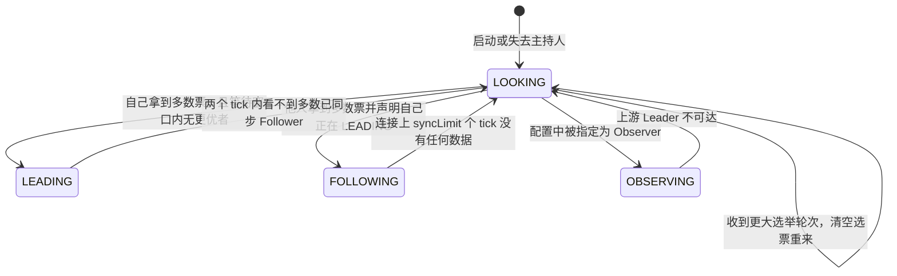
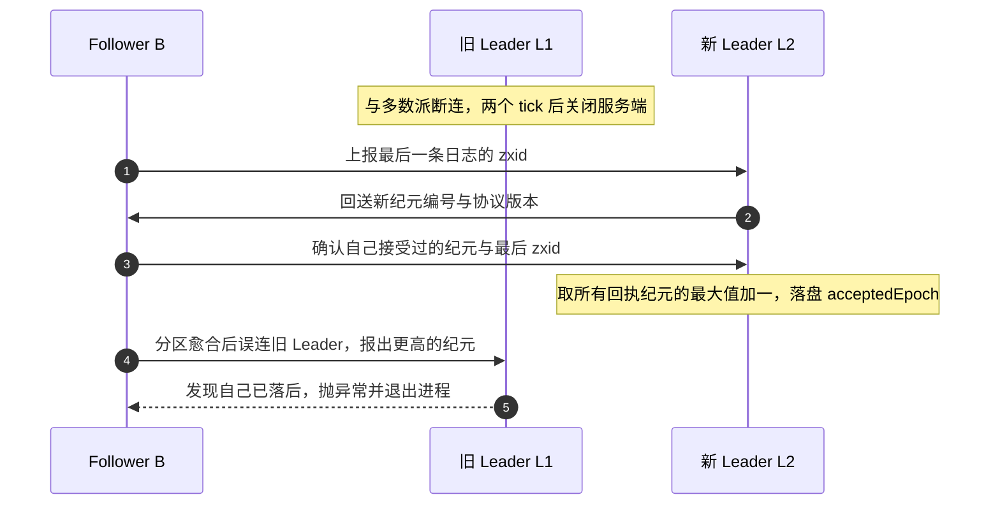
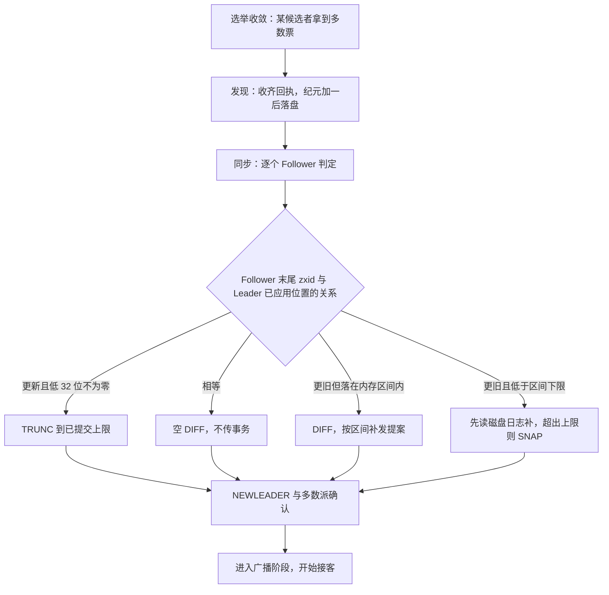
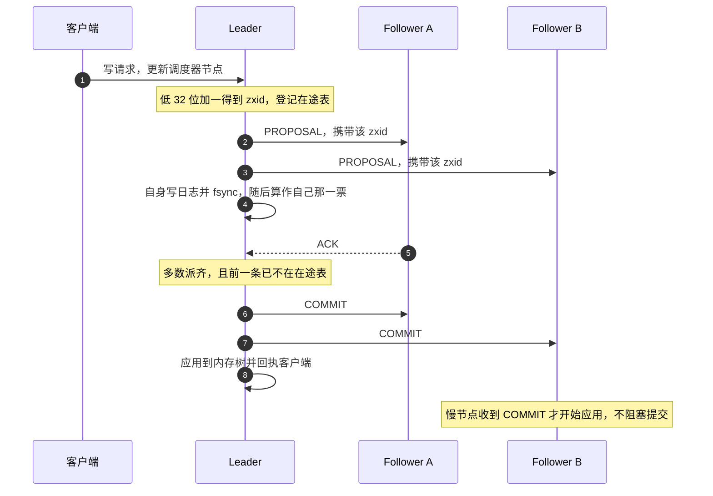

# 02 ZAB 协议——Leader 选举、崩溃恢复与消息广播

**摘要：**

协议论文交出的是性质，实现交出的是动作，而运维每天打交道的偏偏是后者。本篇站在 ZooKeeper 的代码与现场这一侧重讲 ZAB：QuorumPeer 的四个状态怎样切换，FastLeaderElection 的一票里究竟装了哪几个字段，比较顺序为什么必须是纪元在前、zxid 居中、节点编号殿后，发现阶段凭什么用一个落盘的 acceptedEpoch 把旧 Leader 封死，同步阶段又凭什么在 DIFF、TRUNC、SNAP 之间分流，事务日志的 fsync 与 ACK 谁先谁后，`sync` 请求到底做了什么，会话与临时节点在恢复窗口里为什么不按直觉过期。全篇按五问推进：这套协议在进程里是什么形状、它为什么非自研不可、抽掉显式恢复会退化到什么地步、实现与运维要付出哪些代价、这些代价的边界又在哪里。贯穿案例是一套跑在五节点集群上的订单履约系统：订单服务的实例注册、调度器的选主、库存服务的开关配置。读完应当能回答两个问题：一次几十秒的不可写窗口里，时间究竟花在哪一段；日志里那行 `Truncating log to get in sync` 又意味着什么。

---

## 第 1 章 同一套班底，四个角色

### 1.1 角色是现场协商出来的

一台 ZooKeeper 节点启动时并不知道自己要当 Leader 还是 Follower。进程里跑的是同一个 QuorumPeer 对象，它在四个状态之间轮换：LOOKING 表示正在找主持人，FOLLOWING 表示跟着主持人走，LEADING 表示自己就是主持人，OBSERVING 表示只听不投票。除了 Observer 的身份由配置钉死（`peerType=observer`，或在 `server.x` 那一行的末尾缀上 `:observer`），其余三态每经历一次故障都可能换一次，换的过程完全在内存里完成，代价只是几句 `setPeerState` 调用。

这个设计选择值得先看一眼，因为它决定了后面所有故障的形态。把**四种角色塞进同一个进程**，好处是状态迁移不需要重启、不需要重新加载数据树，一次选举收敛之后原来的 Follower 立刻能用内存里现成的结构接客；坏处是故障域重叠，一次长时间的垃圾回收停顿会同时损害它作为 Follower 的及时响应和它作为 Leader 的调度能力，一个进程卡住，两种角色一起失效。

不妨把它想成一支乐队的同一套班底：行头只有一套，开场前推举谁站到中间去，推举不成就没有演出。乐手没有变，位置变了，配合方式也就全变了。

### 1.2 论文交的是性质，实现交的是动作

ZAB 的正式论文发表于 2011 年的 DSN，雏形更早，2008 年的 LADIS 上已有一篇《A simple totally ordered broadcast protocol》。论文把正确性收敛成两条性质：主序性管顺序的传递，任何一个节点投递了后一条事务，就必须已经投递了它前面那条；主完整性管新主的资格，只有包含了此前全部已投递事务的节点才有资格上任。两句话在纸面上足够严密，落到一台机器上却要翻译成一堆具体的东西：一个重启之后依然记得「我见过哪一代 Leader」的文件，一条保证先发先到的 TCP 连接，一张记录「哪些提案已发出但尚未提交」的表，以及一个在多数派失联时肯把自己关掉的循环。

笔者想强调的是这层翻译本身的分量。协议只承诺性质，实现必须选择动作，而同一个性质可以用很多套动作兑现，每套动作的代价落在完全不同的位置：把纪元写成磁盘文件，换取的是重启后的判断力；把顺序托付给 TCP 通道，换取的是消息里可以不带位置信息；把恢复做成集中的一次对齐，换取的是正常路径上可以完全不检查日志连续性。

差别不在理论，在责任分配。理解了这一点，读源码时就不会把某些代码当成冗余，譬如 Leader 在启动时收一遍所有人的纪元、再取最大值加一，看上去只是多一次往返，实际是在替整个集群挡掉「旧主复活」这类最难排查的故障。

为什么非自研不可，答案也可以从实现这一侧看。ZooKeeper 需要的不是一个「就某个值达成一致」的库，而是一个长期在线的服务：它要在角色切换的瞬间接住会话、接住临时节点、接住快照与日志，还要让恢复阶段的结果直接决定「哪些临时节点该消失」。通用共识组件不提供这层对接，把它塞进 ZooKeeper 只会得到两套互相不知道对方在干什么的状态机；自研的代价是多写一套协议，收益是恢复、持久化与会话语义由同一段代码统一裁决。

### 1.3 一次写请求走过的六道工序

订单履约系统里，调度器每隔几秒往 ZooKeeper 写一次「当前活跃实例」的临时节点。这条写请求在服务端并不是一个原子动作，而是穿过一条处理器链，每一道都有自己的职责与顺序约束。

| 工序 | 运行位置 | 职责 | 顺序约束 |
| :--- | :--- | :--- | :--- |
| PrepRequestProcessor | Leader | 校验会话与 ACL，把请求转成事务并分配 zxid | 必须在广播之前 |
| ProposalRequestProcessor | Leader | 把提案分发给每个 Follower 的连接队列 | 按 zxid 递增发送 |
| SyncRequestProcessor | 各节点本地 | 追加事务日志，批量 fsync | fsync 必须在回 ACK 之前 |
| AckRequestProcessor | Leader | 把本地那一票交给 Leader 计票 | 必须在本地 fsync 之后 |
| CommitProcessor | 各节点本地 | 按提交点顺序放行请求 | 提交点之前的写不放行 |
| FinalRequestProcessor | 各节点本地 | 应用到数据树，唤醒等待的客户端 | 最后一步，对外可见 |

表格里最容易被忽略的是第四行。Leader 自己的那一票并不是「我收到了所以我同意」，它由 AckRequestProcessor 在 SyncRequestProcessor 之后提交：Leader 也要先把自己的日志落盘，才把自己算进**多数派**。这条细节把多数派确认的语义钉死在持久化上，所谓**落盘先于回执**，指的是多数节点把这条事务写进了掉电也不丢的地方，而不是多数节点在内存里看到过它。

Follower 一侧的路径对称而略短：客户端请求到达任意节点，若是写请求，FollowerRequestProcessor 会先把请求排进本地流水线，再转发给 Leader，这样回执回来时本地已经有位置可以安放它；读请求不转发，直接由本地处理。订单服务连的是哪台节点并不影响正确性，只影响它读到的东西有多新。

### 1.4 落盘先于回执

把 fsync 放在 ACK 之前，这个顺序不能颠倒。假设某个 Follower 收到提案就先回 ACK、再慢慢写盘，那么一条事务只要凑够多数派的「内存确认」就被提交，客户端随即拿到成功回执；此时集群整体掉电，重启之后那条事务在多数节点上都不存在，客户端手里却握着一张写着成功的凭据。多数派确认的全部意义当场蒸发。

这条规则还有一个不显眼的推论：写延迟的下界里必然包含一次真实的磁盘同步。同机房、普通 SSD 的三节点集群上，一次写落在毫秒量级，其中相当一部分就是这次 fsync 的时间；把事务日志单独挂一块盘之所以能显著改善写延迟的尾部，原因也在这里，它让日志的顺序写不与快照的全量写抢同一块设备的队列。

`zookeeper.forceSync` 这个开关允许关掉强制刷盘，把落盘交给操作系统的页缓存。它在某些测试场景下有用，代价是把「进程崩溃不丢」降级成「整机掉电可能丢最近的若干条」——进程崩溃时页缓存仍在，整机断电时不在。生产集群上关掉它，等于悄悄改变了多数派确认的含义，而客户端对此一无所知。

### 1.5 三个时间参数的量纲

`tickTime` 常被当成心跳间隔，这个理解只说对了一半。它是整个集群的节拍器，心跳、会话过期、选举超时、同步等待都以它为基本单位换算，Leader 每半个 tick 醒一次，每两个 tick 推进一次全局计数。真正决定「多久发现对方不见了」的是另外两个参数。

`initLimit` 管的是「建立关系」的耐心，单位是 tick。Follower 连上 Leader 并完成历史对齐，允许花掉 `initLimit × tickTime`；新 Leader 收集纪元回执、等待多数派回报自己已对齐，用的也是这个上限。超过它，Leader 会放弃这一任，日志里留下一句 `Timeout while waiting for epoch from quorum`，集群回到选举。

`syncLimit` 管的是「维持关系」的耐心，同样以 tick 计。Follower 的 socket 在 `syncLimit × tickTime` 内没收到任何包就判定 Leader 失联，抛异常回到 LOOKING；Leader 侧对称地记录每个 Follower 最后一次回包的时刻，超过同样的窗口就认定它不再同步，轻则把它排除在「已同步集合」之外，重则直接关闭这条连接。

**三个参数是乘法关系**，误配的后果却各不相同。`initLimit` 太小，大数据量的节点每次重启都来不及对齐，Leader 反复放弃任职；`syncLimit` 太小，一次垃圾回收停顿就能让健康的 Follower 被踢下线，集群在「踢掉—重连—再踢掉」之间循环；`tickTime` 太大，故障感知变得迟钝，不可写窗口被无谓拉长。它们必须成组调整，单独改一个往往只是把故障从一处挪到另一处。

---

## 第 2 章 选举：一张票里装了什么

### 2.1 什么时候会进 LOOKING

进入 LOOKING 的路径不止「启动」一条。集群冷启动时所有节点都在 LOOKING，这是最直观的一种；Follower 与 Leader 之间的连接在 `syncLimit × tickTime` 内没有任何数据往来，读 socket 超时，异常被捕获后连接关闭，节点退回 LOOKING；Leader 发现自己与多数已同步 Follower 失去联系，会在两个 tick 之内关掉自己的服务端并退回 LOOKING；动态重配置改变了角色归属时，节点也会重新走一遍选举流程。

四条路径指向同一件事：集群失去了一个被多数派承认的主持人。而「被承认」这个限定词很关键，它意味着一个还能接受客户端连接的进程，未必还是一个有效的 Leader——第 5 章会看到，失效的 Leader 自己就会关掉服务。

顺带说清一个常被误传的细节：怀疑 Leader 失联并不需要等客户端报错，也不需要任何外部探针。Follower 那条 socket 的超时时间是写死的，等于 `syncLimit × tickTime`，所以一个健康的五节点集群里，从 Leader 进程卡死到至少部分 Follower 开始选举，时间是可以用参数直接算出来的，不需要靠监控去「发现」。

### 2.2 一张票里装了什么

FastLeaderElection 把投票消息称为**通知（Notification）**，它不走客户端端口，也不走数据复制端口，而是走每个节点配置里那个独立的选举端口。传输用 TCP 而不是广播式的 UDP，这是刻意的选择：大型集群里 UDP 广播会把一次选举放大成一场网络风暴，而全连接的点对点投递虽然连接数随节点数平方增长，但流量是可预期的。

一张通知里装的东西不多，每一样都有明确用途。`leader` 是发送方推荐谁当主持人，`sid` 是发送方自己的编号，`zxid` 是发送方最后一条日志的事务编号，`peerEpoch` 是它接受过的最大纪元，`electionEpoch` 是它当前所处的选举轮次，`state` 是它此刻的角色，此外还有一个协议版本字段与一份可选的配置信息（3.4.6 之后携带，用于动态重配置期间的选票校验）。

选举端口上另有一层连接管理，平时不显眼，出问题时却很显眼。节点之间为选举单独维持 TCP 连接，每一对节点只保留一条，规则是编号较大的一方主动发起、编号较小的一方接受，重复的连接会被直接关掉。这条规则带来的好处是选举流量完全可预期：一次选举的通知包数量随节点数线性增长，而不是像广播那样随集群规模爆炸。副作用同样真实，每对节点一条连接意味着连接总量随节点数的平方增长，几十个节点的集群可以不在意，上百个节点就得留意选举端口上的文件描述符开销了。

```java
// org.apache.zookeeper.server.quorum.FastLeaderElection
protected boolean totalOrderPredicate(long newId, long newZxid, long newEpoch,
                                      long curId, long curZxid, long curEpoch) {
    // 没有投票权的成员（Observer）被整条挡在比较之外
    if (self.getQuorumVerifier().getWeight(newId) == 0) {
        return false;
    }
    // 先比纪元，再比事务编号，最后用节点编号打破平局
    return (newEpoch > curEpoch)
        || (newEpoch == curEpoch
            && (newZxid > curZxid
                || (newZxid == curZxid && newId > curId)));
}
```

### 2.3 比较顺序为什么是纪元、zxid、编号

这个顺序不是随手排的，每一层的存在理由都能从故障里反推出来，笔者把它记成一句口诀：**纪元定时代，zxid 定长短，编号定胜负**。

第一层比纪元，是在问「谁见过更晚的历史阶段」。一个节点可能参加过纪元协商、把新的纪元写进了磁盘、还没收到任何事务就崩溃了，重启后它的 `peerEpoch` 是新的，最后一条日志却停在旧纪元的某条事务上。这种节点手里的日志并不比别人长，但它知道集群已经走到哪一代，让这样的节点当选，比让一个数据看似更全却停留在旧纪元的节点当选安全得多。

第二层比 zxid，是在同一纪元内部问「谁的日志更长」。这一层只在纪元相同时才有意义，因为不同纪元的 zxid 直接比大小会得出误导性的结论——纪元 3 的尾巴与纪元 4 的开头相比，整数大小关系已经由高位决定了，而真正要判断的是「谁包含谁的日志」。

第三层用节点编号打破平局，是为收敛准备的。两个节点可能纪元、zxid 完全一致，若没有这一层，它们会互相不认输，选举在二者之间反复震荡；加上这一层，比较关系成为严格全序，任何两个候选者都有确定的胜负，收敛才有数学上的保证。这一层几乎用不到，但缺了它，极端情况下集群可以永远选不出结果。

### 2.4 两种纪元不能混用

选举过程中同时存在两个「纪元」，混用是读源码时最常见的误解来源。

`electionEpoch` 是选举轮次，对应代码里的 `logicalclock`。每发起一次新的选举它就自增，作用是仲裁消息的新旧：收到比自己轮次更大的通知，立刻采纳对方轮次、清空已经收集的选票、重新开始；收到比自己轮次更小的通知，直接丢弃，因为那是上一轮残留的声音；只有轮次相同时，才轮到比较候选者的优劣。

`peerEpoch` 是**已接受的纪元**，落在数据目录里，跨重启保留。它回答的是「这个节点见证过哪一代 Leader」，与当前进行到第几轮选举毫无关系。

把两者混成一个量，最直接的后果是重启之后的节点会「忘记」自己见过更高的纪元，于是把一个已经过时的旧 Leader 当作合法候选者推荐出去。3.5 之后，ZooKeeper 把这两个纪元显式落盘为 `currentEpoch` 与 `acceptedEpoch` 两个文件，并在启动时做交叉校验：如果日志里最大 zxid 的纪元比 `currentEpoch` 还新，进程拒绝启动并报出 `is older than the last zxid`；如果 `acceptedEpoch` 小于 `currentEpoch`，同样拒绝启动。这套取向可以概括成四个字：**宁可起不来**。它宁可让进程拒绝启动，也不带着自相矛盾的纪元加入集群，而这条原则贯穿了整个恢复流程。

### 2.5 二百毫秒的等待窗口

拿到多数票并不等于选举结束。FastLeaderElection 在确认某位候选者已经获得多数支持之后，还会再等一个固定窗口（`finalizeWait`，默认 200 毫秒），把这段时间里收到的通知逐条比较一遍；只要出现一条更优的通知，就把票放回队列、更新推荐、重新开始计票。只有这 200 毫秒内再无更优者出现，才真正落定。

这段等待买的是**少一次选举**。多数票只说明「到目前为止，这一位领先」，网络里可能还有一条更优的通知正在路上，若不等它，集群会先选出一个次优者、立刻发现更好的候选者、然后再选一次，两次选举的代价远大于 200 毫秒。这就好比评标时唱完票还要留一个质疑窗口，窗口内无人申诉才宣布结果。

收不到任何消息时的行为也值得记一笔。等待时间从 200 毫秒开始逐次翻倍，封顶 60 秒；每次超时都尝试重发通知或主动建立连接。这个退避策略让选举在短暂抖动时迅速收敛，在网络长期不通时又不至于把选举端口打成一片噪音。理解它的现实意义在于，看到选举耗时从毫秒级突然变成秒级，通常不是节点变慢了，而是有通知包丢了，集群在按退避节奏重试。

### 2.6 重启的节点如何直接入伙

按上面的描述，一个重启的节点似乎必然触发一轮全局选举：它进 LOOKING、投自己一票、把通知发给所有人。若真如此，滚动重启就成了运维噩梦。实现里有一条捷径绕开了它。

已经在 FOLLOWING 或 LEADING 状态的节点收到选举通知时，并不会重新投票，而是回一条携带自己当前角色的通知。重启的节点把这些回执收集到一个独立的集合里，若某个 Leader 编号在该集合中拿到多数、且该 Leader 自己也声明处于 LEADING，它就直接承认这个结果，不再走完整的计票流程。

这条路径的效果是：单节点重启、滚动重启都不会惊动正在服务的集群。反过来，若集群真的没有 Leader，任何节点都不会发出 FOLLOWING 或 LEADING 的回执，捷径自动失效，选举照常进行。捷径只在「已有稳定主持人」时成立，而它判断「稳定」靠的正是多数派回执加上 Leader 本人的确认，两道条件缺一不可。

### 2.7 选举状态机

把状态与转移画在一起，四个角色之间的往来就清楚了。图中每一条回到 LOOKING 的边，都对应一种「主持人不再可信」的情形。



图里那个 LOOKING 的自环是理解选举耗时的关键。它不是一个错误状态，而是「本轮没有定论」的正常出口：轮次自增、选票清空、重新广播，直到某一轮里出现一个稳定的多数。

### 2.8 选举期间集群长什么样

LOOKING 状态下节点不接受客户端请求。已经连上的客户端会看到连接被断开或请求超时，具体表现取决于客户端库的重试策略；多数客户端会反复重连，直到某台节点重新可用。订单履约系统在这个窗口里的直接表现是：调度器的心跳写入失败，重试若干次后成功；库存服务的配置监听没有新事件，读到的仍是旧配置。

有一种例外叫**只读模式**（3.4 起提供，需显式开启 `readonlymode.enabled`，且客户端要显式允许）。它让失去多数派的节点继续回答读请求，代价是这些读完全没有新鲜度保证。把它当作高可用兜底是一种危险的误用：故障的表现会从「明显不可用」变成「悄悄读到旧数据」，后者对上层业务的伤害往往更大。

这个窗口该有多长，是三个阶段的加总：选出候选者的时间、新 Leader 与多数派对齐历史的时间、多数派确认新纪元的时间。三段的量级差别很大，对齐一段常常占大头，这也是第 5 章要单独量它的原因。

### 2.9 Observer 凭什么不投票

Observer 是这套协议里唯一「角色由配置决定」的成员。它在配置里被标成观察者，启动后直接进入 OBSERVING，不参与计票；即便有通知包发到它这里，接收方也会用成员资格过滤掉它。它接收 Leader 广播的提案与提交消息，把它们应用到本地数据树，因此能提供读服务，也能承接跨机房的读流量。

**Observer 扩的是读，不是写**：它带来的是读能力与地理分布，而不是写能力。写仍然要经过 Leader 分配 zxid、经过多数派确认，Observer 既不在这条多数派的算术里，也不缩短任何一次写的往返。多放几个 Observer 不会让写更快，只会让「多一个机房的读副本」这件事变得便宜——它不改变 quorum 的规模，因此不需要重新评估容错阈值。

代价有两处。其一，Leader 的扇出变大，每个 Observer 都是一条独立的复制连接，Observer 太多会把 Leader 的网络出口变成瓶颈。其二，Observer 读到的状态比 Follower 更旧，因为它从不参与确认，只能被动接收提交消息；把「读自己的写」这种要求交给 Observer 所在的节点，出错概率会明显上升。

---

## 第 3 章 恢复：把纪元往前推一格

### 3.1 发现阶段在实现里的三步

选举只产出三样东西：谁是主持人、它的最后一条事务编号、它所在的选举轮次。这些东西不足以开工，新 Leader 还必须知道「当前是第几代」，否则它无法判断自己收到的写请求属于新的一代还是旧主的残留。

发现阶段的第一步是收集。Follower 连上 Leader 后先报自己的信息，Leader 回一条携带新纪元编号与协议版本的消息，Follower 再回一条确认，里面带着自己当前的纪元与最后一条 zxid。第二步是协商：Leader 把所有回报的纪元取最大值加一，作为自己的提案，并等到这个提案被多数派接受。第三步是校验：Leader 拿到每个 Follower 的状态摘要之后，与自己的摘要比较，若发现某个 Follower 比自己更新，直接抛异常退出——日志里写作 `Follower is ahead of the leader`。

第三步是最容易被忽视的一道保险。理论上选举已经保证「当选者的日志不落后于任何投票者」，但现实里存在时钟、配置、人为操作的干扰，这条校验等于在开工前再对一次账：只要有一个成员比新 Leader 更新，这一任就作废，宁可重来一次选举，也不带着可能缺失的历史开工。

对应的，Follower 一侧也有一道对称的校验：Leader 提出的纪元若小于自己已经接受过的纪元，它会拒绝跟随，报出 `Epoch of leader is lower` 并断开。两道校验方向相反，共同保证「纪元不会被往回推」这件事在实现层面成立，而不只是停留在论证里。

### 3.2 纪元落盘与两道启动校验

纪元的持久化不是装饰。每个节点在数据目录里保存两个文件：`currentEpoch` 记录它已经正式进入的纪元，`acceptedEpoch` 记录它协商过、接受过的纪元。前者随 NEWLEADER 的确认推进，后者随发现阶段的协商推进，后者总是大于或等于前者。

启动时，节点读回这两个文件，再读日志里最大 zxid 的纪元，三者做交叉校验：日志的纪元若比 `currentEpoch` 还新，说明磁盘上的数据比记忆里的纪元更靠前，进程拒绝启动；`acceptedEpoch` 若小于 `currentEpoch`，同样拒绝启动。两条校验都指向同一类事故——数据目录里的东西不配套。

这类事故在生产上并不罕见。把旧备份的日志与快照拷回一个纪元文件更新的目录，或者把两台机器的数据目录混在一起，都会撞上它。它看起来是个麻烦，实际是在替运维兜底：如果放任一个纪元自相矛盾的节点加入集群，它会在同步阶段做出谁也无法预测的判断，而那种故障的表现形式是「数据莫名其妙地回退」，排查成本远高于一次起不来。

### 3.3 纪元推进与旧 Leader 隔离

用一个分区场景把上面这些机制串起来，可以看清「旧主复活」是怎样被挡住的。图中旧 Leader 那一侧的动作，正是第 5 章要展开的自我退位。



图里最后一行的方向值得停留。挡下旧主的不是它的自我反省，而是一个比它更年轻的纪元：只要有一个见过新纪元的节点连上来，旧主就会在比较中输掉，然后主动退出。这也解释了为什么「把旧机器的数据目录直接起起来」这种操作很危险——它可能带着一个更年长的纪元回到集群，让整个集群的纪元协商陷入僵局。

### 3.4 同步阶段：三个基准点与五个分支

对齐历史时，Leader 手上有三个基准点。`lastProcessedZxid` 是它内存数据树已经应用到的位置，也就是权威历史的末尾；内存里还保留着最近若干条已提交提案，形成一段区间，区间的上下界分别是 `minCommittedLog` 与 `maxCommittedLog`，容量由实现常量决定，默认是 500 条。

三个基准点把判定分成五条路。第一，Follower 的末尾与 `lastProcessedZxid` 正好相等，说明它完全跟上了，只发一个空的 DIFF，不传任何事务。第二，Follower 比 `maxCommittedLog` 还新，说明它手里握着 Leader 并不认识的尾部，先发 TRUNC 让它截到 `maxCommittedLog`，随后从那个位置继续转发在途的提案。第三，Follower 落在区间之内，直接从内存里的提案清单补发它缺的那一段。第四，Follower 比区间下限还旧，但磁盘上的事务日志同步仍然开启，则先从磁盘日志补，补到区间起点之后，再用内存里的提案接上。第五，以上都不成立，只能整棵树重传，也就是 SNAP。

第四条路是 3.5 之后才完整的优化，它把「落后很多」这个笼统的判断拆细了：真正的分界不是「落后多少条」，而是「磁盘上还留不留得住那段历史」。从磁盘读日志有明确的上限，大约是最近一次快照大小的三分之一（由 `zookeeper.snapshotSizeFactor` 控制，默认 0.33）；超出这个上限，说明读磁盘的成本已经接近传整棵树，此时 SNAP 更划算。

内存里那 500 条的容量在生产上有直接含义。健康集群里，一个心跳间隔内 Follower 落后的事务数通常只有几十条，一次持续几秒的停顿也不过百余条，所以这个区间覆盖了绝大多数「短暂掉队」；反过来说，若某台机器经常因为落后而走到 SNAP，它落后的事务量早已超出这个区间，问题就不在同步策略上，而在这台机器的持续处理能力上，换盘或者换角色比调参数更有用。

顺带把 zxid 的位段说清楚，因为同步阶段的几处判断都建立在这上面。64 位里高 32 位是纪元，低 32 位是这一任期内的计数器，读取时不过是两次位运算。

```java
long epoch    = (zxid >> 32) & 0xffffffffL;  // 这一条属于哪一代 Leader
long counter  = zxid & 0xffffffffL;          // 这一代里的第几条
boolean atBoundary = counter == 0;           // 只可能是 NEWLEADER 或刚收完快照的位置
```

三段对应三处判断：比新旧时先比高位再比低位，判断某条属于哪一代时取高位，判断它是不是纪元边界时只看低位是否为零。旧 Leader 的隔离、TRUNC 的特例、快照之后节点停在什么位置，全都落在这么几次位运算上。这种编码的价值不在省空间——两个 32 位整数拼成一个 64 位整数，占的字节数一模一样——而在于把「之后所有环节都要反复回答的问题」提前压进一个整数里。

还有一个不起眼但必须处理的特例。新 Leader 上任时把本地 zxid 设为「新纪元、第 0 号」，这个编号不对应任何真实事务；刚同步完的 Follower 也可能停在这个编号上。如果它重启回来，Leader 会在自己的历史里找不到这个 zxid，按常规逻辑就会判定「Follower 更新」并发出 TRUNC，去截断一段根本不存在的日志。实现里为此专门判了一下：只要末尾 zxid 的低 32 位是 0，就跳过 TRUNC 判断，改走 DIFF。

### 3.5 同步分支的判定树

把三阶段的顺序与同步阶段的分支画成一张判定树，可以看到**以 Leader 的历史为准**这条原则具体怎么落地。



树里 TRUNC 那条分支的位置，是理解截断性质的关键。截断不是终点，它只是把多出来的部分砍掉，砍完之后 Leader 从截断点开始把在途的提案继续转发过去，再走 NEWLEADER 与确认流程。所以「截断」与「补齐」是两件不同的事：前者砍掉对方多出来的，后者补上对方缺少的，一次同步里可能只发生其中一件，也可能先砍后补。

### 3.6 三种动作在磁盘上留下什么

三种动作的性质差别很大，运维上必须分清。

DIFF 最轻。它不改变本地快照，不重写日志，只在已有的历史后面追加缺失的事务，完之后节点立刻可以服务。看到 `Getting a diff from the leader`，意味着这个节点只是短暂掉队。

TRUNC 重得多。它要求 Follower 清空内存数据库、把事务日志文件截断到指定位置、删掉后续的日志文件，然后从最近的快照开始重放日志，重建整棵数据树。截断一次，等于本地做了一次**小型重启**。如果截断时发现日志文件根本不可读——日志被误删、数据目录被换过、文件系统损坏——Follower 不会带着半截状态继续入伙，而是直接以退出码 13 结束进程。这个行为的用意很明确：宁可退出让人来处理，也不要带着可能不一致的历史加入集群。

SNAP 则是全量。Leader 把整棵数据树序列化后通过网络发过来，Follower 端清空本地状态、装载快照，然后读一个固定字符串作为流完整性的签名，签名不符就断开重来。传输完成之后，Follower 会立刻在本地落一份快照，避免下次重启时又要把很长一段日志重放一遍。

三种动作都会在日志里留下痕迹，而这些痕迹是排查恢复问题的第一手材料：`Truncating log to get in sync` 说明有节点握着未提交的尾部；`Getting a snapshot from leader` 说明它落后得太多；`Getting a diff from the leader` 说明只是小追赶。

### 3.7 什么时候算可以接客

**对齐完成不等于可以服务**。Leader 在启动时会把「新纪元、第 0 号」这个位置做成一条正式的提案，走与其他事务完全相同的广播与确认流程，随后等多数派的确认回执，只有收齐了多数派，才真正打开服务端的请求处理开关。

这个等待的必要性来自多数派的定义。假设新 Leader 只与一个 Follower 对齐就开张，它接下来接受的写可能落在一个不含历史的多数派上，等于在一条与过去断开的支线上继续写；等第三个节点回来，两段历史无法拼接，只能整棵树重传，一次本可避免的雪崩。

等待有超时。超时之后 Leader 放弃这一任，日志里留下 `Waiting for a quorum of followers, only synced with sids: [...]`，紧接着还有一句更实用的提示：`Perhaps the initTicks need to be increased.`。这句提示在生产上极有价值，它把「反复选举」的直接原因指向了参数与数据量的不匹配，而不是网络或磁盘。

### 3.8 会话与临时节点在恢复窗口里的行为

订单服务的实例注册依赖临时节点，所以「恢复期间临时节点会不会消失」是必须讲清的一件事，而它的答案与直觉相反。

会话表存在快照里，恢复时随快照一起装载；会话过期的判断由 Leader 侧的会话跟踪器按 tick 推进，而它在服务真正启动之前并不运行。恢复窗口里没有人为会话记账，不会出现「因为恢复花了三十秒，所以一批会话同时过期」这种事。更反直觉的是重启后的处理：装载进来的每个会话都会被重新赋予一个完整的超时期限，因此集群整体停机十分钟，也不会让所有会话在启动瞬间失效。

真正让临时节点消失的，是客户端先放弃。客户端在超时窗口内连不上任何节点，会关闭连接并向上层报出会话失效，业务代码随后重建会话、重新注册实例——此时旧会话在新 Leader 上的过期处理只是补完手续。这也是为什么故障之后常见的现象不是「恢复完成瞬间掉了一批节点」，而是「恢复完成后一到两个超时窗口内，注册表陆续少掉一批实例」：上层重连与重建的节奏，而不是服务端的恢复进度，决定了这个节奏。

不过有两处边界要记住。其一，恢复窗口若超过会话超时，那些在恢复期间无法心跳的会话会在一恢复后的第一批扫描中被清掉，临时节点随之消失；其二，SNAP 与 TRUNC 都会重建会话表，如果快照本身很旧而日志又不足以补齐会话，重建出来的会话集合可能并不完整——这也是「不要随便用旧快照启动节点」的另一个理由。

---

## 第 4 章 广播：两阶段与它的账

### 4.1 提案从分配到落盘

正常状态下，Leader 收到写请求后做的第一件事是分配编号：把本地 zxid 的低 32 位加一，得到本次事务的全局位置，然后把提案放进在途表，记录为「最后一条已提案」，再按顺序分发给每个 Follower 的连接队列。每个 Follower 有一条独立的连接与独立队列，所以「广播」在实现上是多个单播，靠每条连接内部的先进先出保证顺序。

Follower 收到提案后先写事务日志，写完之后才回确认。Leader 收集确认，连同自己那一票一起计算是否达到多数派；达到之后，提交点前移，向所有 Follower 广播提交消息，同时把这条提案交给本地提交处理器去应用。Follower 收到提交消息后，才把它从事务日志里取出、应用到内存数据树。

四步连起来是一条时序，其中有两处位置经常被记错：Leader 自己那一票在落盘之后，提交消息的广播在提交点前移之后。



图里最后一条注释是理解延迟分布的关键。提交点只等多数派，不等全体；慢节点被留在后面自己追。这让一次写不会被最慢的那台机器拖住，代价是集群内部短暂存在「已经提交但某些节点还没应用」的不一致窗口，而这个窗口正是下一节要谈的读可见性问题。

### 4.2 提交不能跳号

**提交必须严格按 zxid 递增推进，中间不能留空洞**。实现里的判据很直接：提交某条提案之前，先看前一条是否还在在途表里；只要它在，就必须等。

理由用一次订单状态更新就能说明。同一次请求里，业务先创建 `/orders/20261119/flag` 的父节点，再写子节点下的标记，两条事务相邻。如果后一条先凑够多数派就被提交，一部分节点会先应用子节点、后应用父节点，中间那个瞬间数据树里存在一个父节点不存在的子节点；这种中间状态一旦被读请求撞见，业务就会看到自相矛盾的树。

这条规则在实现里还有一层冗余检查：若提交的编号不等于「已提交点加一」，日志里会打印一条警告，说明出现了不该出现的跳号。正常情况下这条警告永远不该出现，它出现就意味在途表与提交点的记账出了偏差。

代价是刻意的队头阻塞。一条凑不齐多数派的提案会卡住它后面所有提案的提交，无论后面那些是否已经凑够。这个代价在协调场景里可以接受，因为写频率低；但它解释了一个常见的性能错觉：客户端连发两个写，第二个明显更慢，延迟差未必来自磁盘——如果第一个撞上了一台慢 Follower 的落盘，第二个就得排队等它。

### 4.3 读可见性由应用进度决定

ZooKeeper 的读不经过共识，在本地数据树上执行，因此**可见性等于本节点的应用进度**：一条写何时可见，答案不是「提交之后」，而是「本节点应用之后」。

三个角色的应用时机并不相同。Leader 在提交点前移后立刻应用，不等 Follower 知道提交点已经前移；Follower 要等提交消息到达才应用，而提交消息与下一条提案共用同一条连接，所以它的应用进度天然落后 Leader 一点；Observer 与 Follower 相同，只是它从不参与确认，落后得可能更多。

由此可以推出一条实用结论：写请求返回成功，说明「多数派已经持久化」，不说明「所有节点都看得见」。客户端 A 写入成功之后通知客户端 B 去读，B 若连在另一台节点上，完全可能读到旧值。这不是缺陷，而是读路径绕开共识的必然结果，第 6 章会给出它的边界与补偿手段。

同一会话内的「读己之写」是另一回事，它靠的不是读请求去等提交点，而是提交处理器把同一会话里排在写请求之后的读请求压住，直到那条写被提交并应用，才放行读。这条机制只在会话之内有效，会话一换，依据就没了。

### 4.4 sync 请求到底做了什么

**`sync` 不是本地刷新**。它常被当成刷新缓存，实际比这重，也比这具体。

客户端在一个 Follower 上发起 sync，请求会被转发给 Leader。Leader 处理它时不分配新的 zxid，也不写事务日志，只做一件事：看当前有没有在途提案。若一条都没有，立即回执；若有，就把这个请求挂在「最后一条已提案」那个编号上，等到提交点推进到那个编号时，连同提交一起回执。

这个实现细节决定了它的两种表现。集群空闲时，sync 就是一次纯往返，代价很低；集群繁忙时，它要等在途的写全部落定，代价接近一次完整的写延迟。两种情况下它达成的效果相同：从回执这一刻起，发起 sync 的那个节点必然已经能看到此前所有已提交的写入。

把它和「强制读 Leader」对比，取舍就清楚了。让所有读都落在 Leader 上确实能读到最新，但 Leader 一换，所有客户端都要重连，切换期间的读全部中断；而 sync 是为少数需要强保证的读路径准备的补丁，它把成本压在那几次读上，不让整个集群为它买单。

### 4.5 组提交与 fsync 的账

每次写都单独 fsync，延迟会被磁盘的同步开销吃掉。实现用的是组提交：写请求进入一条队列，落盘线程按批取出、一次 fsync 覆盖一批。批的边界取决于队列长度，队列最长能攒到一千条左右；队列一空就立刻刷，不再等。

这个策略在低负载与高负载下表现不同。请求稀疏时，队列刚进一条就空，等于每条事务一次 fsync，延迟由磁盘决定；请求密集时，一批事务共享一次 fsync，单条摊销的成本大幅下降，代价是最先进入批的那条要等一会儿，延迟的分布变得不那么均匀。

日志文件的组织方式也服务于这个策略。事务日志按块预分配，追加写落在已经占好的空间里，避免每次写都去改文件长度；日志写到一定条数就滚动，滚动的同时触发一次快照，而快照的触发点还带一点随机偏移，防止整个集群在同一时刻一起做全量序列化。整件事的设计取向是一致的：把能合并的开销合并掉，把不能合并的（比如多数派往返）留在必经路径上。

---

## 第 5 章 故障在集群上长什么样

### 5.1 隔离：Leader 自己会退位

关于脑裂，有一个流传很广的说法是「ZooKeeper 的旧 Leader 会继续接受写，只是提交不了」。这个说法把「来不及提交」与「继续接客」混成了一件事，而在实现里，这两件事被一条明确的检查拆开了。

真实的行为是：Leader 每两个 tick 检查一次自己还能看到多少「已同步」的 Follower，判据是这些 Follower 在 `syncLimit` 个 tick 内回过包；一旦这个集合凑不够多数派，Leader 直接关闭自己的服务端并退回 LOOKING，日志里留下 `Not sufficient followers synced, only synced with sids: [...]`。

这个设计的实际效果是**快速失败**，而不是静默挂着。客户端连在被隔离的旧 Leader 上，会在两个 tick 内收到连接断开，然后去别处找可用节点，而不是把写请求挂在一条永远等不到提交的路径上。对上层系统而言，快速失败远比长时间挂起友好，因为前者能触发重试与降级，后者只会耗尽线程与连接池。

### 5.2 分区愈合：两道纪元校验

旧 Leader 退回 LOOKING 之后，就只是一个普通的少数派节点。它要重新入伙，必须通过纪律检查。

第一道检查在它自己身上：想当 Leader，得先拿到多数票，而它连不上多数派，自然拿不到。第二道检查在别人身上：分区愈合后，如果它还残留着 LEADING 的身份并接受 Follower 的连接，连上来的 Follower 会报出更高的纪元，它一比较就发现自己落后，随即抛异常退出进程。第三道检查在 Follower 一侧：如果它去连一个新 Leader，发现对方提出的纪元比自己接受过的还小，它会拒绝跟随并断开。

三道检查合起来，效果是「新纪元必然压过旧纪元」。这也是为什么纪元这个量在整套协议里如此关键：它不需要任何额外的心跳或租约，就能让所有节点对「谁是过期的」达成一致判断。

### 5.3 频繁选举的三种成因

集群每隔几分钟出现一次不可写窗口，节点本身却都很健康，这类现象在生产上有一组固定的成因。

其一是参数倍数关系被破坏。`initLimit × tickTime` 必须显著大于「一次完整对齐所需的时间」，`syncLimit × tickTime` 必须显著大于「一次垃圾回收停顿加一次网络往返」。谁把 `initLimit` 按默认值配给了一个数据量几十 GB 的集群，谁就会看到 Leader 反复放弃任职。

其二是跨网络域的部署。多数派若跨了高延迟链路，心跳往返时间会接近 `syncLimit` 的容忍上限，容错余量被压缩到几乎没有，一次正常的网络抖动就够触发选举。

其三是节点自身的停顿。长时间的垃圾回收、页缓存抖动、磁盘队列打满，都会让一个健康的进程在几秒内不响应任何网络事件。这类停顿在监控上通常有痕迹，但在「只有选举频繁」这一个症状时很容易被忽略。

排查顺序也因此明确：先看参数与数据量是否匹配，再看部署拓扑的往返时间，再看节点本地的停顿，最后才怀疑网络本身。反过来，一上来就调大 `tickTime` 是最差的处置，它把故障感知整体变钝，把「频繁选举」换成了「长时间不可用」。

### 5.4 截断、快照与坏盘

掉电之后重启的节点，日志尾部可能留下一条已经写入但从未提交的记录。它连上新 Leader 时，报出的末尾 zxid 比 Leader 认识的还新，于是被要求截断。

这一步是安全的，因为那条记录从未被多数派确认过，它在一致性意义上不存在。但它对磁盘不客气：截断意味着清空内存、切短日志文件、从最近的快照重放一遍。若此时日志文件已经损坏到无法定位截断点，节点不会勉强继续，而是直接退出。运维看到的现象是「这台机器每次重启都起不来，进程以退出码 13 结束」，处置方向不是重启，而是清空它的数据目录让它走 SNAP 重来，或者从别的节点拷一份完整的数据目录。

比截断更常见的是反复快照。一个落后很多的节点回来，判定会走到 SNAP：整棵树传输、本地落快照。若这个节点因为磁盘慢而反复落后，它每次回来都要重传一次整棵树，形成「落后—重传—再落后」的循环。这时该动的是它的磁盘或它的角色（把它换成 Observer），而不是继续等它自己追上来。

### 5.5 纪元断层

有一类事故的现场很整齐：节点起不来，日志里写着纪元与 zxid 不匹配。

它通常来自数据目录的搬迁。运维为了「快速恢复」，把一台旧机器的数据目录整个拷到新机器上，或者把某个节点的备份回滚到几天前；快照与日志是配套的，但纪元文件可能与它们不配套。启动校验一旦发现日志里的纪元比纪元文件记录的更新，就拒绝启动。

处置的原则是「配套而不是拼凑」：要么整份数据目录一起回滚，要么清空数据目录让它从 Leader 走 SNAP 重来，不要只替换其中一部分文件。前者的代价是可能丢一段已提交的历史（如果那份备份确实太旧），后者的代价是一次全量传输，但结果一定收敛。判断依据在于这份历史是否还能从集群里其他地方拿到——只要多数派还在，就一定能拿到，那么清空重来就是更安全的那条路。

### 5.6 会话雪崩

故障的连锁反应常常落在会话上。集群经历一次几十秒的选举加同步，客户端在这段时间里反复重连失败；会话超时设得比较短的业务，会在恢复后的几分钟内集中报出会话失效，随后大量临时节点消失、实例重新注册、锁被重新争抢。

这个链条的源动力在客户端一侧。会话超时是客户端与服务端协商出来的，客户端在窗口内连不上任何节点就会放弃；服务端在恢复期间并不会主动让会话过期，但恢复完成后，那些已经超过窗口、又没有成功心跳的会话会被一次性清掉。

缓解手段因此集中在三处：把会话超时调到能覆盖一次正常的选举与同步；让客户端库的重试策略与集群的恢复时长匹配，而不是默认的固定次数；把「实例重新注册」做成幂等操作，避免恢复期间的重复注册把注册表搅乱。

### 5.7 可观测：指标与日志关键字

ZooKeeper 自带四字命令，其中 `mntr` 输出的指标与这套协议的内部状态几乎一一对应：`zk_server_state` 给出当前角色，`zk_followers` 给出连着的跟随者数量，`zk_synced_followers` 给出其中「已同步」的数量，`zk_pending_syncs` 给出正在等待提交点推进的 sync 请求数量，`zk_outstanding_requests` 给出积压的请求。日志侧则有几个稳定出现的关键字。

| 现场表现 | 关键指标或日志 | 处置方向 |
| :--- | :--- | :--- |
| 写全部超时、读仍可用但可能是旧值 | `zk_server_state` 显示 looking | 等选举完成；超过 `initLimit × tickTime` 仍在 looking，查多数派连通性 |
| Leader 自行关闭服务端 | `Not sufficient followers synced` | 查网络分区与对端进程，不要重启少数派节点 |
| 延迟尾部抖动、偶发写超时 | `Closing connection to peer due to transaction timeout` | 查被断开节点的磁盘与垃圾回收停顿 |
| 节点短暂掉队后迅速恢复 | `Getting a diff from the leader` | 正常现象，无需处置 |
| 恢复期网络流量突增 | `Getting a snapshot from leader`、`zk_pending_syncs` 上升 | 缩数据量、把日志目录与快照目录分盘 |
| 选举反复发生 | `Perhaps the initTicks need to be increased` | 核对 `initLimit` 与数据量、对齐耗时是否匹配 |
| 节点起不来 | `is older than the last zxid`、`accepted epoch is less than the current epoch` | 数据目录与纪元文件不配套，整份回滚或清空重来 |

表里每一项都能倒推回前述某个机制：第一行对应选举窗口，第二行对应 Leader 的自我退位，第三行对应慢 Follower 的驱逐，第四、五行对应同步阶段的分支，第六行对应纪元协商的等待上限，第七行对应启动校验。把这张表记熟，比记一堆参数默认值有用得多。

---

## 第 6 章 边界与反例

### 6.1 把 sync 当成本地刷新

`sync` 不读磁盘缓存，也不刷新任何本地状态，它做的是「与 Leader 对一次坐标」。空闲时它只是一次往返，繁忙时它要等在途写落定，把它当成廉价的本地操作嵌进热点路径，会得到一串无法解释的延迟尖刺。

### 6.2 把 Observer 当作扩容手段

把 Observer 加进配置，换来的是读副本与跨机房分布，换不来写能力。写仍然要过 Leader 分配编号、过多数派确认，多放几个 Observer 不会让任何一次写变快；反过来，Observer 太多会把 Leader 的复制扇出撑成瓶颈，还会让「读到自己的写」这种要求在跨机房场景下更容易失败。

### 6.3 把 tickTime 调小当作提升故障感知

故障感知的时间由 `syncLimit × tickTime` 决定，但缩减这个乘积会同时压缩容错余量。真正该做的是让参数与数据量、网络往返时间匹配，而不是把节拍器调快；调快之后，选举风暴与反复截断会一起来。

### 6.4 把 TRUNC 当作数据丢失

截断的对象是「已广播但从未被多数派确认」的事务，这些事务在一致性意义上从未生效。真正需要担心的是另一种情形：某个节点因为磁盘损坏而丢了一段已提交的日志，此时它会表现为「落后」而不是「更新」，走的是 DIFF 或 SNAP 补齐，历史仍然完整。把两者混为一谈，会让人在真正该紧张的时候放松，在不该紧张的时候过度处置。

### 6.5 把「数据最多」当作当选理由

选举比较的是三个量：纪元、zxid、节点编号。一个节点可能日志很长却停留在旧纪元，它不会当选；一个节点可能数据量与别人相同，靠节点编号打破平局才胜出。用「谁的磁盘最大」来预判选举结果，在动态重配置与多轮重启之后必然出错。

### 6.6 把手工操作当作自愈

在多数派不可达时重启剩余节点、修改配置文件里的一台机器地址凑数、把某台机器的数据目录拷来替代故障节点，这些动作的共同点是绕过了纪元与多数派的纪律，把它们从「可自愈的故障」变成了「需要人工恢复的数据事故」。协议已经把「多数派不可达就停止写」定义成正确行为，人的干预应当放在恢复网络与主机上。

### 6.7 把动态重配置当作无损扩容

3.5 之后可以用 `reconfig` 在线增删成员，看起来像一次无损扩容，过渡期的代价却常被低估。提交一条新配置时要求新旧两份配置各自凑够多数派，任何一次提交都必须同时取悦两套人马；在过渡完成之前，写延迟会因为要多等一方回执而上升，而这段窗口的长度取决于新成员同步完整数据树所需的时间。把它当成「改个配置就完事」，多半会在扩容当天收获一批写超时。

行文至此，可以把这一篇的落点收在一处：这套协议把复杂性赶到了两个地方——恢复阶段的集中对齐，以及纪元这套簿记。正常路径因此干净得近乎单调，一条提案、一次落盘、一次确认、一次提交，没有多余的分支；异常路径则重得需要有专门的日志关键字、专门的指标、专门的参数纪律去配合。这笔交换是否划算，取决于业务对「不可写窗口」的容忍度与对「数据不丢」的要求哪个更硬，而不取决于协议本身先进与否。

---

## 第 7 章 落点

回到最初那个问题：为什么这套协议要在广播之外单独做一个恢复阶段。答案在代码里比在论文里更直白——因为「多数派已持久化，但提交消息还没发出去」这个中间状态是真实存在并且高频出现的，每一次 Leader 切换都会批量产生它。把这个状态的处理集中到一个显式的阶段，代价是切换变慢，收益是正常路径可以完全不检查历史。

另一个值得带走的判断是「纪元」的地位。它不是时间戳，不是版本号，而是一个可以被落盘、被协商、被比较的权威标记：谁拥有更大的纪元，谁就是当下的权威，旧权威不需要被说服，只需要被比较。整套恢复流程的确定性，几乎全部建立在这一点上。

至于不可写窗口，它是单写者模式的必然账单，只能被缩短，不能被取消。缩短的手段有两处：把对齐阶段的数据量与带宽算清楚，把纪元协商的等待上限配到与数据量匹配。至于「取消单写者」，那是另一个协议要回答的问题了。

---

## 专栏导航

- 上一篇：[[01 ZooKeeper 全局架构——数据模型与会话机制]]。
- 下一篇：[[03 分布式锁与 Leader 选举的工程实现]]。
- 返回专栏首页：[[00 专栏导览]]。

---

## 参考资料

1. Apache ZooKeeper 3.5 源码：`FastLeaderElection.java`、`QuorumPeer.java`、`Leader.java`、`Follower.java`、`Learner.java`、`LearnerHandler.java`、`QuorumCnxManager.java`（`quorum` 包）。
2. Apache ZooKeeper 3.5 源码：`ZKDatabase.java`、`SyncRequestProcessor.java`、`SessionTrackerImpl.java`、`persistence/FileTxnLog.java`、`persistence/FileTxnSnapLog.java`、`command/MonitorCommand.java`。
3. Reed B, Junqueira F. A simple totally ordered broadcast protocol. LADIS 2008.
4. Junqueira F, Reed B, Serafini M. Zab: High-performance broadcast for primary-backup systems. DSN 2011.
5. Hunt P, Konar M, Junqueira F, Reed B. ZooKeeper: Wait-free coordination for internet-scale systems. USENIX ATC 2010.
6. Apache ZooKeeper 官方文档：ZooKeeper Internals. https://zookeeper.apache.org/doc/current/zookeeperInternals.html
7. Apache ZooKeeper 官方文档：Administrator's Guide（`tickTime`、`initLimit`、`syncLimit`、`forceSync`、`snapCount` 等配置项）. https://zookeeper.apache.org/doc/current/zookeeperAdmin.html
8. Apache ZooKeeper 官方文档：Dynamic Reconfiguration. https://zookeeper.apache.org/doc/current/zookeeperReconfig.html

---

> [!note] 思考题
> 1. Leader 自己的那一票要等本地日志 fsync 之后才投出。若把这一票提前到落盘之前，哪一类故障会立刻暴露，暴露的形式是数据错误还是启动失败？
> 2. `electionEpoch` 是选举轮次，`peerEpoch` 是已接受纪元。若把两者合并为一个量，一个刚参加完纪元协商就崩溃的节点重启后会在哪一步出错？
> 3. `sync` 在集群空闲时立即回执、繁忙时挂到最后一条在途提案上。这个实现选择让「sync 之后必然可见」的保证边界停在哪里？
> 4. 内存里只保留最近 500 条已提交提案，磁盘日志同步又受快照大小的三分之一限制。什么形态的故障会让一个节点跳过两者、直接走 SNAP，又能怎样把这类节点挡在 SNAP 之外？
> 5. 旧 Leader 有两个退场通道：两个 tick 内看不到多数已同步 Follower 就自行关闭，以及被更高纪元逼退。两个通道各自能挡住什么，又都挡不住什么？