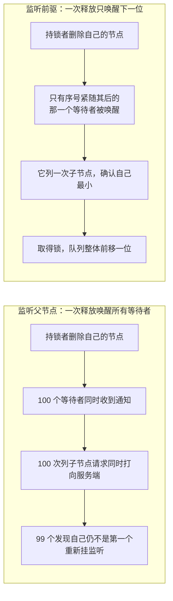
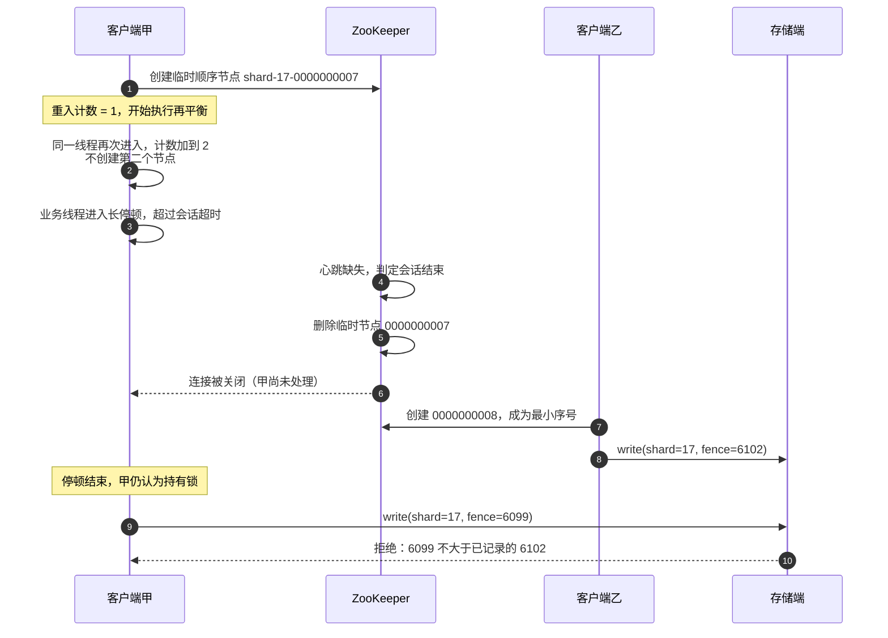
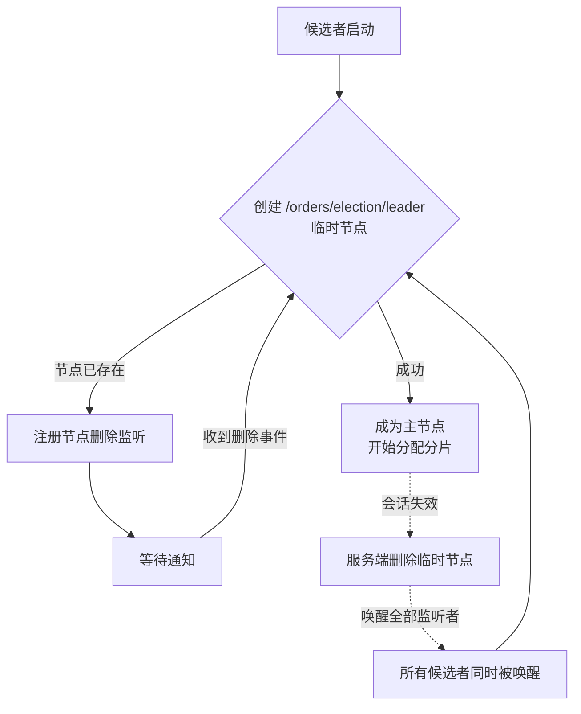
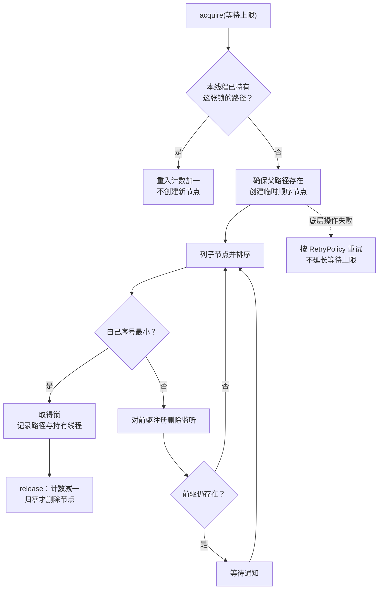

# 03 分布式锁与 Leader 选举的工程实现

**摘要：**

2010 年，Hunt 等人在 USENIX ATC 上给 ZooKeeper 的定位是 wait-free coordination，这个词说的不是性能，而是客户端之间不必互相等待。整套设计敢做这个承诺，是因为它只提供四样东西：一棵可以随意增删的节点树、一种随会话消失而消失的临时节点、一套一次性的通知、一个由服务端判定的会话。锁、选主、注册表这些名词在 ZooKeeper 里并不存在，它们全是客户端用这四样东西拼出来的配方。本文按五问推进：这套原语究竟能表达什么，为什么朴素配方在规模下会失效，失效之后改成什么形状，落地时哪些边界必须自己补，以及它在什么前提下不成立。中段用四张图拆开临时顺序节点的排队与监听、抢注式选主的成功与失败路径、会话失效与重入叠加出的双持窗口、Curator 的加锁循环与重试关系；另有三段 Java 代码，分别对应原生加锁、围栏令牌与存储端校验。读完应当能回答两个问题：为什么等待者只能盯着自己前面的那一位，以及拿到锁为什么还不等于可以安全地写。

---

## 第 1 章 锁、选主与注册：同一套原语的三副面孔

ZooKeeper 里存的几乎没有业务数据。里面是一台机器对另一台机器的持有声明，是一份超时参数，是一个实例的地址与端口，是一把锁的排队序号。这些数据体积极小，彼此之间靠逻辑关联而不靠外键，可一旦两份副本给出不同答案，上层系统立刻会做出互相矛盾的动作：两个节点都相信自己仍是主，就会同时往同一个分片写；两台机器读到不同配置，就会用两套参数跑同一份业务。协调服务的价值不在于存了多少，而在于这些极小的数据被所有节点以同一个顺序看到。

顺着这个定位往下看，锁与选主并不像两门不同的技术。它们共享同一组原语、同一条演进线，甚至在实现上可以互相替换——一把「主节点锁」的持有者就是主节点，一个公平锁的队首就是下一任主。真正把它们分开的，是失败之后允许发生什么：锁失效最多让两个执行者同时进入临界区，选主失效则会让两个主同时发号施令。这个差别决定了后者的防护要更厚一层。

### 1.1 最贵的一次判断是「还在不在」

分布式协调里最贵的一次判断不是「数据对不对」，而是「那台机器还在不在」。这件事在单机上不存在，进程死没死，操作系统知道；一旦跨了网络，判断就退化成猜测：发出去的心跳没有回应，可能是对端崩了，可能是网络断了，也可能是对端在忙、把自己卡住了几十秒。三种情况的处置完全不同，而外部观察者看到的征兆一模一样。

ZooKeeper 的处理方式是把这处判断收归一处。会话是客户端与服务端之间的一段有状态连接，服务端为它分配标识、协商超时，客户端靠心跳维持；超出窗口收不到心跳，服务端就判定会话结束，并删除所有与会话绑定的临时节点。判定权因此只有一个，不需要每个使用方各自写一套「连续三次探测失败就摘除」的启发式。

用持久节点做锁，等于把「谁来清理」写成一道附加题：持锁者崩溃后节点仍在，必须有人判断它该死，再把它删掉；而写这道题的人自己也会崩。清理者的可靠性无法自证，这是一类典型的自指难题。临时节点把这题取消了——节点消失的条件不是「谁都认为它死了」，而是「服务端与它的会话结束了」。

于是锁的「不死锁」不需要超时兜底，也不需要巡检清理，它成了会话语义的副产品。不过代价在同一处被确定下来：锁的寿命上限就是会话的寿命上限，任何让客户端与协调服务失联足够久的停顿，都会把锁从持有者手里收回，而持有者未必知道。这一条会在第 4 章展开，它是这套机制最容易被低估的地方。

### 1.2 四样原语，四种组合

临时节点回答「谁在场」，顺序节点回答「谁先来」，通知回答「有变化叫我一声」，会话回答「还在不在」。四样东西单独看都很朴素，两两组合就长出不同的结构：临时节点加路径唯一性得到互斥，临时顺序节点加排序得到公平队列，临时节点加子节点监听得到注册表，持久节点加数据监听得到配置订阅。

锁、选主、服务注册、配置中心这四类用法，本质是同一组原语换了载荷。载荷不同，对正确性的要求也不同：锁的载荷是「一段临界区」，选主的载荷是「一个身份」，注册表的载荷是「一份地址清单」，配置的载荷是「一组参数」。把载荷抽象掉，剩下的是同一件事——在若干进程之间维持一份大家都认的、会自动收敛的小状态。

这处抽象有个直接用处：机制不好用时，先问「是原语不够，还是配方写错了」。大多数问题属于后者——前驱消失没有重试、会话过期没有重建、通知丢了没有兜底，都是配方的疏漏，换一个协调服务并不会自动修好。

### 1.3 从抢注到排队

把四种组合按出现的先后排一排，会看到一条很清楚的演进线。最早的配方是**抢注**：谁先创建成功谁赢。它正确、简单，等待者变多之后却暴露一个与正确性无关、与成本有关的问题——一次释放会唤醒所有等待者。修法不是给抢注加锁，而是把「抢」换成**排队**：顺序节点给每个请求编号，只让编号最小的那个行动，其余人各自盯着自己前面的那一位。

这两种形态的差别，像停车场与医院挂号的区别。停车场里所有车同时盯着唯一那个空位，谁手快谁停；挂号机给每个来人发一张号，只叫当前号，后面的人看自己的号与当前号差几位。车位多、停留短的时候，抢的方式效率更高；队伍长、服务时间不确定的时候，取号才不制造混乱。协调服务面对的通常是长队列，所以后者成了标准配方。

这条演进线还有一个副作用：它顺带解决了公平性。抢注式的胜者由网络快慢与调度运气决定，等待最久的人不一定先拿到；顺序式的胜者由到达顺序决定，序号就是排队位置。公平在锁里是加分项，在选主里却未必需要——主是谁并不重要，重要的是只有一个。这一分野让两种配方在两种不同的场景里各自活得很好。

---

## 第 2 章 三种锁形态

### 2.1 临时节点抢注

最朴素的形态只有一个节点。加锁是尝试创建 `/orders/locks/shard-17` 这个临时节点，创建成功的人持有锁，收到节点已存在的人注册监听后等待；释放就是删除它，持有者崩溃则由会话超时删除。互斥来自路径唯一，不死锁来自会话语义，两个必需条件在这里都成立，没有一处依赖墙上时钟。

它的不足与正确性无关。持锁者一释放，所有等待者同时收到节点删除的通知，同时发起创建，只有一个成功，其余重新挂监听；下一次释放时同样的一幕再来一遍。等待者越多，被浪费的唤醒越多，这就是**羊群效应**。

另一处不足是公平性：谁先到与谁先拿到锁没有关系，一个刚到的节点完全可能抢在等待最久者前面，因为唤醒之后的竞争只取决于网络与服务端的调度。

两处不足划定了它的适用边界。当竞争很少、或者锁只是用来避免偶发的重复执行时，抢注式足够——实现只有二十来行，出错面小。选主场景里它反而常见，因为「主是谁」不需要公平，只需要唯一；一个候选者抢到之后通常长期持有，羊群只在上任那一次出现。配方的先进与否不是判据，能不能对上场景才是；把简单的那一个用在对的地方，同样是正确用法。

### 2.2 临时顺序节点

标准配方换了一个节点类型：在持久父节点下创建**临时顺序节点**，节点名由前缀加十位补零的序号组成。序号来自父节点的子节点变更计数，只保证在同一父节点内单调递增。加锁是列出全部子节点、按名字排序、看自己是不是第一个；不是的话，找到紧挨在自己前面那一位，在它身上挂监听，然后等待。

顺序号不是全局序号，只是同一个父节点下的相对次序；父节点不同，两个序号之间没有可比性。这一点常被忽略，进而导致一类典型的配置错误：两套服务用了不同的锁根路径，却以为在争同一把锁，结果互斥从来没有成立过，而日志里看不出任何异常。

这套形态同时解决三件事：公平，序号即到达顺序；羊群，一次释放只唤醒一位；可观测，队列长度就是等待者数量，列出一次子节点就能看到。代价是加锁至少走两次往返（创建与列子节点，通常再加一次存在性检查以挂监听），以及必须处理「前驱在我挂上监听之前消失」这种竞态。后者是第 3 章的主题，它看起来是个边角情况，实际上是并发下的常态。

### 2.3 容器节点与锁根目录

父路径必须先存在，而临时节点不能有子节点，于是锁的父路径只能是持久节点。这带来一个不起眼却会累积的问题：每把锁都会在树上留下一个永久目录，锁用完之后目录还在；几百个业务、几千把锁下来，节点树里塞满了空壳，排查问题时满屏都是没人用的路径。

3.5 版本引入的**容器节点（Container Node）**就是为这一类目录准备的。它的语义是「只作为子节点的容器存在」，服务端在它的最后一个子节点被删除之后，会周期性地把它一并清理掉。把锁的父路径建成容器节点，锁节点的增删与目录的生死就自动对齐了，不需要额外写一个清理任务。

使用它有三处限定。其一，清理是服务端周期性执行的，不是子节点一删就立刻消失，中间会有一段「空容器」的时间，把「目录存在」当作「有锁在用」会误判。其二，创建容器节点需要客户端支持 3.5 之后的节点类型，老客户端连上去认不出这种类型，读到的是一个普通节点。其三，容器节点本身不承担互斥语义，它只是目录；把「容器还在」当成「锁还被持有」是另一处误用。

还有一处连带效应容易被忽略：顺序号的计数器随父节点一起消失。锁目录被清理又重建之后，子节点的序号会从零重新开始。这个事实对锁本身没有影响，锁只看同一批子节点里的相对顺序；但它判了「用顺序号做全局围栏」的死刑。第 4 章会回到这一点，那是把锁用于正确性场景时绕不开的一处细节。

### 2.4 三种形态的对照与被淘汰的变体

笔者倾向于把三种形态的差别压进一张表。表的读法不是看谁更先进，而是看每一行的代价是不是自己能承受的。

| 形态 | 节点类型 | 公平性 | 释放时唤醒 | 主要代价 | 适用场景 |
| :--- | :--- | :--- | :--- | :--- | :--- |
| 临时节点抢注 | 临时节点 | 不公平 | 全部等待者 | 羊群效应，先到不一定先得 | 竞争稀少的粗粒度互斥、抢注式选主 |
| 临时顺序节点 | 临时顺序节点 | 公平 | 仅前驱之后的一位 | 至少两次往返，需处理前驱消失 | 默认选择，锁与顺序式选主 |
| 容器节点作父路径 | 容器节点加临时顺序节点 | 同左 | 同左 | 依赖新版本客户端，清理有延迟，序号会重置 | 锁根目录与选主目录的治理 |

另外两种写法在旧代码库里还能见到，都已被证明不划算。一种是用持久节点做锁，释放靠显式删除，崩溃靠一个定时清理任务。它的失效模式很直接：清理任务如何判断持有者已死？只能靠节点里写的超时字段，而超时用的是清理者自己的时钟；清理者与持有者的时钟一旦有偏差，或者清理者自己卡住，锁要么被提前释放、要么永远不释放。另一种是持久顺序节点加过期时间字段，等待者自己读字段比较时间，本质是把上一种方案的判断搬到了每个等待者身上，问题一样，还多了一份读放大。

临时节点之所以成为唯一正确的底座，不是因为它更优雅，而是因为它把「谁有资格宣布持有者已死」从应用层删掉了。会话的存活判定由服务端统一负责，客户端不需要、也不应该自己算。这一点在跨机房部署时尤其重要：两地的时钟偏差可以到几十毫秒甚至更多，而会话超时只由服务端一侧判定，不依赖任何一方的本地时间。

---

## 第 3 章 为什么只监听前一个

### 3.1 监听父节点的代价

假设图省事，让所有等待者都监听父节点的子节点变化。每有一个子节点增删，所有挂在上面的监听都会被触发；不只是释放会触发，新等待者的加入同样会触发。一百个等待者排队，每一次加锁与每一次释放都要向一百个客户端发通知，其中九十九个收到通知后做的事情是「重新列一次子节点，发现自己还不是第一个，重新挂监听」。

代价因此不是线性的，是乘出来的。等待者数量既出现在「一次通知要发给多少人」里，也出现在「每个人被唤醒后要做多少次读」里，两个因子相乘，规模一大，维持队列的开销就远大于保护临界区本身。更糟的是唤醒是同时发生的：一百个客户端在同一瞬间发起列子节点请求，服务端在那一瞬间的负载曲线会出现一个尖峰，而尖峰之后是长时间的静默。

这种负载形状对任何服务端都不友好。

两种监听方式在释放那一刻的差别，画成图最清楚。



图里左右两侧的起点相同，终点也相同，差别全在中间那一段的横向量。左侧每推进一位，就要把整个队列读一遍；右侧每推进一位，只有一个人动。队列越长，两张图的差距越大，这个差距与锁本身的逻辑无关，纯粹是监听对象选错了。

还有一处更隐蔽的代价：监听父节点得到的信号是「子节点集合变了」，它不区分新增与删除，也不说是哪一个。客户端只能重新拉取整个列表自己比较，而这次拉取拿到的可能已是下一次变化之后的状态。监听前驱拿到的信号则精确得多——「你等的那个人走了」，语义与动作一一对应。

### 3.2 只监听前驱的成立条件

**只监听前驱**之所以能成立，靠三条性质同时在线。第一条是顺序号在父节点内单调：前驱被删除是「轮到我」的唯一前提，只要自己不主动放弃、会话不失效，前驱消失就意味着前面再没有别人。第二条是通知与数据的先后关系：客户端在看到某个节点的删除事件之前，不会先读到该节点仍然存在的新状态，因此收到事件后再去列子节点，必然看到队列已经前移。第三条是等待期间零请求：通知由服务端推，客户端不必轮询，睡着的那段时间里它不占任何服务端资源。

三条合起来，一个等待者从挂上监听到成为最小序号之间，不需要任何主动查询。这段时间里协调服务上发生的其他变化与它无关，别人的排队、别人的释放、别人的会话失效，都不会让它多醒一次。这就是为什么前驱监听的扩展性远好于父节点监听：后者的唤醒次数与队列长度成正比，前者的唤醒次数与自己的推进次数成正比，而每个等待者只需要被唤醒一次。

轮询方案常被拿来对比：每隔一段时间列一次子节点。它的延迟由轮询间隔决定，负载由等待者数量乘以轮询频率决定，等待队列越长、间隔越短，压在协调服务上的读请求越多。通知把这两项都压成了一次性的：注册一次、等一次、查一次。真正需要权衡的是通知的可达性——通知可能因为连接中断而丢失，这一点在 3.4 节处理。

### 3.3 前驱消失是一处必然的竞态

从列出子节点返回到挂上监听之间，有一段几十微秒到几十毫秒的窗口。前驱完全可能在这段窗口里被删除：它要么正常释放，要么会话失效。此时对前驱做存在性检查会返回不存在，而在这个不存在的节点上挂的监听，监听的是「它被创建」，不是「它被删除」，对等待者毫无用处。

这处竞态的正确处理是**重查**，而不是报错。报错会让锁永远拿不到——前驱消失恰恰意味着轮到自己了，把它当异常是把有利条件当故障。重查时如果自己已经是最小序号，就直接持锁；如果不是，说明前面又来了新的等待者，继续挂到新的前驱上。整个过程不需要退避，因为每次重查都对应一次真实的队列变化，不会形成忙等。

还有一处必须同时检查：自己创建的节点是否还在。会话过期或被误删之后，子节点列表里根本不会有自己，此时按「找前驱」的逻辑会抛越界，或者更糟，进入死循环。原生实现里这一段判断是必需的，封装库把它收进了内部，但理解它仍然重要——排查「锁一直拿不到」时，第一个要确认的就是自己的节点还在不在队列里。

```java
// 公平锁的加锁循环，只保留关键分支；注释解释的是为什么，而不是做什么
String myPath = zk.create(LOCK_ROOT + "/lock-", owner.getBytes(),
        ZooDefs.Ids.OPEN_ACL_UNSAFE, CreateMode.EPHEMERAL_SEQUENTIAL);

while (true) {
    List<String> children = zk.getChildren(LOCK_ROOT, false);
    Collections.sort(children);              // 序号补零到十位，字典序即数值序
    String me = myPath.substring(myPath.lastIndexOf('/') + 1);

    // 自己已经不在队列里：会话过期或被误删。
    // 此时继续等没有意义，必须放弃，否则会永远挂在一个不属于自己的位置上
    if (!children.contains(me)) {
        throw new IllegalStateException("锁节点已消失，持有关系不再成立");
    }

    int index = children.indexOf(me);
    if (index == 0) {
        return;                              // 序号最小，取得锁
    }

    String predecessor = LOCK_ROOT + "/" + children.get(index - 1);
    CountDownLatch deleted = new CountDownLatch(1);

    // 存在性检查返回 null，说明前驱在挂监听之前已被删除：
    // 直接回到循环重新列子节点，这一刻可能已经轮到自己。
    // 把 null 当异常抛出，会让锁在并发下随机拿不到
    if (zk.exists(predecessor, event -> deleted.countDown()) == null) {
        continue;
    }

    deleted.await();
    // 被唤醒后必须重查，不能直接认为自己持锁：
    // 前驱消失只说明队列前移了一位，我前面可能还有别人
}
```

这段代码里最容易被简化掉的是那处 `continue` 与外面那层循环。去掉 `continue`，前驱消失时抛异常；去掉循环，被唤醒后就直接认为自己持锁。两处都在测试环境里极难复现，因为都需要精确的时序，而生产环境的并发与停顿会把它们稳定地制造出来。

### 3.4 一次性通知与重注册

ZooKeeper 的通知是一次性的，触发之后监听就消失了。这不是设计缺陷，而是把「要不要继续关注」的决定权交给客户端：如果通知是持续的，客户端就无法在两次通知之间做「先读数据、再决定是否继续跟」这样的操作，容易读到半新半旧的组合。一次性通知让每次关注都是一个明确的、可重新评估的决定。

原生接口下，重注册分布在每条等待路径里。连接断开而会话未过期时，客户端库会自动把当前会话的监听重新注册到新连上的服务端，使用者不需要干预；会话过期则不同，监听与临时节点一起被清除，客户端必须重建整条链路——重新创建锁节点、重新排队、重新挂监听。这两种情况在连接状态回调里的表现分别是「挂起」与「丢失」，混为一谈的代码会把「暂时失联」当成「已经失去锁」，从而提前放弃；或者反过来把「会话已死」当成「网络抖动」，继续用一把已经不存在的锁写数据。

判断依据只能来自客户端库给出的状态事件，不能靠「刚才还能用」这种印象。这也是自研封装与成熟封装之间差得最远的一段：成熟封装把状态机、重注册、重建会话全写进了一条路径，自研封装往往只实现了正常路径，异常路径留给使用者临场发挥。

---

## 第 4 章 会话、停顿与以为还持锁

### 4.1 会话超时就是租约

把锁的寿命与会话绑在一起，等于给每个持锁者发了一份租约，而租约的续期方式不是显式调用，是后台线程按心跳不断证明「我还在」。这个设计把释放做成了被动事件：不需要任何人执行删除，服务端判定会话结束时顺手删除临时节点。好处是崩溃、断网、进程被杀这几种情况被统一处理，无需区分。坏处也来自同一处：租约的到期判定权在服务端，客户端只能通过心跳影响它，不能决定它。

于是「持锁」这件事实际包含两个不同的命题：服务端认为你持有，以及你认为你持有。正常时两者一致，故障时不一致，而不一致的方向是危险的——服务端已经收回，客户端还不知道。所有锁失效的事故，本质上都是这两个命题被撕开。

这处语义与基于过期时间的锁有一个根本差别。过期时间是绝对时间，到期就释放，与持有者的状态无关；会话是相对判定，只要心跳持续就不断续期，一旦心跳中断超过阈值就立刻失效。前者对「持有者活着但业务跑了很久」不友好，后者对「持有者卡住」不友好。两者都把安全性让渡给了一个时间参数，只是让渡的对象不同：一个让给时钟，一个让给心跳。

### 4.2 停顿造成的双持窗口

最长的一次停顿通常来自垃圾回收。一次完整回收在几百毫秒到几秒之间，堆越大、对象图越复杂，停顿越久；如果同时发生内存压力、容器被限流、宿主机超卖，十几秒的停顿并不罕见。

会话超时的默认区间换算出来通常是几秒到几十秒，两者是同一个数量级，因此「停顿超过超时」不是极端假设，而是运行久了必然会遇到的事件。

时间线如下：甲持有锁，业务线程进入长停顿；后台心跳线程同样被挂起，因为停的是整个运行时；服务端在超时窗口内收不到心跳，判定会话结束并删除临时节点；乙抢到锁开始写；甲的停顿结束，它手里的锁对象仍处于「已持有」状态，业务继续按临界区逻辑写同一份数据。**两个写者同时认为自己持有锁**，而互斥从未在服务端层面被违反——节点确实只有一个，只是甲手里那个已经不是它了。

**双持窗口**的宽度不是「停顿长度减去超时」，而是从服务端删除节点到甲察觉之间的全部时间。如果甲在临界区里只写数据库、不再碰协调服务，它可以一直不察觉，直到进程退出。这解释了为什么「持锁后立刻做长任务、期间不与协调服务交互」是最危险的用法，也解释了为什么单纯调大会话超时只是把问题推远，而不是解决。

把重入与这处窗口叠在一起，事故的形状会更清楚。



图里甲与协调服务之间的交互，只有创建节点那一次是真的：它建立了持有关系，之后的重入只加了本地计数，长停顿之后的写入带着一个已经过期的围栏编号。三处缓解的力度并不相同。让临界区内的写入带上围栏编号，是唯一能兜住双持的手段，它把判断权从持有者手里拿走；调大会话超时只降低窗口出现的概率，同时拉长真实故障的切换时间，是拿可用性换概率；把停顿时长压到超时以下属于容量与回收调优，能改善但不能消除，因为网络分区同样会造成心跳中断。三者的关系是：围栏管正确性，另外两条管概率。

### 4.3 可重入与不可重入

可重入这件事在单机锁里是标配，在分布式锁里却是一处语义分层。服务端不知道「线程」这个概念，它只知道节点；同一进程里的两个线程去创建节点，在服务端看来是两个毫不相干的客户端。因此重入只能由客户端自己记账：在本地维护一张「哪个线程持有哪些路径、各重入几次」的表，第二次获取时只把计数加一，不再创建节点。

不这么做的后果是自锁。同一个线程第二次获取会创建第二个顺序节点，它排在自己第一个节点之后，于是这个线程在等一个由它自己持有、且要等它自己释放的锁——相互等待，谁也不会先动。这类故障在代码评审里很难看出来，因为两次获取分散在两个方法里，各自的写法都正确，合起来才是错的。

成熟封装里通常同时提供可重入与不可重入两种锁。前者按线程记账，后者把一次获取对应一个许可，重入会去申请第二个许可，拿不到就阻塞。这个差别在选型时经常被忽略：调用链可能嵌套却选了不可重入的那一个，表现为「偶发卡死」，排查时又会因为「明明是同一把锁」而排除掉这个方向。判据不是性能，而是「同一线程会不会在持锁状态下再次进入」。

还有一处必须与重入一起想清楚：计数只在本进程内有效。进程重启、会话过期重建之后，计数清零，而节点可能早已被服务端删除；此时判断「还持不持锁」不能看计数，只能回协调服务查节点是否还在、自己是不是最小序号。把内存里的计数当成权威状态，是这类实现最常见的一处漏洞。

### 4.4 围栏令牌

**围栏令牌（Fencing Token）**的思路只有一句话：让被保护的资源参与判断，而不是让持有者自证。每次获得锁时取一个单调递增的编号，所有写请求都带上它；存储端记录见过的最大值，遇到更小的编号直接拒绝。旧持有者即使还沉浸在「我持有锁」的错觉里，它的写入也会在接收端被挡住。

这个方案不是某一家协调服务特有的。2016 年 Kleppmann 在那篇讨论分布式锁的著名文章里把它作为「锁用于正确性场景」的必要条件提出，争论的焦点是「锁服务能否在时钟不可靠的前提下自证安全」，结论落在了接收端校验上。对 ZooKeeper 而言这套论证同样成立：会话语义没有摆脱时间假设，只是把假设从本地时钟换成了心跳往返。

ZooKeeper 里能当围栏的编号有两个候选。一个是顺序节点的序号，它在同一个父节点内单调递增；问题是这个计数器挂在父节点上，父节点被删除重建就归零，而容器节点的自动清理恰好会让它归零，因此它只在「父节点永不被删」的前提下成立。另一个是节点创建时所分配的事务编号，它来自 ZAB 的分配，全集群单调、不随任何路径的重建而回退，代价是要多读一次节点的状态信息。后者更稳，前者更省，选择取决于锁目录是否会被清理。

```java
// 取围栏：节点创建时的事务编号由 ZAB 统一分配，
// 全集群单调，不随锁目录的创建与删除而回退
Stat stat = new Stat();
zk.getData(lockPath, false, stat);
long fence = stat.getCzxid();

// 写入时把围栏一并交给存储端，由存储端负责拒绝过期持有者
shardStore.write(shardId, payload, fence);
```

```java
// 存储端的判定必须与写入在同一个原子操作里完成，
// 否则比较与写入之间又出现一次时间窗口，围栏退化成一次无效检查
int updated = jdbc.update(
        "UPDATE shard SET payload = ?, fence = ? WHERE id = ? AND fence < ?",
        payload, fence, shardId, fence);

if (updated == 0) {
    throw new StaleOwnerException("围栏 " + fence + " 已被更新的持有者超越");
}
```

这两段代码里有一处最容易写错的地方：比较与写入必须是同一条语句。先查出当前围栏再更新，中间会插进一个窗口，两个旧持有者可以同时通过比较再先后写入，围栏就白加了。围栏的全部价值在于把互斥从锁服务转移到了存储的原子操作上，而这个原子性不能由应用层用两次调用拼出来。

接收端的校验还必须覆盖所有写路径，漏掉一处等于没有。主节点可能通过三条路径写同一个资源，譬如同步接口、异步补偿与离线任务，只要有一条绕过检查，双持的代价就会从「被拒绝」变成「部分成功」，而部分成功比彻底失败更难善后。围栏不是加在客户端的一个字段，而是接收端的一份持久状态。

---

## 第 5 章 Leader 选举

### 5.1 抢注式选主

选主在 ZooKeeper 上的第一种写法与临时节点锁同构：所有候选者在同一个路径上创建临时节点，成功者成为主，失败者监听这个节点，等它消失再抢。互斥保证同一时刻只有一个主，会话语义保证主崩溃后节点会消失、不会永久空占。这套流程的时序很短，但失败路径值得画清楚。



图里有一条容易被忽略的边：主的会话失效之后，被唤醒的不是一个候选者，而是所有挂着监听的候选者。这与锁的羊群是同一个形状，只是在选主场景里它被容忍了——切换不是常态，候选者数量通常只有个位数。真正需要警惕的是切换风暴：主因为长停顿反复被判定失效，每次失效都触发一轮全员抢注，集群在几分钟里换好几次主，业务侧的连接与任务分配被反复打断。这类故障的根因通常不在选举实现，而在主的运行时健康度。

### 5.2 顺序节点式选主

第二种写法把抢注换成排队，与公平锁完全同构：每个候选者创建临时顺序节点，序号最小者为主，其余各自监听前驱。切换时只有前驱被删除的那一位被唤醒，它直接成为新主，其余人的监听关系不变——不需要重新排队，也不需要重新注册监听。

这处差异在候选者多时很明显：抢注式每次切换都要全部候选者重新竞争，顺序式只需要一次通知；附带的好处是可观测，列出一次子节点就看到全部候选者与顺位，队列长度就是备节点数量。

顺序式并不改变「主应当稳定」这条原则。顺序号只决定谁在主失效时接任，不决定主该多久换一次；有些实现把它理解成「轮流当主」，让主在完成一轮任务后主动释放，这在定时任务分片这类场景里可行，在需要长期维护连接与缓存的主从结构里会放大切换成本。公平在这里的含义是「先注册者先接任」，不是「人人有份」。

### 5.3 脑裂：检查自己为什么不够

两种写法共享同一处薄弱环节：主失效的判定权在协调服务，而主的行动权在它自己手里。两者的时间线一旦错开，就会出现两个主。

设想主节点与协调服务之间的网络断开，但它的进程还活着，还在处理请求。服务端那边的会话超时，节点被删，新主当选并开始分配任务；旧主这边的心跳线程失败，但它可能只是记录了一条连接异常，业务线程仍在按「我是主」的假设运行。等网络恢复，两个主都在发指令。这就是**脑裂**：不是共识算法出了错，而是「主」这个身份在应用层没有被同一套判定统一。

最直觉的防护是让主每次行动前问一次协调服务：我还是主吗。这个做法有三处靠不住。其一，ZooKeeper 的读是本地读，可能读到落后于最新提交的状态，问一次得到一个过期的「是」完全可能。其二，即使读到了最新状态，从读到「是」到真正执行之间还有一段时间，判定与执行不可能原子地完成。其三，网络分区时这个询问本身就会失败，而失败之后的默认动作如果是「继续」，防护等于不存在。

把判断权交给接收方，是这类问题的通用解法，也就是围栏思路在选主场景的复用。主在当选时取一个递增的编号，可以取自协调服务的全局事务序，也可以自己在节点里维护一个版本；所有指令带上它，执行方只接受不小于自己记录的编号。旧主的指令因为编号更小被丢弃，脑裂的后果从「数据被写坏」降为「一段无人执行的指令」。Kafka 的控制器纪元走的就是这条路，一个被隔离过的旧控制器发出的请求会因为纪元过期而被拒绝。

### 5.4 职责划分比防护更靠前

围栏能兜住的只是「可以比较编号的写入」。如果主节点直接调用外部系统发消息、调用没有版本概念的老接口，围栏就失效了。因此还有一条比围栏更靠前的设计原则：**让主只做决策，把执行交给被决策者**。

**决策类职责**——决定分片归谁、决定哪台机器承接流量、决定下一批任务的顺序——有一个很好的性质：它可以被覆盖。新主重新做一遍决策，旧主的决策被忽略即可，代价是一段时间的重复计算。执行类的职责——真正写业务数据、真正发出扣款请求——没有这个性质，已经发生的副作用无法撤销，两个主同时执行就是两份副作用。

把职责这样切开之后，脑裂的危害被限制在「一段无效决策」的范围内，而这段决策可以通过围栏、通过执行方对当前主的认知、通过幂等键被安全地丢弃。反过来，如果主既决策又执行，那么所有针对决策的防护都不解决问题——防护的是「主是谁」，坏掉的是「数据被谁改了」。

这条原则也解释了为什么很多系统的选主组件看起来「只做了一半的事」：它只负责选出一个主，把主该做什么留给业务。这不是能力缺失，而是把不可撤销的部分推到了能被校验的地方。

### 5.5 LeaderLatch 与 LeaderSelector

成熟封装里通常提供两个选主原语，语义差别全在「主身份什么时候结束」上。闩式的那一个像一道闸门：调用阻塞到成为主，之后一直持有，直到显式关闭；期间它不回调任何业务方法，主该做什么完全由调用方决定。选择器式的那一个把主身份绑定在一段回调区间上：回调被调用时它是主，方法返回就放弃，并按配置决定是否重新排队。

两种语义对应两种使用模型。需要长期维护连接、缓存、定时轮询的主，譬如接入层网关，用闩式更自然——它把生命周期交给调用方，主知道自己什么时候该收尾。需要「每一轮任务由一个主来执行」的模型，用选择器式更省事——它不会因为忘记释放而永久空占，方法返回就是释放。封装库里，`LeaderLatch` 与 `LeaderSelector` 就是这一对；两者的内部实现都是临时顺序节点加前驱监听，差别只在语义包装。

共同的一处陷阱是回调里做长任务。选择器的回调返回即释放，长任务期间主身份一直绑在这个方法上，一旦会话过期，方法还在跑而主已经不是它了；闩式的持有者同样可能在长任务中被服务端判定失效。两者都不会替使用者解决「失去主之后正在做的事情怎么办」，这件事只能靠任务本身可中断、可重做，或者靠围栏把过期写入挡在接收端。

---

## 第 6 章 Curator 把哪些责任接了过去

### 6.1 三层分工

原生接口的难处不在于调用复杂，而在于失败模式混在一起。一次列子节点可能因为连接断开抛连接丢失，可能因为会话过期抛会话失效，也可能因为节点不存在抛无此节点；三者的处置方式完全不同，而它们在代码里长得几乎一样。封装库的第一层价值就是把这些失败分开：连接层负责重连与会话重建，操作层把可重试的异常按策略重试，原语层把排队、监听、重入、失效这些易错逻辑实现一遍。

Curator 的分层大致如此。最底下是连接管理，它在客户端库之上维护连接状态机，把断开、挂起、重连、丢失这几件事翻译成状态事件；中间一层是操作与重试，提供重试策略、命名空间、路径自动创建；最上面是各类原语与缓存，锁、选主、节点缓存都在这一层。越往上越接近业务语义，越往下越接近网络与协议，每一层的失败模式也不同。

这处分层有个实际好处：出问题时可以先判断故障停在哪一层。连接状态反复挂起，多半是网络或服务端；操作频繁超时，多半是集群压力或会话参数；只有原语层出问题，才轮到怀疑锁的语义。混在一起调试，容易把网络抖动误判成锁的缺陷，白白翻一遍源码。

### 6.2 加锁循环

可重入锁的加锁路径与第 3 章的原生实现是同一套，差别在于它把边界都补上了。整条路径可以画成一张判断图。



四处补丁值得单独点出来。第一处是父路径的自动创建，避免「第一次加锁因为目录不存在而失败」这种部署期问题。第二处是重入表的维护，同一线程再次获取时只加计数，释放时按计数递减、归零才删除节点。第三处是前驱消失的重试循环，存在性检查返回空时回到列子节点，而不是抛异常。第四处是连接事件的接入，会话过期之后锁对象被标记为不可用，后续释放应当失败而不是静默成功——静默成功的释放会让上层以为锁已释放，而实际上节点早已随会话消失，另一个持有者可能已经进来了。

图里那条通向重试策略的虚线是最容易被误读的地方。连接断开与会话过期是两件事：前者可以自愈，客户端重连之后监听会被重新注册、节点仍在；后者不可自愈，节点已删、锁已失去。把两者都当成「稍后重试」，会在会话过期之后继续用一把不存在的锁；把两者都当成「锁已失去」，则会在一次网络抖动时就放弃本可保住的锁。判据只有一处：连接状态事件里给的是挂起还是丢失。

把这些补丁叠起来，使用侧的代码就很短，短到几乎看不出它替使用者挡掉了多少东西。

```java
CuratorFramework client = CuratorFrameworkFactory.builder()
        .connectString("zk1:2181,zk2:2181,zk3:2181")
        .sessionTimeoutMs(15000)      // 同时决定故障感知延迟与停顿误判概率
        .connectionTimeoutMs(5000)    // 只管建立连接，与锁的等待无关
        .retryPolicy(new ExponentialBackoffRetry(100, 3))  // 只作用于底层操作
        .namespace("orders")          // 路径前缀，防止多环境共用集群时撞名
        .build();

InterProcessMutex lock = new InterProcessMutex(client, "/locks/shard-17");

// 三秒是业务愿意为排队付出的耐心，不是底层重试的上限；
// 拿不到就按未持锁处理，不能「再等等看」
if (!lock.acquire(3, TimeUnit.SECONDS)) {
    return RebalanceResult.skipped("锁定超时");
}

try {
    rebalance(shardId);
} finally {
    // 会话过期之后节点已随会话消失，这时「释放」是空动作。
    // 先判断自己是否仍持有，避免让上层误以为互斥依然有效
    if (lock.isAcquiredInThisProcess()) {
        lock.release();
    }
}
```

这段代码里每一行配置都对应前文的一处边界：会话超时回应双持窗口，命名空间回应路径撞名，重试策略回应瞬时故障，`finally` 里的持有判断回应会话过期。使用者看到的是一次加锁与一次释放，看不到的是重连、重注册、排队与失效判定——这些责任被接过去之后，留给业务的只剩「拿到锁做什么」和「拿不到怎么办」。

### 6.3 重试策略与等待超时是两件事

封装库的配置里有两个时间概念，经常被混为一谈。一个是获取锁时的**等待上限**，它约束的是「业务愿意为拿到锁等多久」；另一个是**重试策略**，它约束的是「底层某次操作失败之后，隔多久再试、最多试几次」。前者面向业务节奏，后者面向瞬时故障，两者都要设，而且都要能被监控看到。

两者混用的后果是双向的。把重试策略当成锁超时，业务线程会被底层重试拖住，一次集群抖动就能让线程池堆满；把等待上限当成底层容错，一次连接丢失就会让加锁直接失败，而实际上重试一次就能成功。

更隐蔽的一种是既设了很长的等待上限、又配了很激进的立即重试，结果是故障期间大量线程在协调服务上反复冲击，把一次局部抖动放大成全集群的读尖峰。

还有一类异常不该进重试策略。会话过期意味着临时节点已经消失，重试同一个操作没有意义，必须重建客户端与锁对象；把它交给指数退避重试，只会让进程在「已经失去锁」的状态下多等几轮，然后继续用错误的假设往下走。重试策略解决的是「同一件事再试一次可能成功」，而会话过期改变的是前提。分清这两类失败，是这套配置里最省事的一处纪律。

### 6.4 四个原语的语义差异

把常用的锁与选主原语排在一起，语义差异比名字更值得记住。

| 原语 | 可重入 | 身份何时结束 | 典型用途 |
| :--- | :--- | :--- | :--- |
| `InterProcessMutex` | 可重入，按线程计数 | 显式释放或会话失效 | 同一线程可能嵌套进入的临界区 |
| `InterProcessSemaphoreMutex` | 不可重入 | 显式释放或会话失效 | 一次获取对应一个许可，调用链不嵌套 |
| `LeaderLatch` | 不适用 | 显式关闭或会话失效 | 长期持有主身份，自己管理生命周期 |
| `LeaderSelector` | 不适用 | 回调返回或会话失效 | 每轮任务由主执行，返回即让位 |

表里最容易被忽略的是第二行。不可重入不是缺陷，而是把「重入」这件事的责任显式地交回给调用方：调用链里如果可能嵌套，要么自己保证不嵌套，要么换用可重入的那一个。选择时的判据是「同一线程会不会在持锁状态下再次进入」，而不是「哪个性能更好」——两者在 ZooKeeper 上的开销几乎一样，差别只在语义。

---

## 第 7 章 同一手法的另外两个落点

### 7.1 注册与发现

把锁的节点换个载荷，就得到服务注册：实例启动就绪之后创建一个临时节点，节点数据是地址与端口；消费方列出子节点拿到列表，注册监听，收到变化后重新拉取。宕机时节点随会话消失，注册表自动收敛，不需要额外的健康检查组件来判断「实例还活着吗」——这处判断已经由会话承担了。

这套机制有一处无法消除的滞后：通知到达与重新拉取列表之间，消费方的缓存是旧的。这段时间里请求可能被路由到已经下线的实例，也可能漏掉刚上线的实例。缓解有三条路，力度不同：客户端在请求失败时摘除该地址并重试，兜的是「已经打过去」的那部分；定期主动探活，补的是「通知丢失或延迟」的那部分；优雅下线（先注销、等消费方刷新、再停止服务）缩的是窗口本身。三条都不是把窗口消掉，只是把它挪到不影响业务的位置。

注册时机与下线时机是同一件事的两端。注册应当在依赖初始化完成之后，否则流量会打到还没准备好的实例；下线应当先注销再停止，否则已经建立的连接与已经路由过来的请求会直接失败。这两条看起来是运维细节，实际上是「对外状态」与「实际状态」保持一致的问题，而服务发现的可靠性依赖的正是这处一致。

### 7.2 配置订阅

配置中心的形态是把持久节点当存储、把数据监听当推送。应用启动时读取自己名下的配置并注册监听，变更时收到通知、重新读取、更新本地缓存，整个过程不需要重启。因为配置是持久节点，它与实例的生死无关，不会因为某个客户端掉线而消失。

麻烦出在「一次变更涉及多个节点」的时候。改一个服务的地址与端口要写两个节点，而协调服务的写是单节点的，两次写之间必然存在一个中间状态，订阅者可能读到新地址配旧端口。两种解法：把相关配置合并进一个节点，用结构化内容承载，一次写入即原子；或者设一个版本节点，变更时先写各子配置、最后写版本号，订阅者只监听版本号，收到通知时子配置必然已经就位。前者简单但要求配置的组织方式配合，后者灵活但多一次读。

作为配置中心，这套机制的边界很清楚：没有历史版本与回滚，没有灰度下发，权限只到节点级，写入吞吐受单主限制。变更频率低、参与方少、团队自己能承担发布流程时，它够用；一旦需要按环境、按标签、按比例下发，或者需要审计每一次变更，专业配置中心补齐的正是这些管理能力，而不是原语能力。这处界限值得记住：原语解决「能不能表达」，管理能力解决「敢不敢交给别人用」。

---

## 第 8 章 边界、反例与选型对照

### 8.1 与 Redis 锁、数据库锁的分工

把三种实现放在一起，区别不在谁更强，而在谁承担正确性。Redis 锁的互斥来自单命令的原子性与过期时间，延迟在亚毫秒到毫秒级，代价是主从异步复制会造成锁丢失的窗口；数据库锁的互斥来自事务与唯一约束，天然与业务数据同源，代价是粒度粗、持锁期间占着连接与事务；ZooKeeper 锁的互斥来自节点唯一与会话判定，能排队、能公平、能选主，代价是每次加锁至少两次往返，写吞吐被单主卡住。

| 维度 | ZooKeeper 锁 | Redis 锁 | 数据库锁 |
| :--- | :--- | :--- | :--- |
| 互斥的来源 | 节点路径唯一加会话判定 | 单命令原子加过期时间 | 事务、唯一索引、行锁 |
| 持有者失联后 | 会话超时自动删节点 | 到期自动释放 | 连接断开、事务回滚 |
| 双持的主要成因 | 停顿或分区导致会话失效 | 主从切换丢锁、提前到期 | 连接未正确清理 |
| 公平排队 | 临时顺序节点天然公平 | 需额外实现 | 靠数据库排队，不可控 |
| 单次加锁延迟 | 两次以上往返，毫秒级 | 亚毫秒到毫秒级 | 事务与连接开销，毫秒到十毫秒级 |
| 适合的场景 | 正确性要求高、需要公平或选主 | 高频短临界区、效率型互斥 | 已在事务内的数据竞争 |

这张表给出的分工很直接。要的是「大概率不重复执行」，选 Redis，延迟低、实现轻，再配幂等兜底；要的是「有序、可排队、能选主」，选 ZooKeeper，代价是吞吐；要保护的是同一份数据在同一个事务里的竞争，直接用数据库的行锁或唯一索引，不要把一个外部锁套在事务外面——那样既多了一次网络往返，又多了一处「锁释放了但事务还没提交」的不一致窗口。

还有一条比选型更根本：**任何锁都不能替代幂等**。锁保证的是「同一时刻只有一个执行者」，不保证「执行只发生一次」；重试、超时、双持都会让同一个操作被执行两次。把幂等键与围栏一起用，才是把「不重复」这件事做实的方式。

反过来说，如果一笔操作本身是幂等的，那么对锁的要求可以从「正确性」降为「效率」，选型的空间立刻变大。

### 8.2 六个反例

第一个反例是把获取锁的等待超时当作「一定没拿到锁」。创建操作可能在服务端已经成功，只是确认在回程丢失；客户端放弃之后，那个临时节点仍挂在自己的会话下，占着一个没人认领的队列位置。轻则让后面的等待者多等一轮，重则让同一个进程在下次获取时被自己的孤儿节点挡住。处置方式不是猜，而是回读：拿到节点后核对节点数据里的持有者标识，确认自己到底是不是持有者。

第二个反例是把会话超时当作「锁不会丢」的保证。会话超时只保证「服务端认为你死了之后锁会被释放」，它不保证「你还活着的时候锁一定还在你手里」；停顿、分区、客户端长时间不读不写，都可能让会话先失效。真正的防护只能在被保护的资源一侧。

第三个反例是在锁内做长任务且不设围栏。临界区跑得比会话超时还久，等于把「可能双持」变成「必然双持」，而双持发生时两边都会认为自己正确。可行的做法是把长任务拆成可重入的短段，或者让每次写入带围栏，或者干脆让任务本身幂等。

第四个反例是手写实现只写了正常路径。前驱消失不重试、通知触发后不重注册、会话过期不重建，这三处漏掉任何一处，故障表现都是「偶发卡死」或「锁莫名丢失」，而测试环境因为时序凑不齐，往往一次都不复现。自研封装的价值不在代码量，而在异常路径是不是被认真走过。

第五个反例是把锁路径当成随手写的字符串。两套环境共用一个集群却没有命名空间，或者同一个应用的两个模块用了不同的根路径，都会出现「以为在互斥，其实各锁各的」。这类问题的特征是「加了锁但没效果」，排查时先打印实际的锁路径，比读业务代码快得多。

第六个反例是把锁粒度做成了全局锁。一把锁保护整张表，所有写请求被迫串行，吞吐直接掉一个数量级；而为了提吞吐把粒度拆到分片之后，跨分片的操作又需要同时持有多把锁，加锁顺序不一致就会死锁。粒度是并发与复杂度的取舍，取哪一头要看跨分片操作的比例，而不是看哪一个听起来更先进。

---

## 第 9 章 落点

回到开头那条线索：锁与选主不是两门技术，而是同一套原语在两种载荷上的拼装。临时节点表达在场，顺序节点表达次序，通知表达变化，会话表达判定权。四样东西的组合方式不多，能长出的结构却覆盖了协调服务的绝大部分用法。

第一条判断关于代价的位置。这套机制把「谁在场」的判定从应用层挪到了协调层，应用层因此少了一份巡检代码，但代价集中到了一个参数上：**会话超时**。它同时决定锁的释放延迟、故障感知的延迟、以及停顿导致误判的概率。参数**没有最优值，只有与业务容忍度匹配的取值**；调小换及时性，调大换稳定性，两头都要有人认账。

第二条判断关于锁的能力边界。这套锁能保证的互斥是有条件的：它保证「同一时刻只有一个客户端被服务端认为持有锁」，不保证「同一时刻只有一个客户端在写数据」。两者之间隔着停顿、分区与人的疏忽，唯一的补法是把判断权交给被写的资源。围栏不是对锁的不信任，而是承认故障检测本身不可能瞬时完成。

第三条判断关于选主的可靠性。选举算法本身很少出错，出错的是「旧主的话还有没有人听」。把主限制在决策类职责上、让执行方校验编号，比任何更精巧的选举算法都更能降低脑裂的代价。这条经验与具体用哪套协调服务无关，换一套存储它照样成立。

这套机制今天仍然值得学，不是因为它会被继续大量新建，而是因为它把协调的几个基本问题摆得最清楚：如何判定活着，如何表达顺序，如何让通知不变成风暴，如何在一个会撒谎的时间维度上做判断。这些问题换一套存储仍然存在，只是换了名字；具体选哪一套，答案在负载形状与团队愿意承担的运维成本里。

---

## 专栏导航

- 上一篇：[[02 ZAB 协议——Leader 选举、崩溃恢复与消息广播]]。
- 下一篇：[[04 数据持久化——事务日志与快照]]。
- 返回专栏首页：[[00 专栏导览]]。

---

## 参考资料

1. Hunt, P., Konar, M., Junqueira, F. P., & Reed, B. (2010). ZooKeeper: Wait-free coordination for internet-scale systems. *USENIX ATC 2010*.
2. Apache ZooKeeper. 官方文档：ZooKeeper Programmer's Guide（会话、监听、顺序节点、容器节点）. https://zookeeper.apache.org/doc/current/zookeeperProgrammers.html
3. Apache ZooKeeper. 官方文档：Recipes（Locks、Leader Election、Two-phased Commit）. https://zookeeper.apache.org/doc/current/recipes.html
4. Apache Curator. 官方文档：Locks 与 Leader Election. https://curator.apache.org/docs/recipes.html
5. Apache Curator. 官方文档：连接管理与重试策略. https://curator.apache.org/docs/
6. Kleppmann, M. (2016). How to do distributed locking. https://martin.kleppmann.com/2016/02/08/how-to-do-distributed-locking.html
7. Apache ZooKeeper 源码：`zookeeper-recipes/` 下的 lock 与 leader election 实现。
8. Apache Kafka. 官方文档：Controller Epoch 与脑裂防护. https://kafka.apache.org/documentation/

---

> [!note] 思考题
> 1. 只监听前驱这一处改动，同时消掉了羊群、补上了公平、把通知量降到一次一个。这三处收益能不能拆开实现？如果能，各自要付什么代价，为什么实际实现都选了合在一起的方案？
> 2. 「前驱消失」被当作需要重试的正常分支，而「自己消失」被当作必须放弃的异常。两者在子节点列表里的表现相似，判据却完全不同，请说明这处区分背后的语义依据。
> 3. 会话超时既决定锁的释放延迟，也决定故障感知延迟，还决定停顿误判的概率。这三个目标能否用一个参数同时满足？如果要把它们解耦，需要在架构上动哪一刀？
> 4. 顺序节点的序号在父节点删除重建后会归零，而事务编号不会回退。如果把围栏建在序号上，请构造一个会让它失效的时序；如果把围栏建在事务编号上，代价又落在哪里？
> 5. 把「主只做决策、执行交给被决策者」作为脑裂的第一道防线，它成立的前提是什么？在哪些业务形态下这个划分做不出来，那时只能退回到哪一层防护？
> 6. 注册中心的「通知到达」与「重新拉取」之间存在窗口。三条缓解手段各自补的是窗口的哪一段？为什么没有任何一条能把这个窗口彻底消掉？