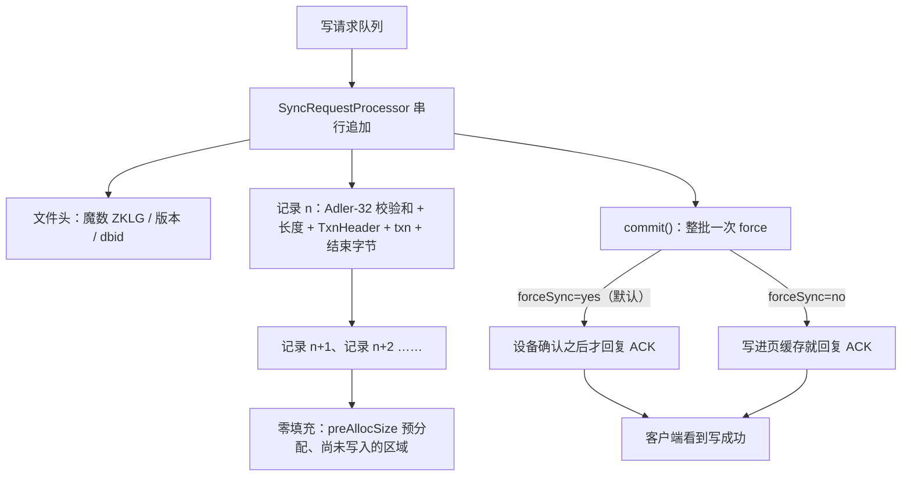
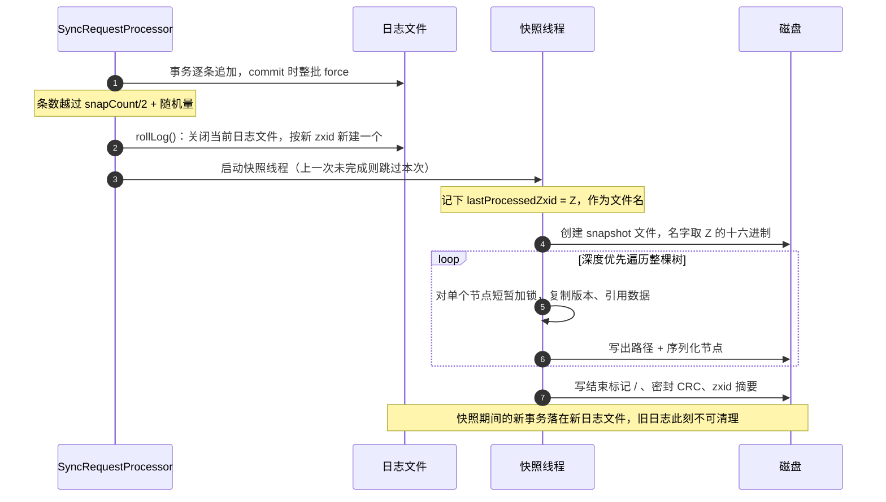
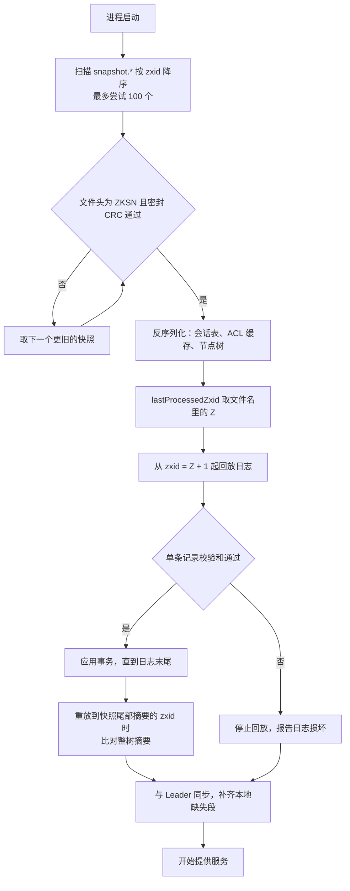
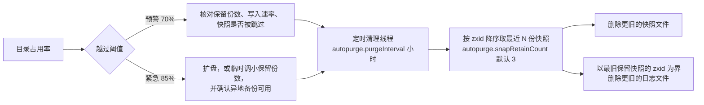

# 04 数据持久化——事务日志与快照

**摘要：**

ZooKeeper 把整棵数据树放在进程的堆里，读因此便宜到只剩一次哈希查找，但内存是易失的，于是这台机器必须回答一个问题：进程被杀掉之后，怎么在几十秒内把树重新长回来，而且一条已经回过确认的事务都不能少。答案由两套机制拼成——追加写的事务日志（TxnLog）负责不丢，周期性的快照（Snapshot）负责恢复够快。麻烦在于两者必须同时活着：快照是在事务提交过程中拍的，拍出来的东西不是任何时刻的镜像，ZooKeeper 自称模糊快照（Fuzzy Snapshot）。本文按五问推进：为什么必须是两套、日志在磁盘上长成什么样、模糊快照凭什么不加全局锁、重启时快照与日志如何接上 zxid、这套机制在磁盘写满与日志损坏时怎么退化。中段用四张图拆开日志的追加与预分配、快照的双写与命名、装载回放的流程、清理与告警的关系，另用四张表把两套机制逐项对照、把一条记录的字段拆开、把磁盘故障的现象与处置列清楚。读完应当能回答两个问题：模糊快照把「保证快照一致」换成「保证事务幂等」这笔交易，究竟在哪里还欠着账；以及 forceSync 的默认值为什么几乎不该改动。

---

## 第 1 章 全内存之后，持久化成了要解决的问题

### 1.1 两套机制，两种职责

把 ZooKeeper 的数据树摊开来看，它是一张从根节点 `/` 长出去的路径表，每个 ZNode 上挂着几 KB 的数据、一份 ACL、一份版本信息。整棵树放在服务端进程的堆内存里，读一次节点就是一次映射查找，不碰磁盘，也不跨网络，这解释了它亚毫秒级的读延迟从何而来。代价藏在另一头：进程一死，堆内存随地址空间一起消失，而这棵树恰恰承担着「谁是谁的主」「谁持有那把锁」这类不能含糊的判断。

补上这个缺口的是两套并行工作的机制。事务日志（TxnLog）是一条只追加的线，每个写请求在拿到确认之前，先以一条事务记录的形式追加上去并落盘；快照（Snapshot）是周期性的全量序列化，把内存树连会话一起写成一个文件。前者的职责是**不丢**，后者的职责是**恢复够快**——注意这不是同一件事的两种程度，而是两件不同的事，混起来谈就会推错结论。日志保证「凡是被确认过的事务，崩溃后都能被重放出来」；快照保证「重放不必从三年零四个月前的那一条开始」。

两者可以概括成一句话：日志决定历史不会断，快照决定历史不必全读。日志清理过头，快照之后的空档就无从补齐；快照缺失，日志再多也只是把重放时间从秒级拖成小时级。

### 1.2 为什么长成这个形状

要理解这套形状，得回到它成形的年代。ZooKeeper 出自 Yahoo! Research，2008 年开源并进入 Apache 基金会，2010 年在 USENIX ATC 上以《ZooKeeper: Wait-free coordination for internet-scale systems》为题发表了完整论述。那个年代的存储共识相当清楚：要随机读写就上 B+ 树加页缓存，那是 MySQL、Berkeley DB 的天下；要顺序吞吐就上日志结构，那是 Bigtable 与 HDFS 的路子。ZooKeeper 两边都没走，因为它存的根本不是业务数据。

它存的数据规模极小，一个生产集群的节点数通常在几千到几十万之间，单节点上限由 `jute.maxbuffer` 卡在 1MB 附近，实际写入往往只有几百字节；读写比又极端不对称，配置变更、选主、锁的交接这类写入以「每次部署几次」计，而读以「每秒几千次」计。把这种负载放到磁盘上，为的是它根本不需要的能力：随机寻址、范围扫描、事务隔离，全都没有用武之地，却要付每次读一次 I/O 的代价。放到内存里，读的成本瞬间降到可以忽略，剩下的唯一问题就是「内存会没」。

于是持久化的问题被重新定义了一次：它不需要支持「边写边读」，只需要支持「崩溃后重建」；它不需要随机访问，只需要顺序追加；它不需要保留每一版的中间状态，只需要一个能当起点的全量。这三个「不需要」把方案空间砍到只剩一种形状——顺序追加的日志做增量，周期性全量做起点。这不是 ZooKeeper 发明了什么，而是它的数据规模与访问模式把别的选项都排除掉了。

把同样的方案搬到 TB 级业务库上会立刻荒谬：每次快照要写 TB 级文件，每次清理都要复制一份全量，恢复时间以小时计。**形状由规模决定，不由品味决定**。

这件事可以借一个比喻记住：日志像值班记录本，一条条往下记，翻到哪一页就知道当时发生了什么；快照像交班时拍的全景照片，照片之前的细节不必再翻本子，之后的每一笔还得靠本子。少了本子，照片之后的事没人知道；少了照片，接班的人要从第一本读起。

### 1.3 抽掉一套会怎样

反事实的推演最能说明分工的必要性，四种抽法对应四种退化。

只留内存、彻底不做本地持久化，节点重启后只能向 Leader 要一份完整数据树。这条路在几千个节点的集群上尚可忍受，节点数上到十万量级就是灾难：一次全量同步要传输、要反序列化、要在接收端重新建树，期间该节点既不提供服务也不能投票，而如果三台机器同时重启，集群会因为凑不齐多数派而整体停摆一段时间。Raft 系系统把这件事叫「装快照」，它的代价与数据量成正比，与历史长度无关——这已经是优化过的形态，全量重传还要更差一层。

只留日志、不做快照，重启就要从最老的那个日志文件开始逐条重放。库跑上一年，日志记录以亿计，重放要走完整的反序列化与状态机应用路径，单位成本与正常写入同量级，于是恢复时间被历史长度直接绑架。更麻烦的是空间：日志是恢复的唯一依据，一条都不能删，磁盘占用随运行时间线性上涨，最后不是恢复慢，而是根本写不进去。清理日志的前提是「前面那段历史已经有人替我记住了」，那个「有人」正是快照。

只留快照、不做日志，两次快照之间的所有事务在崩溃时全部蒸发，客户端收到过的确认作废。要坚持不丢，就只能把快照间隔压到极短，几条事务写一遍全树，写放大到不可接受；或者在拍摄期间加一把全局写锁，让服务停几十秒。快照本身无法承担持久性，它只提供起点。

连 fsync 也抽掉，日志写进了操作系统的页缓存就回复确认，机器掉电时缓存里那一段随电源一起消失。这时候问题不再是「丢多少」，而是「承诺失真」：客户端拿着确认去做后续动作，以为自己抢到了锁、当上了主，重启后系统却说没有这回事，于是出现两个主同时往同一个分区写。协议要求「先落盘再回确认」，落的就是这条线——日志机制的价值不在于它写了文件，而在于它在回确认之前把数据交给了设备。

四次抽掉的结论是同一条：两套机制不是两个可以分别取舍的功能，而是「全内存 + 崩溃恢复 + 不清空历史」这三个前提逼出来的最小组合。任何一个前提被换掉，形状都会跟着变。

### 1.4 代价记在哪本账上

全内存买来的低读延迟不是白拿的，它把账单整体挪到了持久化层。理解了这层挪动，就不会把配套机制当成独立设计来评价。

模糊快照省掉了一把全局锁，这笔账记在「事务幂等」与「多回放一段日志」上；预分配省掉了写路径上的元数据更新，这笔账记在「文件大小不再等于数据量」上；快照阈值带随机偏移省掉了集群级的协调，这笔账记在「快照时点不可预测」上；日志与快照分目录存放省掉了写延迟抖动，这笔账记在「运维必须维护两块盘」上。四处都是同一个动作：**把代价从一处搬到另一处，而不是消灭它**。

笔者读存储系统时的习惯是先找这本账。凡是看起来设计得特别巧的地方，附近必然有一处补偿机制，补偿机制又带来新的约束，顺着链走，运维要点会自己浮出来。反过来，一处设计既省了成本又找不到对应的账，多半是还没读到那一页。

---

## 第 2 章 事务日志：一条只追加的线

### 2.1 文件在磁盘上长什么样

日志文件按「首条记录所属的 zxid」命名，形如 `log.100000001`，后半段是十六进制。用十六进制而不是十进制有两个不起眼的好处：文件名排序即 zxid 排序，扫描目录就能拿到时间序；zxid 的高 32 位是纪元号，纪元每次换主加一，十六进制下高位变化一目了然，肉眼就能看出某个文件属于哪一任 Leader。

单个文件的物理结构分三段。开头是文件头（FileHeader），固定 16 字节：4 字节魔数 `ZKLG`、4 字节版本号、8 字节的数据库标识。魔数的作用是让恢复代码在读第一块时就能判断「这是不是我要的东西」，而不是把一段随机字节当记录解析下去。中间是事务记录序列，一条接一条，没有索引，也没有分隔符之外的任何附加结构。末尾是零填充（ZeroPad），也就是预分配留下的空白，恢复时读到连续的零就知道记录到此为止。

预分配（Preallocation）是日志文件最容易被误读的一处。追加写的朴素实现是「不够就扩展文件」，而每次扩展都要改文件系统元数据：分配新的数据块、更新 inode 的块指针、可能还要改动 extent 树的层级。这些操作在每秒数千条事务的写入下会累积成实打实的开销，而且它发生在写路径上，直接抬高写延迟。

ZooKeeper 的做法是提前把文件撑大：当写入位置进入文件尾部 4KB 范围之内时，一次性补足到下一个分配单位的整数倍，后续几百条记录的追加因此都落在已分配的区域内，只改内容不碰元数据。分配单位由系统属性 `zookeeper.preAllocSize` 控制，单位 KB，默认 65536，也就是 64MB。

代价随之而来，两处都值得记。一处是文件大小不再表示数据量：64MB 的文件里可能只有几百 KB 真实记录，按目录大小估算事务条数必然失真，正确的口径是看 `log.<zxid>` 的编号跨度。另一处是备份与传输的浪费：整目录拷贝会把填充的零一起搬走。

预分配与追加写、批次刷盘的关系，可以用一张图串起来：



图里那条分叉是整章最关键的一处取舍，2.5 节会展开。先记住：同一批请求共享一次 `force`，这是吞吐能上去的原因；而 `force` 是否真的等设备，决定了确认二字的含金量。

### 2.2 一条记录的字段

一条事务记录由五段拼成：8 字节 Adler-32 校验和、4 字节记录长度、变长的 TxnHeader、jute 序列化的事务体、一个固定的结束字节 `0x42`。校验和覆盖的范围是从长度字段开始一直到结束字节的全部内容，也就是说它保护的是负载而不是自己。所有整数都是定长大端，没有标签也没有字段名，读取方必须知道 schema 才能解析——这一点在 2.4 节会引出不小的运维代价。

TxnHeader 里五个字段，各有各的用途，混起来看容易觉得冗余，拆开看则每个都缺不得：

| 字段 | 宽度 | 含义 | 参与什么判断 |
| :--- | :--- | :--- | :--- |
| `sessionid` | 8 字节 | 发起这次写的会话编号 | 归属判定：会话过期时要按它清理临时节点 |
| `cxid` | 4 字节 | 客户端自增的请求序号 | 会话内定序与回执认领，不参与全局排序 |
| `zxid` | 8 字节 | 全局事务编号，高 32 位纪元、低 32 位计数器 | 全局排序、快照与日志的衔接点 |
| `time` | 8 字节 | 毫秒时间戳 | 只用于诊断与审计，恢复流程不依赖它 |
| `type` | 4 字节 | 事务类型：创建、删除、写数据、改 ACL、批量、会话建立与关闭等 | 决定事务体如何反序列化、如何应用 |
| `txn` | 变长 | jute 序列化的事务体 | 真正的变更内容，`type` 决定它的结构 |

表里最值得停留的是 `cxid` 与 `zxid` 并存这件事。既然已经有了全局唯一的 `zxid`，为什么还要留一个只在一个会话内有意义的 `cxid`？因为两者的回答对象不同：`zxid` 回答「这条事务在全局历史上的位置」，服务于恢复与同步；`cxid` 回答「这是这个客户端第几次请求」，服务于客户端把乱序到达的回执认领回去。客户端的请求编号从 1 开始自增，服务端把它原样写进日志、原样带回回执，客户端因此能在异步 API 里对上是哪一次调用。恢复时只看 `zxid`，`cxid` 在这条路径上是纯粹的乘客。

`type` 字段承担的是另一层职责，它其实是这套二进制格式的版本兼容方案。jute 是定序序列化，往一个已有记录里插字段会让老版本解析全部错位，所以 ZooKeeper 加功能的方式不是改结构，而是加类型：批量操作、动态重配置、容器节点、TTL 节点，都是以新事务类型的形式进入日志的，老版本读到不认识的类型会明确报错而不是错解。这是一种很朴素的向前不兼容策略——宁可让旧版本读不懂新日志，也不让新字段悄悄破坏旧记录的解析。

### 2.3 校验和：损坏为什么要能被定位

每条记录都带校验和，起因并不复杂：磁盘扇区、总线、内核缓冲区，任何一层都可能把字节改掉，而 jute 这种紧凑二进制格式天生没有自纠错能力——一段被改坏的字节很可能恰好构成一条语法合法、语义错误的事务。没有校验和，恢复流程会愉快地把这条假事务应用上去，然后当作真相继续服务。这种故障最难查，因为它的表现是「行为诡异」而不是「启动失败」。

Adler-32 的选择体现的是同一种权衡思路。它只用了加法与取模，计算成本极低，适合每条记录都要现算一次的场景；检错能力弱于 CRC32，但对日志这种「写入即校验、读取再校验」的短记录足够。有意思的是同一套代码里，快照用的是 CRC32——快照一次算完整个文件，成本被一次大 I/O 摊薄，于是可以选更强的算法。同一个系统里两种校验算法并存，不是疏忽，而是各自按「算一次要多久、算多少次」来定。

校验失败的处置方式比算法本身更重要。ZooKeeper 的选择是：一旦某条记录校验不过，就认定从这个位置往后的内容不可信，停止重放并向上报错，由恢复流程退回到更早的快照与更早的日志。这个策略可以概括成**宁可少认，不可错认**——错认一条事务的后果是状态被污染且难以察觉，少认一批事务的后果是恢复出来的状态偏旧，后者还能靠与 Leader 同步补齐，前者只能靠人工重建。存储系统的容错设计几乎都落在这条线上：先保证一致，再谈完整。

顺带说清一处容易混淆的地方：校验和只保证「这条记录没有被改动过」，不保证「这条记录对应的操作是对的」。磁盘上的位翻转会被抓住，内存里算错的一个值、应用逻辑里的一个 bug，都不在它的防护范围内。

### 2.4 jute：一个不打算给人看的格式

事务体与节点数据都用 jute 序列化。jute 是 Hadoop 生态里的记录序列化格式，与 HDFS、MapReduce 同源，做法极其简单：按接口定义文件声明的字段顺序依次写出，整数定长、字符串与字节数组带长度前缀、记录之间没有分隔符也没有字段标签。它的目标是把「解析」这件事的固定开销压到零——读取方不需要跳过字段名，不需要处理可选的标签，按顺序读下去即可。

这套格式的收益很直接：体积比文本协议小一大截，解析不需要额外分配。

代价同样直接：不可自描述，也不可演进。拿到一个 `log.100000001` 文件，手边没有对应的类定义，那些字节就是一团无法解释的数据；想加一个字段，老版本解析会错位，只能靠加新事务类型绕开。

所以配套工具比格式本身更重要。官方提供的 LogFormatter 与 SnapshotFormatter 就是人眼解码器，把二进制翻译成文本，供排查时看「这个快照里到底有什么」。

```bash
# 把日志逐条翻译成文本：谁在什么 zxid 上做了什么
# 排查「某个节点为什么被删掉」时，这一条命令比翻应用日志快得多
java -cp zookeeper-server.jar:lib/* \
  org.apache.zookeeper.server.LogFormatter /data/logs/log.100000001

# 把快照翻译成节点清单与数据
# 快照是模糊的，所以它的用途是「看看某一时刻树里有什么」，不是「精确对账」
java -cp zookeeper-server.jar:lib/* \
  org.apache.zookeeper.server.SnapshotFormatter /data/snapshots/snapshot.100000003
```

这两条命令值得写进值班手册。协调类故障里有一类反复出现的形态：某个临时节点莫名消失、某把锁被意外释放，应用日志只能看到结果，看不出因果，而 LogFormatter 的输出会把「哪个会话、哪条事务、什么时候」按 zxid 排出来，因果链自己就浮出来了。快照工具的价值稍弱一些，因为快照本身是模糊的，它给出的是「大概长这样」而不是「精确等于」。

### 2.5 刷盘：一次 fsync 换什么

写路径上有一次不可省略的等待，就是 `fsync`。日志追加到页缓存只是让数据进了内核，真正的持久化要等设备确认，这一次确认的耗时机械盘在毫秒级、固态盘在亚毫秒级、带写缓存与电池保护的阵列卡可以压到微秒级。由于协议要求「落盘之后才回确认」，这一次等待直接成为写延迟的下界：无论上层多少线程并发，单个写请求的延迟都不可能低于一次刷盘。

ZooKeeper 把「要不要等」做成了一个开关，叫 `forceSync`。这里有一处常见误解值得先纠正：它不是 `zoo.cfg` 里的配置项，而是 JVM 系统属性，通过 `-Dzookeeper.forceSync=no` 生效，默认值是 `yes`。这个差别在排查时很要命：照着配置文件翻半天找不到它，而它写在启动脚本的 JVM 参数里。

等待的成本可以靠组提交（Group Commit）摊薄，这正是吞吐能上去的原因。SyncRequestProcessor 是一条单独的线程，它从队列里取请求、串行追加到日志，攒够一批之后调一次 `commit()`，而 `commit()` 对每个打开的日志流只做一次 `force`。也就是说一批请求共享一次刷盘开销，批越大，单条事务摊到的固定成本越低。批次大小受两个参数约束：`zookeeper.maxBatchSize` 默认 1000，`zookeeper.flushDelay` 默认 0 毫秒。后者为 0 意味着系统不主动等待凑批，队列里有多少就写多少，只有在队列空转时才立刻刷盘——这是一个「不牺牲延迟去换吞吐」的默认值。

于是取舍的形状清楚了：把 `flushDelay` 调大，批次变大、吞吐上升，代价是每个请求要多等一段时间才被写入，尾延迟变差；把 `maxBatchSize` 调大，效果类似但只在高压时段生效，低压时批次本来也凑不满。默认值选的是延迟优先，因为协调服务的写入本来就稀疏，等待凑批的收益远小于一次慢写引发的心跳超时。

真正危险的是 `forceSync=no`。关掉它之后，确认的含义从「已经交给设备」退化成「已经交给内核」，机器掉电时页缓存里那一段全部消失，而客户端早已被告知成功。

对协调服务来说这不只是丢数据，而是丢承诺：客户端相信自己拿到了锁、当上了主，重启后的集群却不认这笔账，于是两个主同时往一个分区写。所以这个开关在生产的正当用途近乎为零，只在「数据完全可以从别处重建」的测试环境里才有意义。奇怪的是它偶尔会出现在性能调优建议里，理由是「写延迟降了一个数量级」——那种建议通常漏掉了后半句：降的是延迟，丢掉的是这个系统存在的理由。

设备侧有一条对应的经验，与 `forceSync` 是一体两面。`fsync` 之所以贵，是因为它要等物理介质真的写完；日志放在自带写缓存与电池保护的阵列卡上，设备可以在缓存里确认，成本就降下来了。这也是「事务日志单独挂一块盘」最硬的理由：不是为空间，而是为让刷盘这件事有可优化的余地。

最后留一个现成的观测点。ZooKeeper 会记录刷盘耗时，超过 `fsync.warningthresholdms`（默认 1000 毫秒）就打一条 WARN，措辞是刷盘「会对操作延迟产生不利影响」。这条 WARN 值得接进监控：它出现时，现场是客户端超时、会话过期、临时节点抖动，根因在磁盘。

---

## 第 3 章 快照：把历史长度从公式里拿掉

### 3.1 它换掉的是哪一项

如果只有事务日志，重启时的动作是从最老的那个日志文件开始逐条重放。这个动作的成本与「历史长度」成正比：库跑三年，日志记录上亿条，按每秒几万条的重放速度算，恢复要几十分钟；节点数据多、事务体大的集群还要更久。更糟的是这个时间不可压缩，因为它取决于过去写了多少，而不取决于现在需要多少。

快照的作用就是把这一项从公式里换掉。周期性把内存树的完整状态序列化成一个文件，重启时先加载最近的一个，再从它之后的位置回放日志，重放量于是从「全部历史」变成「最近一段历史」。这一段有多长，由 `snapCount` 决定，默认 100000 条记录；也就是说，无论库跑了多久，最坏情况下要重放的记录数都在十万量级，恢复时间的量级由这个参数而不是由运行年限决定。

### 3.2 文件名与文件内容

快照文件以 `snapshot.<十六进制 zxid>` 命名，那个 zxid 不是随便挑的，它是**拍摄开始时内存树已应用的最后一条事务**。这个取值方式决定了后面恢复流程的全部逻辑，值得单独记住：文件名里的数字表示「这份文件至少包含了到此为止的全部效果」，而不是「这份文件精确等于那一刻」。

文件内容分六段，顺序固定。开头是与日志同构的文件头，魔数换成 `ZKSN`，版本号与数据库标识的布局相同，作用也一样：让读取方一眼判断这是不是快照。接着是会话表，把会话编号、超时时间与过期时间写进去——会话不是内存里的临时对象，它要跨重启延续，否则重启后所有临时节点都会被误判为「主人已死」而清理掉。然后是 ACL 缓存，把用到的权限列表去重后单独存一份，节点只引用编号而不重复存权限。

再往后是节点本身，按树的深度优先遍历顺序写出，每个节点先写路径字符串，再写序列化的节点数据、ACL 引用与版本信息。倒数第二段是一个只有斜杠的路径字符串 `/`，充当结束标记，读到时就知道节点到此为止。最后是密封内容：整个文件流的 CRC32 校验值，以及较新版本追加的 zxid 摘要。

### 3.3 模糊快照：把锁的粒度缩到节点

到了整套机制里最精巧的一处。拍快照需要一份「一致的内存视图」，而朴素的做法是给整棵树加一把写锁，让事务暂停几十秒——对一个每秒要处理上千次读、几十次写的协调服务来说，这个代价直接等于不可用。ZooKeeper 选了另一条路：不加全局锁，允许拍出来的东西不一致，然后用后面的机制把不一致消化掉。

实现上的关键动作在节点粒度：序列化线程遍历到某个节点时，对那个节点短暂加锁，把版本信息复制一份，然后引用它的数据与权限列表继续往下走，锁随即释放。代码里的注释说得很直白——数据内容不需要复制，因为它「从不被修改」，写操作是替换整个节点对象而不是改写它，所以复制一个引用就够了。这是 copy-on-write 最原始的形态——读方拿到的永远是某个完整版本，写方另开一份新对象。

```java
// DataTree.serializeNode 的核心：锁的范围只有一个节点
void serializeNode(OutputArchive oa, StringBuilder path) throws IOException {
    DataNode node = getNode(path.toString());
    if (node == null) return;
    DataNode nodeCopy;
    synchronized (node) {                       // 只锁这一个节点，不锁整棵树
        StatPersisted statCopy = new StatPersisted();
        copyStatPersisted(node.stat, statCopy); // 版本信息是可变对象，必须复制
        // 数据内容从不被修改（写操作替换 DataNode），所以只复制引用
        nodeCopy = new DataNode(node.data, node.acl, statCopy);
        children = node.getChildren().toArray(...);
    }
    serializeNodeData(oa, pathString, nodeCopy);
    for (String child : children) serializeNode(oa, path, child);  // 递归下一个节点
}
```

锁退化到节点粒度之后，代价立刻显形：整棵树不再是某个瞬间的镜像。遍历从根开始，先经过 `/app`，再经过 `/app/config`，最后经过 `/app/locks`，假设在 `/app/config` 与 `/app/locks` 之间提交了一条同时改两者的批量事务，那么前者可能是旧值、后者是新值。这份文件既不等于事务提交前的状态，也不等于提交后的状态，它只是「每个节点各自某一时刻的值」的拼接。这就是**模糊**二字的准确含义。

有一个细节保证模糊不会滑向结构性错误：遍历是沿着父子关系递归下去的，而不是遍历一张扁平的路径映射表。创建节点的动作顺序恰好是先挂父节点的子节点名、再把新节点放进映射，于是遍历要么看到子节点名但读不到节点（跳过，反正日志里有），要么两者都看到。恢复时因此不会出现「子节点存在而父节点缺失」这种无法建树的局面。这个顺序不是巧合，源码里在创建、删除、ACL 缓存三处都留有注释，说明它们是为了配合模糊快照而特意调整的先后关系。

### 3.4 幂等不是免费的

模糊的部分效果既然已经在快照里，重放时就会再执行一遍，靠的是事务幂等。设置某个节点的数据为某个值，执行多少次结果都一样；删除某个节点，第二次执行会报「不存在」。这套「绝对值而非增量」的表达方式让重复应用变得无害，也是第 3.3 节那笔交易的兑付方式。

但账并没有凭空消失，它落在了实现的细节里。源码中有一处很能说明问题的注释：重放可能命中一个「在模糊区间内被创建、随后又被删除」的节点，快照里没有它，而它的创建事务会被重放，于是父节点记录的子节点数量与修改时刻可能被拉回到一个旧值。为此代码加了一条防御，只在重放出来的值更大时才更新：

```java
// 重放「创建后又被删除」的节点时，创建事务会把 cversion 与 pzxid 拉回旧值
// 因此不能无条件写入，只在更大时才覆盖，否则版本信息会倒退
if (parentCVersion > parent.stat.getCversion()) {
    parent.stat.setCversion(parentCVersion);
    parent.stat.setPzxid(zxid);
}
```

类似的补丁还有几处：ACL 缓存要在节点写入之前登记，否则快照可能写出一个引用不存在权限的节点；重复创建节点报「已存在」、重复删除报「不存在」，这两个错误在重放路径上都必须被当作成功处理。所有这些都在说同一件事：**幂等性给了语义层面的许可，工程层面的兑现要靠一条条防御性判断**。读懂这处代价，就不会把「幂等所以随便重放」当成一条可以照抄的经验——它成立的前提是「事务表达目标状态」加「实现容忍中间态的版本倒退」，两者缺一不可。

### 3.5 触发时机：一个刻意不确定的数字

快照由 SyncRequestProcessor 在追加日志的过程中顺带触发，判定条件是两个计数之一越线：写入的日志条数超过 `snapCount` 的一半再加一个随机量，或者日志字节数超过按比例算出的阈值。随机量的取值范围是从零到 `snapCount` 的一半，于是实际触发点落在 `snapCount/2` 与 `snapCount` 之间，每次触发后重新抽一次。

随机化不是为了好看。源码里那行注释把目的写得很清楚：让集群里的各个节点不要在同一时刻拍快照。

如果三个节点在同一次部署后同时启动、写入速率又相近，确定的阈值会让它们在几乎同一秒内各写一个几百 MB 的文件，磁盘带宽被打满一次，日志刷盘延迟随之抖动，客户端的写请求出现一次集体超时。把时点打散之后，这份峰值被摊平到一段时间里，代价是**快照时点不可预测**——想估算磁盘峰值的人必须按最坏情况算。

触发之后的动作顺序也值得记：先滚动日志，再启动快照线程。滚动意味着关闭当前日志文件、新建一个，此后到达的事务写进新文件，而旧文件在快照完成之前必须保留。顺序反过来就会出现一个窗口：快照拍摄期间产生的事务落在旧文件里，而旧文件可能因为「已经拍过快照了」被清理逻辑判定为可删，于是那一段事务凭空消失。这种「多步维护操作必须规定先后」的约束，在存储系统里几乎每处都能遇到。

还有一处容易被忽略的边界：快照线程用一次尝试加锁来防止并发，拿不到锁就直接放弃这一次，日志里留下一句「太忙，跳过快照」。于是高负载下可能出现「快照迟迟不拍」的情况——上一次还没写完，下一次又来了。这时磁盘上的日志会持续增长，直到某一次快照终于成功。如果监盘只看到「日志目录在涨」而没有看到「快照被跳过」这条日志，很容易误判成写入异常。

把日志滚动、快照双写、命名规则串起来看，是这样一条时序：



图里有两条并行的写路径：左边是事务日志还在以正常节奏追加，右边是新文件在慢慢写。它们互不阻塞，这正是「快照不参与写路径」的含义；而它们共用同一块磁盘，这又是 6.2 节要说的问题。

---

## 第 4 章 启动恢复：把两条线接起来

### 4.1 五个动作

进程重启后的第一件事不是接客，而是把自己恢复成「可以接客之前的状态」——像拿一张全景照片加一叠流水账重建现场。这条路径由五个动作组成，前三个是纯本地操作，后两个要碰网络。

第一步，扫描快照目录，按文件名里的 zxid 降序排列，从最新的开始试。第二步，反序列化那份快照：读文件头验魔数，读会话表、ACL 缓存、节点树，最后读到斜杠标记为止，再核对密封的 CRC32。第三步，把内存树的 `lastProcessedZxid` 设成文件名里的那个 Z，它标志着「本地这份历史的起点」。第四步，从 zxid 等于 Z+1 的记录开始回放日志，逐条校验、逐条应用，直到日志末尾。第五步，与 Leader 同步，把本地没有的那一段事务补齐，补齐之后才算真正追平。

五个动作的依赖关系是严格的：没有第二个就没有第三个，没有第三个就不知道第四个从哪开始。中间任何一步失败都会退到更保守的分支——快照损坏就试更旧的，日志损坏就停在损坏点之前，日志比快照还旧就报错退出。整条路径画出来是这样：



图里有两处值得盯：一处是「最多尝试 100 个」这个上限，另一处是「摘要对账」这条边。前者是工程上的止损——如果一百份快照全都读不出来，继续往更早翻也是白费时间，不如直接报错让人介入；后者是模糊快照留下的一根保险丝，下一节解释。

### 4.2 重放起点：zxid 到底怎么接

这里有一处经常被讲错的地方，值得停下来辨析。不少材料说「因为快照是模糊的，所以恢复要从快照标识之前开始重放」，理由是模糊区间里的事务可能只应用了一半，需要从头补一遍。这个推理听起来顺，但与实现不符，也把模糊的方向搞反了。

真实的做法是**取文件名里的 zxid 加一**。之所以够用，是因为文件名里的 Z 是**拍摄开始那一刻**的最后一个已应用事务，而序列化是在这之后才逐个节点展开的。于是所有 zxid 小于等于 Z 的事务，在序列化开始之前就已经全部应用完了，任何一个节点都不可能漏掉它们——节点在遍历到它之前可能已经被更新过很多次，但它绝不会比 Z 更旧。模糊只发生在一个方向上：**Z 之后的事务，效果有一部分已经写进快照了**。这些多出来的效果会被重放覆盖一次，幂等性保证这次覆盖无害。

换句话说，快照的文件名给出的是一个保守的下界，而模糊造成的是「多了」而不是「少了」。把方向弄反之后，会推出「必须多回放一段日志」的结论，进而得到一个并不存在的调优项；而按正确的方向理解，重放量就是「自上次快照以来的全部事务」，与模糊程度无关。这个差别在推算恢复时间时有实际影响：它意味着恢复时长只由 `snapCount` 与写入速率决定，不会因为「快照更大、拍得更久」而变长。

文件头里那个 zxid 摘要则管住另一头。序列化结束时，代码把当时最后一条已应用事务的 zxid 与整棵树的内容摘要一并写进文件尾部；重放走到那个 zxid 时，树应该已经完全追平、进入「非模糊状态」，此时两边的摘要必须一致。若不一致，说明日志与快照拼不上——一般是日志被误删、快照保留得比日志还久，或者从备份里只恢复了其中一样。源码在这种情况下会打一条措辞克制但意思明确的 WARN，提示状态可能已经不一致。

### 4.3 损坏与降级

恢复路径上每一处都有降级分支，因为损坏是常态而不是例外：突然断电时正在写的快照会留下一个截断的文件，磁盘故障会让某条记录校验失败，运维误操作会删掉半个日志目录。

快照这一侧的降级是「退到更旧的」。读取失败时不抛异常终止，而是把目录里更旧的一份拿起来再试，最多试一百个。这个设计的前提是「旧快照加全部日志仍然能得到正确状态」，前提成立是因为日志没被清理——这也是为什么清理策略要留够余量：清理得太狠，旧快照一旦损坏就没有退路，只能整棵树从 Leader 重传。

日志这一侧的降级是「停在损坏点之前」。一条记录校验不过，回放就停在那里，已应用的部分留下，后面的部分放弃，随后靠与 Leader 同步补齐。这个做法在多数情况下正确，但它有一个隐含条件：损坏必须发生在文件尾部附近。如果损坏发生在中间，前面应用了一部分、后面全丢，补齐的量会很大，恢复时间远超预期；如果损坏发生在最老的日志文件里，而快照又比它更旧，那就退无可退。

还有两种极端情况各有专门的处理。一种是快照目录为空而日志非空，说明快照被误删或从没拍成，默认拒绝启动，除非显式打开「允许空快照」的开关——那是给版本升级留的通道，不是日常运维用的。另一种是快照文件长度为 0，多半由磁盘写满导致，写入失败时会被主动删掉，否则后续清理会把真正有效的旧快照判定为多余而删除。

### 4.4 恢复时间由什么构成

把恢复过程拆开，时间花在三处：加载快照、回放日志、与 Leader 同步。

加载快照那一项与文件大小成正比，通常是大头，因为要反序列化全部节点、重建哈希表与父子的引用关系，还要恢复 ACL 缓存与会话表。回放那一项与「自上次快照以来」的日志量成正比，由 `snapCount` 封顶，在十万条量级上通常是秒级到十几秒。同步那一项取决于本地落后多少，正常情况下只有几十条事务，可以忽略；但如果是磁盘长期故障后重启、或者从备份恢复，这一项会变成主要成本。

三者的比例决定优化方向。加载快照占九成，压缩与减小数据量是唯一有效的办法；回放占大头，说明 `snapCount` 太大或写入速率极高；同步占大头，问题不在本地持久化，而在「本地历史太旧」，要去看快照为什么没拍成。把三段时间分别接进监控，「恢复慢」才能变成一个具体的待办项。

---

## 第 5 章 磁盘：积累、清理与告警

### 5.1 默认不清理这件事

ZooKeeper 的日志与快照默认不会自动消失。没有配置清理时，`dataDir` 与 `dataLogDir` 里的文件只会随时间增加，直到某天磁盘写满，进程报出「设备上没有空间」，写请求开始失败。这是这套系统在运维层面最常见的一类事故，而它的根因不是代码缺陷，是默认配置把「清理」当成了运维的职责。

它之所以危险，是因为它退化得太安静。磁盘占用从三成涨到九成，期间服务一切正常，延迟没有变化，错误日志里一个字都没有；涨到九成五时，一次快照写入失败，日志里出现一条 WARN；真正写满的那一刻，突然所有写请求失败，客户端大面积超时，会话成批过期，临时节点集体消失。从「完全正常」到「全面不可用」之间，几乎没有可察觉的过渡。

### 5.2 自动清理的两个参数

较新的版本内置了自动清理（autopurge），由两个参数控制，缺一不可。`autopurge.purgeInterval` 是清理的执行周期，单位小时，默认 0 表示关闭——这正是「默认不清理」这句话的来历。`autopurge.snapRetainCount` 是保留的份数，默认 3，意思是留下最近的三个快照，更旧的删掉。

两个参数的作用方式不对称，理解这一点比记住默认值更重要。保留份数决定的是「快照留几个」，而日志的删除标准不是「留几个」，而是「留到最旧的那个保留快照为止」：凡是 zxid 不小于最旧保留快照的日志文件都留下，更旧的删掉。这个规则推出来的结论有点反直觉——**日志占用的空间不由日志参数决定**，而由「保留几份快照」与「两份快照之间产生多少日志」共同决定。保留份数从 3 调到 5，日志占用也跟着涨了将近一倍。

清理的判定边界与告警的关系，可以画成这样一条链路：



图里那条「以最旧保留快照的 zxid 为界」是关键，它解释了两种常见的误判。第一种是只看日志目录、不看快照目录：日志占用暴涨时，原因可能是「快照一直没拍成」，日志因此无从清理，此时去删日志是本末倒置。第二种是两处都配了清理却仍写满：多半是写入速率或单条事务体积远超预期，清理跑得再勤也追不上增长速度。

### 5.3 磁盘故障的现象与处置

把磁盘故障按现象归类，处置路径会清楚很多。下表按「现象、根因、处置」三列展开，其中几行的顺序就是建议的排查顺序：

| 现象 | 根因 | 处置 |
| :--- | :--- | :--- |
| 写入突然全部失败，日志报设备无空间 | 未配置自动清理，或清理周期过长 | 手工删最旧的日志与快照，补上 autopurge 配置，扩盘 |
| 日志目录缓慢增长但服务正常 | 快照被跳过（快照线程忙），日志无从清理 | 查「太忙跳过快照」告警，降低快照成本或错开写入高峰 |
| 出现长度为 0 的快照文件 | 快照写入过程中磁盘写满 | 该文件会被自动删除；确认旧快照仍有效，优先扩盘 |
| 启动时反复尝试旧快照 | 最新快照截断或 CRC 校验失败，多为断电遗留 | 保留故障文件供分析，确认恢复时长，排查磁盘健康 |
| 刷盘耗时告警频繁出现 | 日志盘延迟抖动，或与快照共用一块盘 | 日志目录单独挂盘，换低延迟设备，检查是否有大块顺序写在争带宽 |
| 目录里日志文件编号出现跳跃 | 清理删掉了中间段，或曾手工删除 | 核对最旧保留快照的 zxid，确认没有「快照比日志更旧」的缺口 |

表里第三行与第六行值得单独说。长度为 0 的快照是磁盘写满的直接证据，出现就说明已经满过一次。日志编号跳跃本身不构成故障，危险的是跳跃之后「最旧的日志编号大于最新快照的 zxid」——那意味着快照与日志之间缺了一段历史，恢复时只能整棵树从 Leader 重传。

### 5.4 容量算式的三个输入

容量规划在这个系统上可以写成一行算式，三个输入加一个余量：占用上限约等于「保留份数乘快照大小」加上「保留份数乘两份快照间的日志量」，再加两成余量。快照大小由数据树规模决定，日志量由 `snapCount` 与单条记录的平均字节数决定，两者又都随业务增长而上升。

算式本身不难，难的是三个输入都在动。数据树的节点数会随服务实例数增长，单条事务的体积会随配置内容变大，写入速率会随部署频率上升。按上线初期的数字算出「磁盘够用三年」，通常一年半就会撞墙。可行的做法是把算式变成一条监控曲线：定期记录快照大小与「两份快照之间的日志量」，看趋势而不是看当前值，并在占用率越过七成时回头核对输入是否还成立。

---

## 第 6 章 三处参数与一处硬件

### 6.1 预分配与磁盘放大

`preAllocSize` 默认 64MB，这个数字直接决定单个日志文件的最小占用。一个刚创建、只写了几百条事务的日志文件，在磁盘上占 64MB；如果日志因为快照间隔短而频繁滚动，目录里可能同时躺着三四个这样的文件，实际数据不到 1MB，占用却是两百多 MB。这属于设计上的**磁盘放大**，它的倍数等于「未填满比例」，最坏情况下接近无穷。

放大是否可接受，取决于单个日志文件能装多少数据。写入速率高、事务体积大的集群，几十秒就能填满一个 64MB 文件，放大比例可以忽略；写入稀疏的集群，譬如一天只有几百次写入的配置中心，一个文件可能要写一整天，放大就很明显。此时把 `zookeeper.preAllocSize` 调到 4MB 或 8MB 是合理的，代价是扩展文件的次数上升，每次扩展都要动文件系统元数据，写路径上多出一些开销。权衡的分界线在「一次 pad 的固定成本」与「一份文件的浪费空间」之间，没有普适取值。

### 6.2 两块盘的道理

日志目录与快照目录应当分开挂盘，这条建议随处可见，但理由常说得含糊。真正的原因是两个目录的访问模式相反：日志是「小批量、高频、必须等设备确认」的写，快照是「大块、低频、不必等」的写。放在同一块盘上，一次快照的连续几百 MB 写入会占满设备的队列深度与写缓存，日志的 fsync 排在这批大 I/O 后面，延迟从亚毫秒涨到几十毫秒，客户端看到的是写请求周期性变慢、会话间歇性超时。

分开之后两边的收益各自独立：日志盘可以选低延迟、带写缓存的设备，容量不必大；快照盘可以选大容量、吞吐高的设备，延迟不必极致。这是典型的**按访问模式切分资源**，而不是按容量切分。

如果只能用一块盘，至少要知道自己在付什么代价。此时快照时点的随机化从优化变成了必需品，因为它决定写入抖动的分布；刷盘耗时告警的阈值也该调得更敏感，让抖动早一点被看见。

### 6.3 snapCount 的取值

`snapCount` 默认 100000，它同时控制三件事：多久拍一次快照、恢复时要重放多少条、日志目录要留多少数据。三者的方向并不一致，于是这个参数**没有「更好」的取值，只有「在这个负载下更合适」的取值**。

往小调，恢复更快、日志占空间更少，但快照更频繁，CPU 与磁盘的周期性峰值更密，如果数据树本身很大（每个快照要写几百 MB），频繁拍摄会持续抢走带宽与 CPU，反倒影响写延迟。往大调，快照开销摊薄，但恢复时间随之上升，日志目录也要留更多空间。

一个可操作的定量方法是把两段成本写成时间的函数，取交点。恢复时间约等于快照加载时间加「`snapCount` 乘单条重放成本」；快照开销折到每秒约等于「快照写入时间除以两次快照的间隔」。前一项随 `snapCount` 线性上升，后一项线性下降，交点由数据树大小与写入速率共同决定：树越大越靠右，写入越密越靠左。默认的 100000 是协调服务典型负载下的折中，不是普适最优。

### 6.4 一张对照表

把两套机制摊到同一张表上，差异与互补都会更清楚：

| 维度 | 事务日志（TxnLog） | 快照（Snapshot） |
| :--- | :--- | :--- |
| 写入时机 | 每个写请求、回确认之前 | 每 `snapCount` 条左右，后台异步 |
| 写的是什么 | 一条事务的增量记录 | 整棵数据树加会话表的全量 |
| 文件命名 | `log.<首条记录的 zxid>` | `snapshot.<开拍时的 zxid>` |
| 文件结构 | 文件头、记录序列、预分配零填充 | 文件头、会话、ACL、节点、结束标记、CRC |
| 体积特征 | 小、随写入速率线性增长 | 大、随数据量增长，与历史长度无关 |
| 校验方式 | 每条记录 Adler-32 | 整文件 CRC32 加 zxid 摘要 |
| 与确认的关系 | 决定确认能否发出 | 不参与确认，只影响恢复 |
| 恢复时的角色 | 回放增量，补齐快照之后的全部 | 提供起点，决定重放从哪开始 |
| 恢复代价 | 与自上次快照以来的记录数成正比 | 与数据树规模成正比 |
| 清理边界 | 以最旧保留快照的 zxid 为界 | 按保留份数删除 |
| 失效后果 | 丢已确认事务，状态污染 | 恢复变慢，或退回到更旧的起点 |

表里最后两行才是这张表真正的用途：把「哪一侧坏了会怎样」摆在同一栏里。日志侧失效的后果是正确性问题，快照侧失效的后果是性能问题，两者差一个量级，处理优先级也差一个量级。

---

## 第 7 章 与 etcd 的 WAL 与快照：结论级对照

把视角拉远一层，同一套思路在 etcd 上是另一种落法。两者都拆成「日志管不丢、快照管恢复快」，都坚持先落盘再确认，都按最旧保留快照划定清理边界，分道扬镳的地方是状态放在哪里。

ZooKeeper 的状态本体在内存里，磁盘上只有重建它所需的材料：日志是增量的动作序列，快照是某一时刻的全量序列化。恢复因此必然是重建，代价与数据树规模成正比，且无法跳过——哪怕进程刚重启完就再重启一次，也要把整棵树重新反序列化一遍。etcd 的状态本体在磁盘上的 B+ 树里，快照是一次一致性备份，恢复更像是打开一个文件，单位成本低得多。

这个差别不是实现水平的高低，是定位的延伸。协调数据规模小、生命周期长、读多写少，全内存换来的读延迟值得用「恢复必须重建」来付；而当状态需要增长到能容纳大量业务元数据时，让状态留在磁盘上、用页缓存加速是更合理的选择。前者的风险是恢复时间随数据量线性上升，后者的风险是读路径要穿过存储引擎、延迟上限由缓存命中率决定。

| 对照项 | ZooKeeper | etcd |
| :--- | :--- | :--- |
| 状态本体 | 进程堆内的数据树 | 磁盘上的 B+ 树引擎 |
| 日志角色 | 增量的动作序列，恢复时重放 | Raft 日志，恢复时重放 |
| 快照角色 | 内存树的周期性全量序列化 | 对存储引擎做一次一致性备份 |
| 恢复方式 | 加载快照加重放，必然全量重建 | 打开快照文件加重放，重建成本较低 |
| 日志清理 | 以最旧保留快照的 zxid 为界 | 以最旧保留快照为界，截断其前的日志 |
| 确认与落盘 | 先追加日志并刷盘，再回确认 | 先写日志并刷盘，再回确认 |
| 快照与并发 | 允许模糊，靠幂等与重放吸收 | 备份一致性由存储引擎的事务提供 |

表里最值得记的是最后一行。ZooKeeper 用「允许不一致、事后吸收」解决并发拍摄的问题，代价是把复杂度下沉到幂等性与重放路径的防御性判断里；etcd 用存储引擎的事务给出一致性备份，代价是备份期间仍要保持写入路径可用、且备份大小随库增长。两条路都在回答同一个问题——怎么在不停止服务的前提下获得一个可用的起点——答案**一个偏语义、一个偏存储引擎**。

结论并不新鲜：判断一套持久化方案是否适合自己，先看状态有多大、增长有多快、恢复窗口有多长，而不是看它有没有「WAL 加快照」这套配置。同一套配置在不同规模下的表现可以差出一个数量级。

---

## 第 8 章 边界与反例

第一处误读是把快照当成持久化保证。快照决定恢复快，日志决定不丢；把两者混起来，就会认为「多拍快照更安全」，而实际效果只是恢复更快、磁盘更忙。判断依据很简单：断电那一刻回过确认的事务，有几条只能从日志里找回来。答案是全部。

第二处误读是把模糊快照当成缺陷，或者把它的代价方向弄反。模糊允许「多了」，不允许「少了」；由此推出的重放起点是快照文件名里的 zxid 加一，而不是更早的位置。方向弄错之后会多出一堆并不存在的调优动作，最常见的是「为了安全多回放一段日志」，它的唯一效果是让恢复更慢。

第三处误读是把日志文件的大小当数据量。预分配留下的零填充让文件体积与内容脱钩，一个 64MB 的文件里可能只有几百 KB 记录。用目录大小估算事务条数、用文件大小估算何时该清理，都会得到偏差数倍的结论；正确的口径是文件名里的 zxid 跨度。

第四处误读是把日志与快照放在同一块盘上还认为没问题。两者访问模式相反，混放会让快照的大块写周期性拉高日志的刷盘延迟，表现为写请求间歇性变慢、会话成片超时。这类抖动很容易被归因于「ZooKeeper 性能不行」，实际原因只是两条独立的负载共用了一条物理队列。

第五处误读是把关闭 `forceSync` 当成性能优化。它确实能把写延迟降一个数量级，代价是确认的含义从「已交给设备」退化为「已交给内核」，掉电时丢掉的正是那些已经回过确认的事务。对协调服务而言，这等于让锁与选主的承诺失效，双主与重复写入都由此而来。

第六处误读是把本地保留更多文件当成备份。清理与备份是两件事：前者删本地文件，后者复制到别处。保留份数调大只延长了本地可回溯的窗口，磁盘整体损坏时这个窗口一文不值。异地备份的有无，与 `autopurge` 的任何参数都无关。

第七处误读是把恢复时间当成不用规划的事。它决定故障后的不可用时长，而不可用时长是会被写进服务等级约定的东西。恢复时间由快照大小与自上次快照以来的日志量决定，不量化它，等于把「重启要多久」交给运气。

---

## 第 9 章 落点

回到开头那个问题：一套全内存的系统，凭什么在崩溃后还能给出不丢的承诺。答案不是某个精巧的数据结构，而是两套机制的配合——日志把「确认」兑现成「已经落到设备上」，快照把「恢复」从「重读全部历史」压缩成「读一个起点加一小段增量」。

这套方案里最值得记住的交换发生在快照上。一致的内存视图很贵，因为它要暂停写入；幂等的事务很便宜，因为它只是把变更表达成目标状态而不是增量。ZooKeeper 用后者换掉了前者，于是快照可以在服务照常运行的时候拍，代价是有了一份「不精确」的文件，以及一整套用来消化不精确的防御性代码——从一个节点一把短锁，到只增不减的版本号判断，再到重放时把「已存在」「不存在」当成功处理。这笔交易的账面上写着「省下一把全局锁」，明细里写着「幂等语义加若干处特判」。

第二处交换发生在参数上。预分配把文件系统元数据的开销从写路径上挪走，代价是磁盘放大与「文件大小不可信」；随机化把集群同步拍快照的峰值摊平，代价是快照时点不可预测；自动清理把空间管起来，代价是运维必须同时理解「保留份数」与「日志以最旧快照为界」这条规则。三处都是**把代价换了位置，而不是把它消掉**。

所以判断这套机制是否适合一个场景，问题应当这样问：数据规模是否小到可以全内存，恢复窗口是否宽到可以接受全量重建，写入是否稀疏到刷盘不会成为瓶颈。三个答案都是肯定的，它就是合适的工具；任何一个答案是否定的，问题就不在参数上，而在选型上——与其在这套方案里调参，不如换一套状态本来就在磁盘上的方案。

---

## 专栏导航

- 上一篇：[[03 分布式锁与 Leader 选举的工程实现]]。
- 下一篇：[[05 生产运维——部署、监控与故障处理]]。
- 返回专栏首页：[[00 专栏导览]]。

---

## 参考资料

1. Apache ZooKeeper 源码：`zookeeper-server/src/main/java/org/apache/zookeeper/server/persistence/` 下的 `FileTxnLog.java`、`FileSnap.java`、`FileTxnSnapLog.java`、`FilePadding.java`、`SnapStream.java`，以及 `server/DataTree.java`、`server/SyncRequestProcessor.java`；本文关于记录格式、预分配、快照摘要与随机化的细节均取自这些文件。
2. Apache ZooKeeper 官方文档：ZooKeeper Internals，事务日志与快照的格式说明. https://zookeeper.apache.org/doc/current/zookeeperInternals.html
3. Apache ZooKeeper 官方文档：Administrator's Guide，`dataDir`、`dataLogDir`、`snapCount`、`autopurge` 等配置说明. https://zookeeper.apache.org/doc/current/zookeeperAdmin.html
4. Apache ZooKeeper 官方文档：Maintenance，自动清理与快照压缩的运维说明. https://zookeeper.apache.org/doc/current/zookeeperAdmin.html#sc_maintenance
5. Apache ZooKeeper 官方文档：Tools，`LogFormatter` 与 `SnapshotFormatter` 的用法. https://zookeeper.apache.org/doc/current/zookeeperTools.html
6. Hunt, P., Konar, M., Junqueira, F. P., & Reed, B. (2010). ZooKeeper: Wait-free coordination for internet-scale systems. *USENIX ATC 2010*.
7. Apache ZooKeeper GitHub 仓库与发布说明. https://github.com/apache/zookeeper

---

> [!note] 思考题
> 1. 事务日志与快照的职责分别是「不丢」与「恢复快」。若把这两件事混为一谈，会在「快照频率该调高还是调低」这个问题上得出什么相反结论，错在哪一步？
> 2. 模糊快照允许「Z 之后的事务效果已部分写入文件」，但不允许「Z 及之前的效果缺失」。请说明这个方向性是被哪一步实现顺序保证的，以及若把那个顺序改成「先写映射再挂子节点」，恢复时会撞上什么问题。
> 3. 文件名里的 zxid 与文件尾部的摘要 zxid 不是同一个值，二者在恢复流程里各管什么？如果只保留前者、去掉后者，哪一类运维事故会重新变成静默故障？
> 4. `preAllocSize` 从 64MB 调到 4MB，磁盘放大立刻缓解，但写路径上多出了什么成本？在什么写入速率下这个调整是净收益，在什么速率下是净损失？
> 5. 若某集群的数据树有几十万个节点、快照达到几百 MB，`snapCount` 该调大还是调小？请用「快照开销」与「重放开销」两条曲线说明交点为什么向一侧移动。
> 6. etcd 把状态留在磁盘上、ZooKeeper 把状态放在内存里，两者都用「日志加快照」保证持久性。请构造一个场景，说明前者的恢复优势会因哪一项成本而被抵消。