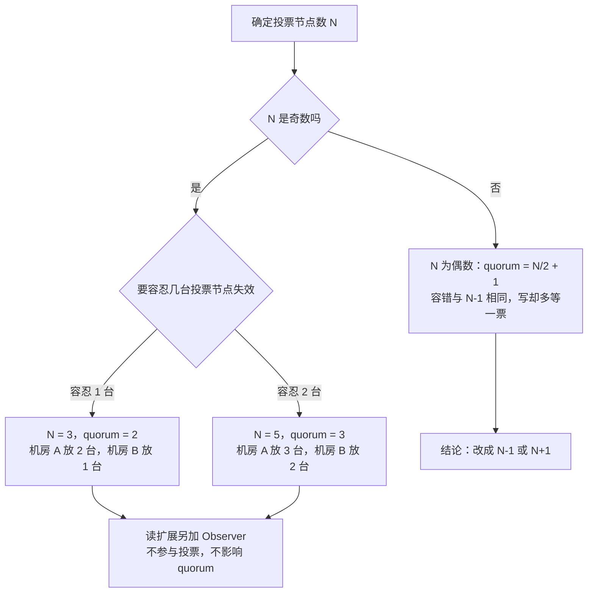
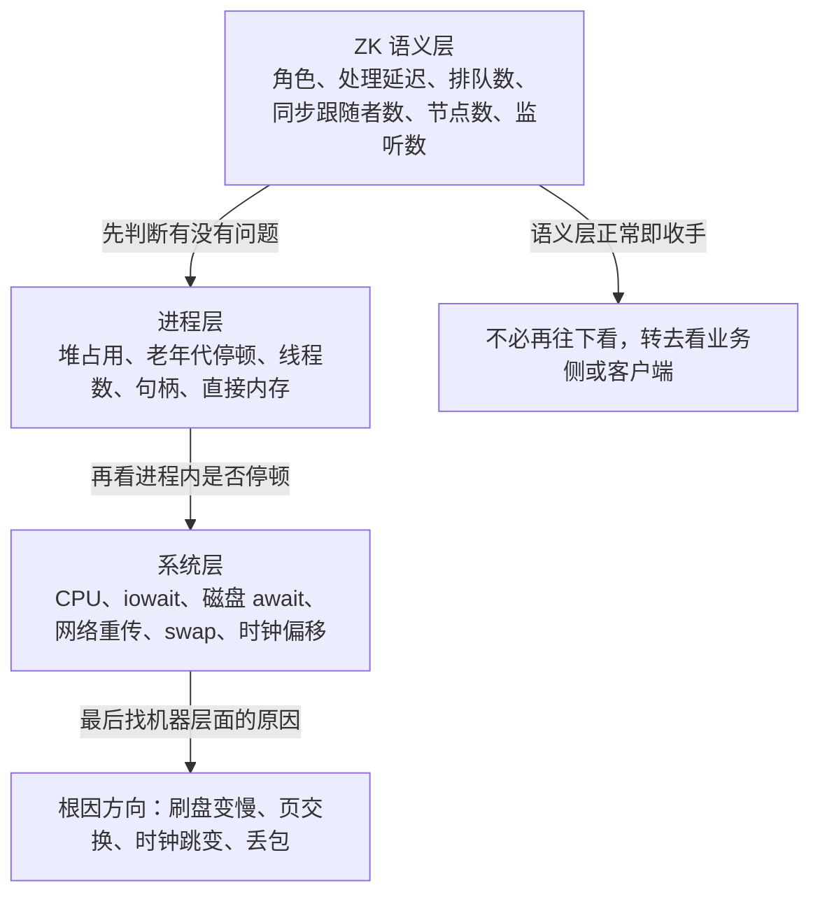
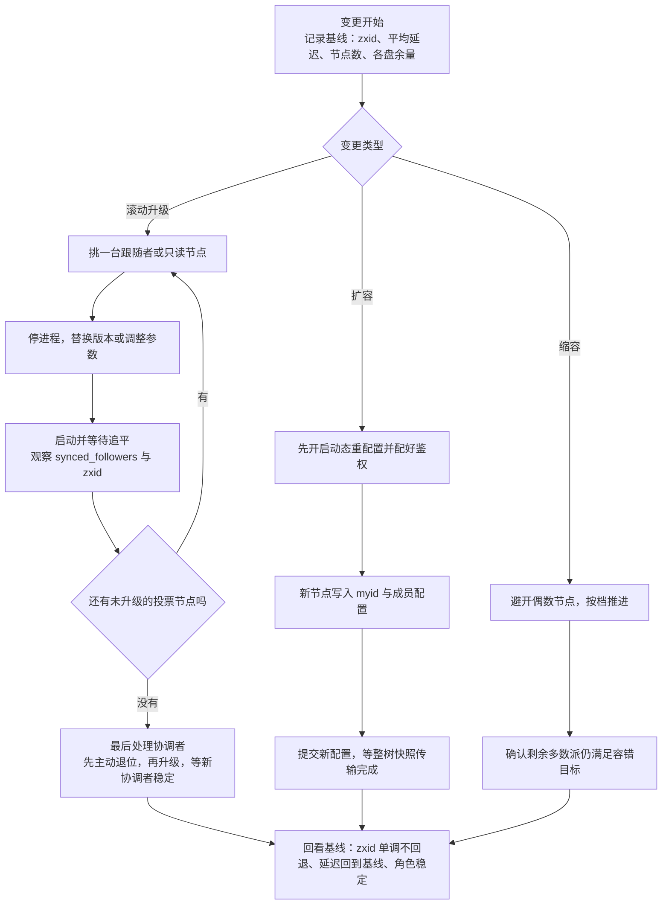
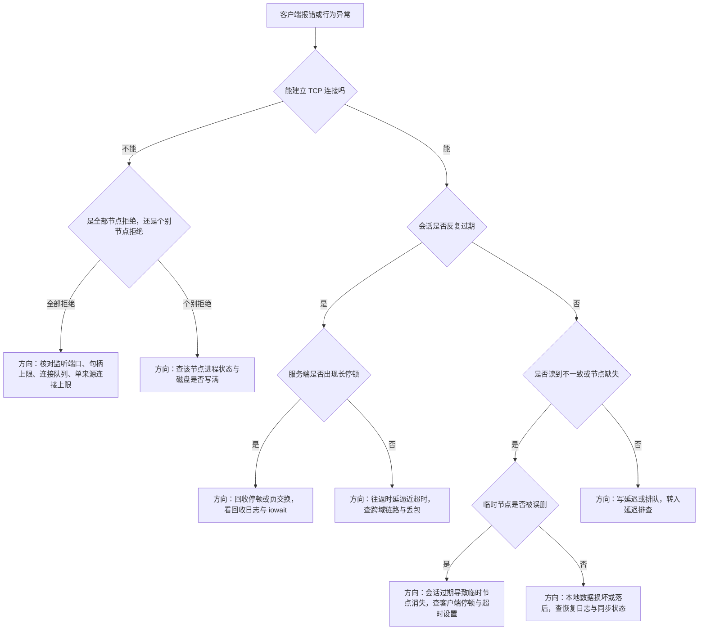

# 05 生产运维——部署、监控与故障处理

**摘要：**

ZooKeeper 的运维难处不在命令多少，而在它的故障形态几乎都绕着一处设计打转：数据全量驻留堆内，写请求要等一次 fsync 落盘，节点活着与否靠心跳与超时判定。三件事叠起来就把主线定了——内存决定能存多少，停顿决定集群会不会抖，磁盘的确认延迟决定写有多快。本文按五问推进：生产部署该按什么顺序规划资源，`tickTime`、`initLimit`、`syncLimit` 与会话超时之间存在哪些量化约束，监控该看哪三层指标与四字命令，扩展与滚动变更的顺序为何不能颠倒，以及哪些现象根本不该指望它自愈。中段给出四张图与五张表，把原本靠经验的部分换成有判据的流程，每一项建议都尽量落在一个可观测的量上。读完应当能回答两个问题：为什么第一次调优先改倍数而不是改 `tickTime`；为什么滚动重启的最后一台必须是协调者。落点则是一句权衡：把延迟敏感的路径单独保护起来，比把机器堆得更大更有效。

---

## 第 1 章 生产部署

2008 年，ZooKeeper 从 Hadoop 的子项目升为 Apache 顶级项目时，它承诺的东西并不复杂：一棵树形命名空间，一套会话与监听，一份把写请求排成全序的广播协议。麻烦在于它进入生产环境后，出问题的姿势几乎都不在协议层，而在协议之外——进程被一次垃圾回收停顿冻住、心跳没按时发出、会话被判过期、临时节点集体消失、上层应用以为自己还持有锁。

### 1.1 资源规划

资源规划的次序与多数中间件相反：先定内存，再定磁盘，最后才是处理能力。这处次序由「数据全量驻留堆内」推出——节点数乘以单节点数据量就是常驻集的下界，堆装不下时只有两条路，加堆或者改数据模型；前者在某个尺寸之后一定换来更长的停顿，所以规划的第一步其实该问一句，这些数据真的应该放在协调服务里吗。

内存按数据规模分档，小规模四到八吉，中等规模八到十六吉，再往上必须重新审视数据模型。协调数据体积极小，一棵装着几十万个节点的树通常不过几百兆，真正把堆吃掉的是三样东西：客户端注册的监听器、未释放的会话、被误当作存储用的业务数据。笔者见过的多数「内存不够」最终都指向第三样，而加内存只是把发作时间往后推几个月。

磁盘要分两块，用途不同，选型标准也不同：事务日志盘必须低延迟，因为它的确认延迟直接构成写延迟的地板；快照盘普通设备即可，因为快照是低频大块写。两块盘严禁与系统盘混用，也不建议放在同一设备的两个目录里——目录分离只解决命名冲突，不解决 I/O 争用，要分离的是物理队列。处理能力通常是四到八核足够，除非连接数很大，那时瓶颈是连接而不是计算。

### 1.2 核心配置与它们的相互关系

核心配置分四组，组内参数互相牵连，改一处要看另三处。

第一组是时间基准与两个倍数。`tickTime` 是公共刻度，默认两秒；`initLimit` 是启动期允许的同步时长上限，单位是这个刻度；`syncLimit` 是运行期允许跟随者落后的时长上限。两个超时分开设置是有道理的：启动期要把快照加载、日志重放、差异传输全部做完，工作量远大于运行期一次心跳往返，塞进同一个值，要么启动期老超时，要么运行期故障感知慢得离谱。

第二组是目录：`dataDir` 放快照与 `myid`，`dataLogDir` 放事务日志，分离的理由见 1.6 节。一处必须配套的是 `myid` 文件，编号写错会表现为节点无法加入集群，编号重复更麻烦，两个进程抢同一个身份，日志里是反复重连而不是一条明确报错。

第三组是连接与容量：客户端端口、单来源最大连接数 `maxClientCnxns`（默认六十，零表示不限）、会话超时上下限。容器化之后每个 Pod 一个连接，连接数会先于请求量成为瓶颈，形态是新连接建不上而老连接一切正常。

第四组是清理与快照：`snapCount` 决定每多少条事务做一次快照，自动清理的两个参数决定历史文件留多少，而自动清理默认不开启——这一条被漏掉，结果几乎注定是磁盘写满。

`tickTime` 是全组的乘数，动它等于同时动了会话上下限、失联判定、启动期限三件事，所以调优的纪律是优先调倍数。**改基准等于同时改全部**，这条纪律下文还会用具体算术再说一遍。

### 1.3 运行时参数：JVM 与 GC 如何影响心跳

这一节是地基。心跳不是能豁免于停顿的独立进程——它由 JVM 里的线程处理，写事务日志也是同一个 JVM 里的线程，一旦发生全停顿（Stop-The-World），整套动作一起冻结，从外面看就是这台机器既不发心跳也不回心跳。

冻结时长决定后果的严重程度，分三层。第一层，超过 `syncLimit × tickTime`，跟随者与协调者之间的连接被判失效，该节点退出并重新加入，期间不参与任何确认；若冻结的是协调者，跟随者判定协调者已宕机并发起选举，集群进入不可写窗口。第二层，超过会话超时，会话过期、临时节点被删，正在监听的客户端收到过期事件。第三层危害最大：会话已经过期而进程还活着，应用并不知道手上的锁已经飞了，另一台实例已拿到同一把锁，两边同时往同一处写。

协议层不会脑裂：`epoch` 与多数派机制保证旧协调者醒来必然退位，它的提案会被拒绝。**脑裂发生在应用层**，就在「会话到期」与「进程发现自己会话到期」之间的那段空窗里。

所以三条设置必须一起看：堆的初始值与最大值设为相同，否则运行时扩张触发一次全回收，这次回收落在业务高峰上；回收器选以暂停时间为目标的那一类，不用吞吐优先的配置；回收日志必须打开并采集，因为停顿是集群震荡的隐藏原因，没有日志就无法把它与网络抖动分开。

堆的大小有一条可量化的纪律：单次全回收的停顿目标应小于 `syncLimit × tickTime` 的一半，按默认值是五秒以内，余量用来吸收一次网络抖动与两次心跳的偏差。堆越大，一次全回收的基础工作量越大，这条线越容易被突破——**更大的堆在这里不是更安全，而是更危险**。

还有一处常被忽略：客户端侧的停顿同样会让会话过期。客户端一次长回收，服务端等不到心跳便判会话结束，客户端醒来重连拿到新会话，却不知道旧临时节点已经消失。监控视野里因此不能只有服务端，任何持有长连接的客户端进程，其停顿时长都要纳入同一个预算。

### 1.4 系统层面的优化

系统层面有四处优化值得在部署阶段一次做完，因为它们的特点是不显形，等流量上来才暴露，那时改动的风险已经高得多。

一是关闭交换分区。交换让内存访问从纳秒级变成毫秒级，对一处依赖内存低延迟的设计是灾难；更隐蔽的是它不报错，只表现为偶发但规律的慢。同时把 `vm.swappiness` 压到接近零，并接受「宁可内存溢出也不要交换」这个取舍，因为前者至少留下一份明确现场。

二是文件句柄上限。每个客户端连接消耗一个句柄，每个打开的事务日志与快照文件各占一个，句柄不足的表现是连接建立失败，而错误信息往往不指向句柄。上限按「最大连接数乘二」留余量，并把已用句柄纳入监控。

三是网络参数，包括连接队列、半连接队列与端口范围。客户端集体重连时（譬如集群刚完成一次选举），队列不够会让一部分客户端直接被拒，重连风暴因此被拉长。四是透明大页与时钟同步：前者会引入不可预测的停顿，建议关闭或设为 `madvise`；后者要用平滑调整而非跳变，一次时间回拨会让会话与超时的计算失去意义。

### 1.5 超时参数之间的量化关系

三个超时参数如何配合，是这套系统调优里最容易凭感觉的地方。先把关系写成算术：

```text
会话超时          ∈ [2 × tickTime, 20 × tickTime]        客户端与服务的存活判据
失联判定          = syncLimit × tickTime                   跟随者允许落后的时长
启动期同步上限    = initLimit × tickTime                   追赶与启动允许的时长
```

按默认值代入，`tickTime` 两秒、`syncLimit` 五、`initLimit` 十，得到失联判定十秒、启动上限二十秒、会话超时落在四秒到四十秒之间。有了这三个数字，调优就从猜测变成对账。

第一处对账：会话超时必须显著大于失联判定。若两者相当，一次十秒级停顿会同时触发失联与过期，两件事一起发生，排查时很难分开；留出三到四倍余量，短暂失联还有机会在同一条会话里恢复，客户端只需重连而不必重建临时节点。

第二处对账：失联判定必须大于一次最长停顿加一跳往返。这是 1.3 节的直接推论，也是判断「该不该调 `syncLimit`」的唯一依据——先量出停顿分布（回收日志里有），再反推倍数。

第三处对账：启动上限只影响启动与追赶，不该为运行期的问题去动它。一台落后很多的节点重新加入时要加载最大快照、重放日志、传输差异，二十秒往往不够，此时该做的是本地数据清理或整树重传，而不是把 `initLimit` 抬到很大——抬上去之后，集群会容忍一个长期追不上的节点挂在里面。

调优顺序因此固定为三步：先确认三处关系成立，再调整倍数，最后才考虑基准。**先倍数后基准**的价值不在参数本身，而在可归因：改倍数只影响一类超时，改基准影响全部。

### 1.6 磁盘与 fsync 的运维红线

写路径的形状决定了一切：请求到协调者，协调者把事务发给多数派，每个节点把事务写进日志并等设备确认，然后才回执，凑够多数派才提交。写延迟因此约等于一次 fsync 的确认延迟加一次网络往返。

选型看的是小写入的确认延迟及其尾部，不是顺序吞吐。有些设备顺序吞吐漂亮而小写入确认延迟不低，按吞吐选型必然选错；更麻烦的是尾部，平均正常而 p99 很差，表现为大部分写很快、偶尔一次要几百毫秒，而选举判定只看最慢的那几次。**按吞吐评估一条延迟敏感的路径，是选型里最常见的错配**。

几条红线值得单列。日志目录不得放在网络文件系统或共享存储上，fsync 的语义与延迟在那里都不可控；设备写缓存若无电池保护就不能开写回模式，否则「已持久化」在掉电时不成立，多数派确认也失去意义；日志盘与快照盘分属不同设备，不与系统盘共用；剩余空间低于两成就要处理，而不是等报警。

fsync 变慢有明确痕迹，日志里会出现类似 `fsync-ing the write ahead log ... will take a long time` 的告警，出现时刻往往与上层的写延迟尖刺完全重合。另有一类尖刺与 `snapCount` 周期吻合：每若干万条事务做一次模糊快照，快照把整棵树序列化写出，几十万节点对应几百兆连续写，若与事务日志共用设备，刷盘就被排在它后面。**周期性尖刺先看快照周期，再看设备**，这条经验能省掉大量在硬件上找原因的工夫。

事务日志文件本身也有形状：单个文件约六十四兆就要滚动，滚动时创建新文件并预分配空间；空间不足或预分配失败，该节点会停止对外服务，它在多数派里的那一票随之消失。所以「磁盘写满」的后果不是「日志写不进去」，而可能是「集群少了一个投票节点」，严重程度差着一个量级。

### 1.7 部署拓扑与节点数的取舍

节点怎么分布同时影响延迟与容错，而两者方向相反：低延迟要求把多数派放进同一个网络域，容错要求把它们散到不同故障域。多数派机制不允许折中，因为提交只需多数，多数派落在哪个域，那个域的延迟就是写延迟。

节点数可以用算术直接算清。三节点多数派是二，容忍一台；五节点多数派是三，容忍两台；四节点多数派是三，容忍一台——与三节点相同，但每次写多等一个确认，等于用性能换了一个零收益。**奇数不是审美，是容错与成本的比值在奇数点上最优**；七节点能容忍三台，但写要等四个确认、运维对象也翻倍，实践中很少越过五。

下图把节点数取舍与故障域分布放在一起，三条分支对应三类常见决策：



按这张图排下来，最常见的是同城两机房、二加一或三加二。前提是一条硬约束：机房之间的往返时延必须显著小于失联判定，否则一次链路抖动就足以让少数派那一侧的节点被反复踢出。以默认值算，判定十秒，跨机房往返要压到一秒以内才谈得上平时能跑且抖动时不抖，这也是跨城部署只在能接受更高写延迟时才被考虑的原因。

故障域还要看粒度，机架、电源、交换机、可用区是四个层次。多数派要么全部避开同一个层次，要么承认这个层次不存在容灾；只分到不同机架却共用一台核心交换机，看起来分散，实际还是一个故障域。

### 1.8 部署形态：物理机、容器与托管服务

同一套二进制跑在三种形态里，运维的着力点完全不同，取舍集中在控制力、部署效率与运维成本三者之间。

物理机延迟稳定，没有资源争用与 CPU 节流，磁盘直连，代价是交付慢、扩容以周计。容器或编排环境交付与扩缩快，代价是资源限制带来两类新故障：内存上限低于「堆加堆外加元空间」之和时，进程被直接杀掉而不是抛内存溢出，现象是节点无征兆消失、重启后从快照重建并整树传输；CPU 上限带来节流，而节流的形态就是停顿。托管服务省去大部分运维，代价是可调参数与诊断能力受限，很多与停顿、刷盘相关的参数改不了，出问题时也拿不到回收日志与线程栈。

| 形态 | 控制力 | 主要风险 | 适用条件 |
| :--- | :--- | :--- | :--- |
| 物理机 | 最高，内核参数与磁盘队列均可调 | 交付慢，扩容以周计 | 写量大、延迟敏感、团队有能力维护 |
| 容器 | 中等，受编排资源限制约束 | 内存上限误设被杀、CPU 节流、网络盘拖慢 fsync | 实例多、需快速扩缩、资源限制已核对 |
| 托管服务 | 最低，参数与日志受限 | 停顿看不见、参数改不动、故障只能等厂商 | 团队无法控制运行环境、规模不大 |

容器化另有三处必须核对：持久化目录要与 `myid` 一起保留，否则重建的 Pod 就是个身份不明的新节点；就绪探针不要用四字命令频繁探测，它占用请求处理能力，用端口探测即可；时钟同步由宿主机保证。

---

## 第 2 章 监控体系

### 2.1 三层指标：系统层、进程层与 ZK 语义层

监控指标可以按观察位置分三层，分层的意义在于「先看哪一层」有确定答案，而不是每次都从一堆曲线里碰运气。

最上面是 ZK 语义层，看这套系统自己认为发生了什么：角色、处理延迟、排队、同步跟随者数量、节点数与监听数。中间是进程层，看 JVM 内部：堆占用、老年代停顿、线程数、句柄、直接内存。最下面是系统层，看机器：CPU、iowait、磁盘 await、网络重传、交换、时钟偏移。**语义层先看**，它离「有没有问题」最近；从系统层出发则注定在噪声里泡很久，因为机器看起来忙与这套系统确实出问题之间没有必然关系。

下图是三层之间的下钻路径：



语义层的指标大多能从四字命令 `mntr` 一次拿到，下表列的是最该长期采集的那一批：

| 指标 | 含义 | 正常范围 | 异常含义 |
| :--- | :--- | :--- | :--- |
| `zk_server_state` | 本节点在集群中的角色 | 与预期一致（leader / follower / observer） | 角色频繁变化说明选举反复，或成员配置有误 |
| `zk_avg_latency` | 服务端处理请求的平均耗时，不含网络 | 与设备确认延迟同量级，通常个位数毫秒 | 台阶式上升指向提交流程或请求排队 |
| `zk_max_latency` | 观测窗口内最慢的一次请求 | 偶发尖峰若与快照周期吻合属正常 | 与 `snapCount` 周期同步的尖峰指向日志与快照共用设备 |
| `zk_outstanding_requests` | 已接收、尚未开始处理的请求数 | 长期贴近零 | 持续为正说明请求处理器饱和，队列在膨胀 |
| `zk_num_alive_connections` | 当前客户端连接数 | 等于在线客户端实例数 | 骤降是重连风暴，缓慢单调上升是连接泄漏 |
| `zk_synced_followers` | 与本机完成同步的跟随者数（协调者视角） | 等于投票节点数减一 | 小于该值说明有节点落后，通常是选举的前兆 |
| `zk_pending_syncs` | 等待同步的跟随者数（协调者视角） | 长期为零 | 持续为正说明追赶速度跟不上写入速度 |
| `zk_znode_count` | 数据树节点总数 | 随业务缓慢变化 | 阶梯式上升多为临时节点泄漏或目录误建 |
| `zk_watch_count` | 全局监听器总数 | 与客户端数量同一量级 | 只增不减说明监听器未释放，内存与通知开销持续上涨 |
| `zk_open_file_descriptor_count` | 已用文件句柄 | 低于上限的一半 | 逼近上限时新连接直接建不上 |
| `zk_approximate_data_size` | 数据树的近似字节数 | 与堆占用同向变化 | 增速超过堆余量时，该扩内存或改数据模型 |

表里最容易被低估的是 `zk_outstanding_requests`。它持续为正说明请求进来的速度已超过单线程处理器的消费速度，此时延迟上升只是结果，而它不像 CPU 使用率那样有明显形态，容易被当成「机器还挺闲」。

### 2.2 三处最该优先关注的指标

四类指标里，三处最该优先建设，因为它们都是过程指标，能在服务受影响之前给出预警。

第一处是选举次数。它没有现成的指标，只能从角色变化与状态迁移日志里数出来——这本身就是一处盲区：多数团队监控了角色，却没把「角色变化了几次」做成计数器。它的正常值就是零，任何增长都要追到底，而它一次能指向三个方向：参数倍数不对、存在长停顿、多数派跨越了高延迟链路。

第二处是老年代回收停顿的时长分布，而不是堆使用率。堆使用率可能长期平稳，中间偶发一次六秒的全回收，平均下来毫无异常，可正是这六秒让协调者被换掉。采集口径要取最长停顿与停顿的 p99，配合回收日志，而不是取均值。

第三处是事务日志的 fsync 延迟，它直接决定写延迟，也是区分内部排队与设备问题的唯一判据：fsync 同步上升，方向在持久化链路；fsync 正常而请求延迟上升，方向在排队或单机瓶颈。

### 2.3 告警设计

告警设计有三条原则，都从上面三层指标的性质里推出来。

原则一是零基线指标非零即告警。选举次数、`zk_outstanding_requests`、`zk_pending_syncs`、`zk_watch_count` 的异常增量，正常值就是零或恒定，不需要设阈值，偏离即异常；省掉阈值的意义在于省掉了「阈值定多少」这场永远吵不完的讨论。

原则二是趋势指标要设提前量。磁盘占用是典型，阈值不该按百分比定，而该按「从触发到达到上限还要多久」定，这个时间必须大于干预所需的时间；同样一个百分比，在增长快时太晚，在增长慢时太吵。

原则三是结果指标要携带方向。请求延迟上升可能来自内部排队、设备变慢、协调者切换三类原因，告警若只报「延迟高」，排查就要从零开始；若同时带上未完成请求数与 fsync 延迟，告警本身已经把方向指出来了。**告警的价值在于指向具体方向**，而不在于报得多及时。

### 2.4 观测层次的下钻路径

除了按位置分三层，还要按对象分三级：集群级回答整体是否健康，节点级回答哪个节点异常，请求级回答哪些请求慢。

建设顺序应当从集群级开始，因为它成本最低、覆盖多数告警。只有集群级，定位不到具体节点，排查时要在几个节点之间轮着猜；只有请求级，看不到整体趋势，容易把一个全局问题误判成个别慢请求。三级齐备之后，排查路径就是一条固定的下钻线：集群级发现异常，节点级缩小范围，请求级用 `cons` 拿现场——每个连接一行，带排队字节与延迟统计，排队字节明显偏大的那些连接，要么在抢同一把锁，要么在等同一批提交。

### 2.5 指标与日志的分工

指标回答「是否异常」，日志回答「为什么异常」：前者聚合，能看到趋势；后者明细，能看到具体事件。这套系统的日志里有几类线索几乎等价于一个确定的故障方向——状态迁移日志连续出现是选举，fsync 相关告警是刷盘变慢，会话过期与连接关闭成批出现是一批客户端同时失联，数据库无法加载是本地数据损坏。两边都要采集，缺一边就只剩半个现场。

### 2.6 四字命令：不重启就能看到的现场

这套系统内置了一组通过客户端端口发送四条短命令组成的诊断接口，俗称四字命令，能在不重启、不改配置的前提下给出运行时快照，因此是排查时的第一件工具。

| 命令 | 输出内容 | 判读要点 | 适用场景 |
| :--- | :--- | :--- | :--- |
| `ruok` | 一个固定的短字符串 | 只证明进程在监听，不证明集群健康 | 负载均衡与探活的粗判 |
| `srvr` | 版本、延迟统计、收发计数、连接数、未完成请求数、zxid、角色、节点数 | 与 `mntr` 同名指标对得上；角色与 zxid 一起看 | 想看单节点全貌时的首选 |
| `stat` | `srvr` 的全部内容加当前连接的客户端列表 | 客户端列表能看出谁连着、连了多久 | 定位「谁在连着这台」 |
| `cons` | 每个连接的来源、排队字节、收发计数、会话号、最后操作、延迟统计 | 排队字节大说明该连接在等；延迟统计能定位慢客户端 | 请求级下钻 |
| `mntr` | 键值对形式的全部指标 | 直接对应监控采集项，适合脚本与人工比对 | 指标核对与临时取值 |
| `wchs` | 监听器汇总：连接数、路径数、总数 | 总数只增不减即为监听器泄漏 | 内存与通知开销异常 |
| `dump` | 会话与临时节点的明细 | 能看出临时节点挂在哪个会话上 | 临时节点泄漏与误删排查 |
| `dirs` | 快照目录与日志目录的文件大小统计 | 目录占用与文件数一起看 | 磁盘容量核对 |
| `isro` | 只读状态 | 只读说明该节点与多数派失联 | 分区后的现场确认 |

两条实践纪律。一是白名单：较新的版本给四字命令加了白名单 `4lw.commands.whitelist`，默认只放通 `srvr`，其余需显式加入——这不是麻烦而是必要的防护，因为这些命令与客户端共用一个端口，端口暴露在不可信网络里时，`dump` 与 `cons` 泄露的是全部会话信息。二是开销：`mntr`、`dump`、`cons` 都会遍历内部结构，自动采集要走指标通道，而不是定时轮询四字命令。

判读时的习惯是**两两对照**：`srvr` 的未完成请求数与 `zk_outstanding_requests` 对照，`cons` 里各连接排队字节之和与未完成请求数对照，角色与 `zk_synced_followers` 对照。对照不上的地方就是线索——未完成请求数很高而排队字节全为零，说明请求卡在处理器而不是网络上。

---

## 第 3 章 水平扩展

### 3.1 两条扩展路径

扩展有两条路径，扩展的是不同的能力。第一条是增加投票节点，扩展的是容错能力：更多节点意味着能容忍更多台失效，代价是每次写需要更多确认，写延迟上升、写吞吐不变。第二条是增加不投票的只读节点（Observer），扩展的是读吞吐：它们不进入多数派计数，因此不影响写性能，读请求可以在本地副本上完成。

两条路径的差别就在是否影响写性能，而这一点决定选择依据：读压力大而写有余量，加只读节点；容错不足，加投票节点；两者都需要则先加只读节点，因为它不动多数派。**写能力无法靠加节点解决**，这是单写者加多数派的直接后果，不是实现缺陷。

### 3.2 只读节点的定位

只读节点的正确用途是扩展读吞吐，它通过异步方式从协调者接收更新，因此数据可能略落后。这个「略」没有上界保证，取决于链路与负载，所以它不适合对一致性要求极高的读，适合读多写少且能容忍轻微滞后的场景，譬如配置读取、服务发现、元数据展示。

它还有一处价值是跨地域：把只读节点放在远端，远端的读请求在本地完成，跨地域的读延迟被消掉；写仍然要回到中心区域的协调者，所以写延迟不变。前提因此是读远多于写——写占比高时，跨地域的写延迟会成为主要问题，而只读节点对此毫无帮助。

### 3.3 扩展的边界

第一处边界是写能力无法横向扩展。所有写都要经过同一个协调者串行分配序号、汇总确认，写吞吐上限由单个节点的处理能力决定；提高的办法只有优化单机——譬如换确认延迟更低的设备、减少写路径上的拷贝、把批量提交做得更彻底。

第二处边界是节点数不是越多越好。多数派变大，每次写要等的确认变多，写延迟上升，内部通信量与故障组合数也一起涨。七节点相对五节点多换一台容错，代价是写延迟与运维成本各上一台阶，这个交换多数场景不划算。

两处边界源于同一处设计：单写者加多数派。它是强顺序一致的代价，突破它就不属于运维范畴了。

### 3.4 扩展的决策依据

判据是当前瓶颈在哪一侧：读压力大而写有余量，加只读节点；容错不足（多数派经常凑不齐、或业务要求更高等级的容灾），加投票节点；写压力大，两条路径都无效，只能优化单机或把写请求分流出去。

确认瓶颈侧的方式是看资源与延迟的对应关系，譬如写延迟与读延迟的背离：写延迟高而读正常，瓶颈在写侧；两者同步升高而设备延迟正常，瓶颈在排队或协调者；两者同步升高且设备延迟也升高，瓶颈在持久化链路。这套判断需要 2.2 节那三处过程指标支撑，没有它们就只能凭感觉。

### 3.5 只读节点的代价

只读节点的代价不只在数据滞后上，另三处都不体现在读性能里，因此容易在评估时被划掉。

一是它仍要从协调者接收全量更新，出站流量随只读节点数线性增长；二是它需要完整的本地持久化，磁盘成本与投票节点相同，它不是缓存而是一份完整副本；三是它增加了成员管理的复杂度，配置、监控、升级都多一套对象。**扩展的代价常常落在被扩展对象之外**，评估时看全链路负载，而不是被扩展那一段的指标。

### 3.6 扩容：增加节点要做的核对

增加投票节点这一步，不同版本的操作方式差别很大。较老的版本成员信息写在配置文件里，改配置只能滚动重启整个集群，期间有不可写窗口；较新的版本支持动态重配置，新配置作为一次事务提交，走与其他写相同的广播路径，被移除的节点降级成没有投票权的跟随者。使用动态重配置要显式开启对应开关并配好鉴权，因为「能改成员」本身就是高权限操作。

加节点之前要核对五项：节点数与近似数据量决定新节点的加载时间与内存需求（堆要装下整棵树外加监听器与连接），日志与快照目录都要留够余量，单来源连接上限与句柄上限要接得住可能迁过来的客户端，新节点到多数派的往返延迟要满足 1.7 节那条约束。

加完之后的动作是追数据。新节点只能从协调者接收一次整树快照，再补其后的日志差异，这段时间协调者多了一份大流量传输负载，写延迟可能短暂上升；数据量大时传输持续很久，所以扩容要选低峰，且追上之前不要把它算进可用容量。

还有一处算术，笔者建议提前算：从三节点扩到五节点，多数派从二变三。过渡期里任何一次确认都要同时取悦新旧两套多数派，集群对故障的容忍度反而更低——此时坏掉两台，新旧多数派都可能凑不齐。扩容窗口本身就是风险窗口。

### 3.7 缩容与滚动重启

缩容比扩容更容易出事，因为容错能力是跳变的。五节点缩到四节点，多数派仍为三，但容忍台数从两台降为一台：规模只少一台，容错降了一级。所以纪律是避开偶数、按档推进，要么一次从五缩到三，要么不动；停在四节点最差，容错与三节点相同而写更慢。

滚动重启的顺序是一条不能颠倒的线：先跟随者与只读节点，协调者留到最后。原因很直接，协调者一旦重启，集群要经历一次选举与一段不可写窗口；把它放在最后，前面所有节点都已在新版本上验证过，这段窗口只需承受一次，而不是每重启一台就承受一次。**最后一台一定是协调者**。

每重启一台的节奏是：停进程，替换版本或参数，启动，等它追上——判据是它重新出现在同步计数里、且 `srvr` 的 zxid 与协调者接近，再动下一台。任意时刻只允许一台离线，这条不是保守而是算术：三节点集群的多数派是二，同时离线两台就没有多数派，整个集群不可写。

下图把滚动升级与扩缩容的动作顺序画在一起，三条分支共用同一套收尾动作：



图里有两处容易被跳过。一处是先主动退位：直接杀掉协调者也能选出新的，但会留下一个未完成的切换过程，日志里混着两条线索；主动退位把切换做成一次有记录的事件。另一处是收尾的回看基线：对比变更前后的延迟与 zxid 单调性，若 zxid 回退，说明有节点从旧数据重建。

还有一条硬提醒：不要把回滚当成兜底方案。日志与快照格式随版本演进，新版本写下的数据旧版本未必读得懂，所谓回滚往往等于用升级前的备份重建数据；升级前要留一份可用的数据目录备份。

### 3.8 跨地域部署与就近接入

跨地域方案本质上是只读节点的典型用途：远端部署只读节点，让远端的读在本地完成，写仍转发到中心区域的协调者。收益是读延迟大幅下降，写延迟仍由到中心的往返决定。

前提是读远多于写并且能容忍读滞后。写占比高时，跨地域的写延迟会成为主要问题，收益被写路径吃掉；一致性要求高时，客户端每次读前都要补一次同步，跨地域往返又把收益抵消。它适合配置读取、服务发现这类「变了以后过一会儿生效也无所谓」的场景。

它还引入两处新的故障形态。一是链路抖动让远端只读节点反复重连：它不参与多数派，所以不影响可用性，但会放大协调者的同步负载。二是就近接入本身要设计：静态列表简单、不引入额外依赖，但节点变更要改配置；动态发现感知变更，却多了一处依赖，而它在故障时往往也不可用。无论选哪种，客户端都要配多个节点，否则那一个不可用时客户端会完全失联。

---

## 第 4 章 常见故障

### 4.1 五类故障与其映射

生产环境里的常见故障归为五类，对应资源、稳定性、性能、连接、数据五个维度。按维度归类的价值在于从现象跳到类别，而类别里已经列好了可能原因与第一动作。

| 现象 | 常见根因 | 第一处置动作 | 判据 |
| :--- | :--- | :--- | :--- |
| 磁盘写满、节点退出集群 | 自动清理未开启、快照与日志文件积累 | 开启自动清理，清理历史文件，恢复节点 | `dirs` 显示目录占用接近上限，日志有空间不足告警 |
| 集群反复选举、周期不可写 | 长停顿、失联判定过紧、多数派跨高延迟链路 | 先量停顿时长，再核参数倍数，最后看链路往返 | 状态迁移日志反复出现，同步跟随者数波动 |
| 写延迟升高、读正常 | 日志盘争用、设备确认延迟变差、协调者排队 | 先看 fsync 延迟，区分持久化与排队 | fsync 告警与延迟尖刺同现则在设备侧，否则在排队侧 |
| 连接建立失败、老连接正常 | 单来源连接上限、句柄上限、连接队列溢出 | 逐项核对三处上限的用量曲线 | 句柄计数逼近上限，或新连接在队列处被拒 |
| 读到不一致、节点缺失、恢复失败 | 快照损坏、磁盘故障、会话过期导致临时节点消失 | 先确认是可自愈的落后还是损坏，损坏则从备份重建 | 加载数据库失败的日志，或临时节点在会话结束后集体消失 |

五类故障的第一动作不同，因为紧迫性不同：磁盘写满会直接减少投票节点，必须立刻止损；选举反复但每次都恢复，可以先观察再定位；读不一致最容易被误判为程序缺陷，而实际根因往往在会话。

### 4.2 根因与处置的对应规律

把五类的处置顺序并排看，能看出三条规律。

资源类先看趋势再看配置：趋势告诉你离上限还有多远，配置决定上限本身。稳定性类先看停顿再看网络：停顿是隐藏原因，网络更明显但更少发，先排停顿等于先排除概率最高且成本最低的一类。性能类先看持久化再看请求：写延迟主要由持久化链路决定，请求侧排队是结果而不是原因，先看 fsync 能一次把设备问题与容量问题分开。

三条规律给的是排查的优先顺序，而顺序的价值在于避免在错误方向上耗时。

### 4.3 容量规划与写入量

事务日志的增长速率与写入请求数成正比，容量需求会随业务增长而上升；容易出错的是增长曲线本身。

写入量通常不是线性增长：客户端实例数增加、上报频率提高、某个业务开始用它做注册中心，都会让写入量阶梯式跳一级。按当前值算容量，结论下个季度就被推翻；按预期峰值算，再配一条占用率提前告警，才是能用的算法——告警能在真正写满之前给出干预时间，把一次事故变成一次扩容。

另有一处特有容量项：`snapCount` 决定快照频率，快照频率决定磁盘上文件的数量与总量。写入量翻倍，同样保留份数占用的空间也翻倍，而保留份数是按「份」而不是按「天」算的——大写入量下，几份快照就可能是几十吉。

### 4.4 客户端行为对服务端的影响

客户端行为常被当作「客户端的事」，但它直接决定服务端稳定性。三类影响最常见：连接数超过单来源上限，表现为某个应用整体连不上；监听器数量过大，每个都占服务端内存且每次变更都要遍历通知；短连接频繁建立与断开，消耗认证处理能力，还让会话与临时节点反复创建删除。

服务端能做的只有用上限防护：连接数上限、单来源上限、会话超时上下限、请求大小上限。这些上限不是限制业务，而是在客户端行为不可控时保住服务端。所以运维应当对客户端提要求：长连接复用、限制单应用的监听器数量、不要用超短会话超时、批量注册而不是逐个注册。多团队共用时，上限就是最后一道防线，而它需要配合告警，否则上限被触及会以「某个应用时不时连不上」的形态存在很久。

### 4.5 故障分类的工程价值

故障分类决定处置效率，因为同类故障共享根因与处置，识别出类别就跳过了大量排查。

分类依据应当是现象而不是原因：现象最先可观测，原因要排查之后才知道。按现象分类、在每类里列可能原因与对应处置，得到的就是 4.1 节那张映射表——这类表是运维效率的核心资产，它把依赖某个人的经验变成照着表往下走，而可传递正是团队规模化的前提。映射表要维护：每次复盘后若发现缺一行或某一行的第一动作不对，就补上、改掉；一张三年没动过的映射表，通常意味着它已经与现实脱节。

### 4.6 故障处置的顺序：先止损，再定位，最后修复

处置顺序错误会加重故障，这在协调服务上尤其明显——它的影响面是所有依赖它的系统，故障每延长一分钟，上层的新故障就多一批。

正确的顺序是**先止损，再定位，最后修复**。止损的含义是减少影响面，手段有一份现成清单：摘除异常节点、把流量切到备用集群、降级非核心功能、限制客户端请求量、暂停非必要的批量任务。这些手段应当平时准备好并演练过，因为故障时临时想往往来不及。

常见的错误是直接开始定位。定位需要时间，而故障还在扩大；先止损能把故障限制在当前范围内，再从容分析。这个顺序还有一层好处：它把时间压力与分析需求分开了，值班的人先做的是几个确定的动作，而不是在压力下追一条不确定的线索。止损的判据是影响面是否还在扩大，而不是根因是否已找到——影响面停止扩大就转去做定位，还在扩大则任何定位都是奢侈。

---

## 第 5 章 排查推演

### 5.1 从现象到方向：一张排查决策树

排查的第一步不是查原因，而是确认现象属于哪一类。**先分类现象，再查原因**：这套系统的客户端报错绝大多数可以归到三条入口——连不上、会话反复过期、读到不一致或节点缺失，三条入口往下各有两三个岔口，走完就得到一个明确方向，而不是一堆猜测。

下图是这三条入口的决策树：



这棵树有两处设计值得说明。一是它按客户端能看到什么分层，不必先懂内部结构就能走到方向；二是每个叶子都指向一个可执行的动作，避免出现方向对了却不知道下一步做什么的停顿。

### 5.2 一次集群频繁选举的排查推演

假设现象是集群每隔几分钟出现一次不可写窗口，每次几秒后自愈。

第一步，确认失联判定与会话超时的关系。若两者相当，一次正常范围内的停顿就足以同时触发失联与过期，表现为抖动频繁但每次恢复；先核参数，因为这一步成本最低。

第二步，确认是否存在长停顿。停顿会让节点错过心跳，而停顿在回收日志里通常有痕迹；把最长停顿与失联判定放在一起比，若最长停顿已接近判定时长，方向就定了，不必再查网络。

第三步，确认多数派是否跨了高延迟网络域。跨域往返让心跳往返时间逼近判定时长，容错余量被压缩到几乎没有；此时的抖动往往与链路质量相关，表现为某个时段特别频繁。

第四步，确认是否有节点负载过高导致处理心跳变慢。心跳处理与其他请求共享处理能力，请求饱和时心跳也在排队，`zk_outstanding_requests` 持续为正是一个明确信号。

第五步，确认是否反复失去多数派。这一点与常见印象不同：这套系统的选举不依赖随机退避，收敛靠投票比较，所以多个节点同时发起选举本身不是问题，真正的问题是多数派反复失去又恢复——原因通常是某台机器的网络间歇性丢包，或某台进程被反复重启。

五步走完，多数情况落在停顿与跨域两处。落在停顿上，处置是控制停顿（收堆、换回收器、关交换、排查内存泄漏）；落在跨域上，处置是重排故障域，而那往往需要一次真正的架构调整，不是调参数能解决的。

### 5.3 一次写延迟升高的排查推演

假设现象是写请求延迟上升，读请求正常。

第一步，确认 fsync 延迟是否同步上升。这一步是二分：同步上升，方向在持久化链路；不同步上升，方向在内部排队。一次二分就能排除一半可能，这是整套推演里性价比最高的一步。

第二步，若方向在持久化链路，确认日志盘是否被其他负载争用。快照写入、系统盘活动、同机其他进程的批量 I/O 都会干扰刷盘；若延迟尖刺与 `snapCount` 周期吻合，几乎可以确定是快照写与日志写共用设备。

第三步，确认设备是否发生性能退化。确认延迟会随使用时间、磨损与剩余寿命变化，也受固件与阵列卡缓存策略影响；这一步需要历史数据对照，所以平时要存 fsync 延迟的基线。

第四步，若方向在内部排队，确认请求队列长度与处理能力。所有写都经过协调者的单线程处理器，队列长度直接反映排队，`zk_outstanding_requests` 是现成读数。

第五步，确认是否存在突发的大量写入。业务侧的写入模式变化，譬如批量注册、批量创建、上报频率提高，会直接反映为延迟上升，而这类变化往往发生在业务变更之后，时间上能对上。

五步的价值在于先二分再细化。拿到现象立刻去查设备，等于把二分跳过了，运气好能一次命中，运气不好会绕很久。

### 5.4 一次数据不一致与恢复失败的推演

这一类故障形态最杂，处置也最不能急，因为「从备份重建」这一步不可逆。

一类反复出现的链条是这样的：某台节点的磁盘先被历史文件写满，事务日志写失败，该节点停止对外服务，集群少一个投票节点；运维清理磁盘、重启该节点，它加载本地最新快照、重放日志，但日志已被清理，只能从更旧的快照重建，再向协调者请求整树传输。上层看到的因此不是磁盘满了，而是集群短暂不可写、某节点数据落后、客户端偶尔读到旧值。

处置这类故障有三条纪律。其一，先摘除再清理：确认磁盘满的节点已经退出集群之后，再动它的文件，避免清理过程中它又加入又退出，把状态搅乱。其二，清理之前先看清目录里有什么，`dirs` 与文件列表一起看，确认要删的是历史快照而不是当前正在用的那一份。其三，重建期间不要对新节点加压，它会先做一次整树传输，这段时间它的读请求会失败或很慢，客户端应当暂时把它从节点列表里摘掉。

另一类是本地数据损坏，加载数据库失败，节点无法启动。判据是损坏是否只在一台：只在一台时，最省事的做法是清空该节点的数据目录，让它以全新节点身份加入并整树传输，代价是一段时间的带宽与协调者负载，收益是不需要人工修复文件；多台同时损坏说明问题在共享层（磁盘阵列、文件系统、快照写入路径），此时应当先停住，从一份确认可用的备份恢复一台，验证集群可用之后再逐台恢复。

读不一致还有一类根因不在数据而在会话：会话过期导致临时节点消失，或客户端跨会话读到旧值。前者查客户端的停顿与超时设置，后者要客户端补一次同步；把它们与数据损坏区分开很重要，因为处置手段完全不同——前者调参数，后者动数据。

### 5.5 排查纪律、日志级别与变更管理

排查有三条纪律。第一条是先确认现象的可观测性：现象无法被度量时排查只能靠猜，所以第一步往往是建立观测而不是查原因；这套系统的多数故障形态（停顿、排队）默认不可见。第二条是先二分再细化：一次二分成本极低，收益是排除一半可能。第三条是改动之后必须回看指标，否则未验证的改动会累积成未知状态，几次之后没人说得清当前配置是怎么来的。

排查中常有一个具体需求：临时把日志级别调细，看清某个时刻到底发生了什么。这件事有三条路径，代价依次递增。最轻的是通过管理接口在线调整，较新的版本在管理端口上提供了设置日志级别的命令，改完立即生效、无需重启；次轻的是通过 JMX 连接调整，前提是日志框架注册了对应的配置器；最重的是改配置文件后重启，代价是一次重启与一段追赶。三条路径的共同纪律是**临时调、调完复原**：调试级别的日志量能在一小时内把磁盘写满，而这套系统对磁盘写满的容忍度极低，等于用一次排查换一次故障。

变更管理要承接排查结果。安全变更的三条纪律：先确认变更前的基线，这样才判断得出变化是不是变更引起的；小步变更并逐次验证；保留快速回滚路径。基础设施的变更尤其需要这些，因为它的影响面大且滞后显现——调整超时参数之后，效果可能要等到下一次抖动才体现，没有基线就永远归因不了。变更记录至少留三样东西：改了什么、什么时候改的、改之前的基线指标。

### 5.6 故障演练的分级与记录

演练能发现只在故障时才暴露的问题：恢复流程是否可用、文档与实际差多少、团队的反应速度如何，三者都只能在演练里验证。

演练应当分级，三档按影响面递增，从最小档开始推进。

| 档位 | 动作 | 验证目标 | 观测值 |
| :--- | :--- | :--- | :--- |
| 第一档 | 重启单个跟随者 | 恢复流程是否可用、追赶耗时 | 从停止到重新出现在同步计数里的时长 |
| 第二档 | 主动触发协调者切换 | 选举是否成功、不可写窗口多长 | 不可写窗口时长、切换后角色是否稳定 |
| 第三档 | 模拟一个故障域失效 | 容灾是否成立、数据是否完整、恢复是否自动 | 剩余节点是否凑够多数派、zxid 是否连续 |

演练计划按档推进，每档记录观测值与预期值的差异，差异正是改进项的来源。

演练要注意两处副作用。一是演练本身产生负载：切换期间不可写，故障域失效会让剩余节点承受全部流量，所以要在低峰期做并评估剩余容量。二是演练要带动文档：每次核对文档步骤与实际是否一致，文档会随版本变化而过时。

---

## 第 6 章 边界与反例

### 6.1 反例一：把「堆越大越好」当作常识

大堆的一次全回收可能暂停数秒，而失联判定默认只有十秒、会话超时下限只有四秒，一次停顿就足以换掉协调者或者让一批会话过期。堆的大小应当由「停顿目标小于失联判定的一半」倒推，而不是由「内存还剩多少」决定；这类错误的成因是把这套系统当成缓存或数据库来规划。

### 6.2 反例二：把「日志盘与快照盘混用」当作可以接受

目录分离只解决命名冲突，不解决 I/O 争用；快照是低频大块写，一次可能几百兆，与事务日志共用设备时刷盘被排在它后面，表现为周期性尖刺。混用的代价不是慢一点，而是「写了也白写」——多数派确认建立在 fsync 完成之上，fsync 排队就是写延迟失控。

### 6.3 反例三：把「加节点」当作能提升写能力

写能力受单写者限制，加节点只会让每次写多等一个确认，写延迟上升而写吞吐不变。判断是否需要加节点，先确认瓶颈在哪一侧；写侧饱和时，唯一有效的方向是优化单机或分流写请求。

### 6.4 反例四：把「只读节点」当作没有代价

它要接收全量更新、占用等量磁盘、增加成员管理复杂度，三处代价都不体现在读性能上。只读节点不是缓存而是一份完整副本；评估时要看全链路负载，尤其看协调者的出站流量。

### 6.5 反例五：把「堆使用率正常」当作没有回收问题

偶尔的长停顿不反映在平均值上，堆使用率可以长期平稳，而集群照样每隔一段时间抖一次。要看的是最长停顿时长与停顿分布，配合回收日志，而不是堆使用率这一条曲线。

### 6.6 反例六：把「按吞吐选磁盘」当作够用

写延迟取决于设备对小写入的确认延迟及其尾部，而不是顺序吞吐。用吞吐指标评估一条延迟敏感的路径，是选型里最常见的错配；它在部署时完全看不出来，只在压力上来之后以「偶发慢」的形态暴露。

### 6.7 反例七：把「有恢复机制」当作不需要备份

恢复机制覆盖进程级故障，备份覆盖存储级故障，两者适用面不同。多台节点的本地数据同时损坏时，恢复机制无从下手，只能从外部备份重建；而备份要可用，必须演练过一次恢复。

### 6.8 反例八：把「未被验证的容灾能力」当作已经具备

恢复流程只在故障时才执行，因此未被演练的流程与不存在在效果上没区别。这条判断适用于所有只在异常路径生效的机制：熔断、切换、重建、回滚，它们平时不运行，只能靠主动触发来验证。

---

## 第 7 章 落点

回到开头那个问题：这套系统的运维主线是什么。主线是停顿与延迟决定稳定性，而不是 CPU 或吞吐：数据全在堆里，一次长停顿会直接引发心跳超时与会话过期；写要等一次 fsync，那块盘的确认延迟直接构成写延迟的地板。本篇的多数建议都能从这两条推出：堆不能太大、必须看回收日志、必须关闭交换、日志盘必须专用。

由此得到的第一条原则是把延迟敏感的负载隔离出来。事务日志盘单独挂载，因为刷盘延迟决定写延迟；关闭交换，因为交换让内存访问从纳秒变成毫秒；多数派集中在一个低延迟域内，因为写延迟由网络往返决定。三处都在保护同一条延迟敏感的路径，而这条路径上没有「差不多」这个档位。

第二条原则是参数要成组看，改动要有顺序。`tickTime`、`initLimit`、`syncLimit` 与会话超时是一组互相牵连的数，先调倍数、后调基准，每次改动的影响面才可控、效果才可归因；顺序本身不是教条，它是让改动可解释的唯一办法。

第三条原则是扩展必须先定位瓶颈侧。读压力大则加只读节点，容错不足则加投票节点，写压力大则两者都无效。盲目扩展不仅无效，还会把瓶颈转移到别处，顺带引入一组新的运维对象——这正是复杂性的守恒，它不会消失，只会转移。**架构即权衡，运维也是权衡**：每一次为了让某个指标好看而做的调整，都要问一句代价落在哪里。

第四条原则留在最后，也是最容易被跳过的一条：容灾能力必须被演练验证，否则只能算假设。协调服务的价值在故障时才兑现，而故障时的行为无法通过正常运行的观察获得。所以运维成熟度的最终体现，不是一套看起来完整的配置，而是一组被反复验证过的流程，以及每次演练之后被改对的那几行文档。

---

## 专栏导航

- 上一篇：[[04 数据持久化——事务日志与快照]]。
- 下一篇：[[06 ZooKeeper vs ETCD——架构对比与去 ZooKeeper 化趋势]]。
- 返回专栏首页：[[00 专栏导览]]。

---

## 参考资料

1. Apache ZooKeeper. 官方文档：管理员指南（配置、调优与维护）. https://zookeeper.apache.org/doc/current/zookeeperAdmin.html
2. Apache ZooKeeper. 官方文档：监控与四字命令. https://zookeeper.apache.org/doc/current/zookeeperMonitor.html
3. Apache ZooKeeper. 官方文档：Observer 与水平扩展. https://zookeeper.apache.org/doc/current/zookeeperObservers.html
4. Apache ZooKeeper. 官方文档：动态重配置（reconfig）与成员变更. https://zookeeper.apache.org/doc/current/zookeeperReconfig.html
5. Apache ZooKeeper. 官方文档：JMX 与管理端口. https://zookeeper.apache.org/doc/current/zookeeperJMX.html
6. Apache ZooKeeper. 官方文档：常见问题与故障处理. https://zookeeper.apache.org/doc/current/zookeeperFAQ.html
7. Apache ZooKeeper 源码：`zookeeper-server/src/main/java/org/apache/zookeeper/server/`（`ZooKeeperServer`、`Follower`、`Leader`、`QuorumPeer`、`persistence/FileTxnLog`）。
8. Apache ZooKeeper. GitHub 仓库与发布说明. https://github.com/apache/zookeeper

---

> [!note] 思考题
> 1. 为什么第一次调优先改 `syncLimit` 而不是 `tickTime`？改后者会同时扰动哪几类判据？
> 2. 一次三秒的全回收停顿，在什么参数组合下会让集群换掉协调者，又在什么组合下只是让某台跟随者重连？
> 3. 会话过期导致的脑裂为什么发生在应用层而不是协议层？应用侧可以补哪几道防线？
> 4. 为什么四节点集群的容错与三节点相同、写却更慢？这条算术如何约束缩容的步长？
> 5. 滚动升级时把协调者放在最后的理由是什么？如果第一台就升协调者，风险会以什么形态出现？
> 6. 跨地域只读节点把读延迟降下来之后，为什么写延迟反而成了这套方案的主要成本？
> 7. 演练的第三档（故障域失效）为什么必须在前两档都通过之后才做？