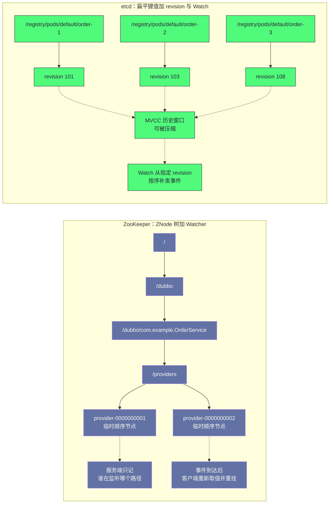
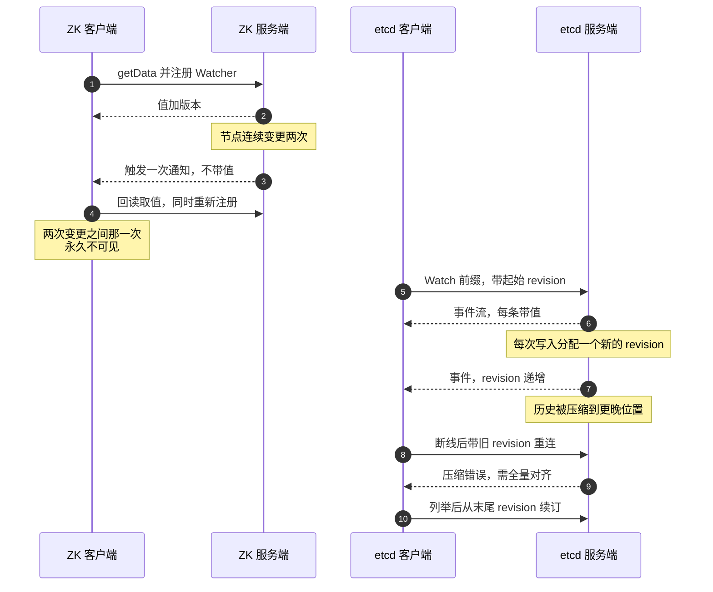
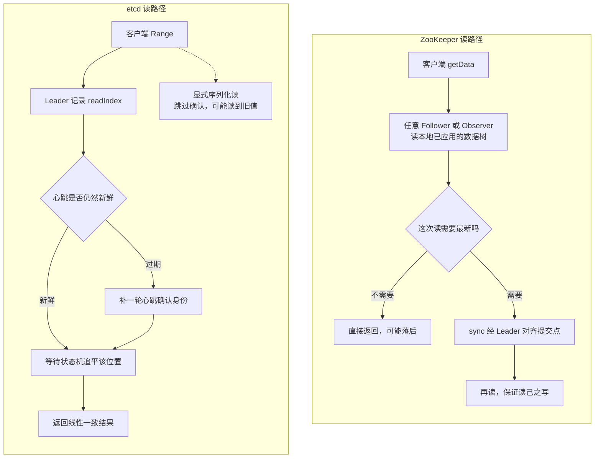
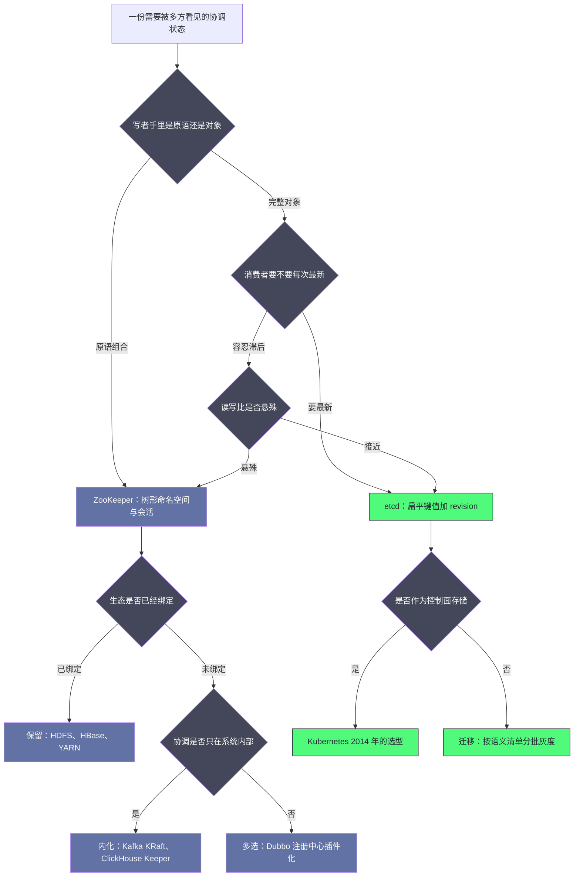

# 06 ZooKeeper vs ETCD——架构对比与去 ZooKeeper 化趋势

**摘要：**

一套跑了八年的 ZooKeeper 集群，上面通常同时挂着五种东西：Dubbo 的服务注册、几把业务锁、一个配置推送、调度器的选主、以及某个中间件自己的元数据。当「去 ZooKeeper 化」的说法开始进入架构评审，真正要回答的并不是「ZooKeeper 是不是过时了」，而是这五种东西各自被哪一套语义整除、哪一种在迁移之后会悄悄变味。本文站在 ZooKeeper 使用者的位置来写这件事：先把 2006 年到 2014 年两次选型各自留下的语义痕迹摊开，说明它当年为什么是唯一答案、etcd 又为什么能后来居上；再按数据模型、通知、失效判定、一致性、权限与事务五条线索，逐项判定 etcd 在哪里是平替、在哪里是取舍、在哪里干脆没有对应物；随后用 Kafka 的 KRaft 与 Kubernetes 的选型决策链，还原「去 ZooKeeper 化」真正的动因不是外部中心太慢，而是协调能力被收进了系统内部；最后给出一份可以照着执行的迁移清单与灰度判据，并明确哪些场景应当留在 ZooKeeper。读完之后，应当能把「要不要迁」换成两个更具体的问题：我的哪几类用法依赖树形父子语义与一次性通知，以及我能否接受把静默的版本丢失换成显式的压缩报错。

---

## 第 1 章 换一个提问方式

### 1.1 该不该继续用，是个被问偏了的问题

给一间住了八年的老房子做体检，「这房子还能不能住」这个问题没有答案，有答案的是「哪几间屋子漏雨、漏到什么程度、修一间要多少钱」。技术选型的处境与此相同：一套长期服役的协调服务不会整体地变好或变坏，它是在某些用法上依然无可替代，在另一些用法上已经被更贴身的方案覆盖，而在第三类用法上，替代方案能接住但会换一种失败方式。

把 ZooKeeper 当作一个整体去问「还该不该用」，得到的只会是立场；把它拆成用法去问，得到的才是判断。笔者见过的做法里，最省事也最危险的一种是拿一份能力对照表逐行打勾，最后得出「功能都能覆盖，可以迁」的结论——功能能覆盖，语义未必能覆盖，而分布式协调里出事的，几乎都是语义那半层。

### 1.2 2006 年那台机器上的题面

ZooKeeper 的起点在 Yahoo! 的研究部门，起因朴素到近乎琐碎：同一个数据中心里，文件系统得选出主备，调度器得盯着哪些机器还在响应，消息系统得指定哪个 Broker 当家；十几个系统各自写过一遍心跳加临时文件，也各自写过一遍锁，谁都不知道别人的那套在极端情况下会不会崩。把这些重复的协调逻辑收敛成一个被所有人复用的服务，是 ZooKeeper 立项时的全部动机。

这个动机决定了它的接口形状。服务端只提供 `create`、`delete`、`exists`、`getData`、`setData`、`getChildren` 这七八个操作，把所有「协调语义」留给使用者用原语组合——公平锁怎么排队、注册表怎么感知下线，都是应用层的判断，服务端不替你决定。同一时期 Google 的 Chubby 走了另一条路，它直接把「锁」做成服务；Chubby 在 2006 年的 OSDI 论文里先把会话与临时节点这两件东西摆上台面，ZooKeeper 随后用一套更像文件系统的接口把它们重写了一遍，并加上了顺序节点这个后来被反复借用的机制。

于是 ZooKeeper 拿到的题面是：读极多、写极少、数据极小、读者可以容忍一点点滞后。它在 2008 年开源，2010 年在 USENIX ATC 上发表论文，随后被 Hadoop 生态整体收编——HDFS 的 NameNode 高可用靠 ZooKeeper 做主备切换，HBase 把 RegionServer 的存活检测与表状态全部放在 ZooKeeper 里，YARN 的 ResourceManager 选主亦然。这套生态绑定不是巧合：一个已经证明了正确性的协调服务，比每个组件自己写一套要便宜得多。

### 1.3 2014 年另一次选型给出的答案

五年之后，CoreOS 撞上的是同一道题的镜像。容器刚起势，Fleet 想把一组机器当作单台机器来派活，而派活之前先得有一份「这堆机器上此刻运行着什么」的共识视图；这份视图不给人看，给调度器和系统服务读，每天变更不了几次，可一旦两个消费者读到了不同的版本，派出去的活就会打架。etcd 的命名把出处交代得很清楚：`/etc` 是 Unix 存放系统配置的地方，末尾那个 d 指的是 distributed，合起来就是「把这份配置目录复制给一群机器」。

Raft 的论文在 2014 年的 USENIX ATC 上发表，它开篇的立论不是「更快」，而是「更容易理解」——可理解性被当作一等目标写进论文，这在共识协议的谱系里是件新鲜事。可理解性带来的是实现成本下降，实现成本下降带来的是周边生态的繁殖速度：单二进制、HTTP/JSON 起步的 API、后来的 gRPC 与双向流，都是在降低「把它接进你的系统」的门槛。

真正的分水岭同样落在 2014 年：Kubernetes 把 etcd 定为唯一的状态存储。从那一刻起，集群里每一个 Pod、Service、ConfigMap 都变成 etcd 里一条带 **revision** 的键值，kube-apiserver 干脆把租约、版本、监听这三件事都建在它上面。这次选型值得逐条抄下来：Kubernetes 要的存储得能装下任意 Protobuf 对象，能按前缀翻页扫出一批同类对象，还能同时喂饱上万个控制器；ZooKeeper 那边既没有「一个大对象值」这种用法，树形结构也不是为「按前缀扫一批」准备的。所以这不是 ZooKeeper 退步，而是题目换了。

### 1.4 两套语义假设

把两次选型留下的痕迹并排放，可以看到两种互不重叠的**语义假设**。

ZooKeeper 押的是这一组：读的人多、写的人少、单条数据小、读者能忍一小段滞后、写者乐于自己拼装原语，通知只需充当提示。etcd 押的是另一组：写方提交的是完整对象、读方要求拿到此刻、消费方需要每一条变更事件，通知本身就是数据。负载只要严丝合缝地落进其中一组，换到另一组就只是折腾；反过来，一旦某套负载在另一组假设里显得更服帖，迁与不迁就只剩下时间问题。

| 年份 | 事件 | 留下的语义痕迹 |
|---|---|---|
| 2006 | Yahoo! 内部重复实现的协调逻辑 | 原语少而通用，语义由使用者组合 |
| 2006 | Chubby 论文（OSDI） | 会话与临时节点成为「存活」的表达方式 |
| 2008 | ZooKeeper 开源 | ZNode 树、Watcher、顺序节点 |
| 2010 | ZooKeeper 论文（USENIX ATC） | 无等待协调的理论表述 |
| 2013 | CoreOS 启动 etcd | 扁平键值，先服务「一组机器的配置视图」 |
| 2014 | Raft 论文（USENIX ATC） | 可理解性成为设计目标 |
| 2014 | Kubernetes 选定 etcd | 前缀列举、对象存储、大规模 Watch |
| 2015 | gRPC 与 HTTP/2 落地 | Watch 变成可长期持有的双向流 |
| 2016 | etcd v3 API | 全局 revision、MVCC、条件事务 |
| 2019 | Kafka KIP-500 提出 | 元数据内化，为 KRaft 铺路 |
| 2025 | Kafka 4.0 移除 ZooKeeper | 外部协调依赖退场 |

---

## 第 2 章 数据模型：树与账本的错位

### 2.1 ZNode 的四副面孔

ZooKeeper 把数据放进一棵树里，树上的每个节点叫 **ZNode**；它既是容器又能装内容，这一点与文件系统那种「目录不存数据」的习惯相反。按寿命可分为四种：持久节点、跟着会话走的临时节点、由服务端在创建时追加序号的顺序节点，以及把后两者合起来的临时顺序节点。每个节点带一组独立的元数据：数据版本、子节点版本、创建与修改的事务标识。顺序节点的序号来自父节点名下的一枚计数器，永久递增、不会被回收，这正是 `getChildren` 天然有序、公平锁能靠序号排队的原因。

父子关系是树最擅长表达的东西。把提供者摆到 `/dubbo/com.example.OrderService/providers/` 这一层，一个实例一个子节点，`getChildren` 一次就把整张清单交出来；某个实例消失时节点随之不见，清单自动变短。这里没有命名规范要守，也没有额外的索引要维护——「谁挂在谁下面」这层结构事实，服务端替你记着。

别扭之处也来自同一处：树只在单个节点上是原子的。`create`、`delete` 各管一个节点，想删掉带子节点的目录就得先清空下一层；`multi` 虽然能把几条操作捆成一批，可它捆的是「若干单节点操作」，不是「一棵子树」，遇到需要整段切换的场合，还是得在应用层搭一个临时节点当开关指针。

### 2.2 扁平键值换来的三件武器

etcd 没有树，只有键值对，层次靠命名约定与前缀模拟。放弃树换来了三样东西，而这三样恰好是「账本」路线真正需要的。

头一件是全局 revision：每次写事务由服务端发一个只增不减的版本号，同一事务里的多条写共用它，于是「此刻的整个库」被压缩成一个整数，而「从这个位置往后听」也就有了精确定义。第二件是 Txn 的条件分支：先比较若干键的当前状态，再决定执行 Then 还是 Else，整批写入共用一个 revision；前缀扫描因此落在同一个版本上，不会出现边扫边改、扫完拼出一份自相矛盾清单的情况。第三件是结构解耦：没有父节点，就没有父子之间那层协调负担，两次写之间不必讲先后。

树形册子与活页账本的区别，本质是「谁记住结构」：册子由服务端记住门牌之间的从属，账本只记住键与页号，从属关系写在使用者的命名约定里。约定不花钱，但约定不会替你检查。

### 2.3 树能表达而键值表达不了的三件事

从 ZooKeeper 这一侧往 etcd 看，有三处能力是真正对不上的，它们在迁移清单里必须单独列出。

第一件是**空目录也是一种状态**。ZooKeeper 里父节点的存在与否是一个可被监听的事实，子节点版本的变化能精确告诉你「这个目录下的集合变了」；etcd 里父路径可以不存在，前缀区间永远是开区间，要表达「这个命名空间已建立」就得额外写一个占位键，多一次写入，也多一条需要维护的一致性边界。

第二件是「递归子树的感知」。ZooKeeper 的 `getChildren` 给出的是精确的子节点集合，配合逐层注册就能覆盖整棵子树，事件语义是「集合变了」；etcd 的前缀 Watch 覆盖区间内所有键，事件语义是「这个键被创建、修改、删除了」，要还原成「集合变了」得在客户端自己维护一份集合做差。前者更节制，后者信息更完整，代价从服务端挪到了客户端。

第三件是「只感知直接子级」。ZooKeeper 的 `getChildren` 只听一层，更深两层的变更不会打扰你；etcd 的前缀 Watch 是区间匹配，前缀下所有深度的键都进同一个流，想只听一层就得在客户端按键的层级做过滤。这个差别在层级深、键又多的命名空间里会变成实打实的成本——每一条深层的变更都要被浅层的监听者接住，再被丢掉。

### 2.4 一张图看清两种组织方式

把两套数据模型并排画出来，差异集中在「谁记住从属关系」与「变更历史存在哪里」两处：



图里那条虚线是两套设计真正的分野：ZooKeeper 的服务端存的是「监听关系」，变更本身不留档；etcd 的服务端存的是「所有版本」，监听只是从这份档案里取一段推送出去。前者省内存，后者能补发。

### 2.5 容量边界到底在哪里

两套系统对容量的限制方式，正好反映各自的存储结构。

ZooKeeper 的整棵树常驻内存，因此它的容量边界不是磁盘而是内存，以及由内存决定的两件事：快照的大小与启动时重放的时间。单节点的数据上限默认是 1MB（`jute.maxbuffer`），官方建议压在几十 KB 以内，真实使用中大多数 ZNode 只有几百字节。znode 的总量没有显式配置，它受堆大小支配，而堆又不能开得太大——堆越大，一次 Full GC 的停顿越长，停顿会打断心跳，于是容量与稳定性在这里互相牵扯。

etcd 的边界写在两个参数上：单值受 `--max-request-bytes` 约束，默认 1.5MB；整库受 `--quota-backend-bytes` 约束，默认 2GB，可调但有建议上限。超过配额的后果不是慢，而是写不进去：集群进入只读状态并持续告警，必须先压缩、再碎片整理、最后人工解除告警，才能恢复写入。历史版本是另一处只在 etcd 存在的开销，一个高频更新的键会在存储引擎里留下几十上百个版本，压缩之前全部占着空间。

两者都不是数据库。大对象该放对象存储，账本里只放引用，这条边界在选型的任何阶段都不该被放宽。

### 2.6 核心能力矩阵

把七项能力并排放一次，可以看清哪些是平替、哪些是取舍：

| 能力 | ZooKeeper 的做法 | etcd 的做法 | 对 ZooKeeper 使用者的含义 |
|---|---|---|---|
| 一致性 | 本地读，可能滞后；`sync` 补「读己之写」 | 默认线性一致读，序列化读为显式降级 | 默认值对调，读的成本与保证同时上升 |
| 通知 | 一次性 Watcher，无载荷，挂会话 | 长期 Watch，带值，可按 revision 续订 | 语义更强，但要自己处理压缩报错 |
| 租约 | 会话绑定临时节点，客户端计时 | 独立 Lease，服务端时钟判定 | 灵活但多一层概念，误判形状改变 |
| 权限 | 逐节点 ACL，不继承 | 用户与角色的键区间授权 | 粒度变粗，运维模型从改节点变为改角色 |
| 有序节点 | 父节点计数器，服务端保证单调唯一 | 无对应物，用 `CreateRevision` 近似 | 公平队列仍可写，序号语义要重新设计 |
| 事务 | `multi` 打包单节点操作 | Txn 可跨键比较后分支写入 | 原子范围扩大，但不再有子树语义 |
| 容量 | 全树在内存，单节点 1MB | 单值 1.5MB，整库 2GB 配额 | 单值更宽松，总量更明确也更刚性 |

---

## 第 3 章 通知：一次性 Watcher 的账

### 3.1 Watcher 的三条硬约束

ZooKeeper 的通知叫 **Watcher**，注册在一个具体操作上：`getData` 带监听、`getChildren` 带监听、`exists` 带监听。它的三条特征彼此咬合，缺一条都理解不对。

第一条是一次性：响过就作废，还想接着听，得再挂一次。第二条是不带内容：通知里除事件类型与路径之外什么也没有，真要取值还得补一次读。第三条是寄生在会话上：监听记录由服务端按会话归档，会话一断，记录跟着清空——服务端于是不得不为每个连接维护一张路径表，而这张表的大小直接与客户端数量挂钩。门铃的比喻在这里很贴切：按一次响一次，响过之后你得再去按一下，而且门铃只告诉你「有人来过」，不告诉你来的是谁、来过几次。

三条约束合起来，把「把变更看见」这件事从服务端推给了客户端：服务端只管提示，客户端负责重新取值、重新注册、以及自己判断这段空档里发生了什么。

### 3.2 丢事件与重放：两个缺口的位置

从 ZooKeeper 迁到 etcd 之后最容易被低估的，不是接口从 `getData` 变成 `Range`，而是「丢失」这件事的形状变了。

ZooKeeper 的缺口在版本这一层。客户端收到通知，回读一次拿到新值，同时重新挂上监听，这两次往返之间若再发生变更，那一次的通知没有任何人收到；因为通知是路径上的一个标记而不是一条历史记录，服务端不会为「中间那几次」留档，下一次读到的已经是最新值，中间版本就永久地消失了。断线场景更明显：同一个会话在网络断开期间发生的多次变更，重连之后只会合并成一次触发，客户端能拿到当前值，但拿不到「变了几次、分别是什么时候」。这里的失败是静默的——没有任何报错，也不会有任何提示，程序如果只关心最终值就完全无感。

etcd 的缺口在历史这一层。Watch 的事件来自 MVCC 的历史版本，而历史会被压缩；服务端压缩到某个 revision 之后，任何试图从该位置之前开始监听的客户端都会收到明确的压缩错误，此时唯一正确的做法是做一次全量列举对齐，再从列举末尾的 revision 继续监听。它不是「永不丢事件」的实现，而是「有明确失败信号与恢复动作」的实现。别把这条错误提示当异常抛掉，也别简单重试，这是线上「监听明明活着、状态就是不更新」这类故障最常见的一个根因。

把两个缺口放在一起，迁移的实质就清楚了：**ZooKeeper 用「静默的版本合并」换内存可控，etcd 用「显式的压缩边界」换可补发**。前者的代价是客户端永远不知道自己漏了什么，后者的代价是客户端必须写对那段恢复逻辑。对「只关心最终状态」的缓存式消费者，前者更省事；对「必须知道每一次变更」的控制器式消费者，后者才可能写对。

### 3.3 同一需求的两段代码

拿一个最寻常的需求来比：应用从 `/apps/order/db-url` 取数据库连接串，值一变就要立刻知道。ZooKeeper 那一侧的代码注定是一个状态机：

```java
// 为什么要有这个循环：Watcher 触发即失效，
// 读值与重新注册必须在同一轮里完成，否则空档里的变更无人知晓。
while (running) {
    Stat stat = new Stat();
    byte[] data = zk.getData(PATH, this::onEvent, stat);  // 读值并注册监听
    apply(data);
    latch.await();      // 等通知，或超时后主动补读一次
    latch.countDown();
}
```

etcd 侧的形状不同，客户端需要维护的是一个整数而不是一个状态机：注册 Watch 时带上上次处理到的 revision，断线重连就从这个位置续订，收到压缩错误就全量对齐一次、把整数重置到列举末尾。

```go
// 为什么只记一个整数：服务端保存了历史，
// 断点续传由 revision 表达，客户端不必重建监听表。
r := cli.Watch(ctx, PATH, clientv3.WithRev(lastRev))
// lastRev 取事件里的 ModRevision + 1；查询报压缩错误时全量对齐后重来。
```

两段代码长度相近，可负担的落点正好相反：ZooKeeper 把状态维护的负担留在调用方（监听表、通知空档、会话重建），etcd 把它收进服务端的 revision 账本。迁移时被重写最多的正是这一段，而它往往散落在几十个业务类里，不在任何一份架构图上。

### 3.4 通知语义对照

| 维度 | ZooKeeper Watcher | etcd Watch | 迁出时的影响 |
|---|---|---|---|
| 注册单位 | 绑定到一次读操作的路径 | 独立的流，可按前缀或区间 | 需要把「顺便注册」改成显式建流 |
| 生命周期 | 触发即失效，需重新注册 | 持续到取消或连接中断 | 去掉重注册循环，代码结构随之简化 |
| 事件载荷 | 只有类型与路径，无值 | 键、值、类型、修改 revision | 少一次回读，读放大下降 |
| 事件粒度 | 单节点或子节点集合 | 区间内每个键的变更 | 集合变化需要在客户端做差 |
| 断线期间 | 多次变更合并为一次触发 | 按 revision 精确补发 | 从「静默合并」变为「显式补发」 |
| 版本可追溯 | 不保留变更历史 | 受压缩窗口约束 | 需要处理压缩报错与全量对齐 |
| 服务端成本 | 与监听关系数量成正比 | 与变更频率和保留窗口成正比 | 高频更新场景要配置压缩周期 |
| 失败信号 | 无，只能靠超时补读 | 压缩错误，明确可判别 | 迁移后必须新增这段错误处理 |

### 3.5 一张图看两种通知

两种通知在时间轴上的差异，用一张图最容易看清——门铃与订阅报刊的区别就在这里：



---

## 第 4 章 失效判定：会话与租约

### 4.1 时间作为唯一证据

服务注册、选主、分布式锁，表面上是三件事，底下都压着同一个问题：这个进程到底还在不在。网络给不出确定的答案，从外面看，「已经死了」与「只是卡了一下」长得一模一样，于是所有方案都只能退化成一个约定——活着的一方隔一阵子报个到，报到断了足够久，就当他走了。这个「足够久」是判定阈值，定短了会把好好的服务踢出去，定长了又让真故障迟迟不被发现。

两边的临时语义都是从这个约定长出来的，分歧只在两处：钟表握在谁手里，以及判死之后发生什么。这里的分寸像打卡机与储物柜：打卡机记录的是你刷卡的那个瞬间，卡没刷上就是你旷工，哪怕你人已经到了；储物柜按小时计租，到点清柜，柜子里放了几件东西与租约本身无关。

### 4.2 会话失效的连锁反应

ZooKeeper 把节点寿命交给会话托管。客户端接入某台服务器时会领到一个会话标识，超时时间由双方谈定；此后客户端库按大约三分之一超时的节奏发心跳。只要会话没被判死，这个客户端亲手建的临时节点就都挂在名下；一旦会话被清理，服务端会把它们一并抹掉，再向盯着相关路径的人推送删除事件。

放在 JVM 上，这套设计有一处人人皆知的软肋：停顿久了会被当成死亡，也就是**假下线**。一次 Full GC 能停几秒乃至十几秒，发心跳的线程一起被冻住，服务端等不到消息，按规则判会话到期并把节点收走；旁观的进程只看见「它没了」，于是摘流量、抢锁、触发主备倒换，动作全都合规。等 GC 回来，客户端手里的会话已经作废，只能重新握手，而重新握手之后，它在集群里的身份已经是另一个了。

于是调参成了第一反应：把超时从几秒推到三十秒，甚至更长。可阈值一松，真宕机也要隔同样久才被注意到，故障窗口被同步拉长。这个死结在 ZooKeeper 上拧不开，因为它是「会话承载一切」的结构性后果——会话本质上是一段连接状态，而连接状态既要看网络脸色，也要看进程内有没有停顿。

默认参数放大了这处代价：`tickTime` 默认 2 秒，会话超时的上下界分别是 2 倍与 20 倍 `tickTime`，也就是说未显式指定时，一个服务从停顿到被判死，中间只有几十秒的缓冲。

### 4.3 租约把计时权收归服务端

etcd 选了一条不同的路：把生命周期从连接上摘出来，做成可以独立存在的对象，这就是 **Lease**。这枚租约由服务端发放，附带一个以秒计的 TTL 和一枚全局独一份的编号；它不搭在连接上，网线拔了也照旧计时，只要续约没停，它就还活着；它也不要求一客户端一枚，同一个租约可以绑定任意多个键，续约一次，绑定的键一起续命——譬如一个进程管着上百个与会话同命的临时节点，迁过去之后只需要一枚租约配一个续约循环，续约包里只带一个标识。

真正的变化藏在判定权的归属上：到期与否由 Leader 拿自己的时钟裁定，客户端报什么时间都不作数；判定到期之后，撤销要走一条普通的 Raft 提案，等多数派点头，状态机才动手删掉挂在这枚租约上的所有键，并顺手把删除事件发出去。于是在账本上，「租约失效」与「键被删掉」不是两件事，而是同一次提交，谁来观察都只能看到同一个顺序。

两边的失败模式因此长得不一样。ZooKeeper 出事时的样子是「身份被注销」：重连回来，名下的临时节点已经不在，注册表上自己的位置另有其人，只能从头建、从头抢。etcd 出事时的样子是「合同到期」：抖动超过一整个 TTL，租约确实作废了，但客户端可以马上申请新租约、重新挂键，再靠键的创建版本判断这回登记的还算不算自己。

不过租约也有它管不到的地方：它只承诺不会早于 TTL 消失。判定按秒计，检查周期与提案落地又各有延迟，实际失效时刻总比名义 TTL 晚一点，所以把「时间一到锁必然松开」写进代码的人，极端情况下会撞见「早就超时、键却还在」。对租约的正确理解是：它让「我还活着」变成一件可以由时间背书的事，而不是让「我已经走了」变成一件可以立刻验尸的事。

### 4.4 顺序节点在账本里没有对应物

迁移清单里最容易被漏掉的一项，是有序节点的语义。

ZooKeeper 的顺序节点由服务端在创建时追加序号，序号源自父节点名下的一枚计数器，永久递增、从不回收、也从不重排。它保证三件事：同一父节点下的序号严格递增，序号唯一，且序号之间的相对顺序就是创建的先后。公平锁靠的正是第三件——每个等待者只看紧邻自己的前一个节点，解锁时只唤醒一个人，避免惊群；**把全局竞争转化成局部排队**，工具就是这枚计数器。

etcd 没有这枚计数器。近似做法是使用键的 `CreateRevision`：它同样单调、同样唯一，但它是全库共享的，两个相邻创建的锁候选者之间可能隔着几十个无关的 revision。这对「只看前任」的排队算法没有影响——比较的是大小关系，不是连续关系；受影响的是另一类用法：任何想用序号推断「我排在第几位」或者「总共还有多少人排队」的代码，在迁到 etcd 之后都会算错，因为相邻序号之间的差值不再是 1。

还有一处更隐蔽的差异：ZooKeeper 的序号不会因为压缩而消失，它写在节点名字里，只要节点还在，序号就还在；etcd 的 `CreateRevision` 依赖的 MVCC 历史会被压缩，而键本身携带的 revision 是元数据，不会随时间消失——这一点两边最终等价，但取到它的路径不同，代码里的假设也不同。

### 4.5 临时节点与租约对照

| 维度 | 临时节点 | Lease | 迁移时的替换动作 |
|---|---|---|---|
| 生命周期载体 | 会话，连接与心跳共同维持 | 独立实体，键显式关联 | 把「建临时节点」拆成「授权租约加写入」 |
| 计时依据 | 心跳抵达服务端的时刻 | Leader 时钟上的续约记录 | 判定权从连接侧移到服务端，心态要跟着换 |
| 心跳内容 | 会话 ping，含会话标识 | 只传一个租约标识 | 心跳包变小，但要单独管理续约循环 |
| 绑定范围 | 会话名下的临时节点一并归入 | 一个租约可挂任意多个键 | 多键同生共死从默认变为可选项 |
| 典型误判 | 长 GC 触发会话过期，节点被误删 | 抖动超过整个 TTL，租约真过期 | 误判从「身份被注销」变为「合同到期」 |
| 过期可见性 | 删除事件 | 撤销提案落地后的删除 | 观察者看到的都只是删除，语义一致 |
| 重建成本 | 新会话需要重建全部临时节点 | 新租约只需重新绑定 | 重建路径更短，但要防重复注册 |

---

## 第 5 章 一致性：默认值决定习惯

### 5.1 ZooKeeper 的读为什么便宜

ZooKeeper 的每一次读都落在客户端所连的那台机器上，用的是它已经应用过的数据树，既不必请示 Leader，也不会进一次日志。读能力因此可以靠堆节点摊开，代价是答案可能是上一拍的。

要把「落后」说准，得区分两条保证。单一系统映像要求客户端不会看到比自己已见过的版本更旧的数据，这条靠客户端记账实现——库记住自己见过的最大事务标识，重连时只连那些不比它旧的服务器，从根上排除时间倒流。顺序一致性要求同一客户端发出的更新按发出顺序被应用，这条靠服务端的处理顺序实现。两条合起来，得到的是「不回退，但不保证最新」：A 写入成功，B 立刻去另一个 Follower 读，B 可能读到旧值。

想要更硬的保证，就得显式调一次 `sync()`。它并不在本机刷新缓存，而是把请求送到 Leader，等这台机器追上当前提交点才算数；从此之后，客户端再读，`sync()` 之前已经完成的写都不会缺席。可它给的只是**读己之写**，不是线性一致——`sync()` 回来之后、真正读之前，别人新提交的写依旧可能没被看见。这条界线细得像根头发，却决定了凡是要「必须最新」的地方，都得自己再加一道确认。

看隔夜的报纸与打电话问编辑部，是这两条读路径的差别：前者快、便宜、可以加印很多份，但内容至少是几个小时前的；后者一定是最新的，代价是每次都要占一条电话线。

### 5.2 Observer 与 Learner 不是一回事

读扩展的形态，是 ZooKeeper 使用者最容易在迁移中吃亏的地方。

ZooKeeper 扩读的抓手是 **Observer**：这类成员不进投票圈，也不计入多数派，只闷头跟 Leader 拉日志，然后老老实实对外答读请求。多摆几个，就多几份物理上的读副本，而 quorum 的门槛与写的延迟一点没变。在 ZooKeeper 这一侧，这是为数不多能按需加读的手段，跨机房部署时也常拿它把数据顺到远端，让本地客户端就近取。

etcd 的 Learner 名字相近、用处不同：它同样不投票，但存在的理由是让新成员慢速把数据追上来，客户端根本读不到它。etcd 里能摊开读的路子只剩两条——在客户端把读显式降成序列化读，忍着可能读到旧值；或者在前面架一层代理，把请求分给各个成员。换句话说，迁移之后还按老习惯「加两个只读副本」，在 etcd 这边是要落空的。

### 5.3 etcd 把默认值放在另一边

etcd 把默认值放在了另一头：一次寻常的读就是线性一致的，靠的是 **ReadIndex**。Leader 先记下此刻的提交位置，若最近一轮心跳证明自己还握着多数派，就等本地状态机爬到那个位置再开口；若心跳已经过期，则先补一轮确认身份，然后才读。这条路上没有日志要写，成本是一次网络往返。想把这一个往返也省掉，必须显式改走序列化读，代价是可能读到旧值，而且从 Follower 读时落后多少没有上界。

默认值的方向决定了使用习惯。ZooKeeper 的用户天然会为每次读问一句「这段旧数据可以接受吗」，etcd 的用户天然不问，直到某一天他为了省一次往返打开了序列化读，而那段代码恰好在一个「必须读到最新」的判断里。默认值本身没有高下，但它把判断权放在了不同的位置：一边在调用点，一边在集群配置里。

### 5.4 一张图看两条读路径

两条读路径的分岔，直接决定了迁移后读流量的去处：



图里有一处结构性后果值得单独说：etcd 的线性一致读最终都排到 Leader 门口，加机器不能扩展这类读；ZooKeeper 的默认读绕开 Leader，加机器就是加读能力。所以「读吞吐」这个指标在两者之间没有可比性——一边是「大量读取、容忍毫秒级滞后」，另一边是「每次读都要最新」，后者讨论吞吐时，瓶颈根本不在副本数量上。

### 5.5 迁移时最容易读错的三个点

第一处是默认值对调带来的成本上升。旧代码里九成的读都是弱读，迁过去之后如果照原样写成默认读，每一次都多一次与 Leader 的往返；这不是 bug，但会把一条原本平坦的延迟曲线抬起来，容量规划要跟着改。

第二处是 `sync()` 与线性一致读的错位。两者看起来都像「刷新一下再读」，语义却差一层：`sync()` 保证「此前的写对我可见」，线性一致读保证「读到的是此刻的最新值」。把前者按后者理解，会在「A 写完、B 读到」这类跨客户端可见性的判断上做错假设——ZooKeeper 那条路径需要 `sync`，etcd 那条路径默认就已经满足，但显式降级之后又不满足了。

第三处是跨键快照。ZooKeeper 里对多个节点的连续读取没有一致性保证，列举过程中被并发修改是常态，所以客户端普遍采用「先列举建表、再逐个挂监听、把一致性交给通知持续修正」的模式；etcd 的一次前缀 Range 返回同一个 revision 的快照，一致性由服务端保证，但「这份列表里某个键是实例还是没清干净的残留」完全取决于命名约定。把前者迁到后者时，代码里那些「容忍列举不一致」的补偿逻辑会变成无用代码，而把它留在原地，又会在语义更强之后掩盖真正的问题。

---

## 第 6 章 权限与事务：ACL 与 RBAC 的错位

### 6.1 逐节点授权

ZooKeeper 的访问控制是逐节点的 **ACL**，格式是「方案:身份:权限」。方案有 `world`、`auth`、`digest`、`ip`，新版本还支持 `x509`；权限是读、写、创建、删除、管理这几种的组合，按位组合成一个整数挂在节点上。

这套模型的第一个特点是细：每个节点一份 ACL，父子之间不自动继承，同一个目录下不同节点可以有完全不同的授权。第二个特点是静态：改权限要遍历节点逐个改，没有任何「批量改一棵子树」的操作。第三个特点是没有内置的「角色」概念，业务上的角色要靠 `digest` 身份加命名约定自己维护。

于是它在多租户隔离上很强，在运维上很重。譬如一个跑了八年的集群，ACL 往往是历史沉积的产物：早期创建节点的人用了 `world:anyone`，后来接手的人只给新节点加了限制，旧节点谁也不敢动——因为不知道哪个客户端还在依赖旧的授权。门禁卡的比喻在这里是准确的：每个房间一把钥匙，钥匙发出去多少把、发给了谁、谁已经离职，全靠一本手账。

### 6.2 键区间授权

etcd 的权限模型是用户、角色、权限三元组，权限作用在键区间上：读、写、读写三种，绑定给角色，角色再赋给用户。它是典型的 **RBAC** 形状，粒度的单位是前缀区间而不是单个键。

第一处差别是粒度。区间授权无法表达「这个前缀下只有这一个键不许写」，而 ZooKeeper 可以。第二处差别是运维方向。etcd 改权限是改角色，一次操作影响一批键，因此更适合「按租户划分命名空间」的部署形态。第三处差别最容易被忽略：etcd 的鉴权默认是关闭的，开启之后要先创建 root 用户与 root 角色，再逐个建用户；历史上有大量集群从上线到下线都没开过鉴权，这让「迁移之后权限会更规范」这个假设往往落空——迁移不会自动带来治理。

### 6.3 差异的实际后果

把两套权限模型放进迁移清单，要落的判断不是「谁更安全」，而是三件事。

其一，授权单元变了。以节点为单元的策略要重新映射成区间策略，映射不上去的（同一前缀下不同键权限不同）只能靠拆前缀解决，而拆前缀意味着改客户端代码。其二，审计粒度变了。ZooKeeper 能回答「谁改了这个节点」，前提是审计链路本来就通；etcd 的审计更多落在 API 层，键区间的授权反而让「谁动了这个区间」成为更自然的问题。其三，最麻烦的一处是「权限随结构走」还是「权限随名字走」：树的授权天然带层级，区间授权只认字符串，迁过去之后，那些依赖父节点 ACL 保护子节点的设计会失去保护层。

### 6.4 `multi` 与 Txn 的分寸

ZooKeeper 的 `multi` 能把若干单节点操作打包成一个事务，要么全成功、要么全失败，返回结果是每个操作的结果码。它解决的是「创建锁节点与写锁数据不能分开」这类问题，但它的原子范围是「若干单节点操作」，不是「一棵子树」。

etcd 的 **Txn** 更强一处，也弱一处。更强的部分是条件分支：一次事务里可以先比较若干个键的值或版本，再决定走 Then 还是 Else，整批写共享一个 revision，这让「检查并更新」变成服务端的一次原子动作。更弱的部分是结构：它没有父子概念，因此任何「以子树为单位」的需求都不存在对应物。

从 ZooKeeper 迁出时，`multi` 里的操作通常能一对一改成 Txn，但有两类会走形：一类依赖「同一父节点下的兄弟节点同时存在」，另一类依赖「创建失败时回滚到父节点仍在的状态」。前者要改成显式的占位键，后者要在应用层补一次清理。

---

## 第 7 章 去 ZooKeeper 化的两条真实动因

### 7.1 Kafka 的账

Kafka 一度是 ZooKeeper 最有名的使用者：谁当 Broker、谁当 Controller、Topic 与分区长什么样、ISR 又变了没有，这些信息都刻在 ZNode 上。几十个 Broker、几千个分区的规模上，这套搭配稳稳当当，麻烦出在继续往上长的阶段。

症结不在「ZooKeeper 写得慢」，而在两件与规模成正比的事：元数据越长越大，以及新 Controller 上任要花多久才能重新管事。Controller 的内存状态是完整的元数据镜像，每次换届都得从 ZNode 上整棵读回来重建；分区数量一涨，重建时间跟着涨，而这段时间里整个集群没人调度。另一处麻烦是写两遍：一次元数据变更既改 ZooKeeper 又改 Broker 自己的状态，两份真相之间的每毫秒都是一次可能跑偏的机会。这就像把自行车棚建在院墙外——车少的时候方便，车一多，每天进出都得绕两道门。

**KRaft** 的答案是把元数据也做成一条日志，用 Raft 复制，Controller 就是这条日志的消费者：元数据从「一棵需要全量加载的树」变成「一段可以快照和压缩的日志」，路径变短，写一致性顺带解决。

时间线值得记准，因为它经常被含糊成「早就迁完了」：KIP-500 在 2019 年提出；2.8 版本提供 KRaft 的早期预览；3.3 起官方宣布 KRaft 可用于生产；3.5 起新集群默认使用 KRaft；4.0 版本正式移除了对 ZooKeeper 的支持。从提出到移除，跨了六年——这个长度本身就是一条结论：生态级的替换从来不取决于技术优劣，而取决于每个使用方自己准备好没有。

### 7.2 Kubernetes 当年的决策链

Kubernetes 在 2014 年选择 etcd，不是因为它比 ZooKeeper 先进，而是因为它要用的那几种操作，ZooKeeper 根本没有为此设计。

决策链可以还原成四步。第一步是对象的形态：K8s 要存的是任意 Protobuf 对象，一个大值加一次原子读，而 ZooKeeper 的节点上限是 1MB，树形模型也不是为「一个大对象」准备的。第二步是列举：K8s 需要按前缀分页扫一批同类对象，`getChildren` 给的是名字数组，拿数据还得逐个再读，而前缀 Range 一次就返回齐。第三步是监听：成千上万个控制器要同时监听各自关心的前缀，etcd 的 Watch 是独立的流，ZooKeeper 的 Watcher 挂在会话上，会话规模直接决定了服务端的监听表规模。第四步才是部署形态：单二进制、无 JVM 调优、原生指标。

四步里没有一步是「ZooKeeper 慢」。这也解释了为什么「去 ZooKeeper 化」的浪潮与 ZooKeeper 的性能曲线没有关系：被换掉的是「用树的形状表达对象」这件事，不是「协调服务」本身。

### 7.3 三种形态：内化、多选、保留

把这些迁移摆到一起，能归成三种形态，其中两种经常被说成一回事。

一是**内化**：组件自己长出共识层，Kafka 的 KRaft 是样板，ClickHouse 把外部 ZooKeeper 换成自带的 Keeper 也算同一路——副本协调这件事并没消失，只是不用再额外养一套 JVM 进程。二是多选：把注册中心做成可插拔的接口，Dubbo 从只认 ZooKeeper 扩到 Nacos、etcd 等多家，让使用方按场景挑。三是保留：Hadoop 与 HBase 到现在仍然紧抱 ZooKeeper，HDFS 的 NameNode 主备切换靠它裁决，HBase 把 RegionServer 是否活着、表处于什么状态、分布式锁全都寄存在里面，真动手替换，代价远大于收益。

三种形态的分布其实有规律：被内化掉的基本都是「系统内部传的协调事件」，它本来就不该由外人经手，收进来之后链路更短、能坏的地方更少；被留下来的基本是「对外的命名空间」，因为那是别人跟你之间的约定，形状一改，所有客户端都得重写。这条规律正好可以拿来给自己手上的东西归类：如果你那套 ZNode 只是本组件内部的约定，内化的账算得过来；如果它是几十个外部系统共同认的地址簿和锁，留下来的成本通常低于替换。

把 Kafka 与 Kubernetes 两次决策并到一张图上，可以看到同一个起点被两组问题分到了不同终点：一支被「协调事件要不要留在外部」分流，另一支被「读者要不要最新值」分流。



图里最有信息量的一处是「生态是否已经绑定」这个分叉：它排在技术判定之后、实现判定之前，意味着一旦某个组件的协调逻辑写死在源码里，前面所有的语义比较都只是背景材料。

### 7.4 运维复杂度对照

迁移的账最终要落到运维动作上，因为运维动作会按频率反复计费：

| 运维动作 | ZooKeeper | etcd | 频率权重 |
|---|---|---|---|
| 部署与调优 | JVM 进程，堆大小与 GC 策略是核心参数 | 单二进制，调心跳、选举超时与配额 | 一次性，但改错代价高 |
| 成员变更 | 改配置文件滚动重启，3.5 起可 `reconfig` | 成员 API，先 Learner 追赶再提升 | 低频，云环境下频率上升 |
| 健康检查 | 四字命令 `ruok`、`stat`、`mntr` | `/health`、`/livez` 与 Leader 指标 | 高频，接入监控的方式不同 |
| 监控接入 | 依赖 exporter 解析文本输出 | 原生 Prometheus 指标 | 一次性，但 exporter 自身是故障点 |
| 备份恢复 | 打包快照与事务日志，恢复靠放回目录 | 快照命令带集群元数据，恢复生成新目录 | 低频，演练频率决定可靠性 |
| 空间回收 | `autopurge` 清理旧日志 | 压缩加碎片整理，两步缺一不可 | 高频，配置不当会写不进去 |
| 读能力扩展 | 增加 Observer | 没有只读副本角色，只能降级读或加配置 | 随读流量增长而变 |

表里最需要盯的是「空间回收」那一行：ZooKeeper 的旧日志清理即使配错，通常只是磁盘慢慢涨；etcd 的压缩与碎片整理配错，会直接走到写不进去的状态，而且恢复动作有先后顺序。

---

## 第 8 章 迁移清单：从清点到灰度

### 8.1 第一步是把用法分类

迁移的第一件事不是选客户端库，而是把 ZooKeeper 上跑着的东西按语义分类。笔者习惯分成五类，因为它们的迁移结论几乎必然不同。

第一类是分布式锁，用的是临时顺序节点与「只看前任」的排队协议。第二类是选主，用临时节点加监听，本质是「谁先创建谁当主」。第三类是服务注册与发现，用临时节点表达存活、用子节点列表表达全量。第四类是配置推送，用持久节点加 Watcher，关心的是最终值。第五类是元数据与序号，包括队列序号、分区归属、批次编号这类依赖顺序节点单调性的用法。

五类里有三类是平替：选主、注册、配置推送迁到 etcd 之后，语义等价甚至更好（Watch 带值、可续订）。锁需要重写排队协议，但结论仍是可迁。序号这一类要单独评估，因为它的语义依赖服务端的计数器，迁过去必须重新设计编号来源。

### 8.2 语义映射与丢失点

把五类用法摊成一张表，迁移的风险就变成可核对的条目：

| ZooKeeper 用法 | etcd 近似物 | 会丢失什么 | 处置建议 |
|---|---|---|---|
| 临时节点表达存活 | 租约加键 | 会话内多节点自动同生共死 | 用一个租约绑多键，或每键独立租约 |
| 会话超时判定 | 租约 TTL 与服务端时钟 | 客户端可控的判定时机 | 接受判定权转移，按服务端时钟规划 |
| 一次性 Watcher | 长期 Watch 加 revision | 断线期间的中间版本 | 需要时改为全量对齐加版本记账 |
| 子节点列表监听 | 前缀 Watch 加客户端做差 | 「集合变了」的语义与单层范围 | 客户端维护集合并按键层级过滤 |
| 顺序节点序号 | `CreateRevision` | 序号连续性与队列长度推断 | 只比较大小，不推断位置 |
| 逐节点 ACL | 角色加键区间授权 | 父子不继承的细粒度隔离 | 按租户拆前缀，或保留 ZK 侧鉴权 |
| `multi` 原子批 | Txn 比较分支 | 同父兄弟节点的结构约束 | 用占位键补齐父级语义 |
| 递归子树感知 | 前缀扫加命名约定 | 服务端不区分目录与叶子 | 显式写入命名空间标记键 |

这张表的读法是：右两列才是迁移的真正工作量，左两列只是查找替换。凡是「会丢失什么」这一列非空的用法，都要在代码里找到所有调用点，逐个确认业务能否接受新的语义。

### 8.3 双跑、影子读与判据

迁移的第二件事是让两套系统同时跑一段时间，而不是找一个月黑风高的晚上切过去。

常见的做法是双注册加**影子读**：业务仍然以 ZooKeeper 为准，同时在 etcd 侧写入同样的注册信息与配置，由旁路程序比对两侧的差异——节点集合是否一致、配置值是否一致、锁的归属是否冲突。影子读阶段不改变任何业务行为，它的价值在于把「语义差异」变成可观测的差异，而不是等到切换之后由故障来揭示。

判据要提前写死，而不是切完了再总结。笔者建议三条：一是差异持续为零的时间窗口，按业务变更频率定，至少覆盖一次完整的发布周期；二是关键路径的延迟对比，尤其是原本依赖弱读的地方，迁移后延迟上升是否在预算内；三是故障演练的结果，主动杀掉 etcd 的一个成员、杀掉一个客户端、制造一次网络分区，观察业务的表现是否与 ZooKeeper 侧一致。

第三条最容易被跳过，也最容易在切换后变成事故。ZooKeeper 侧的会话过期与 etcd 侧的租约过期，失败形状不同，演练能暴露的正是这种「看起来一样、出事时不一样」的地方。

### 8.4 灰度与回滚

灰度按服务分批，而不是按功能分批。同一个服务如果一半实例用 ZooKeeper、一半用 etcd 做注册，两边的注册表互为盲区，流量会被分掉，这种灰度只有在注册中心本身做了聚合时才安全。更稳的顺序是先迁读多写少的（配置推送），再迁写少但影响大的（选主），最后迁锁——锁的迁移最容易在灰度期出现「两个持有者」的窗口。

回滚的边界要提前想清楚，因为有一类回滚是不可逆的：一旦写入切到 etcd，ZooKeeper 侧的顺序节点序号就断了，回滚之后新创建的节点会带着一段空号；同理，锁的归属在切换瞬间可能出现两个持有者，回滚不能靠「切回去」解决，只能靠人工确认。把不可逆的点标出来，灰度才有意义。

### 8.5 迁移是组织动作

最后要说一句不技术在行的话：迁移的工期通常不由代码决定，而由「谁有权改这个客户端」决定。一个跑了八年的集群，注册方可能是十几个团队，配置的读取方可能分散在几十个仓库里，锁的使用者甚至可能藏在某个已经没人维护的批处理任务里。清点阶段最花时间的往往不是读代码，而是找到那些「还在跑但没人认领」的进程。

这也解释了为什么生态级的替换总是以年为单位：Kafka 从提出到移除用了六年，不是因为 KRaft 难写，而是因为每个使用方都要自己走完这条清点与验证的路。

---

## 第 9 章 边界与反例：各自的死角

### 9.1 ZooKeeper 的死角

ZooKeeper 的盲区有四处，且都是结构性的。

写吞吐被单 Leader 卡住，加节点只能提升读能力，不能提升写能力；写到某个量级之后，瓶颈不在网络而在 Leader 单机的处理能力上。数据全量在内存，容量边界由堆决定，而堆又不能开大，因为大堆带来的长停顿会直接威胁会话存活。通知是提示而非历史，断线期间的多次变更会被合并成一次，这件事没有任何报错。大对象与高频写入一定会撞墙，譬如把几兆的配置塞进一个 ZNode，撞上的就是 1MB 那道上限，而单主写结构又从另一个方向把高频写入挡在门外。

还有一处不那么显眼：ACL 的运维成本会随时间累积。逐节点授权意味着每加一个命名空间就多一份要维护的授权矩阵，早期的宽松策略与后来的收紧策略会长期共存，谁也不敢删。

### 9.2 etcd 的死角

etcd 的盲区同样有四处在结构上。

它对磁盘的敏感度更高，每一次写都要落日志，慢盘、坏块与写放大会直接表现为写失败与 Leader 反复切换。容量有刚性上限，超过配额不是变慢而是拒写，恢复动作有严格顺序。默认的线性一致读把读压力全部压到 Leader 门口，读扩展手段比 ZooKeeper 少得多，只有降级读与前置代理两条路。通知依赖历史，历史会被压缩，超出窗口的客户端必须全量对齐，处理不当就会永久停在旧状态。

再加上两条容易被忽略的：没有父子语义，任何「以子树为单位」的需求都要用命名约定补；鉴权默认关闭，很多集群从上线到下线都没开过，迁移不会自动带来治理。

### 9.3 三种常见的错误依据

第一种是拿趋势做依据。「大家都在去 ZooKeeper 化」是多个场景结论的汇总，它不回答「你的场景适不适用」。趋势的正确用法是提示你去检查语义假设，而不是替代检查。

第二种是拿 QPS 做依据。两套系统的写路径受同一处约束支配——Leader 必须让日志落到持久介质上，因此写吞吐的上限由磁盘与多数派往返决定，换方案解决不了共性问题；读吞吐则因为默认值不同而根本不可比，拿两个基准测试数字并排，得出的只是测试条件的差异。

第三种是拿「功能都能覆盖」做依据。功能能覆盖是必要条件，语义能覆盖才是充分条件。会话与租约、Watcher 与 Watch、顺序节点与 revision，每一对都在功能清单上打得上勾，却在失败时给出不同的形状，而迁移事故几乎全部发生在这些「打了勾的语义」里。

### 9.4 什么场景应当留在 ZooKeeper

有五种情形，笔者的判断是留在原地比迁走更划算。

第一种是生态绑定：HDFS 的 NameNode 高可用、HBase 的存活检测、YARN 的选主，这些组件的协调逻辑写在它们的源码里，替换成本远高于收益。第二种是需要递归子树感知的场景，前缀 Watch 加客户端做差能做，但做出来的东西比原来更脆。第三种是读极多、写极少、且读者容忍滞后，Observer 的读扩展成本曲线比 etcd 的任何方案都平。第四种是依赖序号语义做排队或编号，服务端计数器没有便宜的替代品。第五种是已经用 Curator 把锁与主从封装得很稳、写入频率又低——这类系统的迁移收益主要落在「少一个组件」上，而代价是把一套已经被验证过的并发协议重写一遍。

判断的依据可以收成一句：迁移动机应当来自**痛点**的具体形态（容量撞墙、恢复变慢、运维人力不足、云原生部署要求），而不是来自「这套技术还在不在增长」。技术是否增长，是别人的报表；痛点是否具体，才是自己的账。

---

## 第 10 章 结语：五条判断

第一，代际分野不在性能而在题面。ZooKeeper 接到的题是「十几个系统别再各自造一遍协调轮子」，交出的答案是一小把原语加一个会话；etcd 接到的题是「让一组机器共享同一份对象视图」，交出的答案是一本带版本号的账本。题目换了，答案自然要换，性能曲线的差别只是随之而来的余波。

第二，迁移丢的不是接口，是语义。会话换成租约，丢的是客户端可控的判定时机；Watcher 换成 Watch，丢的是「集合变了」这个事件语义与断线期间的中间版本；顺序节点换成 revision，丢的是序号连续性；ACL 换成 RBAC，丢的是父子不继承的细粒度隔离。凡是这几处用得深的地方，迁移成本都不在查找替换里。

第三，两种失败形状要对等地设计。ZooKeeper 的丢失是静默的版本合并，etcd 的丢失是显式的压缩报错；前者要求你用超时与全量核对兜底，后者要求你把那段恢复逻辑写对。迁移文档里最该写的不是新接口怎么调，而是「原来那个坑现在长什么样」。

第四，去 ZooKeeper 化的动因是内化，不是替代。Kafka 把元数据收进自己的 Raft 日志，Kubernetes 一开始就选了对象账本，两者的共同点是协调能力被搬到了离使用者更近的位置。把这件事读成「ZooKeeper 过时了」，会同时误判存量系统的处境与增量系统的选择空间。

第五，留下来的理由与迁走的理由，都是场景而不是态度。读多写少、容忍滞后、需要递归感知与序号语义、生态深度绑定，这四条成立就该留；容量撞墙、恢复变慢、运维人力不足、部署形态要求单二进制，这四条成立就该迁。两者都成立时，答案往往是共存——新场景用新方案，旧场景维持现状，直到旧场景自己的痛点变得具体。

---

## 专栏导航

- 上一篇：[[05 生产运维——部署、监控与故障处理]]。
- 返回专栏首页：[[00 专栏导览]]。
- 相关阅读：[[中间件/ETCD/05 etcd 与 ZooKeeper——一代协调服务的分野|etcd 视角的分野]]、[[中间件/Kafka/06 Controller 与集群管理——从 ZooKeeper 到 KRaft|Kafka 的 KRaft 演进]]、[[分布式架构/分布式系统原理与协议/06 ZAB 协议：ZooKeeper 的一致性基石|ZAB 协议]]。

---

## 参考资料

1. Hunt P, Konar M, Junqueira F P, Reed B. ZooKeeper: Wait-free coordination for Internet-scale systems. USENIX ATC 2010. https://www.usenix.org/conference/usenix-atc-10
2. Burrows M. The Chubby lock service for loosely-coupled distributed systems. OSDI 2006. https://www.usenix.org/legacy/events/osdi06/tech/full_papers/burrows/burrows.pdf
3. Junqueira F P, Reed B C, Serafini M. Zab: High-performance broadcast for primary-backup systems. DSN 2011.
4. Ongaro D, Ousterhout J. In Search of an Understandable Consensus Algorithm. USENIX ATC 2014. https://www.usenix.org/conference/atc14/technical-sessions/presentation/ongaro
5. Apache ZooKeeper 官方文档：Programmer's Guide、Administrator's Guide 与 Dynamic Reconfiguration. https://zookeeper.apache.org/doc/current/
6. etcd 官方文档：API guarantees、Concurrency API 与 Maintenance. https://etcd.io/docs/
7. Kubernetes 官方文档：集群控制面与 etcd 的角色. https://kubernetes.io/docs/concepts/overview/components/
8. Apache Kafka. KIP-500: Replace ZooKeeper with a Self-Managed Metadata Quorum. https://cwiki.apache.org/confluence/display/KAFKA/KIP-500
9. Apache Kafka 官方文档：KRaft 模式与元数据管理. https://kafka.apache.org/documentation/
10. Kleppmann M. Designing Data-Intensive Applications，第 9 章一致性模型. O'Reilly Media, 2017.

---

> [!note] 思考题
> 1. 如果一套业务同时依赖「递归子树感知」与「每次读都要最新」，它落在两套语义假设的夹缝里。除了迁到 etcd 再加一层客户端缓存，还有哪些做法能让它落在其中一套假设之内，各自把代价转移到了哪里？
> 2. ZooKeeper 的丢失是静默的版本合并，etcd 的丢失是显式的压缩报错。哪一种更容易在长期运行中积累成「无人发现的错误状态」，为什么？
> 3. 顺序节点的序号来自服务端计数器，etcd 只能用 `CreateRevision` 近似。设计一把基于 etcd 的公平锁时，如果要保证「只看前任」，需要额外维护哪些不变式？
> 4. Kafka 从提出 KRaft 到移除 ZooKeeper 用了六年。请你给出一个判断标准，用来区分「这条生态替换还在早期」与「只差最后一次发布」。
> 5. 假设你接手一个跑了八年的 ZooKeeper 集群，要在一年内把配置推送迁到 etcd，锁继续留在 ZooKeeper。请写出你的清点顺序，并说明哪一步最可能拖慢整体进度。
> 6. 会话与租约都在用「时间」换取「正确性」。如果集群的时钟出现大幅漂移，两边的失效判定会分别如何退化，哪一种更难排查？