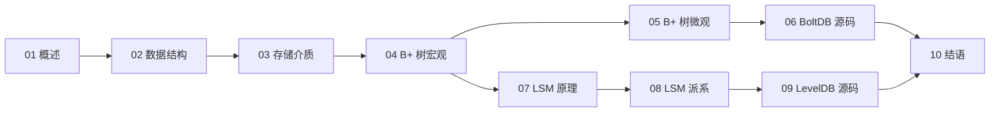

# 深入浅出存储引擎 专栏导览

## 专栏定位

这个专栏只回答一个问题：**数据从内存落到介质、再从介质被找回来，中间到底发生了什么**。

数据库的上层一直在变，SQL 方言、事务模型、复制协议、部署形态，几乎每五年就要重写一遍叙事；但底座上那套"把字节放到页里、把页放到磁盘上、断电之后还能找回来"的机制，几十年没有本质变化。理解这套机制，再去看 MySQL、Redis、Kafka、HBase、etcd、TiKV，看到的就不再是一堆互不相干的产品，而是同一组约束下的不同解法。

专栏覆盖两条主线：B+ 树派系（以 InnoDB 与 BoltDB 为代表）与 LSM 派系（以 LevelDB、RocksDB、Bitcask 为代表）。前者回答"读多写少时如何把读路径压到最短"，后者回答"写多读少时如何把随机写换成顺序写"。两条线最终在同一个地方汇合——读放大、写放大、空间放大的三角权衡。

## 目标读者

- 写过业务代码、用过 MySQL 或 Redis，但说不清"为什么更新一行会慢"的后端工程师；
- 需要做存储选型，面对 B+ 树、LSM、哈希索引不知从何下手的架构师；
- 准备基础架构或数据库方向面试，想把"背结论"换成"讲清推导"的读者；
- 想读 LevelDB、BoltDB、RocksDB 源码，但被逐函数走读劝退的开发者。

## 专栏目录

| 序号 | 标题 | 核心内容 |
| :--- | :--- | :--- |
| **01** | [[01 存储引擎概述——从数据库演进到两大派系]] | 存储引擎在数据库中的位置、三层架构、编码与索引两个共性问题、B+ 树与 LSM 的分野 |
| **02** | [[02 索引数据结构——从数组到 B+ 树的取舍链]] | 数组、链表、哈希、位图、布隆过滤器、红黑树、跳表、B 树、B+ 树、Trie/ART 的取舍 |
| **03** | [[03 数据存储介质——内存、持久化内存与磁盘]] | 存储金字塔、虚拟内存、PMEM、HDD、SSD、文件系统、Page Cache 与 Direct I/O |
| **04** | [[04 B+ 树存储引擎（上）——方案选型与宏观结构]] | 从磁盘 I/O 成本模型出发，逐个淘汰候选结构，推导 B+ 树的胜出理由 |
| **05** | [[05 B+ 树存储引擎（下）——工程细节、事务与恢复]] | 页映射、读写路径、分裂合并、WAL 与 doublewrite、并发控制、MVCC、范围扫描 |
| **06** | [[06 BoltDB 源码剖析——页、节点与写事务]] | 单文件布局、meta/freelist/branch/leaf、写时复制、spill/split、提交与恢复 |
| **07** | [[07 LSM-Tree 原理——用顺序写换取写吞吐]] | 从零推导 LSM、双组件到多层、leveled 与 tiered、读写空间放大的定量分析 |
| **08** | [[08 LSM 派系——Tree、Hash 与 Array]] | RocksDB、WiscKey、Bitcask、Moss、Kafka 日志存储的异同 |
| **09** | [[09 LevelDB 源码剖析——MemTable、SSTable 与 Compaction]] | 写入路径、SkipList、WAL、SSTable 格式、Compaction、Version/Manifest |
| **10** | [[10 结语——存储引擎的六组权衡]] | 全专栏收束：六组权衡、三个放大的换算、选型清单、源码阅读方法 |

## 推荐阅读路径

三条路径，按目的挑一条即可：

- **选型直觉**：01 → 04 → 07 → 10。不纠缠源码，重点是理解两种结构的代价结构，以及什么负载该往哪边靠。
- **存储开发**：全读，05、06、09 反复看。那里有边界条件、异常路径与工程折中的细节，是"能跑"与"敢上生产"之间的差距。
- **面试准备**：01 → 02 → 04 → 07。面试官真正想听的，不是"B+ 树比 LSM 快"，而是"在什么负载下、为什么快、代价是什么"。

## 贯穿主线

整个专栏反复算三笔账：

| 放大类型 | 定义 | 谁在为它买单 |
| :--- | :--- | :--- |
| 读放大 | 一次逻辑读引发的物理读次数 | 读多的系统，B+ 树占优 |
| 写放大 | 一次逻辑写引发的物理写字节数 | 写多的系统，LSM 需要靠合并策略控制 |
| 空间放大 | 物理占用与逻辑数据量之比 | 容量敏感的系统，LSM 的旧版本与 B+ 树的页碎片都要算 |

三笔账不能同时清零，这是 RUM 猜想（RUM Conjecture）的通俗版本。专栏里每一个设计——WAL、缓冲池、写时复制、分层合并、布隆过滤器、KV 分离——都可以还原成"把哪一笔放大挪到了哪里"。

## 前置知识

- 数据结构：数组、链表、哈希表、二叉树、B 树的基本概念；
- 操作系统：虚拟内存、页表、文件系统、Page Cache、mmap；
- 数据库：事务的 ACID 与隔离级别，知道 MVCC 大致在做什么即可。

不要求读过源码，也不要求会用 C++ 或 Go。源码篇的代码片段都控制在能读懂机制的规模，注释解释的是"为什么这么写"，而不是"这一行在做什么"。

## 版本说明

BoltDB 以 bbolt v1.3.x 为准，LevelDB 以 1.23 为准。源码在演进，结构体字段与函数名可能随版本变化，但本专栏关心的是机制与取舍，不是逐行对照。若你手上的版本与文中不一致，优先相信机制，再去看差异。

---

## 关联专栏

- [[02 存储引擎深潜：从 LSM-Tree 到 B-Tree 的写读权衡]]：从数据密集型系统的视角看同一组权衡，可与本专栏 04、07 对照阅读。
- [[04 HBase 存储引擎深度解析——LSM-Tree、MemStore 与 HFile 的设计奥秘]]：LSM 在分布式系统中的一次完整落地。
- [[02 LSM-Tree 存储引擎——为什么用 LSM 而非 CoW 文件覆盖]]：从数据湖场景反推 LSM 的适用边界。
- [[07 事务：从 ACID 到分布式事务的隔离级别]]：本专栏 05 篇的事务部分只讲存储引擎视角，分布式事务的完整图景在这里。
