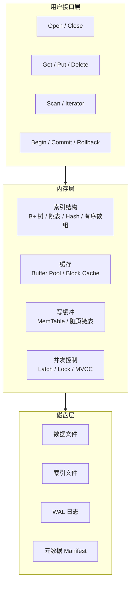
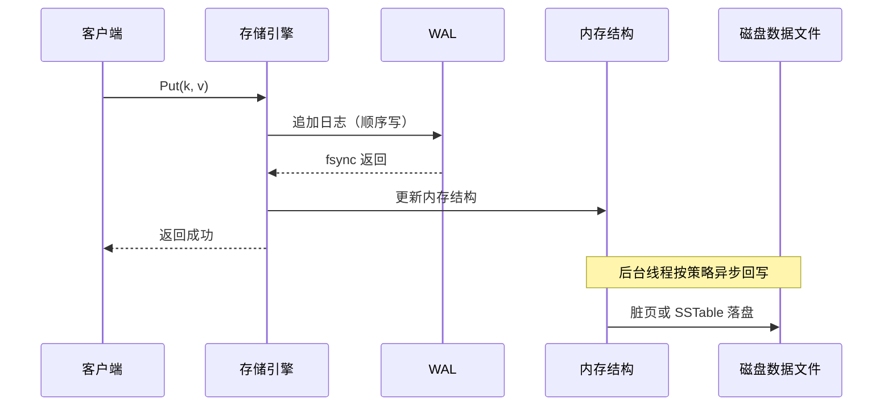
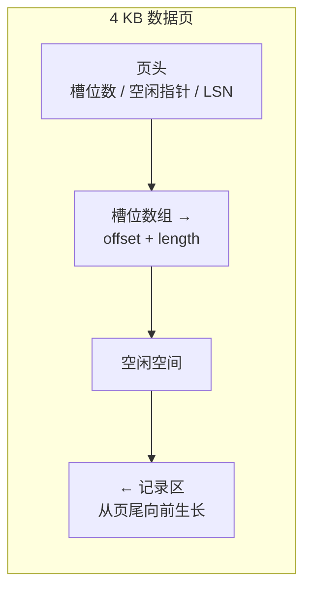
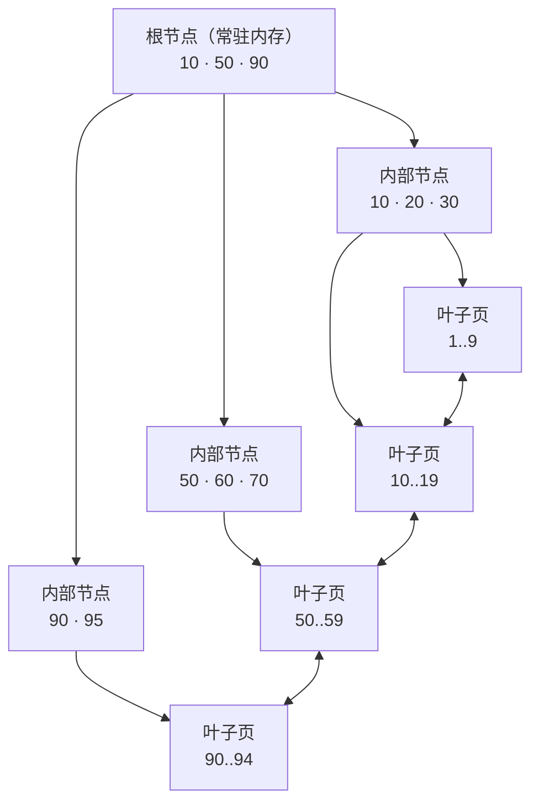
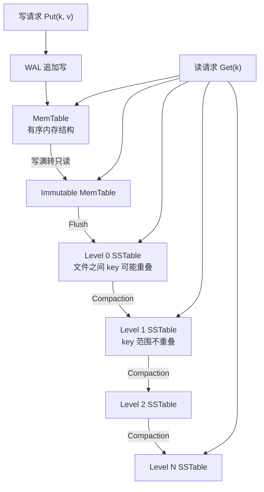
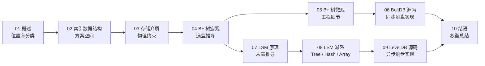

# 01 存储引擎概述——从数据库演进到两大派系

**摘要：**

半个世纪以来，数据库产品从关系模型一路繁衍到 NoSQL、NewSQL 与 HTAP，上层的查询语言、事务模型、部署形态换了又换，但最底下那件事——把字节放到介质上、再按某种顺序取回来——几乎没有变过，这件不变的事就是存储引擎。本文从数据库的演进史切入，先界定存储引擎在数据库系统中的位置与边界，再拆解它几乎统一的三层结构（用户接口层、内存层、磁盘层），然后把所有实现都绕不开的两个共性问题——数据如何编码、索引如何组织——摊开来讲，最后解释工程界为什么最终收敛出 B+ 树与 LSM 两大派系，以及"读多写少用 B+ 树、写多读少用 LSM"这句流传甚广的经验背后究竟记着哪几笔账。读完之后，应当能回答两个问题：存储引擎为什么长成今天这个样子，以及面对一个具体场景时，凭什么判断该选哪一派。

---

## 第 1 章 五十年，变与不变

1970 年 6 月，IBM 圣何塞研究实验室的 Edgar F. Codd 在《Communications of the ACM》上发表了一篇题为《A Relational Model of Data for Large Shared Data Banks》的论文，把数据从"指针与路径"里解放出来，交还给集合与关系。彼时工业界的主流是层次模型与网状模型，IBM 自家的 IMS 靠树形指针导航，CODASYL 标准下的网状数据库则要求应用程序自己沿着记录之间的链路爬行，数据结构一旦调整，访问路径就得跟着重写，程序员对物理布局的依赖几乎无法摆脱。

关系模型给出的承诺是物理独立性：用户只描述"要什么"，不描述"怎么找"。这个承诺听起来只是接口层面的改良，实际上却逼着系统在内部完成一次职责切割——上层负责把声明式的查询翻译成执行计划，下层负责把计划落到具体的页、块与磁道上。这次切割，正是存储引擎诞生的起点。

从论文到产品，中间隔了将近十年。IBM 的 System R 项目在 1974 年启动，第一次把 SQL、查询优化、事务与 B+ 树索引凑齐成一个可运行的系统；加州大学伯克利分校的 Ingres 几乎同期起步，后来演化为 PostgreSQL 的血脉；Oracle 在 1979 年推出第一个商用的 SQL 数据库，DB2 于 1983 年面世，SQL Server 在 1989 年登场，MySQL 则要到 1995 年才由瑞典的一间小公司发布。这段时间里，关系数据库的战场集中在查询优化、事务隔离与并发控制上，存储引擎作为支撑结构，反而显得安静——大家用的无非是 B 树、哈希与堆文件，差别只在工程实现的老练程度。

转折出现在二十一世纪的第一个十年。互联网的流量规模开始超出单机纵向扩展的天花板，分库分表成了所有大型系统的必修课，而分片一旦做深，跨分片的事务、连接与排序就变得昂贵无比。2006 年 Google 的 Bigtable 论文、2007 年 Amazon 的 Dynamo 论文，分别给出了两种截然不同的答案：前者用一张稀疏的、按行键排序的分布式多维映射表承载海量结构化数据，后者用一致性哈希加向量时钟换取永远可写。紧随其后，HBase 在 2008 年成为 Hadoop 的子项目，Cassandra 在同一年由 Facebook 开源，MongoDB 于 2009 年发布。CAP 理论在那几年被反复引用，Brewer 在 2000 年的 PODC 主题演讲中提出猜想，Gilbert 与 Lynch 在 2002 年给出形式化证明，"放弃一致性换可用性"一时间成了架构讨论的通行证。

第二个十年，风向又变。硬件的进步让单机能力大幅回升，万兆网络、NVMe 固态盘与大容量内存把"分布式"的成本重新算了一遍；更重要的是，业务方发现 eventual consistency 带来的心智负担并不比停机更轻。于是 NewSQL 登台：Google 在 2012 年的 OSDI 上公布 Spanner，用 TrueTime 把全球时钟误差压到可控范围，从而在外部一致性下提供分布式事务；TiDB 与 CockroachDB 在 2015 年前后开源，沿着 Raft 加 MVCC 的路线重做了一遍分布式关系库；阿里巴巴的 OceanBase 则从 2010 年起在金融场景里打磨，后来在 TPC-C 榜单上刷新纪录。也是在那个阶段，Gartner 在 2014 年提出 HTAP 的概念，试图用一套系统同时承接在线事务与在线分析，把两套集群之间的数据搬运省掉。

把这条时间线拉直来看，会发现一个颇有意味的反差：越靠近用户的那一层，变化越快；越靠近介质的那一层，变化越慢。SQL 的方言、事务的模型、复制的协议、部署的形态，几乎每五年就要重写一遍叙事；而 B+ 树自 1972 年由 Rudolf Bayer 与 Edward McCreight 在波音研究实验室提出以来，结构骨架至今没动过，LSM-Tree 自 1996 年由 Patrick O'Neil 等人在《Acta Informatica》上系统化之后，核心思想也一直是"内存缓冲加顺序写加后台合并"。

原因并不神秘。存储引擎面对的是物理约束，而物理约束不随业务模型漂移。CPU 与磁盘之间隔着三个数量级的速度差，顺序访问与随机访问之间隔着两个数量级的带宽差，内存断电即失，块设备的最小读写单位是扇区而不是字节，固态盘的擦除块又比读写单位大出两三个数量级。这些数字构成了一个几乎不变的约束集合，所有的存储引擎，本质上都是在这组约束下解同一道题：如何用最少的 I/O、最少的额外空间，完成一次读写，并且在断电之后还能把数据找回来。

不妨把数据库比作一座不断改建的城市。SQL 层是街面上的店铺与招牌，十年换一轮；事务层是账房与契约，规则越来越细；存储引擎则是地下的管网，材料从铸铁换成球墨铸铁再换成 PE，但"把水从 A 送到 B"这件事没变，管径、坡度、压力这些约束也没变。城市的繁华由街面决定，城市的承载力却由管网决定。理解一座城市，不能只看招牌。

那么，这根"管网"究竟埋在数据库的哪一层，它向上承接什么，向下管理什么，边界又划在哪里？

## 第 2 章 存储引擎的位置与边界

### 2.1 一条更新语句的下降路径

设想账户表里有一条记录，用户发起了一笔转账，应用层发出这样一条语句：

```sql
UPDATE accounts SET balance = balance - 100 WHERE id = 42;
```

这条语句进入数据库之后，要先经过解析器（Parser）做词法与语法分析，生成一棵抽象语法树；再经过语义分析，确认 `accounts` 表存在、`balance` 列可写、`id` 上有可用的索引；随后优化器（Optimizer）在若干候选计划中挑一个代价最低的，譬如走主键索引定位到单行，而不是全表扫描；执行器（Executor）按照计划调用下层接口，取出 `id = 42` 的那条记录，算出新的余额，再写回去。

到这里为止，处理的都是"语义"。而当事务层接手之后，语义开始褪色：它要判断这行记录有没有被别的事务锁住，要不要生成 undo 日志以便回滚，要不要分配一个递增的事务号写进行头，要不要把旧版本保留下来供一致性读使用。等这些决定都做完，交给存储引擎的，只剩下一个非常朴素的请求——在某个位置读出一段字节，或者把一段字节写到某个位置。

存储引擎不知道 `balance` 是什么，不知道减一百意味着什么，也不关心这条语句属于哪个用户的哪笔订单。它只认键与值，或者更准确地说，只认"记录标识"与"记录内容"之间的映射。这个"无知"常被误解为层次低，实际上恰恰是它最大的优点：接口越窄，职责越纯，替换与复用才越容易。MySQL 可以在 InnoDB、MyISAM、Memory 之间切换引擎，SQLite 的 `btree.c` 可以被别的项目摘出来单独使用，etcd 把元数据托付给 BoltDB，Kafka 的日志段、HBase 的 RegionServer、TiKV 的每个存储节点，底下都站着一个与 SQL 毫无关系的存储引擎。

边界也需要说清楚。存储引擎通常不负责跨表的约束检查，外键的级联由上层完成；不负责分布式一致性，副本之间的日志复制属于共识层；不负责权限、审计与 SQL 兼容性；甚至在很多实现里，它也不理解 schema 的完整语义，只知道定长与变长、主键与普通列的区别。它真正负责的是四件事：记录在介质上的物理组织、索引的维护、内存与磁盘之间的缓冲、崩溃之后的恢复。这四件事，构成了后面所有章节的骨架。

还有一条边界常被忽略，就是存储引擎与文件系统之间的分工。引擎看到的"磁盘"，其实是文件系统提供的一层抽象：`write` 调用先把数据写进页缓存（Page Cache），什么时候真正落到设备由内核决定；`fsync` 才把脏页与元数据刷下去，而且不同文件系统对 `fsync` 的实现差异不小，有的会把整块日志刷一遍，有的只刷必要的元数据。引擎若想绕开这层缓存，可以使用直接 I/O（Direct I/O），自己管理对齐与缓冲，代价是失去内核的预读与合并；若想借助缓存，就要接受"写成功不等于落盘"的语义，在关键时刻显式调用 `fsync`。WAL 之所以强调"日志必须先落盘再返回"，本质上是在和文件系统的缓存语义打交道，而不是在和磁盘打交道。这条边界上的误解，制造过不少"数据库明明返回成功、重启后数据却丢了"的事故。

### 2.2 三层结构

无论 B+ 树还是 LSM，无论嵌入式还是服务器端，存储引擎的内部都可以粗略地划成三层。这个划法不是物理上的强制分层，而是职责上的切分，几乎每一本讲数据库内核的书都会给出类似的结构，差别只在命名。



用户接口层是引擎对外的全部契约。嵌入式引擎通常暴露 `Open`、`Close`、`Get`、`Put`、`Delete`、`Scan` 这一组函数，事务型的实现再加上 `Begin`、`Commit`、`Rollback` 与批量写接口；服务器端的引擎则把这组接口包在更上层的存储抽象里，供 SQL 执行器调用。接口设计看起来只是 API 好不好用的问题，实际上决定了引擎的能力边界：有没有游标，决定了能不能做范围扫描；有没有快照读，决定了能不能支撑 MVCC；有没有批量写，决定了小写入的场景会不会被系统调用拖垮。BoltDB 的 `Update` 与 `View` 两个入口，把"写事务"与"读事务"直接做成了 API 的一等公民，这个选择后面会看到，它深刻地影响了整个引擎的并发模型。

内存层承担的是"把慢介质伪装成快介质"的工作。索引结构决定查找路径，缓存决定命中率，写缓冲决定写请求能不能攒批，并发控制决定多个线程能不能同时进来。这一层是存储引擎性能的主战场，也是复杂度最集中的地方：B+ 树的页缓存要处理脏页回写与淘汰，LSM 的 MemTable 要处理写满切换与冻结，哈希索引要处理扩容与冲突，跳表要处理并发插入时的指针原子性。所有的数据结构在这里都不是教科书上的抽象类型，而是要在锁、原子操作与内存分配器的夹缝里工作的实体。

磁盘层负责持久化与空间管理。数据文件、索引文件、预写日志（Write-Ahead Log，WAL）、元数据清单，这四类文件几乎出现在所有工业级实现中。页式管理把文件切成固定大小的块，空闲空间管理决定新页从哪里来、删除的页怎么回收，文件分配方式决定一次顺序扫描会不会退化成随机跳转。这一层最容易被忽视，因为它离业务最远，但很多线上事故的根因恰恰在这里：日志文件没有预分配导致写入时频繁扩展，空闲列表损坏导致页被重复分配，元数据更新不是原子的导致重启后文件集合对不上。

三层之间并不是简单的上下调用。同一份数据往往在内存与磁盘各有一份表示，两份表示之间如何保持一致，才是全部复杂度的来源。写请求先落内存还是先落日志，脏页什么时候回写，回写过程中断电怎么办，日志什么时候可以截断，元数据如何原子切换——这些问题没有一个是单纯的"数据结构问题"，它们都是一致性问题在存储层的投影。

| 层次 | 核心职责 | 典型组件 | 失效后的表现 |
|---|---|---|---|
| 用户接口层 | 定义读写语义与事务边界 | 游标、批量写、快照读 | 上层无法表达范围查询或原子写 |
| 内存层 | 加速访问、缓冲写入、并发控制 | Buffer Pool、MemTable、跳表、Latch | 命中率下降、写延迟抖动、死锁 |
| 磁盘层 | 持久化、空间管理、崩溃恢复 | 数据文件、WAL、Manifest、Freelist | 数据丢失、页损坏、重启失败 |

### 2.3 一次写入的完整旅程

把三层串起来看，一次写入的路径大致如下，后面的章节会反复回到这条路径上，只是每次替换掉其中一段的实现。



这条路径上的每一个决定都是一次交换。先写日志再改内存，是用一次顺序写的延迟换取崩溃后的可恢复性；改完内存就返回，是用内存的易失性换取写延迟的下降；后台异步回写，是用实现复杂度换取吞吐；日志写满后截断，是用恢复时间的延长换取磁盘空间的回收。所谓存储引擎的设计，很大程度上就是把这些交换逐一定价，再根据场景选择付哪一笔。

值得强调的是，这条路径并不是唯一的。BoltDB 走的是另一条：写事务开始时复制受影响的页，所有修改都在新页上完成，提交时把根页指针原子地切换过去，然后对数据文件执行一次 `fsync`。它没有独立的 WAL，数据文件本身就是日志；它也不在后台异步回写，提交即落盘。这条路径的写延迟明显更高，但恢复逻辑简单到几乎不需要恢复，这就是不同场景下的不同定价。

### 2.4 一次读取的旅程

读请求的路径与写请求对称，但重点不同。写关心的是"什么时候算成功"，读关心的是"要碰多少次介质"。

一次点查（Point Lookup）通常这样走：接口层收到 `Get(k)`，先查内存中的索引或缓存，若命中直接返回；未命中则按索引定位到目标页，发起一次页读；页读回来之后，在页内做二分查找或槽位扫描，找到记录偏移；再按编码格式解码出字段；最后交给事务层做可见性判断，确认这个版本对当前事务可见。整个过程里，真正昂贵的只有那一次页读，其余都是内存操作；优化的重点因此落在"如何减少页读次数"与"如何提高缓存命中率"上。

范围扫描（Range Scan）的路径不同。它先定位到起始 key 所在的叶子页，然后沿着叶子链表或块索引顺序推进，每次读一整页，把页内符合条件的记录批量返回；引擎通常还会做预读（Prefetch），在消费者处理当前页时提前把后续页读进缓存。范围扫描的效率取决于三个因素：数据在介质上是否连续、预读窗口是否合适、返回结果是否需要回表。若二级索引不覆盖查询列，每一条命中记录都要回到主索引再取一次，读放大立刻翻倍。

读放大的来源可以列得很具体：B+ 树的树高决定索引层要碰几个页，回表决定要不要再走一棵树，MVCC 决定要不要顺着版本链找可见版本，压缩决定要不要先解压整块，LSM 的层数与文件数决定要查多少个 SSTable。把这些环节逐一列出来，再看任何一个"读性能优化"的方案，就能判断它究竟省掉了哪一段。

## 第 3 章 两个共性问题

数据结构可以换，介质可以换，接口可以换，但有两件事任何存储引擎都躲不开：数据以什么形式编码，索引以什么方式组织。前者决定一段逻辑记录在介质上占多少字节、解析要花多少指令；后者决定一次查找要走多少步、读多少次页。把这两件事想清楚，再看任何引擎都不会迷路。

### 3.1 数据如何编码

内存里的数据结构和磁盘上的字节序列，是两套完全不同的世界观。内存里有指针、有对象头、有对齐填充、有虚拟地址映射，进程一退出，这些东西全部失效；磁盘上只有连续的字节，换一台机器、换一个编译器、换一个版本，都得能原样读出来。编码要解决的，就是这两套世界观之间的翻译问题。

最朴素的做法是定长记录：每条记录占用固定字节数，第 n 条记录的偏移就是 `n × 记录长度`，定位是纯算术，不需要任何额外结构。定长编码的读性能极好，代价是空间浪费——一个字段的实际内容可能只有几个字节，却要按照最大长度预留；变长字段一多，浪费就变得不可接受。早期的很多嵌入式数据库与内存表都采用这种方案，原因无他，简单且快。

变长记录则需要在页内维护一张偏移数组，也就是常说的槽页（Slotted Page）结构：页头记录页内槽位数、空闲空间起止位置与一些校验信息；槽位数组从页头向后生长，每个槽位存放一条记录的偏移与长度；记录本身从页尾向前生长。插入时在空闲区分配空间，把偏移写进槽位；删除时只清空槽位，不移动记录；页内碎片多了再做一次压缩整理。这个设计的巧妙之处在于，记录的物理位置可以变，逻辑顺序由槽位数组维持，于是变长记录也能获得稳定的寻址能力。



再复杂一些的是 TLV 编码，也就是类型（Type）、长度（Length）、值（Value）三元组。每个字段自带类型与长度，解析器不需要预先知道 schema 就能逐字段跳过，这让格式演进变得容易：新增字段时，旧版本读到未知类型可以安全跳过，不必重写整个文件。Protobuf、Thrift、Avro 这些序列化框架，本质上都是 TLV 家族的变体，只是在变长整数、字段编号、压缩策略上做了各自的优化。

编码的代价常常被低估。其一是解析成本，字段越多、嵌套越深，反序列化占用的 CPU 就越多，在高吞吐场景下这部分开销足以和 I/O 相提并论。其二是空间放大，对齐填充、冗余的类型字节、为兼容性保留的占位字段，都会让实际占用的空间超过逻辑数据量。其三是缓存友好性，紧凑的列式布局能让一次缓存行装载更多有效数据，而指针密集的行式布局则容易在追指针时不断错过缓存。其四是版本兼容，一旦格式没有设计好演进路径，升级就意味着全量重写。

行存与列存的分野也在这里。行存把一条记录的所有字段放在一起，适合按主键取出整行、适合事务型的点查与更新；列存把同一列的值连续存放，适合只读少数几列的大范围扫描，压缩率也高得多，因为同一列的数据类型一致、取值分布集中。OLTP 系统几乎清一色行存，OLAP 系统几乎清一色列存，HTAP 则往往要在两套表示之间做同步，这本身又是一笔账。

压缩是编码的延伸，也是同一笔交换的另一种形态。字典编码把重复出现的字符串映射成短整数，游程编码（Run-Length Encoding，RLE）把连续重复的值压成一个值与一个计数，位打包（Bit Packing）把取值范围很小的整数塞进尽量少的位，通用压缩算法如 LZ4、Zstd 则在字节流层面找重复模式。压缩的收益是双重的：空间占用下降，同样的 I/O 能带回更多逻辑数据；代价也是双重的：编码与解码消耗 CPU，随机访问变得困难，因为压缩块必须整块解压才能定位到其中一条记录。列存之所以普遍压缩，是因为同一列的数据同质化程度高、压缩比大，而且分析查询本来就以整块扫描为主，随机访问的损失可以接受；行存则要谨慎得多，点查场景下每读一行都解压一次，CPU 很快会成为瓶颈。LevelDB 与 RocksDB 把压缩做成可插拔的块级选项，正是把这个取舍交给使用者按负载决定。

不妨把编码比作集装箱。散货装船，件件都要单独搬运、单独固定，损耗高、效率低；集装箱把货物标准化成统一尺寸，吊装、堆叠、转运都能复用同一套设备。但集装箱也有代价：箱子没装满时空间照样被占着，装卸需要额外的吊机与堆场，超规货物还得特殊处理。编码方案的选择，和选集装箱尺寸是一回事，没有 universally 最优的规格，只有与货物结构、运输方式相匹配的规格。

### 3.2 索引如何组织

索引的本质，是用额外的空间与写代价，把一次线性扫描换成一次数对数级甚至常数级的定位。这个交换听起来稳赚，实际上处处是边界：索引本身要占空间，索引的每一次更新都要跟着写路径走一遍，索引太多会让写入性能塌陷，索引太少又会让查询退化成全表扫描。

按照组织方式，索引可以分成几个维度来看。稠密索引为每条记录都建一个索引项，查找时先定位索引项再取记录；稀疏索引只为每个页或每个块建一个索引项，先定位到页，再在页内顺序查找。稠密索引查得快、占空间多，稀疏索引占空间少、多一次页内扫描，B+ 树的非叶子节点本质上是稀疏索引，叶子节点上的索引项则是稠密的。聚簇索引决定记录的物理顺序，索引项与记录放在一起，一张表只能有一个；非聚簇索引只存索引列与指向记录的指针，可以有多个，查不到需要的列时还要回表。主键索引通常是聚簇的，二级索引通常是非聚簇的，这个区别在 InnoDB 里表现为"二级索引的叶子节点存的是主键值"，一次二级索引查询可能要两棵树各走一遍。

有序索引与哈希索引的分野更根本。有序索引维护键的全局顺序，因此天然支持范围查询、前缀匹配与排序；哈希索引只维护键到位置的映射，点查是常数时间，范围查询则完全无能为力。Bitcask 把索引放在内存里做成哈希表，换来极快的点查，代价是所有 key 必须装得进内存，且不支持范围扫描。B+ 树把索引做成有序的多叉树，点查与范围查询都能兼顾，代价是每次查找要走树高那么多层。选择哪一种，取决于查询模式里点查与范围查询的比例。

组合索引的最左前缀原则，也常被误解为某种人为规定，其实它只是字典序的直接推论。索引 `(a, b, c)` 先按 `a` 排序，`a` 相同再按 `b` 排序，`b` 相同再按 `c` 排序；查询条件里没有 `a`，就无法利用这棵索引的有序性去定位，只能退化成扫描。反过来，只要条件从最左列开始连续，哪怕只用前两列，也能利用索引。这不是数据库的实现细节，而是有序结构本身的数学性质。

索引也不是越多越好。每增加一个索引，写入路径上就多一次维护：B+ 树要多做一次页内插入，可能触发分裂；LSM 要多写一份索引数据，多一层合并。空间上，索引可能占到数据量的三成甚至更多；写放大上，一个表挂五个索引，一次写入的物理字节数可能翻几倍。生产系统里常见的"索引建了一堆、写入却越来越慢"，根因往往不是硬件，而是索引的边际收益早已为负。

同样可以用图书馆来类比。书名目录、作者目录、分类目录、主题目录，每套目录都要在新书入库时同步更新；目录越多，读者找书越快，编目员越累，目录柜也越占地方。一个图书馆该建几套目录，取决于读者怎么找书，而不是目录越多越显得专业。

### 3.3 介质约束

编码与索引之外，还有一层更底层的约束：数据最终要落在某种介质上，而介质的脾气是固定的。

从寄存器到磁带，访问延迟横跨七个数量级。寄存器大约零点几纳秒，L1 缓存一到两纳秒，主存一百纳秒上下，持久化内存（Persistent Memory，PMEM）三百纳秒左右，NVMe 固态盘的随机读在几十到一百微秒，SATA 固态盘更慢一些，机械磁盘的寻道时间则在十毫秒量级。内存与固态盘之间差着三个数量级，固态盘与机械盘之间又差着两个数量级。这个梯度决定了缓存该做多大、预读该做多深、批量该攒多厚——所有"用内存换磁盘"的设计，赌的都是这个梯度。

块设备的语义同样重要。磁盘的最小读写单位是扇区，传统上 512 字节，现代盘多为 4 KB；文件系统以页为单位管理，常见也是 4 KB；固态盘的擦除块则大得多，从几百 KB 到几 MB 不等。写入一个字节，实际可能触发一次 4 KB 的页写；修改一个页，在固态盘上可能引发一次擦除块的读改写。写放大由此而来，而且这个放大是物理层面的，软件只能缓解，无法消除。

顺序与随机的差距则决定了 I/O 模型。机械盘顺序写能跑到两百 MB/s，随机写可能只剩几百 IOPS；固态盘没有寻道，随机读的性能好得多，但随机写仍然受擦除块与垃圾回收的制约，长期看会退化。LSM 之所以执着于顺序写，B+ 树之所以要尽量把随机写攒成批量写，根源都在这里。

这些约束在第 03 篇会展开讲，此处只需记住一个判断：任何存储引擎的性能数字，都可以还原成"它在这个介质梯度上，把哪一类 I/O 换成了哪一类 I/O"。

### 3.4 页：编码与索引的交汇点

编码与索引看起来是两件独立的事，实际上它们在一个地方交汇，那个地方叫页（Page）。

页是存储引擎进行 I/O 的最小逻辑单位，大小通常与文件系统页对齐，4 KB 最常见，InnoDB 默认 16 KB，某些分析型系统会用到 64 KB 甚至更大。选多大的页，本身就是一次权衡：页越大，一次 I/O 能带回的记录越多，B+ 树的树高越低，顺序扫描越划算；但页越大，页内更新的代价越高，缓存能容纳的页数越少，读写放大也越明显。4 KB 之所以成为默认值，是因为它同时匹配了传统磁盘的扇区、操作系统的页大小与大多数 OLTP 负载的随机访问粒度，是一个历史与工程折中出来的公约数。

页的内部要同时容纳三样东西：元数据、索引信息与记录数据。元数据包括页号、页类型、校验和、日志序列号（Log Sequence Number，LSN）、空闲空间指针；索引信息可能是页内的槽位数组，也可能是页内的键值目录；记录数据则按编码格式紧凑排列。B+ 树的节点页要在页内做二分查找，因此键值必须有序；堆文件的页只负责存放记录，因此更依赖槽位数组；LSM 的块（Block）在页的基础上再加一层重启点（Restart Point）与前缀压缩，目的是让键的公共前缀只存一次。同一块 4 KB 的空间，不同的组织方式会带来完全不同的读写成本，这是"页格式"成为存储引擎核心设计对象的原因。

页还承担了一致性的职责。页级校验和用来发现静默损坏，LSN 用来判断这个页的修改是否已经持久化，页头的事务信息用来支撑 MVCC 的可见性判断。很多引擎在页头预留了一小块空间给"将来可能用到"的字段，这不是懒惰，而是因为页格式一旦落盘就很难改，预留是给未来留的余地。

把这一节放在编码与索引之后，是想说明一件事：抽象地讨论"用 B+ 树还是 LSM"意义有限，真正决定性能的是页里怎么放、一次 I/O 带回多少有效信息、修改一个字段要碰几个页。后面分析 B+ 树与 LSM 的工程细节时，会反复回到页这一层。

## 第 4 章 分类的第一刀：工作负载

存储引擎的选型，很少是"哪个技术更先进"的问题，更多是"这个负载更像哪一种"的问题。分类的维度可以列很多，但第一刀通常落在读写比例上，因为读与写在物理层面的代价结构完全不同。

### 4.1 读多写少与写多读少

先看一组常见的业务形态。银行核心账务、订单履约、库存扣减，这类系统每秒的读请求可能是写请求的十倍到百倍，单条请求的延迟要求在一毫秒到十毫秒之间，数据量在千万到十亿行，事务必须严格。日志采集、监控指标、消息队列、时序数据，这类系统每秒写入数十万到数百万条，读取多是按时间范围的批量扫描，单条写入的延迟要求反而宽松，数据量可以到 PB 级。前者的瓶颈在随机读与索引定位，后者的瓶颈在写入吞吐与后台合并。

| 维度 | OLTP | OLAP | HTAP |
|---|---|---|---|
| 主要负载 | 点查、短事务、频繁更新 | 大范围扫描、聚合、连接 | 事务与分析混合 |
| 延迟要求 | 毫秒级 | 秒级到分钟级 | 事务毫秒级，分析秒级 |
| 数据新鲜度 | 当前值 | 历史快照居多 | 近实时 |
| 典型存储布局 | 行存 | 列存 | 行存加列存副本 |
| 代表系统 | MySQL、PostgreSQL、Oracle | ClickHouse、Doris、Hive | TiDB、OceanBase、Spanner |

除了读写比，还有几个维度会实质影响选型。访问模式是点查为主还是范围扫描为主，决定了有序索引与哈希索引的取舍；热数据集能否装进内存，决定了缓存命中率与 I/O 模型；持久性要求是"断电不丢"还是"可以丢最后几秒"，决定了同步刷盘还是异步刷盘；数据生命周期是"永久保留"还是"定期删除"，决定了空间回收与合并策略。这些维度交织在一起，才构成一个完整的负载画像。

内存型与磁盘型的区分也在这里。Redis、Memcached 这类内存型组件把全部数据放在内存，用持久化机制做兜底，换来微秒级延迟，代价是容量受内存成本约束、断电后可能丢数据；磁盘型组件把数据放在外部存储，用缓存承接热点，换来容量与持久性，代价是冷数据的访问要付 I/O。还有一类"读多写多"的场景，譬如社交 Feed、推荐特征、实时大屏，读和写都很重，单靠一种引擎往往撑不住，工程上的常见做法是冷热分层：热数据放内存或 SSD 上的 B+ 树，冷数据放 LSM 或对象存储，中间用异步同步衔接。

| 维度 | 内存型 | 磁盘型 |
|---|---|---|
| 数据驻留 | 全部或绝大部分在内存 | 主体在磁盘，热点在缓存 |
| 延迟量级 | 微秒 | 毫秒，冷数据可达十毫秒 |
| 容量上限 | 受内存成本约束 | 受磁盘容量约束 |
| 持久性 | 依赖快照与日志，可能丢最近数据 | 依赖 WAL 与刷盘策略，可做到不丢 |
| 典型组件 | Redis、Memcached | InnoDB、RocksDB、BoltDB |
| 适合负载 | 会话、计数器、热点缓存 | 交易、日志、元数据、全量数据 |

读多写多的场景还引出一个常被忽略的事实：读写比并不是静态的。一个系统在上线初期可能读多写少，随着业务增长与数据积累，写入比例、数据分布、热点位置都会变化；同一个引擎在不同阶段的性价比可能完全不同。这也是为什么大型系统很少只押注一种存储，而是按数据的温度与访问模式分层，把"选型"从一次性决策变成持续调整的过程。

### 4.2 B+ 树：为读而生

B+ 树的结构，几乎每个写过数据库的人都能画出来：所有数据都在叶子节点，非叶子节点只存索引；叶子节点按 key 有序，并且用指针串成链表；每个节点对应一个磁盘页，节点内的 key 有序排列，通过二分查找定位子节点。



这棵树的高度决定了读的成本。一个 4 KB 的页，若每个索引项占 16 字节，可以放两百多个；三层树可以覆盖数千万到上亿条记录，四层可以到百亿级。也就是说，一次点查最多只需要三到四次页访问，而根节点与上两层通常常驻缓冲池，真正的磁盘 I/O 往往只有一次。范围扫描更划算：定位到起始叶子之后，沿着叶子链表顺序读下去，每次 I/O 都能带回一整页的记录，顺序性天然成立。

写路径则要付代价。插入先定位到叶子页，页内有空间就直接写入；空间不够就分裂成两个页，把中间 key 上推到父节点；父节点也满了就继续分裂，最坏情况一路裂到根，树高加一。删除相反，页内记录太少时可能与兄弟页合并，或者向兄弟页借几条记录。分裂与合并都涉及多个页的修改，必须保证原子性，否则断电后会留下半分裂的状态。InnoDB 用 WAL 加 doublewrite 来解决这个问题，BoltDB 用写时复制加根页原子切换来解决，路径不同，目标一致。

B+ 树适合读多写少，原因并不玄妙。读的路径短且稳定，范围扫描友好，页内有序带来良好的缓存局部性；写的代价虽然不低，但在读多写少的负载里，写的绝对次数少，分裂与合并的成本可以被摊薄。反过来说，如果一个系统每秒要写几十万条随机 key，B+ 树的随机写与页分裂就会成为瓶颈，这时候再谈"读快"已经没有意义。

### 4.3 LSM：为写而生

LSM-Tree（Log-Structured Merge-Tree）的思路完全反过来：不在原地修改，而是把所有写入都变成追加，先写内存，再批量刷盘，后台慢慢合并。



写入路径短得惊人：追加一条 WAL，插入内存中的有序结构，返回。内存结构写满之后转为只读，后台线程把它排序后刷成一个 SSTable 文件，放进 Level 0。Level 0 的文件之间 key 范围可能重叠，读的时候要逐个查；当文件数超过阈值，后台的合并（Compaction）把它们与下一层合并，生成 key 范围不重叠的新文件，逐层往下推。因为每一层的数据量按十倍递增，合并的摊还成本可以被控制在一个可接受的范围内。

读路径则要还债。一次读要先查 MemTable，再查 Immutable MemTable，然后从 Level 0 到 Level N 逐层查找；Level 0 可能有多个文件，每层还要先定位文件再定位块。为了减少无效 I/O，工业实现普遍使用布隆过滤器（Bloom Filter）做快速判否：先判断这个 key 可不可能在某个文件里，不可能就跳过。即便如此，读放大仍然存在，最坏情况一次逻辑读要碰十几个文件。

LSM 适合写多读少，道理同样朴素。所有写入都是顺序追加，机械盘与固态盘都吃这一套；合并虽然消耗带宽与 CPU，但它是后台批量的，不阻塞前台写入；数据按层组织，旧数据自然下沉，冷热分离是结构自带的。代价是读放大、写放大与空间放大，以及合并期间的延迟抖动——这几笔账会在第 07 篇详细算。

### 4.4 三角权衡

2016 年，Athanassoulis 等人在 EDBT 上提出 RUM 猜想（RUM Conjecture），把这件事说得很直白：对于任何一种访问方法，读开销（Read）、更新开销（Update）、空间开销（Memory/Space）三者不可兼得，优化其中两项，必然要以第三项为代价。

| 指标 | 定义 | B+ 树的典型表现 | LSM 的典型表现 |
|---|---|---|---|
| 读放大 | 一次逻辑读引发的物理读次数 | 低，约等于树高 | 高，取决于层数与文件数 |
| 写放大 | 一次逻辑写引发的物理写字节数 | 中，页分裂与 WAL 带来额外写 | 高，合并会反复重写数据 |
| 空间放大 | 物理占用与逻辑数据量之比 | 低，页内碎片有限 | 高，多版本与未合并文件共存 |
| 更新模式 | 原地更新还是追加 | 原地 | 追加 |
| 范围扫描 | 有序遍历的成本 | 低 | 中，需要合并多个有序流 |

这张表解释了很多工程现象。为什么 InnoDB 在写入密集时会出现页分裂与刷脏抖动，因为它在为低读放大买单；为什么 RocksDB 的写吞吐很高但读 P99 会抖，因为它在为低写放大买单；为什么 LSM 的磁盘占用总是比逻辑数据大，因为旧版本要等到合并才消失。所谓"哪个引擎更快"，如果不指明读写比例与数据分布，问题本身就是不完整的。

三项放大之间还可以互相转换，这一点比"三者不可兼得"更实用。攒批写入把多次小写合并成一次大写，写放大下降，代价是延迟上升、掉电时可能丢一批；压缩把数据体积变小，空间放大与读 I/O 同时下降，代价是 CPU 占用上升、随机读要先解压；缓存把热数据留在内存，读放大下降，代价是内存成本与失效时的一致性开销；预读把相邻页一次读进来，顺序扫描的读放大下降，代价是随机访问时读进无用数据。工程上调优，很多时候不是"消除"某一项放大，而是把它挪到一个不痛的地方。

这也解释了为什么同一款引擎在不同参数下会表现出完全不同的性格。RocksDB 把 `write_buffer_size` 调大，写入更顺滑，但内存占用与恢复时间上升；把 compaction 线程调多，写放大下降，但 CPU 与 I/O 争抢加剧；把 block size 调大，扫描更快，但点查的读放大上升。参数没有绝对的最优值，只有与负载匹配的组合。

## 第 5 章 两大派系的工程分支

分类如果只停在"B+ 树与 LSM"，会漏掉大量真实的工程差异。同样是 B+ 树，InnoDB 与 BoltDB 的写路径几乎相反；同样是 LSM，LevelDB 与 Bitcask 的索引组织完全不同。把这些分支摊开，才能理解为什么同一个哲学下会长出不同的实现。

### 5.1 B+ 树派系：异步刷盘与同步刷盘

类 InnoDB 的实现面向服务器场景，追求吞吐与并发的平衡。它把数据页缓存在缓冲池（Buffer Pool）里，写请求先改内存页并记 WAL，脏页由后台线程按检查点（Checkpoint）策略异步回写；为了防住"页写了一半断电"的问题，还有 doublewrite 缓冲区，先把页写到一块连续区域，再写到真实位置。这套机制让写入延迟主要取决于日志的顺序写，而不是数据页的随机写，代价是实现复杂度高、恢复逻辑长、调参空间大。

类 BoltDB 的实现面向嵌入式场景，追求简单与可靠。它用内存映射（mmap）把数据文件映射进地址空间，读操作几乎就是内存访问；写事务开始时，把受影响的页复制一份，所有修改都在新页上完成，提交时把元数据页的根指针原子地指向新树，然后 `fsync`。旧页不立即回收，而是记入空闲列表（Freelist），等没有读者引用时再复用。它没有独立的 WAL，数据文件本身就是日志；它也不做后台异步回写，提交即持久化。

| 维度 | 类 InnoDB（异步刷盘） | 类 BoltDB（同步刷盘） |
|---|---|---|
| 持久化机制 | WAL + 脏页异步回写 + doublewrite | 写时复制 + 根页原子切换 + fsync |
| 写延迟 | 低，取决于日志写 | 高，取决于数据页写与 fsync |
| 读路径 | 缓冲池命中则内存访问，否则页 I/O | mmap 命中则内存访问，否则缺页中断 |
| 并发模型 | 多读写线程，细粒度锁 | 单写多读，写事务串行 |
| 崩溃恢复 | 重放 WAL，处理未完成事务 | 回滚到上一个已提交的元数据页 |
| 实现复杂度 | 高 | 低 |
| 典型场景 | 在线事务、高并发 OLTP | 嵌入式、元数据存储、状态机 |

这两条路没有高下之分，只有场景之分。服务器场景有 DBA、有监控、有后台线程资源，用复杂度换吞吐是划算的；嵌入式场景没有运维介入，进程可能被随时杀掉，简单到"几乎不需要恢复"才是最大的可靠性。第 06 篇分析 BoltDB 时，会看到这种"以简驭繁"的设计如何贯穿到每一个数据结构。

### 5.2 LSM 派系：Tree、Hash 与 Array

LSM 的共同哲学是"内存缓冲加顺序写加后台合并"，但内存里用什么结构、索引放在哪里、合并的粒度多大，长出了三个分支。

LSM-Tree 是最广为人知的一支。内存里用跳表、红黑树或 B 树维护有序的 MemTable，刷盘后形成有序的 SSTable，后台按层合并。LevelDB、RocksDB、HBase、Cassandra 都属于这一支，差别在合并策略：LevelDB 与 RocksDB 默认用分层合并（Leveled Compaction），每层容量按倍数增长，文件之间 key 不重叠；Cassandra 更常用分层与分级混合的策略，按写入吞吐与读延迟的偏好调整。有序的内存结构带来了范围扫描能力，也带来了指针跳转与内存碎片的成本。

LSM-Hash 的代表是 Bitcask，Riak 的默认存储引擎。它把数据追加写进一个或多个数据文件，内存里只维护一张哈希表（Keydir），记录每个 key 最新值所在的文件号、偏移与长度。读一次就够：查哈希表拿到位置，一次 `pread` 取出值。写入是纯追加，落盘后更新哈希表。空间回收靠合并：后台把多个数据文件里的有效记录重写到新文件，丢弃被覆盖或删除的旧记录。它的优点与缺点同样鲜明：点查极快，实现简单，但所有 key 必须装进内存，且不支持范围扫描。

LSM-Array 的代表是 Moss 一类的实现。它把内存中的有序结构换成有序数组，写入先在缓冲区攒批，攒满后排序合并进主数组；落盘时按块顺序写出，读取时用二分查找定位块。数组的优点是内存连续、缓存友好、没有指针开销，扫描性能好；缺点是单条插入要搬移元素，因此必须靠批量缓冲来摊薄成本。它适合写多、批量大、范围扫描频繁的场景，不太适合高频单条随机写。

合并策略是这一派系内部另一条重要的分界线。分层合并（Leveled Compaction）把每一层切成 key 范围不重叠的多个文件，层容量按倍数递增，合并时只搬动与目标范围重叠的文件，空间利用率高、读放大可控，但写放大明显，因为同一份数据在逐层下沉的过程中会被反复重写。分级合并（Tiered Compaction）则允许同一层存在多个 key 范围重叠的文件，写满一批就整体合并成更大的一批，写放大低、合并延迟尖峰小，但读时要检查更多文件，空间放大也更严重。RocksDB 的 Universal Compaction、Cassandra 的 Size-Tiered Compaction 都属于后者，适合写吞吐优先、读延迟不敏感的场景；LevelDB 的默认策略属于前者，适合读多写少或读延迟敏感的场景。近些年很多系统采用混合策略，热层用分级、冷层用分层，试图在写放大与读放大之间找折中。

| 维度 | LSM-Tree | LSM-Hash | LSM-Array |
|---|---|---|---|
| 内存结构 | 跳表 / 红黑树 / B 树 | 哈希表（Keydir） | 有序数组 |
| 索引位置 | 磁盘 SSTable 内 + 内存稀疏索引 | 全量在内存 | 内存数组 + 磁盘块索引 |
| 点查成本 | 多层查找，布隆过滤器辅助 | 一次哈希 + 一次读 | 二分定位 + 一次读 |
| 范围扫描 | 支持 | 不支持 | 支持，且局部性好 |
| 内存约束 | 只放 MemTable 与索引 | 所有 key 必须驻留 | 放当前数组与缓冲 |
| 典型实现 | LevelDB、RocksDB、HBase | Bitcask | Moss |

把这三支放在一起看，"LSM 派系"这个说法就站得住了：它们共享同一套物理策略——把随机写转成顺序写，把合并推迟到后台；差异只在内存结构与索引组织，而这些差异又直接决定了读放大与内存占用。第 08 篇会逐一拆开它们的读写路径与合并算法。

### 5.3 边界正在模糊

需要提醒的是，分类是理解工具，不是站队依据。真实的系统早就在互相借鉴：InnoDB 的 change buffer 把二级索引的随机写攒成批量写，思路与 LSM 的缓冲如出一辙；RocksDB 引入分区索引、前缀布隆过滤器与多线程合并，读放大被压到接近 B+ 树的水平；WiredTiger 同时支持 B 树与 LSM 两种表类型，让用户按集合粒度选择；SQLite 的 WAL 模式把回滚日志换成了预写日志，写入并发明显改善；TiKV 用 RocksDB 做单机引擎，上面再叠一层 Raft，把分布式一致性交给共识层，存储引擎只管本地有序。

所以更准确的说法是：B+ 树与 LSM 代表两种极端的定价策略，工业实现则在两端之间找位置。读多写少的系统会向 B+ 树靠，写多读少的系统会向 LSM 靠，读写都重的系统则往往要用分层架构，把不同温度的数据放到不同引擎里。

硬件的变化也在改写这条分界线。NVMe 固态盘把随机读的延迟压到几十微秒，随机与顺序的差距比机械盘时代小了一个数量级，B+ 树的随机写不再像过去那样致命；大容量内存让 LSM 的 MemTable 可以做得更大，刷盘频率下降，读放大的窗口也随之变化；持久化内存在 2019 年前后被寄予厚望，试图填平内存与固态盘之间的空白，但 Intel 在 2022 年宣布停止 Optane 业务，这条路线短期内没能成为主流。这些变化没有推翻两大派系的划分，却不断调整着两者的性价比曲线，也提醒我们：任何关于"哪种引擎更好"的结论，都带着它被写下时的硬件背景。

## 第 6 章 本专栏的路线

接下来的九篇，沿着"数据结构、介质、B+ 树、LSM、源码、结语"的顺序展开。这个顺序不是随意的：数据结构决定了可选方案的上界，介质决定了方案的物理下限，B+ 树与 LSM 是在这组上下界之间做出的两种典型解，源码分析则用来验证这些解在工程上究竟怎么落地。



不同的读者可以走不同的路径。应用侧的工程师，如果只是想建立选型直觉，读 01、04、07、10 就够了，重点是理解两种结构的代价结构，而不是记住源码细节；做存储或基础架构的工程师，建议全读，05、06、09 三篇值得反复看，那里有大量边界条件与异常路径的处理；准备面试的读者，01、02、04、07 是主干，面试官真正想听的，不是"B+ 树比 LSM 快"，而是"在什么负载下、为什么快、代价是什么"。

源码分析以 bbolt（BoltDB 的社区维护分支）v1.3.x 与 LevelDB 1.23 为准。旧稿里逐函数走读的部分会被压缩，只保留能印证机制的关键结构体与函数片段，把篇幅让给设计动机与边界条件——读源码的目的是理解取舍，不是背下实现。

## 小结

行文至此，可以把这一篇的线索收一收。

存储引擎是数据库的底座，它不理解 SQL，不理解业务语义，只负责记录的物理组织、索引维护、内存缓冲与崩溃恢复。这个窄接口让它得以跨产品复用，也让它成为数据库里变化最慢的一层。它的内部可以划成用户接口层、内存层、磁盘层，三层之间靠"同一份数据的两份表示如何保持一致"这条线索串起来，所有的复杂度几乎都从这里长出来。

它要解决的两个共性问题是编码与索引。编码决定了逻辑记录如何变成字节，索引决定了查找如何从线性扫描变成对数级定位；两者都在空间、CPU 与 I/O 之间做交换。它还要服从介质约束，内存与磁盘之间三个数量级的速度差、块设备的最小读写单位、顺序与随机的带宽差，构成了所有设计的物理下限。

在此之上，工程界收敛出两大派系。B+ 树把数据组织成有序的多叉树，读路径短、范围扫描友好，适合读多写少；LSM 把写入变成追加，用后台合并换取写吞吐，适合写多读少。两者的差异可以统一到读放大、写放大、空间放大这三角权衡上：优化其中两项，必然牺牲第三项。所谓选型，不是选"更好的引擎"，而是选"哪一笔放大在这个场景里可以接受"。

下一章从数据结构开始。因为无论哪一派，最终的取舍都要落到某种具体的结构上：数组、链表、哈希、树、跳表，它们各自的代价，构成了存储引擎方案空间的第一层边界。

---

## 参考资料

1. Codd, E. F. *A Relational Model of Data for Large Shared Data Banks*. Communications of the ACM, 13(6), 1970.
2. Chamberlin, D. et al. *A History and Evaluation of System R*. Communications of the ACM, 24(10), 1981.
3. DeCandia, G. et al. *Dynamo: Amazon's Highly Available Key-value Store*. SOSP, 2007.
4. Chang, F. et al. *Bigtable: A Distributed Storage System for Structured Data*. OSDI, 2006.
5. Corbett, J. et al. *Spanner: Google's Globally-Distributed Database*. OSDI, 2012.
6. O'Neil, P. et al. *The Log-Structured Merge-Tree (LSM-Tree)*. Acta Informatica, 33(4), 1996.
7. Athanassoulis, M. et al. *Designing Access Methods: The RUM Conjecture*. EDBT, 2016.
8. Kleppmann, M. *Designing Data-Intensive Applications*. O'Reilly, 2017.
9. Petrov, A. *Database Internals: A Deep Dive into How Distributed Data Systems Work*. O'Reilly, 2019.
10. Bayer, R., McCreight, E. *Organization and Maintenance of Large Ordered Indices*. Acta Informatica, 1(3), 1972.

---

> [!note] 思考题
> 1. 如果把一条记录直接按内存中的结构体布局写入磁盘，会遇到哪些具体问题？请从指针、对齐、字节序、版本兼容四个角度各举一例。
> 2. 一个系统每秒写入 50 万条时序数据，读取以最近一小时的按时间范围扫描为主，应该选 B+ 树还是 LSM？如果读取改为按设备 ID 点查，结论会变吗？
> 3. 为什么 B+ 树的非叶子节点通常只存索引而不存数据？如果让非叶子节点也存数据，读放大与空间放大分别会怎么变？
> 4. RUM 猜想说三者不可兼得。存不存在某种负载，使得三项放大都不敏感，从而可以随意选择？请构造一个例子并说明理由。
> 5. BoltDB 用写时复制替代 WAL，为什么它在嵌入式场景下更合适，而在高并发写入场景下不合适？
