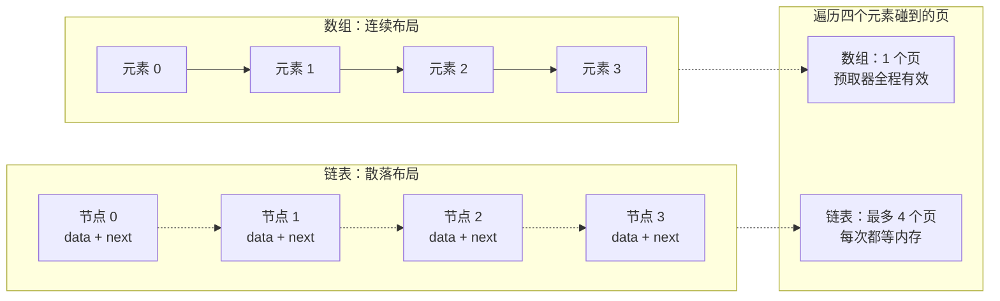
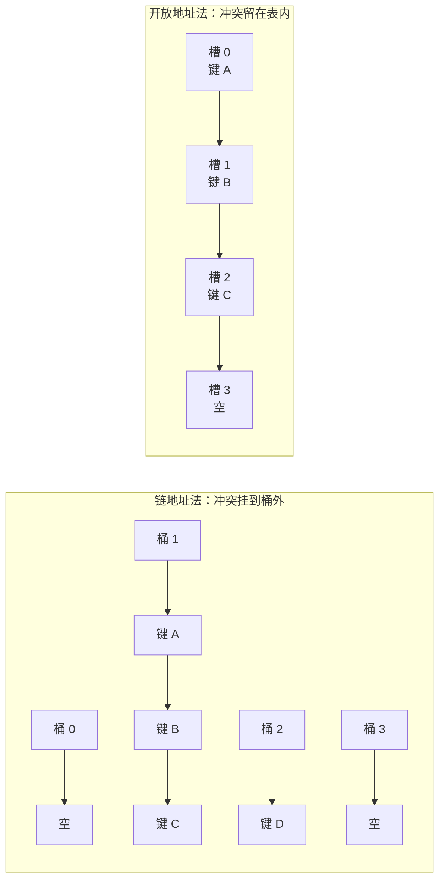
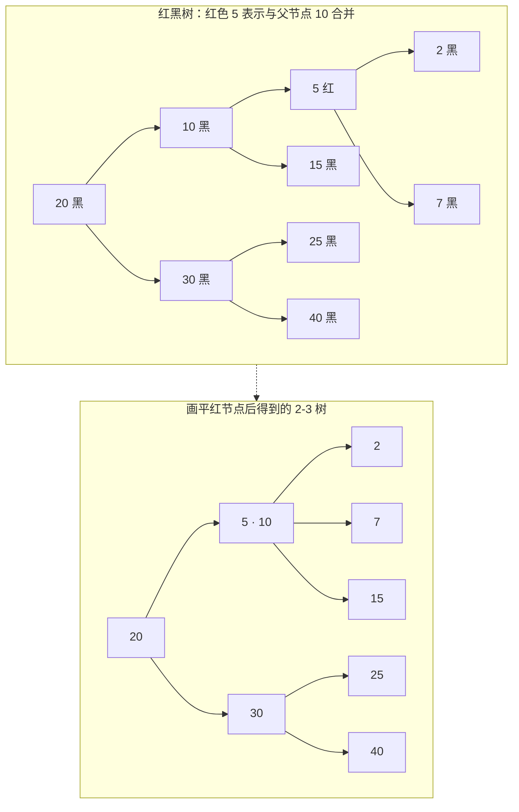
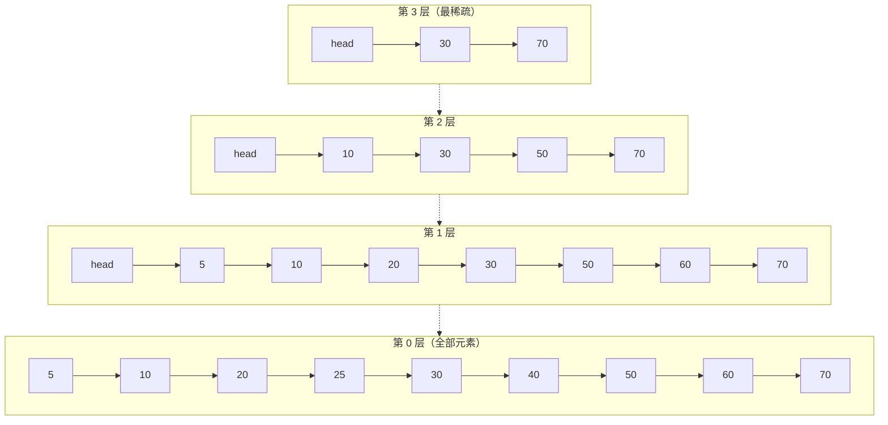
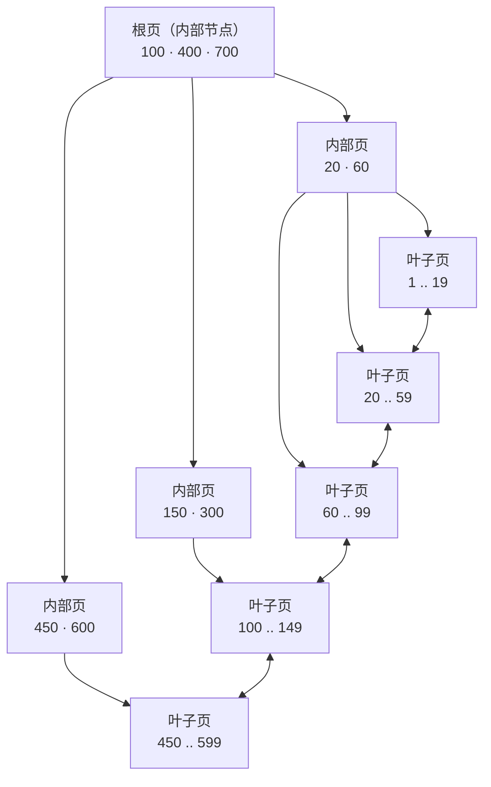

# 02 索引数据结构——从数组到 B+ 树的取舍链

**摘要：**

1972 年，Bayer 与 McCreight 在那篇奠定 B 树的论文标题里只放了两个限定词：Large 与 Ordered。数据量远大于内存，同时必须保持全局有序，这两个条件一旦同时成立，可选的结构就被压得很窄。本文沿着存储引擎的真实约束重走一遍这条路：先看数组与链表这两极如何把"连续"与"链式"的成本各自推到极致，再看哈希类结构（哈希表、位图与 Roaring Bitmap、布隆过滤器及其变体）如何用放弃有序性换取常数时间，然后看二叉搜索树、AVL、红黑树与跳表如何把比较次数压到对数、却在磁盘上败给树高，最后看 B 树与 B+ 树如何用扇出把树高压到三层，以及 Trie、ART、LSM 的稀疏索引与学习型索引各自占据哪一段边界。全文的主线只有一句：数据结构不是按时间复杂度从低到高排列的，而是按"它把哪一类成本转移到了哪里"排列的；磁盘引擎的第一约束是 I/O 次数而不是比较次数，因此扇出比树高更重要。读完之后，应当能对着一张选型矩阵，判断某个具体负载该往哪种结构上靠，以及为什么这么靠。

---

## 第 1 章 三个计数器

### 1.1 论文标题里的两个限定词

先回到那篇论文的标题。《Organization and Maintenance of Large Ordered Indices》里，"Large"说的是数据装不进内存，"Ordered"说的是访问必须能顺着键的顺序走。这两个词合在一起，界定了索引结构要解的那道题：当数据规模超过内存、并且顺序本身是查询语义的一部分时，如何用尽量少的介质访问完成定位、插入与遍历。

如果只满足 Large 而不要求 Ordered，答案会简单很多，把键哈希一下、把位置记在一张表里就够了，这正是第 3 章要讲的哈希类结构；如果只要求 Ordered 而不要求 Large，答案也简单，一棵平衡二叉树、甚至一个有序数组就够，因为所有节点都在内存里，比较次数就是唯一的成本。真正的困难来自两个条件的交集：既要维持顺序，又不能让"维持顺序"这个动作把介质访问次数放大。

所以看任何一种索引结构，都要先问它在这两个限定词上做了什么样的让步。有的放弃了 Ordered，换来点查的常数时间；有的放松了"严格的顺序"，用概率的方式近似维持；有的接受树高，但把每一层的节点做大，让树高变成个位数。这些让步都不是免费的，只是账记在了不同的地方。

### 1.2 比较、I/O 与写代价

衡量一个索引结构，通常要盯三个计数器，而这三个计数器的"汇率"在不同介质上完全不同。

第一个是比较次数。它在内存里是硬通货，一次比较大约一纳秒到几十纳秒，取决于数据是否在缓存里。在内存型数据结构里，把 O(n) 降到 O(log n) 是有意义的，因为常数因子就那么大，省下来的比较次数能直接换成延迟。

第二个是 I/O 次数。在磁盘上，这个计数器的单位成本是几十微秒到十几毫秒，比一次比较贵出三到七个数量级。此时"比较次数"几乎不值钱：在一个 4 KB 的页里做二十次二分比较，耗时可能只有几百纳秒，而把这一页从设备读进内存要花一百微秒。**页内的比较是免费的，页与页之间的跳转才是昂贵的。**

第三个是写代价，或者更准确地说，是写放大。一次逻辑插入落到介质上，可能引发页分裂、索引项上推、日志追加、后续的合并与重写，物理写入的字节数可以是逻辑写入的几倍到几十倍。这个计数器在写密集的负载里会盖过前两个。

三个计数器的相对价格决定了结构的排序。在内存里，红黑树与跳表的差异主要体现在常数因子与实现复杂度上；在磁盘上，这两者都会被 B+ 树按在地上，原因不在比较次数，而在 I/O 次数。一次点查在红黑树里要比较二十多次，在 B+ 树里也要比较二十多次（页内二分），但前者跨了二十多个节点，后者只跨了三个页。

**同一个结构在不同介质上的排名可以完全颠倒，这是理解索引选型的第一把钥匙。**

### 1.3 一张成本转移表

把"它把成本转移到了哪里"当作分类标准，前面这些结构可以排成一条链。下面这张表是全文的骨架，后面每一章都是在给其中某一行补充细节。

| 结构 | 主要优化的成本 | 被转移出去的成本 | 典型归宿 |
|---|---|---|---|
| 有序数组 | 查找与范围扫描的比较次数 | 插入删除要搬移元素，写代价 O(n) | 只读或批量重建的段文件、倒排索引的 posting list |
| 链表 | 插入删除的搬移成本 | 随机访问退化为 O(n)，缓存局部性极差 | 页间串联、空闲页管理、LRU 链 |
| 哈希表 | 点查的比较次数降到 O(1) | 完全放弃顺序，范围与前缀查询失效 | 内存索引、Keydir、自适应哈希索引 |
| 位图 / Roaring | 集合运算与判存的位级并行 | 只适用于整数域，稀疏时空间浪费 | 标签过滤、去重、向量化执行的选择位图 |
| 布隆过滤器 | 判否的空间成本压到每位一个键 | 引入假阳性，不支持删除与遍历 | LSM 的 SSTable 前置过滤 |
| 二叉搜索树 / 红黑树 | 比较次数压到 O(log n) | 树高等于 I/O 次数，写时要旋转 | 内存索引、定时器、epoll 就绪表 |
| 跳表 | 同样的 O(log n)，但写入只改指针 | 概率性平衡，最坏情况无硬保证 | MemTable、Redis ZSet |
| B 树 | 树高降到个位数，页内多路 | 节点分裂合并的原子性与实现复杂度 | 文件系统元数据、部分嵌入式索引 |
| B+ 树 | 扇出最大化，范围扫描走叶子链 | 内部节点冗余存键，写时要维护父节点 | InnoDB、BoltDB、SQLite |
| Trie / ART | 前缀查询与内存局部性 | 指针稀疏带来的空间开销 | 内存数据库、路由表、字典 |
| 学习型索引 | 用模型替代键，空间与查找都下降 | 对分布漂移敏感，插入代价高 | 只读或近似只读的有序数据 |

读这张表有个技巧：先确定你的负载里最贵的是哪一格，再看候选结构在这一格上的表现。写密集的时序场景，最贵的是写放大，哈希与 LSM 会胜出；读密集的交易场景，最贵的是点查与范围扫描的 I/O 次数，B+ 树会胜出；只判存不去重的场景，最贵的是内存占用，布隆过滤器会胜出。脱离负载谈"哪个结构更先进"，得到的结论一定是错的。

行文至此，路线也就清楚了：从最原始的两极开始，逐层看每种结构做了什么让步、把账记到了哪里。这条路线的前提是 [[01 存储引擎概述——从数据库演进到两大派系]] 里给出的那个判断——存储引擎只认键与值、只负责物理组织与索引维护，因此索引结构的选择可以脱离 SQL 语义单独讨论。

## 第 2 章 数组与链表：连续与链式的两极

### 2.1 数组的算术基础

数组的全部魔力可以写成一行算式：第 i 个元素的地址等于首地址加上 i 乘以元素大小。这不是一个算法，而是一次乘加，CPU 在一个周期内就能算完，所以"随机访问 O(1)"这个说法其实低估了它，它比 O(1) 的哈希查找还要快，因为它连哈希函数都不用算。

不过这次乘加只是入场券；真正让数组在存储引擎里不可替代的，是它带来的三个副产品。

第一个是**缓存行（Cache Line）**的利用率。CPU 从内存取数据，一次取一整条缓存行，x86-64 上通常是 64 字节。数组的连续布局意味着一次取数会顺带把后面十几个元素也带进缓存，下一次访问直接命中；链表则相反，每个节点都要单独取一次，而且取回来的 64 字节里可能只有 8 字节有用。

第二个是硬件预取。现代 CPU 的预取器能识别固定步长的访问模式，一旦发现你在按 16 字节的间隔扫内存，它就会提前把后面的行拉进来。数组的顺序扫描天然符合这个模式，链表的指针追逐则完全无法预测，预取器只能干看着。

第三个是页与 TLB 的友好度。一段连续的数组会落在少数几个页里，页表项（Page Table Entry，PTE）与转译后备缓冲器（Translation Lookaside Buffer，TLB）的条目都能复用；链表节点散落在堆的各处，每跳一次都可能换页，轻则 TLB 未命中，重则触发缺页中断。第 03 篇会详细算这笔账，此处只需记住：**连续布局买到的不只是空间局部性，还有地址翻译的局部性。**

数组的代价同样清晰。插入与删除要搬移元素，平均搬移一半，复杂度 O(n)。在内存里这个代价是 memmove，一亿条 16 字节的记录搬一半是 800 MB，现代 CPU 大约要 0.05 到 0.1 秒，勉强能忍；在磁盘上，同样的搬移意味着成百上千个页的重写，没有任何系统会这么做。另一个代价是扩容，动态数组容量不够时要申请一块更大的空间并把旧数据复制过去，主流实现按 1.5 倍或 2 倍增长，把复制成本摊还到每次插入上，摊还复杂度仍是 O(1)，但单次插入会出现延迟尖峰。

### 2.2 链表的指针代价

链表的动机很朴素：既然搬移元素贵，那就不搬移，改指针。插入一个节点只要改两个指针，删除一个节点也只要改一个指针，与元素个数无关。这个性质在内存里非常有价值，在存储引擎里则演化出了另一种形态——页与页之间的串联，因为页不能搬移，能改的只有页号。

不过指针是有代价的，而且代价比教科书上写的更重。

其一是空间开销。链表每个节点要多存一个或两个指针，在 8 字节的指针、16 字节的节点数据这个比例下，额外空间接近 12%；堆分配器还会给每个节点加上元数据头，glibc 的 malloc 通常有 8 到 16 字节的头部开销，小节点的实际空间放大可以到两倍以上。存储引擎因此很少为每条记录单独分配节点，而是把一批记录放进一个页，再用页内的槽位数组管理，这就是后面要讲的槽页结构。

其二是缓存与预取的双重失效。遍历链表时，每一次 `next` 都是一次潜在的内存访问，而且地址不可预测，CPU 只能等。实测中，链表遍历比数组遍历慢一个数量级是常见现象，差距不来自指令数，而来自内存墙。

其三是并发与原子性。改指针看起来只有一条指令，但要改多个指针（双向链表要改四个）时就必须有锁或者原子操作保护，而无锁链表的实现难度远高于无锁数组。

在存储引擎里，链表真正不可替代的地方是"不能搬移的对象之间的顺序"。B+ 树的叶子页之间要用双向链表串起来，因为范围扫描需要在页之间顺序推进；缓冲池的空闲页、脏页、LRU 链都是链表，因为页的物理位置固定，只能改链接关系；LSM 的 SSTable 之间也有版本链。这些场景里，元素是页而不是记录，搬移页的代价是重写整个文件，链表是唯一可行的选择。

下面这张图把两种布局放在一起对比，重点不在形状，而在"一次遍历会碰到几个页"。

### 2.3 存储引擎里的真实形态

真实的存储引擎几乎不会"纯用"数组或链表，而是把两者叠起来用，分工非常明确：**页内用数组，页间用链表。**

页内用数组，是因为一个页已经被读进内存，页内的访问不再有 I/O 成本，此时比较次数与搬移成本才是主要矛盾。B+ 树的节点页内部维护一个有序的键数组，查找时在数组上二分；堆文件的页内部维护一个槽位数组，每个槽位记录一条记录的偏移与长度，记录本身从页尾向前生长。插入时先找到空闲空间，把偏移写进槽位，再按偏移排序调整槽位数组；删除时只把槽位标记为空，不搬移记录；碎片积累到一定程度再做一次页内压缩。这套结构叫槽页（Slotted Page），它让变长记录获得了稳定的寻址能力，因为记录的物理位置可以变，逻辑顺序由槽位数组维持。

页间用链表，是因为页的位置在文件里是固定的，只能通过页号串联。InnoDB 的每个索引页头都有前驱与后继页号，范围扫描靠它顺序推进；空闲页通过 freelist 串起来，分配与回收都是改链表；缓冲池的 LRU 链把页按访问时间排序，淘汰时从尾部摘。

数组与链表的对比可以收成一张表，注意最后两行是存储引擎语境下的差异，教科书里通常不写。

| 维度 | 数组（含动态数组） | 链表（单链与双链） |
|---|---|---|
| 按下标访问 | O(1)，一次乘加 | O(n)，必须从头走 |
| 头部插入删除 | O(n)，整体搬移 | O(1)，改指针 |
| 尾部插入删除 | 摊还 O(1)，扩容时 O(n) | O(1)，需维护尾指针 |
| 查找指定值 | 无序 O(n)，有序可二分到 O(log n) | O(n)，无法二分 |
| 空间开销 | 无指针开销，可能有预留空洞 | 每节点 8 到 16 字节指针，另有分配器头部 |
| 缓存局部性 | 好，预取器有效 | 差，每次 next 都可能缺页或 TLB 未命中 |
| 并发修改 | 搬移导致读者看到中间状态 | 单指针原子写即可，多指针需锁 |
| 存储引擎中的分工 | 页内键数组、槽位数组、位图 | 叶子页链、空闲页链、LRU 链、版本链 |

一句题外话：跳表之所以能把链表变成 O(log n)，靠的就是在链表之上再叠若干层"索引数组"，本质上还是把数组的二分能力借给了链表，第 4 章会展开。

## 第 3 章 哈希类：把有序性换成常数时间

### 3.1 哈希表：一次映射与它的两个副作用

哈希表（Hash Table）的全部设计可以概括成一句话：用一个函数把键映射成数组下标，然后按下标存取。理想情况下，这个映射是一一对应的，查找、插入、删除都是 O(1)；现实中映射必然多对一，冲突的处理方式决定了哈希表的性格。

冲突有两条路。第一条是**链地址法（Separate Chaining）**：数组的每个位置挂一条链，冲突的键都挂到同一条链上。它的优点是删除简单、负载因子可以超过 1、扩容可以推迟；缺点是链表的缓存局部性差，冲突严重时退化成 O(n)。工程上的改良是把长链换成红黑树，Java 的 `HashMap` 在单桶元素超过 8 个时把链表树化，低于 6 个时退化回链表，这个阈值的选择本身就是一次统计上的折中——正常情况下桶内长度服从泊松分布，长度到 8 的概率已经低到可以忽略，树化只是给极端情况兜底。

第二条是开放地址法（Open Addressing）：所有元素都存在数组自身里，冲突时按某种探测序列找下一个空位。线性探测的序列是 i+1、i+2、i+3，实现最简单、缓存最友好，但会产生一次聚集（Primary Clustering）：一段连续的槽位被占满后，任何落进这段的键都要走到段尾，探测长度急剧上升。二次探测把步长改成 i²，打散了一次聚集，但相同哈希值的键仍走同一条探测序列，形成二次聚集（Secondary Clustering）。双重散列用第二个哈希函数决定步长，能同时打散两种聚集，代价是多算一次哈希、缓存局部性变差。

聚集的严重程度可以用探测长度的期望值量化。Knuth 在《The Art of Computer Programming》第三卷里给出了线性探测的经典结果：负载因子为 α 时，成功查找的平均探测次数约为 (1 + 1/(1−α))/2，失败查找约为 (1 + 1/(1−α)²)/2。代入 α = 0.75，成功查找约 2.5 次，失败查找约 8.5 次。这组数字解释了两件事：为什么主流哈希表的负载因子阈值都卡在 0.7 到 0.75 之间，以及为什么开放地址法在失败查找上比链地址法吃亏——它必须一路探测到空槽才能确认不存在，而链地址法走到空链就结束。

开放地址法还有一个隐蔽的坑：删除。直接把槽位置空会切断探测序列，让后面的键永远找不到，所以必须用墓碑（Tombstone）标记，查找时跳过墓碑继续探测，插入时可以复用墓碑。墓碑积累多了，查找性能会持续退化，只能靠定期重哈希清理。

两种解法在内存布局上的差异，可以先用一张图摆开。

### 3.2 扩容、重哈希与渐进式迁移

负载因子超过阈值就要扩容，扩容意味着重新分配一块更大的数组，并把所有键重新哈希一遍。这一步的成本是 O(n)，而且是一次性的，所以扩容瞬间的延迟会突然抬高。

容量通常取 2 的幂，原因不是迷信：取模运算在除数是 2 的幂时可以化简成按位与，`hash % 2^k` 等价于 `hash & (2^k − 1)`，省掉一次除法。代价是哈希函数必须把高位也搅进低位，否则 `hash & mask` 只用到低位，高位信息全丢，冲突率会飙升，这就是为什么 Java 的 `HashMap` 要在 `hashCode()` 之上再做一次扰动。

2 的幂还有一个额外好处：扩容成两倍之后，每个元素的新位置只有两种可能——留在原下标，或者移动到原下标加旧容量。因为新掩码只多了一位，这一位决定了去留。Java 8 的 `HashMap` 正是利用这个性质把扩容时的元素分配简化成两条链的拆分，避免了逐元素重新计算哈希。

Redis 走的是另一条路：**渐进式重哈希（Incremental Rehashing）**。它同时维护两张哈希表，扩容期间新写入进新表、查询先查旧表再查新表、每次操作顺带迁移若干个桶，把 O(n) 的迁移摊到后续的 O(n) 次操作里，避免单次停顿。这个设计对延迟敏感的服务器来说几乎是必需的，代价是代码里到处都要判断"当前是否在重哈希"。

### 3.3 位图与压缩位图

位图（Bitmap）是把哈希思想推到极致的产物：键本身就是下标，值只占一位。判断某个整数在不在集合里，就是查那一位是 0 还是 1，空间成本是每个元素 1 bit，比任何哈希表都省两个数量级以上。

位图的局限也很硬。它只能表示整数域，字符串要先映射成整数，映射函数又得自己解决冲突；它的空间与键的最大值成正比，而不是与元素个数成正比，一个孤零零的 `2^32 − 1` 就能把位图撑到 512 MB。所以纯位图只适合键空间稠密且上界可控的场景，譬如线程号、文件描述符、页号。

稀疏场景的解法是压缩位图。Roaring Bitmap（Chambi 等，2016）的做法是把 32 位键拆成高 16 位与低 16 位：高 16 位作为一级索引，指向一个容器（Container），低 16 位在容器内定位。容器有三种形态，按数据密度自适应切换：元素个数不超过 4096 时用有序数组（Array Container），每个元素 2 字节；超过 4096 时转成 65536 位的位图（Bitmap Container），固定 8 KB；如果数据是连续区间，用行程编码（Run Container），每个行程只存起点与长度。

这个设计的精妙之处在于**按密度选表示**。稀疏的容器只花 2 字节一个元素，稠密的容器用位图获得 O(1) 的判存，连续的容器用行程把整段压成几个字节。同一份数据在不同区段的密度往往差异极大，譬如用户 ID 在早期区段稀疏、在活跃区段稠密，Roaring 能在同一张位图里同时用上三种表示。相比之下，纯位图在稀疏时会浪费 99% 以上的空间，纯数组在稠密时又要 16 倍于位图的空间。

位图与压缩位图在存储引擎里的位置，主要是"过滤"与"选择"，而不是"索引定位"。列存的向量化执行用它表示选择向量（Selection Vector），把"这一批里哪些行满足条件"压成一个位图；LSM 的合并用它记录哪些 key 还有效；数据仓库的标签过滤用它做位图索引，把 `AND`、`OR` 变成按位与或，一次处理 64 个值。这些场景的共同点是：判定结果是布尔值，且需要批量运算，这正是位图最擅长的形状。

### 3.4 布隆过滤器：允许出错的判存

布隆过滤器（Bloom Filter）由 Burton Bloom 在 1970 年的《Space/Time Trade-offs in Hash Coding with Allowable Errors》中提出，论文标题里的"Allowable Errors"就是它的全部秘密：**用允许出错的承诺，换取空间上的数量级优势。**

结构非常简单：一个 m 位的位数组，加 k 个相互独立的哈希函数。插入元素时，用 k 个哈希函数算出 k 个位置，全部置 1；查询时算出同样的 k 个位置，只要有一位是 0，就可以断定元素一定不在集合里；如果全为 1，只能说元素可能存在。

误判率的推导不复杂。插入 n 个元素后，某一位仍为 0 的概率是 (1 − 1/m)^{kn}，近似为 e^{−kn/m}；k 个位置全部被置 1 的概率就是 (1 − e^{−kn/m})^k，这就是假阳性率：

p ≈ (1 − e^{−kn/m})^k

对 k 求导可以解出最优哈希函数个数 k = (m/n)·ln2 ≈ 0.69·(m/n)，此时误判率降到 p ≈ 0.6185^{m/n}。反过来，给定 n 与目标误判率 p，所需位数 m = −n·ln p / (ln2)²，大约是每个元素 1.44·log₂(1/p) 位。

代入一组具体数字会更有感觉。若每个键分配 10 位、取 k = 7，则误判率约为 0.6185^10 ≈ 0.8%；若每个键只分配 6 位、取 k = 4，误判率升到约 5.6%。前者意味着一亿个键只需 125 MB 内存，而同样的键如果用哈希表存，键本身加上指针与桶的冗余，轻松超过 5 GB。LSM 引擎之所以敢给每个 SSTable 都配一个过滤器，靠的就是这个比例。

布隆过滤器的三个硬约束也要说清楚。第一，它不支持删除：把某一位清零，可能同时抹掉其他元素的证据，因为位是被多个键共享的。第二，它不支持遍历与枚举：它只存了位的状态，没有存元素本身。第三，**它不能给出"一定存在"的结论，只能给出"一定不存在"**。

围绕这三个约束，工程上长出了一批变体。

计数布隆过滤器（Counting Bloom Filter）把每一位换成一个 4 位计数器，插入时加一、删除时减一，从而支持删除。代价是空间涨到 4 倍，并且计数器会溢出回绕——一个位置被插入 16 次以上就会归零，删除时就会误清。实际部署里通常把计数器位宽压到 4 位并配合饱和策略，牺牲极端情况下的正确性。

布谷鸟过滤器（Cuckoo Filter，Fan 等，2014）换了一个思路：存指纹而不是位，用两个哈希位置加踢出（Kick-out）策略解决冲突，支持删除，且在低误判率区间比布隆过滤器更省空间。它的代价是插入可能出现踢出循环，需要扩容兜底。

分块布隆过滤器（Blocked Bloom Filter）不改数学，只改内存布局：把 k 个哈希位置约束在同一条缓存行内，用一次内存访问完成 k 次探测。误判率会因为位置相关性略微上升，但每次查询只碰一次缓存行，实测吞吐能提升数倍。RocksDB 引入的 Ribbon 过滤器则是另一条路，用线性代数里的带状矩阵把键映射成更紧凑的指纹，在相同误判率下空间更小，代价是构造更复杂、查询要多算几步。

在 LSM 引擎里，布隆过滤器的部署方式本身也是一个权衡。整表一个过滤器的做法简单，但一次查询要把整个过滤器读进内存才能判断，对于大 SSTable 来说这是一次额外的 I/O；按数据块切分过滤器（Block-based Filter）则可以把过滤器与数据块放在一起，查哪个块就读哪个块的过滤器，代价是总空间略大、管理更复杂。LevelDB 默认按块存过滤器，正是出于这个考虑。

### 3.5 哈希索引在引擎中的位置

哈希结构在存储引擎里通常不承担"主索引"的角色，因为它丢掉了顺序，而顺序恰恰是范围扫描、排序、前缀匹配、分页游标的前提。但在三个位置，它是不可替代的。

第一个位置是纯点查引擎的主索引。Bitcask 把全部键的位置信息放在内存的哈希表里，磁盘上只追加数据，读一次就是一次哈希加一次 `pread`，写入是纯顺序追加。这个设计的代价非常直白：所有键必须装进内存，且不支持范围扫描。它适合键数量可控、访问以点查为主的场景。

第二个位置是缓存加速。InnoDB 的自适应哈希索引（Adaptive Hash Index，AHI）会观察对聚簇索引的访问模式，如果某个页被以相同的模式反复查找，就在内存里建一个"键前缀到页号"的哈希表，把一次树查找降为一次哈希。它不落盘、不参与崩溃恢复、可以随时丢弃，所以不必担心一致性问题。这类"旁路索引"的思路值得记住：**当主索引的结构无法更改时，可以在内存里叠一层只读的加速结构。**

第三个位置是页内定位。B+ 树的页内查找除了二分，还有一种做法是在页头维护一个哈希目录，先哈希再在桶内小范围扫描；某些实现用它来加速"键已存在则更新"的判断。这里的哈希只服务于页内，不承担全局有序的职责，因此不影响范围扫描。

## 第 4 章 二叉树类：把比较次数压到对数，然后被 I/O 打败

### 4.1 二叉搜索树与它的退化

二叉搜索树（Binary Search Tree，BST）的规则只有一条：左子树的所有键小于根，右子树的所有键大于根，且左右子树各自也是 BST。查找时每比较一次就能排除一半的候选，比较次数等于树高。

问题出在"树高"这个词上。BST 的形状完全由插入顺序决定，如果键是随机顺序插入的，树高大约是 4.311·ln n（Devroye 1986 的经典结果），一亿个节点约 88 层，尚可接受；但如果键是单调递增插入的，每次新键都挂在最右边，树就退化成一条链表，树高等于节点数，查找退化成 O(n)。

这个退化不是理论上的极端情况，而是工程上的常态。自增主键、单调递增的时间戳、按顺序导入的历史数据，都会让朴素 BST 退化成链表。所以任何要落地的有序索引，都必须解决平衡问题，区别只在"用什么代价换平衡"。

### 4.2 AVL 与严格平衡的代价

AVL 树（Adelson-Velsky and Landis，1962）是最早的自平衡 BST，它规定每个节点的左右子树高度差不超过 1，通过四种旋转（LL、RR、LR、RL）在插入删除后恢复平衡。它的树高被严格限制在 1.44·log₂(n) 左右，查找性能是所有平衡树里最好的。

代价在写路径上。AVL 的平衡条件太严，一次插入可能触发从插入点到根的连续旋转，删除更糟，最坏要旋转 O(log n) 次。在读多写少的场景里，这个代价可以接受；在写密集的场景里，旋转带来的额外写入会把写放大推高，而这正是红黑树与跳表存在的理由。

### 4.3 2-3 树：把平衡条件写进节点

要理解红黑树，最好先理解 2-3 树，因为红黑树本质上是 2-3 树在二叉树上的编码。

2-3 树放松了"每个节点只能有一个键"的限制：2-节点有一个键、两个孩子，3-节点有两个键、三个孩子。所有叶子在同一层，因此树是完美平衡的。插入时先找到叶子，把键塞进去；如果塞进 2-节点，它变成 3-节点，结束；如果塞进 3-节点，它临时变成 4-节点，然后把中间的键上推到父节点，自己分裂成两个 2-节点；父节点如果也满了，继续上推，最坏一路裂到根，树高加一。删除是逆过程：键太少时先向兄弟借，借不到就与兄弟合并，合并可能让父节点下溢，继续向上传播。

2-3 树的概念非常干净，实现起来却很麻烦：节点有两种类型，类型之间要转换，转换时键与孩子指针要重新分配，边界条件极多。工程上需要一种"只用一种节点类型"的等价表示，这就是红黑树。

### 4.4 红黑树：用颜色编码 3-节点

红黑树（Red-Black Tree）由 Guibas 与 Sedgewick 在 1978 年的《A Dichromatic Framework for Balanced Trees》中系统化。教科书（CLRS）给出的五条性质是：

1. 每个节点要么是红色，要么是黑色；
2. 根节点是黑色；
3. 每个叶子节点（NIL 哨兵）是黑色；
4. 如果一个节点是红色，那么它的两个孩子都是黑色，即不存在连续两个红节点；
5. 对每个节点，从它到其所有后代叶子的路径上，黑色节点的数目相同。

第 5 条是关键，它保证了"最长路径不超过最短路径的两倍"，从而树高被限制在 2·log₂(n+1) 以内。第 4 条则保证了红色节点不能连成一片，把红色理解为"与父节点合并成一个 3-节点"的标记，就不会觉得这两条规则突兀。

把红色节点"画平"——让它与父节点合并——得到的正是 2-3 树。Sedgewick 后来提出的左倾红黑树（Left-Leaning Red-Black Tree，LLRB）把这条对应关系写死：红链接只允许向左倾，于是每个红节点都明确地表示"我和我的父节点组成一个 3-节点"，一棵 LLRB 与一棵 2-3 树一一对应。下面的图给出一个具体的对应关系。

插入的修复逻辑也可以用 2-3 树来读。新节点一律染红，相当于"先塞进一个节点看会不会溢出"。如果父节点是黑的，塞进去正好变成 3-节点，结束；如果父节点也是红的，就出现了连续红节点，相当于 4-节点溢出，此时看叔叔节点的颜色：叔叔红，说明父节点与叔叔所在的这一层都满了，把父与叔染黑、祖父染红，把溢出上推；叔叔黑，说明只需要局部旋转——按插入位置分 LL、LR、RL、RR 四种情形，一到两次旋转加上重新染色即可收尾。删除的逻辑更繁，因为它涉及"借位"与"合并"在二叉树上的模拟，实现时通常用"把待删节点与后继交换，再删后继"的技巧化简，此处不展开。

红黑树的工程价值在于：插入最多两次旋转、删除最多三次旋转，写路径的常数很小；树高上界是 2·log₂(n+1)，查找性能接近 AVL。这两点让它在内存索引、定时器、epoll 的就绪表、Java 的 `TreeMap` 与 `HashMap` 的树化桶里到处出现。

不过它仍然是一棵二叉树。一亿个节点，树高约 27 层，这个数字在内存里毫无问题，在磁盘上却是灾难——如果每一层都对应一次页读，一次点查要 27 次 I/O。这个矛盾在第 5 章会被彻底解决，但在那之前，还有一个结构值得单独讲，因为它是 LSM 引擎的内存索引标准答案。

### 4.5 跳表：用概率换掉旋转

跳表（Skip List）由 William Pugh 在 1989 年提出、1990 年发表于《Communications of the ACM》的《Skip Lists: A Probabilistic Alternative to Balanced Trees》。论文标题里的"Probabilistic Alternative"点明了它的定位：**用概率而不是旋转来维持平衡**。

结构上，跳表就是一条有序链表，外加若干层稀疏索引。最底层（第 0 层）包含全部元素；第 1 层每隔若干个元素抽一个；第 2 层再从第 1 层里抽；以此类推。查找时从最高层开始，能往右就往右，不能往右就降一层，最后在第 0 层定位到目标。这个"先粗后细"的过程与 B+ 树的"先定位页、再定位页内"是同构的，只是跳表的"页"是逻辑层。

关键在于层高怎么定。如果按固定间隔抽取，任何一次插入删除都会破坏间隔，维护成本极高。Pugh 的方案是让每个节点在插入时随机决定层高：以概率 p 继续加一层，直到失败为止。这样层高服从几何分布，期望层数是 1/(1−p)，最高层的期望高度是 log_{1/p}(n)。

取 p = 1/4 时，一亿个节点的期望最高层约为 log₄(10⁸) ≈ 13.3，每个节点的平均指针数是 1/(1−0.25) = 1.33 个。查找的期望比较次数约为 (1/p)·log_{1/p}(n)，代入 p = 1/4、n = 10⁸ 得到约 53 次——比红黑树的 27 次多，但每次比较都在连续的内存块里，实际耗时差不多。LevelDB 的 `kMaxHeight` 取 12、`kBranching` 取 4，正是这组参数的工程取值。

下面这张图把跳表的多层结构与一次查找的下降路径画在一起。

跳表在 LSM 引擎的内存表（MemTable）里几乎是默认选择，LevelDB 与 RocksDB 都如此。选它的理由与性能高低关系不大，主要是三个工程性质。

第一，写入只改指针，不搬移节点。跳表的插入先记录每层的前驱，再逐层改 `next` 指针，没有旋转、没有节点复制。对 MemTable 这种"只增不改、写满即冻结"的结构来说，写路径越短越好。

第二，单写者模型下的并发代价极低。LevelDB 的 MemTable 只允许一个线程写入，读线程可以无锁并发；写者用带内存序的原子写发布新节点，读者要么看到完整的新节点，要么看不到，不需要任何锁。如果换成红黑树，一次旋转要同时改多个指针，读线程可能看到中间状态，必须加锁或使用更复杂的同步方案。

第三，实现短、边界少。一个可用的跳表大约两百行，而一个正确的红黑树删除要处理的情形是它的数倍。存储引擎里代码量直接等于缺陷密度，这个优势常被低估。

跳表也有短板。它的平衡是概率性的，最坏情况（极端倒霉的随机序列）会退化，虽然概率低到可以忽略；它的指针开销比数组大，1.33 个指针每节点在内存紧张时也要算；它不支持"按名次访问"（Order Statistics），需要额外维护跨度（Span）字段，Redis 的 ZSet 正是这么做的，为的是支持 `ZRANGE` 与排名查询。

### 4.6 树高就是 I/O 次数

把这一章收一下。BST、AVL、红黑树、跳表，四者的查找复杂度都是 O(log n)，差异只在常数与写代价。如果数据全在内存里，这个差异就是选型的全部；但在磁盘上，O(log n) 里的 n 是记录数，意味着树高随数据量增长，而每一次从一层走到下一层，都可能是一次随机 I/O。

一亿条记录，二叉树高约 27 层；十亿条约 30 层。假设只有最上面几层能常驻内存，剩下二十多层每层一次页读，一次点查就是二十多次 I/O，按每次 100 微秒计，延迟超过 2 毫秒。这个数字在今天看不算灾难，但如果 QPS 是十万，需要的 IOPS 就是两百万，任何单机都撑不住。

所以磁盘索引的第一诉求不是"降低比较次数"，而是"降低层数"。降低层数只有一条路：让每个节点容纳更多的键，也就是提高扇出（Fan-out）。二叉树每层只能排除一半候选，256 叉树每层能排除 255/256，三层就能覆盖千万级数据。这就是 B 树与 B+ 树的全部动机。

## 第 5 章 多叉树：用扇出换树高

### 5.1 B 树：节点内的多路与分裂合并

B 树由 Bayer 与 McCreight 在 1972 年提出，是一棵多路平衡查找树。定义一棵 m 阶 B 树，需要满足四条：

1. 每个节点最多有 m 棵子树，即最多 m−1 个键；
2. 根节点如果不是叶子，至少有两棵子树；
3. 每个非根节点至少有 ⌈m/2⌉ 棵子树，即至少 ⌈m/2⌉−1 个键；
4. 所有叶子在同一层。

节点内的键有序排列，键与子树交错：k 个键把键空间切成 k+1 段，第 i 棵子树的所有键落在第 i−1 个键与第 i 个键之间。查找分两步：先在节点内二分定位到区间，再沿指针下到子树，重复直到叶子。

插入先定位到叶子，若有空位就直接有序插入；若已满，就把节点连同新键一起分裂成两个，把中间的键上推到父节点，父节点若也满了就继续上推，最坏裂到根，树高加一。删除是逆过程，键数低于下限时先向兄弟借（把父节点中的分隔键下移、兄弟的最小键上移，整体轮转一次），借不到就与兄弟合并（把两个节点与父节点的分隔键并成一个），合并可能让父节点下溢，继续向上传播，最坏让根消失、树高减一。

B 树的高度有一个紧的界：n 个键、最小扇出 ⌈m/2⌉ 时，高度 h ≤ log_{⌈m/2⌉}((n+1)/2) + 1。代入 m = 200、n = 2×10⁶，得 h ≤ 4；代入 m = 1000、n = 10⁹，同样得 h ≤ 4——阶数翻五倍，只把最坏高度从四层压到四层出头，因为对数把阶数的收益压平了。

B 树的一个特点是键只存一份：内部节点里的键同时也是数据记录的一部分，查找可能在内部节点就命中并结束，不必走到叶子。这个特点带来了点查的平均性能优势（命中上层就省一次 I/O），但也带来了范围扫描的麻烦——要按序遍历全部记录，必须做中序遍历，在磁盘上意味着反复上下跳。

### 5.2 B+ 树：把数据全部赶到叶子

B+ 树在 B 树的基础上做了三处改动：

1. 内部节点只存键与子指针，不存记录本身；
2. 所有记录（或指向记录的指针）都在叶子节点，内部节点的键只是"路标"，允许与叶子重复；
3. 叶子节点之间用双向链表串起来。

第一处改动把内部节点的容量全部让给了索引项，扇出显著提高。InnoDB 的索引记录在内部节点里大致是"键 + 4 字节子页号 + 若干字节记录头"，一个 16 KB 的页在键长 8 字节时能放九百多项；如果内部节点还要存整行数据，同样的页只能放十几项，扇出掉两个数量级。

第二处改动让点查的路径长度变得稳定：无论命中与否，都要走到叶子，深度固定。这一点常被认为是缺点（平均路径变长），但它换来了两个好处——所有查询的延迟可预测，且内部节点不含记录，缓存效率更高。

第三处改动让范围扫描变成一次链表遍历：定位到起始叶子，然后顺着 `next` 指针往后读，每个页读一次，全部是顺序 I/O。这是 B+ 树相对 B 树最重要的工程优势，也是它成为关系数据库默认索引结构的原因。把这三处改动画出来，就是下面这棵树。

### 5.3 扇出的算术

把上面这些定性说法换成数字，会看得更清楚。假设页大小 16 KB，键 8 字节，子页号 4 字节，记录头与对齐开销按 5 字节计，则每个索引项约 17 字节，一个内部页能放 16384/17 ≈ 963 项，扇出约 960。

再看叶子。假设每行 1 KB，一个叶子页能放 16 行。那么：

- 两层（根 + 叶子）：960 × 16 ≈ 1.5 万行；
- 三层（根 + 一层内部 + 叶子）：960 × 960 × 16 ≈ 1474 万行；
- 四层：960³ × 16 ≈ 141 亿行。

也就是说，三层 B+ 树能覆盖千万级到亿级的数据量，而根节点与内部节点几乎总是常驻缓冲池，一次点查的实际磁盘 I/O 往往只有一次（读叶子页）。这个结论是 InnoDB 能在机械盘时代撑住 OLTP 的根本原因。

同样的算术换成 4 KB 页：每项仍按 17 字节，扇出降到约 240，叶子每页 4 行，三层只能覆盖 240 × 240 × 4 ≈ 23 万行，四层约 5500 万行，五层才到百亿级。**页大小直接决定树高**，而页大小又受介质与文件系统的约束，这条链条会在第 03 篇被完整地追一遍。

这也解释了一个常见的困惑：为什么很多分析型系统用 64 KB 甚至更大的块？因为它们的扫描是整块读，大块能减少元数据开销、提高压缩比；而 OLTP 的随机访问粒度小，大页会让每次点查带回大量无用数据，反而浪费带宽。

### 5.4 B 树与 B+ 树的逐项对比

| 维度 | B 树 | B+ 树 |
|---|---|---|
| 记录存放位置 | 内部节点与叶子都存 | 只在叶子存，内部只存路标 |
| 内部节点容量 | 键与记录混存，扇出小 | 只有键与子指针，扇出大 |
| 树高（同数据量） | 较高 | 较低 |
| 点查路径 | 可能在内部节点命中，路径不定长 | 必须走到叶子，路径定长 |
| 点查 I/O 次数 | 最好 1 次，平均略少 | 固定等于树高，通常 3 到 4 |
| 范围扫描 | 需中序遍历，反复上下跳 | 沿叶子链顺序推进，纯顺序 I/O |
| 叶子链接 | 通常无 | 双向链表，支持反向扫描 |
| 键的冗余 | 每个键只存一份 | 内部节点的键是叶子的副本 |
| 分裂影响面 | 可能涉及内部节点与记录搬移 | 只涉及叶子与父节点的路标 |
| 典型应用 | 文件系统元数据、部分内存索引 | InnoDB、BoltDB、SQLite、MySQL 二级索引 |

这张表里最容易被忽视的是"分裂影响面"这一行。B 树在内部节点分裂时，要把记录本身搬走，而记录可能很大；B+ 树的内部节点分裂只搬路标，代价小得多。这个差异在写密集时会被放大成可观的写放大差距。

### 5.5 页内结构与原子性

B+ 树的节点在磁盘上就是一个页，页内布局通常是：页头（页号、页类型、校验和、日志序列号）、页目录（槽位数组，记录每条记录的偏移）、空闲空间、记录区（从页尾向前生长）。查找时先在页目录上二分，再按偏移取记录。

这套布局把"页内"与"页间"的成本彻底分开了：页内是纯内存操作，怎么优化都行；页间是 I/O，必须靠扇出与缓存解决。存储引擎的绝大多数工程复杂度，都花在"如何让页间的状态在崩溃后仍然一致"上——页分裂要同时修改新页、旧页、父页三处，任何一处写了一半就断电，都会留下一个结构损坏的树。InnoDB 用预写日志加双写缓冲解决，BoltDB 用写时复制加根页原子切换解决，这两条路会在第 05、06 篇展开。此处只需记住一个判断：**B+ 树的结构本身很简单，复杂的是它的持久化。**

## 第 6 章 其他索引结构：前缀、稀疏与学习

### 6.1 Trie 与 ART

Trie（字典树，也叫前缀树）把键按字符逐位展开：根节点对应空前缀，每条边对应一个字符，从根到某个节点的路径拼起来就是一个前缀。查找的时间复杂度是 O(L)，L 是键的长度，与集合大小无关；前缀查询只要走到对应节点，然后遍历其子树即可，这是哈希表完全做不到的。

Trie 的问题是空间。每个节点要为每个可能的字符准备一个指针，英文字母表是 26 个，字节级是 256 个，一个节点就是 2 KB，绝大多数指针是空的。压缩的思路有两条：一是路径压缩，把只有一个孩子的连续节点合并成一条边，得到基数树（Radix Tree）或 Patricia Trie；二是节点自适应，按实际孩子数量选择不同的节点表示。

自适应基数树（Adaptive Radix Tree，ART）由 Leis、Kemper、Neumann 在 2013 年的 ICDE 论文《The Adaptive Radix Tree: ARTful Indexing for Main-Memory Databases》中提出，正是第二条思路的代表。它有四种节点类型：Node4 存最多 4 个孩子，用有序的小数组；Node16 存最多 16 个，用有序数组加 SIMD 友好的查找；Node48 存最多 48 个，用一个 256 字节的索引数组加 48 个指针槽；Node256 直接用一个 256 项的指针数组。节点随孩子数量增长而升级、随删除而收缩。

ART 同时用了**路径压缩与惰性扩展（Lazy Expansion）**：只有分叉的位置才真正创建节点，单孩子路径压成一段前缀存在节点里。这两招把空间压到接近 B+ 树的水平，同时保留了 Trie 的前缀能力。它在内存数据库中之所以能取代哈希表，还有第三个原因：节点小、访问路径短，缓存局部性好；而哈希表在扩容与冲突链上的随机访问更伤缓存。

对存储引擎来说，Trie 家族的位置主要在内存索引与字符串键的场景：路由表的最长前缀匹配（基数树在 HTTP 路由上的具体用法可参见 [[01 高性能 Web 路由架构——Radix Tree 与中间件流水线设计]]）、倒排索引的词典、内存数据库的字符串主键。磁盘上的 Trie 很少见，因为它的节点大小不固定，难以与页对齐，而 B+ 树的定长页恰好匹配块设备的语义。

### 6.2 LSM 的稀疏索引与过滤器

LSM 引擎的索引不是一棵树，而是三层结构的叠加，这一点常被误解。

第一层是内存表的有序结构，通常是跳表，它承载最新的写入，本身就是一个完整的索引。

第二层是 SSTable 内部的块索引。一个 SSTable 由若干数据块组成，文件末尾存一个索引块，记录"每个数据块的最后一个键（或第一个键）到块偏移"的映射。这是典型的稀疏索引：不为每条记录建索引项，只为每个块建一项，查到时先把块读进内存再在块内查找。稀疏索引的空间开销可以小到数据量的千分之一，代价是多一次块内扫描。

第三层是过滤器。每个 SSTable 配一个布隆过滤器，读的时候先问"这个键可能在这个文件里吗"，答否就直接跳过，避免一次无用的块读。在分层合并（Leveled Compaction）的 LSM 里，一次点查可能要检查十几个 SSTable，过滤器把无效检查的成本从"一次 I/O"降到"一次内存查询"，这是 LSM 读放大能被压住的关键。

把这三层放在一起看，会发现一个有意思的对称：B+ 树把索引做成"一层层变稀疏的路标"，LSM 把索引做成"内存有序结构 + 文件内稀疏块索引 + 文件级过滤器"。两者解决的是同一个问题——用尽量少的信息定位到尽量小的读取范围——只是 B+ 树把它组织成一棵树，LSM 把它摊平成一组文件。

### 6.3 学习型索引：把索引项换成模型

2018 年，Kraska 等人在 SIGMOD 上发表《The Case for Learned Index Structures》，提出了一个在当时颇为激进的判断：索引本质上是一个从键到位置的映射函数，既然它是一个函数，就可以用模型来学，而不必逐条存储。

论证的起点是一个观察：在一个有序数组上做二分查找，等价于在一个累积分布函数（Cumulative Distribution Function，CDF）上求逆——给定键 k，要找的是"小于等于 k 的元素个数"，也就是 CDF 在 k 处的取值。如果数据分布已知（譬如均匀分布、正态分布），CDF 有解析形式，那么位置可以直接算出来，根本不需要索引。真实数据的分布未知，但可以用模型去拟合。

于是索引变成这样：训练一个模型 f，使得 f(k) ≈ 键 k 的位置；由于模型有误差，实际位置落在 [f(k) − ε, f(k) + ε] 区间内，最后在这个小区间里做一次二分或线性搜索即可。误差界 ε 决定了搜索的成本，也决定了模型的精度要求。

为了让模型既能拟合复杂分布又不至于太大，论文提出了递归模型索引（Recursive Model Index，RMI）：顶层用一个模型做粗定位，把键空间分成若干段；第二层为每段训练一个更精细的模型；依此类推，最后一层给出位置估计。整棵"模型树"的参数总量可以远小于 n 个索引项，查找的比较次数也从 O(log n) 降到 O(1) 加一个小常数。

这个想法的边界同样清晰，而且比论文的乐观结论更值得关注。

第一是分布漂移。模型是对当前数据分布的快照，一旦插入删除改变了分布，误差界就会被突破，必须重训或局部修复。后来的工作给出了两条修补路径：ALEX（Ding 等，SIGMOD 2020）在模型中预留空隙（Gapped Array），让插入可以就地完成；分段线性拟合（PGM Index，Ferragina 与 Vinciguerra，2020）用一组线段逼近 CDF，每段带自己的误差界，插入时只需调整局部线段。

第二是最坏情况保证。B+ 树的查找上界是确定的，学习型索引的查找上界依赖模型的误差界，而误差界在分布变化后只能靠重训恢复。对在线系统来说，"最坏情况可预测"往往比"平均情况更快"更重要。

第三是实测收益。Marcus 等人在 VLDB 2021 的《Benchmarking Learned Indexes》里做了一次系统性对比，结论比论文标题克制得多：在只读或近似只读、查询选择性低、数据分布稳定的场景下，学习型索引确实能省空间、降延迟；在写密集、选择性高、分布漂移的场景下，它并不比精心调优的 B+ 树更好，甚至更差。

笔者的判断是：**学习型索引改变的是"索引项里存什么"**——从存键改成存模型参数，但它没有改变"一次查找要碰几次页"。在磁盘引擎上，页访问次数才是主要成本，省下索引项的空间只能间接地降低树高，收益有限；在内存引擎与只读分析场景里，索引项本身的内存占用与缓存未命中才是主要成本，此时学习型索引的价值才真正显现。它是这条取舍链上的一个新节点，不是终点。

## 第 7 章 选型矩阵

把前面六章的内容压成一张表。六个维度对应六种最常见的负载压力，单元格里填的是"在该维度上的表现"，不是绝对快慢。

| 结构 | 点查 | 范围扫描 | 前缀匹配 | 写入 | 内存占用 | 磁盘 I/O 次数 |
|---|---|---|---|---|---|---|
| 有序数组 | 二分，O(log n) | 极好，连续扫描 | 好 | 极差，O(n) 搬移 | 最省，无指针 | 1 到 2 次（若整段驻留） |
| 哈希表 | O(1) | 不支持 | 不支持 | 好，扩容时抖动 | 中，桶加指针冗余 | 1 次（索引在内存） |
| 位图 / Roaring | O(1) 位运算 | 支持，按位扫描 | 不适用 | 好，但只限整数域 | 稀疏时极省，稠密时 1 bit/键 | 通常整体驻留内存 |
| 布隆过滤器 | 只判否，有假阳性 | 不支持 | 不支持 | 好，只置位 | 极省，约 10 bit/键 | 省掉无效 I/O |
| 红黑树 / AVL | O(log n) 比较 | 好，中序即有序 | 好 | 中，旋转有成本 | 高，每节点两个指针加颜色 | 树高层次，磁盘上不可用 |
| 跳表 | O(log n) 比较 | 极好，底层即链表 | 好 | 极好，只改指针 | 中，1.33 指针/节点 | 同上，主要用于内存 |
| B 树 | O(log_m n)，可能提前命中 | 中，需中序跳转 | 好 | 中，分裂搬移记录 | 中 | 3 到 4 次 |
| B+ 树 | O(log_m n)，定长路径 | 极好，叶子链顺序读 | 好 | 中，分裂只搬路标 | 中，内部节点冗余键 | 3 到 4 次，通常 1 次真实 I/O |
| Trie / ART | O(L)，L 为键长 | 好，子树遍历 | 极好，天然前缀 | 好，但节点管理复杂 | 高，需压缩才可用 | 主要用于内存 |
| LSM 稀疏索引加过滤器 | 多层查找加过滤器剪枝 | 好，多路归并 | 好 | 极好，纯顺序追加 | 中，索引与过滤器常驻 | 最坏十几次，过滤器可大幅削减 |
| 学习型索引 | O(1) 加局部搜索 | 好 | 好 | 差，需重训或预留空隙 | 极省，只存模型参数 | 与 B+ 树同量级 |

读这张表不必逐行比较，先找出你的负载里最贵的那一格，再看哪一行在那一格上不吃亏。

举个具体的例子。一个每秒五十万条写入的时序场景，最贵的一格是"写入"，此时 B+ 树的原地更新与页分裂会成为瓶颈，LSM 的纯顺序追加胜出，代价是点查要多查几层、空间放大更高。如果把访问模式改成"按设备 ID 点查最近一条"，最贵的一格变成"点查"，LSM 的多层查找就开始吃亏，此时要么加过滤器、要么换回 B+ 树、要么在 LSM 之上再叠一层内存索引。同一个系统，两种访问模式，两个相反的结论。

再举一个反例。很多团队看到"哈希表点查 O(1)"就把它当成万能索引，结果上线后发现分页、排序、范围统计全部退化成全表扫描。哈希表不是"更快的索引"，它是"只支持一种查询的索引"，这个区别在选型时经常被忽略。

真实系统几乎从不只用一种结构，而是把几种叠起来，各自负责一段成本。InnoDB 是 B+ 树加页内槽位数组加自适应哈希索引加缓冲池 LRU 链；LevelDB 是跳表加 SSTable 稀疏块索引加布隆过滤器加版本链；Bitcask 是哈希表加追加日志加合并；Redis 的 ZSet 是跳表加哈希表（跳表管顺序，哈希表管 O(1) 的分数查询）。这些组合的共同逻辑是：**用便宜的结构承担高频路径，用昂贵的结构兜住低频但必须支持的语义。**

## 小结

行文至此，可以把这条取舍链收一收。

数组与链表是两极。数组用连续布局买到随机访问、缓存局部性与地址翻译的局部性，代价是插入删除要搬移；链表用指针买到插入删除的常数时间，代价是随机访问退化与缓存失效。存储引擎把两者叠起来用：页内用数组，页间用链表。

哈希类结构用放弃顺序换取常数时间。哈希表把点查压到 O(1)，代价是范围与前缀查询彻底失效，且扩容与冲突处理会带来延迟抖动；位图与 Roaring Bitmap 把判存压到一位，代价是只能处理整数域、稀疏时空间浪费；布隆过滤器用允许假阳性的承诺把空间压到每位一个键，代价是不支持删除与遍历。它们在引擎里承担的是"过滤"与"内存索引"，很少承担"主索引"。

二叉树类把比较次数压到对数，却在磁盘上败给树高。BST 会退化成链表，AVL 的严格平衡让写代价过高，红黑树用颜色编码 2-3 树、把旋转次数压到常数，跳表用概率换掉旋转、成为 MemTable 的默认选择。四者的查找复杂度相同，差异在写路径与实现复杂度上；而它们共同的失败原因是层数——一亿条记录就是二十多层，每层一次 I/O，任何缓存都救不回来。

多叉树用扇出换树高。B 树把多个键塞进一个节点，把树高压到个位数；B+ 树把记录全部赶到叶子、把内部节点的容量全部让给路标、再用叶子链表解决范围扫描，于是三层就能覆盖千万级数据，一次点查的真实 I/O 往往只有一次。扇出比树高重要，这是磁盘索引与内存索引最根本的分野。

边界上还有三个方向。Trie 与 ART 用前缀共享换掉比较，在内存索引与字符串键场景里占住一块地盘；LSM 的稀疏索引与过滤器把索引摊平成"内存结构加块索引加过滤器"，用读放大换写吞吐；学习型索引用模型替代索引项，在只读、低选择性、分布稳定的场景里有效，但没有改变"一次查找要碰几次页"这个根本成本。

所以选型不是选"更先进的结构"，而是选"哪一笔成本可以接受"。这句话听起来像套话，但把它落到具体的六维矩阵上，就变成了可以执行的判断：先定位最贵的一格，再看候选结构在那一格上是否吃亏，最后用组合的方式把不同频次的路径分给不同的结构。

下一章转向介质。因为上面所有的算术——页多大、扇出多少、一次 I/O 多久、顺序与随机差几倍——都建立在介质的具体参数上，而这些参数不是常数，它们随介质类型变化了三到七个数量级。

---

## 参考资料

1. Bayer, R., McCreight, E. *Organization and Maintenance of Large Ordered Indices*. Acta Informatica, 1(3), 1972.
2. Comer, D. *The Ubiquitous B-Tree*. ACM Computing Surveys, 11(2), 1979.
3. Bloom, B. H. *Space/Time Trade-offs in Hash Coding with Allowable Errors*. Communications of the ACM, 13(7), 1970.
4. Pugh, W. *Skip Lists: A Probabilistic Alternative to Balanced Trees*. Communications of the ACM, 33(6), 1990.
5. Guibas, L., Sedgewick, R. *A Dichromatic Framework for Balanced Trees*. FOCS, 1978.
6. Knuth, D. E. *The Art of Computer Programming, Vol. 3: Sorting and Searching*. Addison-Wesley（线性探测的探测长度期望）。
7. Chambi, S. et al. *Better Bitmap Performance with Roaring Bitmaps*. Software: Practice and Experience, 46(5), 2016.
8. Fan, B. et al. *Cuckoo Filter: Practically Better Than Bloom*. CoNEXT, 2014.
9. Leis, V., Kemper, A., Neumann, T. *The Adaptive Radix Tree: ARTful Indexing for Main-Memory Databases*. ICDE, 2013.
10. Kraska, T. et al. *The Case for Learned Index Structures*. SIGMOD, 2018.
11. Marcus, R. et al. *Benchmarking Learned Indexes*. VLDB, 2021.
12. Petrov, A. *Database Internals: A Deep Dive into How Distributed Data Systems Work*. O'Reilly, 2019.

---

> [!note] 思考题
> 1. 一个 16 KB 页、键长 8 字节的 B+ 树，若把内部节点的键长从 8 字节改成 64 字节，扇出会变成多少，三层树能覆盖的行数会怎么变化？请给出计算过程。
> 2. 布隆过滤器在每键 10 位、7 个哈希函数时误判率约 0.8%。如果业务要求误判率不高于 0.1%，每键需要多少位？如果内存预算固定，是否可以通过减少哈希函数个数来换取更多位数，从而得到更低的误判率？
> 3. 跳表在 LevelDB 里只用单写者模型就实现了无锁读。如果改成多写者，需要解决哪些问题？为什么红黑树在这种场景下更难做到？
> 4. 学习型索引把索引项换成模型，但 Marcus 等人在 2021 年的系统评测显示它在写密集场景下并不优于 B+ 树。请从"最坏情况保证"与"分布漂移"两个角度，说明为什么在线事务系统至今没有大规模采用它。
> 5. 本章的选型矩阵里，"磁盘 I/O 次数"一列对哈希表填的是"1 次（索引在内存）"。如果一个哈希索引大到装不进内存，这个结论还成立吗？此时它更接近哪一种结构？
