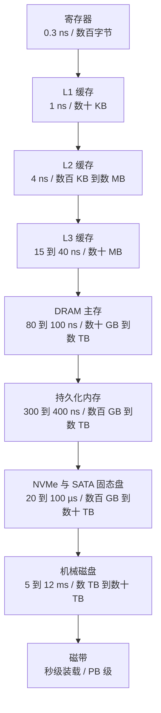
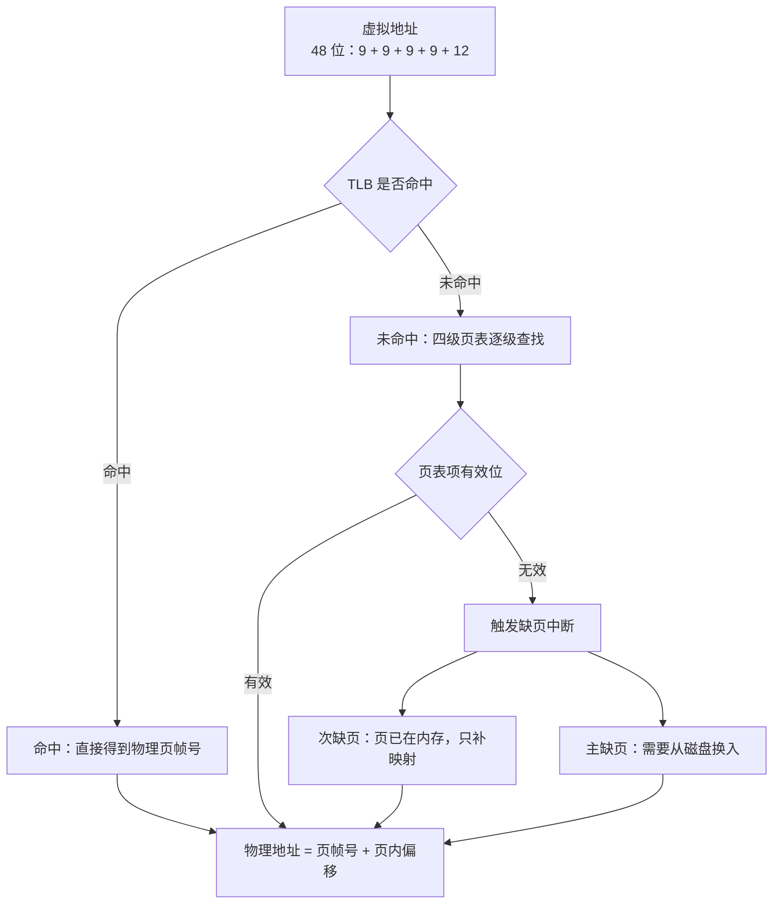
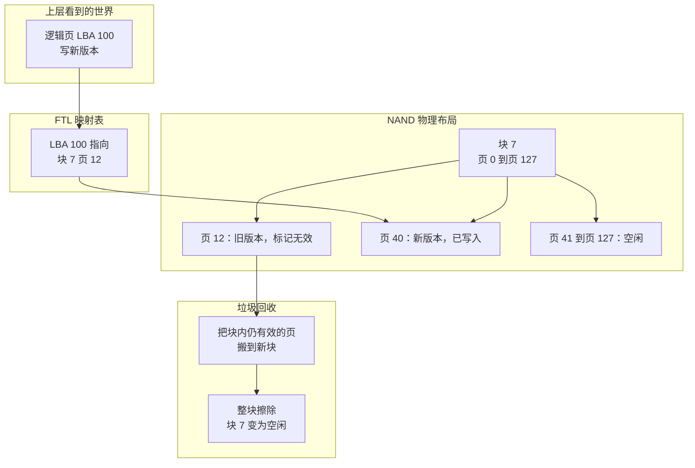
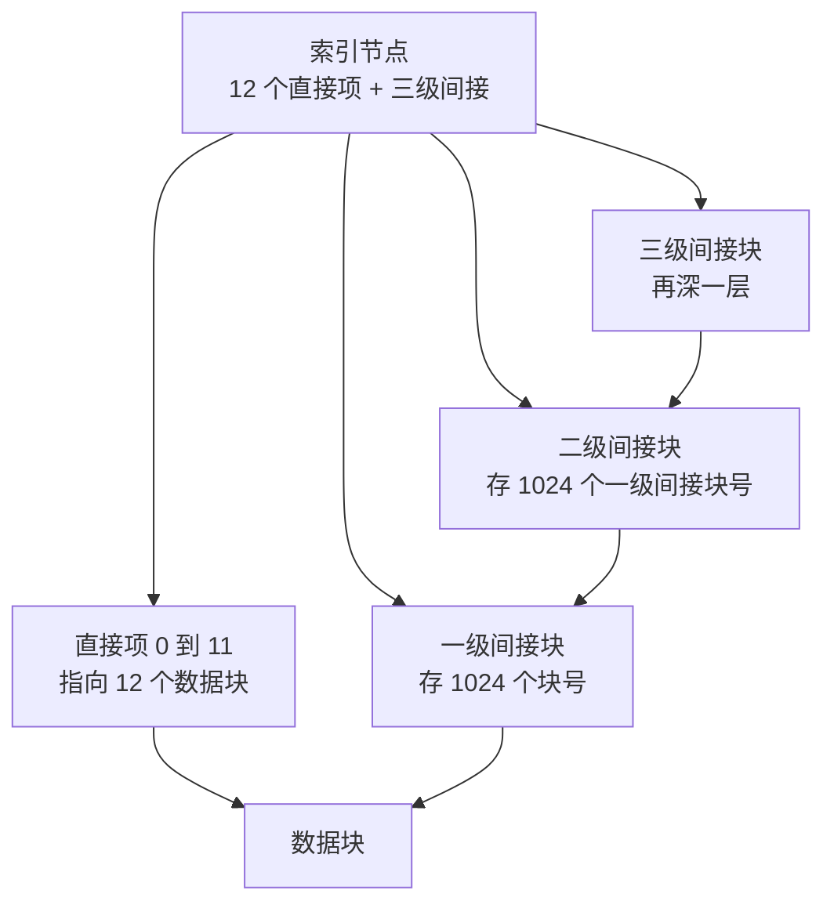
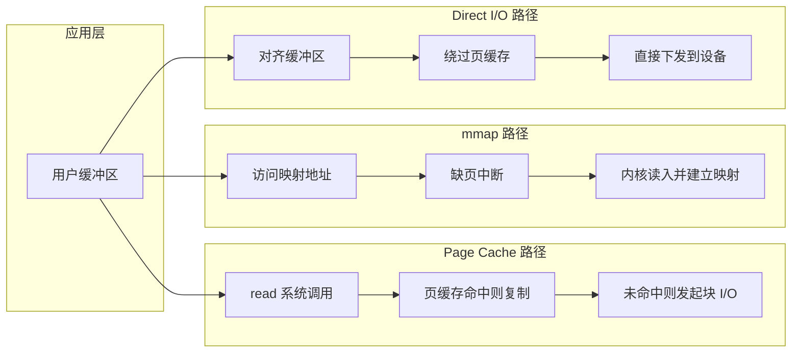

# 03 数据存储介质——内存、持久化内存与磁盘

**摘要：**

上一篇把索引结构排成了一条取舍链，链上每一个数字——页多大、扇出多少、一次 I/O 多久、顺序与随机差几倍——都不是凭空来的，它们全部来自介质。本文就把这条链的底座拆开：先从存储金字塔讲起，把寄存器到磁带的延迟、带宽、成本、易失性四个维度摆在一张表上，用"如果 L1 命中要一秒"的换算让七个数量级的差距变得可感；再逐层往下走，讲清内存的物理结构、缓存行与 TLB、多级页表与缺页中断、页面置换算法与大页的影响，讲清持久化内存的 3D XPoint 原理、NVDIMM 三种形态、内存模式与 AD 模式、持久化屏障的编程模型，以及它在 2022 年为什么没能成为主流；然后是机械磁盘的寻道、旋转与传输三个时间项，固态盘的浮栅、页与擦除块、FTL、垃圾回收与写放大；最后落到文件系统如何把块设备伪装成文件，以及 Page Cache、mmap、Direct I/O、io_uring 这些加速手段各自的边界。收束处回到一个判断：存储引擎的每一个设计决定，几乎都能在介质的物理参数里找到它的理由。

---

## 第 1 章 七个数量级

### 1.1 一个换算问题

先做一个换算。假设 L1 缓存的一次命中需要一秒，那么按同样的比例放大，其他介质的访问要等多久？

L1 的延迟大约是 1 纳秒，放大到 1 秒是十亿倍。按这个倍数，L2 的 4 纳秒变成 4 秒，L3 的 40 纳秒变成 40 秒，主存的 100 纳秒变成 100 秒——一分半多一点，还能忍。持久化内存的 350 纳秒变成 350 秒，接近六分钟。NVMe 固态盘的 100 微秒变成十万秒，约 27.8 小时。机械盘的 10 毫秒变成一千万秒，约 116 天。

这个换算当然不严谨，缓存未命中之后还有流水线与乱序执行在改变实际耗时，但量级是对的：**从 CPU 到机械盘，延迟跨了七个数量级，而且分布并不均匀，在内存与固态盘之间、固态盘与机械盘之间各有一个断崖。**

断崖的存在方式决定了架构的形态。如果延迟是连续渐变的，那么"分层"的收益就是连续的，多一层少一层差别不大；正因为有两个断崖，分层才变成刚需——你必须把数据放在断崖正确的一侧，否则性能会掉一个数量级，而不是掉百分之几十。

### 1.2 四个维度

评价一种介质，通常要看四个维度，它们之间并不总是同向变化。

延迟是单次访问的耗时。它决定了同步路径上的等待，也决定了"一次 I/O 值不值得"。

带宽是单位时间能搬多少字节。它与延迟不是一回事：机械盘的带宽可以到 250 MB/s，但单次 4 KB 随机读的延迟是 10 毫秒，两者相差三个数量级，原因是带宽靠连续传输摊薄了寻道与旋转的固定开销。

成本是每 GB 的价格，它决定了容量，也决定了"能不能全放内存"这类问题的答案。以典型市价为量级参照，内存每 GB 比固态盘贵一个数量级以上，固态盘又是机械盘的三到五倍，磁带则便宜到只适合冷归档。

易失性决定断电后数据还在不在。易失介质需要持续供电与刷新，非易失介质不需要；这条差异直接划出了"缓存"与"存储"的分界，也解释了为什么所有持久化系统都要有 WAL——它们必须先把数据放到非易失的那一侧，才敢对上层说"成功"。

还有第五个维度常被忽略，就是访问粒度。寄存器与内存在指令层面按字节或缓存行访问，可以做到"改一个字节"；块设备的最小读写单位是扇区或页，改一个字节也要写一整块；固态盘的擦除单位又是块的几十上百倍。粒度越大，"改一点"的放大就越严重，这是写放大的物理源头。

| 介质 | 典型延迟 | 典型带宽 | 成本量级 | 易失性 | 访问粒度 |
|---|---|---|---|---|---|
| 寄存器 | 约 0.3 ns | 与主频同级 | 极高 | 易失 | 字（8 字节） |
| L1 缓存 | 约 1 ns | 数百 GB/s 到 TB/s | 极高 | 易失 | 缓存行（64 B） |
| L2 缓存 | 约 4 ns | 百 GB/s 级 | 很高 | 易失 | 缓存行 |
| L3 缓存 | 约 15 到 40 ns | 数十 GB/s | 高 | 易失 | 缓存行 |
| DRAM | 约 80 到 100 ns | 数十到上百 GB/s | 中 | 易失 | 缓存行，按页刷新 |
| PMEM（Optane） | 约 300 到 400 ns | 数 GB/s 到十 GB/s | 较高 | 非易失 | 缓存行，可字节寻址 |
| NVMe SSD | 约 20 到 100 µs | 数 GB/s（PCIe 4.0 x4 约 7 GB/s） | 低 | 非易失 | 页（4 到 16 KB） |
| SATA SSD | 约 100 µs | 约 550 MB/s | 低 | 非易失 | 页 |
| HDD | 约 5 到 12 ms | 约 150 到 250 MB/s | 很低 | 非易失 | 扇区（512 B 或 4 KB） |
| 磁带 | 秒级（含装载） | 数百 MB/s（顺序） | 极低 | 非易失 | 块，严格顺序 |

表里的数字都是典型值，不是规格书上的极限值。同一代硬件的不同型号能差出两三倍，队列深度、访问模式、文件系统都会影响实测；但数量级是稳的，而存储引擎的设计只对数量级敏感。

### 1.3 金字塔

把上面这些介质按延迟与容量排起来，就是经典的存储金字塔。越往上越快越小越贵，越往下越慢越大越便宜。



这张图有一个常被误读的地方：箭头表示"下一层是上一层的后备"，不表示数据会逐层流动。真实的路径是 CPU 直接访问内存、内存充当磁盘的缓存、磁盘充当磁带的缓存，每一层只与相邻层打交道。

金字塔还解释了一批常见参数：缓冲池按内存的六到八成配，是因为再往上加命中率的边际收益迅速衰减；MemTable 只有几十到几百 MB，是因为它要在"攒够批量"与"恢复时间可控"之间取值；预读窗口在几十到几百 KB，是因为再大就会把冷数据读进来挤占缓存。这些参数都是金字塔的形状在软件里的投影。

行文至此，可以逐层往下走了。顺序按介质在金字塔里的位置来，先讲内存，再讲那条没走通的中间路线，最后讲磁盘与固态盘。

## 第 2 章 内存：最快的易失层

### 2.1 DRAM 的物理结构

日常说的"内存"指的是动态随机访问存储器（Dynamic Random Access Memory，DRAM）。它的存储单元极其简单：**一个电容加一个晶体管**，电容存电荷表示 0 或 1，晶体管负责选通。一个比特一个电容，这是它能把密度做上去的根本原因——同样的面积，静态随机访问存储器（Static Random Access Memory，SRAM）要用六个晶体管构成一个双稳态触发器，密度只有 DRAM 的几分之一，价格却是好几倍。

简单的代价是"动态"两个字。电容会漏电，电荷几十毫秒就会流失，所以 DRAM 必须周期性刷新，业界标准是每 64 毫秒把每一行刷新一遍。刷新会占用带宽，也会让访问延迟出现周期性抖动；对绝大多数应用来说这个抖动被缓存吸收了，但对延迟极其敏感的场合（譬如高频交易、实时控制），它是需要被算进去的。

DRAM 的内部不是一个平坦的字节数组，而是按 bank、row、column 组织的二维阵列。访问一个地址要先把整行（row）激活到行缓冲（Row Buffer）里，再从行缓冲里读出所需的列。如果下一次访问落在同一个已激活的行里，就是行命中，只需要读列；如果落在另一行，就要预充电再激活，多花几十纳秒。这个机制解释了一个反直觉的现象：**随机访问同一块内存的不同行，可能比顺序访问更慢，但访问同一行的不同列几乎免费**。它也解释了为什么内存控制器要重排请求、为什么多通道要交错编址——都是为了提高行命中率。

内存控制器从北桥移进 CPU 之后，每个 socket 有了自己的通道，NUMA（Non-Uniform Memory Access）成为必须考虑的因素：跨 socket 访存的延迟是本地的一点五到两倍，足以让没做绑核的程序性能腰斩。

### 2.2 缓存行与缓存层级

CPU 不会按字节从内存取数，它一次取一整条缓存行（Cache Line），x86-64 上是 64 字节。这个设计的前提是空间局部性：程序访问一个字节，很可能马上访问它附近的字节。

缓存分三层。L1 分指令与数据两块，各几十 KB，延迟约 4 个周期；L2 每核数百 KB 到数 MB，延迟十几个周期；L3 多核共享，数十 MB，延迟几十个周期。三层的容量与延迟共同构成了一个梯度，编译器与程序员的所有"缓存友好"优化，本质上都是在提高这个梯度的命中率。

多核带来一致性问题。同一份数据可能同时存在于多个核的 L1、L2 里，修改必须同步，这就是缓存一致性协议的职责。MESI（Modified、Exclusive、Shared、Invalid）给每条缓存行四个状态，写操作让其他核的副本失效，读操作把状态降到共享；细节在 [[01 并发编程的硬件基础——CPU 缓存、MESI 与内存屏障]] 里，此处只取一个结论：**跨核共享的可写数据，代价不在读写本身，而在一致性流量的往返**。

这个结论在存储引擎里有一个具体投影，叫伪共享（False Sharing）。两个线程分别修改同一个缓存行里的不同变量，物理上它们没有冲突，逻辑上却互相让对方的那一行失效，于是每次写都要经历一次一致性往返，性能可能掉一个数量级。解法是把热点变量按缓存行对齐填充，或者干脆让每个线程用自己的局部变量。缓冲池的统计计数器、LSM 的分层计数器、WAL 的序列号分配器，都是伪共享的高发区。

### 2.3 虚拟内存与地址翻译

程序里用的地址是虚拟地址，内存条上的是物理地址，两者之间隔着一层地址翻译。这层翻译的存在理由不止一个：它让每个进程看到独立的地址空间，让内存分配不必连续，让共享库只存一份物理副本，也让"用磁盘冒充内存"成为可能。

翻译的基本单位是页（Page），常见大小 4 KB。页表记录虚拟页号到物理页帧号的映射，页内偏移不做转换。一次翻译要做一次页表查找，而每次内存访问都要翻译一次，这个开销无法接受，所以 CPU 里有一个专门缓存页表项的部件——**转译后备缓冲器（Translation Lookaside Buffer，TLB）**。TLB 命中时翻译在一个周期内完成，未命中就要走页表，代价是几十到上百个周期，若页表项本身也不在缓存里，还要再乘上访存延迟。

页表本身也会大到放不下。x86-64 的四级页表把 48 位虚拟地址切成四段：页全局目录、页上级目录、页中间目录、页表，每级 9 位，加 12 位页内偏移。四级结构的好处是稀疏：一个进程只用到地址空间的一小块，没用到的那部分页表根本不需要分配，一个只用了几个 GB 的进程，页表实际占用只有几百 KB 到几 MB。五级页表把虚拟地址扩到 57 位，代价是翻译多一级。完整的翻译路径如下图所示。



缺页中断（Page Fault）是这套机制的关键接口。访问一个没有有效映射的页时，CPU 抛出异常，内核接管，判断是"页不在内存"还是"根本不该访问"：前者要分配页帧、从磁盘读入、更新页表，后者直接给进程一个段错误。前者又分两种，次缺页（Minor Fault）只需要补一条映射，页内容已经在内存里（譬如共享库已被别的进程读入、或匿名页在零页上写时复制）；主缺页（Major Fault）需要真正的 I/O，代价是毫秒级。数据库的启动、首次查询的抖动，很大一部分来自主缺页。

请求分页（Demand Paging）是这套机制的策略层：进程启动时只加载当前需要的页，其余按需换入，前提是局部性。局部性成立时它能显著降低启动开销与内存占用；局部性不成立时（譬如一次全表扫描），它退化成"每页一次缺页"，此时预读（Readahead）变成必需，否则每次 I/O 只能带回 4 KB。

### 2.4 页面置换：从 OPT 到 Clock

内存不够时要淘汰一些页，淘汰谁由置换算法决定。

最优置换（Optimal，OPT）由 Belady 在 1966 年提出：淘汰未来最长时间不会被访问的那一页。它能保证缺页次数最少，但需要预知未来，所以只能作为评价其他算法的基准。

先进先出（First In First Out，FIFO）按进入内存的时间排队，淘汰最早进来的那一页。它实现极简，但有一个反直觉的性质：增加页帧数反而可能让缺页变多，这就是 Belady 异常。经典例子是访问序列 1、2、3、4、1、2、5、1、2、3、4、5，三帧时缺页 9 次，四帧时缺页 10 次。原因在于 FIFO 只看进入时间，不看访问频率，多出来的帧改变的不是"缓存能力"，而是"淘汰顺序"，于是把有用的页提前踢了出去。

最近最少使用（Least Recently Used，LRU）淘汰最久未被访问的页。它基于时间局部性，效果接近 OPT，是教科书里的标准答案。但 LRU 有两个工程难题：精确实现需要每次访问都更新一个全局有序结构，代价高；在多核上维护这个结构的同步成本更高。所以真实系统用的是近似 LRU。

时钟算法（Clock）是最常见的近似。它把页排成一个环形队列，每页一个访问位；需要淘汰时指针向前扫，遇到访问位为 1 的就清零并放过，遇到 0 的就淘汰。这个"给第二次机会"的机制等价于一个粗糙的 LRU，实现只需要一个指针和一个位。改进版再引入修改位（脏位），优先淘汰"未访问且未修改"的页，其次"未访问但已修改"，避免为了淘汰一个脏页而多做一次写回。

| 算法 | 依据 | 优点 | 缺点 |
|---|---|---|---|
| OPT | 未来访问时间 | 缺页次数最少，作为下界 | 不可实现，只能做基准 |
| FIFO | 进入内存的时间 | 实现最简单 | 存在 Belady 异常，会淘汰热点页 |
| LRU | 最近访问时间 | 接近最优，符合时间局部性 | 精确实现代价高，多核同步昂贵 |
| Clock / 二次机会 | 访问位加环形扫描 | 近似 LRU，开销极低 | 精度依赖扫描频率 |
| 改进 Clock（NRU） | 访问位加修改位 | 减少无谓写回 | 分类粗糙，仍需扫描 |
| LFU | 访问频次 | 适合稳定热点 | 频次只增不减，无法适应热度迁移 |

这套算法并不只属于操作系统。数据库的缓冲池（Buffer Pool）就是一个小型分页系统，InnoDB 把 LRU 链分成 young 与 old 两段，新读入的页先插在 old 段头部，被再次访问才晋升，目的正是防止一次全表扫描冲掉整个缓冲池——这是 LRU 最著名的失效场景。RocksDB 的块缓存默认用 LRU，也提供 Clock 实现以降低锁竞争。共同点是：**承认 LRU 的理想不可实现，转而用分段、分层、近似的方式逼近它。**

### 2.5 大页：给 TLB 扩容

TLB 的条目数是硬限制，x86 的二级 TLB 通常在一千五百到两千条之间。按 4 KB 页算，它能覆盖的地址范围只有 6 到 8 MB；一旦工作集超过这个范围，每次访问都可能 TLB 未命中，翻译要走四级页表，最坏四次访存。对内存数据库、大缓冲池这类工作集动辄几十 GB 的程序，这个开销很可观。

**大页（Huge Page）**是直接的解法。x86-64 支持 2 MB 与 1 GB 两种大页，用一条 TLB 条目覆盖 2 MB 甚至 1 GB，覆盖范围直接扩大五百倍到二十六万倍。同样一千五百条 TLB 条目，用 2 MB 页能覆盖 3 GB，用 1 GB 页能覆盖 1.5 TB。对大内存工作集来说，这是数量级的改善。

大页也有代价。内部碎片是第一个：一个只用了 100 KB 的映射也要占满 2 MB，浪费接近 95%。分配延迟是第二个：2 MB 连续物理内存不好找，分配可能触发内存规整（Compaction），造成毫秒级停顿。透明大页（Transparent Huge Page，THP）让内核在后台自动合并小页，但合并有开销，khugepaged 的扫描会带来不可预测的延迟抖动，所以延迟敏感的系统（包括 Redis 的官方建议）会关掉 THP，改为启动时显式申请大页。

这里有一个值得记住的取舍模式：**大页把"翻译次数"换成了"碎片与分配延迟"**，和存储引擎里"加大页尺寸以压低树高、代价是页内浪费与写放大"是同一个结构。凡是"把单位做大"的优化，都会在某个角落留下碎片。

## 第 3 章 持久化内存：一次没有走完的中间路线

### 3.1 3D XPoint

内存与固态盘之间的断崖存在了很多年：一边是 100 纳秒的易失内存，一边是 100 微秒的非易失闪存，中间空了三个数量级。填平这个空档的想法一直有，2015 年 7 月，Intel 与 Micron 联合公布了 3D XPoint 技术，声称它比 NAND 快约一千倍、寿命长约一千倍、密度是 DRAM 的十倍。

3D XPoint 的物理原理与 NAND 完全不同。它不是靠浮栅存电荷，而是靠一类硫系化合物（Chalcogenide）的相变特性：材料在晶态与非晶态之间的电阻差异极大，晶态电阻低、非晶态电阻高，用一个小电流就能读出状态，用较大的电流加热再急冷就能改写状态。每个存储单元是一个交叉点（Cross-point），由相变材料加一个双向阈值开关（Ovonic Threshold Switch，OTS）构成，字线与位线垂直交叉，单元堆叠成立体结构，这就是"3D"的含义。

这套原理带来两个关键性质：一是字节可寻址，不必像 NAND 那样按页读、按块擦，可以直接改写任意一个字节，也不需要垃圾回收；二是非易失，断电后状态保留，既不刷新也不要后备电源。它的延迟在几百纳秒，比 DRAM 慢一点、比 NAND 快两个数量级，寿命远高于 NAND 而低于 DRAM，正好落在内存与磁盘之间。

### 3.2 NVDIMM 的三种形态

要把这种介质接到现有的服务器上，需要一个兼容内存插槽的封装，这就是非易失双列直插内存模块（Non-Volatile DIMM，NVDIMM）。JEDEC 定义了三种实现，它们的思路差别很大。

NVDIMM-N 把 DRAM 与 NAND 放在同一模块上，再加一个后备电源（通常是超级电容）。正常工作时 CPU 直接访问 DRAM，延迟与普通内存无异；断电瞬间由电容供电，把 DRAM 内容整体复制到 NAND，来电后再复制回来。它的本质是"带电池的内存"，容量受 DRAM 限制（常见 8 到 32 GB），成本高于普通内存，但让"内存级延迟加断电不丢"第一次成为可买到的产品。

NVDIMM-F 是把 NAND 直接挂在 DDR 总线上，只支持块寻址。它需要把 DDR 协议翻译成 SATA 或闪存指令，延迟落在几十微秒，接近固态盘。它的优势是容量容易做到 TB 级，劣势是延迟没有质变，本质上是一个换了接口的固态盘。

NVDIMM-P 是随 DDR5 标准一起定义的形态，用 DRAM 做缓存、NAND 做容量，既支持块寻址也支持字节寻址，容量可到 TB 级，延迟在百纳秒量级。它试图同时避开前两者的缺点，但标准落地较晚，生态没有跟上。

真正大规模商用的是 Intel 基于 3D XPoint 的傲腾持久化内存（Intel Optane DC Persistent Memory），2019 年正式出货，单条容量 128、256、512 GB，走 DDR4 插槽。它在思路上接近后来标准化的 NVDIMM-P，也是本章后面讨论的主角。

### 3.3 两种工作模式

傲腾持久化内存有两种使用模式，差别不在硬件，而在 BIOS 与操作系统的配置。

内存模式（Memory Mode）把它当作大容量内存，普通 DRAM 充当它的缓存，由硬件负责搬运。应用看到的总容量是两者之和，却完全感知不到持久化内存的存在，断电后数据照样丢。收益是容量——用便宜的大容量介质扩展内存；代价是缓存未命中时的延迟接近微秒级。它适合"热点工作集小于 DRAM、总数据量远大于 DRAM"的场景，靠局部性把大多数访问留在 DRAM 里。

应用直接访问模式（App Direct Mode，AD）把它当作持久化设备暴露给应用，容量全部可用，断电不丢。应用通过支持 DAX（Direct Access）的文件系统把持久化内存映射进地址空间，读写就是普通的内存读写，没有页缓存的中转，也没有块设备的 I/O 栈。这个模式才是"持久化内存"这个名字的本意，也是它唯一能体现价值的地方。

两种模式的取舍是一个经典问题：**当一种介质的容量与延迟都介于两层之间时，它既可以当"更大的上层"，也可以当"更快的下层"，选哪个取决于瓶颈是容量还是延迟。**

### 3.4 持久化屏障：编程模型的改变

AD 模式带来的最大冲击不在性能，而在编程模型。用惯了 `write` 加 `fsync` 的人，第一次面对持久化内存时会遇到一个反直觉的事实：**把数据写到持久化内存的地址上，并不等于数据已经持久化。**

原因是 CPU 缓存。写操作先落在缓存里，缓存是易失的，断电就没了。普通内存无所谓的这一点，在持久化内存上变成了正确性问题。要让数据真正落到介质，必须显式地把缓存行刷下去，并保证刷新的顺序。

x86 提供了几条指令来做这件事。`CLFLUSH` 刷新单条缓存行，`CLFLUSHOPT` 是它的乱序优化版，`CLWB`（Cache Line Write Back）只写回不清除，保留缓存中的副本，性能更好。刷完之后还需要一个存储屏障（Store Fence，`SFENCE`）来保证刷新完成之前不会有后续的写越过它。这套组合的顺序是：写数据、刷缓存行、屏障、再写"提交标记"、再刷、再屏障。

还有一层保障叫异步 DRAM 刷新（Asynchronous DRAM Refresh，ADR）域。掉电时，内存控制器里还有未写完的队列，ADR 保证这些队列里的数据在断电前被推入持久化域。这条机制让"已经到达内存控制器的写"不会丢失，但它管不到 CPU 缓存里的数据，所以缓存刷新仍然必须由软件完成。

原子性也要重新定义。持久化内存保证 8 字节对齐的写在掉电时是原子的（不跨越缓存行），更大的写没有原子性保证，可能写了一半就断电。所以即使用了持久化内存，仍然需要日志或写时复制来保证结构的一致性——只是日志可以写在持久化内存上，省掉了一次设备 I/O。

Intel 的 PMDK（Persistent Memory Development Kit）把这些原语封装成了库。`pmem_persist` 刷一段内存，`pmem_memcpy_persist` 复制并持久化，`pmemobj` 提供事务与分配器。下面这段伪代码展示了一个最小的事务写入，注释解释的是"为什么"而不是"是什么"。

```c
/* 把一个新值写进持久化内存的 slot，并保证断电后要么全见、要么全不见 */
pmemobj_tx_begin(pop, NULL, TX_PARAM_NONE);
    /* 分配与写入都在事务内，PMDK 用 undo log 保证失败原子性 */
    slot = pmemobj_tx_alloc(sizeof(struct record), 0);
    pmemobj_tx_add_range_direct(slot, sizeof(struct record));
    memcpy(slot->payload, buf, len);
    /* 提交点：先持久化日志，再把根指针切过去 */
pmemobj_tx_commit();
```

可以看到，持久化内存并没有取消日志，它只是把日志的介质从磁盘换成了内存总线上的非易失介质，把一次毫秒级的 `fsync` 换成了一次几百纳秒的缓存刷新。收益是真实的，但复杂度没有消失，只是转移了。

### 3.5 为什么没能成为主流

2022 年第二季度，Intel 在财报电话会上宣布逐步关停傲腾业务，随后停止出货。一条被寄予厚望的路线就此中断。

原因可以从三个层面看。

技术层面，延迟没有达到预期。它的读延迟在 300 到 400 纳秒，是 DRAM 的三到四倍，性能敏感的应用不愿拿它替内存；而它的价格又远高于固态盘，拿它替盘同样算不过账。它落在了一个尴尬的中间地带：比上不足，比下太贵。

经济层面，单位容量的成本没有打下来。3D XPoint 的制造工艺与 DRAM、NAND 都不兼容，无法复用现有的产线规模，良率与产能都受限。当 NAND 的价格持续下降、NVMe 固态盘的随机读延迟压到几十微秒时，"中间那一层"的性价比窗口越来越窄。

生态层面，改变编程模型的成本被低估了。要用好 AD 模式，应用必须重写持久化路径，处理缓存刷新、原子性、恢复；文件系统要支持 DAX，内核要支持设备，监控与运维工具要跟上。绝大多数团队算完这笔账，发现"继续用固态盘加 WAL"更划算。

值得一提的是，这条路线留下了一份遗产。持久化编程模型里"显式刷新加屏障"的思路，在 CXL 内存分层、在非易失内存的仿真研究、在 NVM 编程库的设计里都被继承下来；而"内存与存储之间应该有一层"这个判断，如今由 CXL 以另一种方式继续推进。技术路线的失败不等于问题不存在，只说明这一种解法在当时的价格与生态下不成立。

## 第 4 章 机械磁盘：把机械运动定价

### 4.1 几何结构

机械磁盘（Hard Disk Drive，HDD）的内部是一组盘片（Platter），盘片两面镀着磁性材料，各自对应一个读写磁头（Head），磁头装在磁臂（Actuator Arm）上，由音圈电机驱动做径向移动；盘片由主轴电机带动匀速旋转。数据的组织是三层：盘面上划分出同心圆的磁道（Track），磁道再切成扇区（Sector），所有盘面上半径相同的磁道构成一个柱面（Cylinder）。

扇区是磁盘的最小读写单位，传统上是 512 字节，现代盘多用 4 KB（4Kn）或 512e（物理 4 KB、逻辑 512 字节）。早期的磁盘每个磁道扇区数相同，靠内侧的磁道周长短、位密度高；现代盘普遍采用区域位记录（Zone Bit Recording），把盘面分成若干环带，外圈环带的扇区数多于内圈，以此提高总容量与顺序带宽。这个细节有一个可观测的后果：同一块盘，外圈的顺序读写速度比内圈快三成以上，分区时把热数据放在外圈是实实在在的优化。

磁盘地址传统上由柱面号、磁头号、扇区号（CHS）组成，现代系统换算成线性逻辑块地址（Logical Block Address，LBA），由控制器翻译。操作系统看到的是一串线性块，几何细节被藏起来，但延迟的结构没有被藏起来。

### 4.2 三个时间项

一次磁盘访问的时间可以拆成三项。

寻道时间（Seek Time）是磁头移动到目标磁道的时间，由机械运动决定。它由启动加速、匀速移动、减速定位三段构成，平均值取决于移动距离的分布：3.5 英寸 7200 转的盘，平均寻道通常在 8 到 9 毫秒，相邻磁道之间约 0.5 到 1 毫秒，跨越全部磁道的全程寻道在 15 到 20 毫秒。

旋转延迟（Rotational Latency）是等待目标扇区转到磁头下方的时间。转速 r 转每分钟对应一周 60/r 秒，平均等待半周，即 30/r 毫秒。7200 转对应一周 8.33 毫秒、平均 4.17 毫秒；15000 转对应一周 4 毫秒、平均 2 毫秒。

传输时间（Transfer Time）是数据真正流过磁头的时间，等于数据量除以持续传输率，也可以写成 b/(rN)，其中 N 是一条磁道能容纳的字节数。

三者相加就是一次访问的总时间：

T = 寻道 + 1/(2r) + b/(rN)

代入一组典型值算一下 4 KB 随机读：寻道 8.5 毫秒，旋转 4.17 毫秒，传输 4 KB 除以 250 MB/s 约 0.016 毫秒，合计约 12.7 毫秒，换算成 IOPS 是每秒 79 次。再算 1 MB 顺序读：寻道与旋转仍然要付，传输 1 MB 约 4 毫秒，合计约 16.7 毫秒；但如果连续读 100 MB，寻道与旋转只付一次，传输占绝对主导，持续带宽就能跑到 250 MB/s。

这组数字解释了机械盘最核心的事实：**随机访问的成本几乎全部是固定开销，与数据量无关。** 读 512 字节和读 4 KB 的耗时几乎一样，因为 12 毫秒里只有几十微秒在传数据。由此可以推出两条工程原则：其一，每次 I/O 都要尽量多带数据，这就是预读与大块 I/O 的动机；其二，把随机 I/O 攒成顺序 I/O，收益是数量级的，这就是日志、LSM、批量写的动机。

| 指标 | 4 KB 随机读 | 顺序读 |
|---|---|---|
| 寻道时间 | 约 8.5 ms | 摊薄到接近 0 |
| 旋转延迟 | 约 4.17 ms | 摊薄到接近 0 |
| 传输时间 | 约 0.016 ms | 主导项 |
| 单次总耗时 | 约 12.7 ms | 1 MB 约 4 ms |
| 等效吞吐 | 约 0.3 MB/s，约 79 IOPS | 约 250 MB/s |
| 差距 | 约 800 倍 | 基准 |

### 4.3 I/O 调度

既然寻道最贵，操作系统就有动机对请求重排，让磁头少跑路。这就是磁盘调度算法的全部出发点。

先来先服务（First Come First Served，FCFS）按请求到达顺序处理，公平但完全不优化寻道，在并发高时退化成随机访问。

最短寻道时间优先（Shortest Seek Time First，SSTF）每次挑离当前磁头最近的请求，局部最优，但会让远处的请求长期得不到服务，形成饥饿。

扫描算法（SCAN）在 SSTF 的基础上引入方向：磁头沿一个方向扫过去，处理沿途请求，到边界再反向，行为像电梯，所以又叫电梯算法。它消除了饥饿，平均寻道接近最优，代价是边界附近的请求等待偏长。循环扫描（C-SCAN）只允许单向移动，扫到一端后快速回到起点，把"往返"变成"环形"，让等待时间分布更均匀。

这些算法在机械盘时代是核心优化，在固态盘时代意义大减——固态盘没有磁头，随机与顺序的差距小得多，重排的收益主要来自减少命令开销与提高并行度，而不是减少机械运动。Linux 的块层因此转向多队列模型（blk-mq），提供几种调度器：`none` 基本不做重排，适合 NVMe；`mq-deadline` 保证请求不会饿死，适合大多数场景；`kyber` 按读、写、discard 分队列控制延迟；`bfq` 做更精细的带宽分配，适合桌面与交互场景。早期的 `cfq` 已在 Linux 5.0 被移除，原因正是它对闪存设备没有意义。

### 4.4 顺序写为什么是第一原则

把上面的算术收一下，可以得到机械盘上存储引擎的第一原则：**顺序写**。

原因不在"顺序"这个词本身，而在磁头。顺序写时磁头不动，数据随着盘片旋转依次流过，寻道与旋转只付一次；随机写时每写一块都要重新寻道定位，12 毫秒里有 12 毫秒是等待。同样写 100 MB，顺序写耗时 0.4 秒，随机写 4 KB 要写两万五千次、耗时五分钟以上，差距接近三个数量级。

这条原则直接塑造了引擎的形态。WAL 只追加不修改；LSM 把随机更新转成顺序追加；B+ 树的脏页回写要做批量排序，让相邻页一起写；机械盘时代的文件系统也要做延迟分配与预分配，避免文件块散落。

不过这条原则的强度随介质变化。固态盘没有磁头，随机写的代价主要来自垃圾回收而不是机械运动，顺序写的优势缩小到两到五倍而不是三个数量级。这也是为什么 NVMe 时代 B+ 树的处境比机械盘时代好得多——它的随机写不再那么致命。第 5 章会把这笔账算清楚。

## 第 5 章 固态盘：擦除块带来的连锁反应

### 5.1 浮栅与页块结构

固态盘（Solid State Drive，SSD）的存储单元是浮栅金属氧化物半导体场效应管（Floating Gate MOSFET）。它在控制栅与沟道之间多加了一层浮栅，浮栅被绝缘层包围，注入的电子无处可逃，能长期保存。写（编程）时加高电压，让电子穿过绝缘层注入浮栅；擦除时反向加高压，把电子拉出来；读的时候测量阈值电压，判断浮栅里有没有电荷。

一个单元能存的位数决定了它的类型。单层单元（Single-Level Cell，SLC）存 1 位，两种电压状态；多层单元（Multi-Level Cell，MLC）存 2 位，四种状态；三层单元（Triple-Level Cell，TLC）存 3 位，八种状态；四层单元（Quad-Level Cell，QLC）存 4 位，十六种状态。位数越多，密度越高、成本越低，但区分状态越难、写入越慢、寿命越短。以典型的擦写次数（P/E Cycle）为量级参照，SLC 在十万次量级，MLC 在数千次，TLC 在一千到三千次，QLC 只有几百次。

更关键的约束在结构上。NAND 闪存的读写单位是页（Page），常见 4 KB 到 16 KB；擦除单位是块（Block），一个块包含几十到几百个页，现代 3D NAND 的块大小从几 MB 到十几 MB 不等。这三个单位的层级关系带来了一条硬约束：**写之前必须先擦除，而擦除的最小单位是块。**

这条约束意味着不能原地更新。要修改一个页里的一条记录，不能像磁盘那样覆盖写，因为覆盖写要求目标区域已经是擦除态。闪存的解法是**异地更新**：把新数据写到一个新的空页，把旧页标记为无效。这个动作叫写时重定向，它把"修改"变成了"追加"，也让"无效页"成为需要回收的垃圾。

### 5.2 FTL：把块设备伪装成块设备

上层看到的固态盘仍然是一个可按 LBA 随机读写的块设备，这个假象由闪存翻译层（Flash Translation Layer，FTL）维持。FTL 维护一张逻辑页到物理页的映射表，读的时候查表定位，写的时候分配新页并更新映射，旧页进入无效队列。

映射表的粒度是一个核心设计。按页映射最灵活，垃圾回收时只需要搬有效页；但表的规模很吓人：一块 1 TB 的盘，按 4 KB 页算有 2.68 亿个页，每项 4 字节就是 1 GB 的映射表，必须放在 DRAM 里，还得再加缓存与掉电保护。按块映射表小得多，但一个块内只要有 4 KB 被改写，整块都要搬走，写放大极其严重。工业界的折中是混合映射：大多数块用块级映射，少量热点块用页级映射。

映射表本身的一致性也要保证。掉电时如果映射表只写了一半，整块盘的数据都可能找不到，所以固态盘内部也要维护自己的元数据日志，甚至配备电容做掉电保护。这一层的复杂度完全被封装在盘内，操作系统看不见，但它是固态盘"看起来像块设备"的代价。下图把一次重定向与一次回收画在一起。



### 5.3 垃圾回收与写放大

无效页积累到一定程度，就需要垃圾回收（Garbage Collection，GC）。GC 挑一个块，把块内仍然有效的页搬到新块，然后整块擦除，回收出全部空闲页。

搬页是有代价的，这个代价就是写放大（Write Amplification，WA）：主机写入一个字节，闪存上实际写入的可能是一点几个字节到几个字节。定义式为：

WA = 闪存实际写入量 / 主机请求写入量

垃圾回收造成的放大可以用一个简单模型估算。假设 GC 触发时块内的有效页占比为 u，那么为了回收 (1−u) 个空闲页，需要搬走 u 个有效页，放大倍数为 1/(1−u)。u = 0.5 时 WA 为 2，u = 0.25 时 WA 为 1.33，u = 0.75 时 WA 为 4。这个公式解释了为什么随机写比顺序写放大得多：顺序写把整个块写满再换下一块，GC 时块内几乎没有有效页，u 接近 0；随机写让每个块都长期处于半有效状态，u 居高不下。

另一个放大器是预留空间（Over-Provisioning，OP），即盘上不暴露给主机的容量。OP 越大，FTL 越有余地把数据摊开、让 GC 挑更干净的块，u 越低，WA 也越低。消费级盘通常预留 7% 左右，企业级可到 28% 甚至更多，这不是厂商小气，而是寿命与性能的定价。

还有一层来自文件系统的配合，叫 TRIM（或 discard）。删除文件时，文件系统知道这些块不再需要，可以发一条 TRIM 告诉固态盘"这些逻辑页已经作废"。如果没有 TRIM，FTL 无法区分"主机已删除"与"主机还会读"，GC 就会把已经无用的页当成有效页搬走，白白增加写放大。TRIM 的代价是它本身要占用命令带宽，且删除会变成非瞬时操作，所以很多系统用周期性批量 discard 而不是每次删除都发。

### 5.4 磨损均衡

闪存单元的擦写次数有限，写坏一个块就少一个块，所以 FTL 必须做磨损均衡（Wear Leveling）：把写操作分散到全盘，避免少数块被反复擦写。

动态磨损均衡只把新数据放到擦写次数少的块；静态磨损均衡还会主动搬移长期不动的冷数据，让所有块的磨损趋于均匀。静态均衡会增加写放大，但能显著延长寿命——一块 1 TB 的 TLC 盘，若 10% 的热点块承担 90% 的写入，寿命可能只有均匀情况的几分之一。

磨损到一定程度，块会出现不可纠正的错误，FTL 把它标记为坏块（Bad Block）并用预留块替换。盘的寿命通常用总写入字节数（Terabytes Written，TBW）或每日全盘写入次数（Drive Writes Per Day，DWPD）标定，背后都是 P/E 次数与容量的算术。

### 5.5 NVMe 与延迟结构

接口决定了固态盘能发挥多少。SATA 的 6 Gb/s 链路实际带宽约 550 MB/s，命令队列深度 32；NVMe 直接跑在 PCIe 上，PCIe 4.0 x4 的带宽约 7 GB/s，支持最多 64K 个队列、每队列 64K 条命令，还能用轮询模式绕过中断开销。

队列深度对随机性能的影响巨大。机械盘的随机 IOPS 受限于机械运动，加深队列只能靠重排略微改善；固态盘内部有几十个并行通道，队列越深，越能把请求摊到各个通道与芯片上，IOPS 随队列深度近似线性增长，直到通道饱和。

延迟的量级也要分清。企业级 NVMe 的随机读延迟通常在几十微秒（80 到 100 微秒是常见值），消费级盘在几十到一百多微秒，Optane SSD 能做到 10 微秒左右。这个数字与机械盘的 10 毫秒相比是两个半数量级的差距，但它仍然比 DRAM 慢三个数量级，所以"固态盘能不能替代内存"的答案依然是否定的。

| 维度 | 机械磁盘 | SATA 固态盘 | NVMe 固态盘 |
|---|---|---|---|
| 随机读延迟 | 5 到 12 ms | 约 100 µs | 20 到 100 µs |
| 随机 4 KB IOPS | 约 75 到 150 | 数万 | 数十万到百万 |
| 顺序带宽 | 150 到 250 MB/s | 约 550 MB/s | 数 GB/s |
| 随机与顺序的差距 | 约三个数量级 | 一到两个数量级 | 一个数量级以内 |
| 写前是否需擦除 | 否，可原地覆盖 | 是，异地更新 | 是，异地更新 |
| 主要写放大来源 | 无 | GC 与磨损均衡 | GC 与磨损均衡 |
| 寿命约束 | 机械磨损，数年 | P/E 次数 | P/E 次数 |
| 对存储引擎的含义 | 必须顺序写 | 顺序写仍有优势 | 随机写可接受，B+ 树压力减轻 |

这张表的最后一行值得展开。机械盘时代，B+ 树的随机写是硬伤，LSM 的顺序写是决定性优势；NVMe 时代，随机写的代价从"三次寻道"降到"一次 GC 分摊"，两者的差距被压缩到一个数量级以内。这不是说 LSM 失去了意义——它在写吞吐、空间管理、批量导入上仍有优势——而是说选型的天平不再一边倒。硬件的变化会不断重写结论，这是第 01 篇就强调过的事。

## 第 6 章 文件系统：把块设备伪装成文件

### 6.1 文件的逻辑结构

存储引擎看到的"磁盘"其实是文件系统提供的一层抽象：一个可以按偏移读写、可以增长、可以 `fsync` 的字节流。要理解这层抽象的代价，得先看文件系统自己是怎么组织的。

文件的逻辑结构分两大类。无结构文件（流式文件）把内容当成字节序列，操作系统不关心里面是什么，UNIX 家族基本如此；有结构文件（记录文件）把内容当成记录的集合，每条记录有固定或变长的长度。有结构文件又分几种组织方式：顺序文件按键排序，利于批量扫描而拙于随机插入；索引文件为变长记录建一张"编号、偏移、长度"的表，从而支持直接定位；索引顺序文件把记录分组、每组首条进索引，兼顾随机与顺序；直接文件（哈希文件）用哈希值算地址，随机访问最快但完全无序。

存储引擎不依赖文件系统的记录结构，它自己管理页与记录，把文件当成可随机读写的空间。上面这些结构对引擎开发者更像历史知识，但它们背后的取舍与第 02 篇的索引结构同源，只是粒度从"记录"换成了"块"。

### 6.2 inode 与混合索引

文件的物理结构决定"文件的第 n 个字节在哪个块上"。三种基本方式各有代价。

连续分配把文件放在一段连续的块里，目录项只记起始块号与长度，顺序读写极快、定位是纯算术，但文件增长困难，反复创建删除会产生外部碎片。

链接分配把文件块串成链表，每块存一个指向下一块的指针，没有外部碎片、增长随意，但随机访问要顺着链走，第 n 块要读 n 次。显式链接把指针抽出来集中存成文件分配表（File Allocation Table，FAT），查表即可跳转，代价是表要常驻内存、盘越大表越大，FAT32 还把单文件限制在 4 GB。

索引分配为每个文件配一个索引块，里面存该文件所有块的块号。随机访问变成"读索引块、再读数据块"两次 I/O，文件增长也容易。索引块装不下时，可以链接多个索引块，也可以做多级索引。

UNIX 的索引节点（inode）用的是**混合索引**，把三种粒度组合在一个固定大小的结构里：若干个直接地址项直接指向数据块，一个一级间接项指向一个索引块，一个二级间接项指向"索引块的索引块"，一个三级间接项再深一层。经典实现是 12 个直接项加三级间接，按 4 KB 块、4 字节块号算，直接项覆盖 48 KB，一级间接覆盖 4 MB，二级间接覆盖 4 GB，三级间接覆盖 4 TB。小文件只用到直接项，一次 I/O 就能定位；大文件才逐级展开，用空间换覆盖范围。

ext4 换了一种更现代的做法：用 extent（区段）代替逐块映射。一个 extent 用"起始块号 + 长度"描述一段连续空间，一个 4 KB 的索引节点能描述几百个 extent，每个 extent 覆盖成千上万个块。extent 存在一棵 B 树里（extent tree），树深最多五级。这个设计的收益是元数据大幅压缩——一个 100 MB 的连续文件只需要一个 extent，而不是两万五千个块号。索引节点与各级间接块的关系如下图所示。



| 分配方式 | 随机访问 | 文件增长 | 碎片 | 典型代表 |
|---|---|---|---|---|
| 连续分配 | 一次算术定位，最快 | 困难，需预留或搬迁 | 外部碎片严重 | 早期的只读介质、部分日志段预分配 |
| 链接分配（隐式） | 第 n 块要读 n 次 | 容易 | 无外部碎片 | 早期文件系统 |
| 链接分配（显式 FAT） | 查表跳转，较快 | 容易 | 无外部碎片 | FAT16、FAT32 |
| 索引分配 | 读索引再读数据 | 容易，可多级扩展 | 索引块有内部浪费 | inode 混合索引、ext4 extent |

### 6.3 目录、空闲空间与检索

目录的本质是"文件名到 inode 号"的映射。最简实现是线性表，查找逐个比较；文件多了之后 ext4 用哈希树（htree）给目录建索引，把查找降到 O(1) 量级。目录项缓存（dcache）把最近用过的映射留在内存，路径解析的绝大多数步骤都能命中。

空闲空间的管理有四种常见做法。位图（bitmap）用一位表示一个块是否空闲，查找连续空闲块时可以用位运算加速，ext 系列用这种方式；空闲链表把空闲块串起来，分配与回收都是改指针，但查找连续块困难；空闲表记录每个空闲区的起始与长度，适合连续分配；成组链接法（Grouped Linking）是 UNIX System V 的做法，把空闲块分组，每组的第一块记录下一组的块号与数量，栈式管理，兼顾了链表省空间与位图易查找的优点。

这些结构的选择会影响存储引擎的行为。位图意味着分配一个块是 O(1)，但找一个足够大的连续区可能要扫描；预分配（fallocate）能一次性占住连续空间，避免文件增长时块散落，这对 LSM 的 SSTable 与 WAL 都很重要——WAL 文件如果在写入过程中反复扩展，每次扩展都可能触发元数据更新与块分配，延迟抖动会直接反映到事务提交上。

### 6.4 日志与崩溃一致性

文件系统的元数据更新往往涉及多个块：分配一个块要改位图、改 inode、改目录项，任何一步做了一半就断电，文件系统就会处于不一致状态。解决办法是**日志（Journaling）**：先把要做的修改写进日志区并落盘，再回头改真正的元数据；崩溃后重放日志，把未完成的修改补齐或丢弃。

ext3 与 ext4 提供三种日志模式。`journal` 模式把数据与元数据都写进日志，最安全但写放大最大，一份数据写两遍；`ordered` 模式只把元数据写日志，但保证数据块先于元数据落盘，这是大多数发行版的默认值；`writeback` 模式只保证元数据有序，数据可能在新元数据之后落盘，崩溃后可能出现"文件存在但内容为空"。

这里有一个必须说清的边界：**文件系统日志保证的是元数据一致，不是数据不丢。** `write` 返回成功只意味着数据进了页缓存；只有 `fsync` 才把数据与必要的元数据刷到设备，代价包括回写脏页、提交日志、等待设备缓存刷新，一次可能是几百微秒到几毫秒。`fdatasync` 省掉不影响数据读取的元数据，略快一些。

这条边界正是数据库要自己写 WAL 的原因。数据库不能假设"写完文件就安全"，它必须自己维护一份顺序追加的日志，在日志落盘之后才敢返回成功；数据页的写入可以延后，因为日志能重放。这个分工在 2009 年曾被公开质疑——ext4 的延迟分配与 `fsync` 的交互在某些情况下会让已提交的数据丢失，随后内核引入了更严格的刷新语义。事故的技术细节不重要，重要的是它揭示的那条链：应用以为的"落盘"、文件系统以为的"落盘"、设备以为的"落盘"，是三个不同的东西。

文件系统还提供屏障（Barrier）语义，保证日志提交顺序不被设备缓存重排。关掉屏障能提升写入性能，代价是崩溃后日志可能乱序，恢复逻辑失效。生产环境里因为"性能调优"关掉屏障，最后在掉电时丢掉数据的案例，比想象中多。

## 第 7 章 加速磁盘访问：把 I/O 变少、变小、变懒

### 7.1 Page Cache

操作系统在内存里留了一块区域缓存磁盘页，叫页缓存（Page Cache）。读文件时先查页缓存，命中就直接返回，未命中才发起 I/O 并把结果存进去；写文件时先写页缓存，标记为脏页，由后台线程按策略回写。

页缓存把文件变成了"内存的一个视图"，并带来几个可调行为。预读（Readahead）在检测到顺序访问时提前读入后续页，默认窗口约 128 KB，内核还会按命中情况自适应放大；它对顺序扫描是纯收益，对随机访问是纯浪费。脏页回写由两个阈值控制，后台回写起点约为内存的 10%，强制回写起点为 20%，超过后者时写入进程会被阻塞，这就是"写抖动"的常见来源。

### 7.2 mmap

内存映射（mmap）把文件的一段映射进进程地址空间，之后读写这段地址就是读写文件，不需要 `read` 与 `write`。它的收益是省掉了一次从内核缓冲区到用户缓冲区的复制，对读多写少的场景很友好。

代价藏在缺页里。映射建立时并不读数据，第一次访问某个页才触发缺页中断，由内核读入并建立映射；也就是说 mmap 的"读"是一次缺页加一次 I/O，延迟并不比 `read` 低，优势在于批量访问时省掉复制、多进程共享同一份物理页。

写映射更微妙。修改映射区只是改了页缓存里的页，何时落盘由内核决定；要保证持久化必须调用 `msync`。而且 mmap 下的写错误无法通过返回值报告——磁盘满了、介质出错了，进程可能收到 SIGBUS 而不是错误码。BoltDB 用 mmap 做读映射，写路径仍然走 `pwrite` 加 `fsync`，正是为了避开这个坑。

### 7.3 Direct I/O

直接 I/O（Direct I/O，`O_DIRECT`）绕过页缓存，让读写直接落在设备上。它解决了双重缓存，也让应用能精确控制何时落盘，代价是三条约束：缓冲区地址、文件偏移、读写长度都要按逻辑块大小对齐；失去内核的预读与写合并；小 I/O 会直接打到设备上，没有缓存兜底。

在用它的系统有一个共同前提：应用自己已经有了一层足够好的缓存，内核那层不但没帮助，还在抢内存。MySQL 的 `innodb_flush_method=O_DIRECT` 让数据文件绕过页缓存，避免缓冲池与页缓存各存一份；RocksDB 提供 Direct I/O 选项，避免大扫描冲掉页缓存；一些系统的 WAL 用 Direct I/O 加 `fsync`，把持久化语义完全握在手里。

### 7.4 io_uring

传统的异步 I/O 在 Linux 上一直不顺：`aio` 只对 Direct I/O 有效，且每次提交仍是系统调用；epoll 只能告诉你"可读了"，真正的读写还要自己发起。io_uring 由 Jens Axboe 在 2019 年引入（Linux 5.1），用一对共享内存环形队列解决问题：应用把请求写进提交队列（Submission Queue），内核把完成事件写进完成队列（Completion Queue），一次系统调用可以提交一批请求，也可以完全不用系统调用（`SQPOLL` 模式下由内核线程轮询）。

它还支持注册缓冲区与注册文件，把地址翻译与文件查找的开销提前做掉，并支持链式请求，把"读—处理—写"的往返压成一次提交。对存储引擎来说，它的价值是把随机 I/O 的提交开销从"每次一个系统调用"降到"每批一次"，在高 IOPS 场景下这部分开销能占到三成以上。三条路径的差异如下图所示。



| 路径 | 数据复制次数 | 是否受页缓存影响 | 主要代价 | 适用场景 |
|---|---|---|---|---|
| read / write | 两次（内核到用户） | 是，可命中 | 复制与系统调用 | 通用读写，顺序访问 |
| mmap | 零次（共享页） | 是，缺页驱动 | 缺页中断、错误难上报 | 读多写少、随机访问 |
| Direct I/O | 一次（DMA 直达用户缓冲） | 否 | 对齐约束、无预读 | 自带缓存的数据库 |
| io_uring | 同底层路径 | 取决于是否 O_DIRECT | 编程模型复杂 | 高 IOPS、批量异步 |

### 7.5 写缓冲、合并与组提交

除了换路径，还有一类优化是改变"何时写"。写缓冲把多次小写攒成一次大写，合并把相邻的写拼成一个连续 I/O，**组提交（Group Commit）**把多个事务的日志刷盘合并成一次 `fsync`。

组提交的收益可以用一个简单的模型估算。假设每次 `fsync` 的固定成本是 1 毫秒，每秒有一万个事务要提交，逐个提交只能做到一千 TPS；如果每批攒十个事务一起提交，每次 `fsync` 服务十个事务，吞吐就能到一万 TPS，代价是每个事务多等最多一个批次的延迟。这就是为什么高并发数据库的提交延迟会随负载上升——它在用延迟换吞吐。

代价也要说清：攒批让数据在内存里多停留一会儿，掉电可能丢一批；合并打乱了写顺序，读时要能处理不连续的块；组提交让事务可见性等批次完成。这些优化都在"持久性、延迟、吞吐"之间挪动边界，没有一项免费。

## 第 8 章 物理约束如何倒推引擎设计

把前面几章的内容与第 02 篇的索引结构对起来看，会发现引擎里的每一个关键参数，都能在介质参数里找到出处。

页大小来自介质。文件系统页通常是 4 KB，磁盘扇区是 512 字节或 4 KB，固态盘的读写单位是 4 到 16 KB，擦除块是几 MB。引擎的页至少要覆盖一个扇区（否则一次逻辑写会退化成读改写），通常取 4 KB 到 16 KB：InnoDB 取 16 KB，是为了在页内放足够多的行以压低树高，同时不让单页写入过大；分析型系统取 64 KB 甚至更大，因为它的访问模式是整块扫描。第 02 篇算过，页从 16 KB 降到 4 KB，扇出从 960 降到 240，同样数据量要多一层树。

WAL 与 LSM 都来自顺序写的价格：机械盘上顺序写比随机写快三个数量级，所以日志只追加、更新只追加；固态盘上这个差距缩小，但追加写仍能减少 GC 的写放大，因此这套结构继续成立，只是优势收窄。

扇出来自页大小，树高来自扇出，命中率来自内存容量，三个参数一环扣一环：内存越大，能缓存的内部节点越多，实际 I/O 越少；页越大，扇出越高、树越矮，但缓存能容纳的页数变少，命中率又会下降。所以"页大小"必须按负载调，不能拍定一个常数。

双写缓冲（Doublewrite）来自扇区原子性。磁盘保证单个扇区的写原子，但不保证 16 KB 的页写原子；写到一半掉电，页就变成半新半旧的碎片。InnoDB 先把页顺序写进连续的双写区并刷盘，再写到真实位置，崩溃时用双写区修复。代价是每次页写多一倍带宽，收益是把"页撕裂"这个不可恢复的错误变成可检测、可修复。

O_DIRECT 与缓冲池的取舍来自双重缓存。文件系统缓存与引擎缓冲池争抢同一块内存，绕过其中一个才能把内存用满；绕过的代价是失去预读与合并，所以只有那些自己实现了预读与合并的引擎才适合开 O_DIRECT。

TRIM 与空间回收来自擦除块。LSM 删除数据只是写一条墓碑，物理空间要等合并才回收；如果文件系统不知道这些块已经无用，固态盘的 GC 会把它们当成有效数据反复搬运，写放大翻倍。所以现代存储系统会定期发 discard，或者用 `fallocate` 的 `FALLOC_FL_PUNCH_HOLE` 显式打洞。

把这张"约束到设计"的映射表列出来，可以看得更清楚。

| 物理约束 | 数值量级 | 倒推出的设计 |
|---|---|---|
| 扇区原子性 | 512 B 或 4 KB | 双写缓冲、页校验和、WAL 的页修复 |
| 顺序与随机的差距 | 机械盘三个数量级，NVMe 一个数量级以内 | 追加日志、LSM、批量刷盘 |
| 页与擦除块的比例 | 擦除块是页的几十到上千倍 | 异地更新、GC、写放大控制、TRIM |
| 内存与磁盘的延迟差 | 三个数量级 | 缓冲池、预读、批量提交 |
| 缓存行大小 | 64 B | 页内布局紧凑、避免伪共享 |
| TLB 覆盖范围 | 4 KB 页约 6 到 8 MB | 大页、缓冲池按大页对齐 |
| fsync 的固定成本 | 数百微秒到数毫秒 | 组提交、异步刷盘加日志重放 |

## 小结

行文至此，可以把这一篇的线索收一收。

介质的差异不是连续的，而是分成几段断崖：寄存器到主存三个数量级，主存到固态盘三个数量级，固态盘到机械盘两个半数量级，机械盘到磁带又是一个。每一段断崖都催生一层缓存或一种结构，而每层缓存的参数都由上下两层的价格比决定。

内存这一层的关键词是"翻译"。电容要刷新、访问要经行缓冲、地址要经 TLB 与多级页表、页不在内存要经缺页中断与置换算法。这些机制都在用"概率命中"换"平均延迟"，一旦局部性被破坏（全表扫描、指针追逐、工作集超过 TLB 覆盖），性能就会掉一个数量级。

持久化内存这一层的关键词是"没走通"。3D XPoint 在物理上确实填平了一段空白，但它的延迟没有低到能替代内存，价格没有低到能替代固态盘，生态成本又高到让应用不愿重写。它在 2022 年退场，留下的是持久化编程模型——显式刷新、屏障、8 字节原子性——这套模型在 CXL 时代仍会被复用。

磁盘这一层的关键词是"固定开销"。机械盘的一次随机访问有 12 毫秒的固定成本，与数据量几乎无关，所以顺序写是压倒一切的原则；固态盘把固定成本换成了垃圾回收，随机写不再致命，但写放大、磨损均衡、TRIM 成为新的约束。文件系统把块设备伪装成文件，代价是"落盘"这件事有了三层含义：应用以为的、文件系统以为的、设备以为的。

加速手段这一层的关键词是"变少、变小、变懒"。Page Cache 让重复读变少，mmap 让复制变少，Direct I/O 让无效缓存变少，io_uring 让系统调用变少；写缓冲让 I/O 次数变少，合并让 I/O 个数变少，组提交让刷盘次数变少。所有手段都在同一个方向上努力：把昂贵的操作攒起来、摊薄、或者干脆绕过去。

最后一层是倒推。页大小、WAL、LSM、B+ 树的扇出、双写缓冲、O_DIRECT、TRIM，这些看起来分属不同层次的设计，追到根上都是同一组物理参数的不同投影。在笔者看来，理解介质不是为了记住数字，而是为了在看到一个设计时，能立刻问出"它在为哪一项物理成本买单"。

下一篇回到 B+ 树。有了索引结构的方案空间，也有了介质的成本模型，就可以开始做那道推导题：为什么在磁盘上，一棵三层的 B+ 树几乎是无敌的，以及它在什么条件下会被击败。

---

## 参考资料

1. Dean, J. *Latency Numbers Every Programmer Should Know*（2009 年起的口头流传版本，后经多人修订，用于数量级参照）。
2. Hennessy, J., Patterson, D. *Computer Architecture: A Quantitative Approach*. 6th Edition, Morgan Kaufmann, 2017.
3. Bryant, R., O'Hallaron, D. *Computer Systems: A Programmer's Perspective*. 3rd Edition, Pearson, 2015（存储层次、虚拟内存、磁盘与文件系统章节）。
4. Belady, L. A. *A Study of Replacement Algorithms for a Virtual-Storage Computer*. IBM Systems Journal, 5(2), 1966.
5. Denning, P. J. *Virtual Memory*. ACM Computing Surveys, 2(3), 1970.
6. Intel Corporation. *Intel Optane DC Persistent Memory — Architectural Overview* 与相关产品文档，2019。
7. SNIA. *NVDIMM Programming Model* 与 *Persistent Memory Programming* 技术白皮书。
8. Rudoff, A. *Persistent Memory Programming*（login: 杂志系列文章），2017。
9. Agrawal, N., Prabhakaran, V., Wobber, T., Davis, J. D., Manasse, M., Panigrahy, R. *Design Tradeoffs for SSD Performance*. USENIX ATC, 2008.
10. Gupta, A. et al. *DFTL: A Flash Translation Layer Employing Demand-Based Selective Caching of Page-Level Address Mappings*. ASPLOS, 2009.
11. Axboe, J. *Efficient IO with io_uring*（内核文档），2019。
12. Mathur, A., Cao, M., Bhattacharya, S., Dilger, A., Tomas, A., Vivier, L. *The New ext4 Filesystem: Current Status and Future Plans*. Linux Symposium, 2007.
13. Rosenblum, M., Ousterhout, J. K. *The Design and Implementation of a Log-Structured File System*. ACM TOCS, 10(1), 1992（日志结构与顺序写权衡）。

---

> [!note] 思考题
> 1. 一块 7200 转的机械盘，平均寻道 8.5 毫秒。若把 I/O 从 4 KB 随机读改成 64 KB 随机读，IOPS 与等效吞吐各会怎么变？请用本章的公式算一遍，并解释为什么"增大 I/O 大小"在机械盘上是提升吞吐最有效的手段。
> 2. 一块 TLC 固态盘，块大小为 4 MB、页大小为 16 KB。若 GC 触发时块内有效页占比为 60%，写放大约为多少？把预留空间从 7% 提到 28% 为什么能降低这个数字？
> 3. 持久化内存保证 8 字节对齐写的掉电原子性。如果一个数据结构需要在一次操作中更新 32 字节的头，应该如何组织写入顺序才能保证崩溃后不出现"半新半旧"的状态？
> 4. `O_DIRECT` 绕过了页缓存，为什么数据库还要保留自己的缓冲池？如果完全去掉缓冲池、只靠 Direct I/O 加预读，会遇到哪些问题？
> 5. 文件系统日志保证元数据一致，数据库 WAL 保证数据不丢。请构造一个场景，说明只依赖文件系统日志会导致什么样的数据丢失，以及数据库为什么必须自己写一份日志。
