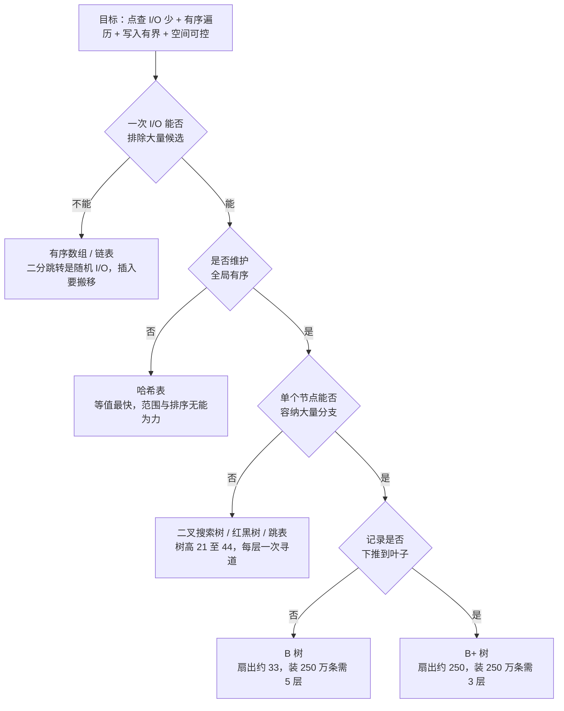
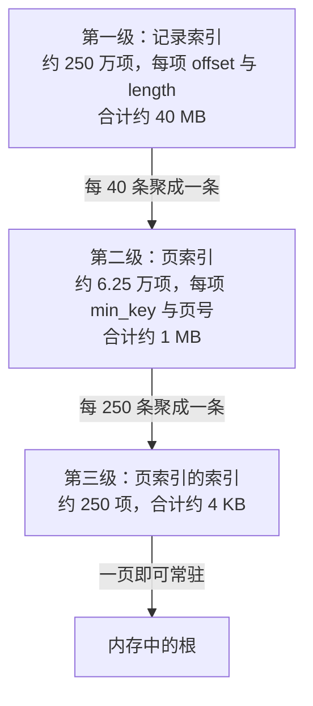
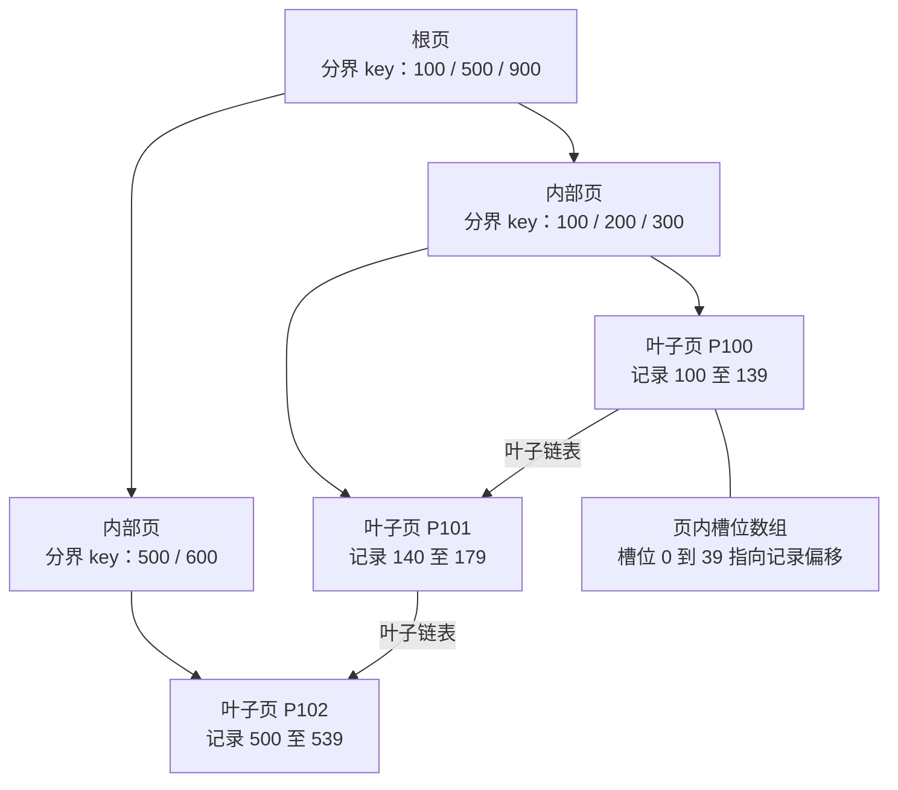
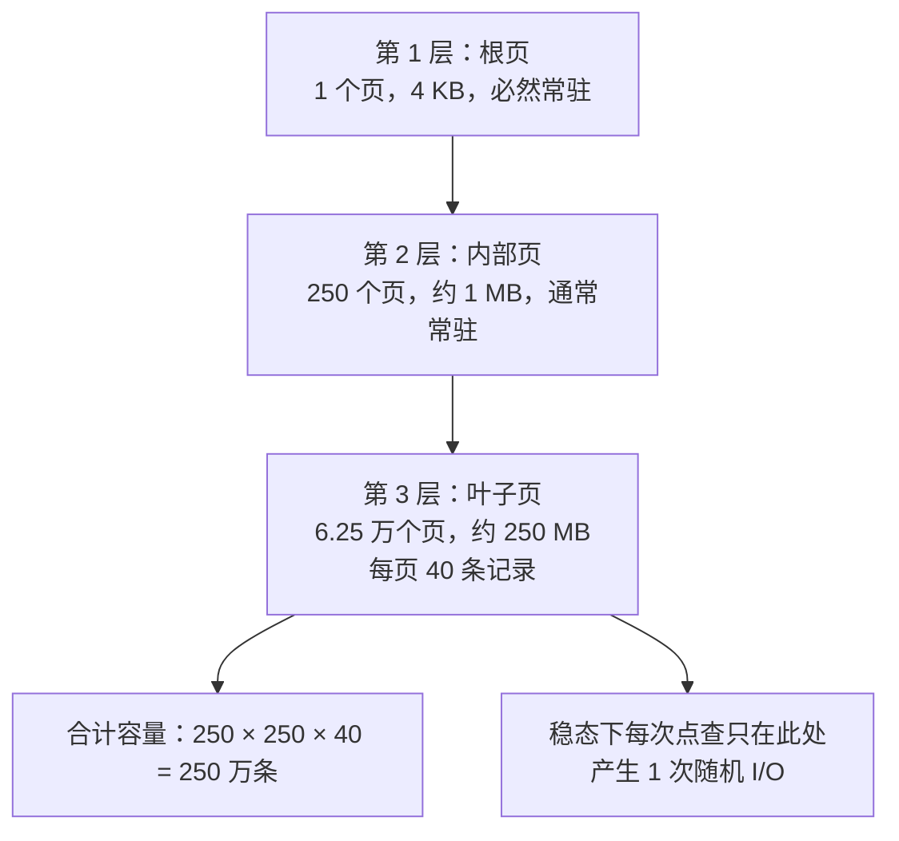
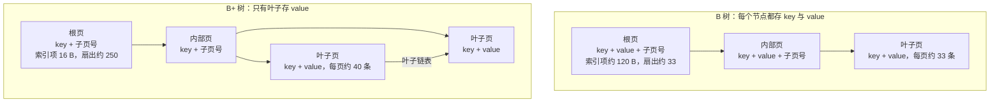

# 04 B+ 树存储引擎（上）——方案选型与宏观结构

**摘要：**

「读多写少的磁盘存储引擎用 B+ 树」这句话，在教材、面试与技术评审里出现的频率高到几乎不需要解释，但它是一个结论，不是一条理由；结论可以被记住，理由不能，于是当负载、介质或数据量发生变化时，记住结论的人就失去了判断力。本文把这条结论重新推导一遍：先给出关系库的真实负载画像与磁盘 I/O 的成本模型，把「性能好」这个模糊目标翻译成「一次点查要碰几个页」这个可以算的量；然后让有序数组、链表、二叉搜索树、红黑树、哈希表、跳表、B 树逐个上场，看它们分别死在磁盘的哪一步；接着从「千万条记录就有千万个索引项」这个现实约束出发，推导出稀疏索引与多级页索引，并给出三层 B+ 树在 4 KB 页、16 B 索引项假设下的容量算式与点查 I/O 次数；再把 B 树与 B+ 树逐项对账，用扇出、树高、范围扫描、分裂行为、缓存命中五个维度算清差距；随后做一次反向论证，说明若改选 B 树、哈希、跳表或红黑树，代价会落在哪个环节。读完之后，应当能回答两个问题：B+ 树到底把哪一项成本压到了最低，以及这项优势在 NVMe、内存数据库与写密集负载面前还剩多少。

---

## 第 1 章 一句结论背后的三个空白

「读多写少的磁盘存储引擎采用 B+ 树」，这句话几乎出现在每一本讲数据库内核的书的前几章，也几乎出现在每一场后端岗位的面试里。它正确，但它是一句结论。结论的好处是便于记忆，坏处是它把推导过程整个吞掉了，只留下一个可以背诵的壳。

笔者见过不少这样的对话：面试官问「为什么关系库用 B+ 树做索引」，候选人答「因为 B+ 树查询快」。这个回答不算错，却没有信息量——红黑树查询也快，哈希表在等值查询上更快。真正被期待的回答应该说清楚 B+ 树在跟谁比、比的是哪个指标、赢了多少倍、代价是什么。

所以不妨先把那句结论放一边，重新问三个问题。第一个问题：除了 B+ 树，磁盘索引还有哪些候选方案，它们在磁盘这个介质上分别死在哪一步？第二个问题：给定页大小与索引项大小，一棵三层或四层的树能装多少行记录，一次点查到底要碰几次磁盘，这个数字能不能算出来？第三个问题：如果介质从机械盘换成 NVMe，从磁盘换成内存，从读多写少换成写多读少，这套结论在哪一步开始动摇？

这三个问题有共同的性格：都可以被量化。第一个的答案是一组 I/O 次数，第二个是一个乘法算式，第三个是一张成本对比表；把它们算清楚，那句结论就不再需要背诵。这条路线与 [[01 存储引擎概述——从数据库演进到两大派系]] 共用一套坐标，只是把镜头推近到「树」这一支内部。

## 第 2 章 起点：负载画像与 I/O 成本模型

### 2.1 关系库到底在承受什么样的负载

谈选型之前必须先谈负载，因为结构没有优劣，只有匹配与否。关系数据库所服务的负载，通常具备四个特征，这四个特征叠加起来，才构成了**读多写少**这个说法的真实含义。

第一个特征是读写比例失衡。以订单系统为例，一笔订单在下单、支付、风控、发货、对账这五六个环节里会被反复读取，真正修改它的时刻只有那么几次；读写比在 10:1 到 100:1 之间是常态，极端场景（譬如商品详情）可以到 1000:1。这意味着写入路径上的一切开销都会被读路径摊薄，读路径上每省下的一次 I/O 也要乘以请求量才算得出收益。

第二个特征是访问粒度小。绝大多数 OLTP 请求是「按主键取一行」或者「按某个条件取几十行」，而不是「扫一遍全表做聚合」。这个特征决定了随机访问的权重远高于顺序访问，也决定了「一次 I/O 能带回多少有用的数据」这件事极其重要——如果一次 I/O 只能带回一行，那么页的大小、页内的组织方式就全白费了。

第三个特征是有序性需求刚性。分页、排序、区间过滤、范围导出，这些在 SQL 层看起来各不相同的操作，落到存储引擎层是同一件事：从某个 key 开始按序取 N 条。只要索引维护了全局有序，这一整类需求都能被一次定位加一次顺序遍历满足；否则只能退化为全表扫描加外部排序。有序性不是「锦上添花的能力」，它是关系模型能够提供声明式查询的物理前提。

第四个特征是事务边界。一条 `UPDATE` 可能同时修改聚簇索引的一个叶子页和三个二级索引的叶子页，这四页必须一起生效或一起失效，页分裂时还会额外牵动父页与新页。写入不是「写一个字节」，而是「一组页的原子切换」。

四个特征合起来，可以浓缩成一句设计要求：**在千万到十亿行、读写比十比一以上的负载下，把点查与范围扫描的磁盘访问次数压到个位数，同时让写入的页修改数有界。**

### 2.2 磁盘的成本模型：一切以 I/O 次数计价

有了设计要求，接下来要有一把尺子。计算机系统里衡量存储访问快慢的尺子只有一把，就是延迟；而延迟在不同介质之间相差的不是几倍，是几个数量级。

下面的图把这条延迟阶梯画出来，从左到右是数量级的跨越，而不是线性增长。


这张图上有两个值得反复注视的落差：主存与 NVMe 之间大约三个数量级，NVMe 与机械盘之间大约两个数量级。前者解释了为什么「缓存命中」是存储引擎最重要的性能杠杆，后者解释了为什么机械盘时代的引擎会把「减少随机 I/O」当成第一原则。

机械盘的十毫秒是怎么来的，值得拆开看，因为它决定了后面所有估算的量级。一次随机读包含三段时间：磁头移动到目标磁道的寻道时间，几毫秒；盘片旋转到目标扇区落到磁头下方的旋转延迟，7200 转的盘片转一圈约 8.3 毫秒，平均等半圈，约 4 毫秒；最后是数据传输，4 KB 的数据在两百 MB/s 的接口上不到二十微秒。十毫秒里九成以上花在「找到位置」而不是「搬运数据」上。

这个结构带来一个极其重要的推论：在机械盘上读 4 KB 和读 64 KB 的耗时几乎一样，于是「一次 I/O 多带一点数据回来」几乎免费，而「多一次 I/O」昂贵得不可接受。这条推论直接指向多叉树——如果一次 I/O 的固定成本这么高，就应该让每个节点尽量大、分支尽量多。

不妨把这件事比作去闭架书库借书：读者不能进库，只能填单子交给管理员，管理员一次可以抱一摞出来，但来回一趟要走十分钟。于是所有优化都围绕「少跑几趟」展开——把最常借的书挪到阅览室（缓存），把书目做成卡片目录放在门口（非叶子节点），一次尽量多抱几本（页）。这个比喻的技术限定在于：真实存储引擎里「一次能抱多少」被页大小固定住；而且如果这一摞书在架子上挨着，下一趟的车程可以省掉大半，这就是顺序 I/O 与随机 I/O 的差别。

### 2.3 把目标翻译成可计算的量

有了尺子，就可以把「性能好」翻译成算式。一次点查的总耗时可以粗略写成：

```text
C = H × t_mem + (1 - H) × (D × t_io + t_cpu)
```

其中 H 是缓存命中率，t_mem 是一次内存访问的耗时，D 是需要访问的磁盘页数，t_io 是单次 I/O 的耗时，t_cpu 是页内查找与解码的处理器开销。

在机械盘上，t_io 取十毫秒，t_cpu 取几十微秒，两者相差两三百倍，于是 t_cpu 几乎可以被忽略，整个式子退化成「C ≈ D × 10 ms」。这时候优化目标极其清晰：把 D 压下去。而在 NVMe 上，t_io 取一百微秒，t_cpu 仍是几十微秒，两者只差几倍，t_cpu 重新变得不可忽略，优化目标就分裂成「压 D」与「压 t_cpu」两条。

这个式子里有两个正交的杠杆：D，也就是树高；H，也就是缓存命中率。B+ 树的设计几乎全部围绕第一个杠杆展开，缓冲池、预读、批量写则围绕第二个。两者是乘法关系——三层树配 99% 的命中率与五层树配 99.9% 的命中率，最终延迟可能差不多，但前者更容易做到，因为它的「热索引」更小。

## 第 3 章 候选结构的逐个淘汰

### 3.1 先立四条判据

在让候选方案上场之前，先要有一把统一的尺子，否则讨论会退化成「我觉得哪个好」。对磁盘索引而言，合格的判据有四条，缺一不可：点查的 I/O 次数必须是对数级或更低，这里的「对数」指的是磁盘访问次数而不是算法课本上的比较次数；必须支持有序遍历，因为范围查询与排序是关系模型的刚性需求；单次写入牵动的页数必须有界，否则写入吞吐会随数据量线性下降；空间放大必须可控，否则「为了查得快」会变成「为了查得快而买不起盘」。用这四条去筛，候选方案会一个接一个地掉队。

### 3.2 有序数组：查找可以二分，插入必须搬移

有序数组是最容易想到的方案。它在内存里表现极好：连续存储、缓存友好、二分查找 O(log N)、范围扫描只需顺着下标走。放到磁盘上，这几条优点就只剩下一条。

原因是二分的每一次跳转都落在数组的中间位置，而在磁盘上数组就是一段页序列，跳到中间位置就是一次随机 I/O。250 万条记录、每页 40 条，共 6.25 万个页；第一次跳转落在第 3 万个页上，第二次落在第 1.5 万个页上，依此类推，需要约 16 次随机 I/O 才能定位到一个页，而多叉树的三层结构只需要 3 次。二分的比较次数确实是对数级，但每一次比较都要付一次寻道。

更致命的是插入。在有序数组中间插入一条记录，平均要搬移一半的元素；即使按页组织、页内留出空闲空间，也仍然要处理「页内腾位」与「页间腾位」两件事。假设 250 万条记录、平均每条 100 字节，总数据量 250 MB，在中间插入一条平均要搬移 125 MB 的数据。这个代价与数据量成正比，意味着表越大写入越慢，系统无法平滑扩展。

### 3.3 链表：查找退化成线性

链表的优点是不需要搬移，插入删除都是常数时间。缺点同样古老：查找必须从头走。

在磁盘上，链表的查找成本比算法课本上写的还要糟糕。课本说 O(N)，隐含假设是「访问一个节点是常数时间」；而在磁盘上，访问一个节点往往就是一次随机 I/O，于是 O(N) 变成了「N 次随机 I/O」。250 万条记录，最坏情况 250 万次寻道，按十毫秒算就是七个小时。即使按页组织、页内放 40 条、页间用指针串联，也仍然需要最多 6.25 万次页读，六百多秒。

链表把「逻辑相邻」与「物理相邻」彻底解耦，这本是设计初衷，但在磁盘上物理不相邻就意味着每一次「下一个」都要付一次寻道，预读机制完全失效。所以它只以辅助结构的形态存在——B+ 树的叶子页之间用指针串成链表，但那是页级的链表，跨页才用一次指针，遍历时还配合预读。

### 3.4 二叉搜索树与红黑树：树高就是 I/O 次数

二叉搜索树看起来是个好方案：O(log N) 的查找、天然有序、支持范围遍历。它的问题只有一个，但这一个问题是致命的——树高。

一棵有 250 万个节点的平衡二叉树，高度是 log₂(2500000) ≈ 21；红黑树为了保证最坏情况下的平衡，高度上界是 2 × log₂(N+1) ≈ 44。每下降一层，就要访问一个节点；如果每个节点独占一个页，那么一次点查就要 21 到 44 次随机 I/O。按机械盘十毫秒计算，就是 210 毫秒到 440 毫秒。这个数字对 OLTP 而言完全不可接受。

更浪费的是空间。一个 4 KB 的页只装一个节点，而这个节点只有 8 字节的 key、8 字节的左右指针，加上可能的颜色位与父指针，不到 40 字节。页的利用率不到 1%，剩下 99% 的带宽全部浪费在「搬运空气」上。

有人会说：那就不要让一个节点独占一页，让一页装多个节点。这个想法是对的，但一旦这么做，就必须解决「页内多个节点之间如何定位」的问题——要么在页内维护一棵小树（复杂且没有收益），要么把页内节点排成有序数组并二分（这就变成了多叉树）。也就是说，**「一页装多个节点」这个优化，走到最后必然收敛成 B 树**。二叉结构在磁盘上没有中间地带。

红黑树在内存里是另一回事：没有寻道，一次节点跳转大约一百纳秒，21 层就是两微秒；指针追逐带来的 cache miss 虽然讨厌，但仍在同一个数量级内。这就是为什么它在内存索引、语言运行时、内核数据结构里无处不在，却几乎不出现在磁盘索引里。同一棵树，换个介质，评价就翻转了。

### 3.5 哈希表：等值查询的冠军，范围查询的弃儿

哈希表在等值查询上是无可争议的冠军：一次哈希计算，一次桶定位，一次页读，总共一次 I/O，比 B+ 树的三次还少两次。如果负载是纯粹的 KV 点查，哈希表就是最优解，这一点没有争议。

但关系库的负载不是纯粹的点查。哈希表放弃的恰恰是 2.1 节列出的第三个特征——有序性。一旦索引不维护顺序，`BETWEEN`、`ORDER BY`、`LIMIT` 分页、前缀匹配全部失效，只能退化为全表扫描加外部排序。以 250 万条、250 MB 的数据量为例，一次全表顺序扫描在两百 MB/s 的机械盘上要 1.25 秒，在 NVMe 上也要一百多毫秒；而同样的查询走 B+ 树索引，可能只要一次定位加几页顺序读。

哈希表在磁盘上还有两个工程难题。一是扩容：桶数固定则冲突链随数据增长而变长，点查退化为链上的线性扫描，而扩容意味着重新哈希全部数据，在磁盘上是灾难性的；可扩展哈希（Extendible Hashing）与线性哈希（Linear Hashing）分别用目录翻倍与渐进迁移来摊平成本，但都要维护一套额外的间接层，复杂度并不比一棵树低。二是哈希函数的稳定性：内存里可以用带随机种子的哈希防碰撞攻击，磁盘上的哈希值一旦落盘就不能随便改，否则全量数据都要重新分布。

所以哈希索引在工业界的定位很清晰：作为辅助索引存在（譬如 PostgreSQL 的 Hash Index），或者作为「全内存索引加追加日志」方案的核心（譬如 Bitcask）。后者的成功恰恰说明哈希表不是不行，而是它的适用边界很窄，窄到只在「纯 KV 加全内存索引」这个格子里成立。

### 3.6 跳表：为内存而生，为磁盘而死

跳表（Skip List）是 William Pugh 在 1990 年提出的概率型数据结构：用多层链表加随机晋升，以期望 O(log N) 的代价实现有序查找，插入删除不需要旋转，并发插入只需原子地改几个指针。在内存里它比平衡树更受欢迎，因为实现简单、无锁并发友好、范围遍历自然。

放到磁盘上，跳表的问题和二叉搜索树同源，只是表现得更隐蔽。跳表的「跳跃」依赖指针，而磁盘上的指针不能直接解引用，每次跟随指针都是一次寻道。层数的期望值是 log₂N，250 万条约 21 层，最坏情况下每层一次随机 I/O，仍然是两百毫秒量级。

更深一层的问题在于**一次 I/O 能带回多少分支**。B+ 树的一次 I/O 带回一个装满 250 个索引项的页，页内二分可以在这一次 I/O 之内把候选范围缩小 250 倍；跳表的一次 I/O 只带回一个节点，节点里通常只有一个 key 和几个指针，候选范围只缩小一倍。这个差异不是常数因子，它直接决定了树高：缩小 250 倍需要 log₂₅₀(250 万) ≈ 3 层，缩小 2 倍需要 21 层。

跳表还有空间上的负担：按 p = 1/2 的晋升概率，每个节点的期望指针数是 2，每个指针 8 字节就是 16 字节的额外开销，相对 100 字节的记录是 16%，而且这些指针必须持久化，否则重启之后跳表就散架了。

不过跳表并没有被淘汰，它只是换了一个战场。LSM-Tree 的 MemTable 用的就是跳表（LevelDB、RocksDB 都是），因为 MemTable 完全在内存里，跳表的并发插入优势被完整兑现，而磁盘上的指针问题根本不存在。同一个结构在内存里是首选、在磁盘上是末选，这个反差本身就是「介质决定结构」的最好注脚。

### 3.7 B 树：方向对了，但还差一步

B 树（B-Tree）由 Rudolf Bayer 与 Edward McCreight 在 1972 年提出，它把二叉结构推广成多叉结构，一个节点可以容纳几十到几百个 key，从而把树高压到很低的水平。这是方向性的一步：既然一次 I/O 的固定成本那么高，就应该让一次 I/O 带回尽可能多的分支。

但 B 树把数据放在了每一个节点里。一个内部节点不仅要存 key 和指向子节点的页号，还要存这个 key 对应的完整记录。这三样东西挤在同一个 4 KB 的页里，扇出就被严重压缩了。

具体算一下。假设 key 8 字节、记录 100 字节、子页号 8 字节，加上槽位数组的开销，一个索引项约 120 字节；4 KB 的页留出页头后按 4000 字节可用计算，扇出约 33。也就是说，一个内部节点只能分出 33 个叉。三层 B 树能装 33³ ≈ 3.6 万条记录，四层约 120 万条，五层约 3900 万条。要装下 250 万条记录，需要五层，也就是五次页访问。

而同样的数据量，如果把记录从内部节点里挪走，扇出立刻从 33 涨到 250，三层就能装 250 万条，页访问次数从五次降到三次。这「挪走」的一步，就是 B 树到 B+ 树的全部差别。

B 树并没有消失，它在部分文件系统与嵌入式数据库里仍有位置；在内存数据库里，它的变体 T 树（T-Tree）甚至是主流选择之一。

### 3.8 淘汰路径的全貌

把上面七个小节的结论收拢成一张决策图，会看得更清楚：每一次淘汰都不是「这个结构不好」，而是「这个结构在某一个判据上过不了关」。



这条路径有一个统一的题眼：**所有落败的结构，都没有把「一次 I/O 能带回多少有用的分支」这件事做大**。数组与链表带回一个元素，二叉树带回两个分支，跳表带回一个节点，哈希表带回一个桶，只有多叉树带回几十到几百个分支。

把七个候选结构放在一起，很像给一条货运线路挑运输工具：自行车灵活但载不动，卡车装得多却要修公路，火车最省但只能到站。技术限定在于，运输工具换掉只损失一次采购费，索引结构换掉要重写全部数据并停机，所以选型一旦落地就很难回头。

下面的表把七个候选方案在四条判据上的表现并排列出，作为这一章的收束。

| 结构 | 点查 I/O 次数 | 有序遍历 | 写入代价 | 空间放大 | 淘汰原因 |
|---|---|---|---|---|---|
| 有序数组 | 约 log₂N 次随机读 | 支持，且顺序极佳 | O(N) 搬移 | 低 | 插入代价随数据量线性增长 |
| 链表 | O(N) 次随机读 | 支持但需全走 | O(1) | 高，指针占 16% | 查找退化为线性 |
| 二叉搜索树 | 约 21 次 | 支持 | O(log N) 但需旋转 | 极高，页利用率不足 1% | 树高即 I/O 次数 |
| 红黑树 | 约 44 次（最坏） | 支持 | O(log N) | 极高 | 同上，且常数更大 |
| 哈希表 | 1 次 | 不支持 | 扩容需全量重哈希 | 中，桶有空洞 | 放弃有序性，范围查询失效 |
| 跳表 | 约 21 次 | 支持 | O(log N)，并发友好 | 中，指针持久化开销 | 指针即寻道，无法批量带回分支 |
| B 树 | 5 次（250 万条） | 支持，但需回溯内部节点 | 分裂搬移记录 | 中 | 记录占用内部节点，扇出被压到 33 |
| B+ 树 | 3 次（250 万条） | 支持，叶子链表直通 | 分裂只上推分隔键 | 低 | 胜出 |

## 第 4 章 从记录到页：两级索引的诞生

### 4.1 索引项不是凭空出现的

前面几节一直在说「一次 I/O 带回多少分支」，却回避了一个问题：这些分支到底是什么？在内部节点里，每个索引项是「一个 key 加一个子页号」；在叶子节点里，每个索引项是「一个 key 加一条记录的位置」。两类索引项的来源不同，值得拆开讲。

叶子层索引项的存在理由，通常被解释为「记录是变长的，所以需要 offset 与 length」，这个解释只说对了一半。即使记录全部定长，页内也需要一套间接层，因为记录会被移动：删除一条记录之后，如果立刻把后面的记录往前挪，所有指向它们的指针都要更新；如果不挪，页内就会留下碎片。工程上的通行做法是「删除时只清空槽位、不移动记录，等碎片积累到阈值再做一次页内压缩整理」，而压缩整理一定会移动记录。既然记录会动，外部就不能直接持有物理偏移，只能持有槽位号，由槽位数组（Slot Array）间接指向记录——这才是它的真正价值：把「逻辑顺序」与「物理位置」解耦，逻辑顺序由槽位下标的排列维持，物理位置可以随整理而变。这个解耦在磁盘上是必需的，因为页会被反复读入读出，而内存地址每次都不一样，任何依赖物理偏移的外部引用都会失效。

### 4.2 千万条记录就有千万个索引项

假设每页装 40 条记录，每条记录在页内有一个 16 字节的索引项（偏移与长度各 8 字节），那么 250 万条记录就有 250 万个索引项，合计约 40 MB。这个数字今天不算什么，但在存储引擎设计成型的年代是个大数目；而且即便放得下，也有一个无法回避的问题：这些索引项必须持久化，否则重启之后要重建，重建期间服务不可用。对一个千万级的库，重建索引意味着把整个文件读一遍，可能是几分钟到几十分钟的停机。

于是有了两个方向的解法：减少索引项的数量，也就是**稀疏索引（Sparse Index）**，不必为每条记录建一个索引项，只为每一页建一个；或者给索引项找一个合适的组织方式，让它能压缩、能快速定位。

第一个方向立刻见效：250 万个记录索引项聚成 6.25 万个页索引项（250 万除以每页 40 条），每个只需要「这一页的最小 key 加页号」16 字节，合计 1 MB，可以完整放进内存。

但 6.25 万个索引项本身也需要被检索。如果它们在内存里排成一个有序数组，二分查找需要 16 次内存访问，完全可接受；可如果它们必须持久化在磁盘上（因为 1 MB 也要防丢），二分就又要变成 16 次随机 I/O。于是第二个方向登场：把这 6.25 万个页索引项再按页组织一次，每页装 250 个，得到 250 个「页索引的索引项」，合计 4 KB，正好一页。

到这一步，三级结构自然浮现，而且是被「索引项太多」这个现实逼出来的，不是人为规定。下面的图把这条稀疏化的链条画出来，从左到右是三级，每一级都是上一级按页聚合的结果。



这个推导有一个漂亮的副产品：它解释了为什么 B+ 树的非叶子节点只存 key 与页号，而不存记录。因为非叶子节点的唯一职责是「把候选范围缩小到一页」，它需要的是「分界点」与「去哪一页」，记录本身对它毫无用处，反而是纯粹的负担。第 6 章会把这个「负担」量化。

### 4.3 页大小定多大

页是存储引擎进行 I/O 的最小逻辑单位，它的大小不是随便定的，而是被三层约束夹出来的。

第一层是操作系统的页。Linux 的虚拟内存管理与页缓存都以 4 KB 为单位，读写文件时的预读、回写、脏页跟踪也以页为粒度。如果存储引擎的页不是 4 KB 的整数倍，那么一次引擎层的页写会跨越两个内核页，带来额外的对齐拷贝；一次引擎层的页读也会浪费掉内核已经预读进来的一半数据。

第二层是设备的物理特性。传统机械盘的扇区是 512 字节，现代盘普遍是 4 KB；固态盘的编程单位是页（通常 4 KB 到 16 KB），擦除单位是块（几百 KB 到几 MB）。页大小与设备单位对齐，可以避免读改写（Read-Modify-Write）。

第三层是负载的访问粒度：OLTP 的随机访问粒度小，页大了浪费带宽；OLAP 的顺序扫描多，页大了能减少 I/O 次数。这一层与前两层往往冲突，于是不同系统选出了不同的页大小——PostgreSQL 用 8 KB，InnoDB 默认 16 KB，BoltDB 直接用操作系统的 4 KB，一些列存与 LSM 的块会到 64 KB 甚至更大。

页大小的影响是可以算的，第 5 章会给出完整的算式。这里先给一个直观的结论：**页大小翻四倍，扇出翻四倍，叶子容量翻四倍，于是三层的总容量翻六十四倍，而树高不变**。这就是为什么大页对「装得多」这件事如此有效；代价是每一次 I/O 带回的数据里可能有大量用不上的部分，读放大随之上升。

### 4.4 索引与数据放在一起，还是分开

索引项必须持久化，这一点没有争议。但持久化到哪里，有两种做法，它们构成了聚簇索引（Clustered Index）与非聚簇索引（Non-Clustered Index）的分野。

聚簇索引把索引页与数据页混在同一个文件里，叶子节点就是数据页本身，一次 I/O 取回一页，页里既有 key 也有整行数据。代价是一张表只能有一个聚簇索引，因为记录的物理顺序只能有一种；插入时若 key 随机，还会不断在文件中间开辟新页，导致页分裂与空间碎片。

非聚簇索引把索引与数据分成不同的文件（或者同一文件的不同区段），叶子节点存的是「指向记录的地址」。这个地址在不同系统里形态不同：MyISAM 存行号，PostgreSQL 存堆表的物理位置（ctid），InnoDB 存主键值。前两者是物理地址，记录一移动就必须重建索引；InnoDB 存主键值是逻辑地址，记录移动不影响索引，代价是每次回表都要再走一次主键索引。

InnoDB 的选择值得多说一句，因为它把「聚簇」与「二级索引」组合成了一个两层结构：主键索引聚簇，叶子页存整行；二级索引非聚簇，叶子页存索引列加主键值。查一条走二级索引的记录，要先在二级索引树上定位到主键值，再拿着主键值去主键索引树上定位整行，这个动作叫回表（Back to Table Lookup）。

回表的成本可以精确算出来。假设二级索引命中 k 条记录，每条都要回表一次，若主键索引的叶子层没有缓存，每条至少一次随机 I/O，k = 100 时就是 100 次，机械盘上一秒，NVMe 上十毫秒。而如果查询需要的列全部包含在二级索引里（也就是覆盖索引，Covering Index），回表次数为 0，100 条记录的查询退化成一次定位加三页顺序读，成本差了两个数量级。这就解释了一个常被忽视的事实：**「索引建得对不对」往往不如「索引覆盖得全不全」重要**。

组合索引（Composite Index）的最左前缀（Leftmost Prefix）原则也常被误解为一条人为规定，其实它只是字典序的推论。索引 `(a, b, c)` 的物理排列是先按 a 排，a 相同按 b 排，b 相同按 c 排；查询条件里没有 a，就无法用这棵树的有序性去定位起点，只能退化成从头扫一遍索引，也就是从「索引查找」降级为「索引扫描」。这个收益同样可以量化：假设 a 的基数（Cardinality）是 1000，b 是 100，c 是 10，总行数 250 万，只用 a 做条件命中约 2500 条，用 a 和 b 命中约 25 条，用全部三列命中约 2.5 条，三者的回表次数相差一千倍。所以组合索引的列顺序不是审美问题，它直接决定了每次查询要在树上走多远、要回表多少次。

下面的图画出一个典型的两级结构：内部页只存分界 key 与子页号，叶子页存记录与页内槽位数组，叶子页之间用指针串联。



## 第 5 章 定量估算：三层能装下多少

### 5.1 假设与算式

前面所有关于「树高低」「装得多」的说法，如果不落到算式上，都只是修辞。这一节把假设摆明，把乘法做完。

假设有四个：页大小 4 KB，扣掉页头、校验和、槽位数组之后可用 4000 字节；内部节点的索引项 16 字节，即 8 字节 key 加 8 字节子页号；叶子节点的每条记录平均 100 字节，包含 8 字节 key 与约 92 字节的行数据；页内填充率取 100%，不考虑分裂后留下的空洞。

在这些假设下，扇出（Fan-out）m = 4000 ÷ 16 = 250，叶容量 L = 4000 ÷ 100 = 40。

一棵高度为 h 的 B+ 树，能容纳的记录数 N 是：

```text
N(h) = m^(h-1) × L
```

代入数字：h = 2 时 N = 250 × 40 = 1 万；h = 3 时 N = 250² × 40 = 250 万；h = 4 时 N = 250³ × 40 = 6.25 亿。

这个算式有一个容易被忽略的性质：容量的增长是指数的，指数的底是扇出。扇出从 250 涨到 1000，三层的容量就从 250 万涨到 1.6 亿（1000² × 160），涨了六十四倍。也就是说，**扇出是 B+ 树唯一重要的参数，而扇出完全由「索引项占多少字节」决定**。这解释了为什么工程实现要在索引项上斤斤计较：key 从 8 字节压到 4 字节，扇出就能涨一半；用前缀压缩把 key 压到 2 字节，扇出能翻两倍多。

### 5.2 一次点查到底碰几个页

点查的成本等于「从根到叶访问的页数」，也就是树高 h。但这里面有一个关键的折扣：并不是每一次页访问都要付磁盘 I/O。

三层树，根节点只有 1 个页，必然常驻内存；第二层有 250 个页，合计 1 MB，对任何一台现代服务器都是小数目，也几乎必然常驻。于是稳态下，一次点查只需要访问叶子层的那一个页，也就是**一次磁盘 I/O**。

这个结论值得停下来体会：前面一直在说「三层树，三次页访问」，但在工程上真正落到磁盘的往往只有一次。B+ 树真正的杀手锏不是「三层比五层少两次」，而是「树高足够低，低到上面所有层都能装进内存」。四层树也成立：第四层之上有 6.25 万个页、合计 250 MB，在 8 GB 的缓冲池里只占 3%。

按第 2 章的式子算延迟。机械盘上，一次随机读十毫秒，点查总延迟约十毫秒；冷启动时根也不在内存，三次页访问约三十毫秒。NVMe 上，一次随机读一百微秒，点查约一百微秒；冷启动约三百微秒。这个量级与真实系统的观测是吻合的——机械盘时代的 MySQL 点查 P99 在十毫秒上下，NVMe 时代能压到几百微秒。

下面的图把三层结构与它的容量、常驻情况一起标出来。



### 5.3 页大小如何改写这张表

把页大小从 4 KB 换成 16 KB，其余假设不变：可用空间 16000 字节，扇出 m = 16000 ÷ 16 = 1000，叶容量 L = 16000 ÷ 100 = 160。三层容量 N = 1000² × 160 = 1.6 亿。

从 250 万到 1.6 亿，是 64 倍。这个 64 不是巧合：页大小翻四倍，扇出翻四倍，叶容量翻四倍，三层的总容量就是 4 × 4 × 4 = 64 倍。同一棵三层树，只因为页变大，承载量涨了六十多倍，而树高一次都没变。

代价在读放大。一次点查只需要 100 字节，4 KB 的页带回 40 条、浪费 39 条，16 KB 的页带回 160 条、浪费 159 条，按带宽利用率算是 2.5% 与 0.6%。机械盘上这个浪费无所谓，因为瓶颈在寻道不在传输；NVMe 上它开始有意义，因为一次 16 KB 读与一次 4 KB 读在延迟上差不多，吞吐却差四倍。

还有第二个代价：随机写的放大。修改一条记录，在 4 KB 页上要写 4 KB，在 16 KB 页上要写 16 KB。对于写密集的负载，这个放大是实打实的。这就是为什么 InnoDB 把页大小做成可配置（4 KB、8 KB、16 KB、32 KB、64 KB 都可选），而不是固定一个值——它在把「树高」与「读放大」之间的取舍交给使用者。

下面的表把三种页大小放在一起对比，作为这一节的收束。

| 页大小 | 扇出 | 叶容量（100 字节记录） | 三层容量 | 点查带宽利用率 | 单次修改写放大 |
|---|---|---|---|---|---|
| 4 KB | 250 | 40 条 | 250 万条 | 约 2.5% | 4 KB |
| 8 KB | 500 | 80 条 | 2000 万条 | 约 1.2% | 8 KB |
| 16 KB | 1000 | 160 条 | 1.6 亿条 | 约 0.6% | 16 KB |

### 5.4 范围扫描的成本结构

点查的成本是「树高」，范围扫描的成本则是「树高加上要读的页数」。这两段的结构完全不同：前者是随机的，后者在定位之后是顺序的。

假设要扫 1000 条连续记录。第一步是定位起始叶，这本质上是一次点查，成本为一次随机 I/O。第二步是沿叶子链表顺序读，4 KB 页每页 40 条，需要 25 页；16 KB 页每页 160 条，需要 7 页。

顺序读的耗时按带宽算：25 页 × 4 KB = 100 KB，机械盘两百 MB/s 约零点五毫秒，NVMe 两 GB/s 约五十微秒。如果这些页在磁盘上不连续、只能随机读，那么 25 次随机 I/O 在机械盘上是两百五十毫秒，在 NVMe 上是两点五毫秒——差了两个数量级。

这解释了叶子链表存在的意义：它不是「方便遍历」这么轻描淡写，而是把范围扫描的 I/O 模式从随机强制成顺序的结构性保证。不过它只保证「逻辑顺序」，不保证「物理连续」——刚建好的表叶子页大致按插入顺序分配，运行久了页分裂会在文件中间开辟新页，链表指向的页散落各处，顺序读就退化成「按链表跳着读」。这时候需要额外的整理机制，譬如 InnoDB 的区（Extent）分配与预读策略，或者 PostgreSQL 的 `CLUSTER` 命令。**顺序性会被写入破坏，需要主动维护**。

### 5.5 把估算与需求对上

回到 2.1 节提出的要求：千万到十亿行、点查与范围扫描的 I/O 次数压到个位数。一个年增 1.8 亿行的订单表三年就是五亿多行，4 KB 页的 B+ 树需要四层；四层树意味着四次页访问，但第四层之上只有 6.25 万个页、250 MB，仍可常驻，所以稳态仍是一次 I/O。换成 16 KB 页，三层就能装下。

这套乘法很像估算一间仓库能放多少货：先算一层货架放几箱，再算一间放几排货架，最后算一栋放几层。技术限定在于，仓库的层数由建筑设计定死，B+ 树的层数却由数据量逼出来——数据涨过阈值，树自动加一层，而加层的那一刻，所有查询的页访问次数一起加一。

千万行以内三层足够，十亿行四层，百亿行五层。每加一层，稳态延迟不变，变的只是「上层能否常驻」；当内存不够、上层开始被换出时，延迟会从一次 I/O 跳到两次、三次，表现不是渐变而是阶跃。这也解释了为什么数据库扩容时常常出现「内存加了一点，延迟掉了一大截」的现象。

## 第 6 章 B 树与 B+ 树：一次逐项对账

### 6.1 数据位置与扇出

B 树的每个节点都存 (key, value, 子页号)，B+ 树只有叶子节点存 value，内部节点只存 (key, 子页号)。这个差别看起来只是「数据放哪儿」，实际上决定了**扇出**。

按 4 KB 页、key 8 字节、记录 100 字节、子页号 8 字节、槽位开销 4 字节计算：B 树的索引项约 120 字节，扇出 4000 ÷ 120 ≈ 33；B+ 树的索引项 16 字节，扇出 250。扇出相差 7.6 倍，而容量是扇出的指数函数，差距会被急剧放大。

装 250 万条记录，B+ 树三层就够（250² × 40 = 250 万），B 树需要五层。算法是：每层扇出 33，叶子层每页 33 条（因为叶子页也存 value，容量与内部页相同），要装 250 万条需要 33^(h-1) × 33 ≥ 250 万，即 33^h ≥ 250 万，h ≥ log₃₃(2500000) ≈ 4.2，向上取整为 5。

五次页访问对三次，看起来只差两次；但在机械盘上这是五十毫秒对三十毫秒，在 NVMe 上是五百微秒对三百微秒。更要紧的是「上层能否常驻」这个条件：B 树的第四层就有 33³ ≈ 3.6 万个页、144 MB，第五层之上是 120 万页、4.8 GB，这个量级已经超出多数缓冲池，于是 B 树的稳态延迟会从一次 I/O 涨到两次。

### 6.2 点查延迟的方差

B 树还有一个 B+ 树没有的特性：如果 key 恰好落在某个内部节点上，可以在那一层直接返回，不必走到叶子。这让 B 树的最好情况更快，也带来了方差——命中根节点是一次 I/O，命中叶子是五次；而 250 万条里绝大多数 key 都在叶子层，于是平均值被少数热 key 拉低到四点八次左右，P99 却仍是五次。B+ 树的所有查询都终止于叶子，延迟恒定，这一点在工程上极其重要，因为现代系统的 SLA 约束的是 P99 而不是平均值。

### 6.3 范围扫描的路径差异

范围扫描的差异比点查更大，因为它暴露了「数据分散在内部节点」这件事的第二个后果。

B+ 树的范围扫描路径很短：定位起始叶（一次点查），然后沿叶子链表一直走，每次读一页，页内顺序取记录。整个过程只访问叶子层，I/O 次数等于叶子页数。

B 树的范围扫描必须做中序遍历。中序遍历的路径是「左子树、根、右子树」，而根在内部节点里，所以遍历过程中会在内部节点与叶子节点之间反复跳转。如果用一个显式的栈保存路径，那么「回到父节点」是内存操作，但「从父节点走向下一个子节点」往往是一个新页，需要一次 I/O。于是总 I/O 次数约等于「叶子页数加上访问到的内部页数」，比 B+ 树多出一截。

举个具体的例子：250 万条记录的五层 B 树，内部节点总数约 33⁴ ≈ 118 万个页，扫描 1000 条连续记录要访问约 30 个叶子页外加路径上的若干内部页，而 B+ 树只需要 25 个叶子页加一次定位。差距不是数量级的，但足以让「大范围导出」这类操作的耗时翻倍。

### 6.4 分裂与合并的行为

插入导致页满时，两种树都要分裂，但分裂时搬动的东西不同。

B 树的分裂要把中间那个 (key, value) 上推到父节点，也就是一条记录从子节点搬到了父节点。这带来两个后果：父节点的容量被记录占掉，扇出进一步下降；父节点自身的「记录集合」发生变化，任何依赖记录内容的辅助结构都要跟着更新。

B+ 树的分裂只把一个 key 上推作为分隔键，value 不动，仍然留在叶子层。父节点只是增加一个 (key, 子页号) 的索引项，16 字节，改动量极小。而且这个 key 在叶子层仍然保留一份，所以 B+ 树的 key 是冗余存储的——这是它用空间换扇出的代价，也是它扇出能做到 250 的原因。

删除时的差异同理：B 树的合并要搬移大量记录，B+ 树只搬记录、不动内部节点的分隔键。第 05 篇会把这些过程逐步画出来，并讨论「分裂到一半断电」这种边界情况。

### 6.5 缓存命中的效率

最后一个维度是缓存：同样大小的缓冲池能缓存多少「分支」，直接决定了树的上层能否常驻。1 MB 内存能放 6.25 万个 16 字节的 B+ 树索引项，却只放得下 8700 个 120 字节的 B 树索引项——常驻三层 B+ 树的非叶节点只需 1 MB 加 4 KB，常驻三层 B 树却需要 144 MB 加 4 KB。在嵌入式设备、边缘节点、容器限额这些小内存场景里，这个差别是决定性的。

下面的图把两种结构并排画出，可以直观看到 value 在内部节点的占位。



把五个维度收进一张表，作为这一章的对账结果。

| 维度 | B 树 | B+ 树 | 差距的实际后果 |
|---|---|---|---|
| 数据位置 | 每个节点都存记录 | 只有叶子存记录 | 扇出 33 对 250 |
| 索引项大小 | 约 120 字节 | 16 字节 | 同内存可缓存分支数差 7 倍 |
| 树高（250 万条） | 5 层 | 3 层 | 冷路径 I/O 次数 5 对 3 |
| 点查延迟方差 | 大，1 到 5 次不等 | 恒定 3 次 | SLA 规划难度不同 |
| 范围扫描 | 需中序遍历，访问内部页 | 沿叶子链表，只访问叶子 | 大范围导出耗时差约一倍 |
| 分裂改动 | 上推记录，父页容量下降 | 上推分隔键，父页改动极小 | 写放大与并发冲突面不同 |
| 上层常驻成本 | 144 MB 起 | 1 MB 起 | 小内存场景下 B 树难以全内存 |

## 第 7 章 反向论证：选错的代价

前面是从「B+ 树为什么赢」的角度推的。换一个方向，从「如果选了别的，代价落在哪里」再走一遍，往往能把结论钉得更牢。这一章逐项算账。

### 7.1 若选 B 树

代价落在两处。第一处是树高：装 250 万条要多两层，冷路径多两次 I/O，热路径因为上层难以常驻，可能从一次 I/O 涨到两次。第二处是范围扫描：中序遍历要访问内部节点，大范围导出的 I/O 次数多出三成到一倍。

B 树也不是没有优势。它的等值查询在内部节点命中时可以提前返回，对「热 key 集中在少数高层节点」的负载有好处；它的 key 不冗余存储，空间占用比 B+ 树小（B+ 树的 key 在内部与叶子各存一份，冗余量约等于内部节点大小）。在某些写少读多、数据量不大、且 key 分布极不均匀的场景里，B 树的实际表现可能不差。

这个权衡在内存数据库里被推到了极致：T 树（T-Tree）本质上是「内部节点也存数据的平衡树」，省掉了叶子层，在早期内存数据库里被广泛使用；它能成立，恰恰因为内存访问没有寻道，「多一层」的代价只是一百纳秒而不是十毫秒。

### 7.2 若选哈希表

代价落在范围查询上，而且是硬代价，没有工程手段可以绕过。

一次 `WHERE ts BETWEEN a AND b` 的查询，如果只有哈希索引，执行计划只能选全表扫描。250 万条、250 MB 的数据，机械盘顺序读约一点二五秒，NVMe 约一百多毫秒。若这张表有十亿行、100 GB，全表扫描在机械盘上要八分钟，在 NVMe 上也要五十秒。而 B+ 树索引只需要一次定位加几十页顺序读，毫秒级完成。

哈希表还有一笔隐性代价：`ORDER BY` 与 `LIMIT` 分页。没有有序索引，排序只能做外部归并，需要临时文件与多趟 I/O，深分页更会退化成「排序全部数据再取十条」。哈希表的优势场景确实存在，但很窄——纯 KV、点查为主、key 能全部装进内存。Bitcask 是这个格子的最佳样本，读路径短到「查哈希表、一次 pread」，写路径短到「追加、更新哈希表」，但边界同样清晰：内存放不下就崩，范围查询做不了。这也是 Etcd 选 BoltDB 而不是 Bitcask 的原因——按前缀列出所有 key 是它的核心需求，哈希表给不了。

### 7.3 若选跳表

代价落在「一次 I/O 带回的分支数」上。

跳表的每一层跳跃只前进一个节点，磁盘上就是一次寻道。250 万条记录、期望 21 层，最坏情况 21 次随机 I/O，机械盘两百一十毫秒，NVMe 两点一毫秒。相比 B+ 树的三次页访问（稳态一次 I/O），差距在十倍到二十倍之间。

还有一个不容易注意到的代价：跳表的指针必须持久化。B+ 树的「指针」是页号，页号在文件里天然存在，不需要额外存储；跳表的指针是内存地址，落盘时必须转成「文件号加偏移」，读回来再转回去，而且每次插入都可能改变多个节点的指针，导致多个页的随机写。这与 B+ 树的「一次插入只改一个叶子页（不分裂时）」形成对比。

跳表的优势在并发：插入不需要分裂与旋转，只需原子地改几个指针，因此可以做到无锁；B+ 树的插入涉及页分裂与父节点更新，必须加 latch。这个优势在内存里（MemTable）被完整兑现，在磁盘上被 I/O 成本淹没。第 05 篇会看到，B+ 树为了在并发下保持正确付出了可观的复杂度，而这正是跳表不需要的。

### 7.4 若选红黑树

代价最直观：**树高即 I/O 次数**。

红黑树的最坏高度是 2 × log₂(N+1)，250 万条约 44 层，机械盘四百四十毫秒。即使是平均情况（约 21 层），也是两百一十毫秒。这个延迟对任何在线业务都是不可接受的。

还有空间上的代价：一个页只装一个节点，利用率不到 1%。要装 250 万条记录，需要 250 万个页，即 10 GB 的文件，而实际有效数据只有 250 MB。四十倍的空间放大过不了任何成本核算。

### 7.5 代价的统一视角

这个视角很像「二十问」猜谜：每一问把候选砍掉一半，二十问就能从一百万缩到一个；如果每一问只能砍掉一个候选，那要问一百万次。技术限定在于，猜谜的每一问是免费的，B+ 树的每一问都要付一次 I/O，所以真正要比的不是「问几次」，而是「每次的价钱乘上次数」。

把四项反向论证收拢，会发现它们都可以用同一个指标解释：**从 N 条记录缩小到 1 条，需要多少次「缩小动作」，以及每次动作的单价**。B+ 树每一次 I/O 把候选范围缩小 250 倍，从 250 万到 1 需要 log₂₅₀(2500000) ≈ 2.7，即三次；B 树每次缩小 33 倍，需要五次；红黑树与跳表每次只缩小 2 倍，需要 21 次；哈希表一次就到，但不支持有序。用一张表把这个视角固定下来。

| 方案 | 单次 I/O 缩小倍数 | 定位 250 万条所需 I/O | 机械盘延迟量级 | 有序遍历 | 主要代价 |
|---|---|---|---|---|---|
| B+ 树 | 250 | 3（稳态 1） | 十毫秒 | 支持，叶子链表 | 写入需分裂与 latch |
| B 树 | 33 | 5 | 五十毫秒 | 支持，需中序回溯 | 扇出被记录挤占 |
| 红黑树 | 2 | 21 至 44 | 两百到四百毫秒 | 支持 | 页利用率不足 1% |
| 跳表 | 2 | 约 21 | 两百毫秒 | 支持 | 指针需持久化 |
| 哈希表 | 全量 | 1 | 十毫秒 | 不支持 | 范围查询失效 |
| 有序数组 | 2 | 约 16 | 一百六十毫秒 | 支持，顺序极佳 | 插入 O(N) 搬移 |

这张表把「为什么是 B+ 树」回答得很干脆：它是唯一一个同时满足「单次缩小倍数极大」「支持有序遍历」「写入代价有界」「空间放大可控」的方案。其余方案各自在其中一项上失分，而这一项恰好无法用工程手段弥补。

## 第 8 章 边界与反例

### 8.1 NVMe 改写了什么，没改写什么

NVMe 固态盘把随机读延迟从十毫秒压到一百微秒左右，两个数量级，这个变化对 B+ 树的影响要分两面看。

被改写的是「随机 I/O 的相对成本」。机械盘时代，一次随机 I/O 相当于几千万条 CPU 指令，所以引擎可以为了省一次 I/O 付出任何代价；NVMe 时代，一次随机 I/O 只相当于几十万条指令，CPU 开销重新变得重要。于是现代引擎的优化重心从「降树高」转向了「提高缓冲池命中率」「减少 latch 争用」「批量提交」「减少 CPU 缓存未命中」。这些工作在机械盘时代是次要的，在 NVMe 时代是主要的。

没被改写的是「I/O 次数仍然是最贵的变量」。一次内存访问一百纳秒，一次 NVMe 读一百微秒，差一千倍；三层树的三次页访问在冷路径上是三百微秒，对 P99 仍有意义。所以「树高低」没有过时，只是收益从「十倍」变成了「三倍」。

还有一件没被改写的事：写放大。固态盘的擦除块是几百 KB 到几 MB，修改一个 4 KB 页会触发一次块级的读改写，频繁的小随机写会让垃圾回收压力剧增、长期性能退化；而 B+ 树的原地更新恰恰是小随机写的典型来源。

### 8.2 内存数据库为什么不用 B+ 树

内存数据库（Redis、MemSQL、SAP HANA、VoltDB）几乎不用 B+ 树做索引，这不是因为它们不知道 B+ 树好，而是因为成本模型变了：没有磁盘 I/O 之后，第 2 章的式子里 D × t_io 这一项消失，只剩下 H × t_mem，「减少 I/O 次数」这个目标不存在了，取而代之的是「减少 CPU 缓存未命中次数」。一次 cache miss 约一百纳秒，一次 cache hit 约一纳秒，差一百倍，于是结构设计的目标从「一次 I/O 带回多少分支」变成「一次 cache line 带回多少有效数据」。

B+ 树在内存里的问题正在这里：一个 4 KB 的页跨越 64 个 cache line，页内二分的每一次比较都可能是一次 cache miss；而分支节点存的是完整 key，key 越长比较越贵、cache 占用越大。

替代方案各有针对性：跳表在 Redis 的 zset 里被使用，因为实现简单、范围遍历自然、并发插入容易，代价是指针追逐；自适应基数树（Adaptive Radix Tree，ART）按前缀自适应选择 4 路、16 路、48 路或 256 路的节点，把公共前缀压掉，让一次 cache line 装更多有效分支；T 树则让内部节点也存数据，以减少层数。

这些结构在磁盘上都活不下来（ART 的节点大小可变，落盘后难以按页组织；T 树内部节点存数据，扇出太小），但在内存里各有所长。**介质变了，最优结构就变了**，这句话在索引结构上的体现，比在任何其他地方都更直白。

### 8.3 写密集场景下 LSM 的反超

B+ 树的原地更新在写密集负载下会暴露两个问题。第一个是随机写：插入一个随机 key，要在文件中间找一个页，读进来、改、写回去，这是典型的随机 I/O。第二个是页分裂：页满了要分裂，分裂要分配新页、更新父页、调整兄弟指针，一次插入可能牵动三四个页。

LSM-Tree 把这两个问题都绕开了：所有写入都是**追加**，先写内存，再批量刷成有序文件，后台慢慢合并。写入变成纯顺序，页分裂不存在（因为没有「页」这个概念，只有「文件」）。代价转移到读路径：一次读要查多层文件，读放大上升。

分界线在哪里？经验上当写入以随机 key 为主、写请求占比超过三成、且对读延迟容忍度较高时，LSM 开始占优；当读请求占绝对多数、且对 P99 敏感时，B+ 树仍占优。这条线不是固定的，它会随硬件、压缩算法与合并策略而移动，第 07 篇会把这条线算清楚。

### 8.4 反例：不是所有有序存储都需要树

B+ 树的价值建立在两个前提上：key 可以任意顺序插入，且需要原地更新。一旦负载放弃其中任何一个前提，树就不再是必需品。

Kafka 的日志存储是第一个反例：访问模式是「按 offset 顺序追加、按 offset 顺序读」，offset 单调递增，插入永远在末尾，从不原地更新，于是「分段文件加稀疏索引」就够了——每个日志段配一个索引文件，存「相对 offset 到物理位置的映射」，每隔若干条记一条；查找时先在索引文件里二分（文件小，可全部映射进内存），再在段内顺序扫一小段。这套结构的本质是「数组加稀疏索引」，比 B+ 树简单得多，也快得多。

时序数据库是第二个反例：时间戳单调递增，写入永远在末尾，查询以「最近一小时」这类范围扫描为主，偶尔按 tag 过滤，于是「时间分区加段内有序」就够了，树的作用被削弱到只剩「tag 索引」这一小块。

Redis 是第三个反例：数据全在内存，主索引是哈希表，有序集合用跳表，它根本不需要「磁盘索引」这个概念。三个反例的共同点很清楚：**当写入天然有序、且不需要原地更新时，树就不是必需品**。B+ 树解决的正是「任意 key 的原地插入加有序遍历」这个组合问题，一旦组合里的某一项消失，结构就可以大幅简化。

### 8.5 页大小与 key 长度的两个反例

4 KB 不是普适值。PostgreSQL 选 8 KB，是因为一个页里要放下行头、MVCC 的元组头与多版本指针，4 KB 太挤；ClickHouse、Parquet、RocksDB 的块可以到 64 KB 甚至更大，因为它们的访问以顺序扫描为主，大块能提高压缩率、减少 I/O 次数；持久化内存（Persistent Memory，PMEM）路线被看好时，还曾有研究提出用 256 字节的缓存行对齐页来减少写放大。页大小始终是跟着介质走的。

key 长度的反例更常见。前面所有估算都假设 key 是 8 字节，而真实系统里用 UUID 做主键就是 16 字节，用字符串可能是 32 字节以上。key 从 8 字节涨到 32 字节，B+ 树的索引项从 16 字节涨到 40 字节，扇出从 250 掉到 100，三层容量从 250 万掉到 40 万，掉了六倍。这个计算解释了两条工程经验：一是不要用随机 UUID 做主键，它不仅让插入位置随机化，还让扇出下降、树高上升；二是前缀压缩值得做，InnoDB 的索引页前缀压缩、LSM 块的重启点与前缀共享，都是把公共前缀只存一次，从而把有效 key 长度压下来。

## 第 9 章 收束：把最贵的成本压到最低

B+ 树之所以成为磁盘索引的默认答案，不是因为它「先进」，而是因为它在一个特定的成本模型下**把最贵的那一项压到了最低**。那个模型是：机械盘上一次随机 I/O 约十毫秒，九成花在寻道与旋转；一次 I/O 能带回多少数据由页大小决定，与延迟几乎无关。在这个模型下「减少 I/O 次数」是唯一有效的方向，而「一次 I/O 带回尽可能多的分支」是达成它最有力的手段。

B+ 树的全部设计都是这一个目标的不同侧面：多叉让一次 I/O 带回几百个分支，记录下推让分支不被记录挤占，叶子链表让范围扫描从随机变成顺序。

落到本专栏反复回到的两条判断上：没有银弹，架构即权衡；没有放之四海皆准的方案，因地制宜。所谓选型，不是找出一个「最优结构」，而是在给定的负载与介质下识别出最贵的那一项成本，选一个能把它压下去的结构并接受它在别处的代价。B+ 树接受了「写入需要分裂」「key 冗余存储」「页内有碎片」三笔代价，换来「点查三次页访问、范围扫描顺序化」两个收益，在关系库的负载下这笔交易划算。

但结构选对只是第一步。一棵 B+ 树在纸上是干净的，落到工程里就全是脏活：内存节点怎么映射到磁盘页，页缓存满了淘汰谁，两个线程同时插入同一个叶子页怎么办，页分裂做到一半断电了怎么恢复，事务的隔离性怎么在这棵树上落地。这些问题的答案，构成了下一篇的全部内容。

## 小结

这一篇做的事情，是把「读多写少用 B+ 树」这句结论重新推导一遍。起点是负载画像与成本模型：关系库的负载具备读写比失衡、访问粒度小、有序性需求刚性、事务边界明确四个特征，而机械盘上一次随机 I/O 的十毫秒里九成花在寻道，于是「多带一点数据」几乎免费、「多一次 I/O」极其昂贵；两者叠加，优化目标被翻译成一个可计算的量——把一次点查的页访问次数压到个位数。

在此之上，候选结构逐个被淘汰：有序数组死于插入搬移，链表死于线性查找，二叉搜索树与红黑树死于树高，哈希表死于放弃有序性，跳表死于指针即寻道，B 树死于记录挤占扇出；它们有一个统一的题眼，就是没有把「一次 I/O 能带回多少有用的分支」做大。B+ 树的胜出可以拆成三个动作——记录下推到叶子让扇出从 33 涨到 250，叶子串成链表让范围扫描从随机变成顺序，页与操作系统的页对齐让一次 I/O 不被边界切断；三个动作合起来，三层树能装 250 万条，而稳态下点查只需一次磁盘 I/O。

边界同样清楚。NVMe 削弱了「降树高」的收益但没有取消它；内存数据库的成本模型里没有 I/O，最优结构换成了跳表、ART 与 T 树；写密集场景下 LSM 用顺序写换读放大，反超了 B+ 树；Kafka、时序库、Redis 这些反例说明，一旦「任意 key 原地插入」这个前提消失，树就不再是必需品。

下一篇把镜头推到工程细节：页如何映射、latch 如何加、分裂如何原子化、事务如何在这棵树上落地。

---

## 参考资料

1. Bayer, R., McCreight, E. *Organization and Maintenance of Large Ordered Indices*. Acta Informatica, 1(3), 1972.
2. Comer, D. *The Ubiquitous B-Tree*. ACM Computing Surveys, 11(2), 1979.
3. Graefe, G. *Modern B-Tree Techniques*. Foundations and Trends in Databases, 3(4), 2011.
4. Pugh, W. *Skip Lists: A Probabilistic Alternative to Balanced Trees*. Communications of the ACM, 33(6), 1990.
5. Fagin, R., Nievergelt, J., Pippenger, N., Strong, H. R. *Extendible Hashing: A Fast Access Method for Dynamic Files*. ACM Transactions on Database Systems, 4(3), 1979.
6. Lehman, T. J., Carey, M. J. *A Study of Index Structures for Main Memory Database Management Systems*. VLDB, 1986.
7. Leis, V., Kemper, A., Neumann, T. *The Adaptive Radix Tree: ARTful Indexing for Main-Memory Databases*. ICDE, 2013.
8. O'Neil, P., Cheng, E., Gawlick, D., O'Neil, E. *The Log-Structured Merge-Tree (LSM-Tree)*. Acta Informatica, 33(4), 1996.
9. Athanassoulis, M., Karpathiotakis, M., Idreos, S. *Designing Access Methods: The RUM Conjecture*. EDBT, 2016.
10. Petrov, A. *Database Internals: A Deep Dive into How Distributed Data Systems Work*. O'Reilly, 2019.
11. Kleppmann, M. *Designing Data-Intensive Applications*. O'Reilly, 2017.
12. MySQL 8.0 Reference Manual. *Clustered and Secondary Indexes*, *InnoDB Page Size*.
13. Kreps, J., Narkhede, N., Rao, J. *Kafka: a Distributed Messaging System for Log Processing*. NetDB, 2011.

---

> [!note] 思考题
> 1. 假设把 B+ 树的内部节点索引项从 16 字节压到 8 字节（key 用前缀压缩、子页号用 4 字节），扇出会变成多少，三层容量会变成多少，这个优化在什么情况下不划算？
> 2. 一棵四层 B+ 树，前三层合计 250 MB。如果缓冲池只有 128 MB，命中率会如何变化，点查延迟会出现什么样的阶跃，能否用别的手段弥补？
> 3. 如果要求「点查与范围扫描都要快，且写入是随机 key、每秒十万次」，B+ 树、LSM 与哈希索引分别会在哪个环节成为瓶颈？请给出你的定量估算与假设。
> 4. 为什么 InnoDB 的二级索引叶子节点存主键值，而 PostgreSQL 的二级索引存堆表物理位置？这两种选择在「记录被更新、被移动」时分别会付出什么代价？
> 5. Kafka 用「分段日志加稀疏索引」而不是 B+ 树，如果要求它支持「按消息 key 随机查询任意历史消息」，结构需要怎么改，代价是什么？
