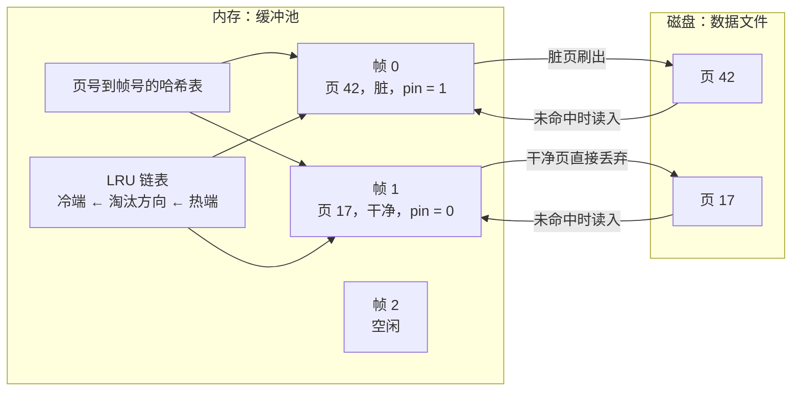
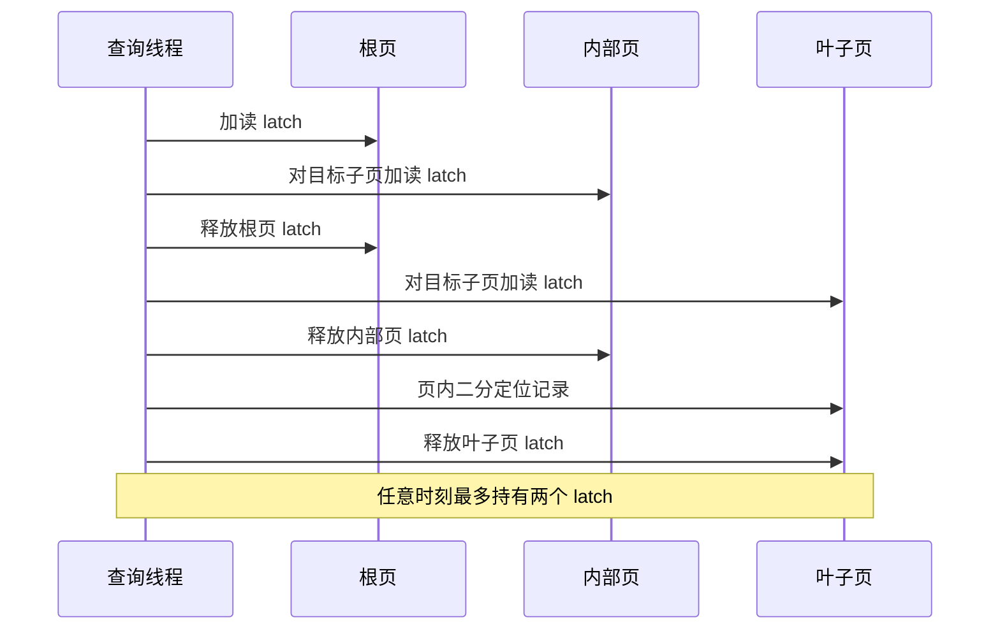
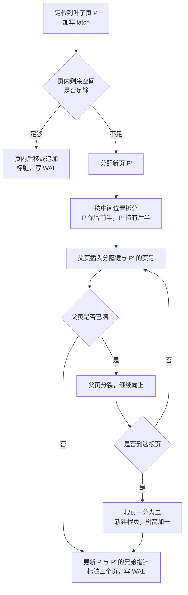
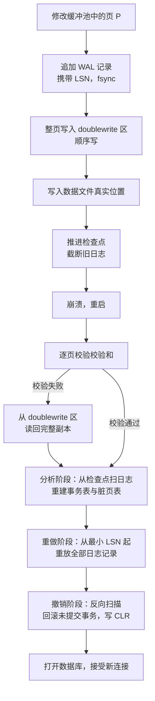
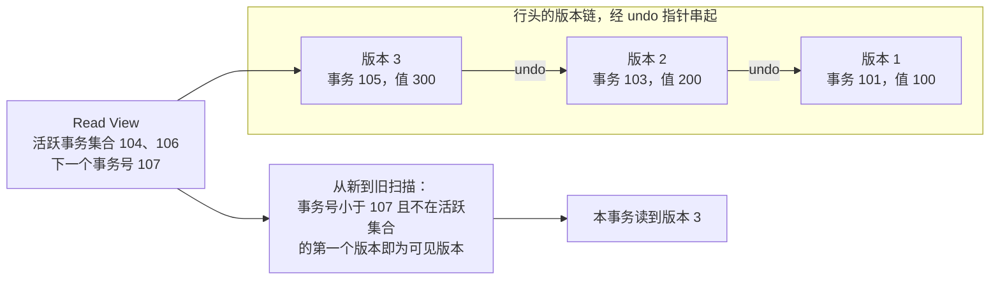

# 05 B+ 树存储引擎（下）——工程细节、事务与恢复

**摘要：**

上一篇把 B+ 树当作一个抽象的数据结构来推导，选型、扇出、树高、容量都算得清清楚楚；但真实的存储引擎里没有抽象节点，只有内存中的帧与磁盘上的页，没有「一次插入」，只有「一组页的原子切换」。本文接着往下走，先把内存节点与磁盘页的映射关系拆开，讲清页号、缓冲池、pin 与 unpin、脏页与 LRU 淘汰这套机制为什么必须存在；再沿着读路径看页内二分、latch 与 Crabbing 协议如何在保证正确性的前提下把并发放出去；然后沿着写路径看插入、页分裂、借位、页合并与级联分裂各自要改动几个页，并把写放大算出来。有了读写路径，才谈得上崩溃一致性：部分写入（torn page）、页校验和、doublewrite、WAL 与 LSN、检查点、redo 与 undo，这些机制合起来回答一个问题——页分裂做到一半断电，重启之后凭什么能回到一个自洽的状态。事务部分不讲教科书式的 ACID 定义，而是讲存储引擎为什么不得不支持事务：一条更新要同时改聚簇索引和三个二级索引，没有原子性这四页就必然撕裂。最后落到并发控制与 MVCC，讲清两阶段锁、意向锁、死锁、时间戳、乐观有效性检查、版本链、Read View、快照隔离与写偏斜，以及范围查询为什么要靠叶子链表加游标。读完之后应当能回答两个问题：一个页从被读进内存到被淘汰，中间经历了哪些状态；以及崩溃恢复的三条防线各自挡住了哪一类故障。

---

## 第 1 章 结构选对之后，工程才刚开始

[[04 B+ 树存储引擎（上）——方案选型与宏观结构]] 结束在一个颇为干净的画面里：一棵三层的 B+ 树，根与第二层常驻内存，叶子层按需读入，一次点查一次 I/O，范围扫描顺着叶子链表走。这个画面是对的，但它是一张剖面图，把时间、并发与故障这三条轴都抽掉了。

一旦把这三条轴加回来，画面立刻变得拥挤。页不是凭空出现在内存里的，它要被读进来、被钉住、被修改、被标脏、被刷出去、被淘汰；同一个叶子页可能同时有三个线程在插入，一个在读；页分裂要把一个页拆成两个，同时改父页、改兄弟指针，这三处修改必须一起生效；而在这三处修改之间，随时可能断电。任何一个环节处理不当，前面算得再漂亮的树高与扇出都没有意义，因为数据已经错了。

所以这一篇要回答的问题与上一篇正交：上一篇问「选什么结构」，这一篇问「这个结构在真实机器上怎么活下去」。前者是设计，可以用纸笔完成；后者是工程，必须在崩溃、并发与性能的三重压力下反复权衡。

路线大致对应一个页的生命周期：第 2 章讲它在内存与磁盘之间的映射，第 3 章讲它被并发读、第 4 章讲它被并发写，第 5 章讲它被持久化，第 6 到 8 章讲它被事务包裹，第 9 章讲它被顺序遍历，第 10 章讲它在边界条件下如何失效。

## 第 2 章 内存节点与磁盘页的映射

### 2.1 页号：把指针换成偏移

在数据结构课本里，B+ 树的节点之间用指针连接；在存储引擎里，指针变成了页号（Page Number，常缩写为 pgid 或 pageno）。这个替换看起来只是「换个名字」，实际上改写了整个结构的语义。

指针是内存地址，进程退出即失效；页号是文件内的逻辑偏移，与进程无关、与机器无关、与字节序无关。一个页号乘以页大小，就是文件内的字节偏移，一次 `pread` 就能把这一页读出来。正因为页号可以脱离进程存在，B+ 树才能同时存在于内存与磁盘：内存里的节点持有子节点的页号，磁盘上的页持有同样的页号，两者是同构的，读入时不需要任何地址翻译。

页号还带来一个副作用：**页的数量决定了页号的位宽，而页号的位宽又反过来影响扇出**。一个 32 位的页号最大支持 40 亿个页，按 4 KB 一页算是 16 TB；64 位页号则几乎没有上限。用 4 字节页号代替 8 字节，索引项就能从 16 字节压到 12 字节，扇出从 250 涨到 333。这类「省几个字节」的优化在大表上会被指数放大，第 4 章算过这个乘法。

页的分配与回收由空闲空间管理负责。最简单的做法是维护一张空闲页列表（Free List），分配时从表头取一个，回收时挂回表尾；复杂一些的做法是按区（Extent）分配，一次预留连续的几十个页，以减少文件碎片。无论哪种，这张表本身也必须持久化，否则重启之后不知道哪些页是空闲的，只能全文件扫描一遍。这张表的状态一致性，是崩溃恢复里最容易被忽略的一环。

### 2.2 缓冲池：把慢介质伪装成快介质

有了页号，接下来要解决「页在哪儿」的问题。答案是一个固定大小的内存区域，叫**缓冲池（Buffer Pool）**。它被切成一堆大小等于页的槽位，每个槽位叫一个帧（Frame），帧里存放某一页的副本，帧的元数据记录着它当前装的是哪一页。

缓冲池要同时回答四个问题，这四个问题构成了它的全部复杂度：这一页在不在池子里；在的话能不能被换出去；改了之后什么时候写回；池子满了淘汰谁。

第一个问题靠一张哈希表解决，键是页号，值是帧号。一次查找是常数时间，比任何树都快。第二个问题靠一个引用计数解决，这个计数叫 pin。线程要用某一页时先 pin 住，用完再 unpin；只要 pin 计数大于零，这一页就不能被淘汰。第三个问题靠脏页标记与刷脏线程解决，页被修改后标为脏（Dirty），后台线程按检查点策略把它写回磁盘，写回成功后清掉脏标记。第四个问题靠淘汰算法解决，最常见的是最近最少使用（Least Recently Used，LRU），但直接用朴素 LRU 会被全表扫描打穿，所以工业实现通常用改进版本。

下面的图把缓冲池的帧、页号映射、pin 计数与磁盘页之间的关系画出来。

缓冲池的收益可以直接算。8 GB 缓冲池、4 KB 页，能装 200 万个页；热数据集 20 GB 时命中率大概九成，每秒一万次点查就有一千次穿透到磁盘——机械盘上是十秒的 I/O 时间，撑不住，NVMe 上是一百毫秒，勉强能扛。把缓冲池加到 32 GB，命中率升到九成九，穿透降到每秒一百次。

这组数字说明：**缓冲池的大小有一个明确的拐点，就是热数据集能否装下**。装得下，磁盘几乎不参与；装不下，命中率随容量线性下滑，延迟随之阶跃。这也解释了为什么数据库扩容常常是「加内存」而不是「加 CPU」。

### 2.3 页的生命周期与 LRU 的两个变种

一个页在缓冲池里的生命周期，大致是四个状态之间的循环：未驻留，页只在磁盘上，任何访问都要先读入；干净驻留，内容与磁盘一致，pin 计数为零时随时可淘汰、直接丢弃；脏驻留，内容与磁盘不一致，淘汰前必须先写回；固定，pin 计数大于零，正在被某个线程使用，无论干净还是脏都不能动。

这四个状态之间的转换构成了所有并发与一致性问题的基础。譬如「一个线程正在分裂页，另一个线程把这一页淘汰了」，就是固定状态被破坏；「脏页还没写回就被淘汰」，就是脏驻留直接跳到未驻留。缓冲池的实现里大量代码都在防止这两类越界。

淘汰算法的选择同样值得说。朴素 LRU 有一个致命弱点：一次全表扫描会把所有页都读进来，把真正的热页全部挤出缓冲池，扫描结束后热查询全部未命中。这个问题在数据库里非常常见，因为报表、备份、导出这类操作天然是全表扫描。

工程上的解法有两个。第一个是分区 LRU，把缓冲池切成热区与冷区，新读入的页先放进冷区头部，只有被再次访问才晋升到热区；这样全表扫描的页进来又出去，不会污染热区。第二个是分段 LRU 加时间窗口，把「最近一次访问时间」与「访问频次」结合起来打分，低频的大扫描页即使刚被访问过，分数也上不去。两个解法的共同思路是：**不要把「最近访问过」等同于「将来还会访问」**，这两件事在存在大扫描的负载里经常相反。

不妨把缓冲池比作一间只有几十个座位的自习室，页是来上自习的学生。朴素 LRU 的规则是「谁刚来过谁坐」，于是一支上百人的参观队伍涌进来，把常驻学生全挤走，队伍离开后座位空着，常驻学生回来发现没位置。分区 LRU 的规则是「新来的先坐过道边的临时座，坐满两次才给正式座位」，参观队伍永远进不了正式区。这个比喻的技术限定在于：真实系统里「坐两次」靠访问计数与晋升条件实现，而晋升本身有开销，分区比例调得不好会让热区过小、命中率反而下降。

## 第 3 章 读路径：从根到叶

### 3.1 定位的四个动作

一次点查在引擎内部要完成四个动作：定位根页、逐层下降、页内二分、解码返回。前两个动作是「走树」，第三个是「页内找」，第四个是「把字节变成值」。

走树这一步的关键在于根页从哪来。根页号是一个元数据，通常存在文件头或者元数据页里，引擎启动时读一次就记住了。根页本身几乎必然常驻，因为每个查询都要经过它。第二层页的数量等于扇出，250 个页合计 1 MB，也几乎必然常驻。于是走树在稳态下只需要访问叶子层那一页，这正是上一篇算出来的结论。

页内二分是第二个动作。页内的索引项按 key 有序排列，二分的比较次数是 log₂(250) ≈ 8 次，全部在内存里完成，成本可以忽略。真正需要注意的是边界：key 落在页内第一个位置之前、最后一个位置之后，或者页内存在已删除的槽位（墓碑），这几种情况都要有明确的语义。工程上的常见做法是在页内维护两个哨兵（Sentinel）槽位，一个指向最小值之前，一个指向最大值之后，二分的循环条件因此可以写得非常简洁。

解码返回是第三个动作。页内记录可能经过前缀压缩、字典编码或列式重排，解码要按页头的格式描述逐字段进行，CPU 成本常被低估——一条 100 字节的记录要几十条指令，一万 QPS 就是每秒几十万条指令，在 NVMe 时代已与 I/O 处于同一量级。

### 3.2 latch 与 Crabbing 协议

单线程的读路径很干净，多线程就不一样了。两个线程同时读同一页没有问题，但同时有一个线程在分裂这一页，读线程就可能读到「分裂到一半」的状态：父页已经有新页的指针，新页里却还没有数据。

解决这个问题要用 latch。latch 与事务的锁（lock）是两个东西，虽然中文常都译作「锁」：latch 保护的是内存数据结构的短期一致性，持有时间以微秒计，事务结束前一定释放；lock 保护的是数据的逻辑一致性，持有时间以毫秒甚至秒计，由事务的隔离级别决定。把两者混为一谈，是理解存储引擎并发控制的第一个坑。

latch 有读模式与写模式：读页加读 latch，可多个线程同时持有；改页加写 latch，独占。但如果每个线程都必须「先锁根、再锁第二层、再锁叶子」，根页就成了全局瓶颈——所有查询都要先拿它的读 latch，即使读 latch 之间不互斥，缓存行争用也足以把吞吐压下去。

**Crabbing 协议**（也叫蟹行协议）解决的就是这个问题。它的规则是：**先锁子节点，再放父节点**。线程持着父页的 latch 去拿子页的 latch，拿到之后立刻释放父页的 latch，然后继续往下。这样在任意时刻，一个线程最多持有两个 latch，而且父页的 latch 很快就被释放，根页不会成为瓶颈。

下面的时序图把这个过程画出来，注意每一步「加」与「放」的先后顺序。

Crabbing 的手感很像接力赛交接棒：跑者必须在松开自己那一棒之前先握住下一棒，否则棒就掉了；拿到下一棒之后立刻松手，才能腾出另一只手。技术限定在于，接力赛只有两个人交接，而 Crabbing 要沿树逐层传递，且写路径上父页的 latch 往往不能提前放——因为分裂要在父页留下新指针，父页必须一直钉住。

写路径的 Crabbing 要严格得多。读操作只要保证「看到一致的页」，写操作却要保证「分裂时父页与两个子页同时一致」，因此写路径上的 latch 通常不能提前释放，而要一直持有到分裂完成。这也是为什么 B+ 树的写并发度天然低于读并发度：读可以一路蟹行、迅速放手，写必须把路径钉住。

### 3.3 命中与未命中的成本差

把 latch 的成本与 I/O 的成本放在一起比，会得到一个有意思的结论：**在稳态下，一次点查的时间几乎全部花在 latch 与 CPU 上，而不是 I/O 上**。

原因很简单。稳态下叶子页大概率也在缓冲池里（如果热数据集装得下），那么整条路径全是内存操作：三次 latch 加放、三次页内二分、一次解码。latch 的加放各是几十纳秒的原子操作，页内二分是八次比较，解码是几十条指令，加起来大概一两微秒。而未命中时，一次 NVMe 读要一百微秒，机械盘读要十毫秒，差两个到四个数量级。

这个结论带来两个工程推论。第一个推论是：在读多写少的系统里，缓冲池命中率是比树高更重要的指标，因为树高只影响「访问几个页」，命中率决定「访问的页要不要付 I/O」。第二个推论是：在 NVMe 时代，latch 争用与 CPU 缓存未命中已经成为主要瓶颈，这也是为什么现代引擎在无锁化、批量读、向量化解码上投入很大。

## 第 4 章 写路径：分裂、借位与合并

### 4.1 插入的三种情形

插入一条记录，第一步与点查完全一样：走树定位到目标叶子页。差别在于定位之后要加写 latch，而且要一直持有到修改完成。

定位到叶子页之后，按页内剩余空间分成三种情形。

第一种情形是页内有足够空间，且插入位置在页内中间。此时要把插入位置之后的记录全部后移，腾出空间写入新记录与新的槽位。后移的代价与页内记录数成正比，但页内最多几百条记录，一次 `memmove` 是微秒级的操作，可以接受。

第二种情形是页内有空间，但插入位置在页尾或者页头。此时不需要后移，直接追加即可。这是顺序插入（譬如自增主键）的理想情况，也是 B+ 树在「按主键递增写入」时性能最好的原因。

第三种情形是页内空间不足，也就是**页溢出**。此时必须分裂。分裂的过程可以拆成六步：分配一个新页；把原页的记录按中间位置分成两半，一半留在原页、一半搬到新页；在父页里插入新页的分隔键与页号；更新原页与新页的兄弟指针；把原页、新页、父页都标脏；写 WAL 记录这次分裂。

下面的流程图把这六步画出来，并标出父页也满时的级联路径。

页分裂有点像图书馆书架上某一格塞满了：管理员把后半排书搬到新的一格，再在书架侧面的分类标签上补一行「从这里开始是新的一格」。技术限定在于，现实里搬书可以慢慢来，页分裂必须在一次原子操作内完成——新格子的边界、旧格子的边界、侧面标签的补行，三者要么一起生效，要么一起不生效，否则读者会按旧标签找到空位。

### 4.2 分裂的代价与写放大

分裂不是免费的，它的代价要算清楚。

一次分裂至少修改三个页：原叶子页、新叶子页、父页。按 4 KB 页算，就是 12 KB 的物理写；而这次插入的逻辑数据只有 100 字节。写放大是 120 倍。这个数字听起来夸张，但要知道分裂不是每次插入都发生：一个装 40 条的叶子页，在顺序插入时大约每 40 次插入分裂一次，摊到每次插入是 3 倍；在随机插入时分裂频率更高，因为分裂出来的两个页都是半满的，很快又会被填满再分裂，摊到每次插入可能是 6 到 10 倍。

随机插入还有一个更隐蔽的代价：**空间利用率**。顺序插入时页总是填满才分裂，平均填充率接近百分之百；随机插入时页在半满状态下被反复分裂，稳态填充率只有五成到七成。这意味着同样的数据量要多占三成到一倍的空间，而空间变大会让树变高、缓存命中率下降，形成连锁反应。

分裂还会引发父页的修改，而父页是被多个子页共享的。如果两个线程同时分裂两个不同的叶子页，它们的父页可能是同一个，那么父页就成了争用点。工程上的解法是让父页的修改尽量短：只插入一个 16 字节的索引项，而不是重排整个父页；并且在父页的 latch 上加一个「乐观路径」，先假设父页有空间，直接插入，失败再退回到加写 latch 的路径。

### 4.3 删除：借位优先于合并

删除是插入的逆操作，但策略上有一个重要的不对称：**删除时优先借位（Redistribution），尽量避免合并（Merge）**。

原因在于合并的代价太高。合并两个页要把一个页的全部记录搬到另一个页，然后删掉空页、删掉父页里的索引项、修正兄弟指针，涉及四个页的修改；而且合并之后的页又是半满的，下一次插入可能立刻又触发分裂。这种「合并—分裂」的抖动在删除与插入交替发生的负载里非常常见，会让写放大失控。

借位的做法是从相邻的兄弟页「借」几条记录过来，让当前页的记录数回到阈值之上。借位只修改两个页（当前页与兄弟页），不动父页（如果借的是边界记录，父页的分隔键要更新，但只改一个键值）。代价小得多，而且不会改变页的数量。

只有当兄弟页也「穷」到无法借出时，才真正合并。工业实现里通常把合并的触发阈值设得很低，譬如页内记录数低于容量的四分之一才考虑合并，这样大部分删除只触发借位，只有极端情况才触发合并。

删除还有一个变体：逻辑删除，只打一个墓碑标记而不搬移记录，空间靠后台整理回收。

下面的表把插入与删除的各种情形、涉及的页数与代价并列出来。

| 操作 | 情形 | 涉及的页 | 主要代价 | 备注 |
|---|---|---|---|---|
| 插入 | 页内有空间，位置在中间 | 1 | 页内后移，微秒级 | 最常见 |
| 插入 | 页内有空间，位置在两端 | 1 | 直接追加 | 自增主键的理想路径 |
| 插入 | 页溢出，父页有空间 | 3 | 搬移半页记录，写放大约 120 倍 | 顺序插入约每 40 次一次 |
| 插入 | 页溢出，父页也溢出 | 4 以上 | 级联分裂，可能加高树 | 概率低但代价高 |
| 删除 | 页内记录数仍高于阈值 | 1 | 清空槽位，不搬移 | 可延迟到整理时压缩 |
| 删除 | 低于阈值，兄弟页可借 | 2 | 借位，边界键要更新 | 优先选择 |
| 删除 | 低于阈值，兄弟页也穷 | 4 | 合并，删页，改父页 | 尽量少触发 |
| 删除 | 逻辑删除 | 1 | 打标记，原地更新 | 空间靠后台回收 |

## 第 5 章 崩溃一致性：三条防线

### 5.1 部分写入：最讨厌的故障形态

前面所有关于分裂的描述，都假设「修改三个页」这个动作是原子的。现实不是这样。磁盘的写入单位是扇区，而一个页可能跨越多个扇区；如果写到一半断电，磁盘上留下的就是「前半页是新内容、后半页是旧内容」的混合体。这种故障叫部分写入（Partial Write），也叫撕裂页（Torn Page）。

部分写入比「完全没写」难处理得多。完全没写，磁盘上还是旧页，语义清晰；写了一半，磁盘上是一个既不是旧页也不是新页的东西，校验和可能对得上（如果校验和只覆盖页头），页内的槽位数组可能指向一个不存在的位置，父页的指针可能指向一个半成品。用这种页去恢复，会把错误传播出去。

部分写入的成因有三层。第一层是硬件：扇区写入本身可能不原子，尤其在掉电瞬间。第二层是操作系统：`write` 调用只是把数据拷进页缓存，什么时候真正落盘由内核决定，一次 `write` 可能被拆成多次设备写。第三层是文件系统：某些文件系统在扩展文件时会改写元数据块，这些块与数据块不在同一次事务里。

三层成因叠加，结论是：**不能假设一次页写是原子的，必须在软件层提供保护**。

### 5.2 第一道防线：页校验和

最轻量的保护是校验和（Checksum）。每个页在页头存一个校验值，覆盖页内全部字节；页被读入时重新计算并比对，不一致就判定为损坏。

校验和能发现损坏，但不能修复损坏。它的价值在于「快速失败」：与其让一个半成品页进入缓冲池、被当作正常页解析、把错误数据返回给用户，不如在入口处就拒绝它，走恢复路径。校验和还顺带解决了静默损坏（Silent Corruption）的问题——磁盘、内存、控制器都可能在没有报错的情况下翻转几个比特，校验和是唯一能发现这类问题的手段。

算法的选择是一次权衡：CRC32 快且碰撞概率低，Fletcher 校验和更快但保护更弱，也有引擎用页内多个校验值分段保护以便定位损坏位置。开销上，一个 4 KB 页算一次 CRC32 约几百纳秒到一微秒，相对 I/O 可以忽略，但在纯内存命中的路径上就不可忽略了，所以很多引擎只在页从磁盘读入时校验。

### 5.3 第二道防线：doublewrite

校验和只能发现损坏，要修复就得有一份副本。最直接的方案是双写（Doublewrite）：修改页时，先把整页写进一块连续的专用区域（doublewrite 区），刷盘之后再写到数据文件的真实位置。

恢复时，如果数据文件里的页校验失败，就从 doublewrite 区把那一页的副本读回来覆盖。因为 doublewrite 区是顺序写的、连续的，一次写入不会跨越随机的多个位置，部分写入的概率低得多；即便发生了，doublewrite 区里通常还留着上一份完整副本。

doublewrite 的代价很直接：每次页写变成两次写，写放大翻倍。为了缓解，工程上把 doublewrite 做成批量的：攒一批页，一次顺序写出去，再分别写到各自的位置；有些实现把 doublewrite 与 WAL 合并，让日志本身承担副本的职责。但无论怎么优化，这笔额外的写带宽是省不掉的。

这也解释了为什么有些系统在存储设备本身保证原子写时会关掉 doublewrite：既然一次页写不会撕裂，它就是纯粹的浪费。这是典型的「硬件能力换软件复杂度」的交易。

### 5.4 第三道防线：WAL 与 LSN

校验和与 doublewrite 解决的是「页本身坏了怎么办」，但没有解决「页还没写、数据就丢了怎么办」，也没有解决「多个页的修改只完成了一部分怎么办」。这两件事要靠预写日志（Write-Ahead Log，WAL）。

WAL 的规则只有两条，但这两条决定了整个恢复逻辑。第一条：任何数据页的修改，必须在对应的日志记录落盘之后才能落盘。第二条：日志记录必须包含足够的信息，使得「从旧页出发重放这条记录」能得到新页。

第一条规则保证了**日志一定比数据新**。于是崩溃之后，只要日志还在，就能把数据页恢复到日志覆盖的最后一个状态。第二条规则保证了「重放是幂等的」——同一条日志重放两次与重放一次结果相同，这一点对恢复过程极其重要，因为恢复本身也可能被打断。

日志记录里有一个关键字段：日志序列号（Log Sequence Number，LSN）。LSN 是一个单调递增的整数，每条日志记录有一个 LSN，每个数据页的页头也记录着「这一页最后一次被哪条日志修改过」的 LSN。恢复时比对两者：页头的 LSN 小于日志的 LSN，说明这一页还没应用这条修改，需要重放；大于等于，说明已经应用过，跳过。这个比对就是重放幂等性的实现方式。

WAL 的思路很像老式账房的做法：先在流水簿上按时间顺序记下每一笔，再慢慢把流水誊到总账上。技术限定在于，流水簿必须比总账「更早落定」——如果流水还没干透就去改总账，一旦出事两本账都靠不住；而且流水必须记到「能凭它重算出总账」的详细程度，只写一句「改了余额」是不够的。

WAL 还有一个容易忽略的好处：它把随机写变成了顺序写。修改三个页原本是三次随机写，现在前台只需等一次顺序的日志追加落盘，三次随机写被推迟到后台。这是 WAL 在性能上的核心价值，与它在正确性上的价值同等重要。

### 5.5 检查点：日志什么时候可以截断

日志不能无限增长，否则磁盘会被日志填满，恢复时间也会无限拉长。截断日志的前提是「日志覆盖的修改已经全部落到数据页上」，这个「已经落到哪儿」的位置就叫**检查点（Checkpoint）**。

检查点的做法有好几种。最简单的是全量检查点：暂停写入，把所有脏页刷盘，记录一个 LSN，然后截断此前的日志。这种做法停顿太长，不适合在线系统。常见的是模糊检查点（Fuzzy Checkpoint）：不暂停写入，只是记下当前所有脏页的清单与它们的 LSN，然后后台慢慢刷；日志截断的位置取「所有脏页中最小的 LSN」，因为那之前的日志对应的修改都已经落盘了。

检查点的频率是一次明确的权衡：刷得太勤，脏页被反复写、写放大上升；刷得太懒，日志堆积、恢复时间变长。工程上通常按「日志量」与「脏页比例」两个阈值触发，并给刷脏线程留足提前量，避免「日志写满被迫同步刷脏」的停顿。

恢复时间可以估算。假设日志重放的速度是每秒几百 MB（受限于随机 I/O 与 CPU），日志量是 1 GB，那么恢复需要几秒；如果日志量是 10 GB，恢复就是几十秒。这个数字直接决定了「检查点最晚可以多久做一次」。

### 5.6 恢复流程：ARIES 的三段式

有了 WAL、LSN 与检查点，恢复流程就可以写清楚了。工业界最经典的框架是 ARIES（Algorithm for Recovery and Isolation Exploiting Semantics），它把恢复分成三个阶段：分析（Analysis）、重做（Redo）、撤销（Undo）。

分析阶段从最后一个检查点开始，顺着日志往后扫，重建两张表：事务表（哪些事务在崩溃时还活着）与脏页表（哪些页有未落盘的修改）。这个阶段不做任何数据修改，只做统计。

重做阶段从脏页表里最小的 LSN 开始，把日志记录全部重放一遍——包括那些属于未提交事务的记录。这一点常让人困惑：为什么要把一个最终会被回滚的事务的修改先重做上去？因为重做追求的是「把数据页恢复到崩溃前的物理状态」，而不是「恢复到逻辑上正确的状态」，先物理恢复再逻辑回滚，比「跳过某些记录」简单也可靠得多。

撤销阶段反向扫描日志，把未提交事务的修改逐条撤销，并写补偿日志（Compensation Log Record，CLR），保证撤销本身也可以被重做。需要 CLR 的原因是恢复过程本身也可能崩溃：撤销做到一半又断电，重启后不能重新撤销一遍，只能顺着 CLR 知道哪些已经撤销过了。

下面的图把正常写入路径与崩溃恢复路径画在一起，可以看到 doublewrite 与 WAL 各自的位置。

把三道防线与它们各自挡住的故障对照一下，会更清楚分工。

| 故障形态 | 表现 | 主要防线 | 局限 |
|---|---|---|---|
| 页内部分写入 | 页内容新旧混合，槽位错乱 | doublewrite 加校验和 | 写放大翻倍 |
| 静默比特翻转 | 页内容看似正常但已损坏 | 页校验和 | 只能发现不能修复 |
| 修改未落盘即断电 | 数据页还是旧版本 | WAL 重做 | 恢复时间随日志量增长 |
| 事务只提交了一半 | 部分页新、部分页旧 | WAL 加 undo 回滚 | 需要 CLR 保证撤销幂等 |
| 元数据页损坏 | 文件集合对不上 | 元数据双份交替写 | 需要额外的空间 |
| 磁盘整体损坏 | 设备不可读 | 副本与备份 | 已超出单机引擎范畴 |

## 第 6 章 事务：存储引擎为什么不得不支持它

### 6.1 一条更新要改几个页

教科书讲事务，通常从「转账」这个例子开始，讲原子性、一致性、隔离性、持久性。这个讲法没有错，但它站在应用的角度，看不到存储引擎内部的压力。要理解引擎为什么必须支持事务，最好的办法是数一数一条更新语句要改几个页。

设想一张订单表，主键是订单号，上面有两个二级索引：一个按用户号，一个按创建时间。现在执行一条更新，把某个订单的状态从「待支付」改成「已支付」。

引擎要做的事包括：在主键索引树上定位到这一行，修改行内的状态字段；如果状态字段在二级索引里出现过（有些设计会把状态放进索引以支持「查某用户的待支付订单」），那么两个二级索引都要删掉旧索引项、插入新索引项；如果行变长了放不下，还要触发行的迁移；如果索引页满了，还要分裂。

粗算一下：主键叶子页 1 个、两个二级索引各 2 个页（删旧插新可能落在不同页）、可能的行迁移 1 个页、可能的分裂 2 到 3 个页。一次逻辑上的「改一个字段」，物理上可能牵动六到八个页。

这六到八个页必须一起生效。如果只完成了前四个，用户看到的是「主键说已支付，按用户查还是待支付」，两个索引互相矛盾，后续的查询会给出错误结果；而且这种矛盾不会自愈，只会随着时间积累。

原子性在这里不是一个抽象的性质，它是一个非常具体的工程需求：**把 N 个页的修改打包成一个不可分割的动作**。

### 6.2 ACID 在引擎层的落点

四个特性在引擎层各有明确的落点，把它们对应起来，事务就不再是玄学。

原子性落在 undo 日志上。每个事务的修改在 undo 日志里留一份「怎么撤销」的记录，事务回滚时反向执行；崩溃恢复时，未提交事务的 undo 记录被用来回滚。原子性的强度取决于 undo 记录是否先于数据页落盘，这与 WAL 的第一条规则是同一件事。

持久性落在 WAL 与 fsync 上。事务提交时，必须保证这个事务的全部日志记录已经落到持久介质上，否则「提交成功」这个承诺就是空的。这里有一个常见的性能优化：**组提交（Group Commit）**，把多个事务的日志攒在一起做一次 fsync，一次系统调用的成本被多个事务摊薄，吞吐能提升一个数量级，代价是最长等待时间增加。

隔离性落在并发控制上，也就是第 7、8 章的内容。它要解决的问题是：多个事务并发执行时，最终结果必须等价于某种串行执行。

一致性最容易被误解。它不是引擎「提供」的，而是应用与引擎共同维护的：引擎保证「如果每个事务都把数据库从一个一致状态带到另一个一致状态，并发之后仍然一致」，而「什么是一致状态」由应用定义（譬如「余额不能为负」）。引擎能提供约束、外键、触发器，但定义不了业务上的一致性。

### 6.3 隔离级别到底约束了什么

隔离级别常被当作一个「从弱到强」的刻度尺来记，但真正需要理解的是它约束了哪几类异常。

第一类异常是脏读（Dirty Read）：读到了另一个事务未提交的修改。第二类是脏写（Dirty Write）：覆盖了另一个事务未提交的修改，这一类几乎所有实现都会禁止，因为它会直接破坏回滚的语义。第三类是不可重复读（Non-Repeatable Read）：同一事务内两次读同一行，结果不同。第四类是幻读（Phantom）：同一事务内两次执行同一范围查询，结果集的行数不同。第五类是**写偏斜（Write Skew）**，它比前四类隐蔽得多，第 8 章会专门讲。

四个标准隔离级别与这些异常的对应关系，可以列成一张表。

| 隔离级别 | 脏读 | 不可重复读 | 幻读 | 写偏斜 | 典型实现手段 |
|---|---|---|---|---|---|
| 读未提交 | 可能 | 可能 | 可能 | 可能 | 几乎不提供隔离 |
| 读已提交 | 禁止 | 可能 | 可能 | 可能 | 每条语句一个快照 |
| 可重复读 | 禁止 | 禁止 | 视实现而定 | 可能 | 事务级快照，或范围锁 |
| 串行化 | 禁止 | 禁止 | 禁止 | 禁止 | 范围锁，或 SSI |

这张表有一处值得注意：可重复读与幻读的关系不是「一定禁止」或「一定允许」，而取决于实现。InnoDB 的可重复读通过间隙锁（Gap Lock）在很大程度上避免了幻读，纯快照的实现则无法避免。所以「可重复读能不能防幻读」在不同数据库上有不同答案——问的不是标准，是具体实现。

## 第 7 章 并发控制：锁、时间戳与有效性检查

### 7.1 两阶段锁与意向锁

锁是最直观的方案：读加共享锁（Shared Lock），写加排他锁（Exclusive Lock），两者互斥。但只有锁还不够，因为「什么时候放锁」决定了调度是否可串行化。

两阶段锁（Two-Phase Locking，2PL）给出了规则：每个事务分为增长阶段与缩减阶段，增长阶段只能加锁不能放锁，缩减阶段只能放锁不能加锁。一旦事务释放了第一个锁，它就进入缩减阶段，此后不能再申请新锁。这条规则保证了「按加锁点排序」等价于一个串行顺序。

两阶段锁有两个变种：严格两阶段锁（Strict 2PL）要求排他锁到提交后才释放，防止脏读；强两阶段锁（Rigorous 2PL）要求所有锁都到提交后才释放，让事务按提交顺序串行化。工业实现几乎都用后者，因为它让「提交顺序即串行顺序」成立，回滚与恢复都简单得多。

两阶段锁的约束很像工厂工具房的老规矩：上工前一次性把要用的工具全领出来，中途不许再领新的，收工后才统一归还。技术限定在于，工具房的规矩是为了盘点方便，而两阶段锁的目的是保证「按加锁点排序」等价于串行执行；一旦允许中途归还再领，两个事务就可能交叉持有对方的资源，可串行性立刻消失。

两阶段锁在单表上工作良好，在多层级结构上就遇到一个问题：如果我要给某一行加排他锁，是否要给整张表加锁？显然不能，那会杀掉并发；但如果只给行加锁，另一个想给整张表加锁的事务怎么知道「这张表里有没有行锁」？它不能逐行检查，那是 O(N)。

意向锁（Intention Lock）解决这个问题。它的规则是：给某一行加锁之前，先在表级加一个意向锁（意向共享或意向排他）；表级锁与意向锁之间的相容性有明确定义，于是「给整张表加排他锁」只需要检查表级有没有意向锁，一次判断即可。这个设计把「逐行检查」变成了「查一个标志位」，是层次化锁定的经典手法。

死锁是锁方案的必然副产品：两个事务各持一把锁、各等对方释放，就形成了环。处理有两条路。预防的常见做法是给资源定一个全序、要求按序加锁，或者用「等待-死亡」（Wait-Die）与「伤害-等待」（Wound-Wait）这类时间戳策略让老事务赢、新事务回滚；检测的做法是维护等待图（Wait-for Graph），周期性找环并挑一个代价最小的事务回滚。工程上通常两者并用：超时兜底、等待图精确定位——超时简单但会误杀，等待图准确但维护成本高，正好互补。

### 7.2 基于时间戳的并发控制

锁是悲观的：先假定会冲突，提前加锁。时间戳方案也是悲观的，但它不加锁，而是用「顺序」来裁决冲突。

每个事务开始时分配一个时间戳（Timestamp，TS），可以用系统时钟，也可以用逻辑计数器。每条数据上维护两个时间戳：读时间戳（Read Timestamp，RT）记录「最后一次读它的最大事务时间戳」，写时间戳（Write Timestamp，WT）记录「最后一次写它的事务时间戳」。

读操作的规则是：如果事务的 TS 小于数据的 WT，说明它想读的版本已经被更晚的事务覆盖了，这次读「太晚」，必须回滚重启；否则允许读，并把 RT 更新为 max(RT, TS)。

写操作的规则是：如果 TS 小于 RT，说明有更晚的事务已经读过旧值，而系统假定那个值不会再出现，这次写「太晚」，回滚；如果 TS 小于 WT，说明要写的值已经过时，按基本规则也要回滚，但 Thomas 写法则指出这一条可以放宽——既然更晚的事务已经写了，本次写的结果永远不会被读到，直接忽略即可，不必回滚。

时间戳方案的最大优点是**无锁**，读操作永远不会被阻塞，因此不会出现死锁；缺点是冲突时直接回滚，在冲突率高的负载下回滚风暴会把吞吐打垮。这个特性决定了它的适用场景：冲突少、事务短、读多写少的系统。

### 7.3 乐观并发控制：先做，再检查

乐观并发控制（Optimistic Concurrency Control，OCC）把「检查」推到最后。事务分三个阶段：读阶段，读入需要的全部数据并在私有空间里计算新值；有效性检查阶段，检查这个事务的读写集合与其他事务是否冲突；写阶段，把结果写回。

检查规则的核心是：对所有时间戳小于自己的事务 U，要么 U 在自己开始之前就已经完成（那自然串行），要么 U 的写集合与自己读集合不相交、且 U 的写阶段发生在自己的读阶段之后与检查之前。

这个方案在只读事务占多数时非常划算：不加锁、不写版本、不做记录，只在提交时付一次检查成本。短板也很明显——冲突率一上升，回滚率就急剧上升，而且回滚发生在事务末尾，前面做的全部工作都白费。所以它在只读为主的负载里表现好，在 OLTP 的高冲突场景里很少单独使用。

下面的表把三种并发控制方案放在一起对比。

| 维度 | 两阶段锁 | 时间戳 | 乐观有效性检查 |
|---|---|---|---|
| 基本假设 | 悲观，假定会冲突 | 悲观，用顺序裁决 | 乐观，假定不冲突 |
| 阻塞行为 | 读读相容，读写阻塞 | 不阻塞，冲突即回滚 | 不阻塞，提交时检查 |
| 死锁 | 可能，需要检测或预防 | 不会 | 不会 |
| 回滚时机 | 冲突时等待或回滚 | 操作时立即回滚 | 提交时回滚，浪费最大 |
| 适合负载 | 冲突较高的 OLTP | 冲突低、事务短 | 只读事务占多数 |
| 主要开销 | 锁管理与争用 | 每条数据的两个时间戳字段 | 读写集合的维护与比较 |

## 第 8 章 MVCC：版本链、Read View 与写偏斜

### 8.1 为什么需要多版本

前面三种方案的共同点是：同一条数据在任一时刻只有一个值，所以「读」与「写」必然要互相等待或互相回滚。这个约束在读写混合的负载下代价很高——一个长事务在读，所有想改这行的写事务都要等；一个写事务在改，所有想读这行的事务都要等或者回滚。

多版本并发控制（Multi-Version Concurrency Control，MVCC）的思路是：既然冲突的根源是「只有一个值」，那就保留多个值。每次修改产生一个新版本，旧版本不立刻删除，读操作按规则挑一个可见版本，写操作产生新版本。这样读与写不再争同一份数据，读永远不阻塞写，写也不阻塞读。

代价转移到三处：存储（多版本占空间）、维护（版本链管理与旧版本清理）、判断（选错版本就是脏读或幻读）。MVCC 的工程复杂度全在这里。

### 8.2 版本链与 undo log

版本链的物理载体通常是 undo 日志。每次修改一行时，把「修改前的值」以及「怎么从新值回到旧值」写进 undo 记录，行头存一个指向最近一条 undo 记录的指针。于是所有历史版本通过 undo 指针串成一条链，从新到旧。

行头还存两个事务标识：创建这个版本的事务号（可以理解为插入标记）与删除这个版本的事务号（删除标记）。这两个标记是可见性判断的输入。

读版本链很像查合同：每一版修订稿都留着签署人与签署时间，读者手上有一份「生效日期」，于是从最新一版往回翻，翻到第一份「签署时间早于我的生效日期」的稿子为止。技术限定在于，合同可以永久归档，版本链不行——旧版本必须在水位线推进后清理，否则空间会被历史吃光。

读操作拿到一行之后，看它的删除标记：如果删除标记对应的事务还没提交，说明这行「正在被删」，对当前读不可见；如果已提交，说明这行已删，也不可见。再看创建标记：如果创建它的事务还没提交，不可见；如果已提交，再判断这个事务是否在当前读的快照之前。如果当前版本不可见，就顺着 undo 指针找上一个版本，重复判断，直到找到一个可见版本或者链走完。

下面的图把版本链与 Read View 的关系画出来。

### 8.3 Read View：快照的判定规则

Read View 是「快照」的具体实现。它在事务（或者语句）开始时创建，记录三样东西：当前活跃事务的集合（也就是「还没提交的事务」）、活跃事务中的最小事务号、下一个将要分配的事务号。

判定规则可以用一句话概括：**一个版本可见，当且仅当创建它的事务已经提交，并且这个事务在快照创建之前就已经提交，或者就是当前事务自己**。

具体到实现，通常分四步判断。第一步，如果版本的创建事务号等于当前事务号，可见（自己的修改自己看得见）。第二步，如果创建事务号小于活跃事务中的最小值，说明它一定在快照创建之前就提交了，可见。第三步，如果创建事务号大于等于下一个事务号，说明它是在快照创建之后才开始的，不可见。第四步，如果创建事务号落在活跃集合里，说明它当时还没提交，不可见。

这四步判断决定了「读已提交」与「可重复读」的差别：读已提交在每条语句开始时创建一个新的 Read View，所以同一事务内两条语句可能看到不同的快照；可重复读则在整个事务内共用一个 Read View（InnoDB 是在事务的第一次快照读时创建，而不是在 `BEGIN` 时创建），所以两次读的结果一致。**两者的差别不在存储结构上，只在这一个创建时机的选择上**，这是一个常被误解的点。

### 8.4 快照隔离与写偏斜

用快照隔离（Snapshot Isolation，SI）来实现可重复读，会得到一个看起来很强、实际有一个洞的隔离级别。

它强在：读不阻塞写，写不阻塞读，只读事务永不被回滚，这在读多写少的系统里是巨大的优势。它弱在：两个并发事务各自在自己的快照上读写，可能写出一个「各自都正确、合起来违反约束」的结果。

最经典的例子是「医生值班」。医院规定任何时刻至少有一名医生在岗，现在有 A、B 两名医生同时值班，两人都提交了「请假」事务。事务 A 检查「当前在岗人数是 2，我请假后还剩 1，满足约束」，提交；事务 B 在它自己的快照里也看到「在岗人数是 2」，同样判断满足约束，也提交。两个事务都读到了同一个旧快照，都写了自己那一行（不冲突），结果在岗人数变成 0。这种现象叫写偏斜（Write Skew）。

写偏斜的关键特征是：冲突发生在「读集合」与「写集合」之间，而不是「写集合」与「写集合」之间。快照隔离只检测写写冲突（同一行的并发修改），检测不到读写冲突，所以它放过了写偏斜。这也解释了为什么快照隔离不是串行化：它允许某些不可串行化的调度通过。

### 8.5 SSI：在快照隔离上补一个检测

串行化快照隔离（Serializable Snapshot Isolation，SSI）的思路是：保留快照隔离的全部优点，额外检测「危险的读写依赖」，一旦发现就回滚其中一个事务。

SSI 的理论基础是 Adya 的依赖图模型。它要检测的是一种特定结构：两个并发事务之间存在「读-写依赖」与「写-读依赖」形成的危险环路。工程实现上，通常给每个事务记录「读过的数据项」与「写过的数据项」，提交时检查是否存在「我读了别人正在写的东西」或者「别人读了我正在写的东西」的组合。

SSI 的价值在于把串行化的成本从「加范围锁、阻塞并发」降到了「多记一些元数据、冲突时回滚」，让串行化在 OLTP 场景里第一次变得可用——PostgreSQL 从 9.1 开始提供 SSI 就是这条路线。代价是回滚率上升，应用要准备好重试逻辑。这也回答了一个常见疑问：为什么很多系统默认用可重复读而不是串行化？因为 SSI 普及之前范围锁代价太高，普及之后默认级别又因兼容性与回滚率而没有立刻改，这是技术演进滞后于技术能力的典型例子。

## 第 9 章 范围查询与全量遍历

### 9.1 游标：把一次遍历变成一个状态机

范围查询在 B+ 树上看起来很简单：定位起始叶子，沿链表走。但工程上要处理的问题比这多。

第一个问题是「一次返回多少」。如果一次返回全部结果，内存会被打爆；所以要引入游标（Cursor），把遍历变成一个可以暂停、可以恢复的状态机。游标里保存当前位置：当前叶子页的页号、页内槽位号、遍历方向。

第二个问题是「游标打开期间数据被改了怎么办」。如果游标指向的页被分裂了，槽位号可能失效；如果记录被删了，游标可能跳过或重复。工程上的做法通常给游标一个**快照语义**（基于 MVCC 的 Read View），让游标看到的是一个固定版本的数据；或者给游标加一个「页级 latch 短持有」的策略，每次取下一页时重新定位，牺牲一点一致性换取并发。

第三个问题是「反向扫描」。单向链表只能正着走，要实现 `ORDER BY key DESC` 就得要么建反向索引，要么用双向链表。双向链表的代价是每次分裂要改两个指针而不是一个，写路径的复杂度上升。这是一个明确的空间与写代价换读能力的交易。

### 9.2 预读：把随机变成顺序

范围扫描的性能瓶颈通常不在 CPU，而在 I/O 模式。如果每次只读一页，读下一页时再发一次 I/O，那么即使这些页在磁盘上连续，也无法利用顺序带宽——因为 I/O 是串行发出的，每次都要等前一次完成。

预读（Prefetch）解决这个问题：在消费者处理当前页时，提前把后面若干页读进缓冲池。预读窗口的大小是一次权衡：窗口太小，I/O 串行化，带宽用不上；窗口太大，读进了大量用不上的页，污染缓冲池。

预读有两种触发方式。一种是顺序预读，检测到「连续访问相邻页」的模式就自动加大窗口，这是操作系统与数据库都常用的启发式。另一种是显式预读，由执行器根据「还需要多少行」估算「还需要多少页」，主动发起批量读。后者更精确，但需要执行器与存储引擎之间有更紧的耦合。

### 9.3 全量遍历的特殊性

全量遍历（全表扫描）是范围查询的极端情况：起点是最小 key，终点是最大 key，没有任何过滤条件可以利用，成本完全由「页数 × 每页成本」决定。它也因此成为缓冲池的头号杀手——一次扫描把所有叶子页读进池子，表比池子大就会不断淘汰其他查询的热页，这正是分区 LRU 要解决的问题。工程上还有两个补充手段：把扫描页标记为「一次性使用」，只进冷区且不晋升；或者绕过缓冲池，用直接 I/O 读进一块专用内存，代价是失去统一管理，换来「不污染」。另有一项容易忽略的成本：如果表上历史版本很多，扫描时每一行都要走一遍版本链，这个成本可能比 I/O 还高。

## 第 10 章 边界与反例

### 10.1 长事务：一个事务拖垮整个系统

长事务的危害可以拆成三条，每一条都能独立造成事故。

第一条是 **undo 膨胀**。长事务期间产生的所有 undo 记录都不能清理，因为回滚还要用。假设一个事务跑了一小时，期间系统每秒更新一千行、每行 undo 记录 200 字节，那么一小时积累的 undo 是 720 MB。这 720 MB 既占空间，又要参与版本链的遍历，让所有读到这些行的查询变慢。

第二条是版本链变长。热点行的版本链可能积到上千个版本，每次读都要从新到旧走一遍，直到找到可见版本。这个成本是纯 CPU 的，但它会把一次「内存命中」的读从一微秒拖到几十微秒。

第三条是清理无法推进。MVCC 的旧版本清理需要一个「最老的活跃事务」作为水位线，长事务把这个水位线钉住，导致所有比它新的旧版本都无法回收。空间持续增长，直到磁盘写满。

三条合起来，长事务的影响是全局的：它不只影响自己，还影响所有访问相关数据的查询，以及整个实例的空间回收。这也是为什么几乎所有数据库都有「长事务监控」这个功能，并且建议把大事务拆成小批次。

### 10.2 页分裂引发的写放大连锁

页分裂的写放大在第 4 章算过，但它的影响不止于写路径。

第一个连锁反应是空间碎片。随机插入导致的半满页会让文件变大，文件变大意味着树变高（同样的记录数需要更多页），树变高意味着索引层变大，索引层变大意味着缓冲池装不下，缓冲池装不下意味着命中率下降。这是一条完整的因果链，起点只是一个「用了随机 UUID 做主键」的设计选择。

第二个连锁反应是刷脏抖动。分裂产生的新页都是脏页，如果分裂集中发生在一段时间内，脏页会突然堆积，触发检查点提前，进而引发大量随机写，把 I/O 带宽吃满，前台的读延迟随之上升。这种现象在批量导入数据时非常常见。

第三个连锁反应是备份与复制：物理备份要拷整个文件，碎片让文件变大、备份变慢；而逻辑复制重放的是逻辑操作，备库的分裂行为可能与主库不同，于是「主备性能不一致」这个现象变得难以解释。

### 10.3 命中率下降的阶跃效应

第 2 章说过，缓冲池命中率与容量之间不是线性关系，而是有一个拐点。这个拐点在真实系统里表现为**性能阶跃**：内存从 30 GB 加到 32 GB，延迟可能从 8 毫秒掉到 0.5 毫秒；而从 32 GB 加到 34 GB，几乎没有变化。

阶跃效应带来两个实践上的后果。第一个后果是容量规划不能按平均值算，必须按「最坏情况下的热数据集」算，否则上线时看着还好，流量涨两成之后就崩。第二个后果是「加内存」这个操作的收益极不稳定：在拐点附近收益巨大，离开拐点收益接近零。这也解释了为什么有些团队的经验是「加内存没用」——他们可能已经在拐点右侧了。

### 10.4 反例：不是所有系统都需要这一整套

最后要提醒的是，这一篇讲的机制是「通用关系库」的配置，不是所有系统的必需品。

嵌入式键值库（譬如 BoltDB）用写时复制加根页原子切换，不需要 WAL、doublewrite 与检查点，恢复逻辑简单到「读最后一个完好的元数据页」，代价是写延迟高、并发度低；只追加的日志系统（譬如 Kafka）不需要页、不需要分裂、不需要 MVCC，因为它的数据模型里没有「原地更新」；内存数据库（譬如 Redis）用「快照加日志」持久化，可以接受崩溃后丢最后几秒，用关系库的标准去要求它是错配。

这三个反例说明一件事：**这一整套机制是为「原地更新加强一致、高并发、大容量」这个组合准备的**。一旦组合里的某一项被放弃，对应的机制就可以整块拿掉。

## 第 11 章 收束：复杂度不会消失，只会转移

行文至此，可以把这一篇的线索收一收。

上一篇的结论是「B+ 树把最贵的成本压到了最低」，这一篇的结论则是「压下去的成本并没有消失，它转移到了工程复杂度上」。页分裂的写放大转移到了 WAL 与 doublewrite；多版本读的不阻塞转移到了 undo 空间与清理水位线；并发的正确性转移到了 latch、Crabbing 与死锁检测。每一项能力的背后都有一套机制在兜底，而每一套机制都有自己的失效模式。

这些机制之间不是并列的，而是分层的。最底层是页与校验和，保证「读到的字节是完整的」；上一层是 doublewrite 与 WAL，保证「多页修改可以重来」；再上一层是事务与并发控制，保证「多个修改可以组合」；最上层是 MVCC 与隔离级别，保证「并发组合的结果可以预期」。任何一层的缺失，都会让上层的保证变成空话。

落到本专栏反复回到的判断上：**复杂性不会消失只会转移**，基础设施应替应用隐藏复杂性。应用开发者看到的是一条 `UPDATE` 语句，看不到背后的六个页、三条日志、两次 fsync 与一次版本链判断；这种「看不见」不是欺骗，而是分层的价值。但分层也有代价：故障发生时症状出现在最上层（查询变慢、磁盘写满），根因却往往在最下层（页分裂、检查点过频、长事务钉住水位线）。理解这些机制的意义，很大程度上是为了在排查时能把症状翻译回根因。

下一篇换一个方向，去看 B+ 树的另一条工程路线：BoltDB 如何用写时复制替代 WAL，把「几乎不需要恢复」做成了最大的可靠性。

## 小结

这一篇从「结构选对之后」讲起，把 B+ 树放进真实的机器里，逐层加上时间、并发与故障三条轴。

内存与磁盘的映射靠页号实现：页号是文件内偏移，与进程无关，因此同一棵树可以同时存在于内存与磁盘。缓冲池用哈希表定位帧、用 pin 计数防淘汰、用脏标记管回写、用改进的 LRU 决定淘汰谁；朴素 LRU 会被全表扫描打穿，分区 LRU 与分段 LRU 都是为了不让「最近访问过」等同于「将来还会访问」。

读路径是走树加页内二分，稳态下成本几乎全在 latch 与 CPU 上；Crabbing 协议用「先锁子、再放父」让任意时刻最多持有两个 latch。写路径要处理三种插入情形与分裂，一次分裂至少改三个页、写放大上百倍；删除优先借位、尽量避免合并。崩溃一致性有三条防线：校验和负责发现损坏，doublewrite 负责修复撕裂页，WAL 加 LSN 负责让多页修改可以重做；恢复按 ARIES 的三段式进行，重做先物理恢复、撤销再逻辑回滚，并用 CLR 保证撤销本身可以重做。

事务部分的核心不是 ACID 的定义，而是一条更新要改六到八个页这个事实：没有原子性，聚簇索引与二级索引必然撕裂。原子性落在 undo，持久性落在 WAL 与组提交，隔离性落在并发控制，一致性由应用与引擎共同维护。MVCC 用版本链与 Read View 把读写解耦，代价是空间与清理；快照隔离解决了不可重复读却留下写偏斜，SSI 用危险依赖检测把这块补上。

边界同样清楚：长事务通过 undo 膨胀、版本链变长、清理水位线被钉住三条路径拖垮整个实例；页分裂的写放大会沿空间碎片、树高、命中率这条链条传导；命中率与容量之间是阶跃而非线性关系。BoltDB、Kafka、Redis 这些反例则说明，这一整套机制是为「原地更新加强一致」这个组合准备的，组合一变，机制就可以整块拿掉。

---

## 参考资料

1. Mohan, C., Haderle, D., Lindsay, B., Pirahesh, H., Schwarz, P. *ARIES: A Transaction Recovery Method Supporting Fine-Granularity Locking and Partial Rollbacks Using Write-Ahead Logging*. ACM Transactions on Database Systems, 17(1), 1992.
2. Gray, J., Reuter, A. *Transaction Processing: Concepts and Techniques*. Morgan Kaufmann, 1992.
3. Berenson, H., Bernstein, P., Gray, J., Melton, J., O'Neil, E., O'Neil, P. *A Critique of ANSI SQL Isolation Levels*. SIGMOD, 1995.
4. Bernstein, P. A., Hadzilacos, V., Goodman, N. *Concurrency Control and Recovery in Database Systems*. Addison-Wesley, 1987.
5. Kung, H. T., Robinson, J. T. *On Optimistic Methods for Concurrency Control*. ACM Transactions on Database Systems, 6(2), 1981.
6. Cahill, M. J., Röhm, U., Fekete, A. D. *Serializable Isolation for Snapshot Databases*. SIGMOD, 2008.
7. Fekete, A., Liarokapis, D., O'Neil, E., O'Neil, P., Shasha, D. *Making Snapshot Isolation Serializable*. ACM Transactions on Database Systems, 30(2), 2005.
8. Reed, D. P. *Naming and Synchronization in a Decentralized Computer System*. MIT PhD Thesis, 1978.
9. Graefe, G. *Modern B-Tree Techniques*. Foundations and Trends in Databases, 3(4), 2011.
10. Petrov, A. *Database Internals: A Deep Dive into How Distributed Data Systems Work*. O'Reilly, 2019.
11. Kleppmann, M. *Designing Data-Intensive Applications*. O'Reilly, 2017.
12. MySQL 8.0 Reference Manual. *InnoDB Locking*, *InnoDB Multi-Versioning*, *Doublewrite Buffer*.
13. PostgreSQL Documentation. *Concurrency Control*, *Transaction Isolation*.

---

> [!note] 思考题
> 1. 一个叶子页被三个线程同时插入、一个线程全表扫描读取。请描述 latch 的加放顺序，并说明哪个环节最可能成为瓶颈。
> 2. 如果把检查点间隔从 1 GB 日志调到 10 GB，写吞吐与恢复时间分别会怎么变？请给出你的估算假设与算式。
> 3. 为什么恢复流程的重做阶段要重放未提交事务的日志，而不是直接跳过？如果跳过，会出现什么问题？
> 4. 快照隔离下的写偏斜，能否通过「给读加共享锁」来避免？如果能，代价是什么；如果不能，为什么？
> 5. 一个系统每秒更新同一行一千次，读也集中在这一行。MVCC 的版本链会变成什么样，有哪些手段可以缓解？
