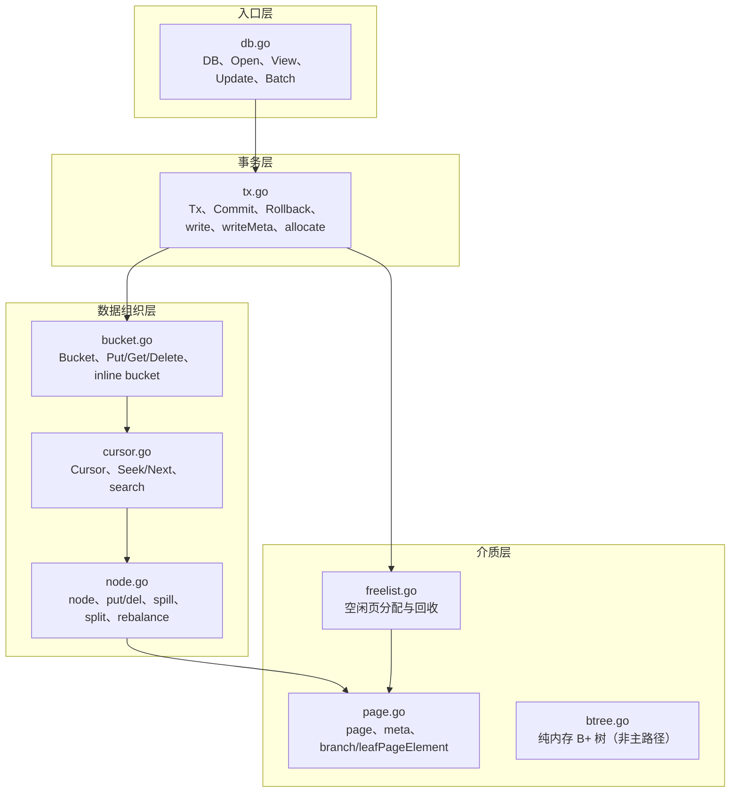
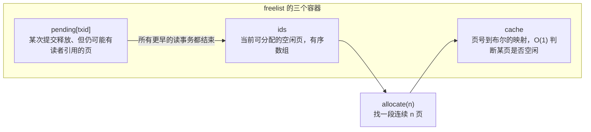
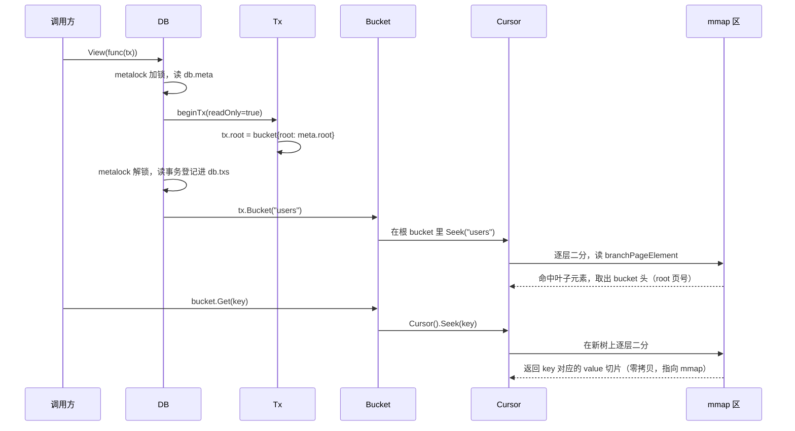
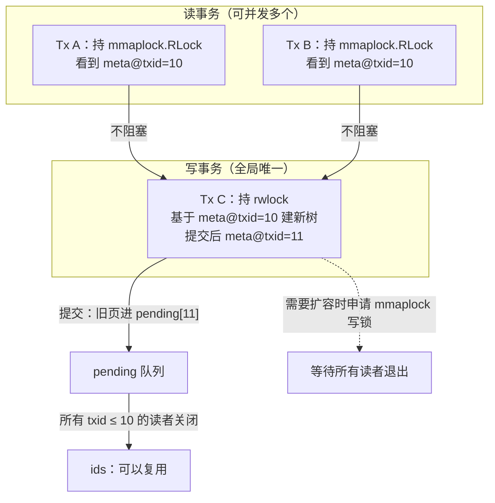

# 06 BoltDB 源码剖析——页、节点与写事务

**摘要：**

BoltDB 是一个把"简单"推到近乎偏执的存储引擎：一个进程、一个文件、一把写锁，没有独立的预写日志，没有后台刷脏线程，没有检查点，崩溃之后需要做的恢复工作只是从两个元数据页里挑出校验和正确的那个。这种简单不是偷懒省出来的，而是用一整套写时复制（Copy-on-Write，COW）机制换来的：每一次修改都落在新页上，旧页原封不动地留在文件里，直到所有可能引用它的读者离开。本文以 bbolt v1.3.x 为准，沿着"页—节点—事务"三层推进，先看文件被切成什么样的页、页头与元数据各存了什么，再看定长元素与变长数据如何靠相对偏移在页内拼出一棵 B+ 树，然后跟着一次 `DB.Update` 走完复制、插入、spill、split、freelist 分配、写元数据、两次 `fdatasync` 的完整提交链路，最后算清这套设计在并发、文件体积与写放大上付出的代价。读完之后应当能回答两个问题：BoltDB 凭什么敢说自己"几乎不需要恢复"，以及这份底气在什么样的负载下会反过来变成负担。

---

## 第 1 章 一个几乎不需要恢复的引擎

如果要在一个 Go 进程里塞进"断电不丢、不需要运维、不引入外部依赖"的键值存储，选型的终点往往会落到 BoltDB 上。它由 Ben Johnson 写成，设计骨架直接借自 Howard Chu 的 LMDB（Lightning Memory-Mapped Database），只是把 C 换成了 Go，把指针运算藏进了 `unsafe`。它的全部家当就是一个文件：打开时 `mmap` 进地址空间，读操作直接在映射区里做指针跳转，写操作复制受影响的页、改完再把根指针换过去。没有 WAL 文件要轮转，没有 checkpoint 要推进，也没有后台线程在你不知道的时候把脏页刷下去。

这套设计最直接的后果，是崩溃恢复的成本被压到了一个近乎可以忽略的量级。开启数据库时，BoltDB 只做三件事：读第 0 页和第 1 页的两个元数据页，各自校验魔数、版本号与校验和，然后挑事务号更大的那个用。两个都坏才算真的坏，坏一个就用另一个，代价是回退到上一次提交。这个过程是常数时间，与数据库里有多少条记录、多少个页、多少层树都没有关系。对比一下 InnoDB 的恢复：重放 redo log 到最后一个检查点、回滚未提交事务、处理 doublewrite 里可能的半写页，恢复时间随日志量增长，长到一定程度就要靠"预热"和"限速"来兜。

不过，"不需要恢复"这件事本身是有前提的。它成立的前提是：任何时刻磁盘上的数据文件都必须是某个已提交状态的完整快照。BoltDB 用两条规则守住这个前提。第一条，写入永远不覆盖仍可能被引用的页，改动一律落在从未被引用过的新页上；第二条，把"哪些页构成当前这棵树"这个信息，压缩进一个 64 字节的元数据结构，并且只通过一次单页写入来切换它。于是提交这件事，被归结成了"写一堆没人引用的新页，最后切换一个元数据页"。

不妨把这种提交方式比作抄写一本账册时的规矩：不许在正本上涂改，要改就先复印一份副本，在副本上改，改完把副本当作新的正本，旧正本收进柜子，等所有正在查阅它的人走了再销毁。涂改痕迹是不可能出现的，因为正本从来没被改过；代价也很清楚，复印的成本取决于要改多少页，而不是要改多少字节。WAL 走的是另一条路：正本照旧，先在一张流水单上记下"某页某处要改成什么"，攒够了一次性誊到正本上。流水单便宜，誊写贵，而且誊到一半断电还得靠流水单重来。

BoltDB 的历史角色也值得交代一句。etcd 从 v3 起就把键空间、revision、lease 这些元数据放在 BoltDB 里，原因不难理解：etcd 的写入以集群配置变更和少量键值更新为主，数据量通常在几十 MB 到几 GB，读远多于写，而且对"断电之后元数据不能错"的要求极高。这种负载正好落在 BoltDB 的甜点区——写不频繁，于是写放大的绝对值可以接受；数据量小，于是 mmap 能把整个文件装进页缓存，读几乎不产生真实 I/O；对恢复时间敏感，于是"常数时间恢复"的价值被放大。后来 etcd 社区把 BoltDB fork 出来独立维护成 bbolt，并在上层加了批量提交与 schema 化改造，动机也都是同一个：不换引擎，只把写入路径再压一压。这段历史在 [[03 存储引擎——WAL、BoltDB 与 MVCC 的持久化链路]] 里有更完整的叙述，本文只关心引擎内部的机制。

那么，这个"一个文件"里究竟装了些什么？

## 第 2 章 模块地图：八个小文件撑起一个引擎

bbolt 的代码量不大，v1.3.x 的核心文件加起来不到一万行，但职责切得很干净。读源码之前先把这张地图记住，后面每提到一个函数，都能立刻知道它站在哪一层。



`db.go` 是门面，负责打开文件、建立映射、维护三把锁与两个元数据页的指针，对外暴露 `View`（只读事务）与 `Update`（读写事务）两个一等公民，外加一个把并发写攒成批的 `Batch`。`tx.go` 是提交协议的全部，`Commit`、`write`、`writeMeta`、`allocate` 这几个函数决定了断电之后文件长什么样。`bucket.go` 提供命名空间，BoltDB 里所有键值都挂在某个 bucket 之下，连"根"本身也是一个 bucket。`cursor.go` 负责定位与遍历，二分查找、前向迭代、后向迭代都在这里。`node.go` 是磁盘页在内存中的可变镜像，插入、删除、分裂、合并、序列化全在这一层完成。

`page.go` 贴着介质，定义页头、元数据与两种页元素的字节布局，是整个引擎里唯一需要关心字节序与对齐的地方。`freelist.go` 管空闲页，它的正确性直接决定了"旧页什么时候可以复用"，也就直接决定了长读事务会不会把文件撑大。`btree.go` 是个例外——它是一份纯内存的 B+ 树实现，与磁盘格式没有关系，主路径并不经过它，更像是早期设计留下的参照物；bbolt 后来的版本干脆把这个文件删掉了。

> [!info] 版本说明
> 本文代码以 bbolt v1.3.x 为准，函数名保持该版本的小写未导出风格（如 `page.meta()`、`tx.writeMeta()`）。bbolt 后续版本把这些方法逐步导出并重命名（如 `Page.Meta()`、`Common.Page`），结构体字段与常量取值没有变化，机制也一致。读的时候优先相信机制，遇到名字对不上再去看差异。

## 第 3 章 文件布局：把文件切成页

BoltDB 对文件的看法极其朴素：一个文件就是一串等长的页（Page），页号从 0 开始，第 n 页的字节偏移永远是 `n × pageSize`。页大小在创建数据库时确定，取的是操作系统的页大小（`os.Getpagesize()`，x86 上通常是 4 KB），之后写进元数据页，每次打开都以元数据里的值为准——这个细节很重要，因为同一个文件可能被搬到页大小不同的机器上打开。

前四个页的位置是硬编码的，其余页由 B+ 树与空闲列表自由使用。


第 0 页与第 1 页是两份互为备份的元数据页。写提交时，BoltDB 按事务号的奇偶决定写哪一页：`txid` 为偶数写第 0 页，为奇数写第 1 页。用奇偶而不是轮流维护一个"当前页"变量，是为了让页号可以从数据本身推导出来——只要读到元数据里的 `txid`，就知道它该在哪个页里，不需要额外的状态位，也不会出现"状态位和数据不一致"这种二级故障。

第 2 页是空闲列表页，记录文件里哪些页当前是空闲的、可以重新分配。它可能不止一页，靠页头里的 `overflow` 字段串起来。第 3 页通常是根 bucket 的叶子页，里面存着最顶层的那些 bucket 名字与它们的根页号。从第 4 页往后，就是 B+ 树的分支页与叶子页，以及被 `overflow` 串起来的大记录页。

页头是固定 16 字节的，所有页共用。

```go
// page.go —— 页头固定 16 字节，页头之后的所有字节由 flags 决定怎么解释
type page struct {
	id       pgid    // 8B：页号，等于文件偏移除以 pageSize
	flags    uint16  // 2B：页类型，决定 ptr 之后的内容是 branch、leaf 还是别的
	count    uint16  // 2B：元素个数；freelist 页超过 65535 时置 0xFFFF 走溢出分支
	overflow uint32  // 4B：后面还跟着几个连续页；只有首页有页头，其余页是纯数据
	ptr      uintptr // 无类型指针，指向紧随页头之后的页数据
}

const (
	branchPageFlag   = 0x01 // 分支页：只存 key 与子页号，不存 value
	leafPageFlag     = 0x02 // 叶子页：存 key 与 value
	metaPageFlag     = 0x04 // 元数据页：存一个 meta 结构
	freelistPageFlag = 0x10 // 空闲列表页：存一串有序的空闲页号
	bucketLeafFlag   = 0x01 // 叶子元素上的标记：这个 value 其实是个子 bucket
)
```

`overflow` 是这套布局里唯一"跨页"的机制。当一条记录或者一个节点的序列化结果超过一页时，BoltDB 不去切分它，而是向空闲列表申请一段连续页，把 `overflow` 设成"还占了几个后续页"，然后一次性写完。这样做的收益是读写逻辑都简单——页号加上溢出计数就是一个完整的字节区间；代价是连续性要求，文件碎片化之后可能找不到足够长的连续区间，只能向文件尾部扩展。

`count` 的 16 位宽度埋了一个坑。一个页最多能装 65535 个元素，正常页永远到不了这个量级，但空闲列表页不一样：一个几 GB 的数据库可能攒下几十万个空闲页。于是 `freelist.write()` 里有个特判——当空闲页数达到 `0xFFFF` 时，把 `count` 置成 `0xFFFF`，然后把真实数量塞进页数据的第一个 `pgid` 槽位，页数据从第二个槽位开始才是页号数组。读的时候先看 `count`，等于 `0xFFFF` 就先取出第一个槽位当真实长度。这个技巧在存储引擎里很常见：用保留值表达"长度字段溢出，去数据区找真值"，比加宽页头字段更省事，也更不容易破坏兼容性。

### 3.1 元数据：64 字节决定一切

元数据是整个文件的"提交指针"，它自己也是页里的一段字节，紧跟在一个 `metaPageFlag` 页的页头之后。

```go
// page.go —— meta 是数据库的提交指针，它自己也是页里的一段字节
type meta struct {
	magic    uint32 // 0xED0CDAED，用来在字节层面认亲，防止误开别的文件
	version  uint32 // 2，格式版本；不匹配直接拒绝打开，而不是尝试兼容
	pageSize uint32 // 页大小，创建时取自操作系统页大小，之后以它为准
	flags    uint32 // 保留字段，当前未使用
	root     bucket // 根 bucket：root 页号 + sequence 自增序号
	freelist pgid   // 本次提交对应的 freelist 页号
	pgid     pgid   // 高水位线：文件里有效页号的上界，不是文件长度
	txid     txid   // 事务号，单调递增，同时兼作"该读哪个 meta 页"的依据
	checksum uint64 // 对前面所有字段做 FNV-1a，用来识别写了一半的元数据
}
```

逐个字段看，每一个都在解决一个具体问题。

`magic` 与 `version` 是"认亲"用的。存储引擎最怕的事故之一是打开了一个不是自己格式的文件——用户传错了路径、磁盘上残留了别的数据库、备份恢复时选错了文件。魔数让这种误认在第一时间失败，而不是在解析到一半时崩溃。`version` 的存在则是为了拒绝跨大版本的格式，因为页布局一旦落盘，任何字段增删都是破坏性变更，宁可明确报错，也不要"尽力而为地读"。

`pageSize` 决定了所有页号到偏移的换算。把它写进元数据而不是每次打开时重新探测，是因为同一个文件可能被搬到页大小不同的机器上；如果两次打开算出不同的页大小，所有页号都会错位，而错误会以"数据莫名其妙"的形式出现，极难排查。

`root` 与 `freelist` 是两个页号，前者指向 B+ 树的根，后者指向空闲列表。提交一个新事务，本质上就是把这两个页号换成新值——新树的根页是新分配的，新的空闲列表页也是新分配的。

`pgid` 是高水位线，表示"文件里有效页号的上界"，注意它不是文件长度。文件可以比 `pgid × pageSize` 更大，多出来的部分是预留空间（`grow` 时会一次性 `ftruncate` 到更大尺寸，避免每次提交都改文件长度）。分配新页时如果空闲列表给不出连续区间，就从 `pgid` 往后切，同时把 `pgid` 往上推。

`txid` 承担了三件事：作为单调递增的事务标识、决定元数据页的奇偶、作为判断"哪个元数据页更新"的依据。一个字段干三份活，在存储引擎里不算罕见，因为它必须随每次提交原子地变化，多引入一个字段就多一份不一致的风险。

`checksum` 是这套恢复逻辑的最后一环。计算方式是对 `checksum` 字段之前的全部字节做 FNV-1a 64 位哈希，也就是说校验覆盖了魔数、版本、页大小、根页号、空闲列表页号、高水位线与事务号。没有它，一个写了一半的元数据页（页头对了、后面一半是旧数据）会通过魔数与版本检查，然后把数据库指向一棵根本不存在的树。

整个 `meta` 结构在 64 位平台上正好 64 字节：四个 `uint32` 占 16 字节，`bucket` 是两个 `uint64` 占 16 字节，后面 `freelist`、`pgid`、`txid` 各 8 字节，`checksum` 8 字节；校验和覆盖的是它前面的 56 字节。这个数字不是设计出来的，而是 Go 结构体布局自然算出来的结果，但它带来一个实际好处：一个 4 KB 的 meta 页里，除了这 64 字节，剩下的空间全是零，写坏的概率被压在极小的一段字节里。也正因为字段是连续排布的，`Sum64()` 可以直接把"从结构体起始地址到 `checksum` 字段"这一段内存交给 FNV-1a 哈希函数，不需要逐个字段序列化——这是一种把内存布局当作磁盘格式的做法，省事但脆弱：任何字段顺序调整都会改变校验范围，必须同步改版本号。

两份元数据页加上校验和，构成了 BoltDB 恢复逻辑的全部。这里有个必须讲清楚的边界：**双 meta 只能回退一个事务**。因为下一次提交会把更旧的那个 meta 页覆盖掉，所以任何时刻磁盘上只有"最新"和"次新"两个状态。如果最新那次提交的数据页在写入过程中被写坏（元数据校验通过，但它指向的页内容是垃圾），BoltDB 不会自动发现——页头里没有校验和，只有 meta 有。这类静默损坏只能靠 `tx.Check()` 主动扫描发现，而 `Check()` 是一个 O(全库) 的遍历，不可能每次打开都跑。

### 3.2 空闲列表：谁在决定旧页何时可以复用

空闲列表是 BoltDB 里唯一带"延迟"的数据结构，它的设计直接决定了长读事务的代价。



`ids` 是一个升序排列的页号数组。`pending` 是一个以事务号为键的映射，写入某次提交时被替换下来的旧页先放进这里，而不是直接进 `ids`。`cache` 是 `ids` 与 `pending` 的并集的映射，用来在 O(1) 时间里回答"这个页是不是已经空闲了"，防止重复释放。

`pending` 的存在理由只有一条：**读事务可能在引用旧页**。一个读事务开始时读到某个 meta，于是它眼里的树是那一刻的树；写事务随后提交，把这条路径上的页全部换成了新页，旧页被释放。但如果此时读事务还没结束，旧页的内容必须保持原样，否则读事务会在中途看到"半新半旧"的树。所以写事务不能直接把旧页丢回 `ids`，只能挂在 `pending[自己的 txid]` 下。等到所有事务号小于等于它的读事务都关闭了，`release()` 才把它们合并进 `ids`。

分配的逻辑简单到可以用一句话概括：在有序数组里找第一段长度足够的连续页。

```go
// freelist.go —— ids 有序，所以"找连续 n 页"退化成一次线性扫描
func (f *freelist) allocate(n int) pgid {
	var initial, previd pgid
	for i, id := range f.ids {
		// 页号不连续，说明上一段连续区间到此为止，重新开始计数
		if previd == 0 || id-previd != 1 {
			initial = id
		}
		if (id-initial)+1 == pgid(n) {
			// 命中：把这 n 个页从 ids 与 cache 里同时摘掉
			if (i + 1) == n {
				f.ids = f.ids[i+1:]
			} else {
				copy(f.ids[i-n+1:], f.ids[i+1:])
				f.ids = f.ids[:len(f.ids)-n]
			}
			for j := pgid(0); j < pgid(n); j++ {
				delete(f.cache, initial+j)
			}
			return initial
		}
		previd = id
	}
	return 0 // 0 是非法页号，调用方据此转向文件尾部扩展
}
```

这段代码是 O(空闲页数) 的线性扫描。对一个攒了几十万空闲页的数据库，一次分配要扫几十万次比较，听起来不便宜，但实际影响有限：绝大多数分配请求的 `n` 是 1 或者 2，扫描通常在数组前段就命中；而且每次提交只在 `spill` 阶段调用它，次数等于本次提交涉及的节点数，不是记录数。bbolt 后来的版本加了一个哈希表类型的 freelist 选项，正是为了把这部分成本进一步摊薄，但那属于工程优化，机制没变。

这里还藏着一个容易被忽略的正确性细节。新页是从 `freelist` 里摘出来的，而 `freelist` 本身也是通过 COW 提交的：新的空闲列表页在 `commitFreelist` 阶段被写进文件，元数据页在最后一步才指向它。这意味着如果提交在写元数据之前失败，磁盘上那份旧的空闲列表页仍然把本次分配的页标记为"空闲"。崩溃重启后加载旧 freelist，这些页又回到了可用池里，既没有泄漏也没有重复引用。**空闲列表也参与写时复制**，这是"几乎不需要恢复"这句话的第二个支撑点，很多人读源码时会漏掉它。

## 第 4 章 磁盘上的 B+ 树：定长元素与相对偏移

页只是容器，真正决定读写成本的是页内布局。BoltDB 的页内布局有一个贯穿全篇的设计选择：**定长元素数组 + 变长数据区 + 相对偏移**。

```go
// page.go —— 定长元素数组在前，变长 key/value 在后，pos 是相对元素自身的偏移
type branchPageElement struct {
	pos   uint32 // 从本元素的地址算起，key 数据在哪里
	ksize uint32 // key 的长度
	pgid  pgid   // 这个 key 对应的子页号
}

type leafPageElement struct {
	flags uint32 // 普通键值，还是内联 bucket
	pos   uint32 // 同上，相对本元素地址
	ksize uint32 // key 长度
	vsize uint32 // value 长度；key 之后紧接着就是 value
}

// 为什么用相对偏移而不是绝对偏移：mmap 的基址会变（扩容要重新映射），
// 任何写进页里的绝对地址在重映射之后都会失效；相对偏移只依赖页内布局，
// 整页 memcpy 到任何地址都仍然自洽。
func (n *leafPageElement) key() []byte {
	buf := (*[maxAllocSize]byte)(unsafe.Pointer(n))
	return (*[maxAllocSize]byte)(unsafe.Pointer(&buf[n.pos]))[:n.ksize:n.ksize]
}
```

为什么元素定长、key 与 value 放到后面？因为要二分查找。定长元素的地址是 `页基址 + 页头 + i × 16`，纯算术，第 i 个元素的头可以立刻取到；而 key 是变长的，如果把 key 内联在元素里，元素就变成变长，第 i 个元素的地址就得从头累加，二分查找直接退化。把变长部分挪到后面，代价是每个元素多一个 `pos` 字段，收益是页内查找回到对数复杂度，而且比较 key 之前只需要触碰 16 字节的元素头，缓存局部性极好——一页 4 KB 能装 250 个元素头，二分 8 次全在同一两条缓存行里。

`pos` 为什么是相对元素自身的偏移，而不是相对页首的偏移？这个问题在第一次读源码时容易滑过去，但它恰恰是 mmap 能成立的前提。如果存的是相对页首的偏移，那么页被 `memcpy` 到别的地方也仍然有效，看起来更"干净"；但 BoltDB 里页并不是独立对象，它可能被整体搬到一段新分配的缓冲区里（`allocate` 返回的就是一块新 `[]byte`），也可能因为 `mmap` 重映射而换了基址。相对元素自身的偏移有个更强的性质：它只描述"从我这里往后多少字节"，与页在哪、页首在哪完全无关。写的时候算一次，之后这页可以随便搬。

还有一个不那么显眼的好处：`pos` 的语义是"元素头到数据"的距离，而元素头是按顺序排列的，于是同一页里的 `pos` 值天然递增。这让某些遍历可以少做一次加法，也让调试时肉眼比对偏移成为可能。

| 维度 | branchPageElement | leafPageElement | 说明 |
|---|---|---|---|
| 元素大小 | 16 字节 | 16 字节 | 定长，支持 `i × 16` 直接寻址 |
| 字段构成 | pos / ksize / pgid | flags / pos / ksize / vsize | 分支只需要子页号，叶子需要 value 长度 |
| 承载数据 | key | key + value | 分支页不存 value，节省一半以上空间 |
| 排序依据 | key 的字节序 | key 的字节序 | 页内升序，是二分查找的前提 |
| 特殊标记 | 无 | `bucketLeafFlag` | 标记该 value 是子 bucket 的头部 |

### 4.1 内联 bucket：为元数据负载做的一处特化

Bucket 是 BoltDB 的命名空间，每个 bucket 本身又是一棵独立的 B+ 树，它的根页号存在父 bucket 的一个叶子元素里。如果每个 bucket 都单独占一页，那么在"bucket 数量多、每个 bucket 里只有几条记录"的负载下，空间浪费会非常惊人——一个只有一条键值的 bucket，也要占掉一整页 4 KB。

于是有了内联 bucket（inline bucket）：当一个 bucket 的内容能放进 `pageSize / 4` 字节以内、并且不含子 bucket 时，它不单独分配页，而是把整个 bucket 的内容序列化成一个伪造的页，直接塞进父 bucket 那个叶子元素的 value 里。这个伪造页的页号是 0，读取时 `Bucket.pageNode(0)` 会返回内存里那个 `rootNode` 或者 `b.page`，而不是去 `tx.page(0)` 取——0 号页是元数据页，绝不能走正常路径。

判断逻辑很短：`bucket.inlineable()` 先确认这个 bucket 的根节点存在、是叶子、没有子节点，然后按"页头 + 每个元素的 16 字节头 + key 长度 + value 长度"累加出一个估算尺寸，超过阈值就放弃内联。它解释了 BoltDB 在元数据场景下的空间效率——etcd 里成百上千个 bucket，绝大多数只有几条记录，如果每个都占一页，光 bucket 的壳就要吃掉几 MB。

阈值取 `pageSize / 4` 而不是 `pageSize`，是因为内联的 bucket 最终要作为一个 value 放进父页，它必须给父页留出容纳多个同类元素的空间。如果阈值取一整页，一个父页只能装一个内联 bucket，内联就失去了意义。

这里还有一层常被忽略的连锁效应：内联 bucket 的 key 空间不占独立页，因此它也不参与 `spill` 的页分配，只在父页被重写时跟着重写。也就是说，内联不只省空间，还顺带把"改一个只有三条记录的小 bucket"的写放大从"树高 × 页大小"降到了"父页一页"。对 etcd 那种"bucket 多、每个 bucket 记录少、写入分散在各个 bucket"的负载，这个优化直接决定了写入能不能跑得动。

这也带来一个必须处理的边界：内联 bucket 在写入过程中可能"长大"到超过阈值。`Bucket.spill()` 里会在序列化之前重新检查一次 `inlineable()`，不满足就转成真实页。换句话说，内联是提交时刻的一个判定，而不是创建时刻的一次性决定。

## 第 5 章 读路径：View、Bucket 与 Cursor

读路径的全部工作，可以概括成"沿着 mmap 的地址空间做几次指针跳转"。这里没有缓冲区管理、没有 LRU 淘汰、没有脏页判定，因为内核的页缓存就是缓冲区，缺页中断就是 I/O 请求。

一次 `DB.View` 的调用链是这样的：



第一步是拿元数据。`beginTx` 会短暂持有 `metalock`，把 `db.meta()` 指向的那个 `meta` 结构复制到事务里，然后立刻释放。这一步之后，读事务就不再需要任何锁——它手上有一个固定的根页号，而由于 COW 的承诺，这棵树在整个事务期间不会被任何人改写。

第二步是把命名空间解析出来。根 bucket 本身也是一个 bucket，`tx.Bucket(name)` 会在根 bucket 里做一次 `Cursor.Seek(name)`，命中之后检查 `flags & bucketLeafFlag`，确认这是一个 bucket 而不是普通键值，然后从 value 里解出 `bucket` 结构（`root` 页号 + `sequence`）。如果这个 bucket 是内联的，`root` 会是 0，后续所有读取都走内存里的伪造页。

第三步是真正的查找。`Cursor.search()` 从根页开始，每层在 `branchPageElement` 数组上做二分，取"最后一个 key 小于等于目标"的子页，递归下去；到了叶子层改用 `nsearch()` 在 `leafPageElement` 数组上二分，命中就把下标记在栈顶。

```go
// cursor.go —— 从根页一路二分下去；stack 记录每一层停在哪，供 Next/Prev 回溯
func (c *Cursor) search(key []byte, pgid pgid) {
	p, n := c.bucket.pageNode(pgid)
	e := elemRef{page: p, node: n}
	c.stack = append(c.stack, e)

	if e.isLeaf() {
		c.nsearch(key) // 叶子层：页内二分，命中就把 index 写进栈顶
		return
	}
	if n != nil {
		c.searchNode(key, n) // 写事务：页已经被 materialize 成可变的 node
		return
	}
	c.searchPage(key, p) // 读事务：直接在 mmap 的页上二分，不分配任何对象
}
```

`searchPage` 与 `searchNode` 的分叉，是 BoltDB 读性能的关键。读事务里 `pageNode` 直接返回 `tx.page(id)`，也就是把 mmap 里某个偏移转成 `*page` 指针，中间没有任何拷贝、没有任何对象分配；写事务里页已经被复制成 `node`（因为要改），查找就改在 `node.inodes` 这个切片上做。同一段定位逻辑，对两种介质各写一份，避免了"为了统一而付出一次转换"的开销。

`nsearch` 的实现里有个值得注意的取舍。它在叶子元素数组上做二分，但由于 `pos` 是相对偏移，比较 key 的时候必须真的跳过去读那段字节。二分八次意味着最多八次"跳转 + 比较"，每次跳转都可能跨越缓存行。BoltDB 没有为此做前缀压缩或者指纹（fingerprint）优化，因为页大小只有 4 KB，整页大概率已经在缓存里，跳转的代价被摊薄了。这也是小页面的一个隐性好处：页内随机访问的缓存惩罚更小。

`pageNode` 里还有一层缓存，只对写事务生效：写事务把被访问到的页 materialize 成 `node` 之后，会以页号为键存进 `bucket.nodes`，同一个事务里再访问就复用；读事务则永远走 `tx.page(id)`，把 mmap 里某个偏移转成 `*page` 指针，不复制、不分配。

这个缓存的存在解释了 COW 的一个隐含成本：写事务里被访问到的页，只要会被修改，就要复制一份成 `node`。复制的粒度是整页，不是被改的那几个字节。所以一次"改一个 key"的操作，在内存里也要复制从根到叶的整条路径。

`Cursor.Next()` 的行为也建立在这个栈上。它把栈顶的 `index` 加一，如果越界就弹出栈顶、把上一层的 `index` 加一、重新下潜到最左叶子；否则就在当前页里前进一个元素。这套逻辑保证了一次范围扫描的复杂度是"每页一次下潜 + 页内线性推进"，与树的深度成正比而不是与记录数成正比。后向遍历 `Prev()` 完全对称，只是找的是"最右子节点"。

> [!note] mmap 不等于零 I/O
> 读路径里看不到任何 `read` 调用，容易让人误以为 BoltDB 的读是纯内存操作。实际上每次第一次触碰某个页，都会触发一次缺页中断（Page Fault），内核要确认这一页在页缓存里；不在就去读盘。区别只在于这次 I/O 是隐式的、由内核发起的、并且不受引擎控制——引擎无法预读、无法合并、也无法给这次 I/O 设超时。缺页中断的完整机制在 [[03 缺页异常：一次内存访问的完整旅程]] 里有详细拆解，`fsync` 与页缓存的关系则在 [[04 Page Cache 与脏页回写——Linux IO 的秘密缓冲层]] 里。

## 第 6 章 写路径：一次 Update 的完整旅程

写路径是 BoltDB 全部复杂度的所在。它没有把复杂度摊到后台线程，而是全部压进了一次同步的 `Commit` 调用里，所以你读 `Commit` 的顺序，读的就是它的安全性论证。

`DB.Update` 的第一步是拿写锁。`beginRWTx` 先 `rwlock.Lock()`，这把锁保证全局只有一个写事务；然后拿 `metalock`，复制当前 `meta`，复制 `freelist`（因为要改），再把 `pgid` 往上推一格——这一格留给新的空闲列表页。到这一步，事务有了一个私有世界：自己的 meta、自己的 freelist、自己的 node 缓存，所有修改都在这个世界里进行，磁盘上的东西一点没动。

第二步是改数据。`Bucket.Put` 先用 `Cursor.seek` 定位，再 `c.node()` 把路径上的页 materialize 成 `node`，最后 `node.put` 把 inode 插进 `inodes` 切片（覆盖或者插入，保持有序）。`Bucket.Delete` 走 `node.del`，如果删掉的是个 bucket，还要递归地把整棵子树标记为待回收。这两个函数都会把路径上的节点标成 `unbalanced`，意思是"我这一层可能元素太少了，提交时检查一下要不要合并"。

第三步是提交。这是整个引擎最值得逐行读的函数。

```go
// tx.go —— 提交的动作顺序本身就是安全性论证，改顺序等于改语义
func (tx *Tx) Commit() error {
	tx.root.rebalance() // 1. 删除过的节点先合并回去，避免页里留下空洞
	// 2. 自底向上把内存 node 重新写成页，空间不够就分裂
	if err := tx.root.spill(); err != nil {
		tx.rollback()
		return err
	}
	tx.meta.root.root = tx.root.root // 根可能换了页号
	// 3. 旧 freelist 页作废，写一份新的（也走 COW）
	tx.db.freelist.free(tx.meta.txid, tx.db.page(tx.meta.freelist))
	if err := tx.commitFreelist(); err != nil { // 内部会 allocate 一个新页
		return err
	}
	// 4. 高水位涨了才扩文件；省略错误处理，失败一律走 rollback
	if tx.meta.pgid > opgid {
		_ = tx.db.grow(int(tx.meta.pgid+1) * tx.db.pageSize)
	}
	// 5. 先落数据页，再落 meta 页；meta 是提交点，必须最后到
	if err := tx.write(); err != nil {
		tx.rollback()
		return err
	}
	if err := tx.writeMeta(); err != nil {
		tx.rollback()
		return err
	}
	tx.close()
	return nil
}
```

`rebalance` 处理的是删除。当某个节点的 inode 数少于 `minKeysPerPage`（2）时，它会尝试与兄弟节点合并，或者从兄弟那里借几个过来；如果合并后父节点也变少了，就继续往上。这套逻辑与 B+ 树的教科书描述一致，但 BoltDB 的实现有个特点：合并只在提交时做一次，而不是在每次删除时立刻做。这意味着一次事务里删了一万条记录，中间过程不会反复分裂再合并，只在最后统一整理一次。

`spill` 是 COW 的核心，也是整个引擎里最容易读错的地方。

```go
// node.go —— spill 是内存树"铺"回磁盘页的唯一入口，也是 COW 的落地点
func (n *node) spill() error {
	// 子节点先铺：子节点可能触发分裂，从而给父节点添新 inode
	sort.Sort(n.children)
	for i := 0; i < len(n.children); i++ {
		if err := n.children[i].spill(); err != nil {
			return err
		}
	}
	for _, node := range n.split(uintptr(n.bucket.tx.db.pageSize)) {
		// 旧页不原地改，直接还给 freelist，等没有读者了再复用
		if node.pgid > 0 {
			n.bucket.tx.db.freelist.free(n.bucket.tx.meta.txid, n.bucket.tx.page(node.pgid))
			node.pgid = 0
		}
		// 省略错误处理：allocate 失败一律向上抛，由 Commit 回滚
		p, _ := n.bucket.tx.allocate((node.size() + pageSize - 1) / pageSize)
		node.pgid = p.id
		node.write(p) // 把 inode 序列化进新页
		node.spilled = true
		if node.parent != nil {
			node.parent.put(node.key, node.inodes[0].key, nil, node.pgid, 0)
		}
	}
	if n.parent != nil && n.parent.pgid == 0 {
		return n.parent.spill() // 根分裂产生了新根，新根也要落盘
	}
	return nil
}
```

这段代码里有四个关键动作，每一个都在为"不覆盖旧数据"服务。

先铺子节点，是因为分裂是自底向上的：子节点分裂会往父节点里插一个新 inode，父节点的大小因此变化，所以父节点必须在子节点全部铺完之后才能确定自己的最终形状。`sort.Sort(n.children)` 保证父节点的 inode 顺序正确，因为父节点最后要按 key 有序地写自己的元素数组。

`freelist.free(旧页)` 把旧页还回去，但注意它进的是 `pending[txid]` 而不是 `ids`——这一刻可能还有读事务在引用它。真正的回收要等到所有更早的读事务结束。

`tx.allocate` 拿新页。这里有个隐含的顺序保证：`allocate` 可能返回文件里任意位置的空闲页，也可能从高水位线往后切，但无论如何，这个页一定不在当前已提交的那棵树里。COW 的"不覆盖"承诺，实际上是由 freelist 的"空闲页不可能是可达页"这个不变量来保证的。

`node.write(p)` 把 inode 序列化成页内的元素数组与数据区。这一步之后，`node.pgid` 更新为新页号，父节点用 `parent.put` 把这个新页号写进自己的 inode。于是整棵树从叶子往根逐层重建，最终根节点的页号变了，`tx.root.root` 也就变了。

### 6.1 分裂：什么时候一页装不下

`spill` 里调用的 `split` 决定了一页能装多少元素。它不是"装满了才分裂"，而是"按填充率分裂"。

```go
// node.go —— 按 FillPercent 找分裂点，而不是把页塞满再裂
func (n *node) splitTwo(pageSize uintptr) (*node, *node) {
	// 元素太少（不足两页各两个）或者能塞进一页，就不裂
	if len(n.inodes) <= minKeysPerPage*2 || n.sizeLessThan(pageSize) {
		return n, nil
	}
	fillPercent := n.bucket.FillPercent // 默认 0.5
	threshold := int(float64(pageSize) * fillPercent)
	splitIndex, _ := n.splitIndex(threshold)

	if n.parent == nil { // 根分裂，造一个新根
		n.parent = &node{bucket: n.bucket, children: []*node{n}}
	}
	next := &node{bucket: n.bucket, isLeaf: n.isLeaf, parent: n.parent}
	n.parent.children = append(n.parent.children, next)
	next.inodes = n.inodes[splitIndex:]
	n.inodes = n.inodes[:splitIndex]
	return n, next
}
```

默认 `FillPercent` 是 0.5，意味着一个 4 KB 的页在装到 2 KB 左右就会分裂。为什么不用 1.0 把页塞满？因为 BoltDB 的页一旦写出就不再原地修改，分裂的触发条件不是"装不下"，而是"下一次写入时可能装不下"。留一半空间，等于给未来的插入留了余量，减少分裂次数。这个参数是可以调的（`bucket.FillPercent`），调到 0.9 能省空间但会增加分裂频率，调到 0.3 则相反——这是 BoltDB 为数不多的可调旋钮之一，也是"空间与写放大之间的一次显式交换"。

`splitIndex` 的实现也值得一看：它从第一个元素开始累加 `元素头 + key + value` 的字节数，累加到超过 `threshold` 就停，同时保证后半页至少有 `minKeysPerPage` 个元素。这个"保证最小元素数"的检查很重要，否则一条巨大的 value 可能让分裂点落在最后，产生一个只有一条记录的页，而这条记录本身又超页，导致下一轮 `overflow` 分配。

### 6.2 落盘：两次 fsync 与它们的顺序

数据页全部写完之后，`tx.write()` 把 `tx.pages` 按页号排序，逐页 `writeAt` 到文件，然后 `fdatasync`。排序不是为了性能（页号顺序对 SSD 没有意义），而是为了让 HDD 上的写入尽可能连续，顺便让调试时的 strace 输出可读。

然后 `tx.writeMeta()` 构造一个新的 meta 页，写到 `txid % 2` 对应的那一页，再 `fdatasync` 一次。**一次提交两次 fsync**，这是 BoltDB 写延迟的物理下限：即使只改一个字节，也要等两次磁盘确认。写 meta 的那一次 `writeAt` 只有 4 KB，是整个提交协议里唯一的原子切换点，它前后各有一把 `metalock` 保护，防止两个事务同时改同一个 meta 页。

为什么必须先落数据页再落 meta 页？因为 meta 页是唯一的"可达性入口"。在它落盘之前，新写的那些页在文件里存在，但没有任何已提交的元数据指向它们，等价于不存在。断电之后读到的是旧 meta，旧 meta 指向旧树，旧树的页一页都没被改过——数据库完整地回退到上一个提交点。反过来，如果先写 meta 再写数据，断电后新 meta 会指向一堆还没写好的页，数据库直接损坏。

这个顺序也解释了为什么"孤儿页"不会泄漏。本次提交新分配的页，在旧 freelist 里仍然被标记为空闲（因为新 freelist 还没落盘），所以重启加载旧 freelist 时它们又回到可用池。这是上一章末尾那个"空闲列表也参与 COW"的结论在实际恢复路径上的体现。注意这里的前提是"旧 freelist 里确实把它们标记为空闲"——从 freelist 里摘出来的页满足这个条件，而从高水位线往后切的页则由"旧 meta 的 `pgid` 更小"来保证不可见。两条来源，两条不同的论证，但结论一致。

`grow` 的调用位置也有讲究。它排在 `write` 之前，因为 `writeAt` 写到文件末尾之外会失败（或者在部分系统上悄悄扩展，行为不一致），必须先把文件 `ftruncate` 到足够大。`grow` 只在 `pgid` 上涨时调用，而 `pgid` 只在 freelist 给不出连续页时才上涨，所以稳态下大多数提交不会碰文件长度。

### 6.3 回滚：把一个世界整个丢掉

BoltDB 的事务回滚几乎不需要实现，因为事务本来就没有碰过磁盘。`tx.rollback()` 做的三件事都很轻：调 `freelist.rollback(txid)` 把本事务在 pending 里登记过的页撤销、把本事务从 `ids` 里摘走的页还回去、清空 `tx.pages` 这个脏页表，最后 `tx.close()` 释放写锁。

这个性质值得展开一句。传统数据库的回滚要读 undo log，把已经写进页里的旧值恢复回去，所以回滚成本与"改了多少"成正比，而且回滚本身也可能失败（undo 页写坏了）。BoltDB 的回滚只是一次内存释放，因为"改"从未离开过内存：`node` 是页的副本，`tx.pages` 是待写的缓冲区，`tx.meta` 是 `db.meta` 的拷贝。丢弃这些对象，等于把整个世界丢掉，磁盘上那份数据连一个字节都没变。**没有 undo log，是因为没有需要 undo 的东西**。

这也顺带解释了 `Commit` 里那些 `tx.rollback()` 调用的位置：`spill` 失败、`grow` 失败、`write` 失败、`writeMeta` 失败，四条路径都走同一个回滚。其中前三条失败时磁盘完全没有变化；第四条（写 meta 失败）时数据页可能已经写进文件，但 meta 还没切换，数据库仍然停在旧状态，只是文件里多了一批不可达的页——下次加载旧 freelist 时它们会回到可用池。

### 6.4 写放大的定量估算

BoltDB 的物理写量与"改了多少字节"几乎无关，只与"改了几页"有关。这个性质可以用一个具体例子算清楚。

假设页大小 4 KB，数据库里有一百万条键值，key 与 value 各 32 字节，每条记录加上 16 字节元素头占 80 字节，一页按 50% 填充率装 25 条左右。于是叶子页约四万页。分支页的每个元素是 16 字节头加 32 字节 key，共 48 字节，同样按 50% 填充，一页能放 40 个左右的子页指针，于是第二层约 950 页，第三层约 24 页，第四层是根页。树高 4。

在这个结构上做一次 `Put`，改动落在某一个叶子页上，而 COW 要求把从叶到根的整条路径都换成新页：

- 复制并重写 1 个叶子页：4 KB
- 复制并重写 1 个第二层分支页：4 KB
- 复制并重写 1 个第三层分支页：4 KB
- 复制并重写根页：4 KB
- 新的 freelist 页（若空闲页多则不止一页）：4 KB
- 新的 meta 页：4 KB

合计约 24 KB 物理写，而逻辑上只改了 64 字节，**写放大约 375 倍**。注意这个数字与 value 的大小几乎无关：把 value 从 32 字节改成 320 字节，逻辑写入变成 10 倍，物理写仍然是 24 KB，写放大反而降到 75 倍。**写放大的分母是"改了多少字节"，分子是"碰了多少页"，两者的比例才是它真正的量纲。**

同样的一百万条记录，换几种提交方式，数字会走出一个很陡的阶梯。

把 1000 次 `Put` 放进一个事务里，且 key 随机分布：这 1000 次修改命中约 1000 个不同的叶子页；这 1000 个叶子散布在四万页里，按覆盖概率算，会牵连到第二层的大约 620 页（950 页里被覆盖六成多）、第三层的全部 24 页，再加根页、freelist 页与 meta 页，总共约 1650 页、6.6 MB。分摊到每条记录是 6.6 KB，写放大降到约 100 倍，是单条提交的四分之一。

把 100 万条全部放进一个事务，相当于把整棵树重写一遍：四万叶子页加 950 加 24 加根页与两个元数据页，约 41,000 页、164 MB。分摊到每条记录是 164 字节，写放大只有 2.6 倍。

这个阶梯说明 BoltDB 的写放大不是一个常数，而是"本次事务涉及页数"与"本次事务改动字节数"的比值。事务越小、key 越分散，这个比值越难看；事务越大、key 越集中，它越接近 1。它解释了两件事。第一，为什么 `DB.Batch` 在 BoltDB 里不是锦上添花而是必需品：它把并发的多个 `Put` 攒进一个事务，本质上是在用延迟换写放大。第二，为什么 BoltDB 的典型负载是"低频写、小数据量"：375 倍的写放大在每秒几十次写的场景下完全无感（24 KB × 50 = 1.2 MB/s），在每秒几万次写的场景下就是灾难（24 KB × 50000 = 1.2 GB/s，任何一块盘都撑不住），而在每秒几十次、每次批量一千条的形态下又变得可以接受（6.6 MB × 50 = 330 MB/s，仍然偏紧，所以真实部署往往还要把批量再调大）。

## 第 7 章 并发模型：一个写者与一群读者

BoltDB 的并发模型只有一句话：**多读单写，读写互不阻塞，写写互斥**。这句话背后是三把锁和一套 pending 机制。



三把锁的分工是这样的。`rwlock` 是写锁，`beginRWTx` 拿它，`tx.close()` 放它，保证同一时刻只有一个写事务。`metalock` 保护元数据页与 `db.meta` 指针，只在读 meta、写 meta 这两个极短的窗口里持有。`mmaplock` 是一把读写锁：每个事务（无论读写）在生命周期内持有一份读锁，而 `db.mmap()` 扩容重映射时需要写锁。这把锁的存在理由很直接——重映射会把旧地址空间 `munmap` 掉，如果此时还有事务在旧地址上读页，就是段错误。

三把锁的组合带来两个必须理解的后果。

第一个后果是**长读事务会阻止空间回收**。前面说过，写事务释放的页进 `pending[txid]`，只有当事务号小于等于它的所有读事务都关闭，`release()` 才会把它们并入 `ids`。如果有一个读事务开了十分钟还没结束（譬如有人在里面做了个全表扫描然后去调了个外部接口），这十分钟里所有被替换下来的旧页都堆在 pending 里，文件只能继续往大长。BoltDB 的官方文档专门警告过这一点：读事务要短，不要在里面做 I/O。

第二个后果是**长读事务还会阻止文件扩容**。`db.allocate` 发现空闲列表给不出页时，会把高水位推上去，并在需要时调用 `db.mmap(minsz)`；而 `db.mmap` 要拿 `mmaplock` 的写锁，必须等所有持读锁的事务退出。于是写事务会在 `grow` 这一步卡住，直到那个长读事务结束。两个机制叠加起来，一个忘记关闭的游标足以让整个写入侧停摆——这是 BoltDB 在生产环境里最常见的事故形态。

`DB.Batch` 是对写放大的直接回应。它开一个 channel 收并发写请求，攒到 `MaxBatchSize`（默认 1000）或者等满 `MaxBatchDelay`（默认 10ms）就合成一个事务提交。这不是为了减少锁竞争（写本来就串行），而是为了把 N 次 COW 合成 1 次——上一节算过，这一步能把写放大降一个量级。代价是延迟：每个 `Put` 都要等批攒满或者超时，P99 会明显高于 `Update`。

并发模型还决定了一件事：**在线备份是可以做到的，而且很便宜**。`Tx.WriteTo(w)` 在一个只读事务里遍历整棵树，把每个页按顺序写进一个 `io.Writer`，产出的文件就是一个自洽的、指向某个已提交状态的数据库副本。因为它工作在只读事务的快照上，写事务可以在同一时刻继续提交，备份出来的内容仍然是某一时刻的一致视图——不需要停写、不需要文件系统快照、也不需要 doublewrite。这也是 etcd 的 `snapshot save` 能在线跑的技术基础。代价是遍历全库，耗时与数据量成正比，大库上要几百毫秒到几秒。

| 锁 | 类型 | 持有者 | 保护对象 | 争用后果 |
|---|---|---|---|---|
| `rwlock` | Mutex | 写事务 | 全局单写 | 写请求排队，串行提交 |
| `metalock` | Mutex | 读写事务的短暂窗口 | meta 页与 `db.meta` 指针 | 影响极小，持有时间以纳秒计 |
| `mmaplock` | RWMutex | 所有事务持读锁，`mmap` 扩容持写锁 | mmap 地址空间 | 长事务阻止扩容，写入卡在 `grow` |

## 第 8 章 边界与代价：这份简单定价几何

行文至此，可以把 BoltDB 的账算一遍了。它用"简单到几乎不需要恢复"换来了什么，又付出了什么。

**第一笔代价是地址空间**。mmap 要求一段连续的虚拟地址，这在 64 位平台上几乎不是问题（理论上限大到没有意义），但在 32 位平台上是硬约束：bbolt 在 32 位目标上把 `maxMapSize` 压到 `0x7FFFFFFF`，也就是 2 GB，实际可用还要扣掉进程自身的地址空间占用。这意味着一个 32 位进程里的 BoltDB 数据库不可能超过 1 GB 出头。即使 64 位，映射区的增长也是分段的：从 32 KB 起按 2 的幂翻倍到 1 GB，之后按 1 GB 的步长增长，每次增长都要重映射、都要等所有事务退出。

**第二笔代价是写放大**。上一节算过，单条 `Put` 的写放大在几百倍量级。这个数字对"每秒几十次写"的场景无感，对"每秒几万次写"的场景是致命的。它也解释了为什么 BoltDB 的性能曲线在写入速率上升时会突然塌陷——不是锁竞争，而是 I/O 带宽被 COW 吃光了。

**第三笔代价是随机写**。COW 分配的新页来自 freelist，位置是任意的，于是一次逻辑上连续的写入，物理上会散落在文件各处。对 SSD 来说，这意味着更多的页级写入与更重的垃圾回收压力；对 HDD 来说，这意味着寻道次数直接乘以树高。这也是 BoltDB 明确不推荐用于写密集负载的技术原因，比"单写锁"这个表面原因更根本。

**第四笔代价是文件只增不减**。删除数据只会把页还给 freelist，文件长度不会缩。一个曾经存过 10 GB 数据、后来只剩 100 MB 的 BoltDB 文件，仍然是 10 GB。要真正缩小，只能用 `bbolt compact` 把数据重写到新文件再替换，而这个过程需要停机或者双写。

**第五笔代价是值的尺寸敏感**。BoltDB 的设计假设 value 不大。一个超过页大小的 value 会走 `overflow`，占用一段连续页，这既加剧了连续空间的压力，也让"改一个 value"变成"重写一大段"。把图片、文档这类大对象直接塞进 BoltDB 是常见的误用，正确做法是存对象存储的引用。

把这些代价与它的收益放在一起，BoltDB 的定位就清楚了。

| 维度 | BoltDB 的表现 | 适配的负载 | 不适配的负载 |
|---|---|---|---|
| 恢复时间 | 常数时间，选一个 meta 页 | 对重启时间敏感的边缘设备、嵌入式 | 需要 PITR（按时间点恢复）的场景 |
| 写吞吐 | 低，单写 + 两次 fsync + COW | 配置、元数据、状态机日志 | 日志采集、时序写入、消息队列 |
| 读延迟 | 极低，mmap 直读，无缓冲区管理 | 读多写少、热数据集能装进内存 | 冷数据为主、数据集远大于内存 |
| 空间效率 | 中等，页内 50% 填充 + 文件不缩 | 数据量稳定、写入以覆盖为主 | 大量删除、数据量剧烈波动 |
| 并发 | 单写多读 | 一写多读的元数据服务 | 多写并发的计数器、队列 |
| 运维复杂度 | 极低，一个文件，无参数 | 无法专人运维的嵌入式环境 | 需要在线扩容、备份、监控的集群 |

把这张表与 [[01 存储引擎概述——从数据库演进到两大派系]] 里 InnoDB 那张表对照着看，会发现两者几乎是互补的：InnoDB 把复杂度花在缓冲池、WAL、doublewrite、后台刷脏上，换来的是高并发写与稳定的延迟；BoltDB 把这些全部砍掉，换来的是"任何时刻杀掉进程都不会坏"和"零运维"。这不是水平高低，而是定价策略不同——**在嵌入式场景里，可靠性不是靠机制多，而是靠机制少**。机制越少，能出错的路径越少；恢复逻辑越短，越不容易在恢复时引入新故障。

这个判断有一个反例值得记住：etcd 的写入压力一旦超过 BoltDB 的甜点区，社区的做法不是给 BoltDB 加后台线程或者 WAL，而是在上层做批量提交、schema 化、把大 key 拆小。换句话说，边界不是靠改造引擎推远的，而是靠调整使用方式来绕开的。这也从侧面说明，BoltDB 的设计已经收敛到它那个定价策略的极值，再往上加机制，得到的就不是 BoltDB 了。

## 小结

BoltDB 的全部设计可以压缩成一句话：**用写时复制把"提交"退化成一次单页写入，从而把"恢复"退化成一次校验和比较**。

这句话在源码里的落点是五处。文件被切成等长的页，页头 16 字节，`overflow` 处理跨页，`count` 用 `0xFFFF` 表达溢出。页内用定长元素数组加变长数据区，`pos` 是相对元素自身的偏移，让整页可以在任意地址上自洽。元数据页有两份，靠 `txid` 的奇偶决定写哪一份，靠校验和识别半写。写事务在私有世界里改 node，提交时自底向上 spill，旧页进 pending，新页从 freelist 来，最后两次 `fsync` 把数据页与 meta 页依次钉死。读事务只拿一瞬间的锁，之后靠 COW 的承诺在一个不会被改写的快照上工作。

代价也清清楚楚：写放大与树高、页大小成正比而与改动字节数无关，单写锁把并发写压成串行，长读事务同时阻止空间回收与文件扩容，文件只增不减，32 位平台上有 2 GB 的天花板。这些代价在"低频写、小数据量、一写多读、零运维"的场景里几乎不可见，在"高频写、大数据量、多写并发"的场景里则是决定性的。

下一章换一条路。B+ 树的困境是"原地更新必须付随机写"，LSM-Tree 的答案是把所有写都变成追加，把代价推到后台合并里去——但代价并没有消失，它只是换了个地方记账，而且这笔账要用读放大、写放大与空间放大三张单子分别结算。

---

## 参考资料

1. bbolt 源码仓库，`go.etcd.io/bbolt`（v1.3.x），核心文件 `db.go`、`tx.go`、`bucket.go`、`cursor.go`、`node.go`、`page.go`、`freelist.go`。
2. BoltDB 原始项目，`github.com/boltdb/bolt`，Ben Johnson。
3. Chu, H. *MDB: A Memory-Mapped Database and Backend for OpenLDAP*. LDAPCon, 2011.（LMDB 的设计文档，BoltDB 的直接灵感来源）
4. Comer, D. *The Ubiquitous B-Tree*. ACM Computing Surveys, 11(2), 1979.
5. Bayer, R., McCreight, E. *Organization and Maintenance of Large Ordered Indices*. Acta Informatica, 1(3), 1972.
6. etcd 文档，*Storage / Backend*（etcd 使用 bbolt 作为后端存储的说明）。
7. Fowler, G., Noll, L., Vo, K.-P. *FNV Non-Cryptographic Hash Algorithm*. IETF Internet Draft.（meta 页校验和使用的 FNV-1a）
8. Kleppmann, M. *Designing Data-Intensive Applications*. O'Reilly, 2017.（第 3 章关于 B 树与写时复制的讨论）
9. Petrov, A. *Database Internals: A Deep Dive into How Distributed Data Systems Work*. O'Reilly, 2019.
10. Linux man-pages，`mmap(2)`、`msync(2)`、`fdatasync(2)`。
11. Go 标准库文档，`sync`、`sync/atomic`、`syscall.Mmap`、`unsafe`。

---

> [!note] 思考题
> 1. BoltDB 的双 meta 页只能回退一个事务。如果要支持回退到任意历史提交点，最少需要改哪些结构？代价是什么？
> 2. 一次 `Put` 的写放大约 375 倍。如果把 `FillPercent` 从 0.5 调到 0.9，写放大与空间放大分别会怎么变？请给出估算过程。
> 3. 读事务持有一个固定的 meta 快照，因此不会看到写事务的中间状态。那么它是否满足可重复读（Repeatable Read）？它是否满足可串行化（Serializable）？
> 4. 一个读事务忘记关闭，会让写侧同时卡在"空间回收"与"文件扩容"两处。如果只能改一处来缓解，你会改哪一处，为什么？
> 5. 页头里没有校验和，只有 meta 有。如果要在页头加 4 字节 CRC，读取路径、写入路径与恢复路径分别要付什么代价？这个交换在什么场景下值得做？
