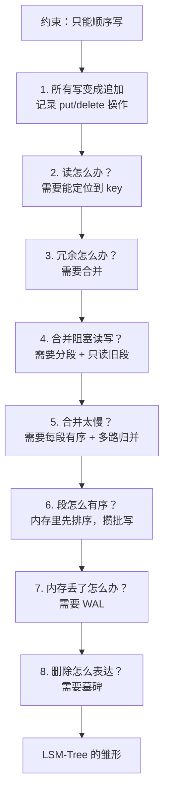
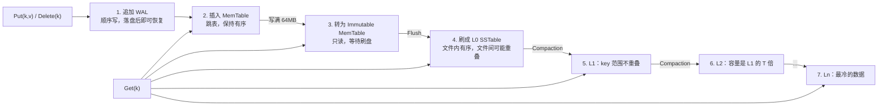
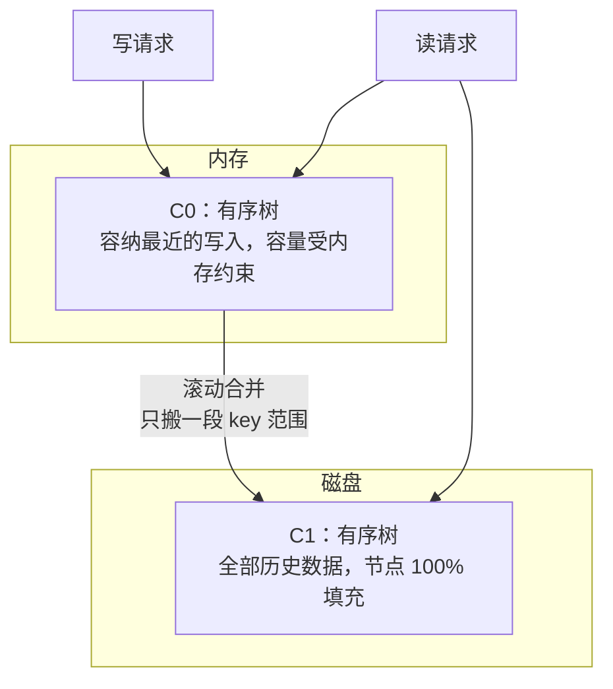
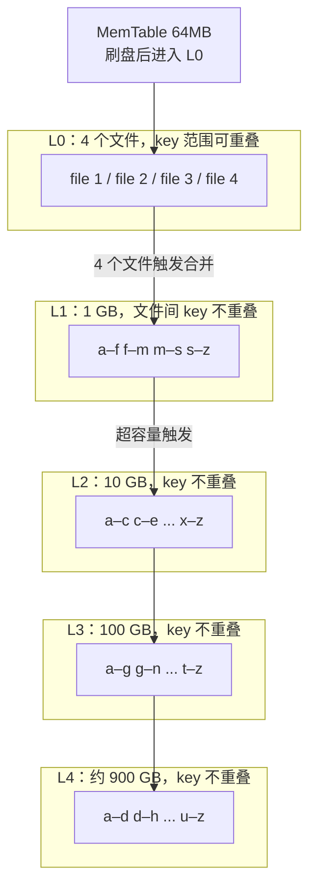
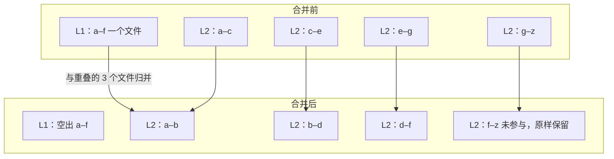
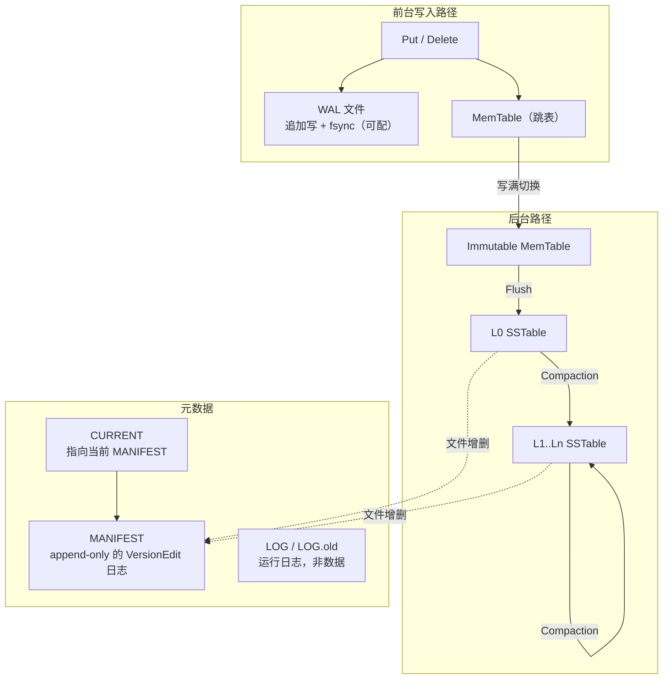
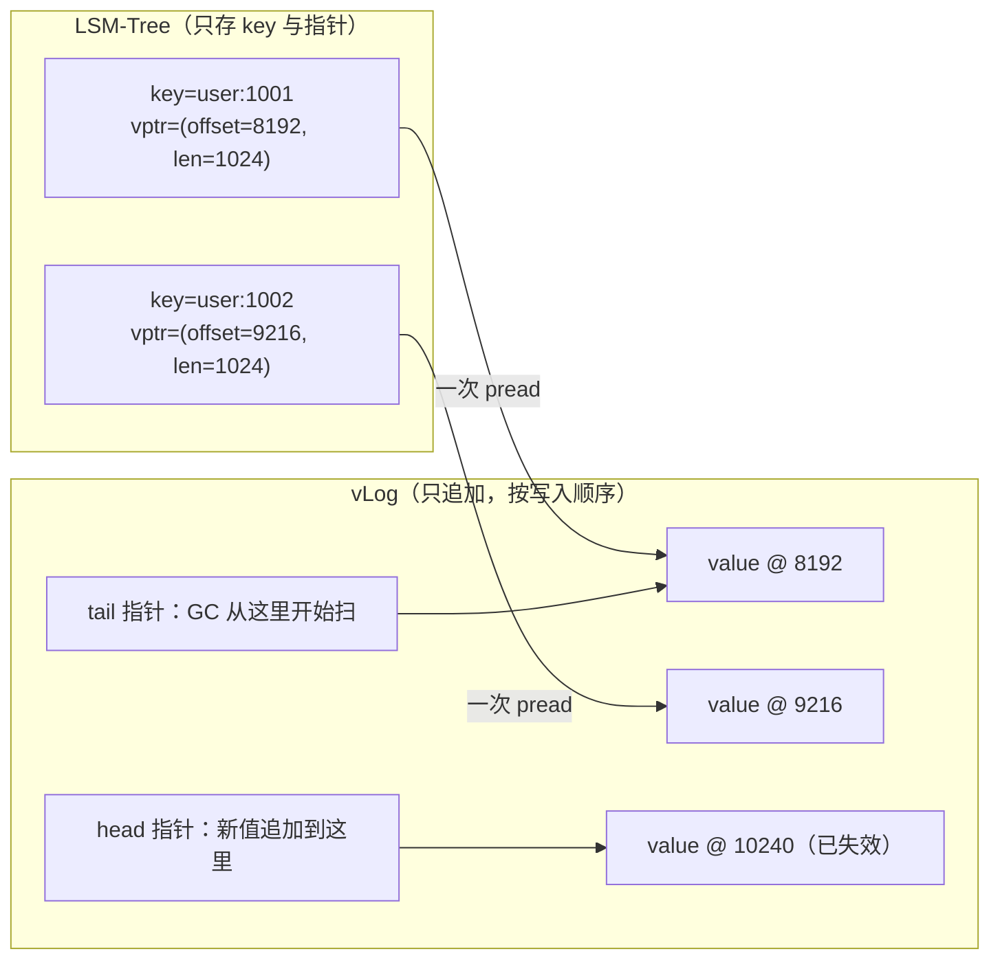

# 07 LSM-Tree 原理——用顺序写换取写吞吐

**摘要：**

B+ 树把所有更新的代价压在了"找到那一页"上：一次写要先随机读一页、改几个字节、再随机写回去，这个模式在机械盘时代意味着一次寻道十毫秒，在写密集的负载下根本撑不住。1996 年，Patrick O'Neil 等人在《Acta Informatica》上给出了另一条路：把所有更新都当作日志记录追加到文件末尾，让写入永远是顺序的，把"整理"这件事推迟到后台，用反复的合并把追加产生的冗余慢慢消化掉，这就是日志结构合并树（Log-Structured Merge-Tree，LSM-Tree）。本文不满足于罗列 MemTable、SSTable、Compaction 这些名词，而是从"如果只能顺序写，怎样还能支持更新与删除"这个问题出发，一步步把 LSM 的结构推导出来，再依次展开双组件与多组件结构、分层合并（Leveled Compaction）与分级合并（Tiered Compaction）的差异、工业实现里的 WAL 与 Manifest 与布隆过滤器各自的职责，最后用一组明确的假设把读放大、写放大、空间放大三笔账算成具体数字，并给出 KV 分离、限速、子合并、分区索引这几条优化路径的收益与代价。读完之后应当能回答两个问题：LSM 到底把随机写换成了什么，以及这笔交换在什么负载下会亏本。

---

## 第 1 章 一块硬盘的脾气，与一篇 1996 年的论文

讨论 LSM 之前，得先把介质这件事说清楚，因为 LSM 的全部设计动机都写在一块机械硬盘的物理参数里。

一块 7200 转的机械盘，盘片每分钟转 7200 圈，也就是每 8.3 毫秒转一圈；磁头寻道到目标磁道平均要 8 到 9 毫秒；一条磁道上的数据靠旋转依次经过磁头，所以一旦寻道完成，连续读写的速度可以到 150 到 200 MB/s。把这两个数字放在一起，结论就很刺眼：顺序写 4 KB 的耗时是微秒级（传输时间几乎可以忽略），随机写 4 KB 的耗时是十毫秒级（寻道加旋转延迟），**两者差了三到四个数量级**。一个只能随机写的存储引擎，在机械盘上的写入上限就是每秒一两百次；一个能顺序写的引擎，同样的盘能跑到每秒几百 MB。

这个差距在过去三十年里一直在缩小，但从来没有消失。固态盘把寻道换成了闪存页的随机访问，4 KB 随机读降到几十微秒，随机写降到几十到几百微秒；NVMe 又把协议开销砍掉一大截。可即便如此，固态盘内部仍然是"页读、块擦"的结构，随机写在长期运行后会因为垃圾回收而退化，而顺序写几乎不受影响。所以"尽量顺序写"这条经验，在机械盘时代是生存法则，在固态盘时代是性能与寿命的双重保险。

写密集的负载则在另一边施加压力。应用日志、监控指标、链路追踪的 Span、推荐系统的用户行为流、车联网的传感器读数，这些数据的共同特征是"写入量远大于读取量，且读取多是按时间范围的批量扫描"。用 B+ 树承接这类负载，每一次写入都要先定位到叶子页、修改、再写回，页分裂时还要连带修改父页，随机写立刻成为瓶颈；而且 B+ 树为了给未来的插入留空间，页内通常只填充到六七成，空间利用率也不算高。这两条路线的分野，在 [[01 存储引擎概述——从数据库演进到两大派系]] 里已经从工作负载的角度铺过一遍，此处只需要记住一个判断：**同一块盘，顺序写与随机写的带宽差，决定了两派引擎的分界线**。

1996 年，Patrick O'Neil、Edward Cheng、Dieter Gawlick 与 Elizabeth O'Neil 在《Acta Informatica》第 33 卷上发表了《The Log-Structured Merge-Tree (LSM-Tree)》，给出的答案是把"更新"重新定义成"追加"。论文的命名直接借自五年前 Ousterhout 团队提出的日志结构文件系统（Log-Structured File System，LFS）：LFS 把整个文件系统的写入都组织成对一段连续日志的顺序追加，LSM-Tree 把这个思路搬到了索引结构上——所有插入、更新、删除都作为一条记录追加，绝不回头修改已经写下的字节，需要整理时再在后台把多份记录合并成一份。

这里有个常见的误解值得先破除：LSM 里的"日志结构"不是"写一个 WAL 就叫日志结构"。WAL 几乎每个存储引擎都有，B+ 树也有；LSM 的特别之处在于**主数据文件本身也是日志式的**——数据以追加的方式落盘，同一份逻辑记录在物理上可能有很多个版本，靠"哪个更新"来决定谁有效，而不是靠"覆盖"。WAL 是"为了不丢而先记一笔"，日志结构是"整个存储都只记流水账，账目靠事后轧账来清"。

不妨把 LSM 比作一间只往前台放便签的档案室。所有新到的材料先写成便签，摞在前台的架子上；查材料的人先翻前台，翻不到再去翻已经按编号装订好的卷宗；卷宗不是一次成型的，而是定期把几摞便签和旧卷宗一起重新装订，装订时同一个编号只留最新那一份。这个比喻的要点在于"重装"这个动作：它不在读者面前发生（在后台），但它确实在消耗装订工的力气，而且卷宗层数越多，同一份材料被反复抄写的次数就越多。**LSM 的写放大，本质上就是这份重复抄写的工钱**。

## 第 2 章 如果只能顺序写

要理解 LSM 为什么长成今天这个样子，最好的办法不是背它的模块清单，而是把自己放到一个约束里：假设你手上只有一块只能高效顺序写的盘，要求你实现一个支持 `Put`、`Get`、`Delete`、`Scan` 的键值存储。每解决一个难题，就会自然长出 LSM 的一个部件。



### 2.1 第一步：把写变成追加

最直接的做法是开一个文件，每收到一次写请求就追加一条记录：`(op, key, value)`，`op` 取 `put` 或 `delete`。这样写入永远是文件末尾的顺序追加，一次系统调用写几十个字节，磁盘的磁头几乎不用动。写吞吐立刻从"每秒几百次"跳到"每秒几十万次"，延迟从毫秒级降到微秒级。

代价马上出现：文件里的记录是乱序的，同一个 key 可能出现很多次，而且没有任何结构能告诉你"某条 key 在哪"。要在这样的文件里 `Get(k)`，只能从头到尾扫一遍，复杂度 O(N)，一个 1 TB 的文件要扫几分钟。

### 2.2 第二步：给读一条捷径

既然文件本身没有结构，那就额外维护一份索引。索引的最小形态是"key 到文件位置的映射"，内容只有三样：key、文件内偏移、长度。查询时先查索引拿到位置，再做一次定位读。

索引放哪里？放内存最快，但内存有限，而且进程一重启就没了；放磁盘就得再解决"索引怎么组织"的问题，绕回原点。工业上两种选择都有：Bitcask 把整个索引放在内存里做成哈希表，换来极快的点查，代价是所有 key 必须装得进内存；LSM 选择让**数据文件自己有序**，索引只记每个文件（或者每个数据块）的 key 范围，于是索引很小，可以常驻内存。

这个分叉很关键，它决定了后面所有设计的走向。选择"文件有序"意味着写入时必须保证顺序，而"顺序追加"和"内容有序"是一对天然矛盾：写进来的 key 是随机的，怎么可能既顺序写又有序存？

### 2.3 第三步：让空间能回收

追加写带来的第二个问题是空间。一条记录被更新十次，文件里就有十一条记录，其中十条是垃圾；删除一条记录只是在末尾多写一个墓碑（Tombstone），旧值仍然占着空间。这个现象叫空间放大（Space Amplification），物理占用与逻辑数据量之比。数据湖里的 CoW 表格式面对的是同一个问题，只是它用"定期重写整份文件"来替代合并，[[02 LSM-Tree 存储引擎——为什么用 LSM 而非 CoW 文件覆盖]] 从另一个场景讨论过这条分岔。

回收的办法是合并（Compaction）：把多个文件读出来，按 key 归并，同一个 key 只保留最新的一条，墓碑如果在更旧的层里还有对应的值就保留、否则可以丢弃，最后把结果写成一个新文件。这个操作把"多份流水"轧成"一份账"，空间回来了，读的时候要查的文件也少了。

但最初的版本里只有一个文件，合并必须读全量、写全量，而且合并期间不能写入（会破坏正在读的输入），也不能读取（文件正被重写）。对一个要求持续可用的系统，这等于定期停机。

### 2.4 第四步：让回收不阻塞写入

把一个大文件切成多个小段（Segment），同一时刻只有最新的那一段接受写入，写满就关闭、开新段。关闭的段从此只读，永不修改。合并只在关闭的段之间进行，于是合并与写入可以并行：写入方只管往最新段追加，合并方慢慢啃旧段。

这一步带来一个必须明确的规则：**任何已经关闭的段都不能再被修改**。这条规则是 LSM 全部并发模型的基石——读操作一旦打开了某个段，就可以放心地读下去，不必担心读到一半文件被改了。它也是 LSM 不需要读写锁、不需要 MVCC 就能支持"读不阻塞写"的原因。

### 2.5 第五步：让合并从 O(N) 变成 O(N log k)

分段解决了阻塞，没有解决速度。如果每个段内部是乱序的，合并就得把每个段整个读进内存、建哈希表、逐条判重，复杂度 O(N)，而且内存放不下就得外部排序。数据量一大，合并就成了永久的后台负担。

出路是多路归并（K-way Merge）：如果每个段内部已经按 key 有序，合并只需要 k 个游标，每次取最小的那个输出，复杂度 O(N log k)，而且只需要 k 个块的缓冲，不需要把数据全部装进内存。这是 LSM 效率的关键一跃——**有序性把"全量重排"变成了"流式归并"**。

于是问题反过来变成：怎么保证每个段落盘时就是有序的？

### 2.6 第六步：内存里先排序，攒批写

答案是不要在收到一条记录时就落盘。先在内存里维护一个有序结构，把写请求插进去；等这个结构涨到阈值（譬如 64 MB），把它整体按序遍历一遍，顺序写成一个有序的段。内存里的有序结构可以是跳表（SkipList）、红黑树、B 树，工业实现多用跳表，因为它的插入不需要旋转、无锁实现相对容易，而且顺序遍历的代价低。

这个内存结构就是 MemTable，落盘后的段就是 SSTable（Sorted String Table，有序字符串表）。一次写入的路径从此变成：插入内存有序结构 → 阈值到了整体刷盘。写入依然接近顺序（刷盘时是一整段连续写），而每个段落盘时天然有序。

攒批还带来一个额外收益：压缩。一批记录放在一起，key 的前缀往往重复，块内可以做前缀压缩，把公共前缀只存一次；配合 LZ4、Zstd 之类的块级压缩，一个 SSTable 的物理体积常常只有逻辑数据的几分之一。B+ 树的页虽然也能压缩，但页内只有几百条记录，压缩比远不如一个几 MB 的 SSTable 块。

### 2.7 第七步：内存里的数据不能丢

MemTable 在内存里，进程崩溃或者机器断电就没了。所以每次写请求在插入 MemTable 之前，必须先往一个追加写的日志文件里记一笔，这个日志就是预写日志（Write-Ahead Log，WAL）。恢复时重放 WAL 里在最后一次刷盘之后的部分，把 MemTable 重建出来。

WAL 与 LSM 的关系需要说清楚：WAL 是"为了不丢"的补丁，不是 LSM 的本质。它也存在写放大（每条记录写两次：一次 WAL、一次最终落盘），但因为两次都是顺序写，绝对值可以接受。工程上常见的优化是把 WAL 按 MemTable 分段，刷盘成功后对应的 WAL 段就可以删除，于是 WAL 的总大小被限制在"几个 MemTable"的量级。

### 2.8 第八步：删除怎么表达

在只追加的世界里，删除不能是"把那条记录抹掉"，只能写一条"这个 key 没了"的标记，这就是墓碑。读的时候如果先碰到墓碑，就直接返回"不存在"，不再往下层找。

墓碑的代价比想象中大。它占用空间（一条墓碑可能只有几十字节，但一个批量删除会产生几百万条）；它影响读（布隆过滤器对墓碑无能为力，因为墓碑本身就是要被"找到"的）；它还影响合并（墓碑只有在确认更旧的层里没有对应值之后才能丢弃，否则删掉墓碑会让旧值"复活"）。所以删除密集的负载在 LSM 上表现通常不好，这不是实现问题，而是模型的结构性代价。

把八步串起来，LSM 的写路径就成型了。



读路径是写路径的镜像，方向反过来：先查 MemTable（最新），再查 Immutable MemTable，然后从 L0 到 Ln 逐层查（越往下越旧），一旦找到就停。这个"从新到旧"的顺序不是优化，而是正确性要求——同一个 key 在多层都有版本，只有最新的那个算数。

## 第 3 章 双组件 LSM：C0 与 C1

论文里给出的第一个结构只有两个组件：内存里的 C0 与磁盘上的 C1。



C0 是内存里的一棵有序树，所有写入先进这里；C1 是磁盘上的一棵有序树，承载全部历史数据。当 C0 超过阈值，就把其中一段连续的 key 范围与 C1 中对应的子树做一次滚动合并（Rolling Merge）：两边都是有序的，用两个迭代器推进，把结果写成 C1 的新子树，替换掉旧的子树，然后从 C0 里删掉这一段。

论文特别强调 C1 的节点要 100% 填充。这个细节背后是成本模型：C1 上的每一次写都是顺序的（因为合并是批量写新子树），所以填充率不需要为"未来插入"留余量，留了反而浪费空间、加深树高、增加读的 I/O 次数。这与 B+ 树必须留 30% 到 50% 空位的做法形成鲜明对比——同一个 B 树形状，因为写入模式不同，填充策略完全相反。

双组件结构的问题也很清楚。C0 的大小受内存约束，假设 64 MB；C1 有 1 TB。那么每写 64 MB 就要触发一次滚动合并，把 64 MB 的数据搬进 C1，同时重写 C1 中与之重叠的那一段。如果 C1 的树高是 4 层，一次合并可能要重写路径上的多个节点，写放大在个位数到十位数之间波动。把 C0 调大能降低合并频率，但内存成本立刻上升；把 C0 调小能省内存，但合并会变得极其频繁。

读路径在这个结构里是最舒服的：先查 C0，再查 C1，最多两次查找。C1 因为只有一份、节点 100% 填充、树高被压到最低，一次点查的 I/O 次数可以做到 2 到 3 次。这也是论文强调"双组件结构读效率更高"的原因——它不是随口一说，而是"只有一个磁盘组件"这个前提的直接推论。**读的代价与磁盘组件的数量成正比**，这个规律在后面的多组件结构里会一直成立，只是常数变了。

这就是多组件结构出现的原因：**用更多层、更大的层间比例，把"频繁小合并"换成"稀疏大合并"**。代价是读要跨更多组件，于是读放大从"2 次"涨到"层数 + L0 文件数"。

## 第 4 章 多组件与分层：从 L0 到 Ln

多组件 LSM 把磁盘部分拆成 C1 到 Ck 共 k 层，每层的容量是上一层的 T 倍，T 通常取 8 到 12。数据从 C0 落盘进入 C1，C1 满了合并进 C2，C2 满了进 C3，一路往下沉。一条记录的生命周期因此变成"从最上层缓慢下沉到最下层"，每下沉一层就被重写一次。



层数由数据总量与层间比例决定：`L = log_T(N / M)`，其中 N 是数据总量，M 是最上层（L1）的容量。1 TB 数据、L1 为 1 GB、T 为 10，需要 4 层；如果 T 取 4，就要 10 层，每一层都要重写一遍，写放大直接翻倍。这个公式解释了一个常被问的问题：为什么 RocksDB 的 `max_bytes_for_level_multiplier` 默认是 10 而不是 2——因为层数是对数项，但每层都要付一次写，T 太小会让层数膨胀。

### 4.1 分层合并：每层一份，范围不重叠

分层合并（Leveled Compaction，也译作 Leveling）的规则是：除 L0 之外，每一层内部的多个文件 key 范围互不重叠，整层按 key 排成一个有序序列。

L0 是例外。L0 的文件由 MemTable 直接刷出，刷出时并不知道别的文件覆盖哪些 key，所以 L0 的文件之间范围必然重叠。这就是为什么 L0 的文件数必须被严格控制（LevelDB 默认到 4 个就触发合并，到 8 个开始拖慢写入，到 12 个直接停写）——L0 的每一个文件都要在点查时被检查一遍，它实际上是"读放大"的放大器。

合并的动作是这样的：从 L1 里挑一个文件（或者一段范围），把它与 L2 中所有 key 范围重叠的文件一起读出来做多路归并，输出新的 L2 文件，然后删掉输入文件。



这张图里藏着一个容易被忽略的成本：输入是"L1 的一个文件 + L2 的三个文件"，输出是"L2 的三个文件"，所以物理写入量约等于 L2 中被触碰的那部分，而 L2 是 L1 的 T 倍大。也就是说，**每往下沉一层，就要重写大约 T 倍于输入的数据**。这就是写放大公式的来源，第 6 章会把它算成具体数字。

### 4.2 分级合并：每层 T 份，写完一批再合

分级合并（Tiered Compaction，也译作 Tiering）的规则反过来：每一层允许存在最多 T 个"运行段"（Run），每个运行段内部有序，但运行段之间 key 范围可以重叠。一层攒够 T 个运行段，就把它们一次性归并成一个更大的运行段，推进下一层。

这个策略的收益与代价同样鲜明。收益是写放大低：数据每下沉一层只被重写一次，因为它不需要与下层已有的数据混合——攒够一批一起走，走的时候只写自己的内容。代价是读放大高：一层里有 T 个运行段，每个都可能包含目标 key，点查要检查 T 次；空间放大也高，最坏情况下 T 个运行段里存着同一个 key 的 T 个版本。

| 维度 | 分层合并（Leveled） | 分级合并（Tiered） |
|---|---|---|
| 每层文件数 | 1 组，key 范围不重叠 | 最多 T 个运行段，范围可重叠 |
| 合并输入 | 上层若干文件 + 下层重叠文件 | 同层 T 个运行段 |
| 写放大 | 高，约 T × L | 低，约 L |
| 读放大 | 低，每层查 1 个文件 | 高，每层查最多 T 个运行段 |
| 空间放大 | 低，约 1 + 1/T | 高，最坏约 T |
| 合并延迟尖峰 | 小，每次只搬一段 | 大，一次搬一整层 |
| 典型实现 | LevelDB、RocksDB 默认 | Cassandra 的 STCS、RocksDB 的 Universal |

两种策略的差别，本质上是把同一笔成本记在不同的账本上。Leveled 用"多写几遍"换"少查几个文件"，Tiered 用"多查几个文件、多占几倍空间"换"少写几遍"。近些年的研究（譬如 Monkey、Dostoevsky 这些工作）指出，两者之间还存在连续的中间形态：不同层用不同策略、热层用 Tiered、冷层用 Leveled，或者按查询模式动态调整，本质是在同一条帕累托前沿上选点。

### 4.3 何时合并、合并谁

策略定了之后，还有两个工程问题：什么时候触发，以及从一堆候选里挑哪一个。

触发条件通常是两类。一类是文件数阈值：L0 的文件数达到 4 个就触发，这是 LevelDB 的默认值，因为 L0 的重叠是读放大的主要来源。另一类是容量阈值：每层有一个容量上限，超过就触发，`score = 该层实际大小 / 该层容量上限`，score 最大的层优先合并。RocksDB 沿用了这套打分机制，只是把容量计算换成了动态的。

两个阈值放在一起用，是因为它们各自防的是不同的病。文件数阈值防的是"L0 文件堆积导致点查要扫太多文件"，它只管最上面一层；容量阈值防的是"某一层无限膨胀导致下层被压垮"，它管的是稳态下的空间分布。前者是延迟保护，后者是容量保护，缺一个都会在特定负载下出问题——只有文件数阈值，L1 会慢慢涨到和 L4 一样大，合并永远停在浅层；只有容量阈值，L0 的文件可能在两次打分之间就堆到十几个。

选择策略则决定了"局部热点"会不会被放大。LevelDB 的做法是轮转（Round-Robin）：每层记一个 `compact_pointer`，指向上次合并结束的 key，下次从它开始找第一个文件，这样保证每一段 key 范围都有机会被搬动，不会永远只合并最左边那一小段。如果没有轮转，顺序键写入（譬如按时间戳递增的时序数据）会把所有写入都压在 key 范围的右端，合并永远只碰右端的文件，左端的旧数据永远沉不下去。

还有一类触发叫寻道合并（Seek Compaction），它针对的是"读得太多但写得太少"的文件。

```go
// LevelDB 的 table cache：一个文件被无效 Seek 太多次，就把它标记为"该合并了"
// 阈值不是拍脑袋：文件越大，允许的无效 Seek 越多；但至少给 100 次机会
func (v *Version) updateStats(file *FileMetaData) {
    // 64MB 的文件允许 64MB / 16KB = 4096 次无效 Seek
    if file.allowed_seeks <= 1 {
        // 用完了：把这个文件的 seek 计数清零，并触发一次针对它的合并
        v.seekCompaction(file)
        return
    }
    file.allowed_seeks--
}
```

这个机制解决的是一个很实际的问题：某几个文件被频繁查询但从未命中（因为查询的 key 根本不在里面，只是落在它的范围内），布隆过滤器能挡住 I/O，但挡不住每次都要查一次过滤器、查一次索引。当无效查询累积到阈值，系统主动把这个文件与下层合并，让它与相邻范围的数据混在一起，从而缩短"范围重叠"的长度。这是"用一次写换长期读"的典型交易。LevelDB 里这套"版本 + 合并选择"的完整实现在 [[04 Compaction——分层合并与版本管理]] 中有逐层拆解，本文只取它对 LSM 通用性的启示。

## 第 5 章 工业实现的实际结构

论文给的是骨架，工业实现往骨架上加了不少零件。以 LevelDB 与 RocksDB 这一支为例，一个完整的 LSM 引擎由下面这些部分组成。LevelDB 这一支的完整拆解见 [[01 LevelDB 全局架构——LSM-Tree 的写优化设计]]，本节只按"每个零件解决什么问题"的角度过一遍。



### 5.1 MemTable 与不可变 MemTable

MemTable 是一个按 key 有序的内存表，LevelDB 用跳表实现。跳表的好处是插入不需要旋转、不需要再平衡，单次插入的期望复杂度 O(log n)，而且顺序遍历只需要沿着最底层的链表走。

当 MemTable 的大小超过 `write_buffer_size`（RocksDB 默认 64 MB）时，它被切换成只读的 Immutable MemTable，同时开一个新的 MemTable 接写。这个切换必须是原子的：写入方要么写进旧的、要么写进新的，不能出现"两边都写了"或者"两边都没写"。LevelDB 用一把互斥锁保护这个指针切换，RocksDB 用更细的原子指针。

为什么需要 Immutable 这个中间态？因为刷盘是一个耗时的动作（几十毫秒到几秒），如果直接在 MemTable 上刷，刷盘期间就不能写入；如果刷完再切换，那刷盘期间写入的数据会落进一个"即将被丢弃"的表。引入一个只读的中间态，让"接写"和"刷盘"彻底解耦：新表接写，旧表慢慢刷，两者互不影响。

刷盘完成后，对应的 WAL 段就可以删除，Immutable MemTable 占的内存也可以释放。这里有个顺序要求：**必须先确保 SSTable 落盘成功，再删 WAL**，否则中间断电会丢数据。

### 5.2 SSTable 的内部布局

SSTable 是一个不可变的文件，内部按 key 有序，切成若干数据块（Block），块尾放重启点（Restart Point），文件尾放索引块、过滤器块与 Footer。

```text
[data block 0] [data block 1] ... [data block N]
[filter block：每个 data block 一个布隆过滤器]
[metaindex block：记录 filter 块的位置]
[index block：每个 data block 的 last key + 偏移 + 长度]
[footer：index 偏移 + metaindex 偏移 + 魔数]

data block 内部：
  [key1][value1][key2 共享前缀长度][value2] ... [restart point 数组]
```

块内的 key 采用前缀压缩：每条 key 只存"与上一条 key 的公共前缀长度 + 剩余部分"。这对有序数据极其有效——相邻 key 往往共享很长的前缀，譬如同一个设备 ID 下的多个时间戳。代价是块内不能二分查找（因为第 n 条 key 必须知道前 n-1 条才能还原），所以每隔若干条记录一个重启点（LevelDB 默认 16 条），重启点上的 key 完整存储，二分查找在重启点数组上做，找到区间后再线性扫描。**"前缀压缩"与"可二分"这对矛盾，用重启点做了一次折中**，这个手法在列存、倒排索引里都能看到同构的版本。

索引块记录每个数据块的最大 key 与位置，常驻内存（或者缓存在 block cache 里）。一个 4 KB 的数据块大约装几十条记录，1 TB 数据就有两三亿个数据块，索引项本身就要几 GB——这就是"分区索引"（Partitioned Index）要解决的问题，第 7 章会展开。

### 5.3 Manifest 与 Version：文件集合的原子切换

一次合并会删掉几个旧文件、产生几个新文件。这个变化必须原子地生效，否则崩溃之后可能出现"新旧文件都在"或者"新旧文件都不在"的状态，读出来的数据就是错的。

LSM 用一份追加写的清单来解决，LevelDB 叫 MANIFEST，内容是一串 VersionEdit 记录，每条记录描述"新增了哪些文件、删除了哪些文件、各层的 compact_pointer 变成了什么"。启动时从 MANIFEST 头开始重放所有 VersionEdit，得到当前的文件集合（Version）。CURRENT 文件里存着当前 MANIFEST 的文件名，切换 MANIFEST 时先写新文件、fsync、再原子地改写 CURRENT（一个小文件，靠 rename 保证原子）。

```text
VersionEdit 的字段（简化）：
  comparator         : "leveldb.BytewiseComparator"
  log_number         : 1234        // 这个版本对应的最小 WAL 号
  next_file_number   : 5678
  last_sequence      : 9000000
  compact_pointer[0] : "user_1000" // L0 下次从哪个 key 开始合并
  compact_pointer[1] : "user_0500"
  deleted_file       : (2, 45)     // 层号, 文件号
  new_file           : (2, 46, 1048576, "a", "f") // 层, 号, 大小, 最小 key, 最大 key
```

这套机制的巧妙之处在于"用日志表达状态变化"，而不是"把状态整体写一遍"。1 TB 数据可能有几万个文件，把整个文件清单序列化一遍要几百 KB，而一次合并只改动了几个文件，对应的 VersionEdit 只有几百字节。用日志表达增量，代价是启动时要重放（几万个文件的清单，重放通常在毫秒级）。

### 5.4 布隆过滤器：把"不存在"变成一次内存查询

LSM 的读放大主要来自"要查很多层、很多文件才能确认一个 key 不存在"。布隆过滤器（Bloom Filter）在这里的价值被放大到了极致：它用一个位数组回答"这个 key 可能在这个文件里吗"，答"不可能"时一定正确，答"可能"时有一定误判率。

误判率与每个 key 分配的位数有关，近似公式是 `FP ≈ 0.6185^b`，b 是每个 key 的位数。10 bit/key 对应约 0.8% 的误判率，16 bit/key 对应约 0.05%。这个数字决定了读放大的期望值：假设一次点查要检查 8 个磁盘文件（4 个 L0、4 层各 1 个），每个文件的过滤器都以 0.8% 的概率误判，那么期望的物理读次数是 `1 + 7 × 0.008 ≈ 1.06` 次——**过滤器把"最坏 8 次"压成了"平均 1.06 次"**。

代价是内存。10 bit/key 意味着 1 亿个 key 要 125 MB，1 TB 数据、每条 100 字节就是 100 亿个 key，要 12.5 GB，显然放不下。所以工业实现把过滤器放在块级而不是文件级（每个 4 KB 数据块一个过滤器），并按需加载到 block cache 里；同时允许为不同层配置不同的过滤器强度，冷层甚至可以不放。

### 5.5 恢复：两条重放路径

进程重启时，LSM 要把"文件集合"与"内存里的增量"分别恢复出来，这是两条独立的路径。

第一条恢复文件集合：读 CURRENT，找到 MANIFEST，从头重放所有 VersionEdit，得到崩溃前最后一个已持久化的 Version。这条路径只关心元数据，与数据量无关，几万个文件的清单重放通常在毫秒级。如果 MANIFEST 本身损坏或者缺失，LevelDB 提供了 `repair` 工具去扫目录、按文件号重建清单——这是一条兜底路径，不保证不丢数据，只保证能把数据库打开。

第二条恢复内存增量：从 Version 里记录的 `log_number` 开始，依次重放 WAL 文件，把每条记录重新插进新的 MemTable，直到最后一个 WAL 文件。重放完成后，新的 MemTable 就是崩溃前内存里那份数据，可以正常接写。这里有个细节：重放时不需要校验"这条记录是否已经刷进 SSTable"，因为 `log_number` 已经指明了"这个号之前的 WAL 对应的 MemTable 都已经刷盘成功"，重放从它之后开始就不会重复。

恢复路径里还有一个不起眼但很关键的东西：序列号（Sequence Number）。每条记录在写入时被分配一个全局单调递增的序列号，随记录一起落盘。它的作用是解决"同一个 key 在多个地方出现，哪个更新"的问题。对 L1 及以下，因为层内 key 范围不重叠，同一层最多一条，跨层则"层号越大越旧"，判断很简单。但 L0 的文件之间范围重叠，两个文件里可能都有同一个 key，此时既不能靠文件号（文件号是分配顺序，与数据新旧不严格对应），也不能靠时间戳（时钟不可靠），只能靠序列号。读的时候取序列号最大的那条，合并的时候也按序列号取舍。**序列号是 LSM 里唯一可靠的"时间"**，这也是为什么 LSM 天然支持快照读——指定一个序列号，就指定了一个时间点。

## 第 6 章 三笔账：把放大算成数字

前面反复提到读放大、写放大、空间放大，这一章把它们算清楚。先固定一组假设，所有数字都从这组假设推出来。

| 参数 | 取值 | 说明 |
|---|---|---|
| 逻辑数据总量 N | 1 TB | 稳态下的全量数据 |
| 层间容量比 T | 10 | 每层是上一层的 10 倍 |
| 磁盘层数 L | 4 | L1=1 GB、L2=10 GB、L3=100 GB、L4≈889 GB |
| MemTable 大小 M | 64 MB | 触发刷盘的阈值 |
| L0 文件数阈值 | 4 | 达到 4 个触发合并 |
| 记录大小 | key 16 B + value 100 B | 典型的元数据/日志行 |
| 数据块大小 | 4 KB | 每块约 35 条记录 |

### 6.1 写放大

写放大（Write Amplification，WA）的定义是"一次逻辑写引发的物理写字节数"。LSM 的写放大来自三个环节：WAL、刷盘、合并。

WAL 与刷盘各写一次。刷盘那一次算进下面的公式，WAL 那一次单独记账——它不参与后续合并，只是把"为了不丢"的成本额外加上去。合并的账要按层算。考虑 L1 中的一个文件要合并进 L2：输入是 L1 的这份数据（记其大小为 Δ），加上 L2 中与之 key 范围重叠的部分。因为 L2 的容量是 L1 的 T 倍，且 key 范围均匀分布，重叠部分的大小约等于 `Δ × T`。合并的输出大小是 `Δ + Δ×T`，全部写到 L2。

于是"每下沉一层"的写放大是 `1 + T`。数据从 L1 沉到 L4 要经历 3 次下沉，加上 L0 刷盘那一次：

```text
WA_leveled ≈ 1（刷盘） + (L - 1) × (1 + T)
           = 1 + 3 × 11
           = 34
```

量级上与文献里常见的 `T × L` 上界一致，差别来自"最后一层不再往下沉"这个边界。把 T 换掉再算一遍，就能看出层间比例到底在调什么：覆盖同样的 1000 倍容量增长，T 取 4 需要 5 层（4 的 5 次方约 1024），写放大降到 `1 + 4 × 5 = 21`；T 取 20 只需要 3 层（20 的 3 次方是 8000），写放大升到 `1 + 2 × 21 = 43`。**层间比例越大，层数越少，但每层要拖带的旧数据越多，写放大反而上升**；层间比例越小，写放大越低，但空间放大（`1 + 1/T`）与读放大（层数）跟着涨。这就是 T 的默认值普遍落在 8 到 12 的原因——它不是让写放大最小的那个点，而是让三笔账都还付得起的那个点。

按 34 倍算绝对值：一次逻辑写 116 字节（key + value），物理写 34 × 116 ≈ 3.9 KB。写入 10 万条每秒，就是 390 MB/s 的持续写带宽，再加 WAL 的 11.6 MB/s。一块 SATA 固态盘的持续写大约 500 MB/s，一块 NVMe 能到 2 到 5 GB/s，所以 LSM 在"每秒十万条、每条 100 字节"这个量级上还能跑，再往上就要靠 KV 分离（第 7 章）。

Tiered 的写放大完全不同。数据每下沉一层只被重写一次，因为它不与下层已有数据混合：

```text
WA_tiered ≈ 1（刷盘） + (L - 1) × 1 = L = 4
```

4 与 34，差了将近一个数量级。这就是为什么 Cassandra 默认用 STCS（Size-Tiered Compaction Strategy）——它的目标负载是"写吞吐优先、读延迟不敏感"。

### 6.2 读放大

读放大（Read Amplification，RA）的定义是"一次逻辑读引发的物理读次数"。一次点查最坏要检查：

```text
RA_worst ≈ 4（L0 的 4 个文件，范围重叠，逐个查）
           + 4（L1..L4 每层最多 1 个文件）
         = 8 次块读
```

MemTable 与 Immutable MemTable 也在检查范围里，但它们在内存中，不产生块读，所以不计入物理读次数。注意 L4 也必须查，因为目标 key 可能就躺在最冷的那一层。8 次块读、每次 4 KB，就是 32 KB 的物理读来回答一个 116 字节的查询，按字节算的读放大约 280 倍。

布隆过滤器把期望值改写了。设每个 key 10 bit、误判率 0.8%，且过滤器常驻内存不产生 I/O，那么期望的物理读次数是：

```text
RA_expected ≈ 1 + 7 × 0.008 ≈ 1.06
```

那个"1"是命中那一层不可避免的一次读，后面的"7"是其余七个文件被过滤器挡住的概率。也就是说，绝大多数"不存在"的查询在内存里就被拒绝了，只有真正命中的那一次产生 I/O。但要注意两个前提：过滤器必须在内存里（否则查过滤器本身就要 I/O），以及查询的 key 确实存在（存在时必然会命中某一层，那一次无法避免）。

Tiered 的读放大完全不同：L0 的 4 个文件照旧，之后每层最多有 T 个运行段，逐个都要查，所以最坏是 `4 + 4 × 10 = 44` 次。布隆过滤器同样能把它压下来，期望值 `1 + 43 × 0.008 ≈ 1.34`，但代价是要常驻内存的过滤器数量多了四倍多。

### 6.3 空间放大

空间放大（Space Amplification，SA）来自三处：多版本（同一个 key 在不同层有多个值）、墓碑（删除标记要等到更旧的层被合并才能丢弃）、合并过程中的临时空间（输入文件在输出写完之前不能删）。

Leveled 的空间放大近似是 `1 + 1/T`。原因是最坏情况发生在"某一层正在合并"时：L2 有 10 GB，其中 1 GB 正被 L1 的新数据替换，新旧并存，于是峰值是 11 GB 装 10 GB 的逻辑数据，比例 1.1。T=10 时空间放大 1.1，这也是 RocksDB 文档里常见的数字。

Tiered 的空间放大最坏是 T。因为一层里可能有 T 个运行段，同一个 key 在 T 个段里各有一个版本，最坏情况下这些版本全都是不同 key 的不同版本（实际上不会这么糟，但上界是 T）。

墓碑会额外增加空间放大，而且它的影响难以用一个公式概括：一个批量删除 1000 万条记录的操作，会写入 1000 万个墓碑，这些墓碑要等到合并把它们推到最底层、并且确认底层没有对应值之后才能丢弃。在这期间，逻辑上"删掉了 1000 万条"，物理上"多了 1000 万条"。

| 指标 | Leveled（T=10, L=4） | Tiered（T=10, L=4） |
|---|---|---|
| 写放大 | ≈ 34 | ≈ 4 |
| 读放大（最坏） | 8 次块读 | 44 次块读 |
| 读放大（有过滤器） | ≈ 1.06 | ≈ 1.34 |
| 空间放大 | ≈ 1.1 | 最坏 ≈ 10 |
| 每 TB 数据占盘 | 1.1 TB | 最多 10 TB |
| 适合的负载 | 读延迟敏感、空间敏感 | 写吞吐优先、空间充裕 |

把这两列并排看，会发现它们几乎是镜像：一列的优势正好是另一列的劣势。这不是巧合，而是 RUM 猜想（RUM Conjecture）在这个具体结构上的投影——读、更新、空间三者不能同时最优，你只能选择把哪一项推到极端。

还有一件事这张表没体现：这三笔账不是独立的，它们可以互相兑换。把 T 从 10 调到 4，层数从 4 层涨到 5 层，写放大从 34 降到 `1 + 4×5 = 21`，代价是空间放大从 1.1 升到 1.25、最坏读放大从 8 次升到 9 次；把 T 调到 20，层数缩到 3 层，空间放大降到 1.05、最坏读放大降到 7 次，写放大却升到 `1 + 2×21 = 43`。三个方向互相拉扯，没有哪个 T 能让三项同时变好。**默认值 8 到 12 是这场拉扯里的一个停战点，不是一个最优解**；如果业务对空间极度敏感（譬如 10 TB 数据只买了 11 TB 的盘），就该往大调；如果写带宽是唯一瓶颈（譬如日志采集），就该往小调，然后接受空间放大。

## 第 7 章 写放大的五条优化路径

写放大是 LSM 最贵的账单，尤其是在固态盘上——它不仅消耗带宽，还直接消耗闪存的擦写寿命。一块标称 1 DWPD（每天全盘写一次）的企业级固态盘，5 年保修期内允许写入约 1800 倍全盘容量；写放大 34 意味着逻辑上写入 1 TB 数据，实际消耗 34 TB 的寿命额度。所以在 SSD 上，写放大是一个会变成钱的数字。

### 7.1 KV 分离：让 value 不参与合并

最有效的一条路是 WiscKey（Lu 等人，FAST 2016）提出的键值分离。核心观察是：合并之所以贵，是因为它要把 value 一起搬来搬去；而 value 通常比 key 大一到三个数量级，且一旦写入就不再变化。既然如此，为什么不把 value 存到另一个只追加、不合并的地方，LSM 里只留 key 和一个指向 value 的指针？



收益可以算出来。假设 key 16 字节、value 1 KB，合并时 LSM 里每条记录是 `16 + 12（偏移与长度）+ 若干元数据 ≈ 32` 字节。写放大 34 意味着：

```text
不分离：34 × (16 + 1024) ≈ 35.4 KB 物理写 / 每次逻辑写
分离后：34 × 32 ≈ 1.1 KB（LSM） + 1.0 KB（vLog 追加） + 1.4 KB（vLog GC 重写）
      ≈ 3.5 KB 物理写 / 每次逻辑写
```

差距接近 10 倍，而且 value 越大差距越大：value 涨到 4 KB，不分离是 137 KB，分离后是 1.1 + 4 + 5.6 ≈ 10.7 KB，差距拉到 13 倍。反过来，value 只有 10 字节时，分离几乎没有收益，因为指针本身就有 12 字节。

代价也很实在。点查变成两次 I/O：先在 LSM 里找到指针，再去 vLog 里 `pread` 一次，后者的位置是随机的。范围扫描更糟：本来是顺序读 LSM 的块，现在每读一条记录都要跳到 vLog 的另一个位置，顺序读退化成随机读。WiscKey 用预读与批量取回缓解这个问题，但缓解不等于消除。此外 vLog 需要自己的垃圾回收：从 tail 开始扫，对每条 value 反查 LSM 确认它还是最新版本，是就搬到 head，不是就丢弃，然后推进 tail。这个 GC 本身又是一笔写放大，而且它需要额外的空间来容纳"搬迁过程中新旧并存"。

Titan（TiKV 的 KV 分离实现）、Badger（Go 语言实现）、TerarkDB 都走了这条路，差别主要在 GC 策略与指针编码上。

### 7.2 限速：把合并的 I/O 关进笼子

写放大决定的是"总共要写多少"，限速（Rate Limiter）决定的是"这些写什么时候发生"。RocksDB 提供 `RateLimiter`，把 flush 与 compaction 的 I/O 限制在一个可配置的速率上。

这个机制解决的是延迟抖动。合并是后台任务，但它和前台写入抢同一块盘的带宽：一次大合并可能瞬间吃掉几百 MB/s，前台写入的 P99 从 1 毫秒跳到几十毫秒。限速把后台写入压在设备可持续带宽的 70% 到 80%，给前台留出余量。代价是合并变慢，L0 的文件堆积更快，堆积到 `level0_slowdown_writes_trigger`（默认 8）就开始主动拖慢写入，到 `level0_stop_writes_trigger`（默认 12）就直接停写。

**限速本质上是把"写放大"的代价从"延迟抖动"换成了"写入停顿风险"**，它不减少任何物理写，只改变这些写的时间分布。参数调得太松，抖动大；调得太紧，停写。这是一个纯粹的经验值问题，没有解析解。

### 7.3 子合并：把一次大合并切成并行的小合并

一次合并的 key 范围可能横跨几十 GB，串行做要几十秒。子合并（Subcompaction）把这个范围按输出文件大小切成 N 段，每段一个线程并行归并，最后把结果拼起来。

收益有两个。第一是总时长下降，从 T 降到大约 `T/N` 加上尾部的不均衡；第二是空间峰值下降，因为每一段的输出写完就可以立刻释放对应的输入，不必等整次合并完成。第二点常被忽略，但对空间敏感的系统很重要：一次 50 GB 的合并，串行做需要 50 GB 的额外空间容纳输出，切 10 段并行只需要 5 GB 的峰值。

代价是线程与 I/O 的争抢。并行度不是越高越好，RocksDB 默认 `max_subcompactions = 1`，需要用户按核数与设备队列深度手动调。在一个 4 核的虚拟机上开 16 路并行，只会让所有线程都变慢。

### 7.4 分区索引：把索引从内存里赶出去

前面算过，1 TB 数据、4 KB 数据块，就有两三亿个数据块，索引项按 30 字节算要 6 到 8 GB。这个量级不可能全部常驻内存，但如果不在内存里，每次点查都要先读索引块，读放大又加一次。

分区索引（Partitioned Index）把索引本身也切成块：一级索引记录"哪些 key 范围对应哪个二级索引块"，二级索引块里才是真正的数据块位置。一级索引只有几千条记录，几十 KB，可以常驻内存；二级索引块按需加载。查询时先在内存里定位到二级索引块，读它（一次 I/O），再定位到数据块（再一次 I/O）。

代价是点查多了一次 I/O（从 1 次变 2 次），收益是索引内存从 GB 级降到 MB 级。这个交换在"数据集远大于内存"的场景里几乎总是值得的，因为省下来的内存可以给 block cache，提高数据块的命中率。RocksDB 的 `index_type = kTwoLevelIndexSearch` 就是这条路。

### 7.5 混合策略：不同层用不同的账本

最后一条不是某个具体技术，而是一种组合思路：热层（L0、L1）用 Tiered，因为这里的数据刚写进来，很快又会被更新，用 Leveled 等于白写；冷层（Ln）用 Leveled，因为这里的数据基本不再变，但会被反复读，用 Tiered 会让读放大翻几倍。

```text
一种常见的混合配置（示意）：
  L0 → L1 : Tiered，攒够 N 个文件一起合并，写放大低
  L1 → L2 : Tiered，继续攒
  L2 → L3 : Leveled，开始按范围切分，为读做准备
  L3 → L4 : Leveled，冷数据，读放大优先
```

RocksDB 的 `level_compaction_dynamic_level_bytes`、Cassandra 的混合 compaction、以及学术界提出的 Dostoevsky 的 "lazy leveling"，都是这条思路的不同实现。它们的共同判断是：**同一份数据在生命周期的不同阶段，读写模式不同，因此应该用不同的策略**。这条判断比"选 Leveled 还是 Tiered"更接近工程现实。

| 手段 | 主要降低 | 新增的代价 | 适用前提 |
|---|---|---|---|
| KV 分离（WiscKey） | 写放大（数倍到十几倍） | 点查两次 I/O、vLog GC、范围扫描退化 | value 远大于 key |
| 限速（Rate Limiter） | 不降低，只平滑 | 合并变慢、停写风险 | 延迟敏感、带宽受限 |
| 子合并（Subcompaction） | 不降低，缩短时长 | 线程争抢、实现复杂 | 多核、大合并 |
| 分区索引 | 不降低，省内存 | 点查多一次 I/O | 数据集远大于内存 |
| 混合策略 | 写放大（数倍） | 实现复杂、参数多 | 冷热分层明显 |
| 分级合并（Tiered） | 写放大（约 8 倍） | 读放大、空间放大 | 写吞吐优先 |

## 第 8 章 边界与反例：LSM 不适合什么

任何结构都有它的失效边界，LSM 的边界比 B+ 树更"陡"——它在甜点区里表现极好，一旦越界，退化得非常快。

**长范围扫描是 LSM 的弱项**。B+ 树的叶子页用链表串起来，一次范围扫描就是沿着链表顺序读，每次 I/O 都带回一整页的有效数据。LSM 做范围扫描要同时打开多个有序流（MemTable、Immutable、L0 的 4 个文件、每层 1 个文件），做多路归并，而且这些流的物理位置分散在文件各处，预读几乎无效。如果查询跨越多个层，还要处理"同一个 key 在多层出现"的去重。范围越长，归并的堆开销越大；选择性越差，无效数据越多。

**低延迟点查是另一个弱项**，不是因为平均延迟高，而是因为尾部延迟不可控。LSM 的点查平均延迟可以做到很低（有布隆过滤器时通常一次 I/O），但 P99 会被三件事拉高：合并正在抢 I/O 带宽、block cache 刚好淘汰了目标块、以及一次 compaction 之后 block cache 里大量失效。B+ 树的 P99 相对稳定，因为它的读路径长度固定（树高），不依赖"目标数据恰好没被搬动"。

**小内存设备上 LSM 的下限更高**。B+ 树只需要一个缓冲池，最小可以开到几 MB；LSM 需要 MemTable（64 MB）、Immutable MemTable（可能又一个 64 MB）、block cache（通常几百 MB）、布隆过滤器（按 key 数算，可能上 GB）、以及合并时的读写缓冲。把这些加起来，一个"能跑得像样"的 LSM 实例通常要 1 GB 以上的内存。在嵌入式设备或者边缘网关上，这个下限就是硬门槛，而 BoltDB 那种 mmap 加 B+ 树的方案只要几十 MB。

**顺序键写入会把 LSM 的优势变成劣势**。LSM 的顺序写优势建立在"写入的 key 是随机分布的"这个假设上。如果 key 是单调递增的（时间戳、自增 ID），所有写入都落在 key 范围的右端，合并永远只碰最右边的文件，左边的旧数据永远沉不下去——这就是写倾斜（Write Skew）。后果是 L0 与 L1 的右端文件被反复合并，写放大集中在局部，同时左边的层里堆积着大量从未被合并的旧文件，读放大也跟着上升。缓解的办法是在 key 前面加哈希前缀打散（代价是丧失范围扫描的顺序性），或者按时间分区建多个 LSM 实例。

**需要"读最新值且强一致"的场景，LSM 能做但成本更高**。LSM 天然支持快照读（因为旧版本还在），但要支持"读到最新已提交版本"就需要额外的序列号比较与事务层；要支持范围锁、间隙锁，更是要在 LSM 之上重建一套索引。这也是为什么 MySQL 的 InnoDB 坚持 B+ 树，而 TiKV 在 RocksDB 之上叠了一整套 Percolator 事务层——不是不能做，是每一层都要额外付账。

| 维度 | B+ 树 | LSM-Tree |
|---|---|---|
| 写模式 | 原地更新，随机写 | 追加写，顺序写 |
| 写吞吐 | 受随机写与页分裂限制 | 高，接近设备顺序写上限 |
| 点查延迟 | 稳定，约等于树高次 I/O | 平均低，P99 受合并影响 |
| 范围扫描 | 优，叶子链表天然有序 | 中，需要多路归并 |
| 空间放大 | 低（页内碎片 + 预留空间） | 中到高（多版本 + 墓碑） |
| 写放大 | 中（页分裂 + WAL） | 高（合并反复重写） |
| 删除成本 | 低，就地标记 | 高，墓碑要等合并 |
| 恢复时间 | 与日志量相关 | 与 WAL 量相关，通常更短 |
| 典型场景 | OLTP、读多写少、范围查询多 | 日志、时序、写多读少、KV |

把这张表和 B+ 树那一章的表放在一起，会发现一个有意思的对称：两者的优势项几乎完全互补，没有一项是"两边都好"。这不是巧合，而是同一组物理约束（顺序与随机的带宽差、块设备的最小读写单位、内存与介质的成本差）在不同策略下的必然投影。如果想把这条投影从"存储引擎内部"放大到"整个数据系统"，[[02 存储引擎深潜：从 LSM-Tree 到 B-Tree 的写读权衡]] 提供了另一条从上层架构反推的路径。

## 小结

LSM 的故事可以压缩成一句话：**它把"随机写"这个最贵的动作，换成了"顺序写 + 后台合并 + 多层查找"这三件相对便宜的事，然后为这三件事分别付账**。

顺序写的账最容易算：一次追加就是一次顺序 I/O，接近设备的带宽上限。后台合并的账要按层算：数据每下沉一层就被重写一次，Leveled 策略下每层还要拖带 T 倍的旧数据，于是写放大约等于 T × L。多层查找的账要按层数与文件数算：最坏情况下一次点查要碰九个文件，布隆过滤器把它压回一次 I/O 的期望值，但内存开销随之而来。这三笔账加上墓碑与多版本带来的空间放大，构成了 LSM 的完整成本结构。

回看第 2 章那八步推导，每一步都在解决一个具体问题，也都在引入一个新的代价。追加解决了随机写，引入了冗余；合并解决了冗余，引入了阻塞；分段解决了阻塞，引入了文件数；有序解决了合并效率，引入了内存缓冲；WAL 解决了内存易失，引入了双写；墓碑解决了删除，引入了延迟回收。**没有一步是免费的，也没有一步是可以跳过的**——这正是"架构即权衡"在存储引擎里最直白的体现。

所以"LSM 比 B+ 树先进"这个说法站不住。它只是在"写多读少、能容忍读放大与空间放大、有足够内存与 SSD 寿命预算"这几个前提同时成立时更划算。前提一变，账本立刻翻转：读多的系统会退回 B+ 树，空间紧张的系统会退回 B+ 树，小内存设备会退回 B+ 树，需要稳定 P99 的在线交易系统也会退回 B+ 树。反过来，写吞吐是瓶颈、数据只增不改、查询以范围扫描为主的系统，用 B+ 树就是在拿最贵的随机写去换用不上的低读放大。

下一章把这套原理落到具体的派系上：同样是 LSM，LevelDB 与 RocksDB 用分层合并，Cassandra 用分级合并，Bitcask 干脆把索引全放内存，Kafka 的日志段则连合并都不做——它只按时间或大小整段删除，把"回收"这件事交给了"过期即丢"这个更粗的语义，[[02 日志存储引擎——Segment、索引与零拷贝]] 里能看到这种极简策略的完整落地。它们的差别不在哲学，而在"把哪一笔账记在谁头上"。

---

## 参考资料

1. O'Neil, P., Cheng, E., Gawlick, D., O'Neil, E. *The Log-Structured Merge-Tree (LSM-Tree)*. Acta Informatica, 33(4), 1996.
2. Rosenblum, M., Ousterhout, J. *The Design and Implementation of a Log-Structured File System*. SOSP, 1991.
3. Luo, C., Carey, M. J. *LSM-based Storage Techniques: A Survey*. The VLDB Journal, 2020.
4. Lu, L., Pillai, T., Gopalakrishnan, H., Arpaci-Dusseau, A., Arpaci-Dusseau, R. *WiscKey: Separating Keys from Values in SSD-Conscious Storage*. FAST, 2016.
5. Dayan, N., Athanassoulis, M., Idreos, S. *Monkey: Optimal Navigable Key-Value Store*. SIGMOD, 2017.
6. Dayan, N., Idreos, S. *Dostoevsky: Better Space-Time Trade-Offs for LSM-Tree Based Key-Value Stores via Adaptive Removal of Superfluous Merging*. SIGMOD, 2018.
7. Athanassoulis, M., Kester, M., Maas, L., Stoica, R., Idreos, S., Ailamaki, A., Callaghan, M. *Designing Access Methods: The RUM Conjecture*. EDBT, 2016.
8. LevelDB 源码与文档，`github.com/google/leveldb`，`db/version_set.cc`、`table/block_builder.cc`、`db/db_impl.cc`。
9. RocksDB Wiki，*Compaction*、*Leveled Compaction*、*Universal Compaction*、*Partitioned Index Filters*。
10. Dong, S., Callaghan, M., Galanis, L., Borthakur, D., Savor, T., Strum, M. *Optimizing Space Amplification in RocksDB*. CIDR, 2017.
11. Kleppmann, M. *Designing Data-Intensive Applications*. O'Reilly, 2017.（第 3 章 SSTable 与 LSM 的入门叙述）
12. Petrov, A. *Database Internals: A Deep Dive into How Distributed Data Systems Work*. O'Reilly, 2019.

---

> [!note] 思考题
> 1. 如果只能顺序写，删除为什么必须用墓碑而不能"跳过"？请构造一个"删掉墓碑导致旧值复活"的具体时序。
> 2. 本文算出 Leveled 的写放大约 34、Tiered 约 4。如果业务是"每天写入 10 TB、只查最近 7 天"，你会怎么设计层数与策略？请给出层数、T 与预期放大的估算。
> 3. 布隆过滤器把读放大从 8 次压到 1.06 次。如果内存只够放一半的过滤器，应该优先给哪些层？依据是什么？
> 4. 顺序键写入会导致写倾斜。除了加哈希前缀，还有哪些办法能打散合并热点？各自损失了什么？
> 5. KV 分离在 value 为 1 KB 时收益接近 10 倍，在 value 为 10 字节时几乎没有收益。请算出临界点（value 多大时收益为 1 倍），并说明这个临界点与哪些参数有关。
