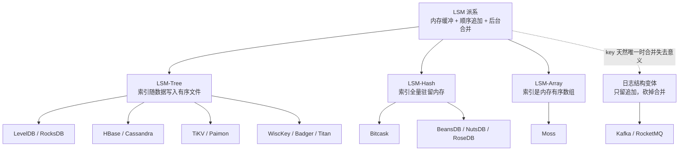
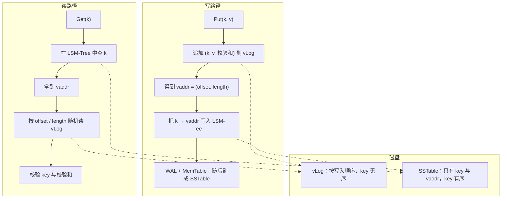
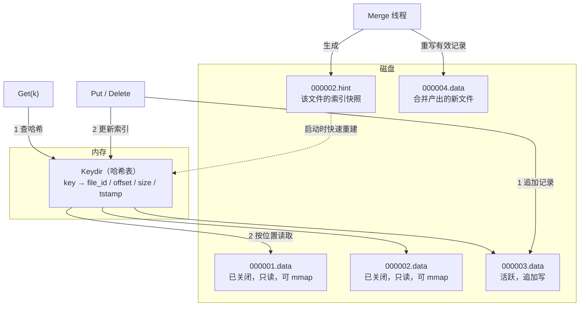
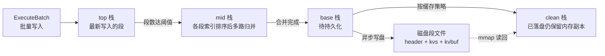
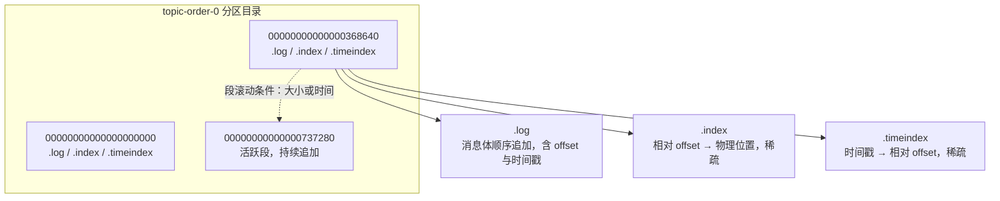

# 08 LSM 派系——Tree、Hash 与 Array

**摘要：**

LSM 常被当成一个具体的结构来讲：跳表、SSTable、分层合并，仿佛只有一种写法。但只要把视线从论文移到工业界的代码库里，就会看到同一句哲学被讲成了好几种方言——LevelDB 与 RocksDB 把索引随数据一起写进有序文件，Bitcask 把索引整块搬进内存，Moss 用有序数组同时承担缓冲与索引，Kafka 干脆砍掉合并只留日志。本文沿着这条分岔走一遍：先钉住派系的三个共同点（内存缓冲、顺序追加、后台合并），再把分歧归结为一个变量——索引放在哪里、以什么形态组织。派系内部的差异看似零碎，其实都能还原成同一道题：索引驻留内存还是磁盘，合并粒度粗还是细，读放大能忍到哪一步。随后依次拆开 LSM-Tree 的工程谱系（LevelDB 到 RocksDB，再到 HBase、Cassandra、TiKV、Paimon）、WiscKey 的键值分离、Bitcask 的内存哈希索引、Moss 的有序数组，以及 Kafka 的"日志即存储"；最后用一张对比矩阵把内存结构、索引位置、点查成本、范围扫描与内存约束摊在一起。读完之后应当能回答两个问题：这些实现各自在为什么付费，以及面对一个具体负载时该往哪一边靠。

---

## 第 1 章 同一句哲学，三种方言

1996 年，Patrick O'Neil 与三位合作者在《Acta Informatica》上发表《The Log-Structured Merge-Tree》时，针对的是机械磁盘上 B 树随机写的糟糕表现：一次页分裂意味着一次寻道，而一次寻道的时间足够顺序读完几十个页。论文给出的方案并不复杂——把写入先攒在内存里，攒够一批就整体顺序写出去，用后台的合并把重复与无效的数据慢慢磨掉。

二十多年过去，介质从机械盘换到固态盘，又从固态盘换到 NVMe，但这条思路没有被推翻，反而长成了一片森林。今天被归到"LSM 派系"名下的系统，共享的并不是某个数据结构，而是**三个更朴素的约定**：写请求先进内存缓冲，落盘只做顺序追加，旧数据靠后台合并回收。这三条约定一旦立住，合并策略、崩溃恢复、读放大这些后续问题就都被框定了方向，剩下能变的东西其实只有一个——**索引放在哪里**。

不妨把这一派系想象成三家连锁药房。它们的物流策略完全一样：门店只收货、不退货，所有缺货与调拨都汇总到总仓统一发车，门店永远不做"就地拆箱重排"这种费时的事。差别在于药品查询系统放在哪里：有的把中央数据库放在总部机房，查一次要走网络；有的给每个门店发一本纸质台账，翻起来最快，但台账厚了就没地方放；有的用按拼音排序的活页夹，查一种药要翻两页，却顺带能列出"拼音相邻的一批药"。物流策略决定了成本结构，查询系统决定了响应时间与内存占用，这两件事混在一起谈，就会得出"LSM 快"或"LSM 慢"这种没有信息量的结论。

把共同点先钉死，有三个推论值得提前说清。第一，只要允许对同一个 key 反复覆盖写，合并就一定存在，因为物理上不可能让旧版本自动消失，差别只在合并的触发条件、粒度与它消耗的资源。第二，只要内存是易失的，恢复机制就一定存在，差别只在"恢复时重放什么"——重放日志，还是重放数据文件本身。第三，只要数据分布在多个文件或多层里，读放大就不可避免，差别只在"一次读要碰几个文件、能不能用布隆过滤器（Bloom Filter）提前判否"。

分歧则落在两个坐标上：索引驻留在内存还是磁盘，以及索引在内存里用什么形态组织。前一个坐标决定内存约束，后一个坐标决定点查与范围扫描的能力边界。把这两个坐标画成一张图，派系的全貌就出来了。

图里那条虚线值得多看两眼。Kafka 严格来说不是 LSM 的实现，它没有 MemTable，没有排序，也没有分层合并；但它把"顺序追加、不可变文件、后台清理"这三件事做到了极致，以至于讨论 LSM 的边界时绕不开它。把它放在派系图的边缘而不是中心，恰好说明分类是理解工具，不是族谱。

这一篇的顺序，就沿着这张图从中间往外走：先看 LSM-Tree 这一支怎么从 LevelDB 长成 RocksDB 再长进分布式系统，再看 WiscKey 如何把 value 从排序路径里摘出去，然后看 Bitcask 把索引整块搬进内存的代价，接着看 Moss 用数组承担有序的巧思，最后看 Kafka 这条退化路径为什么在某些场景下反而更对。第 07 篇已经算过 LSM 的读写空间放大，这一篇只算"换了索引位置之后，账目怎么变"；如果你对 B+ 树与 LSM 的分野还没有整体印象，不妨先回看 [[01 存储引擎概述——从数据库演进到两大派系]] 的第 4、5 章。

## 第 2 章 LSM-Tree 的工程谱系

### 2.1 LevelDB：把骨架做到最小

2011 年，Google 开源了 LevelDB，作者是 Jeff Dean 与 Sanjay Ghemawat。这两个名字在分布式系统领域的分量不必多言，但 LevelDB 本身并不炫技，它的价值恰恰在于克制：核心实现只有万行量级的 C++，只做五件事——内存表（MemTable）、有序字符串表（Sorted String Table，SSTable）、预写日志（Write-Ahead Log，WAL）、合并（Compaction）、版本管理（Version）。

克制体现在很多具体的"不做"上。它只有一个可写 MemTable 与一个只读 MemTable，写满就必须等后台刷盘，没有队列；合并只有一个后台线程，不做并行；没有列族，一个进程一个库；没有事务，批量写（WriteBatch）是唯一的原子单位；甚至连布隆过滤器都要用户显式装上，默认配置里 `filter_policy` 是空指针。这些"不做"在当时被批评为功能单薄，但正是它们让 LevelDB 成为一个可以在一周内读完、并且能被别的系统当作零件拆开用的实现。

第 09 篇会把这条骨架逐段拆开，此处只需要记住它的形状：写入落到 WAL 与 MemTable，MemTable 写满转只读并刷成 Level 0 文件，后台按层合并，元数据通过 MANIFEST 与 CURRENT 两个文件维持原子切换。后面所有 LSM-Tree 的实现，基本都是在这副骨架上加减零件。

### 2.2 RocksDB：把短板一项项补上

2012 年，Facebook 从 LevelDB 分叉出 RocksDB，目标很明确：让这套骨架撑住服务器端的真实负载。分叉之后的十年里，RocksDB 加的东西可以按"补哪块短板"分类，而每一块短板背后都是一笔放大账。把这条分叉连同它前后两条源流一起画出来，谱系就清楚了：一条源流来自 1996 年的论文，经 Bigtable 与 Dynamo 分流到 HBase、Cassandra；另一条源流从 LevelDB 出发，经 RocksDB 分叉出 TiKV、Titan、Paimon 这些下游形态。

```mermaid
%%{init: {'theme': 'dracula'}}%%
flowchart LR
    PAPER["O'Neil 1996<br/>LSM-Tree 论文"] --> BT["Bigtable 2006<br/>Dynamo 2007"]
    PAPER --> LV["LevelDB 2011<br/>单机嵌入式骨架"]
    BT --> HB["HBase 2008<br/>Region + HFile"]
    BT --> CS["Cassandra 2008<br/>分级合并 + 多数据中心"]
    LV --> RK["RocksDB 2012<br/>列族 / 插件 / 并行合并"]
    RK --> TK["TiKV<br/>Raft 之下的本地引擎"]
    RK --> TN["Titan / BlobDB<br/>大 value 分离"]
    RK --> PM["Paimon<br/>对象存储上的 LSM"]
```

第一块短板是隔离。LevelDB 一个库只有一个 MemTable 与一套 SSTable，不同业务的数据混在一起，合并时互相牵连。列族（Column Family，CF）解决的正是这件事：每个列族有自己的 MemTable 与 SSTable 集合，但共享同一个 WAL 与 MANIFEST，因此跨列族的批量写仍然是原子的。这个设计的取舍很清晰——用"共享日志"换来写原子性，用"独立表"换来合并隔离，代价是列族数量不能太多，否则 MemTable 的内存占用与刷盘频率都会失控。

第二块短板是空间回收的灵活性。合并过滤器（Compaction Filter）允许用户在合并时挂一个回调，对每条记录判断"还要不要"。这条看似简单的钩子解决了一类很实际的问题：带生存时间（Time-To-Live，TTL）的数据、被业务判定为过期的数据、需要按版本清理的旧值，都可以在合并时顺手丢掉，而不必等到墓碑（Tombstone）被推到最底层。它的代价是把一部分正确性责任交给了用户——回调写错，数据就真的没了，而且这种丢失在合并完成之后无法回滚。

第三块短板是结构可替换。MemTable 被抽象成接口，除了默认的跳表，还有哈希跳表、哈希链表、向量等实现，譬如纯点查且 key 空间不大的场景，哈希跳表就比跳表更省 CPU；SSTable 的格式也可替换，针对固态盘与全内存场景的 PlainTable 把索引整块放进内存，省掉了块内二分之前的那一跳。可替换意味着用户可以按负载选结构，也意味着 RocksDB 自己不必为每一种负载都做到最优。

第四块短板是合并的资源控制。LevelDB 的单线程合并遇到大库就会跟不上写入，RocksDB 引入了多线程合并、子合并（Subcompaction，把一个大范围合并切成几段并行做），以及基于漏桶（Leaky Bucket）的合并限速——合并要写盘之前先申请令牌，令牌按设定速率发放，于是合并的写带宽被限制在一个上限内，前台读写的延迟抖动随之收敛。这是一笔很典型的交换：用"合并变慢"换"前台稳定"。

第五块短板是空间放大的治理。大 value 混在小 key 里被反复重排，是 LSM 写放大的主要来源，RocksDB 的 BlobDB 把超过阈值的 value 挪到单独的 blob 文件里，SSTable 只留指针——这就是下一章要讲的 WiscKey 思路的工程化版本。第六块是事务与备份：TransactionDB 提供了基于锁的读写事务，Checkpoint 提供了不阻塞写入的一致性快照，这两项让 RocksDB 从"嵌入式引擎"变成了"能托住数据库的系统组件"。这一路加法的完整脉络，在 [[05 从 LevelDB 到 RocksDB——优化与演进]] 里有更细的对照。

把这些扩展摊成一张表，能看出它们各自在放大三角上动了哪一笔。

| 扩展 | 解决的短板 | 挪动的那笔账 | 代价 |
|---|---|---|---|
| 列族 | 多业务共享一个库时的合并互相干扰 | 读放大（按列族隔离文件集合） | MemTable 内存与刷盘频率随列族数上升 |
| 合并过滤器 | 过期数据要等到最底层才能清除 | 空间放大 | 正确性责任转移给用户回调 |
| 可插拔 MemTable | 跳表在纯点查负载下不是最优 | 点查延迟 | 范围扫描能力随实现退化 |
| 可插拔 SSTable | 块式格式在固态盘上多一次索引跳转 | 读放大 | 格式碎片化，工具链要跟着适配 |
| 多线程与子合并 | 单线程合并跟不上写入 | 写吞吐 | CPU 与 I/O 争抢，调参空间变大 |
| 合并限速 | 合并抢占前台带宽导致延迟抖动 | 延迟稳定性 | 合并积压，空间放大上升 |
| BlobDB | 大 value 被反复重排 | 写放大 | 读路径多一次随机读 |
| 事务与 Checkpoint | 上层要自己实现原子性与备份 | 不直接影响放大 | 实现复杂度与元数据开销 |

### 2.3 分布式系统里的 LSM

单机引擎往上走一步，就进入分布式系统的领地。这一步里 LSM 的职责被重新切分了一次：一致性交给共识层，本地只负责"有序地放下并找回来"。

HBase 是最早的一批落地。它按行键把表切成 Region，每个 Region 由一个 RegionServer 托管，写入先进内存存储（MemStore），写满刷成 HFile，HFile 之间按合并策略归并。它的合并策略比 LevelDB 丰富：除了分层，还有探查式（Exploring）策略——枚举所有可合并的候选序列，挑写开销最小的那一个；以及面向时间序列的按日期分层策略，按数据的时间跨度而不是体积来组织合并。这些策略的存在说明一件事：**合并策略不是数学问题，而是负载问题**，同一套层数与时序参数，换一种数据分布就会得出不同的最优解。

Cassandra 走的是另一条路。它借了 Dynamo 的分区与副本模型，单机侧则是提交日志（Commitlog）加 MemTable 加 SSTable 的经典组合，合并策略以分级（Size-Tiered）为主，也支持分层与时间窗口两种。分级合并的特点是写放大低、合并尖峰小，代价是同一层里允许存在 key 范围重叠的文件，读的时候要查更多份。Cassandra 把这份代价转嫁给了读路径上的布隆过滤器与分区索引，也转嫁给了"读修复"这种补偿机制。

TiKV 的切法又不同。它把 Raft 共识放在 RocksDB 之上，Raft 日志与用户数据分列不同的列族，key 里编码了事务提交时间戳以实现多版本并发控制（Multi-Version Concurrency Control，MVCC），Region 分裂时用范围删除（DeleteRange）把一半数据一次性标记掉，避免逐条墓碑。这里能看到一个有意思的分层：RocksDB 只管本地有序，TiKV 管副本一致，上层事务层管可见性，每一层都只解自己那道题。

Paimon 则把 LSM 搬到了对象存储上。数据湖的介质没有 rename、没有目录语义、写一次就不再改，于是 LSM 的"层"变成了"文件与有序运行段（Sorted Run）"，合并变成后台任务写出一批新文件再原子切换元数据快照。LevelDB 里由 CURRENT 与 MANIFEST 承担的角色，在这里由快照文件与清单文件承担，思路一脉相承——用一次元数据的原子切换，替代一堆文件的原地修改。区别在于对象存储的一次"重命名"要付出整个对象的拷贝代价，所以元数据设计必须假设"任何一次写都可能只完成一半"，幂等与清理逻辑因此比单机版本重得多。

分布式系统对 LSM 的改造，有点像把一台整机拆成可替换的模块：电源与冗余被上层拿走，本地引擎只留主板与内存，接口一窄，替换就容易；代价是每一层都要自己应付"上游随时可能重发同一条指令"这件事，幂等与去重因此从引擎内部问题变成了系统级问题。

这条谱系讲到这里，可以抽出一个共同的观察：**越往分布式走，LSM 承担的责任越窄，合并策略反而越成为差异化竞争的主战场**。原因不难理解，副本、分区、事务这些事都有成熟的外部方案，唯独"什么时候合并、合并多深、合并多快"必须贴着本地负载调，没有通用答案。

### 2.4 合并策略如何决定性格

分层合并（Leveled Compaction）与分级合并（Tiered Compaction）的分岔，第 07 篇已经算过账，这里只补充它对派系内部性格的影响。

分层合并把每一层切成 key 范围互不重叠的若干文件，层容量按倍数递增。它的读放大可控——一次点查每层最多碰一个文件；空间利用率也高，因为同一个 key 只有一份落在某一层。代价是写放大：一份数据从 L0 沉到最底层，每一层都要被重写一次，而且每次合并还要连带重写目标层中与之重叠的部分。

分级合并允许同一层存在多个范围重叠的文件，写满一批就整体并成更大的一批。写放大因此大幅下降，合并的延迟尖峰也被摊平；代价是读的时候要检查更多文件，空间放大也更严重，因为同一个 key 的多个版本可能同时存在于不同批次里。

这两条路没有对错，只有定价不同。读延迟敏感的系统（在线点查、元数据服务）偏分层，写吞吐敏感的系统（日志聚合、时序写入）偏分级，读写都重的系统则做混合——热层用分级吸收写入，冷层用分层收敛读放大。RocksDB 的通用合并（Universal Compaction）与 Cassandra 的分级策略属于后者，LevelDB 的默认策略属于前者，这条分界线在派系图里看不见，却实实在在地决定了每个系统的脾气。

## 第 3 章 WiscKey：把 value 请出排序路径

### 3.1 一笔很直白的算术

LSM 的写放大有一个容易被忽略的来源：排序。合并的本质是把若干有序流归并成一个新的有序流，参与归并的每一个字节都要被读出来、比较、再写回去。而在绝大多数 KV 负载里，key 只有几十个字节，value 却可能是几百字节到几兆字节——为了让 16 字节的 key 保持有序，1 KB 的 value 被迫陪着搬了六次。

2016 年，威斯康星大学麦迪逊分校的 Lanyue Lu 等人在 FAST 会议上发表《WiscKey: Separating Keys from Values in SSD-Conscious Storage》，把这个观察推到了极致：既然排序只需要 key 有序，那就让 value 彻底退出排序路径。

这个想法能成立，还依赖一个硬件前提。机械盘时代，随机读的代价是寻道，一次随机读的时间足够顺序读几十个块，所以"把 value 挪出去换一次随机读"是笔亏本买卖；固态盘没有寻道，随机读的延迟落在几十微秒量级，而且盘内部有多个通道与裸片（Die），并发发出的随机读可以叠加吞吐。介质变了，同一笔交换的定价也就变了。

算一笔账。假设库里有 100 GB 数据，key 平均 16 字节，value 平均 1 KB，那么记录数约为一亿条；若索引项是 key 加上 12 字节的位置信息，再加上 LSM 内部的序列号、类型与块内开销，索引总量落在 2 GB 的量级——论文给出的估算也是这个数量级。2 GB 意味着整个索引可以常驻内存，一次点查在索引侧几乎不产生 I/O，只剩下取 value 的那一次随机读。

反过来说，如果 value 只有 50 字节，同样的算术会得出完全相反的结论：索引项里多出的 12 字节位置信息让索引膨胀了近两成，而省下的合并量只有 value 那部分，收益抵不过"多一次随机读"的固定成本。所以**键值分离不是"更先进的 LSM"，而是一个以 value 大小为自变量的条件优化**。

### 3.2 结构：两份文件，两种秩序

WiscKey 把数据拆成两份：一份是值日志（value Log，vLog），按写入顺序追加完整的键值对；另一份是 LSM-Tree，只存 `<key, vaddr>`，其中 `vaddr` 由偏移与长度两部分组成，指向 value 在 vLog 中的位置。

把 value 挪出排序路径，有点像快递分拣只扫面单、不搬包裹：面单轻，可以高速排序与比对；包裹重，只在最后按面单号去货架上取一次。技术上的限定也在这里——取包裹从"顺手带出"变成了"专程跑一趟"，货架越分散、这一趟越贵。

这个结构把"有序"与"完整"拆开了：有序的那一半极小，可以整块缓存；完整的那一半很大，但永远只追加、不排序、不合并。**写放大因此从"层数乘以数据总量"降到"层数乘以索引总量"**，量级上的差距就是 key 与 value 的大小之比。

### 3.3 读写路径各自的新代价

写路径变成两次写：先追加 vLog，再把索引写进 LSM。两次写听起来更贵，但 vLog 的那一次是纯顺序追加，且不参与后续合并；LSM 的那一次虽然仍要走 WAL 与合并，但写的是小得多的索引。总写放大因此约为"vLog 一次写加上索引的写放大乘以索引占比"，在 value 远大于 key 的场景下，这个数字比原生 LSM 低一个数量级。

读路径则要付一次随机读。索引查完之后，必须按 `vaddr` 跳到 vLog 的某个位置取回 value，这次读的粒度是 value 本身，无法像 SSTable 那样"读一个块带回相邻的几十条记录"。换句话说，点查的读放大从"多个文件各查一次"变成了"一次定位加一次随机读"，次数下降，但每次读的局部性变差。

范围扫描的问题更尖锐。索引是有序的，可以顺序读出连续的一段 key；但这些 key 对应的 value 在 vLog 里是乱序的，逐条读就是逐条随机 I/O。单线程的随机读在固态盘上打不满带宽，WiscKey 的解法是把索引项塞进队列，由后台线程并发预取——这一招之所以有效，靠的是固态盘内部的并行度，而不是软件技巧。反过来说，如果换回机械盘，同样的预取只会让磁头来回摆动，性能反而更差。

这里有一层容易被忽略的连锁反应：索引变小之后，LSM 的层数与文件数都可以压缩，读索引时碰到的文件数随之下降，布隆过滤器的误判率也更容易做低；这些收益叠加起来，才是 WiscKey 在某些负载上"读也变快"的真实原因，而不是"KV 分离"本身有什么魔力。

### 3.4 三个必须自己解决的麻烦

把 value 挪出去之后，LSM 原本替我们处理的三件事都要重新处理一遍。

第一件是垃圾回收。LSM 里旧版本会被合并自然清除，vLog 里被覆盖或删除的 value 却不会自动消失，它们只是失去了索引指向。回收的思路很直接：从日志尾部开始按块扫描，逐条解析出 key，回查 LSM 判断这条记录是否仍是最新版本，是就把它追加到头部并更新索引，不是就丢弃；处理完一块就推进尾指针。为了让这个过程可以在线、可中断地进行，vLog 的头部与尾部位置本身也要记进 LSM，且顺序有讲究——先 `fsync` 新的 value，再把索引与尾指针写进 LSM，最后才释放空间，否则一次崩溃就会丢掉刚搬过去的数据。

第二件是一致性。写 vLog 与写索引之间存在一个窗口，崩溃可能落在窗口的任意位置。若 vLog 写失败，索引不存在，用户读不到这条数据，残留的 value 会在后续回收时被清理，这种情况是安全的；若 vLog 写成功而索引写失败，效果与前者相同；真正麻烦的是两边都"看起来成功"，但 vLog 尾部的内容因掉电而残缺。WiscKey 的处理办法是在读路径上加校验：`vaddr` 必须落在有效区间内，取回的记录里必须带着原来的 key，且校验和必须匹配，任何一项不成立就当作数据不存在，并顺手删掉索引。

第三件是日志冗余。LSM 的 WAL 与 vLog 记录的是同一批写入，只是格式不同。既然 vLog 本身就是按写入顺序的日志，理论上可以拿它替代 WAL，省掉一次写。代价是恢复变慢——要从头扫 vLog 才能重建索引，所以工程上会在 LSM 里定期记下一个头部位置，恢复时只从这个位置往后重放。这个优化听起来稳赚，但它把"恢复正确性"与"vLog 格式"绑在了一起，一旦 vLog 格式演进，恢复逻辑就要跟着改。

### 3.5 三个工程实现的分岔

WiscKey 是论文，落到工程上有几种不同的走法，差异集中在"什么时候分离"与"回收怎么做"。

Badger 是 Dgraph 图数据库的存储引擎，用 Go 写成，思路最贴近论文。它给 value 设一个阈值，小于阈值的键值对直接进 LSM，大于等于阈值的才写进 vLog；vLog 被切成多个文件，同一时刻只有一个在接收写入，因此索引项要记成 `<file_id, offset, length>` 三段。它保留了 LSM 自己的 WAL，没有做"用 vLog 替代 WAL"那个优化，这是一个保守但省心的选择。

Titan 是 PingCAP 为 TiKV 做的引擎，基于 RocksDB。它把大 value 写进 Blob 文件，索引只记 `<file_no, offset>`。回收有两套：一套按文件统计垃圾比例，挑垃圾多的文件重写有效数据并更新索引；另一套挂在合并流程上，在对最下面两层做合并时顺带重写对应的 Blob 文件，把回收成本摊进本来就要做的 I/O 里。后者只在最后两层启用，因为那两层的数据最冷、最稳定，重写的收益最高。

TerarkDB 的走法又不同。它把大 value 组织成值 SSTable（v-SSTable），索引里只留文件名，回收时不更新 LSM 的索引，而是在清单里记录新旧文件之间的依赖关系，读的时候按依赖链重定位到最新文件。这个设计让回收与索引彻底解耦，代价是依赖链会越拉越长，长到一定程度就得做一次"重建"把链条压平。

三种走法对应三种定价：Badger 用阈值换简单，Titan 用合并换回收的隐蔽性，TerarkDB 用依赖链换索引的不可变。没有一种能在所有场景胜出，选哪一种取决于 value 有多大、更新有多频繁、能不能容忍后台重写。

### 3.6 边界在哪里

WiscKey 的收益与 value 的大小强相关，这一点常被忽略。当 value 只有几十字节时，索引项里多出来的 `vaddr` 反而让索引变大，而每次点查多出的那次随机读也不再被"省下的合并开销"抵消——此时原生 LSM 更划算。所以工程实现普遍设一个最小阈值，低于阈值的键值对留在 LSM 里；这个阈值不是拍脑袋定的，它应该跟着 value 的大小分布与固态盘的随机读能力走。

另一条边界是更新模式。如果业务是"同一个 key 的 value 频繁小幅修改"，分离之后每次修改都要写一条新的完整 value，vLog 的增长速度会比原生 LSM 快得多，回收压力随之上升；反过来，如果业务是"写一次、读多次"的大对象（图片、文档、序列化后的特征向量），分离几乎是必然选择。

第三条边界是读延迟的分布。原生 LSM 的点查延迟取决于"命中在第几层"，分布相对集中；WiscKey 的点查延迟取决于"vLog 的随机读落在缓存还是盘上"，尾部会明显拉长。对 P99 敏感的系统，要么把热点 value 也缓存起来，要么接受这条尾巴。

第四条边界是回收与前台争抢 I/O。回收是"读一遍旧数据、写一遍有效数据"的重活，如果它和前台写入共享同一块盘，就会把写延迟推高；工程上通常给回收限速，或者把它绑到合并流程里，用"本来就要做的 I/O"摊掉一部分成本。

## 第 4 章 Bitcask：把索引全部搬进内存

### 4.1 一个更激进的选择

如果说 WiscKey 是"把 value 挪出排序路径"，那么 Bitcask 就是"把索引整个挪出磁盘"。它是 Basho 为 Riak 提供的存储后端之一，2010 年由 Justin Sheehy 与 David Smith 在技术报告《Bitcask: A Log-Structured Hash Table for Fast Key/Value Data》中系统描述。报告里给出的定位很务实：不追求极限吞吐，追求可预测的低延迟——每一次读写都只有固定的几次操作，没有后台合并带来的抖动尖峰。

Bitcask 把 LSM 的共同点保留了两条，砍掉了一条。保留的是"顺序追加"与"后台合并"，砍掉的是"内存缓冲"——写请求不需要先进 MemTable 攒批，直接追加到数据文件，然后把索引项更新到内存哈希表里。于是它连独立的 WAL 都不需要，因为数据文件本身就是日志：写成功即落盘，落盘即持久。

这个选择带来一个非常干净的成本结构：写一次是"编码、追加、内存更新"，读一次是"哈希查找、一次定位读"，两者都不涉及多层查找，也不涉及文件内的二分。代价则集中在内存上——所有 key 必须常驻。

### 4.2 数据文件与 Keydir

数据文件里存的是追加记录，格式大致是"校验和、时间戳、key 长度、value 长度、key、value"这样一串扁平的字节。没有页、没有块、没有索引区，读到一条记录就能解析出一条键值对。校验和放在最前面，读取时先算校验再解析，这样一条被截断的记录不会污染后续解析。

内存里维护一张哈希表，Bitcask 称之为 Keydir，键是用户 key，值是"文件编号、偏移、长度、时间戳"这四元组。一次写入之后，Keydir 里这个 key 指向的就是最新版本；旧版本仍留在数据文件里，只是没人指向它。

Bitcask 的形态像一本流水账加一套抽屉索引卡：账本按时间顺序记，卡片告诉你某笔账在第几页第几行；卡片丢了可以照账本重抄，账本丢了就真的没了。限定同样明确——卡片数量随账目数增长，抽屉终有装满的一天，而那正是它内存约束的来源。

数据文件是分段（Segment）的：当前文件写满阈值就关闭，变成只读，另开一个新文件继续接收写入。已关闭的文件可以用内存映射（Memory Mapping，mmap）打开，读的时候少一次内核态拷贝；活跃文件仍用普通读写，因为要持续追加。分段还带来一个副作用——每个文件都能独立回收，合并的粒度因此是"文件集合"而不是"整个库"。

### 4.3 读写与删除

写入是两步：把记录编码后追加到活跃文件，然后更新 Keydir。这两步之间有一个窗口——如果追加成功而进程在更新 Keydir 之前崩溃，重启后的恢复过程会重新扫描文件，把这条记录补进 Keydir，数据不会丢；反过来，如果追加失败，Keydir 不更新，用户看到的就是写失败。也就是说，**数据文件是权威，索引只是加速结构**，正确性完全押在"数据文件按写入顺序可重放"这一条上。

读取也是两步：查 Keydir 拿到位置，按位置读一次。删除在 Bitcask 里不是"抹掉"，而是追加一条特殊的删除记录，同时把 Keydir 里的条目移除。这样重启恢复时，扫描到删除记录就知道这个 key 已经被删掉，不会把更早的版本又捡回来。

这套读写的漂亮之处在于它没有"读放大"这个概念：一次点查永远是一次哈希加一次定位读，与数据量、文件数无关。这也是 Bitcask 论文强调的"可预测延迟"的来源。但请注意，**这份可预测性是用内存换来的**，而且换得很彻底。

### 4.4 恢复与 hint 文件

没有 hint 文件的 Bitcask，启动时要扫描所有数据文件，逐条解析记录、逐条更新 Keydir，最后留下的就是每个 key 的最新位置。扫描量等于数据总量，一个几十 GB 的库，重启可能要几分钟甚至更久。

hint 文件就是为这件事准备的。合并过程在重写数据文件时，顺手把该文件里每条记录的位置信息写进一个同名的 `.hint` 文件——它不含 value，只有 key 与位置，体积比数据文件小得多。启动时先读 hint 重建 Keydir，再对活跃文件做增量扫描，恢复时间就从"与数据量成正比"降到"与 key 数量成正比"。

这个设计值得多想一层：hint 文件是索引的快照，不是权威数据。它可以被删除、被重建，正确性完全由数据文件保证。**把"可重建的派生数据"与"不可丢失的原始数据"分开存放，是 Bitcask 在工程上最值得借鉴的一点**，LevelDB 的 MANIFEST 与 SSTable 之间也是同样的关系，只是层次不同。

不过 hint 文件也带来一个新的耦合：合并产出数据文件与 hint 文件，两者必须在同一个原子操作里切换，否则启动时可能读到旧 hint 配新数据。工程实现的常见做法是"新文件先落盘并 `fsync`，再更新一个元信息文件指向新文件集合"，这与数据库切换数据文件目录的做法同源。

### 4.5 合并：没有层的合并

Bitcask 的合并与 LSM 的合并形似而神不同。LSM 的合并有"层"的概念，按 key 范围挑文件，逐层下沉；Bitcask 没有层，合并的对象是"若干个已关闭的数据文件"，判据是"这条记录是否仍是 Keydir 指向的版本"。

合并过程大致是：遍历待合并的文件，逐条解析记录，回查 Keydir，若这条记录的位置正好等于 Keydir 里记的位置，说明它是最新版本，就把它写进新文件并更新 Keydir 指向新位置；否则丢弃。所有待合并文件处理完之后，新文件落盘并 `fsync`，然后用一次原子操作替换掉旧文件集合，最后删除旧文件。

触发方式有两种：定时触发，或者按"无效数据占比"触发。后者更合理，因为合并的成本与收益都和垃圾比例直接相关——一个几乎没有覆盖写的库，合并一次纯属浪费 I/O。

合并的代价可以估得很清楚：扫描全部待合并数据，重写其中的有效部分。若有效比例为 p，则写放大约为 p，空间回收约为 1-p。这比 LSM 的逐层重写要温和，因为每份数据最多被重写一次，而不是每层一次。

### 4.6 三条硬约束

Bitcask 的限制不是实现不够好，而是设计选择的直接后果，绕不过去。

第一条是 key 必须驻留内存。Keydir 的每一项至少包含 key 本身、文件编号、偏移、长度、时间戳，加上哈希表的桶指针与负载因子带来的空位，一条索引项落在几十字节的量级。一亿个 key 就是几个 GB 的内存，十亿个 key 就是几十 GB——这已经超过很多机器的物理内存。相比之下，LSM 的内存里只放 MemTable 与稀疏索引，**key 的总量可以与内存无关**，这是两派最根本的分野。

第二条是不支持范围扫描。数据文件按写入顺序排列，key 在其中完全无序；Keydir 是哈希表，天然不维护顺序。想按 key 区间扫描，只能遍历所有文件、过滤出符合条件的记录，再在内存里排序——这在数据量大时不可接受。有些实现用自适应基数树（Adaptive Radix Tree，ART）替代哈希表，譬如 Go 语言社区的几个 Bitcask 复刻就用 ART 替代了哈希表，靠前缀共享压缩索引体积，并顺带获得前缀查找能力，但那是"前缀匹配"，不是任意区间扫描。

第三条是冷热不分。内存里放的是全部 key，而不是热 key，于是内存开销与访问频率无关，只与 key 总量有关。这一点常被忽视：一个 90% 请求集中在 1% key 上的系统，用 Bitcask 仍然要为那 99% 的冷 key 付内存。

此外还有几条工程性的约束：单写者模型（同一时刻只有一个活跃文件在写），文件数量增长带来的句柄与元数据管理成本，以及恢复时间虽经 hint 优化但仍与 key 数量线性相关。这几条在单机小库上都不算问题，一旦数据量上去，就会变成必须正面处理的架构约束。

### 4.7 与 WiscKey 的对照

把 Bitcask 与 WiscKey 放在一起看，会发现它们解决的是同一个问题的两种极端。两者都把"数据"放在按写入顺序追加的日志里，都让索引保持有序，都用后台重写回收空间；差别只在索引放在哪里——Bitcask 放内存，WiscKey 放 LSM。

放内存的版本简单到可以一个人在一周内写出来，点查延迟最低且最稳定，代价是内存天花板与范围扫描的缺失。放 LSM 的版本复杂得多，索引可以随数据量增长，范围扫描天然支持，代价是索引自身的写放大与读放大又回来了。这条对照恰好印证了本篇的主题：**同一套物理策略下，索引的位置决定了一切，而位置的选择没有免费选项**。

还有一个更细的差别值得一提：Bitcask 的索引是"精确位置"，一次读只碰一条记录；WiscKey 的索引也是"精确位置"，但因为 value 可能很大，一次读的字节数可能是 Bitcask 的几百倍。前者的瓶颈在内存容量，后者的瓶颈在带宽与并发度，同一个"按位置取数"的动作，在不同数据形态下有着完全不同的资源画像。

## 第 5 章 Moss 与 LSM-Array：让数组承担有序

### 5.1 数组的两难

数组在存储引擎里的地位有点尴尬。它的优点极其突出：内存连续、没有指针、缓存行利用率高、二分查找只需两次内存访问就能把范围砍半；它的缺点也同样突出：中间插入要搬移元素，删除要填补空洞，单条写入的成本与数组长度成正比。

LSM-Array 这一支的巧思，就是把"插入"和"有序"这两件事分开处理：原始数据只追加，永不搬移；索引单独放在一个数组里，需要有序时只对索引排序。这个思路与数据库页里的槽位数组（Slotted Page）如出一辙——记录的物理位置可以乱，逻辑顺序由一张定长的偏移表维持。数组、跳表、哈希这几类结构在点查与扫描上的取舍，[[02 索引数据结构——从数组到 B+ 树的取舍链]] 有更完整的推演。

Moss 是 Couchbase 开源的 Go 语言 KV 引擎，是这一支最有代表性的实现。它提供的接口包括点查、批量写、快照读与合并，底层完全建立在数组之上。

### 5.2 Segment：一份数据，两个数组

Moss 的基本单元叫段（Segment）。每个段里有两个数组：一个是 `kvbuf`，按写入顺序追加编码后的键值对，只增不改；另一个是 `kvs`，存放定长的索引项，每个键值对对应两个机器字，一个记录操作类型与长度信息，另一个记录它在 `kvbuf` 中的偏移。

数组在这里的角色像一排按到达顺序摆放的储物柜，另有一张按姓名排序的号码表：找人时先查表、再开柜，柜子本身从不挪动。限定是"表的维护成本转移"——重排的代价全部落在号码表上，柜子越大、表越长，重排一次越贵。

这个结构的好处在于"排序只动索引"。当需要按 key 有序时，对 `kvs` 排序即可，`kvbuf` 里那几兆字节的原始数据一个字节都不用搬。索引项是定长的，排序时的交换成本极低，而且排序之后，一次二分就能定位到任意 key 在 `kvbuf` 中的位置。

代价是索引与数据之间多了一次间接寻址。点查要先在 `kvs` 里二分，再按偏移去 `kvbuf` 取数据，这是两次随机内存访问而不是一次。在数据量小、全在缓存里的场景，这点开销可以忽略；数据量大时，`kvs` 本身可能就有几兆字节，二分过程中的缓存缺失会开始显现。

顺带说一句，把操作类型与长度压缩进索引项的那几个比特，是一个典型的空间优化：每个键值对因此只多花一个机器字，索引总体积与 key 数量成正比而不是与数据量成正比。这种"在定长结构里挤出空间"的手法和数据库页头的标志位是同一类工程趣味。

### 5.3 四级栈与两条后台协程

Moss 的内存组织被分成四层，每层是一个段栈（SegmentStack），只能在一端进出，形如栈。

写入先落 `top`，攒够若干段之后整体搬到 `mid`，在 `mid` 里对每个段的索引排序，再用堆做多路归并，合并成一个更大的段；合并结果搬到 `base`，由持久化协程异步写盘；写完若决定继续缓存，就搬到 `clean`，否则释放。

读路径是从上往下：先在 `top` 里找，找不到去 `mid`，再不行去 `base` 与 `clean`，最后落到磁盘。每一层内部，先二分索引，再按偏移取数据。由于新数据永远在上层，找到即可返回，天然实现了"最新版本优先"。

这套分层与 LSM 的层有本质区别。LSM 的层是"按 key 范围划分的持久化文件集合"，层数由容量比例决定；Moss 的层是"按生命周期划分的内存段栈"，层数固定为四。**前者的复杂度在磁盘上的合并与版本管理，后者的复杂度在内存中的排序与协程协作**。

### 5.4 为什么数组在扫描上占优

如果只看点查，数组结构并不比跳表强，甚至因为多一次间接寻址而略慢。它的优势在范围扫描与合并。

范围扫描时，索引数组是有序且连续的，一次缓存行加载能带进十几个索引项，二分定位之后顺着数组往前走，每一步都是相邻内存，预取器能准确预测。跳表则要沿指针跳，每一跳都可能是一次缓存缺失，节点在堆上的分布也不保证相邻。数据量越大，这个差距越明显。

合并时，数组的优势更直接。多个段各自排好序之后，用堆做 k 路归并，每次从堆顶取最小的 key，写进新的 `kvbuf` 与 `kvs`。归并的复杂度是 O(N log k)，其中 k 是段数，通常很小；而且归并过程是纯顺序读写，没有指针追逐，CPU 的流水线利用率很高。

这也解释了 Moss 为什么把"合并"放在内存里做，而不是像 LSM 那样在磁盘上做——内存里的数组归并既快又简单，磁盘上只需要顺序写出一批新段，不需要复杂的多路迭代器与块缓存协调。代价是内存里必须同时容纳输入与输出，峰值占用比稳态高出一截。

### 5.5 边界：批量是前提

数组结构的成立有一个隐含前提：写入必须是批量的。单条随机写入进数组，要么搬移元素（O(N)），要么放弃有序（二分失效）；Moss 的解法是"先追加到无序的 `kvbuf`，等攒够一批再排序"，于是单条写入的成本被摊薄到整批上。批量越大，摊薄效果越好；批量越小，排序的固定开销占比越高。

第二条边界是内存放大。`top`、`mid`、`base`、`clean` 四层里可能同时存在同一份数据的多个副本，合并完成之前，旧段不能释放。这意味着峰值内存可能是稳态数据量的若干倍，对于内存敏感的场景需要谨慎设置段大小与阈值。

第三条边界是合并的 CPU 开销。排序与归并都是 CPU 密集操作，在写入吞吐很高的场景，后台合并协程可能吃掉可观的核心数。LSM 把这份开销摊到了磁盘 I/O 上（合并时本来就要读写磁盘），Moss 则把它集中在内存与 CPU 上，两者的资源画像完全不同。

这些边界决定了 Moss 的适用场景：批量导入、快照读、嵌入式缓存、日志聚合的前置缓冲——写入成批、读以扫描为主、数据量可控。反过来，高频单条更新、低延迟点查、超大数据集，都不是它的强项。

## 第 6 章 Kafka：日志即存储

### 6.1 把合并砍掉会怎样

前面几节反复出现一个前提：同一个 key 会被反复覆盖，所以必须合并。那么如果一个场景里这个前提不成立呢？

消息队列正是这样的场景。每条消息有一个单调递增的偏移（Offset），它天然唯一，写入之后永远不会被同一条 offset 覆盖。既然没有覆盖，旧数据就不会变成垃圾，合并也就失去了主要目标——剩下的只有"按保留策略删除过期数据"，而那件事不需要排序，也不需要重写。

于是 Kafka 的存储模型可以只保留 LSM 的一半：顺序追加、不可变文件、后台清理，把内存缓冲、排序、分层合并全部砍掉。这不是"简化版的 LSM"，而是"在 key 唯一的前提下，LSM 退化成的极限形态"。

### 6.2 Partition 与 Segment

Kafka 的一个主题（Topic）被切成若干分区（Partition），分区是并行与顺序的最小单位：同一分区内消息严格有序，不同分区之间没有顺序保证。每个分区在磁盘上是一个目录，目录里是一串段文件（Segment），文件名就是该段第一条消息的 offset，用零填充到二十位，于是按文件名排序就等于按 offset 排序。

Kafka 的段文件像一卷卷已经装订好的账册：新账写在最后一卷，查账先看卷脊上的起始编号定位到卷，再翻到那一页。限定在于"卷册不可改写"——任何修改都要另起一卷，删除也只能整卷作废，无法抽掉中间某一页。

每个段有三个文件。`.log` 存消息体，消息按 offset 顺序追加，每条消息自带 offset、时间戳、key、value 与校验和。`.index` 存稀疏索引，键是相对基准 offset 的偏移量，值是消息在 `.log` 中的物理位置。`.timeindex` 同理，只是把键换成时间戳，用于按时间定位。

稀疏是这里的关键设计。如果每条消息都记一条索引，索引体积会膨胀到不可接受，而且大部分查询根本用不上这么细的粒度。Kafka 的做法是每隔一段日志字节数才记一条，于是**索引文件的体积只有日志的百分之几**，可以整体映射进内存；查询时先用二分找到"不大于目标 offset 的最大索引项"，再从那个物理位置开始顺序扫描，直到命中目标。扫描的条数由索引间隔决定，是一个可控的小常数。

### 6.3 读路径与零拷贝

按 offset 读一条消息的路径非常短：先用 offset 在段文件列表里二分（文件名即基准 offset），定位到段；再在 `.index` 里二分，找到不大于目标的最大索引项；从该项记录的物理位置开始顺序读 `.log`，逐条比较 offset 直到命中。

这条路径的每一步都是二分加顺序，没有多层查找，也没有跨文件归并。如果消费者是顺序消费（绝大多数情况如此），它甚至不需要每次都二分——记住上次的位置，往后接着读即可，整个消费过程就是一次顺序扫描。

真正让 Kafka 吞吐突出的是消费路径上的零拷贝（Zero-Copy）。传统的读取要经过"磁盘、页缓存、内核缓冲区、用户缓冲区、socket 缓冲区、网卡"这样多次拷贝；`sendfile` 系统调用让数据从页缓存直接送到 socket，跳过了用户态，拷贝次数减少，上下文切换也减少。配合操作系统的预读与页缓存，热段的消费几乎不产生真实的磁盘 I/O。这一段链路在 [[02 日志存储引擎——Segment、索引与零拷贝]] 里从 Kafka 自身的角度展开过，此处只取它对"日志即存储"的意义。

这段优化与 LSM 无关，但它解释了为什么"日志即存储"这条路在消息场景下能跑得这么快：**当数据只需要被顺序读、顺序写时，整条路径上的每一层都可以为顺序访问做特化**。

### 6.4 与 LSM 的关系与差异

把 Kafka 与 LSM 摆在一起对照，相同点比想象中多：都只追加不原地改，都把文件做成不可变，都靠后台任务清理旧数据，都用稀疏索引减少内存占用。差异则集中在三处。

第一处是覆盖语义。LSM 面对的是"同一个 key 的多个版本"，所以它的核心机制是"在合并中保留最新版本、丢弃旧版本"；Kafka 面对的是"每个 offset 只有一条消息"，没有版本概念，所以它不需要合并，只需要按时间或大小整段删除。

第二处是索引的权威性。LSM 的 SSTable 里带完整的块索引与布隆过滤器，索引与数据是同一次写入的产物；Kafka 的 `.index` 是"可以重建的派生文件"，损坏了删掉即可，Kafka 会按日志内容重建。这个差异让 Kafka 的索引可以做得很粗、很小。

第三处是删除的粒度。LSM 的删除是逻辑删除加墓碑，粒度是单条记录；Kafka 的删除是整段删除，粒度是整个文件。整段删除的成本极低——删一个文件即可，不需要重写任何数据；但它也意味着无法精确删除某条消息，这在合规场景下是个真实痛点。

| 维度 | LSM-Tree | Kafka 日志 |
|---|---|---|
| 写入单位 | 键值对，可覆盖 | 消息，offset 唯一 |
| 内存结构 | MemTable，需排序 | 无，仅页缓存 |
| 索引 | 块索引加布隆过滤器，随数据写入 | 稀疏 offset 与时间索引，可重建 |
| 合并 | 必需，分层或分级 | 无合并，仅按策略删除整段 |
| 删除粒度 | 单条，靠墓碑 | 整段文件 |
| 读放大 | 多层多文件 | 一次二分加一次顺序扫描 |
| 空间回收 | 合并时重写 | 删除文件 |

### 6.5 log compaction：退化路径上的补丁

Kafka 并非完全不需要"按 key 保留最新值"的语义。变更数据捕获（Change Data Capture，CDC）、事件溯源、流处理的状态存储，这些场景里同一个 key 会被反复写入，而消费者只关心最后一条。

Kafka 的日志压缩（Log Compaction）就是为这类场景准备的：后台的清理线程（Cleaner）扫描段文件，为每个 key 保留最后一条记录，把更早的版本丢掉，再把结果写成新段。这个过程与 LSM 的合并几乎是同一件事——按 key 去重、保留最新、重写文件——只是它没有层，也没有 key 范围划分，粒度是整个段。

这个补丁恰好说明了分类的边界在哪里：**Kafka 的默认路径是"日志"，加上 log compaction 之后才变成"带 key 的日志结构合并"**。同一套存储，语义不同，代价也不同——开启压缩之后，写放大与 CPU 开销都会上升，因为清理线程要持续重写段文件。

### 6.6 边界

Kafka 的存储模型有三条边界值得记住。

按 key 点查不是它的强项。虽然 offset 查找是"段数二分加上一个小常数扫描"，但按业务 key 查找要遍历索引甚至全段扫描，没有布隆过滤器可用。这也是为什么"用 Kafka 当数据库"的尝试大多停在原型阶段。

原地更新不可能。消息写入后不可变，任何"更新"都要写一条新消息，由消费者自己做合并。这让 Kafka 天然适合流式管道，不适合需要强一致读写的账务类场景。

段大小与文件数需要平衡。段太小，文件数量爆炸，句柄与元数据管理成本上升，二分定位的层级也变深；段太大，删除的粒度变粗，空间回收不及时。这个参数没有普适最优值，只能按保留策略与流量特征调。

## 第 7 章 对比矩阵与三个问句

### 7.1 把五个实现摊在一张表上

前面几章分别拆了五种实现，现在把它们放在同一组维度下对照。这张表不是为了评出优劣，而是为了让"差异究竟落在哪"变得可见。

| 维度 | LSM-Tree（LevelDB / RocksDB） | WiscKey（Badger / Titan） | Bitcask | Moss（LSM-Array） | Kafka |
|---|---|---|---|---|---|
| 内存结构 | 跳表（MemTable）加块缓存 | 跳表，索引常驻内存 | 哈希表（Keydir） | 有序数组加追加缓冲 | 无，仅页缓存 |
| 索引位置 | 磁盘 SSTable 内加内存稀疏索引 | 索引在 LSM，value 在 vLog | 全量在内存 | 内存数组加磁盘段索引 | 磁盘稀疏索引，可重建 |
| 点查成本 | 多层查找，布隆过滤器辅助 | 索引查加一次随机读 | 一次哈希加一次定位读 | 二分加一次偏移取数 | 段二分加索引二分加顺序扫 |
| 范围扫描 | 支持，多路归并 | 支持，value 需并发预取 | 不支持 | 支持，局部性好 | 支持，按 offset 顺序读 |
| 内存约束 | MemTable 加稀疏索引 | 索引全量，但可很小 | 全部 key 必须驻留 | 当前段与缓冲 | 几乎无约束 |
| 写放大来源 | 逐层合并重写 | 索引合并，量小 | 合并时重写有效数据 | 批量排序与归并 | 无，仅清理时重写 |
| 空间放大来源 | 多层旧版本共存 | vLog 中的无效 value | 覆盖写残留 | 多层段副本 | 保留策略内的全部数据 |
| 典型实现 | LevelDB、RocksDB、HBase、Cassandra | Badger、Titan、TerarkDB | Bitcask、NutsDB、RoseDB | Moss | Kafka、RocketMQ |

从表里能读出三条规律。**索引越往内存挪，点查越快、内存约束越紧；索引越往磁盘挪，可扩展性越好、读放大越大；合并越粗（整段、整文件），写放大越小、空间回收越不及时**。

### 7.2 三笔账的不同定价

同一张表还可以换一个角度读：每一种实现，其实都是在为某几笔放大付高价，为另几笔放大付低价。

| 实现 | 读放大 | 写放大 | 空间放大 | 它在为什么买单 |
|---|---|---|---|---|
| LSM-Tree | 中到高，层数乘文件数 | 高，逐层重写 | 中，旧版本待合并 | 写吞吐与可扩展性 |
| WiscKey | 低索引加一次随机读 | 低，只合并索引 | 中，vLog 垃圾 | 大 value 场景的写效率 |
| Bitcask | 极低，一次哈希加一次读 | 低，每份数据最多重写一次 | 中到高，取决于合并频率 | 点查延迟与实现简单 |
| Moss | 低，数组二分加顺序 | 中，批量重排 | 高，多层副本 | 扫描性能与缓存局部性 |
| Kafka | 低，二分加顺序扫 | 极低，纯追加 | 取决于保留策略 | 顺序吞吐与消费延迟 |

这张表解释了一个常见的困惑：为什么同一个业务在不同引擎上的表现差异会那么大。因为业务的读写比例、value 大小、扫描模式，恰好决定了它落在哪一笔放大的敏感区。一个"写少读多、value 很小"的业务，在 LSM 上可能完全没问题，换到 WiscKey 上反而变差；一个"写多、value 大"的业务，在原生 LSM 上写放大爆炸，换到 WiscKey 或 Titan 上立刻顺畅。**同一份数据、同一种查询，落在不同的定价表上，结论可以完全相反**。

### 7.3 选型的三个问句

选型这件事，笔者更愿意把它比作配眼镜：先验光（量负载的读写比与 value 分布），再选镜片（决定索引放哪），最后调镜架（调合并与缓存参数）。限定是顺序不能反——验光错了，镜片再贵也只是把模糊换成另一种模糊。

面对一个具体场景，笔者习惯先问三个问题，它们比"哪个引擎更快"有用得多。

第一个问题：索引能不能装进内存？如果能，Bitcask 这类结构就值得认真考虑，它简单、稳定、点查快；如果不能，就要往 LSM-Tree 或 WiscKey 那边靠，让索引自己也有一个磁盘上的家。这里的"能装进"不是指"勉强装下"，而是指"留出足够余量给缓存与业务"，因为索引一旦开始换页，Bitcask 的性能会断崖式下跌。

第二个问题：value 有多大，会不会被反复重排？如果 value 的中位数在几百字节以上，且写多读少，键值分离的收益就很明显；如果 value 很小，分离带来的额外一次随机读与索引膨胀会抵消收益。判断这条不该看平均值，要看分布——譬如"九成是 50 字节、一成是 1 MB"的负载，阈值设在哪里会完全改变系统的行为。

第三个问题：读放大能忍到什么程度？读延迟敏感、P99 要求严格的系统，应该偏向分层合并与布隆过滤器，必要时牺牲写吞吐；写吞吐优先、读延迟宽松的系统，可以接受分级合并与更多的文件检查。这个问题的答案往往不来自技术偏好，而来自业务对延迟的容忍度与成本预算。

三个问题问完，剩下的都是参数调优——合并线程数、MemTable 大小、段文件阈值、布隆过滤器位数。参数没有最优值，只有与负载匹配的组合，这一点在 LSM 派系里体现得尤其明显。

### 7.4 三个常见误区

第一个误区是把 Bitcask 用在需要范围扫描的场景。哈希索引天然无序，数据文件也按写入顺序排列，任何"按 key 区间查"的需求都会退化成全表扫描。有些实现用 ART 树替代哈希表，获得了前缀查找能力，但那是前缀匹配，不是任意区间扫描，二者不能混为一谈。

第二个误区是把键值分离当成万能优化。WiscKey 的收益与 value 大小强相关，在小 value 场景下，索引里多出的位置信息与读路径上多出的一次随机读，会让它比原生 LSM 更慢。判断是否该分离，要看 value 分布与更新模式，而不是看别人用了。

第三个误区是把 Kafka 当通用 KV 存储。它的强项是顺序追加与顺序消费，按 key 点查既没有索引也没有过滤器，原地更新更是完全不支持。log compaction 让它看起来像"按 key 保留最新值"的存储，但那只是流处理场景的一个特例，不是通用能力。

还有一个更隐蔽的误区：把"LSM 派系"当成性能标签。派系只说明"随机写被换成了顺序写"，并不保证读快或写快；**真正的性能取决于索引位置、合并策略、参数配置与硬件介质这四项的组合**。同一个 RocksDB，换一套合并参数，性格可以完全变样。

## 小结

这一篇从"LSM 派系的共同点"出发，走过了五条不同的实现路径，最后收在三个问句上。回顾一下这条线索。

派系的共同点是三条约定：写入先进内存缓冲，落盘只做顺序追加，旧数据靠后台合并回收。这三条一旦立住，合并策略、恢复机制、读放大就被框定了方向。派系内部的分歧则集中在一个变量上：索引放在哪里、以什么形态组织。LSM-Tree 把索引随数据写进有序文件，换来可扩展性与范围扫描；LSM-Hash 把索引整块搬进内存，换来极低的点查延迟与实现简单，代价是内存天花板；LSM-Array 用有序数组承担索引，换来扫描性能与缓存局部性，代价是必须批量写入。

WiscKey 是这条主线上的一个变奏：它没有改变索引的位置，而是把 value 从排序路径里摘了出去，于是写放大的量级从"层数乘以数据总量"降到"层数乘以索引总量"。这个变奏之所以成立，靠的是固态盘随机读能力的提升——介质变了，同一笔交换的定价也就变了。

Kafka 则站在派系的边缘：当 key 天然唯一、覆盖不存在时，合并失去了目标，LSM 退化成纯粹的日志。这条退化路径在消息场景下跑得比任何 LSM 都快，因为它把整条 I/O 路径都特化成了顺序访问。它的边界同样清晰：按 key 点查、原地更新、单条删除，都不是它擅长的。

行文至此，可以把这一篇的结论收成一句话：**同一套物理策略下，不同的实现只是在为不同的放大付费，选型选的是"哪一笔放大在这个场景里可以接受"**。索引放内存还是放磁盘，合并做粗还是做细，读放大忍到什么程度，这三个问题的答案组合起来，就是一个系统的性格。

下一章要做的，是把这套策略落到一份具体代码里。LevelDB 只有万行量级的实现，却把 MemTable、WAL、SSTable、合并、版本管理这五件事完整地讲了一遍；读懂它，再看 RocksDB 那些"补齐短板"的扩展，就会明白每一处改动究竟在解哪一道题。

---

## 参考资料

1. O'Neil, P., Cheng, E., Gawlick, D., O'Neil, E. *The Log-Structured Merge-Tree (LSM-Tree)*. Acta Informatica, 33(4), 1996.
2. Lu, L., Pillai, T. S., Gopalakrishnan, H., Arpaci-Dusseau, A. C., Arpaci-Dusseau, R. H. *WiscKey: Separating Keys from Values in SSD-Conscious Storage*. FAST, 2016.
3. Sheehy, J., Smith, D. *Bitcask: A Log-Structured Hash Table for Fast Key/Value Data*. Basho Technologies Technical Report, 2010.
4. Google. *LevelDB Documentation and Source Code (v1.23)*. https://github.com/google/leveldb
5. Facebook. *RocksDB Wiki: Compaction, Column Families, BlobDB, Rate Limiter*. https://github.com/facebook/rocksdb/wiki
6. Couchbase. *Moss: A Memory-Mapped Key-Value Storage Engine for Go*. https://github.com/couchbase/moss
7. Kreps, J., Narkhede, N., Rao, J. *Kafka: a Distributed Messaging System for Log Processing*. NetDB Workshop, 2011.
8. Apache Kafka. *Documentation: Log Compaction, Log Segment, Index Files*. https://kafka.apache.org/documentation/
9. PingCAP. *Titan: A RocksDB Plugin for Key-Value Separation*. https://github.com/tikv/titan
10. Dgraph. *Badger Documentation: Value Log, Garbage Collection, Design Overview*. https://github.com/dgraph-io/badger
11. Apache HBase. *Reference Guide: MemStore, HFile, Compaction Policies*. https://hbase.apache.org/book.html
12. Apache Cassandra. *Architecture Guide: Storage Engine, Compaction Strategies*. https://cassandra.apache.org/doc/latest/
13. Apache Paimon. *Documentation: LSM Tree on Object Storage, Compaction*. https://paimon.apache.org/
14. Athanassoulis, M., Kester, M., Maas, L., Stoica, R., Idreos, S., Ailamaki, A., Callaghan, M. *Designing Access Methods: The RUM Conjecture*. EDBT, 2016.
15. Petrov, A. *Database Internals: A Deep Dive into How Distributed Data Systems Work*. O'Reilly, 2019.

---

> [!note] 思考题
> 1. Bitcask 把索引全量放在内存，如果把 key 总量从一亿涨到十亿，系统会先在哪一环出问题？请从内存容量、恢复时间、合并代价三个角度分别推演。
> 2. WiscKey 的 vLog 回收需要"先 fsync 新 value、再更新索引与尾指针、最后释放空间"。如果把这三步的顺序打乱，各自会引入什么故障？
> 3. Kafka 的稀疏索引把"二分定位"和"顺序扫描"组合在一起。如果改成每条消息都建索引，读延迟、索引体积、页缓存命中率会分别怎么变？
> 4. Moss 用数组承担有序，前提是批量写入。如果业务的写入是"每秒几千次单条随机写"，Moss 与 LevelDB 的表现会差在哪里？
> 5. 一个"value 中位数 200 字节、P99 为 2 MB、写多读少"的负载，键值分离的阈值应该怎么定？请给出判断依据，并说明阈值过高与过低各自的后果。
