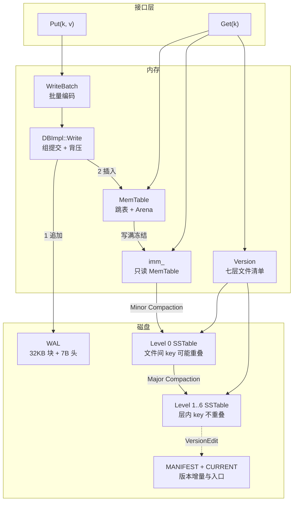
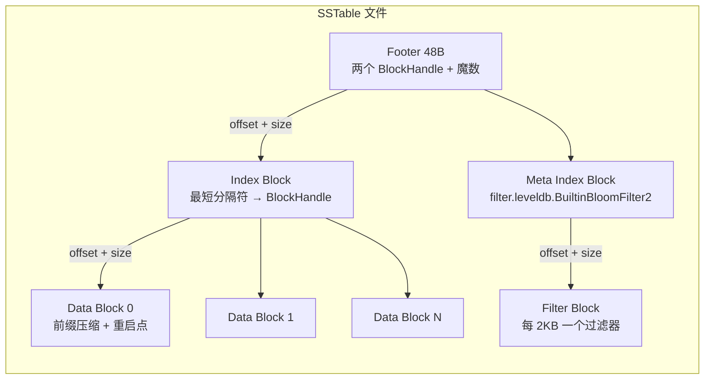
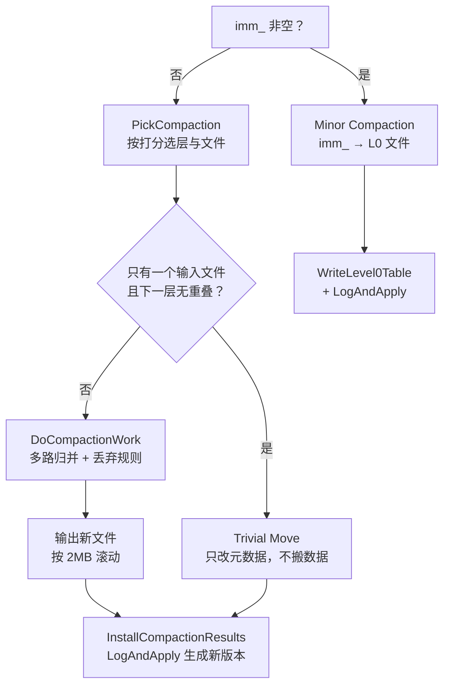
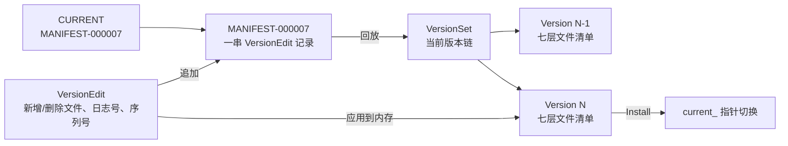

# 09 LevelDB 源码剖析——MemTable、SSTable 与 Compaction

**摘要：**

读 LSM 的资料容易停在示意图上：写入先进内存表，写满刷成文件，后台按层合并。示意图能解释"为什么"，却解释不了"代价落在哪一行代码上"。本文以 LevelDB 1.23 为标本，不逐函数走读，而是跟着一次 Put 与一次 Get 穿过整个 LSM：写入侧看组提交如何把多个请求攒成一次 `fsync`、看 `MakeRoomForWrite` 的五条分支如何构成背压、看 32 KB 日志块与 7 字节记录头如何在崩溃后还能判断"这条记录完整吗"、看 InternalKey 如何把序列号与类型塞进 8 字节从而让"新版本优先"退化成一次字节比较；读取侧看 `Version::Get` 如何用三个状态在内存表与七层文件之间短路、看布隆过滤器为什么默认关闭、看"读得太多次"如何反过来触发合并；文件格式侧看前缀压缩与重启点如何把索引压小、看 Footer 与魔数如何让打开文件只需读末尾 48 字节；合并侧看打分、挑选、丢弃规则与墓碑清理，以及版本管理如何用 VersionEdit 增量加 MANIFEST 加 CURRENT 完成一次原子切换。最后把写放大、合并抖动、读放大这三笔账落回代码，并解释 RocksDB 的演进为什么基本是在补这些短板。

---

## 第 1 章 为什么值得读一份"小"引擎

### 1.1 万行代码里的完整 LSM

LevelDB 的源码规模常被形容为"一个周末能读完"，这个说法有点乐观，但方向没错：`db/`、`table/`、`util/` 三个目录加上 `include/leveldb/` 的公开头文件，核心实现落在万行量级，去掉测试、基准与工具之后更少。少到可以逐段对照，又完整到包含了工业级 LSM 的全部要害——内存表、预写日志、不可变有序文件、分层合并、版本管理、崩溃恢复。

这个组合很少见。教学项目通常只有前四件，缺版本管理与恢复，于是"崩溃之后会发生什么"永远讲不清；工业系统则往往把每一件都做到极致，代码量膨胀到读不完，读者只能在文档与博客之间拼凑。LevelDB 恰好卡在中间：每一件都做了，每一件都只做到"够用"，剩下的空间留给读者自己判断"如果要更好，该往哪里加"。

克制本身也是一种设计信息。它只有一个可写内存表和一个只读内存表，写满就必须等后台刷盘，没有队列；只有一个后台线程，合并不能并行；没有列族，没有事务，没有生存时间（Time-To-Live，TTL），连范围删除都没有。这些"没有"不是疏忽，而是把复杂度挡在门外的一种方式——**每挡住一项功能，就少一组需要同时成立的约束**。

### 1.2 两位作者与它的血统

2011 年，Google 开源了 LevelDB，作者是 Jeff Dean 与 Sanjay Ghemawat。这两人在分布式系统与系统软件领域的分量不必多言，更有意思的是它的血统：SSTable 这个文件格式来自 Bigtable，内存表加日志加合并这套组合也是 Bigtable 单机侧的做法，LevelDB 相当于把 Bigtable 的本地存储层剥出来，做成一个可以嵌进任何进程的库。

剥出来的结果比原版更有生命力。RocksDB 在 2012 年从它分叉，补上了列族、多线程合并、合并限速、键值分离，成了今天大多数分布式数据库的本地引擎；HyperLevelDB 曾经尝试改写它的合并并发模型；Go 语言社区有 goleveldb 这样的移植；CockroachDB 用的是 Pebbles，一个受它启发的 Go 实现；Bitcoin Core 与 Chrome 的 IndexedDB 后端也曾把数据托付给它。这些衍生品的共同点是保留了 LevelDB 的骨架，只替换自己最在意的那一段——这恰好说明骨架选得对。

对读者而言，血统的意义在于"读一份，懂一片"。LevelDB 里的 `Version`、`VersionEdit`、`MANIFEST` 三件套，在 RocksDB 里叫同样的名字；`MemTable` 与 `SSTable` 的分工也几乎没变。把这份代码读透，再看别的实现，多数时候只需要问一句"它把哪一段换掉了，为什么"。

### 1.3 读法：跟着一次 Put 与一次 Get 走

本文不按文件顺序走读，因为那样会把一条完整的因果链切成碎片：读到 `memtable.cc` 时不知道它被谁调用，读到 `version_set.cc` 时又忘了它为什么需要增量。更有效的方式是选两条路径——一次写入、一次读取——跟着它们穿过所有组件，每次停留只回答一个问题：这一段为什么必须这么写。

具体来说，写入路径会依次经过 `DB::Put`、`WriteBatch`、`DBImpl::Write`、`log::Writer`、`MemTable::Add`、`SkipList::Insert`、`Arena`；读取路径会依次经过 `DBImpl::Get`、`LookupKey`、`Version::Get`、`TableCache`、`Table::InternalGet`、`BlockReader`、`FilterBlockReader`。两条路径在 `MemTable` 与 `SSTable` 处交汇，而 `Compaction` 与 `VersionSet` 则负责把交汇之后产生的文件整理成一个可查询的整体。



### 1.4 版本与本文约定

本文以 LevelDB 1.23 为准，涉及的具体常量与默认值都来自这一版的 `db/dbformat.h`、`db/db_impl.cc`、`include/leveldb/options.h`。源码在演进，字段与函数签名可能变化，但本文关心的是机制与取舍，不是逐行对照；若手上的版本与文中不一致，优先相信机制，再去看差异。若你更想先建立 LSM 的整体印象，可以回看 [[01 存储引擎概述——从数据库演进到两大派系]] 的第 5 章，以及 [[07 LSM-Tree 原理——用顺序写换取写吞吐]] 里对读写空间放大的定量推导。

代码片段只保留能印证机制的部分，省略错误处理、日志输出与断言，注释解释"为什么这么写"而不是"这一行在做什么"。笔者在取舍时有一条标准：如果删掉这段代码，读者会误解某个机制，就留下；只是少了一个分支或少了一次检查，就删掉。文中不标行号，因为版本一换行号就失效，反而误导。

## 第 2 章 写入：从 Put 到 MemTable

### 2.1 三层调用

`DB::Put` 在 LevelDB 里是一个非虚函数的默认实现，它做的事只有一件：把键值对塞进一个 `WriteBatch`，然后调用虚函数 `Write`。`Delete` 同理，只是往批里塞的是一条删除标记。这个设计看起来多绕了一层，实际是为了让"单条写"与"批量写"走同一条路径——只要都变成 `WriteBatch`，后面的组提交、序列号分配、日志编码就只需要实现一份。因此阅读写入路径时，不必区分"插入"与"删除"，它们在 `WriteBatch` 之后完全同构，差别只在编码时那个 1 字节的类型位。

`DBImpl::Write` 是整个写入路径上最值得细读的函数，因为它同时承担了三件事：排队、组提交、以及把数据分发到日志与内存表。

### 2.2 组提交：一次 fsync 服务多个请求

LevelDB 的写入并发模型是"单写多读"：同一时刻只有一个线程能把数据写进日志与内存表，其余线程在队列里等。这个模型听起来保守，但它带来了一个巨大的好处——多个并发请求可以合并成一次日志追加、一次 `fsync`。

```cpp
Status DBImpl::Write(const WriteOptions& options, WriteBatch* updates) {
  Writer w(&mutex_);
  w.batch = updates;
  w.sync = options.sync;
  w.done = false;

  MutexLock l(&mutex_);
  writers_.push_back(&w);
  // 只有队首能真正写盘；其余线程挂起，等被组提交顺带完成
  while (!w.done && &w != writers_.front()) w.cv.Wait();
  if (w.done) return w.status;          // 已被前面的队首带着写完了

  // 成为队首之后，先确认内存表还有空间，必要时切换甚至阻塞
  Status status = MakeRoomForWrite(updates == nullptr);
  uint64_t last_sequence = versions_->LastSequence();
  Writer* last_writer = &w;
  if (status.ok() && updates != nullptr) {
    WriteBatch* write_batch = BuildBatchGroup(&last_writer);   // 拼成一组
    WriteBatchInternal::SetSequence(write_batch, last_sequence + 1);
    last_sequence += WriteBatchInternal::Count(write_batch);
    mutex_.Unlock();                    // 写盘期间放开锁，允许读请求进来
    status = log_->AddRecord(WriteBatchInternal::Contents(write_batch));
    if (status.ok() && options.sync) status = logfile_->Sync();
    if (status.ok()) status = WriteBatchInternal::InsertInto(write_batch, mem_);
    mutex_.Lock();
    versions_->SetLastSequence(last_sequence);
  }
  // 依次唤醒这一组里的 writer，并把队首交给下一个（略）
  return status;
}
```

这套排队机制像早高峰的班车：与其给每个人发一辆车，不如等几分钟凑满一车再走。限定在于"等待"本身就是成本——凑车的时间直接加到延迟上，队列的长度则决定了公平性的边界，谁排在队首谁就先走。

这段代码里有三个决定值得停下来想。

第一，**组提交把"每次写入一次 fsync"变成"每组一次 fsync"**。一次 `fsync` 要等设备确认落盘，机械盘上是毫秒量级，固态盘上也要几十到几百微秒，若每个请求都付一次，写入吞吐就被同步开销按住了。攒批之后，单次写入摊到的同步成本随并发度下降，这是 LevelDB 在批量写场景下吞吐好看的主要原因。

第二，写日志与写内存表之间**释放了互斥锁**。这不是为了并发写——写仍然只有一个线程在做——而是为了让读请求不被 `fsync` 阻塞。读路径只需要短暂持锁拿到 `mem_`、`imm_` 与当前 `Version` 的引用，随后就可以在锁外完成查找。

第三，序列号在批级别分配。`SetSequence` 给整批一个起始序列号，批内每条记录按顺序递增。这意味着同一个 `WriteBatch` 内的多条记录有确定的先后关系，崩溃恢复时按日志重放能得到一致的结果。

### 2.3 背压：MakeRoomForWrite 的分支阶梯

`MakeRoomForWrite` 是 LevelDB 的"刹车系统"，它决定了写请求什么时候能直接过、什么时候要慢一点、什么时候必须停下等。函数体是一个 `while (true)`，每一轮检查一个条件：

- 若后台已经出错（`bg_error_` 不空），直接把这个错误返回给所有后续写入，数据库进入"只读失败"状态；
- 若第 0 层文件数达到 `kL0_SlowdownWritesTrigger`（8 个）且本次允许延迟，则睡眠 1 毫秒再重试。注意这里睡的是"每一次写"，而不是"某一次写睡几秒"——目的是把延迟摊平、降低方差，同时把 CPU 让给合并线程；
- 若当前内存表还没写满（`ApproximateMemoryUsage()` 不超过 `write_buffer_size`，默认 4 MB），且不是强制切换，直接返回，允许写入；
- 若已经存在只读内存表（`imm_` 不空），说明上一张表还没刷完，只能等后台完成信号；
- 若第 0 层文件数达到 `kL0_StopWritesTrigger`（12 个），硬停，同样等后台信号；
- 以上都不成立，就执行切换：把 `mem_` 赋给 `imm_`，开一个新的日志文件与新的 `MemTable`，然后尝试调度一次合并。

这五条判断加上最后的兜底，构成了一条阶梯式背压：8 个文件时开始"变慢"，12 个文件时"停下"，中间靠 1 毫秒的微延迟做缓冲。**这套机制的本质是把"磁盘跟不上"翻译成"写入变慢"，而不是让内存无限堆积**。代价也很直接：一旦后台合并被某个大文件卡住，前台写入会成片地停在这里，表现为周期性的延迟毛刺。

### 2.4 WAL：32 KB 块与 7 字节头

日志的物理布局由两个常量决定：块大小 32 KB，记录头 7 字节。选 32 KB 的理由并不神秘，它要和文件系统的页、预读窗口、以及"一次写入不要太大也不要太小"的直觉对上；块太小会让头部开销占比上升，块太大则一次损坏会牵连更多数据。

7 字节的头由三部分组成：4 字节的 CRC32C 校验和、2 字节的长度、1 字节的类型。类型有四种——整条记录、首段、中段、末段——因为一条记录可能跨越块边界，甚至跨越多个块。

```cpp
Status Writer::AddRecord(const Slice& slice) {
  const char* ptr = slice.data();
  size_t left = slice.size();
  Status s;
  bool begin = true;
  do {
    const int leftover = kBlockSize - block_offset_;   // kBlockSize = 32768
    if (leftover < kHeaderSize) {                     // kHeaderSize = 7
      // 块尾剩余空间装不下一个头，就补零跳过：读的时候据此判定"这个块结束了"
      if (leftover > 0) dest_->Append(Slice("\x00\x00\x00\x00\x00\x00", leftover));
      block_offset_ = 0;
    }
    const size_t avail = kBlockSize - block_offset_ - kHeaderSize;
    const size_t fragment_length = (left < avail) ? left : avail;
    RecordType type;
    const bool end = (left == fragment_length);
    if (begin && end)      type = kFullType;     // 一块装得下
    else if (begin)        type = kFirstType;    // 分段的第一段
    else if (end)          type = kLastType;     // 分段的最后一段
    else                   type = kMiddleType;   // 分段的中间段
    s = EmitPhysicalRecord(type, ptr, fragment_length);
    ptr += fragment_length;
    left -= fragment_length;
    begin = false;
  } while (s.ok() && left > 0);
  return s;
}
```

`EmitPhysicalRecord` 里有两处细节值得注意。一是校验和覆盖了"类型字节加数据"，而不是只覆盖数据——这样即使类型位发生翻转，也能被校验发现，否则读端会按错误的类型去拼接记录，产生难以定位的错乱。二是块尾补零而不是跨越块边界写一个"半个头"：补零让读端可以简单地判断"剩余不足 7 字节就是块尾"，代价是浪费几个字节。

读端在 `log::Reader` 里做的判断同样朴素：按 32 KB 读一块，从头解析记录头，校验通过就把数据交出去；遇到首段就攒进临时缓冲，遇到末段就拼成完整记录返回；若某条记录在中间损坏，就把这个块剩余部分跳过，从下一块重新对齐。这套"按块对齐加校验和"的策略不保证一定能恢复到最后一条写入，但保证了**恢复过程不会因为一条坏记录而陷入无限错误**。

`WriteOptions::sync` 的语义也在这里落地：日志追加只是写进内核缓冲，只有显式 `Sync()` 才会 `fsync`。默认情况下 LevelDB 不 `fsync`，这意味着进程崩溃不会丢数据（数据已在内核页缓存里），但机器掉电可能丢最近一段。这个默认值是一笔明确的交换——用"掉电可能丢最后几条"换"写延迟低一个数量级"。

### 2.5 WriteBatch 的布局

`WriteBatch` 把所有要写的数据编码进一个字符串：前 8 字节是起始序列号，接着 4 字节是记录条数，之后是若干条记录，每条以 1 字节类型开头，然后是变长的 key 与 value（各自带长度前缀）。整个批次在日志里作为一条记录写入，在内存表里逐条插入。

序列号放在批头而不是每条记录上，是为了省空间：一个批次里的记录序列号连续，读的时候按顺序加一即可。条数放在批头，是为了让 `InsertInto` 能一次性预分配，也让日志重放时知道"这批到哪结束"。

这个格式还有一个隐含好处：批量写在日志里是原子的。要么整批记录完整地出现在日志里，要么一条都没有；不会出现"批里的前三条恢复了、后两条没恢复"的情况。这正是 LevelDB 敢把 `WriteBatch` 作为唯一原子单位的原因。

### 2.6 InternalKey：把序列号与类型塞进 8 字节

内存表里存的不是用户 key，而是内部键（InternalKey）。它的编码是"用户 key 加 8 字节标签"，标签的高 56 位是序列号，低 8 位是类型（值为 1 表示写，0 表示删）。序列号在编码时被放在高位，而比较器按字节序比较，于是**"序列号大的排在前"这件事自动成立**，读的时候第一条匹配的记录就是最新版本。

```cpp
void MemTable::Add(SequenceNumber s, ValueType type,
                   const Slice& key, const Slice& value) {
  // 一条内部记录的布局：
  // | varint32 key_size+8 | key | fixed64 tag | varint32 value_size | value |
  size_t key_size = key.size();
  size_t val_size = value.size();
  size_t internal_key_size = key_size + 8;
  const size_t encoded_len = VarintLength(internal_key_size) + internal_key_size +
                             VarintLength(val_size) + val_size;
  char* buf = arena_.Allocate(encoded_len);      // 一次分配，永不释放
  char* p = EncodeVarint32(buf, internal_key_size);
  std::memcpy(p, key.data(), key_size);
  p += key_size;
  // 序列号与类型打包成一个 8 字节整数：比较时无需解析，按字节序即"新的在前"
  EncodeFixed64(p, (s << 8) | type);
  p += 8;
  p = EncodeVarint32(p, val_size);
  std::memcpy(p, value.data(), val_size);
  table_.Insert(buf);                            // 跳表只存指针，不拷贝内容
}
```

这里有三个取舍。

先说序列号与类型的打包：它们被压成一个整数，而不是分成两个字段。这样比较器只需要按字节比较整条内部键，不必先解析再比较；跳表的每一次比较都因此少了几条指令，在百万级写入下是可观的节省。

再说长度的编码：用变长整数（varint）而不是定长。key 通常很短，一个字节就能表示长度，定长会浪费三字节。省下来的空间在内存表里是实打实的——内存表只有 4 MB，能多放一条是一条。

最后一处取舍落在内存分配上——整条记录一次分配、永不移动。跳表节点指向这块内存，后续插入不会让它失效；删除也不释放内存，只是留一条墓碑。这带来了极高的写入速度，也带来了"内存表只能整体丢弃、不能局部回收"的限制。

### 2.7 SkipList 与 Arena

内存表的底层是跳表。选跳表而不是红黑树，理由有三个：跳表的读可以完全不加锁（只要写者用发布语义挂好指针），跳表的插入不需要旋转与再平衡，跳表的迭代天然支持"定位到不小于某键的第一个元素"——这正是读路径需要的能力。

```cpp
template <typename Key, class Comparator>
void SkipList<Key, Comparator>::Insert(const Key& key) {
  Node* prev[kMaxHeight];
  Node* x = FindGreaterOrEqual(key, prev);   // 逐层下降，记录每层的前驱
  assert(x == nullptr || !Equal(key, x->key));

  int height = RandomHeight();               // 幂律分布，层数越高越罕见
  if (height > GetMaxHeight()) {
    for (int i = GetMaxHeight(); i < height; i++) prev[i] = head_;
    max_height_.store(height, std::memory_order_relaxed);
  }

  x = NewNode(key, height);
  for (int i = 0; i < height; i++) {
    // 先无屏障挂好后继，再用 release 语义把节点"发布"给读线程
    x->NoBarrier_SetNext(i, prev[i]->NoBarrier_Next(i));
    prev[i]->SetNext(i, x);
  }
}
```

内存序的选择是这段代码的核心。`NoBarrier_SetNext` 用 relaxed 语义设置节点内部的指针，`SetNext` 用 release 语义把节点挂到链表上；读端用 acquire 语义读取 next 指针。这套组合保证了"读线程要么看不到这个节点，要么看到的是一个已经完整构造好的节点"，于是**写者单线程、读者多线程、读不加锁**成为可能。这个性质对 LSM 特别重要：读请求远多于写请求，读路径上每少一把锁，吞吐就上一个台阶。

节点的内存来自 `Arena`，一个按 4 KB 块向系统申请、内部切分的小分配器。用它而不是 `malloc`，理由同样有三条：批量申请摊薄了系统调用的元数据开销；同一条记录与其索引项在内存中相邻，缓存局部性更好；析构时整块释放，不需要逐个 `free`，这也正好匹配"内存表整体丢弃"的生命周期。

跳表的最大高度是 12，层数按幂律随机生成。跳表本身的概率分析与复杂度推导，在 [[02 MemTable 与 SkipList]] 里有更细致的展开，这里只取它对并发读的意义。12 层意味着在节点数达到百万级时，一次查找期望只走十几次指针跳转；层数再高收益递减，而每加一层都要多一个指针的空间开销。

## 第 3 章 读取：从 Get 到 TableCache

### 3.1 三段式

`DBImpl::Get` 的结构非常清晰：先在锁内确定一个快照序列号，拿到 `mem_`、`imm_` 与当前 `Version` 的引用，然后释放锁，按"内存表、只读内存表、磁盘文件"的顺序查找，最后重新加锁、更新统计并返回。

```cpp
Status DBImpl::Get(const ReadOptions& options, const Slice& key, std::string* value) {
  Status s;
  MutexLock l(&mutex_);
  // 快照决定了"能看到哪些写入"：默认用当前最后序列号，即读最新
  SequenceNumber snapshot = (options.snapshot != nullptr)
      ? static_cast<const SnapshotImpl*>(options.snapshot)->sequence_number()
      : versions_->LastSequence();
  MemTable* mem = mem_;
  MemTable* imm = imm_;
  Version* current = versions_->current();
  // ……此处对 mem_ / imm_ / current 增加引用，防止在锁外被释放
  {
    mutex_.Unlock();
    LookupKey lkey(key, snapshot);
    if (mem->Get(lkey, value, &s)) {
      // 命中可写内存表
    } else if (imm != nullptr && imm->Get(lkey, value, &s)) {
      // 命中只读内存表
    } else {
      s = current->Get(options, lkey, value, &stats);   // 落到磁盘
      have_stat_update = true;
    }
    mutex_.Lock();
  }
  // 若某个文件被读得太多次，这里会触发一次"seek 合并"
  if (have_stat_update && current->UpdateStats(stats)) {
    MaybeScheduleCompaction();
  }
  return s;
}
```

三个细节值得留意。

第一，**快照只是一个序列号**。`LookupKey` 把"用户 key 加这个序列号"编码成内部键，查找时跳表按内部键比较，于是所有序列号大于快照的版本会被自然跳过。LevelDB 的多版本读因此几乎零成本——不需要维护版本链，只需要在比较时把序列号带上。

第二，引用计数保护锁外访问。`mem_`、`imm_` 与 `Version` 都可能在查找过程中被后台线程替换或删除，所以取到指针之后要立刻加引用，用完再减。这是 LevelDB 里唯一一处必须小心处理的并发细节，也是最容易在读源码时忽略的地方。

第三，**统计信息会反过来驱动合并**。`Version::Get` 会记录"这次查找碰了哪些文件"，`UpdateStats` 发现某个文件的 seek 次数超过阈值，就把它标记为待合并，并尝试调度一次合并。这条反馈通路在第 3.5 节展开。

### 3.2 LookupKey 与那个"故意选大的类型"

`LookupKey` 是对"要查什么"的一次编码，它同时提供三种视图：内存表用的键（带长度前缀）、内部键（不带长度前缀）、用户键。构造时它把传入的序列号与 `kValueTypeForSeek` 组合成标签。

`kValueTypeForSeek` 的值等于 `kTypeValue`（1），而删除类型的值是 0。为什么要选一个"比删除更大"的类型？因为内部键按字节序降序排列序列号、升序排列类型，若用删除类型去定位，就可能跳过"同一序列号的写入记录"。选一个不小于任何真实类型的值，才能保证 `Seek` 落在"小于等于该序列号的第一条记录"上。

这类细节是读源码最值钱的部分：它不体现在任何文档里，但只要改错一个常量，删除语义就会在某些边界上失效，而测试未必覆盖得到。

### 3.3 Version::Get 与三个状态

真正在磁盘上找数据的是 `Version::Get`。它用一个叫 `Saver` 的小结构在多层查找之间传递状态，状态只有三种：没找到、找到了、找到墓碑。三个状态让"找到墓碑就停止查找"这件事变得自然——墓碑意味着这个 key 在更早的层里即使存在也应该被隐藏。

```cpp
Status Version::Get(const ReadOptions& options, const LookupKey& k,
                    std::string* value, GetStats* stats) {
  Slice ikey = k.internal_key(), user_key = k.user_key();
  // 略去 Saver 初始化（state / ucmp / user_key / value）与 searched 计数
  for (int level = 0; level < config::kNumLevels; level++) {
    const std::vector<FileMetaData*>& files = files_[level];
    if (level == 0) {
      // L0 文件可能重叠：按文件号从新到旧逐个试，命中即停
      for (int i = int(files.size()) - 1; i >= 0 && saver.state == kNotFound; i--) {
        if (ucmp->Compare(user_key, files[i]->smallest.user_key()) >= 0 &&
            ucmp->Compare(user_key, files[i]->largest.user_key()) <= 0 &&
            vset_->table_cache_->Get(options, files[i]->number,
                                     files[i]->file_size, ikey, &saver, SaveValue)) {
          return saver.state == kFound ? Status::OK() : Status::NotFound(Slice());
        }
      }
    } else {
      // 其余层内 key 不重叠：二分定位唯一候选，越过层尾即断定不存在
      int index = FindFile(vset_->icmp_, files, ikey);
      if (index >= int(files.size())) return Status::NotFound(Slice());
      FileMetaData* f = files[index];
      if (vset_->table_cache_->Get(options, f->number, f->file_size,
                                   ikey, &saver, SaveValue)) {
        return saver.state == kFound ? Status::OK() : Status::NotFound(Slice());
      }
    }
    if (saver.state != kNotFound) break;   // 命中（含墓碑）即停止下沉
  }
  return Status::NotFound(Slice());
}
```

读路径的层次感像查户口：先在现住址（可写内存表）找，再去刚迁出的旧址（只读内存表）找，最后翻档案库（各层 SSTable），每进一个门之前都要先看门牌号（key 范围）决定值不值得进。限定在于"最多敲几次门"由层数决定，而"要不要带钥匙"（布隆过滤器）则决定了白跑一趟的概率。

这段循环里有三处设计值得展开。

第一，**L0 与其余层的查找方式不同，原因是重叠性**。L0 的文件由内存表刷出，彼此之间 key 范围可能重叠，因此不能二分，只能按文件号从新到旧逐个试——文件号越大越新，找到即停。L1 及以下由合并产出，层内 key 范围互不重叠，于是可以二分，一次定位到唯一候选。

第二，**二分找不到就直接返回"不存在"**。`FindFile` 返回的索引若越过该层末尾，说明目标 key 大于该层所有文件的最大键，而层与层之间是"越往下越老"的关系，更下层只会有更老的键，因此可以立刻断定不存在。这个短路是 LevelDB 读性能的重要来源。

第三，**墓碑也是"命中"**。`saver.state` 一旦变成"找到墓碑"，循环就停止下沉，返回不存在。若没有这一条，一个被删除的 key 会在每一层都被重新查找一遍，删除越多读越慢。

### 3.4 布隆过滤器：默认关着的那道门

`TableCache::Get` 会打开或复用 `Table` 对象（受 `max_open_files` 限制的最近最少使用缓存），然后调用 `Table::InternalGet`。后者先在索引块里定位候选数据块，再通过 `FilterBlockReader` 判断"这个块里可能有没有这个 key"，判否就直接跳过，连块都不用读。

这一步的价值可以量化：一次点查若命中在 L5，理想情况下只需要读一个数据块；但没有过滤器时，L0 的每个文件、L1 到 L4 的候选文件都要被打开、读索引、读数据块，才能确认"这里没有"。过滤器把这些"确认没有"的成本从一次 I/O 降到一次内存查表。

不过 LevelDB 默认并不启用它。`Options::filter_policy` 的默认值是空指针，必须由使用者显式设置 `NewBloomFilterPolicy(bits_per_key)` 才会生成 Filter Block。这个默认值的选择很能说明 LevelDB 的定位：它不假设负载，也不替使用者做决定；加上过滤器会让文件变大、写入变慢，而某些负载（写多读少、key 空间小）未必划算。

过滤器的粒度是"每 2 KB 数据一个"，由 `kFilterBaseLg = 11` 决定。读的时候用数据块在文件中的偏移右移 11 位算出属于哪个过滤器，再做判定。这个粒度是"过滤器体积"与"判否精度"之间的折中：粒度太细，过滤器本身的偏移数组会膨胀；粒度太粗，一个过滤器覆盖的 key 太多，误判率上升。

### 3.5 读得太多次，也是一种信号

`Version::Get` 在结束时记录"这次查找碰了几个文件"。若超过一个，就把最后碰到的文件记进统计。`UpdateStats` 拿到统计之后做一件很有意思的事：给这个文件的 `allowed_seeks` 减一，减到零就把它标记为"待合并"，并在下次调度时优先合并它。

`allowed_seeks` 的初值是"文件大小除以 16 KB"。一个 2 MB 的文件，初值约 128 次。这意味着**一个文件如果在合并之前被"白查"了一百多次，系统就会认为它待错了层**——它的 key 范围与上层重叠太多，或者它的数据太老却占着上层的位置，于是主动把它合并下去。

这条机制是 LevelDB 里最像"自适应"的部分。它承认一个事实：分层合并的打分公式（按层容量）只是静态估算，真实的访问分布可能与之不符；与其相信估算，不如听读路径的反馈。RocksDB 后来把这个思路扩展成了更复杂的合并优先级，但源头在这里。

### 3.6 读的代价拆解

把一次点查的每一步摊开，可以看清时间花在哪里。

| 阶段 | 命中条件 | 典型开销 | 失效时的后果 |
|---|---|---|---|
| 可写内存表 | 刚写入的数据 | 一次跳表查找，纯内存 | 落到只读内存表 |
| 只读内存表 | 刚刷盘但尚未合并的数据 | 一次跳表查找，纯内存 | 落到磁盘 |
| L0 文件 | 最近刷盘的数据 | 每个文件一次索引查找加一次块读 | 文件数越多越慢 |
| L1 到 L6 | 较早的数据 | 每层一次索引查找加一次块读 | 最多六层，逐层下沉 |
| 布隆过滤器 | 每层每个候选文件 | 一次内存查表 | 未启用时全变成真实 I/O |
| 版本判断 | 每条候选记录 | 一次序列号比较 | 快照读失效 |

从表里能看出读放大的两个来源：**层数**与**L0 文件数**。层数由容量比例决定，改不了多少；L0 文件数由合并速度决定，一旦合并跟不上，L0 会涨到 8 个、12 个，读延迟随之线性上升。这也是为什么 LevelDB 在写入压力大时，读的 P99 会明显变差——不是读路径变慢了，而是它要碰的文件变多了。

## 第 4 章 SSTable：不可变文件里的三层索引

### 4.1 布局

一个 SSTable 由五部分组成：若干数据块、一个过滤块、一个元索引块、一个索引块、一个 48 字节的尾部。数据块里放键值对，过滤块里放布隆过滤器，元索引块记录过滤块的位置，索引块记录每个数据块的位置，尾部记录索引块与元索引块的位置。



SSTable 更像一本印好的书而不是一叠活页：目录印在最后，正文分块，块内相邻条目共享前缀，所以要从块首读起；书一旦印好就不能改一个字，想改只能整本重印。限定是"重印的成本由合并承担"——这正是写放大的来源。

这个布局的关键在于"索引在文件末尾"。打开一个文件时，只需读最后 48 字节拿到索引块的位置，再读索引块就能知道所有数据块的位置，不必扫描整个文件。对于动辄几十兆的文件，这把"打开成本"从与文件大小相关降到与块数相关。

### 4.2 数据块与前缀压缩

数据块内部的每条记录不是简单的"长度加 key 加 value"，而是"共享前缀长度、非共享长度、值长度、非共享 key 部分、value"。相邻的 key 往往有很长的公共前缀（尤其是有序的内部键，前缀几乎一样），把公共部分省掉，块内体积能显著下降。

```cpp
void BlockBuilder::Add(const Slice& key, const Slice& value) {
  Slice last_key_piece(last_key_);
  size_t shared = 0;
  if (counter_ < options_->block_restart_interval) {
    // 只有重启点之间才做前缀压缩：与前一条 key 求公共前缀长度
    const size_t min_length = std::min(last_key_piece.size(), key.size());
    while ((shared < min_length) && (last_key_piece[shared] == key[shared])) {
      shared++;
    }
  } else {
    restarts_.push_back(static_cast<uint32_t>(buffer_.size()));  // 记一个重启点
    counter_ = 0;
  }

  const size_t non_shared = key.size() - shared;
  PutVarint32(&buffer_, shared);
  PutVarint32(&buffer_, non_shared);
  PutVarint32(&buffer_, value.size());
  buffer_.append(key.data() + shared, non_shared);
  buffer_.append(value.data(), value.size());

  last_key_.resize(shared);                    // 维护"上一条完整 key"
  last_key_.append(key.data() + shared, non_shared);
  counter_++;
}
```

压缩的收益与代价都很清楚。收益是体积：一个 16 字节的 key 若共享 14 字节，每条记录只多写两个字节的差异。代价是读一条记录必须知道它的前一条，于是块内不能随机定位，只能顺序解码。

### 4.3 重启点：把"不能随机定位"这件事补回来

重启点（Restart Point）就是补丁。每隔固定条数（默认 16 条），块里存一条完整 key，并把这个位置的偏移记进块尾的重启点数组。查找时先用二分在重启点数组上定位到"最后一个不大于目标的重启点"，从那里开始顺序解码，最多走 16 条。

这个设计把两个互相冲突的目标调和在一起：块内体积要小，所以做前缀压缩；块内要能二分，所以要周期性重置。间隔取 16 是一个经验值——取小了，重启点数组变大、压缩率下降；取大了，顺序扫描变长、查找变慢。

块的最后还有 5 个字节的尾部：1 字节压缩类型加 4 字节 CRC32C。校验和覆盖的是"块内容加类型字节"，作用与日志记录头一致——防止把损坏的块当成正常数据解析。

### 4.4 索引块与最短分隔符

索引块本身也是一个数据块（同样的格式、同样的前缀压缩），它的每条记录是"某个数据块的最大 key"到"该块的位置与长度"的映射。但 LevelDB 并不直接存最大 key，而是存一个"最短分隔符"。

假设前一个数据块的最大 key 是 `helloBlock`，后一个数据块的最小 key 是 `helloTable`，那么任何落在 `helloBlock` 与 `helloTable` 之间、且不短于两者公共前缀加一个字符的字符串，都可以作为分隔符，譬如 `helloC`。用它替代 `helloBlock`，索引项变短了，而区间判定依然正确——因为查找时只需要"目标不大于分隔符就往这个块找"。

索引块末尾还有一个"最短后缀"的处理，用于最后一个块：既然它之后没有别的块，任何比最大 key 大的字符串都能当分隔符，于是可以截短到最短的可行形式。这两处优化加起来省下的字节不多，但它体现了一种态度：**索引是要常驻内存的，能省一个字节就省一个字节**。

### 4.5 过滤块与元索引

过滤块不是普通数据块，它的结构是"若干过滤器内容、过滤器偏移数组、过滤器元信息"。每个过滤器覆盖文件中一段 2 KB 的区域，偏移数组记录每个过滤器在块内的起点。

元索引块则是一个只有一条记录的索引块，键是 `filter.leveldb.BuiltinBloomFilter2`，值是过滤块的位置与长度。名字里带版本号，是为了将来更换过滤器算法时不至于误读旧文件——这是一种很朴素但很有效的向后兼容手段。

### 4.6 尾部与魔数

尾部固定 48 字节：两个 `BlockHandle`（各含偏移与长度，变长编码，最多 20 字节）、填充到 40 字节、最后 8 字节魔数。魔数的值是固定的，读文件时先校验它，不匹配就直接判定"这不是一个 LevelDB 表文件"。

为什么尾部要定长？因为读的时候是从文件末尾倒着读 48 字节，若长度不固定就无法定位。为什么魔数放在最后？因为最后 8 字节是唯一一个"无论文件多大都固定位置"的区域，用它做格式判别最省事。

### 4.7 写表：延迟写索引项

`TableBuilder` 在写数据块时有一个不太直观的动作：它不在写完一个块之后立刻写索引项，而是把块的位置暂存进一个"待写索引"状态位，等到下一次 `Add` 才真正写索引。原因是索引项要存最短分隔符，而分隔符需要"下一个块的首个 key"才能算出来——在写完当前块的那一刻，这个 key 还不存在。

于是 `Add` 的开头总要先检查那个状态位：若它被置上，就用 `last_key_`（上一个块的最后一个 key）与当前位置构造索引项，追加进索引块，再清掉状态位；随后把本条的 key 记成新的 `last_key_`，把键值对交给 `BlockBuilder`，最后判断块是否超过 4 KB，超了就 `Flush`——写块、记下 `BlockHandle`、把状态位置上。

这个"延后一拍"的设计让索引项平均短了几个字节，代价是代码里多了一个必须小心维护的状态位。对读者而言，它的启示是：**文件格式的每一处节省，都会在写入逻辑里留下一个必须同步维护的状态**，而这些状态正是格式难以演进的根源。

### 4.8 读一个块

读一个块的路径是"两次二分加一次扫描"：先在索引块里二分（借助重启点数组），定位到候选数据块；再用 `BlockReader` 打开这个块，在重启点数组上二分，定位到不大于目标的最后一个重启点；最后从那里顺序解码，最多走 16 条记录。

这条路径的每一步都不涉及额外的 I/O——索引块通常常驻内存（被 `Table` 缓存），数据块才是真正的磁盘读。所以一次点查在文件内部的成本，约等于"一次索引内存查找加一次块读"。

## 第 5 章 Compaction：把随机写换成顺序写的那台机器

### 5.1 触发链路

合并的调度入口是 `MaybeScheduleCompaction`。它检查四件事：后台是否已有合并任务在跑、是否正在关闭、是否有后台错误、以及是否"需要合并"（有只读内存表待刷、有文件被标记待合并、或某一层打分超过阈值）。四者都通过，就向环境投递一个后台任务，由 `BackgroundCompaction` 执行。

合并的动作像整理仓库：把几个货架上编号相邻的货并到新货架上，过期的直接扔掉，剩下的按容量分装成若干箱，再把货架标签换掉。限定是"每搬一次货就是一次写放大"，而"标签换掉"必须是原子的，否则叉车走到一半断电，仓库里就会出现两套互相矛盾的标签。

`BackgroundCompaction` 的分支很少，但顺序有讲究：**先处理只读内存表，再处理磁盘文件**。因为只读内存表占着内存、挡着写入，优先级最高；磁盘合并则可以等。



### 5.2 打分：L0 数文件，其余层数字节

每一层都有一个分数，`Finalize` 时算出来。L0 的分数是"文件数除以 4"——因为 L0 的文件之间可能重叠，衡量它的拥挤程度用文件数最直观；L1 及以下的分数是"该层总字节数除以容量上限"，容量上限从 L1 的 10 MB 起，每层乘 10。

这个设计有一个容易被忽略的细节：**L0 到 L1 的比例并不严格是十倍**。L0 在 4 个文件（约 8 MB）时触发合并，而 L1 的容量是 10 MB，两者只差一点。这意味着 L0 的数据几乎刚落到 L1 就会因为 L1 超限而被推向 L2，头两层的合并频率明显高于后面几层。这是早期实现留下的一个不太均衡的比例，RocksDB 后来把它调成了更规整的倍数关系。

分数最高且超过 1 的层被选中。若所有层都没超，但存在被 seek 标记的文件，就选那个文件所在的层——这就是第 3.5 节那条反馈通路的落点。

### 5.3 挑选与扩大输入

`PickCompaction` 做三件事：确定层号、确定第一个输入文件、确定第二个输入文件。

第一个输入在 L0 里是"整个 L0 的所有文件"（因为重叠，必须一起处理），在其余层里是按层内顺序轮转选一个（用一个游标记录上次处理到哪，避免总是合并同一段）。

第二个输入是下一层中与第一个输入 key 范围重叠的所有文件。这一步由 `SetupOtherInputs` 完成，它还会做一次"扩大输入"的尝试：如果能把第一个输入的范围扩大一点、而第二层的重叠文件数不变，那就扩大——因为一次合并搬动的数据越多，单位数据的合并成本越低。

`SetupOtherInputs` 还计算了"祖父层重叠字节数"，用于限制单次合并的输出规模。若一次合并要写出的数据与下下层重叠太多，就提前收尾，避免一次合并把整层都牵动。

### 5.4 DoCompactionWork：什么时候可以丢

合并的输入是若干个文件，输出是若干新文件。中间的归并由 `MergingIterator` 完成——它把每个输入文件的迭代器串成一个堆，每次取最小的内部键。由于内部键的编码把序列号放在高位，同一个用户 key 的多个版本会按"新到旧"的顺序依次出现，这正好让"只保留最新版本"变成一次顺序扫描。

```cpp
Status DBImpl::DoCompactionWork(CompactionState* compact) {
  // 略去 smallest_snapshot（快照中最小的序列号）与 input 迭代器的初始化
  for (; input->Valid() && !shutting_down_.load(); input->Next()) {
    Slice key = input->key();
    if (compact->compaction->ShouldStopBefore(key) && compact->builder != nullptr)
      FinishCompactionOutputFile(compact, input);   // 输出文件超 2MB 就切
    bool drop = false;
    ParsedInternalKey ikey;
    if (!ParseInternalKey(key, &ikey)) {
      has_current_user_key = false;        // 坏键不丢，交给上层报错
      last_sequence_for_key = kMaxSequenceNumber;
    } else {
      if (!has_current_user_key ||
          ucmp->Compare(ikey.user_key, Slice(current_user_key)) != 0) {
        current_user_key.assign(ikey.user_key.data(), ikey.user_key.size());
        has_current_user_key = true;
        last_sequence_for_key = kMaxSequenceNumber;   // 换了一个用户 key
      }
      if (last_sequence_for_key <= smallest_snapshot) {
        drop = true;          // 规则 A：已有更新版本输出，这条被完全遮蔽
      } else if (ikey.type == kTypeDeletion &&
                 ikey.sequence <= smallest_snapshot &&
                 compact->compaction->IsBaseLevelForKey(ikey.user_key)) {
        drop = true;          // 规则 B：墓碑之下已无更老数据，它自己也可消失
      }
      last_sequence_for_key = ikey.sequence;
    }
    if (!drop) { /* 打开输出文件、写入、更新最大 key */ }
  }
}
```

两条丢弃规则值得逐个推敲。

规则 A 处理"被更新的版本覆盖"。因为归并保证同一个用户 key 的版本按序列号降序出现，所以"当前记录之前已经输出过同 key 的版本"就等价于"当前记录是旧的"。但有一个前提：已经输出的那个版本必须对**所有快照**都可见，即它的序列号不大于 `smallest_snapshot`。否则，一个还在被某个快照读取的旧版本就不能丢。

规则 B 处理墓碑。墓碑的作用是"告诉读路径这个 key 已经不存在"，但它的必要性仅限于"下面还有更老的数据需要遮蔽"。`IsBaseLevelForKey` 会检查该 key 在更深的层里是否还有可能存在的文件，若没有，墓碑就失去了遮蔽对象，可以一并丢掉。这条规则是空间回收的关键——否则删除过的 key 会永远以墓碑形式占着空间。

这里还能看出一个设计取向：**LevelDB 宁可多留，也不愿错删**。解析失败的内键不丢、快照可见的版本不丢、下层可能有数据的墓碑不丢。这些"保守"的规则让正确性容易论证，代价是空间回收不够激进——这也是 RocksDB 引入合并过滤器让用户自己决定的部分原因。

### 5.5 写放大的账

把合并摊到单条记录上，可以算一笔粗略的账。一条新写入的记录，先以日志形式写一次，再随内存表刷成 L0 文件写一次；从 L0 到 L1 要重写一次，L1 到 L2 再一次，直到最底层。若数据最终停在 L6，那么这条记录至少被重写了七次。

这还没算"连带重写"。每次把 Ln 的文件与 Ln+1 的重叠文件合并时，重叠文件里的记录虽然不属于本次输入的第一层，也要被读出来、写进新文件。稳态下，一份数据每下沉一层，大约要陪着重写一次。于是写放大落在"层数乘以一个系数"的量级，十几倍到几十倍都属常见。

这个数字解释了很多现象：为什么 LevelDB 的写吞吐上限远低于裸盘带宽，为什么固态盘的写入寿命在 LSM 上消耗得快，为什么"减少层数"或"增大层容量比例"能立刻改善写性能。它也解释了第 07 篇那个结论——写放大不是 bug，是"用顺序写换随机写"这笔交易的找零。

### 5.6 抖动的来源

合并是后台任务，但它消耗的资源与前台共享：磁盘带宽、页缓存、CPU。LevelDB 的抖动有三个具体来源。

抖动的第一个来源是**单线程**。只有一个后台线程，意味着一次大合并会把内存表刷盘也挡住；而内存表刷盘被挡住，`MakeRoomForWrite` 就会让前台写入等待。于是"一次大合并"表现为"一段写入停顿"。

第二个来源是只读内存表只有一张。写入压力大时，内存表很快写满转只读，但刷盘要排队，于是第二个内存表写满时前台必须硬等。RocksDB 后来允许排队多张只读内存表，正是为了消掉这个停顿。

最粗的一处则是**阶梯背压的粒度**。8 个文件开始慢、12 个文件硬停，中间没有更细的调节手段。一次合并若能在一秒内完成，这个粗粒度没问题；若一次合并要几十秒，写入就会成片地卡在 12 这个阈值上。

这三条都是"实现选择"而非"原理限制"，RocksDB 逐条做了改进：多线程与子合并解决第一条，只读内存表队列解决第二条，更细的限速与优先级解决第三条。但改完之后，复杂度也上去了——这正是第 2 章说的"每加一项功能，就多一组约束"。

## 第 6 章 版本管理：一次原子的文件集合切换

### 6.1 问题的形状

合并会不断新增文件、删除文件，而读请求随时可能在旧的文件集合上工作。如果"文件集合"的变更不是原子的，就会出现"读到一个已经被删掉的文件"或"看到一半新一半旧"的情况。

LevelDB 的解法是把"文件集合"抽象成一个不可变的版本（Version），每次变更产生一个新版本，读请求持有旧版本的引用直到用完。变更本身通过一个增量描述（VersionEdit）写进清单文件（MANIFEST），再由一个只存清单文件名的小文件（CURRENT）指向当前清单。



### 6.2 Version 与引用计数

一个 Version 里存的是七层的文件列表，每个文件带编号、大小、最小与最大内部键、以及 `allowed_seeks`。它不含任何可变状态——合并产生的是新 Version，旧 Version 原样保留。

版本切换因此像舞台换景：新布景在后台搭好，灯光一暗一亮的瞬间整体替换，观众（读请求）看到的永远是完整的一幕，不会看到半截道具。限定是"换景需要一份节目单"——MANIFEST 记录每一次换景，CURRENT 指明当前演的是哪一版，断电之后照单重排即可复原。

引用计数决定生命周期。`DBImpl::Get` 在锁内取到当前 Version 后加一，用完减一；迭代器创建时加一，销毁时减一。引用归零的 Version 被延迟删除，因为它可能还被某个正在遍历的迭代器使用。

这个模型的好处是读路径完全无锁：一旦拿到 Version 指针，整层文件列表就不会再变，读到一半不会被合并打断。代价是内存里可能同时存在几个 Version，每个都持有一份文件元数据列表——数据量不大，但文件多时（几千个 SSTable）也要占几兆。

### 6.3 VersionEdit：为什么用增量

如果每次合并都把"完整的文件清单"写进清单文件，清单会随文件数线性膨胀，而合并频率很高，写清单本身就成了负担。所以 VersionEdit 只记录变化：新增了哪些文件、删除了哪些文件、日志号变成多少、下一个可用文件号是多少、最后序列号是多少、某一层的合并游标推进到哪。

重放时，从空版本开始逐条应用这些增量，就能重建出当前的文件集合。这也解释了为什么清单文件会"滚动"——增量越积越多，重放越来越慢，于是 LevelDB 在清单文件超过阈值时另起一个新文件，把当前完整状态写成一条增量，旧清单作废。

### 6.4 LogAndApply 的顺序

`VersionSet::LogAndApply` 是整个版本管理里最关键的函数，它的顺序不能乱：

1. 把 VersionEdit 编码后追加到清单文件；
2. 对清单文件执行 `Sync()`，确保落盘；
3. 把 VersionEdit 应用到内存中的新 Version；
4. 若清单文件过大，另起新清单并更新 CURRENT；
5. 安装新版本，唤醒等待的写线程。

"先落盘再生效"是这个顺序的核心。若先改内存再写盘，一次崩溃就会让内存里的文件集合与磁盘上的清单不一致，重启后可能引用一个不存在的文件，或者漏掉一个已经写好的文件。反过来，先写盘再改内存，最坏情况是"清单里多了一次变更，但内存还没应用"，重启时重放清单即可自愈。

### 6.5 CURRENT：一个只有一行的文件

CURRENT 文件的内容只有一行：当前清单文件名。它存在的唯一理由是"清单文件会换名"，而系统需要一个稳定的入口。

写 CURRENT 的方式是"写临时文件、`fsync`、重命名"。重命名在同一文件系统内是原子的，于是任何时刻读到的 CURRENT 要么指向旧清单、要么指向新清单，不会读到半个文件名。重命名之后还要对目录做一次 `fsync`，否则目录项本身可能没落盘，崩溃后文件"消失"。

这几步是所有"用文件系统做元数据"的系统都要走一遍的仪式，BoltDB 的 meta 页切换、Paimon 的快照切换、乃至很多对象存储上的表格式，本质都是同一套动作。

### 6.6 恢复路径

打开数据库时，`DBImpl::Recover` 做两件事：先恢复版本，再重放日志。

恢复版本由 `VersionSet::Recover` 完成：读 CURRENT 拿到清单文件名，逐条回放清单里的 VersionEdit，重建出文件集合与各种编号；若清单损坏或缺失，就尝试从目录里扫描文件重建一个"尽力而为"的版本，并报错提示。

重放日志则由 `DBImpl::Recover` 完成：遍历目录里编号大于当前日志号（或等于上一个日志号）的日志文件，用 `log::Reader` 逐条读出 `WriteBatch`，插入一个临时内存表；重放完成后，把这个内存表写成 L0 文件，再开一个新的日志文件与内存表。

这条路径解释了一个常被问到的问题：为什么 LevelDB 重启后有时会多出一个 L0 文件？因为日志里可能有尚未刷盘的数据，恢复时把它们写成了文件。这也解释了为什么"重启后立刻合并"是必要的——那些文件如果不合并，就会一直占着 L0 的位置，拖慢读。

### 6.7 文件生命周期

删除文件是件危险的事：删早了会让正在读的请求失败，删晚了会占空间。LevelDB 用一个"存活集合"来判断：当前版本里的所有文件、正在合并输出的文件（`pending_outputs_`）、当前日志、上一个日志、当前清单、CURRENT，这些都在集合里；集合之外的 `.sst`、`.log`、`.dbtmp` 文件才允许删除。

`pending_outputs_` 这一项尤其重要。合并正在写一个新文件时，这个文件还不属于任何版本，若此时执行一次清理，它就会被误删。所以合并开始前先把文件号登记进去，写完并安装到新版本之后再撤销登记。

这套机制不复杂，但它把"文件何时可以安全删除"这个容易出错的问题，变成了一个可以机械检查的集合运算。

## 第 7 章 边界：LevelDB 没做的那些事

### 7.1 写放大

写放大是 LSM 的固有成本，LevelDB 没有做任何针对性的削减：没有键值分离，大 value 跟着 key 一起被重排；没有合并过滤器，过期数据只能等墓碑下沉；层容量比例在头两层还不规整。它的写放大落在"十几倍到几十倍"的量级，对写密集负载并不友好。

这个成本在嵌入式场景可以接受——写入量不大，磁盘寿命不是瓶颈；在服务器端就未必，这也是 RocksDB 引入 BlobDB、限速、多线程合并的直接动因。

### 7.2 合并抖动与写停顿

第 5.6 节列过三个来源，这里补一个数量级的直觉：一次 2 MB 输入、涉及下层若干重叠文件的合并，在普通固态盘上通常在几十到几百毫秒量级；若输入是 L0 的四个文件加上 L1 的大量重叠文件，可能到秒级。在这段时间里，内存表刷盘被挡住，前台写入在 `imm_ != nullptr` 这个分支上等待。

于是 LevelDB 的写延迟分布不是"稳定的低"，而是"大部分很快、周期性很慢"。对延迟敏感的系统，这个分布比平均值更重要。

### 7.3 读放大

读放大的两个来源是层数与 L0 文件数。层数固定为 7，改不了；L0 文件数受合并速度影响，最坏到 12 个。加上每层一次候选文件查找，一次未命中的点查在最坏情况下要碰十几个文件。

布隆过滤器能把"确认没有"的成本降下来，但它默认关闭；即使开启，它也只能减少块读，不能减少文件打开与索引查找。RocksDB 后来加了分区索引（把大索引块再切一层）与前缀布隆过滤器，正是为了压这部分成本。

### 7.4 功能缺口

LevelDB 的能力边界像一间毛坯房：承重墙、水电管线、防水都做扎实了，但隔断、家具、装修一概没有，住进去之前必须自己决定怎么隔。限定在于"毛坯"不等于"简陋"——结构错了再装修也救不回来，而 LevelDB 把结构做对了，把装修留给了下游。

把 LevelDB 与 RocksDB 的差距列成一张表，能看清"补齐短板"具体补了什么。

| 能力 | LevelDB 1.23 | RocksDB 的补齐方式 | 补齐之后挪动了哪笔账 |
|---|---|---|---|
| 多业务隔离 | 无，一个库一套表 | 列族，共享 WAL 与 MANIFEST | 读放大按列族隔离，内存开销上升 |
| 合并并发 | 单后台线程 | 多线程合并与子合并 | 写吞吐上升，CPU 与 I/O 争抢加剧 |
| 合并限速 | 无 | 基于漏桶的速率限制 | 前台延迟更稳，合并积压与空间放大上升 |
| 过期数据清理 | 等墓碑下沉 | 合并过滤器回调 | 空间放大下降，正确性责任转移 |
| 大 value | 与 key 一起重排 | BlobDB 键值分离 | 写放大下降，读路径多一次随机读 |
| 内存表形态 | 只有跳表 | 可插拔（哈希跳表、向量等） | 点查变快，范围扫描可能退化 |
| 表格式 | 块式 | 可插拔（PlainTable 等） | 读放大下降，工具链需适配 |
| 原子性与备份 | 只有 WriteBatch | 事务、Checkpoint、备份引擎 | 不直接影响放大，复杂度上升 |

这张表的读法是"每一行都是一次交换"。RocksDB 并没有让 LSM 变得没有代价，它只是把代价挪到了使用者可以调的地方——你可以用内存换读延迟，用合并积压换前台稳定，用随机读换写放大。

## 小结

LevelDB 的价值不在于它有多快，而在于它把 LSM 的每一处取舍都摆在了一页代码里。读完之后应该能回答这样几个问题：为什么写入要先写日志再写内存表（因为日志是顺序追加、内存表是易失的）；为什么内存表用跳表而不是红黑树（因为读要无锁、迭代要能定位）；为什么 SSTable 的索引放在文件末尾（因为打开成本要与文件大小解耦）；为什么合并要先处理只读内存表（因为它挡着写入）；为什么版本变更要先写清单再生效（因为崩溃后要能自愈）。

这些问题的答案合起来，就是一句话：**存储引擎的每一段代码，都在为某一次崩溃、某一次变慢、某一次空间不足做准备**。RocksDB 的演进基本是在补 LevelDB 的工程短板——补并发、补限速、补隔离、补大 value——但它没有推翻这副骨架，因为骨架里的每一根梁，都是被物理约束顶出来的。

读到这里，如果再回头看第 07 篇那些示意图，感受会不太一样：那些箭头不再是抽象的数据流，而是一条条具体的函数调用与一次次具体的 `fsync`。这也是本专栏把源码篇放在原理篇之后的原因——先知道为什么，再看见怎么做，最后才能判断"换成我的场景，该改哪一段"。

---

## 参考资料

1. Google. *LevelDB Source Code (v1.23)*. https://github.com/google/leveldb
2. Google. *LevelDB Documentation: leveldb/index.html, impl.md, table_format.md, log_format.md*. https://github.com/google/leveldb/blob/main/doc
3. Dean, J., Ghemawat, S. *LevelDB: A Fast Persistent Key-Value Store*（项目发布说明与设计文档）, 2011.
4. Chang, F. et al. *Bigtable: A Distributed Storage System for Structured Data*. OSDI, 2006.
5. O'Neil, P. et al. *The Log-Structured Merge-Tree (LSM-Tree)*. Acta Informatica, 33(4), 1996.
6. Facebook. *RocksDB Wiki: Compaction, Column Families, BlobDB, Rate Limiter, PlainTable*.
7. Bloom, B. H. *Space/Time Trade-offs in Hash Coding with Allowable Errors*. Communications of the ACM, 13(7), 1970.
8. Kirsch, A., Mitzenmacher, M. *Less Hashing, Same Performance: Building a Better Bloom Filter*. ESA, 2006.
9. Petrov, A. *Database Internals: A Deep Dive into How Distributed Data Systems Work*. O'Reilly, 2019.
10. Kleppmann, M. *Designing Data-Intensive Applications*. O'Reilly, 2017.
11. Athanassoulis, M. et al. *Designing Access Methods: The RUM Conjecture*. EDBT, 2016.
12. CockroachDB. *Pebbles: A LevelDB/RocksDB Inspired Key-Value Store*. https://github.com/cockroachdb/pebbles

---

> [!note] 思考题
> 1. `MakeRoomForWrite` 在 L0 文件数达到 8 时让每次写多睡 1 毫秒，而不是让某一次写睡若干秒。这两种策略对延迟分布、CPU 让渡、以及写入公平性分别有什么影响？
> 2. `MemTable::Add` 把序列号与类型打包成一个 8 字节整数。如果改成"8 字节序列号加 1 字节类型"，读路径的比较逻辑、内存占用、以及块内前缀压缩的效率会怎么变？
> 3. 布隆过滤器在 LevelDB 里默认关闭。请构造两个负载，一个应该开启、一个应该保持关闭，并说明判断依据。
> 4. `DoCompactionWork` 的规则 B 允许在"下层已无更老数据"时丢弃墓碑。如果 `IsBaseLevelForKey` 的判断出现偏差（误判为"下层无数据"），会造成什么后果？这种错误能否被读路径发现？
> 5. 版本切换要求"先写 MANIFEST 并 Sync，再改内存"。如果把这个顺序反过来，请描述一次掉电之后重启时可能出现的两种不一致状态，以及系统能否自愈。
