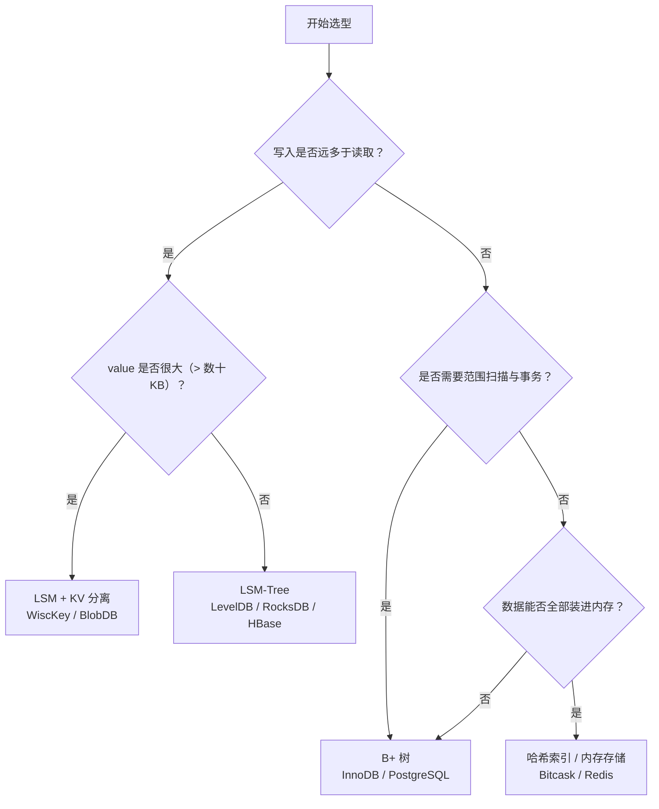

# 10 结语——存储引擎的六组权衡

**摘要：**

前面九篇从数据库演进讲到索引结构、存储介质、B+ 树的宏观选型与微观实现，再讲到 BoltDB、LSM-Tree、LSM 派系与 LevelDB，线索很多，落点却只有一个：存储引擎的每一种设计，都是在几组固定的矛盾之间做交换。本文不再引入新机制，而是把散落在各篇里的取舍收拢成六组权衡——原地更新与追加写、同步刷盘与异步刷盘、单写者与多写者、有序索引与哈希索引、缓冲与直写、简单与复杂；再用一组定量估算说明读放大、写放大、空间放大之间如何互相换算；最后给出一份可操作的选型清单、五个常见误判，以及一套读存储引擎源码的方法。读完这一篇，应当能把"哪个引擎更快"这种问法，替换成"在这个负载与介质下，哪一笔成本可以被接受"。

---

## 第 1 章 把整条写路径再走一遍

第一篇里有一条贯穿案例：一次 `Put(k, v)` 从接口层进来，先追加 WAL，再改内存结构，返回成功，后台线程择机把脏页或 MemTable 落到数据文件，最后回收已经无用的日志与旧版本。九篇读完再回看这条路径，会发现每一个箭头都可以换一种走法，而每一种走法都对应着一类引擎的性格。

- 日志可以先写，也可以后写；可以每条都 `fsync`，也可以攒一批再刷。前者把持久性做到极致，后者把延迟压到最低。
- 内存结构可以是有序树，也可以是哈希表，还可以是有序数组。树支持范围扫描，哈希只支持点查，数组在两者之间取一个位置。
- 数据文件可以原地更新，也可以追加写；可以覆盖旧页，也可以写时复制。原地更新读得快，追加写写得快。
- 落盘可以是同步的，也可以是异步的；可以由前台线程完成，也可以交给后台线程。同步简单，异步吞吐高。
- 旧数据可以立即回收，也可以等合并时统一清理。立即回收省空间，延迟回收省写放大。
- 元数据可以每次提交都原子切换，也可以靠日志重放恢复。前者恢复快，后者写入省。

这条路径上没有哪个环节是"标准答案"。BoltDB 把日志与数据文件合并成一份，用写时复制替代 WAL，用同步提交替代后台刷盘，于是恢复逻辑简单到几乎不存在，代价是写延迟高、并发写能力弱。InnoDB 把日志与数据文件分开，用缓冲池承接随机写，用 doublewrite 防住半页写，用后台线程刷脏，于是写入吞吐高、并发能力强，代价是组件多、参数多、恢复路径长。LevelDB 把"原地更新"整个换成了"追加加合并"，于是写入几乎全是顺序 I/O，代价是读要查多层、空间要等合并才回收。

读路径同样如此。一次点查可以只碰一次页，也可以碰三次、五次、十次；可以让布隆过滤器先判否，也可以让缓存先兜底；可以在页内二分，也可以在块内线性扫描。这些差异累加起来，就是我们在基准测试里看到的那些数字。数字本身没有意义，数字背后的路径才有意义。

所以这一篇不打算再讲"是什么"，而是把"为什么这样选"摊开，逐组对照。

还需要补一句读路径的对照。读路径上的第一个分岔是"去哪里找"：B+ 树从根页往下走，路径由 key 的比较结果决定，长度等于树高；LSM 从 MemTable 往下走，路径由层数与文件数决定，长度不固定；Bitcask 直接查内存哈希表，路径长度是一。第二个分岔是"找到之后要不要验证"：B+ 树信任页内有序，找到即返回；LSM 要用布隆过滤器判否、要用序列号判断版本；Bitcask 信任 keydir 指向最新值。第三个分岔是"一次读带回多少"：B+ 树带回一整页，范围扫描可以顺势推进；LSM 带回一个块，跨层还要归并；Kafka 带回一整段，顺序消费。这三处分岔，决定了同样是"读一次"，成本可以差一到两个数量级。

## 第 2 章 六组权衡

### 2.1 原地更新与追加写

第一组，也是最根本的一组。

原地更新（In-place Update）的意思是，修改一条记录时，找到它原来所在的页，在页内改掉那几个字节；页满了就分裂，页空了就合并。B+ 树是这一路的典型。它的好处是读路径短：数据只有一份，位置确定，找到页就找到了记录，不需要在多个版本之间做选择；范围扫描也直接，叶子链表一拉，顺序读下去即可。代价在写上：一次更新可能触发一次随机页写，页分裂还会把一页变成两页，向上传播到父节点，最坏情况一路裂到根。

追加写（Append-only）的意思是，修改一条记录时不碰旧数据，而是把新版本追加到文件末尾，旧版本留待后台合并时清理。LSM 是这一路的典型。它的好处是写路径顺：所有写入都是顺序追加，机械盘与固态盘都吃这一套，写入吞吐可以做到很高。代价在读与空间上：同一个 key 的多个版本散落在不同层、不同文件里，读的时候要逐层查找，还要判断哪个版本最新；旧版本在合并之前一直占着空间。

这两条路的分野，本质上是把成本放在读上还是放在写上。读多写少的系统，愿意为读路径的确定性付出页分裂的代价；写多读少的系统，愿意为写入的顺序性付出读放大与空间放大的代价。

举一个具体的对照。InnoDB 更新一行时，如果目标页在缓冲池里，修改几乎就是内存操作，代价是脏页、undo 与 redo 的记账；如果目标页不在，先把页读进来，再改，代价是一次随机读加一次未来的随机写。LSM 更新同一个 key 时，不关心旧值在哪一层，直接往 MemTable 追加一条带序列号的新记录，代价是未来的合并要处理这份冗余；读的时候则要从新到旧逐层找，直到遇见第一个可见版本。同样是"更新一行"，一个把成本放在写时的定位与刷脏，一个把成本放在读时的多层查找与后台合并，账本完全不同。

但边界并不绝对。InnoDB 的 change buffer 会把二级索引的随机更新攒在内存里，等页被读进来时再合并，这已经是"延迟更新"的思路；RocksDB 的 BlobDB 把大 value 拆出去单独存，SSTable 里只留指针，这又是在减少追加写带来的空间放大。纯粹的原地更新与纯粹的追加写都很少见，工业实现大多在两端之间找一个位置。

### 2.2 同步刷盘与异步刷盘

第二组，决定"一次写什么时候算成功"。

同步刷盘（Synchronous Flush）要求数据在返回之前真正落到持久介质。BoltDB 的提交路径就是如此：写事务把修改写到新页，更新 meta 页，调用 `fsync`，然后才返回。它的语义非常干净——只要调用返回成功，断电也不会丢；恢复时只需要看两个 meta 页里哪个 txid 更大、校验和正确，取那一个即可。代价是每一次提交都要等一次设备刷写，写延迟被硬生生抬高一个数量级，写入吞吐也被 `fsync` 的频率卡住。

异步刷盘（Asynchronous Flush）只要求日志先落盘，数据页可以晚一点再写。InnoDB 的默认路径就是如此：事务提交时把 redo log 写到磁盘（还要看 `innodb_flush_log_at_trx_commit` 的取值），数据页留在缓冲池里，由后台线程按检查点策略慢慢刷。它的好处是写入延迟主要取决于日志的顺序写，而不是数据页的随机写；代价是恢复时要重放日志，崩溃后可能有一段时间的数据页是旧的，必须靠 redo 补齐。

这组权衡还牵出一个常被忽略的维度：**"成功"的语义是由调用方定义的**。金融交易要求提交即持久，宁可慢也不能丢；日志采集可以接受最近几秒的数据丢失，换取更高的吞吐；缓存类系统甚至可以不保证持久，重启后从源头重建。引擎本身没有对错，只有与业务语义是否匹配。

| 维度 | 同步刷盘 | 异步刷盘 |
|---|---|---|
| 返回时机 | 数据页与元数据都已落盘 | 日志落盘即可返回 |
| 写延迟 | 高，受设备刷写限制 | 低，取决于日志顺序写 |
| 崩溃恢复 | 读 meta 页即可，几乎无需重放 | 重放日志，补齐未刷的数据页 |
| 实现复杂度 | 低 | 高，需要检查点、LSN、恢复流程 |
| 典型实现 | BoltDB、LMDB | InnoDB、RocksDB |
| 适合场景 | 嵌入式、元数据、状态机 | 在线事务、高吞吐写入 |

### 2.3 单写者与多写者

第三组，决定并发模型，也决定 API 的形状。

单写者（Single Writer）的意思是，同一时刻只允许一个写事务，读事务可以并发。BoltDB 把这一点直接做进了 API：`Update` 是写事务，`View` 是读事务，写事务之间串行排队。这个设计看起来保守，实际上换来了两个好处：写路径不需要复杂的锁协议，页的分配与回收可以在一个全局视角下完成；读事务看到的是一个一致的快照，不需要逐条判断可见性。代价是写入无法横向扩展，写事务一长，后面的写全部排队。

多写者（Multi Writer）允许并发的写事务，靠行锁、页锁、latch 或者乐观冲突检测来保证正确性。InnoDB 用行级锁加意向锁，允许多个事务同时修改不同的行；LSM 引擎通常只允许一个线程写 MemTable，但可以通过多 MemTable、批量提交、分组提交来提高吞吐。多写者的好处是并发能力强，代价是锁竞争、死锁检测、可见性判断与恢复逻辑都变得更复杂。

这组权衡经常被误解为"单写者性能差"。其实要分场景：嵌入式系统里，写入本来就稀疏，单写者省下的锁开销与复杂度远超它带来的排队成本；高并发交易系统里，写入密集且冲突多，单写者会成为明显的瓶颈。选哪种，取决于写入的并发度与事务的长度，而不是"先进"与"落后"。

### 2.4 有序索引与哈希索引

第四组，决定支持什么查询。

有序索引维护键的全局顺序，因此天然支持点查、范围扫描、前缀匹配与排序。B+ 树、跳表、有序数组都属于这一路。哈希索引只维护键到位置的映射，点查是常数时间，范围查询则完全无能为力。Bitcask 把索引放在内存里做成哈希表，换来极快的点查，代价是所有 key 必须装得进内存，且不支持范围扫描。

这组权衡的关键，是**查询模式的比例**。如果一个系统九成以上是点查，哈希索引的常数时间非常有吸引力；如果有一成是范围扫描，哈希索引就会让这一成退化成全表扫描，整体成本可能反而更高。组合索引的最左前缀原则也是同一回事：有序结构才能利用前缀，哈希结构只能利用全键。

还有一个常被忽略的维度：索引放在哪里。放在内存里，查找快，但受内存容量约束；放在磁盘上，容量大，但每次查找要付 I/O；放在磁盘上再加一层内存稀疏索引，是 B+ 树与 LSM 都在用的折中。索引的位置，往往比索引的数据结构更能决定实际性能。

### 2.5 缓冲与直写

第五组，决定"内存是缓存还是真相"。

缓冲（Buffering）的思路是把内存当作磁盘的缓存：读先查缓存，未命中再读磁盘并把结果放回缓存；写先改缓存，标记为脏，等后台线程刷下去。InnoDB 的 Buffer Pool、操作系统的 Page Cache、LSM 的 MemTable，本质上都是这一路。缓冲的好处是绝大多数访问都在内存完成，延迟低、吞吐高；代价是一致性复杂——缓存与磁盘可能不一致，崩溃后要靠日志恢复，缓存淘汰策略会影响命中率。

直写（Direct I/O）的思路是绕开缓存，让应用自己管理内存与对齐。数据库可以用 Direct I/O 避免"Page Cache 与 Buffer Pool 双份缓存"的内存浪费，也可以避免内核的写合并打乱自己的刷盘节奏。代价是应用要自己做预读、自己做对齐、自己处理部分写，复杂度明显上升。

这组权衡在云上与容器里变得更重要。容器的内存限额让 Page Cache 与 Buffer Pool 争夺同一块内存，双份缓存可能导致 OOM；NVMe 的低延迟让"绕开内核"的收益变得可观；而持久化内存的退场，又让"内存即持久介质"的设想暂时搁置。引擎该不该自己管缓存，取决于它对延迟、内存与一致性的控制需求有多强。

### 2.6 简单与复杂

第六组，是前面五组的元问题。

BoltDB 用一份数据文件、一套写时复制、一个单写事务，换来了极简的恢复逻辑与极低的维护成本。它的代码量小，行为可预测，出问题时容易定位。InnoDB 用缓冲池、redo、undo、doublewrite、change buffer、自适应哈希、后台线程，换来了高并发与高吞吐，代价是组件多、参数多、故障模式多。LevelDB 用极少的代码把 LSM 的核心讲清楚，RocksDB 在它的基础上补上了几十个工程短板，代码量与调参空间同步膨胀。

复杂度不会消失，只会转移。把复杂度放在引擎里，应用就简单，但引擎难维护、难调优；把复杂度留给应用，引擎就简单，但应用要自己处理一致性、重试与降级。所谓"合适的架构"，是在团队能力、运维水平与业务要求之间找一个平衡点，而不是追求某个绝对的最优解。

### 2.7 六组权衡如何叠加

这六组权衡不是六个独立的选择题，它们会互相牵制，最后叠成一个引擎的性格。把前面反复出现的几个实现按六组坐标摆一遍，关系会清楚很多。

| 引擎 | 更新方式 | 刷盘 | 并发 | 索引 | 缓冲 | 复杂度 |
|---|---|---|---|---|---|---|
| InnoDB | 原地更新 | 异步（日志同步） | 多写者 | 有序 B+ 树 | Buffer Pool | 高 |
| BoltDB | 写时复制 | 同步 | 单写者 | 有序 B+ 树 | mmap | 低 |
| LevelDB | 追加写 | 异步（日志同步） | 单 MemTable 写 | 有序 + 布隆过滤器 | MemTable + Block Cache | 中 |
| Bitcask | 追加写 | 同步（可配置） | 单写者 | 哈希 | 全量 Keydir | 低 |
| Kafka | 追加写 | 异步（可配置） | 分区内单写 | 稀疏 offset 索引 | Page Cache | 中 |

这张表能解释很多"看起来矛盾"的现象。BoltDB 与 InnoDB 都用 B+ 树，但一个同步刷盘、单写者，另一个异步刷盘、多写者，于是前者适合嵌入式元数据，后者适合在线交易；LevelDB 与 Bitcask 都追加写，但一个有有序索引、一个只有哈希，于是前者支持范围扫描，后者只擅长点查。**结构相同，不代表性格相同；性格由六组选择的组合决定。**

叠加还会产生新的约束。BoltDB 选了写时复制加单写者，就必须接受"长读事务会阻止旧页回收"这个副作用；InnoDB 选了异步刷盘加多写者，就必须引入 doublewrite、undo、检查点来兜底；LSM 选了追加写加异步合并，就必须面对读放大与合并抖动。这些副作用不是实现缺陷，而是选择的必然结果。判断一个引擎是否适合，不能只看它的优点，还要看它的副作用落在谁身上。

## 第 3 章 三个放大之间的换算

六组权衡最终都可以折算成三笔账：读放大、写放大、空间放大。这一节用一组粗略的估算，说明它们之间如何互相换算。需要先声明，下面的数字是量级估算，不是基准测试结果，不同实现、不同参数、不同数据分布会带来很大差异。

假设有一个 1 亿条记录的数据集，每条记录 1 KB，逻辑数据量约 100 GB。

先看 B+ 树。若页大小为 16 KB，页内平均填充率为七成，那么有效数据约占 11 KB/页，加上索引与页头开销，物理占用大约 130 GB，空间放大 1.3 左右。一次点查要走三层：根节点常驻内存，第二层大概率命中缓冲池，真正落到磁盘的通常只有一次页读，读放大约等于 1 到 2。一次更新要写 redo log、修改脏页，脏页刷下去时还可能触发页分裂，写放大约在 2 到 3 之间（不算 doublewrite 的额外一份）。

再看 LSM。若采用分层合并，层数比例为 10，共 5 层，每层的数据在向下合并时会被重写若干次，写放大的粗略估计在 20 到 50 之间；实际系统通过调大层比例、限制合并并发、使用 tiered 策略，把写放大压到 10 到 30 的范围。空间放大取决于合并策略：分层合并通常在 1.1 到 1.2，分级合并可能到 1.5 甚至更高，因为同一层允许存在多个重叠的文件。读放大约等于层数加上 L0 的文件数，若 L0 有 4 个文件、共 5 层，一次点查可能要查 9 个位置，布隆过滤器可以把大部分无效查找挡掉，但最坏情况仍然存在。

把这两组数字放在一起，结论就出来了：B+ 树用较低的读放大与空间放大，换来了较高的写放大；LSM 用较低的写放大，换来了较高的读放大与空间放大。而"较低"与"较高"是相对的，取决于负载里读与写的比例。如果一个系统读写比是 10:1，B+ 树多出来的写成本被十倍的读收益摊薄；如果读写比是 1:10，LSM 多出来的读成本被十倍的写收益摊薄。

上面这些数字可以写成更一般的式子，方便在调参时判断方向。对于分层合并的 LSM，设层比例（Size Ratio）为 $T$、层数为 $L$、L0 的文件数为 $F_0$，那么：

- 写放大约为 $T \times L$：每一层的数据在向下合并时，平均会被重写 $T$ 次，层数越多，重写次数越多。
- 读放大约为 $L + F_0$：一次点查要依次检查 L0 的 $F_0$ 个文件，再逐层往下，布隆过滤器只能减少实际 I/O，不能减少查找次数。
- 空间放大约为 $1 + 1/T$（分层合并）：每一层都可能保留一部分尚未合并的旧数据，层比例越大，冗余越少。

这三条式子解释了一个常见的调参困境：把 $T$ 调大，空间放大下降、层数可能减少，但每一层的合并规模变大，写放大反而上升；把 $T$ 调小，写放大下降，但层数增加、读放大上升；改用分级合并，写放大可以降到个位数，空间放大却可能翻倍。三个目标里，最多只能同时优化两个，第三个必然被推高。

| 配置 | 层比例 T | 层数 L | 写放大量级 | 读放大量级 | 空间放大量级 |
|---|---|---|---|---|---|
| 分层合并，偏读 | 10 | 4 | 约 40 | 约 8 | 约 1.1 |
| 分层合并，偏写 | 20 | 3 | 约 60 | 约 6 | 约 1.05 |
| 分级合并，偏写 | — | 4 个 run | 约 4 到 8 | 约 10 到 15 | 约 2.0 |

表里的数字只用于比较方向，不是任何具体产品的实测值。真实系统的写放大还会受压缩、批量大小、合并并发、数据分布的影响，可能相差数倍。但方向是稳定的：**想让写更便宜，就要让读或空间更贵；想让读更便宜，就要让写或空间更贵。**

这些估算的用处，不是算出精确值，而是在动手之前判断"哪一笔账会先爆"。如果一个系统的磁盘写入带宽是 500 MB/s，前台写入是 100 MB/s，写放大是 30，那么后台合并需要 3 GB/s 的写入能力，显然不可能，系统一定会在某个时刻被合并拖垮；反过来，如果写放大只有 5，后台只需要 500 MB/s，刚好打满，仍要留出余量。把这三个数字（前台写入、写放大、磁盘带宽）放在一起，很多"上线三个月后变慢"的问题，其实在上线前就能算出来。

换算还可以更细。把 LSM 的层比例从 10 调到 20，写放大会上升，读放大会下降，因为层数变少；把合并策略从 leveled 换成 tiered，写放大会下降，空间放大与读放大会上升；把 B+ 树的页大小从 16 KB 调到 4 KB，树高会增加，读放大上升，但页内更新的代价下降，缓存能装下更多页。这些调整没有一个是"免费"的，它们只是把成本从一笔账挪到另一笔账。

## 第 4 章 三个系统的取舍复盘

抽象地讲六组权衡，容易停留在纸面。把三个真实系统摆出来，看它们分别在哪个环节做了选择、又把代价推给了谁，会更有体感。这三个系统恰好代表了三种典型：单机事务、分布式 KV、日志型存储。

### 4.1 InnoDB：把随机写关进缓冲池

InnoDB 的核心思路，是不让前台事务直接面对数据页的随机写。一次更新进来，先在缓冲池里找到目标页，修改内存中的记录，写一条 undo 记录以便回滚，再写 redo 日志；事务提交时，只保证 redo 落盘，脏页留在缓冲池里，由后台线程按检查点策略慢慢刷。页分裂、页合并、二次写，全部发生在后台。

这套设计把"随机写"这件最贵的事，拆成了两次较便宜的事：一次顺序的日志写，一次延迟的批量刷脏。代价是组件多——缓冲池要管理淘汰与脏页，redo 要管理检查点与日志空间，undo 要管理版本链与清理，doublewrite 要防住半页写。任何一个组件出问题，都会以"性能抖动"或"恢复失败"的形式表现出来。

它的边界也很清楚。长事务会让 undo 版本链变得很长，清理跟不上，历史版本堆积；大事务会让 redo 日志暴涨，检查点推进受阻；写入突增时，脏页比例上升，后台刷脏与前台写入争抢 I/O，出现明显的延迟尖刺。这些现象不是 InnoDB 的实现缺陷，而是"异步刷盘加多写者"这组选择的必然副作用。理解这一点，调参时就不会指望某个参数能同时消除抖动与提升吞吐。

### 4.2 RocksDB 与 TiKV：把写放大交给合并，把一致性交给 Raft

RocksDB 沿着 LevelDB 的路子，把写入做成"WAL 加 MemTable 加后台合并"。前台写入只碰顺序日志与内存，落盘与合并都在后台；写入吞吐因此很高，代价是合并会持续占用磁盘带宽与 CPU，读要跨多层查找，空间要等旧版本合并后才回收。

TiKV 在 RocksDB 之上又叠了一层：每个 Region 的写入先走 Raft 日志，复制到多数派之后再应用到状态机，状态机就是 RocksDB。这样做的结果是职责非常清晰——Raft 负责多副本一致性，RocksDB 负责单机有序存储，Region 的分裂与调度负责水平扩展。RocksDB 不需要知道分布式，Raft 不需要知道 B+ 树还是 LSM。

这个组合的代价落在运维上。合并会与 Raft 日志写入、快照传输争抢 I/O；Region 分裂与调度会带来额外的数据搬迁；读放大在跨 Region 查询时会被进一步放大。所以 TiKV 的调优，很大一部分是在调 RocksDB 的合并参数与 Raft 的日志参数，让两者不要在同一时刻抢同一块磁盘。

### 4.3 Kafka：日志即存储

Kafka 走的是另一条极端：它几乎不做"存储引擎"意义上的随机读写，而是把每个分区做成一个追加写的日志，消息按 offset 顺序写入段文件（Segment），每个段配一个稀疏的 offset 索引与时间索引。生产者写末尾，消费者按 offset 顺序读，读完不删除，按保留策略整段过期。

这个设计的吞吐极高，因为写入是纯顺序追加，读取是顺序扫描，Page Cache 与零拷贝（Zero-Copy）能把数据从页缓存直接送到网络，几乎不经过用户态。它的索引只用来定位段与偏移，不维护每条消息的完整键索引，因此不支持按 key 随机点查，也不支持原地更新。

Kafka 与 LSM 的关系常被误解。两者都追加写、都用稀疏索引、都靠后台清理，但 Kafka 的"合并"是按时间或大小整段删除，不是按 key 合并去重；它的读是顺序消费，不是多层查找。它更像"日志型存储"而不是"KV 存储引擎"。这也解释了为什么 Kafka 不适合做数据库：它把"随机读"与"更新"这两件事直接排除在外，换来了极致的顺序吞吐。

### 4.4 三个案例的共同点

三个系统的共同点，不是用了哪种数据结构，而是**都明确地"不做"某件事**。InnoDB 不让前台做随机页写，RocksDB 不让前台做合并，Kafka 不让用户做随机更新。它们把最贵的操作转移到了自己最擅长的层，然后接受由此产生的副作用。

这正是六组权衡的用法：先确定哪些操作是系统的命脉，把它做到极致；再确定哪些操作可以放弃或延迟，把代价推到那里；最后确认被推过去的代价，不会在另一个环节变成无法承受的瓶颈。选型不是把所有指标都做到最好，而是有意识地让某些指标变差。

## 第 5 章 选型清单

把六组权衡与三笔账落到具体场景，可以整理成下面这棵树。它不能替代基准测试，但可以在动手之前排除掉明显不合适的方向。

| 场景 | 推荐方向 | 主要理由 | 需要警惕 |
|---|---|---|---|
| 金融交易、订单、库存 | B+ 树（InnoDB、PostgreSQL） | 点查与范围查询兼顾，事务成熟 | 页分裂与刷脏抖动，长事务导致 undo 膨胀 |
| 嵌入式元数据、配置、状态机 | BoltDB、LMDB | 单文件、同步提交、恢复简单 | 单写者、数据库体积增长、地址空间限制 |
| 日志、时序、消息 | LSM（RocksDB、Kafka 日志） | 顺序写吞吐高，天然按时间分层 | 合并占用后台带宽，读放大导致 P99 抖动 |
| 大 value 对象 | LSM + KV 分离（WiscKey、BlobDB） | 避免大 value 反复参与合并 | value log 的垃圾回收与空间放大 |
| 纯点查、数据可全内存 | Bitcask、Redis | 一次哈希加一次读，延迟极低 | 内存成本，不支持范围扫描 |
| 分析型扫描 | 列存（ClickHouse、Doris） | 压缩率高，只读必要列 | 点查与更新代价高，导入延迟 |

真正动手之前，有五个问题必须先回答清楚：

1. **读写比是多少**，是稳定比例还是随时间变化？上线初期与高峰期可能完全不同。
2. **数据量与内存的比例**是多少，热数据集能否装进内存？这决定了缓存命中率与 I/O 模型。
3. **延迟的 SLA 是什么**，是平均延迟还是 P99、P999？LSM 的平均延迟可能很好看，P99 却会被合并拖垮。
4. **持久性要求是什么**，能容忍丢多少数据（RPO），能容忍多长恢复时间（RTO）？
5. **访问模式是什么**，点查、范围扫描、前缀匹配、全表扫描各占多少？有没有排序与聚合？

这五个问题答不上来，任何选型都是在猜。答上来了，答案往往已经很明显。

选型时还有三个常见的反例，值得单独记一笔。其一，只看基准测试的 QPS，不看测试的数据量、读写比与持久化配置，结果上线后发现测试跑的是"关掉 fsync、预热缓存"的理想状态。其二，只看平均值，不看 P99 与 P999，LSM 的平均延迟可能优于 B+ 树，但合并期间的尾延迟会高出数倍，而用户的体感往往由尾延迟决定。其三，只看单机指标，不看后台任务的资源占用，合并、刷脏、日志回收都要吃磁盘带宽与 CPU，把这些算进去，单机吞吐可能要打七折。

## 第 6 章 六个常见误判

### 6.1 "LSM 写入一定比 B+ 树快"

这句话只在"关闭 fsync、关闭合并、只测前台写入"的条件下成立。真实系统里，LSM 的写路径要写 WAL、要等 MemTable 切换、要跟后台合并抢 I/O 与 CPU；合并一旦跟不上，L0 文件堆积，读会变慢，写入也会被限速。很多基准测试里 LSM 的写吞吐领先，是因为测试没有把合并成本算进去。把合并带宽、写放大与长尾延迟一起算，结论往往没那么绝对。

### 6.2 "B+ 树不适合写密集"

InnoDB 在 NVMe 上依然能跑到很高的写入吞吐，靠的是组提交、change buffer、缓冲池与后台刷脏的配合。B+ 树的随机写确实比顺序写贵，但"贵"不等于"不可用"；当写入的并发度高、每次事务修改的行数少时，日志的顺序写会吸收掉大部分成本。真正让 B+ 树吃力的是大量随机的页分裂与频繁的检查点，而不是"写入"这件事本身。

### 6.3 "SSD 让 LSM 失去意义"

固态盘消除了寻道，但没有消除擦除块、垃圾回收与写放大。随机写仍然比顺序写贵，长期高写入还会加速磨损。LSM 的顺序写在固态盘上依然有优势，只是优势的幅度比机械盘时代小。反过来，固态盘的低随机读延迟也让 B+ 树的读路径更快，两者的性价比曲线都在移动，谁也没有"失去意义"。

### 6.4 "有了缓存就不需要关心存储引擎"

缓存解决的是命中路径的延迟，解决不了未命中、冷启动、容量上限与一致性问题。数据量超过内存时，命中率会按访问分布急剧下降；进程重启后缓存是空的，所有请求同时打到磁盘；缓存与磁盘不一致时，还要靠引擎的日志与恢复机制兜底。缓存是加速器，不是替代品。

### 6.5 "读多写少就该无脑选 B+ 树"

还要看数据量、访问模式与写放大。数据量远超内存、以范围扫描为主、写入虽然少但每次都是大批量导入时，LSM 可能更合适；反过来，写入比例不高但要求强事务与低延迟点查时，B+ 树更稳。读写比只是第一刀，不是全部。

### 6.6 "上了分布式，单机引擎就不重要了"

分布式系统解决的是容量与可用性，不解决单机的读写效率。副本复制、分片路由、共识协议，最终都要落到每个节点上的那一次读写；单机引擎的写放大、读放大、合并抖动，会被复制因子与网络往返进一步放大。一个在单机上就抖动明显的引擎，放到分布式里只会更难调。反过来，单机引擎选得合适，分布式层才能把精力放在一致性、调度与故障转移上。

## 第 7 章 如何读一个存储引擎的源码

源码篇最容易犯的错误，是从 `main` 函数开始逐行读，读了几千行还不知道数据到底怎么写下去的。更有效的方式，是先带着五个问题去找答案。

1. **数据以什么为单位落盘？** 是页、块、段还是文件？这个单位决定了 I/O 的粒度，也决定了缓存与索引的组织方式。
2. **一次写什么时候算成功？** 是写完日志、写完内存、还是写完数据文件并 `fsync`？这决定了持久性语义与恢复路径。
3. **崩溃之后靠什么恢复？** 是重放日志、读 meta 页、还是扫描全量文件？恢复逻辑往往藏着一个引擎最核心的不变量。
4. **一次读要碰几次介质？** 从接口到记录，中间经过几层索引、几次缓存、几次解码？读放大就藏在这条路径里。
5. **空间怎么回收？** 是空闲列表、是合并、还是标记清除？回收策略决定了空间放大与写放大。

带着这五个问题读 BoltDB，会很快抓到主线：page 是落盘单位，meta 页是恢复入口，写时复制是并发与一致性的基础，freelist 是空间回收的账本。带着同样的问题读 LevelDB，主线会变成：SSTable 是落盘单位，WAL 与 Manifest 是恢复入口，MemTable 与 Version 是并发与一致性的基础，Compaction 是空间回收与读优化的手段。两条主线完全不同，但问题的结构是一样的。

几个实用的技巧：从测试用例读起，测试往往比实现更能说明"这个接口保证什么"；从一次 commit 读起，看作者为什么改、改了哪几个不变量；用 `strace` 或 `bpftrace` 观察真实的系统调用，确认 `fsync`、`pread`、`mmap` 的调用频率；用 `perf` 看热点，确认 CPU 到底花在比较、解码还是压缩上。源码是静态的，行为是动态的，两者对照着看，理解才会牢。

不妨把"读一次提交"具体化。以 BoltDB 的 `Tx.Commit` 为例，顺着调用往下看，会依次遇到：把脏节点 `spill` 成页、给新页分配页号、把旧页放回空闲列表、把新的根页号写进 meta、对文件执行 `fsync`、更新内存中的 meta 副本。每一步都能回答一个问题：为什么先 spill 再分配页号，因为页号要在写页之前确定；为什么旧页要延迟回收，因为还有读事务可能引用它；为什么 meta 要写两份，因为单份 meta 在写入过程中损坏就没有退路。读完这一条路径，BoltDB 的并发模型与恢复逻辑基本就清楚了。

换成 LevelDB，同样读一次 `DBImpl::Put`，会遇到：构造 `WriteBatch`、追加 WAL、更新 MemTable、检查是否需要 `MakeRoomForWrite`、必要时触发 Minor Compaction。再顺着 `MakeRoomForWrite` 往下，会看到 MemTable 切换、Immutable MemTable 排队、L0 文件数检查、写入限速。两条路径的"形状"完全不同，但回答的是同一组问题：什么时候算成功、崩溃后靠什么恢复、空间什么时候回收。

## 第 8 章 硬件在变，权衡不变

过去十年，硬件变了几件大事。NVMe 固态盘把随机读延迟压到几十微秒，顺序与随机的差距缩小；内存容量从几十 GB 涨到几百 GB 甚至 TB 级，热数据集能装下的比例越来越高；持久化内存在 2019 年前后被寄予厚望，但 Intel 在 2022 年结束了 Optane 业务，这条路线短期内没能成为主流；云上的存算分离把存储推到远端，网络延迟与带宽成了新的约束。

这些变化调整了两大派系的性价比曲线，但没有推翻那六组权衡。原地更新与追加写的取舍还在，只是页分裂的代价相对下降；同步与异步的取舍还在，只是设备刷写的绝对时间变短；单写者与多写者的取舍还在，只是单机的并发能力变强；有序与哈希的取舍还在，只是内存能装下的索引更多；缓冲与直写的取舍还在，只是双份缓存的内存压力更突出；简单与复杂的取舍还在，只是云上的运维边界重新划了一遍。

再往前看，有几个方向值得留意，但目前都还言之尚早。学习型索引（Learned Index）用模型替代部分索引结构，在数据分布稳定、查询模式可预测的场景里有不错的效果，但数据漂移与更新成本仍是难题；存算分离把计算与存储解耦，让存储层可以独立扩展，但网络往返会放大读放大；可计算存储把部分过滤与聚合下推到设备，能减少数据搬运，但生态与编程模型还不成熟。这些方向都可能改变某一组权衡的价格，却不太可能让"读、写、空间三者不可兼得"这条底层约束消失。

云上的形态还带来一个额外变量：存储不再由单机独占。对象存储按请求计费、按吞吐限流，网络往返的延迟比本地磁盘高一个数量级，重试与超时成了常态；本地盘变成缓存，实例重启后缓存全空，冷启动的读放大被放大数倍；多副本与跨区复制把写路径拉长，一次提交要等多数派确认。这些变化让"单机引擎"的边界向外延伸，但六组权衡依然在：缓存与直写变成"本地缓存与远端存储"的取舍，同步与异步变成"等多数派还是等本地日志"的取舍，简单与复杂变成"托管服务还是自建"的取舍。

## 第 9 章 一页纸检查清单

最后留一份可以贴在工位上的清单。它不解释原理，只提醒在哪些时刻该问哪些问题。

**选型之前**

- 读写比是多少，高峰期与平时差多少，未来一年会怎么变？
- 数据量与内存的比例是多少，热数据集能不能装下？
- 延迟看平均还是 P99，P99 的预算里有没有给后台合并留余量？
- RPO 与 RTO 是多少，能不能接受最近几秒的数据丢失？
- 点查、范围扫描、前缀匹配、全量扫描各占多少？
- 团队能不能维护一套带后台合并、检查点、副本复制的系统？

**上线之前**

- 磁盘容量是否按空间放大预留，而不是按逻辑数据量预留？
- 后台合并、刷脏、日志回收的带宽是否与前台写入隔离？
- 长事务、大事务、大批量导入有没有限流与超时？
- 监控是否覆盖 P99 延迟、L0 文件数、待合并字节数、脏页比例、WAL 体积？
- 有没有做过真实的崩溃恢复演练，而不只是看文档？

**出问题时先看什么**

| 症状 | 优先排查 | 常见根因 |
|---|---|---|
| 写入变慢 | WAL 刷写、页分裂、合并积压 | `fsync` 频率过高、脏页比例过高、L0 文件堆积 |
| 读取变慢 | 缓存命中率、读放大、回表 | 热数据超出内存、布隆过滤器失效、二级索引未覆盖 |
| 空间异常增长 | 旧版本、空闲列表、临时文件 | 长读事务阻止回收、合并跟不上、删除未落盘 |
| 恢复时间变长 | 日志重放量、检查点间隔、文件数 | 检查点太稀、单文件过大、元数据扫描慢 |

这份清单不能替代监控与压测，但能在多数时候把排查方向收敛到两三个可能上。存储引擎的故障，很少是"某个神秘 bug"，更多是"某一笔被推迟的成本，终于到期了"。

压测也要按这三笔账设计，而不是只跑一个 QPS 数字。至少覆盖三种负载：稳态负载，验证平均延迟与资源占用；批量导入，验证写放大与合并是否跟得上；故障恢复，验证日志重放时间与数据完整性。每种负载都要看 P99 与 P999，都要把后台任务的资源占用算进去，都要在磁盘接近写满时再跑一遍——磁盘越满，合并越难找到可用空间，性能退化往往在容量达到七成之后才开始显现。

## 附录 A 术语速查

- **读放大（Read Amplification）**：一次逻辑读引发的物理读次数，LSM 通常高于 B+ 树。
- **写放大（Write Amplification）**：一次逻辑写引发的物理写字节数，合并与页分裂都会推高它。
- **空间放大（Space Amplification）**：物理占用与逻辑数据量之比，旧版本与页碎片是主要来源。
- **RUM 猜想（RUM Conjecture）**：读、更新、空间三者不可同时最优的访问方法权衡。
- **WAL（Write-Ahead Log）**：先写日志再改数据，用于崩溃恢复与持久性保证。
- **LSN（Log Sequence Number）**：日志序列号，用于判断页的修改是否已持久化。
- **检查点（Checkpoint）**：把内存中的脏页刷到磁盘并推进日志回收点的过程。
- **Doublewrite**：先把页写到连续区域再写真实位置，防止半页写导致页损坏。
- **写时复制（Copy-on-Write）**：修改时复制新页、提交时原子切换根指针，BoltDB 的核心机制。
- **MemTable**：LSM 的内存有序结构，写满后转为只读并刷成 SSTable。
- **SSTable（Sorted String Table）**：按 key 有序的不可变磁盘文件，LSM 的基本存储单位。
- **Compaction**：把多个 SSTable 合并成更少、更大的文件，回收旧版本并控制读放大。
- **分层合并（Leveled Compaction）**：层内 key 范围不重叠，读放大低、写放大高。
- **分级合并（Tiered Compaction）**：层内允许多个重叠文件，写放大低、空间放大高。
- **布隆过滤器（Bloom Filter）**：用位数组与多哈希判断 key 是否可能存在，允许假阳性、不允许假阴性。
- **MVCC（Multi-Version Concurrency Control）**：保留多版本，让读不阻塞写、写不阻塞读。
- **页（Page）**：存储引擎进行 I/O 的最小逻辑单位，常见 4 KB 或 16 KB。
- **空闲列表（Freelist）**：记录可复用页的账本，BoltDB 与 InnoDB 都用它管理空间回收。
- **墓碑（Tombstone）**：追加写系统里表示删除的特殊记录，等合并时才真正清除。
- **前缀压缩（Prefix Compression）**：SSTable 内相邻 key 只存与上一个 key 的差异，降低空间占用。
- **归并迭代器（Merging Iterator）**：把多个有序输入流合并成一个有序输出流，合并与范围查询的基础。
- **预读（Prefetch）**：在消费者处理当前页时提前把后续页读入缓存，用带宽换延迟。

## 附录 B 引擎速查

| 引擎 | 派系 | 持久化方式 | 强项 | 弱项 |
|---|---|---|---|---|
| InnoDB | B+ 树 | redo + 脏页异步刷盘 | 事务、范围查询、并发 | 组件多、抖动源多 |
| BoltDB | B+ 树 | 写时复制 + 同步 fsync | 简单、恢复快、单文件 | 单写者、写延迟高 |
| LevelDB | LSM-Tree | WAL + MemTable + SSTable | 写吞吐、代码精简 | 单线程合并、读放大 |
| RocksDB | LSM-Tree | 同 LevelDB，可插拔组件 | 高吞吐、可调优、生态好 | 参数多、合并占资源 |
| Bitcask | LSM-Hash | 追加日志 + 内存 Keydir | 点查极快、实现简单 | key 必须驻留内存、无范围扫描 |
| Kafka | 日志型 | 追加段文件 + Page Cache | 顺序吞吐、零拷贝 | 不支持随机更新与点查 |

## 附录 C 再读一遍的路线

如果只记得住结论，记不住推导，可以按下面的顺序回头补：

- 想弄清"为什么 B+ 树"，回 04，看候选结构如何被逐个淘汰，重点看扇出与树高的估算。
- 想弄清"为什么 LSM 要合并"，回 07，从"只能顺序写"这个前提重新推一遍，重点看读放大与写放大的公式。
- 想弄清"崩溃之后怎么恢复"，回 05 与 06，对照 InnoDB 的 redo/doublewrite 与 BoltDB 的写时复制，看两种恢复哲学。
- 想弄清"源码怎么落地"，回 06 与 09，带着五个问题各读一遍写路径，不必逐行。
- 想弄清"怎么选"，回 01 与 10，把读写比、数据量、延迟、持久性四个变量代进去。

## 小结

九篇正文，加上这一篇收束，讲的无非是几件事。

存储引擎是数据库的底座，它不理解业务语义，只负责记录的物理组织、索引维护、内存缓冲与崩溃恢复；它的内部可以划成用户接口层、内存层、磁盘层，三层之间靠"同一份数据的两份表示如何保持一致"这条线索串起来。它要解决编码与索引两个共性问题，要服从内存、固态盘、机械盘构成的介质梯度，最终收敛出 B+ 树与 LSM 两大派系。

两大派系的差异，可以还原成六组权衡：原地更新与追加写、同步刷盘与异步刷盘、单写者与多写者、有序索引与哈希索引、缓冲与直写、简单与复杂。六组权衡最终又折算成三笔账：读放大、写放大、空间放大。三笔账不能同时清零，所谓选型，就是判断在这个负载、这个介质、这个团队条件下，哪一笔成本可以被接受，哪一笔必须压到最低。

这也是为什么，笔者不太愿意回答"哪个存储引擎更好"这种问题。更好的问法是："这个系统的读写比是多少，数据量与内存的比例是多少，延迟与持久性的底线在哪里，团队能维护多复杂的系统？"把这些答清楚，B+ 树与 LSM 的取舍自然就出来了。架构不是选出来的，是在约束里长出来的；存储引擎也一样。

如果非要把整专栏压缩成三句话，大约是这样：第一，介质决定下限，内存与磁盘之间三个数量级的速度差，是所有设计的起点；第二，负载决定倾向，读多写少往 B+ 树靠，写多读少往 LSM 靠，读写都重就分层；第三，复杂度守恒，省下来的每一笔成本，都会在另一个环节以另一种形式出现。记住这三句，再看任何新引擎、新论文、新参数，都不容易被名词带走。

下一站，可以从任意一个源码篇开始，也可以回到 01 重新走一遍那条写路径。带着六组权衡去看，代码会变得比想象中好读。

---

## 参考资料

1. Athanassoulis, M. et al. *Designing Access Methods: The RUM Conjecture*. EDBT, 2016.
2. O'Neil, P. et al. *The Log-Structured Merge-Tree (LSM-Tree)*. Acta Informatica, 33(4), 1996.
3. Bayer, R., McCreight, E. *Organization and Maintenance of Large Ordered Indices*. Acta Informatica, 1(3), 1972.
4. Kleppmann, M. *Designing Data-Intensive Applications*. O'Reilly, 2017.
5. Petrov, A. *Database Internals: A Deep Dive into How Distributed Data Systems Work*. O'Reilly, 2019.
6. Lu, L. et al. *WiscKey: Separating Keys from Values in SSD-Conscious Storage*. FAST, 2016.
7. Sheehy, J., Smith, D. *Bitcask: A Log-Structured Hash Table for Fast Key/Value Data*. Basho Technologies, 2010.
8. Kraska, T. et al. *The Case for Learned Index Structures*. SIGMOD, 2018.
9. O'Neil, E. et al. *The Log-Structured Merge-Tree* 之后的分层合并实践：RocksDB Wiki, *Compaction*.
10. bbolt 项目文档与源码：https://github.com/etcd-io/bbolt

---

> [!note] 思考题
> 1. 如果把一个读多写少的系统强行迁到 LSM 上，最可能先出问题的是哪一笔放大？请结合读路径与合并策略说明。
> 2. 同步刷盘一定比异步刷盘"更可靠"吗？请从 RPO、RTO 与硬件故障模型三个角度分析。
> 3. 一个系统需要支持按时间范围扫描，同时每秒写入 20 万条。你会选 B+ 树、LSM 还是两者组合？请给出理由与代价。
> 4. 为什么"降低写放大"经常会推高读放大或空间放大？请用分层合并的层比例 T 举例说明。
> 5. 如果让你只带五个问题去读一个陌生的存储引擎源码，你会问哪五个？它们分别对应哪些不变量？
