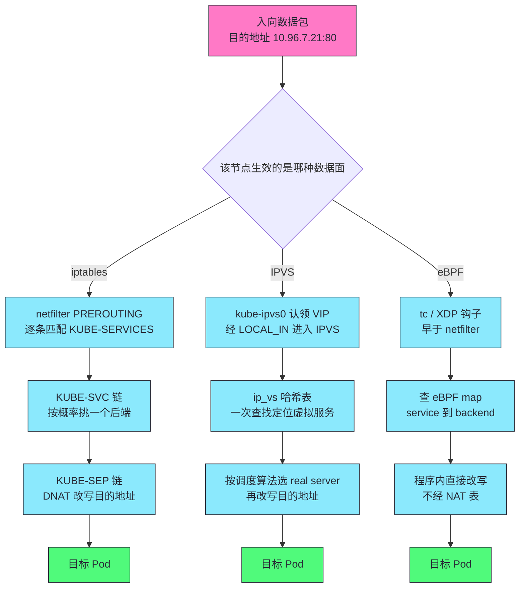
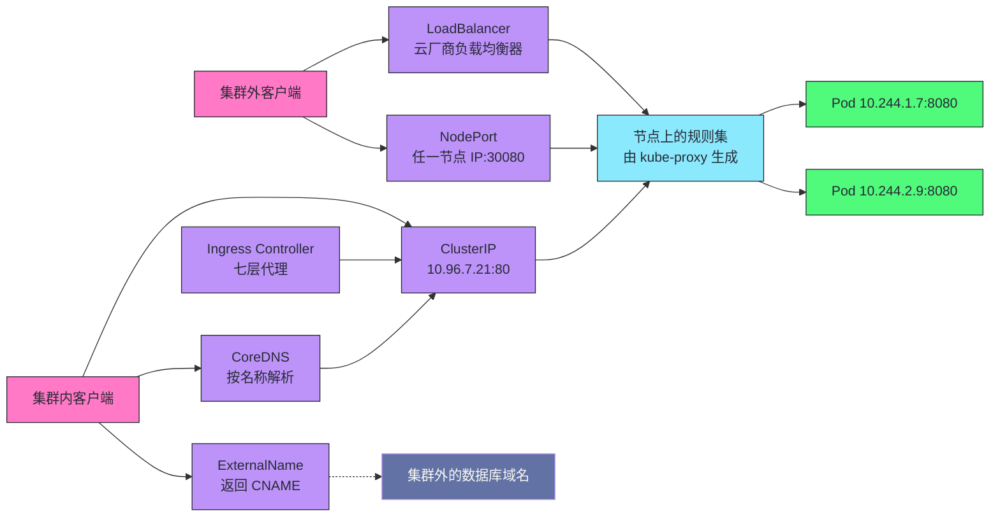
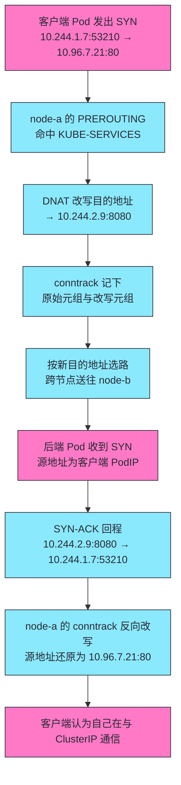
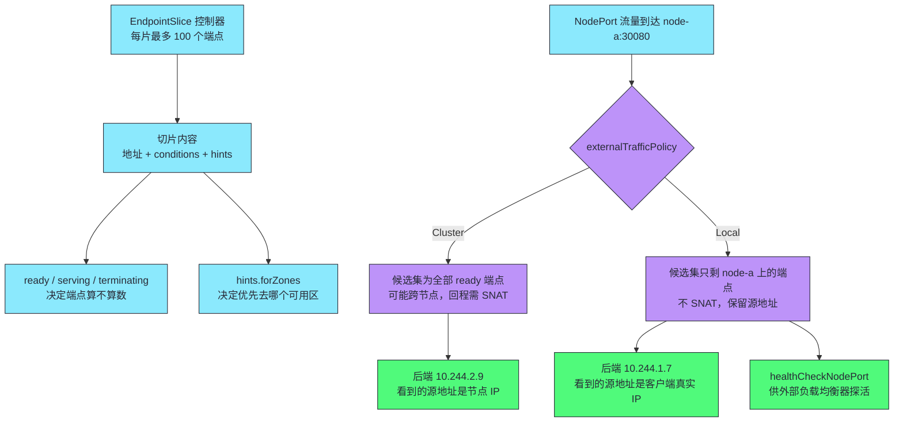

# 14 Service 与 kube-proxy：iptables/IPVS/eBPF 数据面演进

**摘要：**

Service 大概是 Kubernetes 里最容易被讲薄的对象。背下四种类型、记住 kube-proxy 的两种模式，似乎就算掌握，可一旦线上出现新 Pod 已就绪却不接流量、ClusterIP 偶发连不上、Pod 经 Service 访问自身握手失败这类现象，类型清单一条也用不上——真正决定行为的是数据面：地址如何分配，规则由谁写，数据包在第几个内核钩子上被改写，回程又凭什么认出这是同一条流。本文按五问推进：Service 交付的是什么，为什么它不能做成反向代理，抽掉这层抽象与 EndpointSlice 会如何退化，三种数据面怎样落地，两处代价在哪里显形。中段用四张图拆开流量入口、三种数据面、地址改写与回程 conntrack、外部策略与切片的配合，表格把模式、类型与调度算法逐项对齐。全文落点在两处权衡：把负载均衡下移到内核换来了性能与可靠性，代价是规则同步必然存在的延迟窗口；把客户端源地址保住换来了可审计性，代价是流量倾斜与节点级健康检查。读完应当能回答两个问题：为什么 kube-proxy 崩了流量还通，以及为什么"本地优先"的入口策略会先把某个节点压垮。

---

## 第 1 章 一个不落在任何网卡上的地址

### 1.1 从一次滚动发布说起

笔者先摆一个贯穿全篇的场景。ordersvc 部署五个副本，散在三台节点上，前面是一个名为 ordersvc 的 Service，ClusterIP 为 10.96.7.21，端口 80 映射到容器的 8080；上游的 shopfront 从不解析 Pod 地址，只连这个 ClusterIP。某个下午 ordersvc 做一次并无异常的小版本滚动发布，五分钟内监控出现几十条上游报错，报错内容是连接被重置，随后自行恢复。翻看事件时间线，那一时段没有节点故障，没有 OOM，Pod 也没有重启，唯一发生的事情是五个副本按顺序被替换了一遍。

现场的取证往往是这样展开的：`kubectl get endpointslice` 显示新 Pod 已经出现在切片里且 `ready: true`；在某个节点上 `iptables-save | grep 10.96.7.21` 却看不到新 Pod 的 DNAT 目标；再过几秒重新抓一次，规则又出现了。也就是说，声明层面已经完成切换，而某些机器上的转发规则还停留在上一版。上游的连接恰好落在这几秒的空档里，连到了已经在终止流程中的旧 Pod，于是被重置。

这一个场景几乎把本文要说的事情都说完了：ClusterIP 是一个不落在任何网卡上的地址，它之所以能用，是因为每台节点上都有一份由 kube-proxy 生成的规则集，而这份规则集与 API Server 里的声明之间，永远隔着一段传播时间。

### 1.2 总机号码与每台交换机上的接线表

理解 Service，笔者建议先换一个比喻。ClusterIP 像一栋大楼的总机号码：号码登记在号簿里，全公司对外只用这一个号码，可这个号码本身并没有一部对应的实体话机，真正干活的是每台交换机上的接线表——电话进来之后，交换机照着表把它接到某个分机上。总机号码的妙处在于它稳定，分机换了、增了、撤了，号簿上的号码不用动；接线表的代价在于它是每台交换机各自一份的副本，副本之间不保证同一时刻一致。

这个比喻要跟一句限定，否则容易失真。第一，接线表不是抄一份就完事，它由每台交换机上的一个常驻进程根据号簿的变化重写，进程挂了表还在，但表不会再更新；第二，号码并非对所有呼叫方都可见，总机号码只在楼内有效，楼外的人要用另一个入口进来，这就是 NodePort 与 LoadBalancer 存在的位置；第三，分机的选择规则写在表里而不是号码里，所以"轮询还是按连接数"这类策略的改变，改的是接线表的生成方式，而不是号码本身。

### 1.3 虚拟地址的三层含义

"ClusterIP 是虚拟 IP"这句话说得太省，省掉的正是值得追究的部分。它在三个层次上分别成立，而三个层次对应的机制并不相同。

第一层是分配。ClusterIP 从 kube-apiserver 的 `--service-cluster-ip-range` 划定的网段里取出（kubeadm 的默认值多在 10.96.0.0/12 一带），可以由用户显式指定，也可以交给 API Server 自动挑选。挑选动作发生在 Service 对象创建时，写进 `spec.clusterIP`，此后不可更改——想换地址只能删掉重建，这一点常被忽略，因为大多数改动（端口、selector、策略）都可以原地更新。

第二层是表达。在 iptables 模式下，ClusterIP 在节点上唯一的物理形态，是规则集里一条 `-d 10.96.7.21/32` 的匹配条件。没有接口、没有 ARP 应答、没有路由表项，所以 `ping 10.96.7.21` 不通而 `curl 10.96.7.21:80` 通——前者需要一个能回 ICMP 的实体，后者只需要在 PREROUTING 处被 DNAT 掉。这也是"虚拟"最贴切的解释：它不是被配置出来的设备，而是被引用出来的匹配条件。

第三层是认领，这一层在 IPVS 模式下才出现，而且与直觉相反。IPVS 的虚拟服务要求本机是目的地址的持有者，否则数据包在进入 IPVS 之前就被内核判定为"非本地"而转发走掉。kube-proxy 的解法是创建一块名为 **kube-ipvs0** 的 dummy 网卡，把每个 ClusterIP 以 /32 的形式挂上去，让节点在地址意义上认领它，再由 IPVS 在 netfilter 的 LOCAL_IN 之后接管。于是同一个"虚拟 IP"，在 iptables 模式下是纯匹配条件，在 IPVS 模式下是一条挂在 dummy 网卡上的地址——排查时 `ip addr show kube-ipvs0` 能看到成百上千个地址，原因就在这里。

虚拟不等于不存在，而是**取决于数据面用哪套机制**。 这句判断在排障时很实用：如果你在节点上既看不到地址、也看不到规则，那问题不在"虚拟"，而在负责写规则的那一环根本没有把声明投影下来。

| 约定 | 实现方式 | 排障时看什么 |
| :--- | :--- | :--- |
| 地址稳定 | ClusterIP 在创建时分配并固定 | `kubectl get svc` 的 clusterIP 一栏 |
| 地址虚拟 | 无网卡与 ARP，iptables 下仅作匹配条件 | `ping` 不通而 `curl` 端口通 |
| 后端动态 | EndpointSlice 由 selector 与就绪状态决定 | 切片里的端点与 Pod 的 ready 状态 |
| 转发在内核 | 节点规则集做 DNAT，kube-proxy 不搬包 | `iptables-save` 与 `conntrack -L` |

### 1.4 一条 watch 链路上的四段

从一个 YAML 被 `kubectl apply`，到某个节点上的规则集生效，链路上有四段，每段都有自己的延迟与失败模式。

第一段在 API Server。Service 对象写入 etcd，ClusterIP 在此刻被分配并固定；如果指定了不存在的地址或已被占用的地址，创建会直接失败，这是端口与地址冲突最靠前的拦截点。

第二段在 EndpointSlice 控制器（早期是 Endpoints 控制器）。它 watch Service 与 Pod，按 selector 匹配出后端集合，再按每片最多 100 个端点的规则切成若干切片，写回 API Server。Pod 的 readiness 变化、IP 变化、删除事件都在这一段被翻译成切片内容的变化。这一段决定了"哪些后端算数"，也是"Pod 明明在跑却收不到流量"最常见的断点——selector 打错、readinessProbe 未通过、命名空间不匹配，都会让切片为空。

第三段在每台节点的 kube-proxy。它通过 informer watch Service 与 EndpointSlice，在本地维护一份缓存，等事件攒到一定程度或定时器到点，调用 proxier 把缓存渲染成规则集。这一段是本文后半程的主角，它的关键变量是"攒多久"与"渲染多贵"。

第四段在内核。规则集被写入 netfilter 或 IPVS，数据包开始按新规则转发。这一段的失败模式最隐蔽：写入本身可能因为 **xtables 锁**被别的组件占着而失败，可能因为 conntrack 表满而在数据包层面表现为丢包，也可能因为规则写进去了而路由不通，看起来像"规则没生效"。

### 1.5 控制面与数据面分离

四段链路里，kube-proxy 只做第三段的一件小事：把声明翻译成规则。它不接收连接，不转发字节，不在数据路径上。这一点值得单独强调，因为把它误认为"代理"会连带误判三件事。

误判之一是性能。若 kube-proxy 在数据路径上，每个数据包都要穿越一次用户态，转发能力就受这个进程的调度、内存与文件描述符限制；事实上转发完全由内核完成，kube-proxy 的开销只在"规则更新"这一刻发生，与流量大小无关。误判之二是可靠性。kube-proxy 崩溃或重启期间，已写入内核的规则继续生效，流量不受影响，受影响的只是"新变化不再被同步"，所以它的故障表现通常是"新增的 Service 不可达"而不是"全站不可达"。误判之三是排障方向。代理出问题要抓包看连接，规则生成器出问题要看 informer 缓存与规则集本身，两者的取证路径完全不同。

---

## 第 2 章 为什么 Service 不能做成反向代理

### 2.1 代理的位置决定了它的代价

反向代理（Nginx、HAProxy、Envoy）的共同特征不是"能转发"，而是"必须终结连接"。它得先和目标建立一条 TCP 连接，读得懂字节流，才谈得上按域名、路径、Header 做路由，也才谈得上在应用层做重试、限流、熔断。终结连接这件事没法便宜：数据包要从内核态交给用户态，处理完再交回去，一条业务连接在代理内部变成两条，文件描述符与内存随并发线性增长，优雅退出还得等两端都收尾。

对四层转发而言，这些代价花得不值。Service 要解决的是"给一组会变的后端一个不变的入口"，它不需要读懂字节流，只需要在包的头部改一个目的地址——而这件工作，netfilter 的 NAT 表与 IPVS 的调度器在内核里做得又快又稳。1998 年章文嵩发起的 LVS 项目已经证明过这条路的可行性：四层负载均衡可以完全放在内核里，用一次地址改写完成调度，性能随网卡而非进程伸缩。K8s 的设计者显然读到了这段经验，于是把"代理"两个字从 Service 的实现里删掉了。

不过，把转发交给内核也意味着放弃一部分控制权。用户态代理可以按请求做七层路由，内核里的 DNAT 只能按 IP 与端口；用户态代理能统计每条连接的请求数，内核规则只能统计包与字节。这不是取舍失误，而是分工：Service 只管四层，七层的路由交给 Ingress Controller 与 Gateway 这类明确位于数据路径上的组件去承担。

### 2.2 kube-proxy 的真实角色是编译器

换个角度看 kube-proxy，它的工作形态更接近编译器而不是代理：输入是两份声明（Service 描述"入口长什么样"，EndpointSlice 描述"后端有哪些"），输出是一份目标平台的指令序列（iptables 规则、IPVS 服务与 real server、eBPF map 里的条目），中间要经历解析、匹配、渲染、提交四个阶段。凡是被编译出来的东西都有一个共同特征：**源程序改了，产物要重新生成才能生效**，而重新生成需要时间、需要一致性、也需要处理失败重试。

用编译器的语汇去描述，很多现象就顺了。规则集是"快照"而非"增量日志"，所以任何一次变化都可能导致全量重建；产物是"平台相关"的，同一份声明在 iptables 与 IPVS 下生成的**指令形态完全不同**，因此两种模式的故障表现也不同；编译过程需要独占资源（xtables 锁、IPVS 的 netlink 接口），并发提交会排队甚至失败；产物还分"优化等级"，把窗口内的多个变化合并成一次提交，就是给编译加上了批处理。

这个视角也能解释为什么"重启 kube-proxy"能解决很大一部分 Service 故障。重启相当于强制重新编译一次：本地缓存从 API Server 重新 List 一遍，规则集重建成最新状态，中间漏掉的事件被补齐。

### 2.3 反事实一：没有 Service 抽象会怎样

假设 K8s 只提供 Pod，不提供 Service，最直接的后果不是"少了负载均衡"，而是三件更基本的事情同时崩塌。

服务发现被下推到每个应用。客户端要么自己 watch API Server 取 Pod 列表，要么依赖某种外部的注册中心；无论哪条路，每种语言、每个框架都要自己实现一遍拉取、缓存、失效与重选，而这些实现里的缓存策略一旦不一致，故障表现就会五花八门。K8s 后来确实提供了更底层的 API（EndpointSlice 可以被任意客户端直接消费），但那是给 Ingress Controller、服务网格这类"基础设施软件"用的，而不是给业务进程用的。

滚动发布变成客户端的责任。Deployment 的滚动更新假定"流量入口会自动把新副本纳进来、把旧副本摘出去"，这个假定由 Service 与 readinessProbe 共同兑现。没有这层抽象，客户端必须自己识别某个后端不可达并剔除、必须处理"连接还在但进程正在退出"的窗口、必须在重试时避开已被替换的地址。把这些逻辑推给每个业务进程，等于把平台的责任摊回给所有团队。

稳定命名消失。没有 ClusterIP 的服务名，配置里写的就是 IP 列表——地址一变配置就要变，这跟"声明式、面向终态"的整个设计取向背道而驰。更实际的问题是：没有名字就没有策略落点，网络策略、限流规则、访问日志、审计，全都需要一个稳定的被引用对象。

### 2.4 反事实二：没有 EndpointSlice 会怎样

再假设有 Service，但后端清单仍由单个 Endpoints 对象承载——这正是 1.21 之前的状态。一个两千后端的 Service，每个 Pod 的 readiness 抖动都会导致同一个对象被更新一次，随之而来的是三重放大。

第一重是对象本身的体量。etcd 对单次请求有大小上限（默认 1.5 MB），一个包含数千地址与端口的 Endpoints 对象，很快会逼近这条线；超限的写入不是慢，而是直接失败。

第二重是并发写的冲突。所有变化都集中到同一个对象上，乐观并发控制会把并发写变成 409 与重试；变化越频繁，冲突越多，重试本身又制造更多写入，形成正反馈。这不是理论推演，早期大集群里 Endpoints 更新冲突是常见的告警项。

第三重是消费端的放大。每个节点的 kube-proxy 都 watch 这个对象，对象每产生一个新版本，所有节点都要重新接收全量内容并据此重写全量规则——一个后端的一次状态翻转，被放大成 N 个节点的全量重编译。

EndpointSlice 用分片把这三重放大同时收窄：每片最多 100 个端点，一片变化只影响这一片，kube-proxy 也只需要重算受影响 Service 的规则；对象再大也不会撞上单对象上限，因为它被摊成了多个小对象。这个改动看起来只是数据结构的调整，实际改变的是"变化的传播半径"——分布式系统里，**控制变化的影响面通常比提升单点性能更重要**。

### 2.5 数据面的四次换代

把时间轴拉出来看，数据面的演进不是性能调优的线性叠加，而是四次"换掉最贵的那一段"。

| 时期 | 数据面 | 位置 | 关键变化 |
| :--- | :--- | :--- | :--- |
| 1998 起 | LVS | 内核 netfilter/IPVS | 证明四层调度可完全在内核完成 |
| K8s 1.0–1.1（2015） | userspace | 用户态进程 | kube-proxy 亲自转发，端口与并发受进程限制 |
| K8s 1.2 起（2016） | iptables | 内核 netfilter | 转发下移内核，kube-proxy 退到控制面 |
| K8s 1.8 alpha / 1.11 GA（2017–2018） | IPVS | 内核 IPVS | 哈希查找与增量更新，规则数不再线性膨胀 |
| 2017 起 | eBPF | tc/XDP 钩子 | Cilium 用 eBPF 程序与 map 取代 kube-proxy |
| K8s 1.29 alpha / 1.31 beta（2023–2024） | nftables | 内核 netfilter | 集合与 verdict map 替代逐条规则，事务式提交 |

---

## 第 3 章 iptables 模式的同步：一次全量提交

### 3.1 从事件到规则集的流水线

kube-proxy 在 iptables 模式下的内部结构可以概括成三段：informer 把 API Server 的事件写进本地缓存，proxier 把缓存渲染成"期望的规则文本"，最后用 `iptables-restore` 把这份文本一次性提交给内核。三段之间靠一个工作队列解耦，队列里攒的是"有变化"这一事实而不是变化本身，因此同一秒内十个 Endpoint 翻转，触发的是一到两次渲染，而不是十次。

这里有两个时间参数决定了整条流水线的手感。`--iptables-min-sync-period` 默认 1 秒，作用是节流——事件来得多密，两次提交之间至少隔这么久；`--iptables-sync-period` 默认 30 秒，作用是兜底——即使一个事件都没收到，也每 30 秒强制重算一次，把可能漏掉的、写失败的、被别的组件覆盖掉的内容修正回来。前者的默认值很小，意味着 kube-proxy 在节点规模不大时其实相当敏捷；后者的默认值很大，意味着它并不打算靠"勤"来兜底，而是默认事件机制是可靠的。

### 3.2 规则链的骨架

规则集的形态值得逐层看一眼，因为排查时的每一条命令都对应其中一段。

```bash
# 入口：按目的地址匹配到某个 Service
-A KUBE-SERVICES -d 10.96.7.21/32 -p tcp --dport 80 -j KUBE-SVC-XXXXXX

# 选后端：概率递减，三个 endpoint 时依次为 1/3、1/2、兜底
-A KUBE-SVC-XXXXXX -m statistic --mode random --probability 0.333 -j KUBE-SEP-AAAAAA
-A KUBE-SVC-XXXXXX -m statistic --mode random --probability 0.500 -j KUBE-SEP-BBBBBB
-A KUBE-SVC-XXXXXX -j KUBE-SEP-CCCCCC

# 改写：每个 endpoint 一条 DNAT，一条给自己打 mark 供 hairpin 使用
-A KUBE-SEP-AAAAAA -p tcp -j DNAT --to-destination 10.244.1.7:8080
-A KUBE-SEP-AAAAAA -p tcp -j KUBE-MARK-MASQ
```

三层结构各自承担一件事：`KUBE-SERVICES` 是索引，把五元组收敛到"这是哪个 Service"；`KUBE-SVC-*` 是调度器，把连接分给某个后端；`KUBE-SEP-*` 是改写器，把目的地址换成 PodIP:targetPort。三层都是链（chain），链与链之间靠 `-j` 跳转，跳转的成本是一次线性匹配——这正是后文所有复杂度分析的来源。

`-m statistic --mode random` 的概率写法经常被误读。第一个后端写 1/N，第二个写 1/(N-1)，最后一个不写概率直接兜底，是因为每条规则只在"前面都未命中"的前提下被评估。三个后端时：第一条命中概率 1/3；第二条在剩下的 2/3 中命中 1/2，绝对概率仍是 1/3；第三条接走剩下的 1/3。换成四个后端，四条规则的概率依次是 1/4、1/3、1/2、兜底，绝对概率都收敛到 1/4。这个构造保证了**等概率**，代价是规则数随后端数线性增长，且每个数据包要按顺序试到命中为止。

### 3.3 负载均衡的粒度是连接

概率只在**新建连接的第一个包**上被掷一次。DNAT 之后，conntrack 记下了这条流的原始五元组与改写结果，同一条流的后续包进来时直接命中已有条目，跳过整条链的匹配，也不再重新随机。于是 iptables 模式的负载均衡**粒度是连接而不是数据包**，这句话的工程含义比它听起来大得多。

第一，长连接会把流量钉死。HTTP/1.1 的 keep-alive、gRPC 的 HTTP/2 长连接、数据库连接池、消息队列的消费者连接，生命周期动辄几分钟到几小时，期间所有请求都落在同一个 Pod 上。若后端规格一致、负载类型均匀，这没什么问题；一旦请求开销差异很大（譬如一批慢查询混在快请求里），就会出现"副本数相同、CPU 使用率差两倍"的现象——原因不是调度不均，而是连接粒度太粗，骰子掷得太少。

第二，扩缩容的效果是渐进的。新增的 Pod 只对"之后新建的连接"有机会分到流量，已有连接不会迁移，所以一次扩容的收益要等连接自然更替才能完全体现；反过来缩容时，被删 Pod 上的长连接会一直撑到优雅终止的宽限期结束。这一点在容量规划里必须显式考虑，否则会得出"扩了副本却没提速"的错误结论。

### 3.4 全量提交的三重代价

规则条数怎么长，值得算一笔粗账。一个 Service 至少贡献：`KUBE-SERVICES` 里一到两条匹配、一条 `KUBE-SVC-*` 链；每个 endpoint 贡献一条概率规则、一条 DNAT、一条 mark，再加 `KUBE-FORWARD`、`KUBE-POSTROUTING`、`KUBE-MARK-DROP` 这些全局链。一千个 Service、每个十个后端，规则总量落在数万行这个量级，并非夸张估计。

第一重代价是提交耗时。`iptables-restore` 的**耗时与规则行数近似线性**，数万行时量级在几百毫秒到数秒之间，这期间表被锁住。锁的争用方不止 kube-proxy：CNI 插件、主机防火墙、某些监控 agent 都会写 iptables，它们与 kube-proxy 抢同一把锁，谁先拿到谁先写。大集群里偶发的"kube-proxy 同步超时"告警，根因常常是这把锁被别人占了几秒。

第二重代价是同步窗口内的不一致。Service 刚创建、新 Pod 刚就绪时，规则还没写进去，此时到达节点的连接会被内核按"目的地址不可达"处理——表现为连接被拒或超时，而不是被转发到旧后端。这就是 1.1 节那几十条重置报错的技术来源：它们不是应用的问题，而是"声明已生效、规则尚未投影"的时间差。这个窗口无法消除，只能压缩：减小 min-sync-period、减少规则总量、把提交从全量换成增量，都是压缩手段。

第三重代价是抖动放大。Endpoints 频繁变化时，每次变化都可能触发一次全量提交，提交本身又占用 xtables 锁并推迟下一次提交，形成"变化越多、提交越慢、队列越长"的正反馈。缓解办法是把窗口内的变化合并：`--iptables-min-sync-period` 调大能显著降低提交频次，代价是变更生效更慢；较新版本还给 EndpointSlice 引入了批量窗口参数（`--endpointslice-updates-batching-period`，默认 0 表示不合并），大集群把它调到几百毫秒，能让重写次数下降一个量级。

### 3.5 conntrack：隐藏的容量上限

Service 转发依赖连接跟踪，而连接跟踪是一张有容量上限的表。上限由 `nf_conntrack_max` 控制，默认值随内存规模浮动，常见值是 262144；每条记录约占几百字节（工程上按 300 字节估算），表满之后内核不再为新连接建条目，并按策略丢弃数据包，日志里出现 `nf_conntrack: table full, dropping packet`。

表满的故障形态很有欺骗性：已建立的连接一切正常，**只有新连接间歇性失败**。 因为老连接的条目还在，转发路径畅通；新连接建不了条目，DNAT 无法被记录，回程也就无从还原。运维看到的现象是"服务时好时坏""重试几次就通了"，很容易误判为应用侧问题。判断方法很直接：读 `/proc/sys/net/netfilter/nf_conntrack_count` 与 `nf_conntrack_max`，看比值是否长期贴着上限；`conntrack -S` 能给出插入失败与丢弃的计数。

调参有两个层面。系统层面用 sysctl 抬高上限并相应扩大哈希桶，避免链表过长导致查找变慢；kube-proxy 层面用 `--conntrack-max-per-core` 与 `--conntrack-min` 让它在启动时按节点规格自动推算一个值（前者为 0 时按内存自动计算，后者给出下限）。这里有个容易踩的坑：kube-proxy 计算出的值会写进 sysctl，如果同时又用别的方式（譬如 systemd-sysctl 或安全基线）设置了同一个键，两边会互相覆盖，表现为"重启后又变回去了"。排障时先确认写入者是谁，再决定改哪一边。

### 3.6 hairpin：Pod 经 Service 访问自身

有一类流量专门考验规则集的完整性：Pod 通过 Service 访问自己所属的那组后端，而选中的恰好是自己。数据包从 Pod 出发，在节点上被 DNAT 成"目的地址等于源地址所在 Pod"，回程时源地址就是 PodIP，内核会认为这是本地直连、无需 NAT，于是绕过了 conntrack 的反向改写，发起方看到的是一个源地址陌生的 SYN-ACK，三次握手失败。

kube-proxy 的解法是给这类流量打标记再补一次 SNAT：DNAT 之后紧跟一条 `KUBE-MARK-MASQ`，在 `POSTROUTING` 阶段按 mark 做源地址伪装，让回程重新进入 conntrack 的视野。`--masquerade-all` 是更粗的一档，对所有出 ClusterIP 的流量无条件伪装，用于网络插件不支持 hairpin 的场景；它的代价是 Pod 侧看到的源地址一律变成节点 IP，基于源地址的日志与策略从此失真。

这个机制值得记住的原因不在于 hairpin 本身有多少流量，而在于它是"conntrack 决定一切"的极端例证：同一个数据包，只要绕过 conntrack，NAT 就不成立，连接就不成立。理解了这一点，后面看 IPVS 与 eBPF 对 conntrack 的不同态度，就不会觉得突兀。

---

## 第 4 章 IPVS 模式：哈希表与增量更新

### 4.1 结构换了，语义没有全换

IPVS（IP Virtual Server）是内核里专为四层负载均衡写的子系统：虚拟服务（virtual service）记录 VIP 与端口，真实服务器（real server）记录后端地址与转发方式，两者之间是一张哈希表，查找一次即可定位，复杂度与后端数量无关。kube-proxy 的 IPVS 模式把每个 Service 映射成一个虚拟服务、每个 endpoint 映射成一个 real server。

结构上的差异带来两个直接好处。其一是查找成本恒定：一万个 Service 与一百个 Service，单包定位的代价几乎相同，因为哈希不随规模线性增长。其二是更新是增量的：同步时 kube-proxy 拿本地缓存与内核现有状态比对，只对差异部分发起 netlink 调用，新增一个 endpoint 就是加一条 real server，不需要重建整张表。这两点合起来，使 IPVS 在大规模集群里同时赢在"单包成本"与"同步成本"上。

不过 IPVS 模式并没有把 iptables 全部赶走。NodePort 的源地址伪装、hairpin 的 MH 转发、部分过滤规则，仍由少量 iptables 规则承担；kube-proxy 也仍然依赖 conntrack 来完成回程改写。这一点常被误解成"IPVS 模式不用 conntrack"，实际上它只是把"选后端"这件事从 conntrack 与规则链里挪进了 IPVS 的调度表，NAT 的记录与还原依旧由内核连接跟踪负责。

### 4.2 调度算法：从随机到有状态

IPVS 提供的调度器比"等概率随机"丰富得多，kube-proxy 允许通过 `--ipvs-scheduler` 选择（默认 rr）。

| 算法 | 决策依据 | 适合的场景 | 失效点 |
| :--- | :--- | :--- | :--- |
| rr | 轮询 | 后端同规格、请求同量级 | 长连接下退化为按连接均分 |
| wrr | 权重轮询 | 后端规格不一，按权重折算 | 权重是静态配置，不反映实时负载 |
| lc | 当前连接数最少 | 长连接、会话型流量 | 连接数与实际负载不成正比时误判 |
| wlc | 连接数除以权重 | 规格不一且长连接 | 权重失真时同样误判 |
| sh | 源地址哈希 | 需要会话保持又不想用持久化表 | 客户端集中在少数 IP 时严重倾斜 |
| sed | 短响应优先 | 响应时间敏感的短请求 | 需要维护响应时间估计，抖动大 |
| mh | 一致性哈希 | 后端增减时尽量少迁移 | 实现细节复杂，排障成本高 |

### 4.3 连接粒度与持久化

IPVS 自己维护连接表（`ip_vs_conn`），记录每条已调度连接的后端选择。这条表的作用与 conntrack 类似但不重合：conntrack 管 NAT 的可逆性，IPVS 连接表管"这条连接该给哪个后端"。两者叠加，才构成"连接建立后不再重新调度"的行为。

会话亲和性在 IPVS 模式下走的是另一套实现：`sessionAffinity: ClientIP` 会被翻译成虚拟服务上的持久化超时（`ipvsadm -p`），粒度按 Service 端口而不是按单个客户端记录。这带来一个语义差异——iptables 模式用 `recent` 模块逐客户端记录并带独立超时，IPVS 模式是"整端口一个超时窗口"，客户端侧的精细度更粗。对绝大多数场景这个差异无感，但当你想做"每个客户端独立过期"的策略时，就得知道它做不到。

### 4.4 增量更新的边界

增量更新不等于没有成本。每次同步仍要做一次全量比对：把本地缓存的 Service 与 endpoint 摊开，与内核里现有的虚拟服务、real server 逐项核对，生成差异。服务数量很大时，这次比对本身就要花时间，而默认的 `--ipvs-min-sync-period` 是 0，意味着事件来一次就可能触发一次比对。大集群里把它调到一秒以上，能明显降低 kube-proxy 的 CPU 占用，代价是变更生效延迟增加。

另外两处边界值得提前知道。其一，IPVS 依赖内核模块（`ip_vs`、`ip_vs_rr` 等），部分发行版默认不加载，kube-proxy 启动时会直接报错退出——切模式之前先 `lsmod | grep ip_vs` 确认。其二，`kube-ipvs0` 上挂的地址数量随 Service 数量增长，地址极多时 `ip addr` 类操作会变慢，节点上其他依赖遍历地址的工具（譬如监控采集）也会跟着变慢；这不是 IPVS 本身的限制，而是"用地址认领 VIP"这一做法的副作用。

---

## 第 5 章 eBPF：把规则集换成程序

### 5.1 更早的钩子

eBPF 的杀伤力来自位置。netfilter 的钩子（PREROUTING、FORWARD、POSTROUTING）位于网络栈的路由决策前后，而 tc（traffic control）钩子位于网卡收发的更早阶段，XDP 更靠前，直接在驱动层处理。把程序挂在这些位置，意味着数据包还没走到 netfilter，就已经被改写了目的地址，甚至已经被丢掉了。

这带来两个后果。性能上，它跳过了 netfilter 的表遍历、跳过了 NAT 表的规则匹配，只剩一次哈希查表与一次字段改写；功能上，它让"策略"与"转发"可以在同一个程序里完成——同一个 eBPF 程序既能做 Service 的 DNAT，又能顺手做 NetworkPolicy 判定，还能把元数据写进 ring buffer 供可观测性使用。这是 eBPF 与前面几代最本质的区别：前几代是在既有框架里换实现，eBPF 换的是框架。

### 5.2 Cilium 如何替代 kube-proxy

Cilium 2017 年发布 1.0，它的 Service 实现全部落在 eBPF 程序与 map 上：Service 与后端的映射存进 `cilium_lb4_services_v2`、`cilium_lb4_backends_v3` 这类 map，连接状态存进自己的 ct map（`cilium_ct4_global`），调度用一个可配置的哈希（默认随机，也可选 Maglev 一致性哈希）。它不安装 kube-proxy，也不生成 iptables 规则。

这里有个容易被忽略的细节：Cilium 的负载均衡可以发生在 `connect()` 系统调用那一刻，而不是数据包发出之后。Pod 内的进程调用 connect 时，cgroup 上的 eBPF 钩子直接把目标地址从 ClusterIP 换成某个后端 PodIP，于是这条 TCP 连接自始至终连的都是 PodIP，ClusterIP 从未出现在任何包头里。这种做法把"选后端"提前到了连接建立之前，代价是它只对同节点、走 socket 层的流量生效，跨节点流量仍要在 tc 钩子上做常规的 DNAT。

绕过 conntrack 不是取消连接状态，而是**把状态搬到了另一个地方**。

### 5.3 三种模式放在一起看

把三种模式的数据面位置画在一张图上，各自的取舍就一目了然了。



图里三条路径的终点一样，成本结构完全不同：iptables 的成本在"匹配要遍历"，IPVS 的成本在"要找得到虚拟服务"，eBPF 的成本在"程序与 map 要提前准备好"。图中 IPVS 那条多出来的"kube-ipvs0 认领 VIP"一步，正是排查时最容易忽略的分叉——地址没认领，包根本进不了 IPVS。

| 维度 | iptables | IPVS | eBPF |
| :--- | :--- | :--- | :--- |
| 单包定位成本 | 随 Service 数线性增长 | 哈希查找，近似恒定 | 哈希查找，近似恒定 |
| 规则同步方式 | 全量重建整表 | 增量增删 real server | 增量更新 map |
| 规则规模 | 随 Service × Endpoint 增长 | 与后端数线性，与查找无关 | 与后端数线性，与查找无关 |
| 调度算法 | 等概率随机、源地址哈希 | rr/wrr/lc/wlc/sh/sed/nq/mh | 随机或 Maglev，可编程 |
| 连接状态 | nf_conntrack | nf_conntrack + ip_vs_conn | 自有 ct map（主机侧仍可能有 conntrack） |
| 会话亲和 | recent 模块，逐客户端超时 | 虚拟服务级持久化超时 | 一致性哈希或亲和表 |
| 依赖 | 内核 netfilter | 内核 ip_vs 模块 + dummy 网卡 | 较新内核与对应 CNI |
| 典型失效点 | 规则膨胀与同步窗口 | 模块缺失、VIP 未认领 | 工具链陌生、抓包位置误判 |

> [!warning] 生产避坑：不要用"节点数"当模式选择的唯一依据
> iptables 模式的瓶颈是规则总量与提交窗口，取决于 Service 数、endpoint 数与变更频率，而不只是节点数；IPVS 也不是无条件的更优，它引入内核模块依赖与 VIP 认领这两处新的失败点；eBPF 把性能上限抬高，但同时把排障门槛抬高。选择的正确顺序是：先量出规则规模与变更频率，再确认内核与插件能力，最后才比较性能。

---

## 第 6 章 四种类型与流量入口

### 6.1 类型只决定"从哪儿进来"

`type` 字段经常被当成四种截然不同的机制来讲，实际不是。ClusterIP、NodePort、LoadBalancer 三者**共享同一套转发实现**——都是把入口地址改写为 Pod 地址，靠的都是节点上的规则集与 conntrack；它们之间的差别只在于"入口地址是什么、谁来把流量送到这个入口"。ClusterIP 的入口在集群内部，NodePort 的入口在每台节点的固定端口上，LoadBalancer 的入口是云厂商分配的一个外部地址。ExternalName 是唯一的例外：它根本不进数据面，只在 DNS 层返回一条 CNAME。

把四种类型与三条入口路径放在一起，能看清它们的拼接关系。



图中有两处容易被忽略的连线。一处是 Ingress Controller 到 ClusterIP 的那一条：Ingress 是七层代理，它自己也从集群内的 Service 取后端，于是"外部流量"实际上走了两段——先到 Ingress Controller 的 Service，再由它按域名转发到目标 Service 的 ClusterIP。另一处是 ExternalName 的虚线与节点规则集毫无关系：这类 Service 不产生任何转发规则，`kubectl get endpoints` 对它永远是空。

### 6.2 NodePort：范围、冲突与地址收敛

NodePort 在每台节点上开放同一个端口（默认范围 30000–32767，由 kube-apiserver 的 `--service-node-port-range` 决定），客户端连任意节点的这个端口，都能被转发到后端 Pod。默认范围只有 2768 个端口，这一条就是硬上限：同一集群里最多只能有这么多需要独立端口的 NodePort 服务，超出之后新建会被拒绝。

冲突面比想象中大。手动指定的 `nodePort` 若已被占用（包括被另一个 Service、被 `--service-node-port-range` 之外的进程、被 hostPort 占用），创建会失败；不指定则由 API Server 随机挑一个空闲的，但挑的过程不保证稳定——删除重建通常拿到不同的端口。更隐蔽的冲突来自身份重叠：NodePort 会占用节点上所有地址的该端口，若某节点上有进程用 hostNetwork 监听同一端口，两者会互相干扰，表现为"有时通有时不通"。多网卡节点上可以用 `--nodeport-addresses` 把监听收敛到指定网段，既减少暴露面，也避开与内网服务抢端口。

NodePort 的另一层含义是"天然高可用，但客户端要自己处理失败"：任一节点都能转发，单个节点挂掉不影响其他入口；但客户端连的那个节点挂了，连接就断了，重连只能由客户端完成。把"选节点"交给外部负载均衡器，正是 LoadBalancer 类型的做法。

### 6.3 LoadBalancer：云上的接入层

LoadBalancer 类型由云控制器（cloud-controller-manager 中的 service controller）实现：它 watch 这类 Service，调用云 API 创建一个负载均衡器，把后端指向各节点的 NodePort，并把分配到的外部地址写回 `status.loadBalancer.ingress`。删除 Service 时对应的云资源被回收，这套"声明即资源"的联动是 K8s 与云平台集成的早期范例。

这里要澄清一处常见误解：云负载均衡器的后端默认是节点，不是 Pod。原因是云 LB 在集群外的网络里，它没有 Pod 网段的路由信息，只能把节点当作可达的目标。于是流量路径变成"客户端 → 云 LB → 节点 NodePort → 规则集 DNAT → Pod"，多了一跳，也多了一层健康检查——LB 探的是节点的 NodePort，节点挂掉或该端口无响应就被摘除。较新的实现提供了另一种模式：AWS NLB 支持把 target 类型设为 IP，直接以 Pod IP 为后端，此时流量跳过 NodePort 一跳，但要求 CNI 与云网络能路由 Pod 网段。

云厂商差异是这一类型最现实的部分。负载均衡器的类型、源地址保留能力、健康检查的协议与路径、跨区流量计费，几乎全部通过 annotation 表达，譬如 `service.beta.kubernetes.io/aws-load-balancer-type` 用来在同族的 CLB 与 NLB 之间选择，`service.beta.kubernetes.io/azure-load-balancer-internal` 决定内网还是公网。这些 annotation 是厂商私有的，换云就要改配置，这正是 Gateway API 想解决的问题——把"我要一个能按域名路由的入口"表达成标准资源，而不是一堆厂商键值对。

### 6.4 ExternalName：只存在于 DNS 里

ExternalName 把 Service 名映射成一个外部域名，CoreDNS 收到查询时返回一条 CNAME，客户端继续解析那个域名。它不创建 endpoint，不产生转发规则，kube-proxy 完全不为它工作，因此开销最小——但能力也最小。

它的适用面窄而明确：把"集群外的一个依赖"纳进集群内的命名体系。应用里写 `db.default.svc.cluster.local`，实际指向 `db.prod.example.com`，外部数据库迁移时只改 `externalName`，应用侧一行不动。这个解耦在混合云与渐进迁移的场景里很实用，尤其是把一部分数据服务先留在 IDC、再逐步搬进集群的过渡期。

限制同样明确。第一，只做 DNS，不做健康检查、不做负载均衡、不做 TLS 终止；外部服务有多个地址时，CNAME 只能指向一个名字，轮询得由那个名字的 DNS 自己完成。第二，证书与 SNI 会对不上——客户端用的是 Service 名，服务端证书签的是外部域名，除非客户端关掉校验或额外配置，否则握手失败。

| 类型 | 入口位置 | 是否进数据面 | 典型用途 |
| :--- | :--- | :--- | :--- |
| ClusterIP | 集群内虚拟地址 | 是，节点规则集 | 内部服务间调用 |
| NodePort | 每节点固定端口 | 是，节点规则集 | 临时暴露、外部 LB 的后端 |
| LoadBalancer | 云厂商分配的外部地址 | 是，经节点或直连 Pod | 生产环境对外入口 |
| ExternalName | DNS 名称 | 否，仅 CNAME | 引用集群外依赖 |

---

## 第 7 章 改写与还原：一条连接的完整往返

### 7.1 去程：改写在路由之前

以 1.1 节的 ordersvc 为例，假设客户端 Pod 在 node-a（10.244.1.7），后端 Pod 在 node-b（10.244.2.9），ClusterIP 为 10.96.7.21:80。

数据包从客户端 Pod 的 veth 出来，进入 node-a 的网络栈，在路由决策之前先经过 PREROUTING。此时 netfilter 在 `KUBE-SERVICES` 里按目的地址匹配到这条 Service，跳到对应的 `KUBE-SVC-*`，按概率选中 node-b 上那个后端，再由 `KUBE-SEP-*` 执行 DNAT：目的地址从 10.96.7.21:80 改为 10.244.2.9:8080。改写发生在路由之前，所以随后的路由决策是奔着 10.244.2.9 去的，而不是奔着那个不存在的 ClusterIP 去的——这是"地址改写先于选路"的顺序带来的便利，也是 iptables 模式不需要为 VIP 配置路由的原因。

改写完成的同时，conntrack 记下了一条记录：原始元组（客户端 IP:端口 → ClusterIP:端口）与改写后元组（客户端 IP:端口 → PodIP:端口）的对应关系。这条记录是整条链路的关键，因为没有它，回程就无法还原，客户端会看到一个来自陌生地址的响应并把它丢掉。

### 7.2 回程：conntrack 的反向改写

后端 Pod 收到 SYN，它看到的源地址是客户端 Pod 的地址（10.244.1.7），因为它不知道 ClusterIP 的存在。它回 SYN-ACK 时，目的地址就是 10.244.1.7，源地址是 10.244.2.9:8080。

这个包回到 node-a 后，同样先经过 conntrack 的检查。连接跟踪发现它属于一条已记录的流，于是按记录做反向改写：源地址从 10.244.2.9:8080 还原成 10.96.7.21:80。客户端看到的就是"我从 ClusterIP 收到了响应"，它自始至终不知道后端在哪个节点、哪个 Pod 上。下图把去程与回程画在一条线上。



图里有一个位置值得盯住：**反向改写发生在客户端节点**，而不是后端节点。这意味着后端节点对这条连接是"无状态"的——它不做 NAT，也不记录 ClusterIP，因此后端节点重启、kube-proxy 重装，都不会影响已建立连接的转发；反过来，客户端节点上的 conntrack 表项一旦丢失（表满被淘汰、节点重启），这条连接立刻失效，表现为"连接还在但收不到回应"。

### 7.3 用 conntrack 对照抓包

排查 Service 问题时，把 conntrack 表项与抓包对上，往往比逐条读 iptables 规则更快。一条被 Service 转发的连接，在客户端节点上会呈现为一对地址：

```bash
# 在客户端节点上查这条流的 NAT 记录
conntrack -L -p tcp --dport 8080
# tcp 6 431997 ESTABLISHED src=10.244.1.7 dst=10.96.7.21 sport=53210 dport=80 \
#   src=10.244.2.9 dst=10.244.1.7 sport=8080 dport=53210 [ASSURED] mark=0 use=1
```

前半段是客户端眼中的元组，后半段是实际在网络上跑的元组。如果表里根本没有这条记录，说明 DNAT 没有发生——要么规则没写进去，要么包在更早的位置就被丢掉了；如果记录存在而流量不通，问题多半在转发路径之后，譬如后端 Pod 不可达、网络策略拦截、回程被丢弃。这个二分法把"Service 不通"这个模糊描述切成了两半，而两半的排查手段完全不同。

---

## 第 8 章 EndpointSlice：把变化的影响面收窄

### 8.1 分片策略

每个切片最多 100 个端点，超过就再切一片。这个数字不是随口定的：它要足够大，避免一个两千后端的服务产生几十个对象、把 watch 事件数量推高；又要足够小，让单次更新传输的内容与 etcd 单对象的体量都留在安全区。控制器在创建切片时会尽量让每片端点数量均衡，端点增减后再做合并与再切分。

分片维度默认按节点与可用区聚拢，同一节点上的端点尽量落在同一片里。这个选择服务于两件事：一是拓扑感知路由需要按可用区筛选，聚拢之后筛选成本低；二是 kube-proxy 若只关心本节点相关的内容，可以只消费部分切片。代价是切片大小会不均——Pod 密度高的节点对应的切片更大，于是"某一片更新更频繁"成为常态，这也是大集群里为什么需要批量窗口来合并更新的原因之一。

### 8.2 端点的状态与优雅终止

切片里的每个端点都带一组条件，最重要的三个是 `ready`、`serving`、`terminating`。`ready` 决定它是否接收新流量；`serving` 表示它虽然可能正在终止但还能服务存量连接；`terminating` 表示它已进入删除流程。三者的组合让"优雅终止"有了可表达的状态：Pod 进入终止时先从 ready 变为 false，流量不再新增，但存量连接仍可按 serving 继续服务，等宽限期结束再彻底移除。

### 8.3 拓扑提示

拓扑提示（Topology Aware Hints）解决的是"同可用区优先"：多可用区集群里，客户端与后端若跨区通信，既多一跳延迟，也可能产生跨区流量费用。提示的做法是在每个端点的 `hints.forZones` 里写入若干可用区，控制器按各可用区的就绪端点比例分配，消费端读到之后，在本可用区有可用端点时优先本地。

它的开关是 `service.kubernetes.io/topology-mode: Auto`（1.27 起取代旧的 `topology-aware-hints: auto`），设成 `Disabled` 可关闭。但提示不是无条件生效：某个可用区的端点比例过低、或某区根本没有端点时，控制器会整体清空提示，避免把全部流量压到少数节点上。较新的 API 还提供了更高一层的表达 `trafficDistribution: PreferClose`，只说"优先就近"，不暴露可用区概念，具体如何落地交给实现。

边界要讲清楚：提示是**尽力而为**，本地没有端点时仍会回退到全局；它不改变 Endpoints 的语义，只影响消费端的选择顺序，因此不能用它保证任何形式的隔离。

### 8.4 externalTrafficPolicy 与 EndpointSlice 的配合

外部流量策略与切片的关系，本质是"候选集怎么筛"。`externalTrafficPolicy: Cluster` 的候选集是全部 ready 端点，允许跨节点转发，代价是回程需要 SNAT；`Local` 的候选集被裁剪成本节点上的端点，不做 SNAT，源地址得以保留，代价是本节点没有端点时流量无处可去。两种筛法的差别如下图。



图里 `Local` 那一侧多出来的 `healthCheckNodePort` 是这套策略能成立的前提。节点的候选集被裁到本地之后，"这个节点能不能接流量"就变成了一个必须让外部可见的信号：kube-proxy 会在这个专用端口上提供健康检查端点，本节点没有可用后端时返回失败，外部负载均衡器据此把该节点摘掉。没有这道探活，Local 策略就会把流量送到没有后端的节点上，然后被直接丢弃——这也是为什么"用了 Local 但忘了配健康检查"是最常见的配置事故之一。

| 维度 | Endpoints | EndpointSlice |
| :--- | :--- | :--- |
| 对象粒度 | 一个 Service 一个对象 | 一个 Service 多个切片，每片最多 100 端点 |
| 更新影响面 | 整对象更新，牵动全部消费端 | 只影响变化的切片 |
| 并发写风险 | 高，乐观并发冲突频发 | 低，不同切片互不干扰 |
| 体量上限 | 受 etcd 单对象大小约束，数千端点即触顶 | 摊到多个对象，不撞单对象上限 |
| 附加信息 | 只有地址与端口 | 地址、条件、拓扑提示、节点名 |
| 版本口径 | 所有版本 | 1.21 起默认 |

---

## 第 9 章 Headless Service 与名称解析

### 9.1 无头形态的语义

把 `clusterIP` 设成 `None`，Service 就退出了数据面：没有虚拟地址，没有转发规则，kube-proxy 不再为它工作。它剩下的唯一职责是命名——CoreDNS 收到查询时，返回该 Service 后端全部就绪 Pod 的地址，而不是一个虚拟地址。

这个形态的价值在于"把后端暴露出来"，而这恰好是普通 Service 刻意隐藏的。有些场景必须知道后端是谁：主从数据库的客户端要区分主节点与从节点，消息队列的客户端要拿到 broker 列表自己组建连接池，分布式存储的节点之间要互相定位。这些需求下，一个把后端藏起来的负载均衡器反而是障碍。

无头形态还带来 Pod 级 DNS。当 Service 被 StatefulSet 用作 `serviceName` 时，每个 Pod 会得到 `<pod-name>.<service-name>` 这样的稳定名称，解析结果指向该 Pod 自身的地址。这套名称的稳定性不依赖 Pod IP，Pod 重建、IP 变化，名字不变——有状态应用的成员发现、主从切换、副本间寻址，全都建立在这一点上。

两个常用开关值得记下。`publishNotReadyAddresses: true` 让未就绪的 Pod 也出现在 DNS 里，用于集群引导阶段；`hostname` 与 `subdomain` 字段则让非 StatefulSet 的 Pod 也能拿到 Pod 级名称。

### 9.2 三种解析结果的差异

同一个名字在不同形态下返回的内容完全不同，这一点在排障时经常被混淆。

| Service 形态 | 查询 `ordersvc.default.svc.cluster.local` 得到 | 客户端如何用 |
| :--- | :--- | :--- |
| 普通 ClusterIP | 一个虚拟地址 10.96.7.21 | 直连虚拟地址，由节点规则集转发 |
| Headless | 全部就绪 Pod 地址的列表 | 自行挑选，或按 SRV 记录取端口 |
| Headless + StatefulSet | `ordersvc-0.ordersvc` 等逐 Pod 名称 | 按名称定向访问特定成员 |

### 9.3 ndots 与被放大的查询

Pod 的 `/etc/resolv.conf` 默认带 `ndots:5` 与一组搜索域（`<ns>.svc.cluster.local`、`svc.cluster.local`、`cluster.local`），含义是：要查询的名字里点数少于 5 个时，先把搜索域逐个拼上去试一遍，全失败才查原名。对集群内的短名，这套扩展通常一次就命中；对集群外的域名（譬如 `api.example.com`，只有两个点），解析器要先试几个注定失败的名字，每次外部调用都多付一段延迟。

缓解手段有三个方向：把 `dnsConfig.options` 里的 ndots 调小（代价是跨命名空间访问必须写全名），对高频外部域名使用带尾点的绝对形式（`api.example.com.`，尾点让解析器跳过搜索域），或者在节点上部署本地 DNS 缓存。三个方向并不互斥，实践中常常是"外部调用写绝对域名 + 节点级缓存"的组合。

---

## 第 10 章 会话亲和与流量策略

### 10.1 同一份配置，三种实现

`sessionAffinity: ClientIP` 在三种数据面下的实现方式完全不同，效果也有细微差别。

iptables 模式用 `recent` 模块：为每个 Service 维护一张客户端地址表，新连接到来时先 `--rcheck` 查表，命中就直接跳到上次选中的后端，未命中则正常按概率选一个并 `--set` 记录。超时由 `--seconds` 控制，默认 10800 秒，即三小时。

IPVS 模式用的是虚拟服务上的持久化超时（`ipvsadm -p`），粒度是"整个虚拟服务一个窗口"，而不是逐客户端记录。语义上等价，实现上更省，但精细度更低——想给不同客户端设不同过期时间，它做不到。

eBPF 实现（Cilium）则可以在一致性哈希与显式亲和表之间选。Maglev 这类一致性哈希的好处是后端增减时只有少量客户端被重新映射，比"取模"式的哈希稳定得多；代价是哈希环的构建与更新有额外开销。

三者共同的失效点在于"客户端身份"本身。亲和策略按源 IP 识别客户端，一旦中间有 NAT 或代理，成千上万个客户端会被折叠成同一个源地址，全部钉在同一个后端上。云环境的 SNAT 网关、企业出口代理、运营商 NAT 都会触发这种情况。此时"亲和"从优化变成了故障源，正确的做法是改用七层方案（按 Cookie 或 Header 保持会话），把身份识别交给能看见应用层的东西。

### 10.2 externalTrafficPolicy 的两种代价

外部流量策略只影响一件事：从节点外部进来的流量（NodePort 与 LoadBalancer）允许被转发到哪里。

| 策略 | 候选后端 | 源地址 | 代价 |
| :--- | :--- | :--- | :--- |
| Cluster（默认） | 全部就绪端点，可跨节点 | 被 SNAT 为节点 IP | 客户端真实 IP 丢失，基于 IP 的策略与审计失真 |
| Local | 仅本节点上的端点 | 保留客户端真实 IP | 本节点无端点则丢弃，流量按节点而非按 Pod 分布 |

`Local` 的流量倾斜是两层叠加的结果，这一点常被简化成"按节点分布不均"，实际比这更细。第一层是入口层的倾斜：外部负载均衡器把流量按连接分给节点，各节点的入口流量大致相同，但每个节点上的 Pod 数量并不相同——Pod 密度高的节点，每个 Pod 分到的流量反而更少。第二层是连接层的倾斜：即便 Pod 数量一致，长连接的存在也会让"先建立连接的那个 Pod"承担更多请求量，因为连接不会迁移。

**两层倾斜叠加**，结果就是"同样的副本数，CPU 使用率能差出一截"。要缓解，只能从两端下手：入口侧用能感知后端容量的负载均衡（或让 LB 的调度算法按节点上的 Pod 数加权），应用侧缩短连接生命周期，让流量有机会重新分配。

### 10.3 内部策略与组合

`internalTrafficPolicy: Local`（1.26 起 GA）把同样的思路用到集群内部：ClusterIP 流量只转给本节点上的 Pod，本节点没有就直接丢弃，不回退。它的动机是省掉一次跨节点跳转，降低延迟与跨节点带宽；代价是可用性——某些客户端连不上、另一些完全正常，因为它们的请求落在了不同节点上。

两种策略可以组合，各自有明确的使用场景：

| 组合 | 适用场景 | 需要注意 |
| :--- | :--- | :--- |
| 内部 Local + 外部 Cluster | 内部调用对延迟敏感，外部入口要求均匀 | 内部调用方要接受"本节点无 Pod 即失败" |
| 内部 Cluster + 外部 Local | 外部需要真实源 IP，内部不在乎 | 必须有 DaemonSet 或副本数覆盖全部节点 |
| 两者都是 Local | 极致的就近访问 | 无 Pod 的节点上两种流量都被丢弃，必须有兜底 |

---

## 第 11 章 落地：模式选择、参数与排障

### 11.1 模式怎么选

选择的依据不是节点数，而是三个可测量的量：Service 与 endpoint 的总规模、变更频率、以及能否接受内核与插件的额外依赖。规模小、变更少，iptables 的简单直接是最优解；规模大或变更频繁，IPVS 的增量更新能显著降低同步开销；已经采用 Cilium 之类 eBPF 数据面的集群，顺带获得 Service 转发能力，不必再叠一层 kube-proxy。

### 11.2 关键参数速查

参数很多，真正影响行为的就那么几个。下面这张表按"改了会怎样"排列，而不是按字母顺序。

| 参数 | 常见取值 | 改动的影响 |
| :--- | :--- | :--- |
| `--proxy-mode` | iptables / ipvs | 决定整套数据面实现，需重启 |
| `--cluster-cidr` | Pod 网段 | kube-proxy 据此区分集群内外的目的地址，配错会导致 SNAT 判断失误 |
| `--iptables-sync-period` | 默认 30s | 兜底全量重算的周期，调小能更快纠偏，代价是 CPU |
| `--iptables-min-sync-period` | 默认 1s | 提交节流下限，调大能合并抖动，代价是生效变慢 |
| `--ipvs-scheduler` | 默认 rr | 调度算法，长连接场景可考虑 lc |
| `--conntrack-max-per-core` | 默认 0（自动） | 为 0 时按内存推算，手改需与系统 sysctl 口径统一 |
| `--endpointslice-updates-batching-period` | 默认 0s | 把窗口内的切片变更加以合并，大集群可调至百毫秒级 |

参数表只能解决"该改哪个"，解决不了"改完有没有用"；后者要看同步耗时与同步新鲜度是否随改动改善，而不是凭感觉。

### 11.3 排障的顺序

Service 相关的故障，现象高度相似而根因分布很广，按固定顺序排查比凭直觉猜要快得多。

| 现象 | 第一检查点 | 常见根因 |
| :--- | :--- | :--- |
| 连 ClusterIP 超时 | 切片里有没有端点 | selector 不匹配、Pod 未就绪、命名空间错 |
| 连接被拒（RST） | 规则集里有没有该 VIP | Service 刚建、同步未完成、kube-proxy 未运行 |
| 部分客户端不通 | 客户端所在节点的规则集 | 单节点同步失败、xtables 锁争用 |
| 新 Pod 不接流量 | 切片内容与规则集是否一致 | 同步延迟、批量窗口过大 |
| 流量通了但源 IP 是节点地址 | 策略与 SNAT 规则 | `externalTrafficPolicy: Cluster` 或 `--masquerade-all` |
| 长连接偶发中断 | 旧 Pod 的终止流程 | 摘流与优雅终止未对齐 |
| DNS 解析失败 | CoreDNS 是否可达、ndots 配置 | 网络策略拦截、搜索域拼错 |
| 全集群间歇性新建失败 | conntrack 使用率 | `nf_conntrack_max` 偏低、哈希桶过小 |

---

## 第 12 章 边界与反例

### 12.1 iptables 模式在哪里失效

iptables 的失效点有四个，且往往同时出现；IPVS 的失效点性质不同，多半出在模块缺失与 VIP 未认领（见 4.4 节），属于配置与认知问题。

规则膨胀是最直观的一个。规则数随 Service 与 endpoint 的乘积增长，几万行之后单次提交进入秒级，而提交期间表被锁住，其他组件写 iptables 只能排队。于是"同步慢"会传染成"别的组件也慢"，最终表现为节点上各类依赖 iptables 的功能出现间歇性异常。

同步窗口是第二个。窗口内新建的 Service 不可达，新建的 Pod 不接流量，这个窗口无法彻底消除，只能压缩。滚动发布频率高的团队会反复撞上它，典型症状就是 1.1 节那种"发布时抖一下"。

conntrack 容量是第三个，前面已经说过：新连接失败而旧连接正常，是最容易被误判为应用问题的形态。

xtables 锁的争用是第四个，也是最难定位的一个。它不产生明确报错，只让操作变慢；排查时看到的是"kube-proxy 日志里有等待超时"，而占锁的可能是 CNI 插件、主机防火墙，也可能是一条临时敲下去的 iptables 命令。

### 12.2 源地址保留的三重代价

`externalTrafficPolicy: Local` 常被当成"开了就能拿到真实 IP"的开关，实际它换来的东西标价不低。

第一重是可用性代价。节点没有端点就丢流量，因此必须保证每个节点都有可用后端，通常意味着 DaemonSet 或者副本数与节点数绑定。这会改变容量模型——副本数不再由负载决定，而由节点数决定，资源利用率随之下降。

第二重是均衡性代价。如 10.2 节所述，入口按节点分、后端按 Pod 分，两层倾斜叠加后各 Pod 的负载天然不均；连接越长，倾斜越严重。

第三重是拓扑代价。它与直接路由（DSR）类方案并不总是相容，因为 DSR 要求回程绕过入口节点，而源地址保留通常依赖"回程走原路"的假设；跨可用区时，入口节点与后端节点若不在一处，还会产生跨区流量费用。

真需要客户端 IP 又不想承担这些代价，可选的路有几条：在入口层用七层代理解析并透传（`X-Forwarded-For`），把源地址问题从四层挪到七层；用支持保留源 IP 的云负载均衡器直连 Pod；或者接受 SNAT，在日志与风控侧用其他标识（譬如请求头里的租户 ID）替代 IP。三条路各有前提，没有一条是免费的。

---

## 总结

Service 交付的是一个不落在任何网卡上的稳定地址，以及一套把该地址翻译成后端 Pod 的机制；kube-proxy 不是代理，而是把 Service 与 EndpointSlice 的声明编译成节点规则集的编译器，它不在数据路径上，所以它崩了流量还通，但它不工作时新变化不会生效。iptables 模式用概率递减的规则链实现等概率调度，负载均衡的粒度是连接，瓶颈在规则总量与全量提交的窗口；IPVS 把选后端挪进哈希表并改成增量更新，代价是内核模块依赖与 VIP 认领；eBPF 把匹配换成程序、把规则集换成 map，绕过了 netfilter 与 conntrack，代价是排障工具链的整体更换。

四种类型只是四种入口：ClusterIP 在集群内，NodePort 在每台节点的固定端口，LoadBalancer 在云厂商的外部地址，ExternalName 只存在于 DNS。真正决定行为的始终是数据面，而数据面的核心是两件事——改写与还原：去程在路由之前 DNAT，回程靠 conntrack 反向还原，客户端因此只与虚拟地址打交道。EndpointSlice 把后端清单切成每片最多 100 个端点，收窄了变化的影响半径，并用 conditions 与拓扑提示承载了就绪状态、优雅终止与就近访问。会话亲和、流量策略、无头 Service 与 DNS，都是这套机制之上的局部调节，**每一处调节都在换取某种代价**。

---

> [!info] 专栏导航
> 本文是 [[00 专栏导览|Kubernetes 架构深度剖析专栏]] 的第 14 篇，讨论 Service 与 kube-proxy 的数据面。下一篇 [[15 CNI 网络模型与数据面对比：Flannel Calico Cilium]] 转向 CNI 的网络模型与插件实现差异。

---

## 参考资料

1. Service 概念与类型：https://kubernetes.io/docs/concepts/services-networking/service/
2. kube-proxy 参数参考：https://kubernetes.io/docs/reference/command-line-tools-reference/kube-proxy/
3. IPVS 模式深入解析：https://kubernetes.io/blog/2018/07/09/ipvs-based-in-cluster-load-balancing-deep-dive/
4. EndpointSlice 概念：https://kubernetes.io/docs/concepts/services-networking/endpoint-slices/
5. Cilium 官方文档：https://docs.cilium.io/
6. kube-proxy 源码目录：https://github.com/kubernetes/kubernetes/tree/master/pkg/proxy
7. 发布 Service 的方式：https://kubernetes.io/docs/concepts/services-networking/service/#publishing-services-service-types
8. 无头 Service：https://kubernetes.io/docs/concepts/services-networking/service/#headless-services
9. 外部负载均衡与源地址：https://kubernetes.io/docs/tasks/access-application-cluster/create-external-load-balancer/
10. Pod 的 DNS 解析：https://kubernetes.io/docs/concepts/services-networking/dns-pod-service/
11. Ingress 概念：https://kubernetes.io/docs/concepts/services-networking/ingress/
12. iptables 代理模式说明：https://kubernetes.io/docs/concepts/services-networking/service/#proxy-mode-iptables
13. IPVS 调度算法：http://www.linuxvirtualserver.org/docs/scheduling.html
14. KEP-3866 nftables 代理：https://github.com/kubernetes/enhancements/tree/master/keps/sig-network/3866-nftables-proxy
15. 拓扑感知路由：https://kubernetes.io/docs/concepts/services-networking/topology-aware-hints/

---

> [!note] 思考题
> 1. iptables 模式用概率递减实现等概率调度，若后端从 3 个扩到 4 个，整条 `KUBE-SVC` 链要怎么改？改动生效的那一瞬间，正在建立的连接会落在哪一套概率上？
> 2. 负载均衡的粒度是连接而不是请求。对于 gRPC 这类长连接协议，这个事实对扩缩容的收益曲线意味着什么？有没有办法在四层就改善它？
> 3. kube-proxy 崩溃后流量仍然通，但如果此时恰好有 Pod 扩缩容，新规则不会写入。这个"规则滞后"对滚动发布的策略有什么要求？
> 4. IPVS 模式下 `kube-ipvs0` 上挂着成百上千个地址，这个设计除了"让节点认领 VIP"还有什么作用？地址极多时又会给节点带来什么负担？
> 5. `externalTrafficPolicy: Local` 保住了源地址，却把负载按节点而非按 Pod 分布。如果节点上的 Pod 密度相差两倍，你会如何缓解这种倾斜？
> 6. nftables 后端把逐条匹配换成了集合查找，为什么它仍然无法改变"长连接被钉死在后端"这一行为？
> 7. eBPF 路径上 `tcpdump` 抓到的地址可能是 PodIP 也可能是 ClusterIP。若不查文档，你会用哪几个实验判断当前抓包位置处于改写的哪一侧？
> 8. 一个 2000 后端的 Service，EndpointSlice 会切成 20 片。若某节点的 Pod 全部同时重启，事件数量与规则重写次数大概是什么量级？批量窗口能省掉多少？
> 9. 客户端缓存了 DNS 结果而 Pod 已被删除，这类故障为什么不能靠"调短 CoreDNS 的 TTL"根治？
> 10. 假设有人提议把 `sessionAffinity: ClientIP` 用在经过 SNAT 网关的入口上，你会用什么证据说明这个方案会在什么条件下失效？
> 11. Ingress Controller 是用户态代理而 Service 是内核转发，为什么七层路由必须付出用户态的代价？这个代价在大流量下如何被摊薄？
> 12. conntrack 表满时表现为"新连接失败、旧连接正常"。如果只允许你看一个指标来判断是否中招，你选哪个？

---

> [!info] 时效说明
> 本文事实口径以 Kubernetes 1.37 为准（2026 年 8 月 26 日发布，补丁版本 1.37.2 于 2026 年 10 月 27 日发布），此前的大版本节点为 1.36（2026-04-22）、1.35（2025-12-17）、1.34（2025-08-27）、1.33（2025-04-23）。kube-proxy 的默认代理模式、nftables 后端的成熟度、拓扑提示与 `trafficDistribution` 的具体行为都在逐版本推进，涉及"当前默认值"与"某特性是否已 GA"的判断，请以对应版本的官方文档与 release note 为准。文中涉及的规模数字（规则行数、同步耗时、conntrack 条目开销）均为量级估计，用于说明趋势而非精确基准，实际值随内核版本、规则形态与硬件差异而变化。
