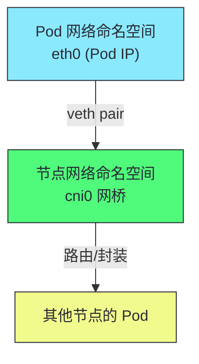
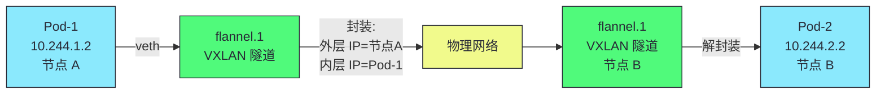
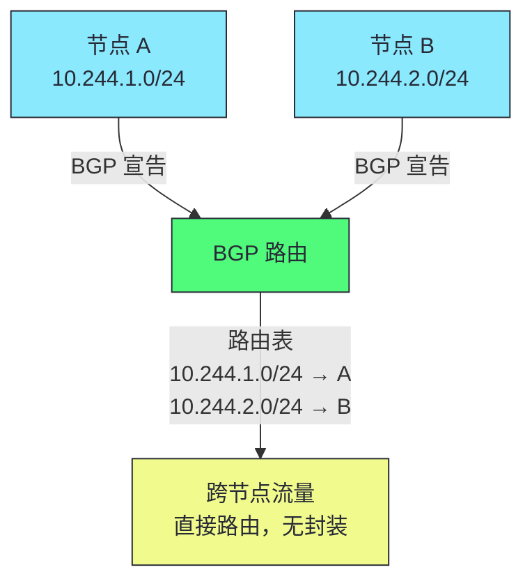
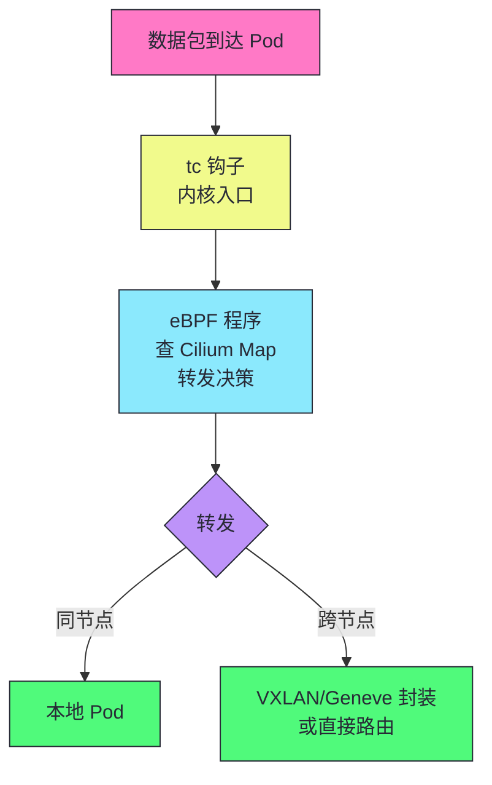
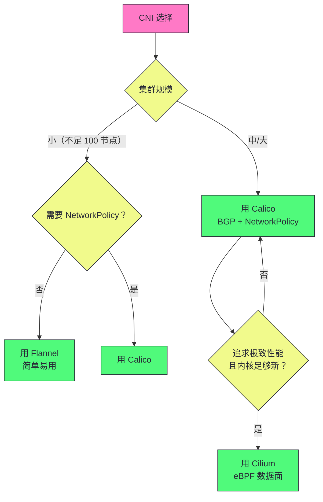

# 15 CNI 网络模型与数据面对比：Flannel/Calico/Cilium

**摘要：**

Kubernetes 的聪明处之一，是把自己不擅长的事连皮带骨让了出去。2015 年，CoreOS 与 Kubernetes、Mesos 社区的维护者一起拿出了一份不到十页的文档，只规定三件事：调用哪个二进制、通过标准输入传什么、通过标准输出返回什么。这份文档叫 CNI（Container Network Interface），它把「Pod 的网络怎么搭」从一个平台问题变成了一个插件问题。本文按五问推进：K8s 网络模型究竟要求什么；它为什么宁可交出实现权也不内置网络；没有这份规范、没有 NetworkPolicy 的落地实现会退化成什么样；Flannel、Calico、Cilium 如何在同一个 ADD 入口下走出三条完全不同的数据面；以及这三条路各自在哪里失效。中段会拆开一次 ADD 调用里发生的七件事、conflist 链的正序与逆序、VXLAN 背后的 FDB 与 ARP 两张表、BGP 的 full-mesh 与 Route Reflector 两种拓扑、eBPF 的 identity 与尾调用，以及那 50 字节封装头如何演变成「小包通、大包断」的连锁故障。落点不在插件排名，而在两处取舍：Overlay 用封装换来可移植性，Underlay 用可路由性换来性能与原生的 MTU；三种数据面真正区分的不是吞吐数字，而是团队能运维到哪一层。读完应当能回答两个问题：一个集群该选哪种 CNI；以及当跨节点不通时，第一步该看哪张表。

---

## 第 1 章 三条要求与一份薄规范

### 1.1 一次「新节点不通」的故障

2020 年代某电商的订单服务从三节点集群扩到十二节点，新加的机器落在另一个机柜。滚动更新完成之后出现一种很挑人的现象：同一节点上的两个 Pod 互相 curl 秒回，跨机柜的两台 Pod 一律超时；`kubectl exec` 进去 `ping` 网关通、`ping` 对端 Pod 不通；到节点上查 `ip route`，目标 Pod 网段的路由赫然在列，下一跳指向对端宿主机，看上去一切正常。

问题出在「有路由」与「包真能出门」是两件事。VXLAN 模式下，发往对端的包要先交给 `flannel.1` 这个隧道口，而隧道口把包送到哪个物理地址，取决于 FDB（Forwarding Database）表项；FDB 表项不是学来的，是 flanneld 按节点的增删事件写进去的。新节点的 flanneld 因为在镜像拉取上卡了三分钟，FDB 里缺一条表项，于是路由查得到、包发不出去，内核也不报错。这个案例会在第 4 章、第 8 章各回访一次，因为它是理解 Flannel 数据面的最短路径：**路由表决定往哪走，FDB 决定发给谁**。

### 1.2 三条要求与一个隐含前提

K8s 官方文档把 Pod 网络的要求写成三条，这三条几乎是照着「一个 Pod 就是一个带 IP 的虚拟机」这个朴素期望列出来的。

| 要求 | 准确含义 | 由谁兑现 |
| --- | --- | --- |
| Pod 拥有集群内唯一 IP | 不与节点 IP、其他 Pod IP 冲突，由 IPAM 分配 | CNI 插件 + IPAM 插件 |
| Pod 之间直接通信，不做 NAT | 源 Pod 看到的对端地址就是对方 Pod IP | 路由传播或隧道封装 |
| 节点上的代理可访问全部 Pod | kubelet 探针、kube-proxy 转发的前提 | 节点侧网卡与路由表 |

第一条把地址分配的责任推给了插件，同时也解释了为什么 Pod 网段的规划是一件三年前不做、三年后要命的事。第二条是三条里最贵的：不做 NAT，意味着 Pod IP 必须在集群范围内可路由，而物理网络对 Pod 网段一无所知——它只认识节点 IP。第三条常被误读成「节点能上网」，其实它要求的是节点网络命名空间与 Pod 网络命名空间之间的双向可达，这也是后面 host-gw 与 BGP 能成立的前提。

三条要求合起来暗示一个前提：**Pod IP 必须能被任何节点路由到**。兑现这个前提只有两条路，一是让网络知道这些地址（路由传播），二是让这些地址藏进节点 IP 里（隧道封装）。后面所有 CNI 插件的差异，本质上是在这两条路之间选边，或者在同一条路上选择把复杂度放在谁身上。

### 1.3 为什么把网络让出去

把网络实现写进 kubelet 是一个看起来很自然的念头：既然 kubelet 已经管了 Pod 的创建与销毁，顺手把网卡配了不就省了一个接口？K8s 没有这么做，理由不是没想到，而是三条现实约束。

其一，网络拓扑是环境的函数，不是平台的不变量。同一份 kubelet 二进制要跑在公有云的 VPC 里、跑在自建机房的裸金属上、跑在边缘的树莓派上；在这些环境里，能用的手段譬如从「打 VLAN 标签」到「调云厂商 API 挂弹性网卡」，再到「什么都干不了，只能发广播」，差异大到无法用一份实现覆盖。

其二，网络是故障的主要来源，排查却必须贴着内核的能力走。iptables、nftables、eBPF、硬件卸载的成熟节奏与 K8s 的季度发布毫不同步；把它们绑进 kubelet，等于让内核版本决定 K8s 的升级窗口。

其三，网络是一块责任边界。企业采购的 SDN、云厂商的网络产品、安全团队的策略平台，都要在 Pod 这一层落一次地；平台方如果自己实现了数据面，这些产品就只能改自己的实现才能接进来。

所以 K8s 让出去的是实现权，留下的是语义定义权——它规定 Pod 有唯一 IP、规定 NetworkPolicy 这份 API 的形状，然后把语义交给插件兑现。这就是**标准与实现分离**：规范只承诺行为，不承诺手段。代价是一致性只能靠规范约束：同一份 NetworkPolicy 在三家插件下的边界表现并不完全相同，这一点在第 7 章展开。

### 1.4 扁平网络与 IP-per-Pod 的价格

K8s 网络模型还有两个容易被当成「设计优点」而不加追问的决定。

第一个是扁平网络。Pod 之间无 NAT 直连，应用看到的地址就是对方真实地址，对服务发现、日志关联、限流规则都是好事。但扁平只在集群内部成立，出集群仍要经过 NAT 或 Ingress，这条「内扁平、外 NAT」的裂缝，成了后来多集群与 Service Mesh 要处理的主要麻烦。

第二个是 IP-per-Pod。网络的最小单位是 Pod 而不是容器，Pod 内容器共享同一网络命名空间：一个 Pod 就是一个 IP、一张路由表、一套端口空间。代价是地址消耗——一个跑五十个 Pod 的节点吃掉五十个地址，滚动更新时新旧并存会让瞬时占用翻倍，回收不及时就会在毫无征兆时告罄。

> [!info] 核心概念：CNI 的三个命令是整套体系的接口面
> CNI 规范只定义 ADD、DEL、CHECK 三个命令（早期只有前两个），以及调用时通过环境变量与标准输入传递的上下文。规范不关心插件用 VXLAN 还是 BGP，不关心它是否支持 NetworkPolicy，甚至不关心它是用 Go 写的还是用 shell 写的。**规范薄，才有生态；规范厚，只会剩下一个实现**。

---

## 第 2 章 一个 Pod 的网络是怎么搭起来的

### 2.1 命名空间先于容器

要理解 CNI 的调用时机，得先弄清一件事：Pod 的网络命名空间不是容器创建时才有的，它比容器更早存在。

kubelet 在启动一个 Pod 时，先通过 CRI（Container Runtime Interface）调用 `RunPodSandbox`。运行时创建的是一个只持有网络命名空间的「沙箱容器」，常见的实现是 pause 容器——它里面只有一个永不退出的进程，不做任何业务，唯一的价值就是让那个网络命名空间有一个持有者，从而不会因为业务容器退出而消失。命名空间建好之后，kubelet 拿到它的路径（形如 `/var/run/netns/cni-8f2a1d3e` 或 `/proc/<pid>/ns/net`），把这个路径写进 CNI 调用的 `CNI_NETNS` 环境变量，然后才轮到 CNI 插件上场。

这个顺序解释了很多运维现象。Pod 卡在 `ContainerCreating` 且事件里反复出现 `failed to set up sandbox container network`，说明卡在了 CNI 这一步，业务容器根本没启动；而一个 Pod 被删除时，如果 DEL 调用失败，pause 容器会留下来，命名空间也不会被回收，`/var/lib/cni/networks/` 下的地址文件同样留在原地。

### 2.2 一次 ADD 调用里的七件事

以「网桥 + host-local IPAM」这种最朴素的组合为例，把一次 ADD 摊开，能看到七个动作依次发生。

1. kubelet 侧：读取 `/etc/cni/net.d/` 下的配置，按文件名排序取第一个有效配置，把网络配置与 Pod 信息（命名空间、名字、容器 ID、接口名）打包。
2. 插件侧：把宿主机上一个 veth 的一端创建出来，另一端准备移入 Pod 命名空间。**创建时两端都在宿主机，再移一端进去**。
3. 移动：插件进入 Pod 的网络命名空间（setns），把 veth 的 peer 端移入，重命名为 `eth0`。这一步不能反过来做——容器内的命名空间里没有创建 veth 的工具链，而且两端必须协同，只能在宿主机的视角下成对建立再拆开。
4. 地址：IPAM 插件从节点分到的 Pod 子网里取一个空闲地址，写进本地分配记录；地址以 `ip addr add` 的方式配置在 `eth0` 上。
5. 路由：在 Pod 命名空间里写两条路由——一条指向 Pod 所在子网的直连路由，一条 `default` 指向网桥地址或链路本地网关地址。Calico 用的是 `169.254.1.1` 这个链路本地网关，为的是不占用 Pod 子网里的真实地址。
6. 宿主机侧：把 veth 的另一端挂到网桥（Flannel 的 `cni0`）或保持在宿主机的独立接口上（Calico 的 `caliXXXX`），并把网桥地址设为该子网的网关。
7. 返回：插件把结果（接口名、分配的 IP、网关、DNS 配置）以 JSON 打到标准输出，kubelet 据此填充 Pod 的状态。

这七步里有三处是后来故障的高发区。第 3 步的移动如果中途失败，会留下一个「一半在宿主机、一半不见了」的 veth，只能人工清理；第 4 步的地址记录如果写成功但第 5 步失败，地址就被占着而无人使用；第 6 步如果网桥不存在，插件会创建它，但创建出来的网桥 MTU 默认继承物理网卡，在 Overlay 场景下这个默认值往往是错的——第 8 章会回到这一点。

### 2.3 同节点与跨节点：两条完全不同的路径

Pod 配好之后，流量走向分两种情况，而这两种情况的排查手法几乎没有交集。



同一节点上的两个 Pod 通信，走的是网桥的二层转发：包从源 Pod 的 `eth0` 出发，经 veth 到 `cni0`，网桥查 MAC 地址表发现目标 MAC 在同一网桥上，直接转发到目标 veth。这条路径上不经过路由表，也不经过任何封装，因此它几乎不会受 MTU、BGP、隧道这些问题影响——这也是「同节点通、跨节点不通」这个经典现象的结构性原因。

跨节点的通信则交给宿主机路由表：包从网桥出来，目的地址不在本节点子网内，于是命中一条「目标 Pod 网段 → 下一跳」的路由，下一跳可能是对端节点 IP（host-gw、BGP），也可能是隧道口（VXLAN、IPIP）。**同节点看 MAC 表，跨节点看路由表**。

| 组件 | 作用 | 出问题时的表现 |
| --- | --- | --- |
| 网络命名空间 | 隔离 Pod 的网络栈（独立 IP、路由、iptables） | 命名空间残留导致 IP 不释放 |
| veth pair | 连接 Pod 命名空间与节点命名空间的虚拟网线 | 一端丢失，Pod 完全不通 |
| 网桥 cni0 / caliXXXX | 节点内二层转发与网关 | 网桥 MTU 错，跨节点大包断 |
| 路由表 | 决定跨节点流量的下一跳 | 有路由但下一跳不可达，静默丢包 |

### 2.4 三处埋在地基里的脆弱点

第一处是网桥与宿主机 iptables 的耦合。Linux 有个开关 `bridge-nf-call-iptables`，打开之后经过网桥的二层帧也会被 iptables 的 FORWARD 链看到。K8s 生态默认要求它是打开的，否则 kube-proxy 的规则对同节点 Pod 之间的流量不生效；但打开了又意味着同节点的二层流量要额外走一遍 netfilter，吞吐与延迟都要付账。

第二处是 DEL 的失败。Pod 删除时若节点失联、kubelet 重启、插件二进制被换掉，DEL 都可能失败，失败之后 veth 与 IP 记录都留着。IPAM 的泄漏不像磁盘满那样有明确告警，它的表现是「某天开始，滚动更新到一半，新 Pod 一直 ContainerCreating，事件说 no IP addresses available in range」。

第三处是命名空间路径的失效。`CNI_NETNS` 传的是路径，若 Pod 在 DEL 之前经历容器运行时重启，路径对应的 netns 可能已不存在；插件必须在「找不到命名空间」时依然成功返回，否则删除流程会卡死。规范要求 DEL 幂等，正是为了让这种状态可被机械清理。

---

## 第 3 章 CNI 规范：三个入口、一条链、两个契约

### 3.1 ADD、DEL、CHECK 的语义

| 命令 | 职责 | 失败之后的后果 |
| --- | --- | --- |
| ADD | 建 veth、分配 IP、配路由，把「期望的网络」变成内核状态 | Pod 卡在 ContainerCreating，业务容器不启动 |
| DEL | 拆 veth、释放 IP、清路由，尽量回到没有这个 Pod 的状态 | IP 泄漏、命名空间残留，最终耗尽 IPAM |
| CHECK | 只读地核对当前状态是否符合配置，不做修复 | 一般不影响调度，只影响就绪判定与自检 |

三个命令里，ADD 最容易被写成「一次性成功」，但它其实被要求幂等：同一个容器 ID 重复 ADD，要么给出同样的结果，要么明确报错并留下可清理的状态。DEL 的幂等要求更硬——删一个不存在的网络必须返回成功，否则一次失败的删除就会在 API 层反复重试。CHECK 在规范较新版本中才加入，kubelet 侧用得不多，多数实现把它当成自检入口：跑一遍就能知道内核状态和配置对不对得上。

### 3.2 两个契约：环境变量进，JSON 出

CNI 插件不是常驻进程，它是被 exec 一次、干完活就退出的二进制。这意味着每次调用都必须自带全部上下文，内存里不可能留有任何「上一次」的状态。把 libcni 的动作摊开看，一次调用等价于下面这一串。

```bash
# kubelet 经 libcni 调用插件时的真实形态：
# 上下文走环境变量，配置走标准输入，结果走标准输出
CNI_COMMAND=ADD \
CNI_CONTAINERID=3f9c2b7e1a \
CNI_NETNS=/var/run/netns/cni-8f2a1d3e \
CNI_IFNAME=eth0 \
CNI_ARGS='IgnoreUnknown=1;K8S_POD_NAMESPACE=shop;K8S_POD_NAME=order-7d9f' \
CNI_PATH=/opt/cni/bin \
/opt/cni/bin/calico < /etc/cni/net.d/10-calico.conflist
```

这套接口的好处是把进程管理、心跳、重连这些麻烦全部消掉了。插件可任意重启与升级，已有 Pod 的网络不受影响——配置在内核里，不依赖任何用户态进程存活。这就好比电话交换机把线路接通之后就可以下班，通话本身不靠接线员维持。

坏处同样明确：插件没有地方存状态，所有状态必须落在可被重启重建的外部——文件系统（host-local IPAM）、etcd 或 API Server（Calico IPAM）、内核对象（路由、veth、eBPF map）。**无状态换可升级性，状态必须外部化**。

### 3.3 conflist 与链式调用

单插件能满足的需求越来越少，因为「连通」只是第一层需求，「端口映射」「带宽限制」「DNS 配置」都要在同一个命名空间里落一次地。CNI 的应对方式是链式调用：一个 `.conflist` 文件列出若干插件，按顺序执行。

```json
{
  "cniVersion": "1.0.0",
  "name": "k8s-pod-network",
  "plugins": [
    { "type": "bridge", "bridge": "cni0",
      "ipam": { "type": "host-local", "ranges": [[{ "subnet": "10.244.1.0/24" }]] } },
    { "type": "portmap", "capabilities": { "portMappings": true } },
    { "type": "bandwidth", "capabilities": { "bandwidth": true } },
    { "type": "dns", "capabilities": { "dns": true } }
  ]
}
```

链的执行规则有两条容易被忽略的不对称。ADD 是正序的：`bridge` 先建接口、分配地址，`portmap` 再在已存在的命名空间里写 DNAT 规则，`bandwidth` 再挂 tc 限速；后面的插件依赖前面的插件把接口建好。DEL 则是逆序的：先拆 `dns`，再拆 `bandwidth` 与 `portmap`，最后才 `bridge` 释放 IP。若 DEL 也按正序来，`bridge` 会先释放 IP、删掉接口，后面的插件再去清理一个不存在的接口，通常报错并让整条链中断。

要让后一个插件知道前一个插件做了什么，靠的是 `prevResult`：每个插件把自己的结果交给下一个，下一个从结果里读接口名、地址、沙箱 ID。这也是 conflist 里那些 `capabilities` 字段的用途——它声明本插件愿意接收运行时传来的额外配置（端口映射列表、限速参数），kubelet 只会把对应内容传给声明了的插件。

> [!warning] 生产避坑：DEL 中断会留下一条再也清不掉的链
> 只要链里任何一个插件的 DEL 返回失败，libcni 就会把整次删除判为失败，kubelet 重试若干次后放弃，Pod 对象被删而内核里残留接口与 IP。排查这类问题的第一步不是看业务，而是 `ls /var/lib/cni/networks/` 与 `ip link | grep -E 'veth|cali'` 对账——**残留地址与残留接口应当一一对应**。

### 3.4 IPAM：地址从哪来

IPAM（IP Address Management）在规范里是可插拔的一环，它的实现决定了「IP 冲突」这类事故的形状。

| 实现 | 状态存在哪 | 能保证什么 | 典型问题 |
| --- | --- | --- | --- |
| host-local | 节点本地文件 `/var/lib/cni/networks/` | 单节点内不重复 | 文件残留导致地址泄漏；跨节点靠 Pod 子网切分避免冲突 |
| calico-ipam | etcd 或 API Server 中的 IPAM 块 | 集群范围内全局不重复 | 块（block）不够时节点借不到地址，扩容卡住 |
| 云厂商 ENI 模式 | 云平台网卡与辅助 IP 配额 | 与 VPC 路由天然一致 | ENI 数量与每 ENI 的 IP 数双重上限，Pod 密度受限 |

host-local 的思路是把地址空间静态切给节点：Pod 网段 `10.244.0.0/16`，每节点一个 `/24`，本地只需在这个 `/24` 里分配，天然不跨节点冲突。隐含前提是「节点分到的子网不会变」——节点重新加进集群、子网变了而本地文件还在，就会出现新旧文件对不上、地址重复分配的怪事。

Calico 的选择是把分配状态放到集群存储里，并且以「块」为单位预分配：每个节点领到一个 `/26` 的块，块内的地址由节点自己分配，块与块之间由集群层面协调。这样分配路径上不需要每次都与存储交互，只在领块时交互一次。代价是块是独占的——一个节点即使只用掉两个地址，那个 `/26` 也不会借给别人，所以在节点数远大于 Pod 密度时会浪费地址。

云厂商的 ENI（Elastic Network Interface）模式走得更远：Pod 直接用 VPC 地址，不封装、不做路由传播，物理网络天然认识它们，性能与排障体验都接近原生；代价是把地址约束换成了配额约束——每实例能挂的网卡数、每网卡能挂的辅助 IP 数都是硬上限，Pod 密度被机型锁死。

### 3.5 配置文件目录与一个安静的陷阱

kubelet 读 `/etc/cni/net.d/`，按文件名字典序取第一个能解析的配置；插件二进制在 `/opt/cni/bin/`。这两个约定朴素到几乎不值得写，但由此产生的事故相当安静：集群里先装了 Flannel（`10-flannel.conflist`），后来为了 NetworkPolicy 又装了 Calico，Calico 的配置写成了 `10-calico.conflist`，两个文件字典序相同、只差后缀，kubelet 重启之后选中了哪一个，取决于文件系统的扫描结果。表现是新创建的 Pod 用一套插件，老 Pod 用另一套，两套子网还不一样，于是集群内部出现两块互不连通的孤岛。

所以**配置目录只有一个赢家**，多份配置共存不会叠加生效。这是把它当成配置文件管理、而不是当成集群唯一事实来管理时最容易踩的坑。

### 3.6 反事实：没有这份规范会怎样

设想 K8s 没有定义 CNI，而是由 kubelet 内置一套网络实现。那么今天每一家想接入自己网络方案的组织，都要改 kubelet 源码、维护自己的 fork；每升级一次 K8s，就要把自己的补丁重放一遍；云厂商的弹性网卡、SDN 厂商的隧道、安全团队的策略引擎，全都只能在外围打补丁。这不是假想的困难——容器运行时的历史里，正是因为有人试图把运行时接口绑进编排器，才催生了后来的 CRI。

规范的作用在这里很清楚：**把「谁来实现」变成可替换的**。今天企业在 Flannel、Calico、Cilium、云厂商 CNI 之间挑选，正是这种可替换性的收益。

---

## 第 4 章 Flannel：把「连通」做成一件事

### 4.1 三个后端

Flannel 的定位窄到近乎固执：只负责让 Pod 之间能通，别的一概不管。它把这份职责拆成两半，一半是每个节点上的 flanneld 进程，负责从集群层面领到自己节点的 Pod 子网并维护路由；另一半是 CNI 插件，负责在 Pod 启动时把网卡配好。

| 后端 | 机制 | 额外封装开销 | 前提条件 |
| --- | --- | --- | --- |
| VXLAN | 二层帧套进 UDP 包，经 `flannel.1` 封装 | 50 字节 | 只要节点三层互通 |
| host-gw | 把「目标 Pod 网段 → 节点 IP」写进路由表 | 0 | 节点必须同二层 |
| UDP | 用户态转发 | 大 | 早期兼容手段，早已不推荐 |

三个后端的取舍不是「快与慢」，而是「把要求放在网络上，还是放在内核上」。VXLAN 把要求降到了最低——只要节点之间能三层互通，它就能工作，代价是每个包多 50 字节、多一次封装与解封装；host-gw 把要求提到了最高——节点必须同二层，换来的是零封装、原生 MTU、接近线速的转发。

### 4.2 VXLAN：两张表撑起一条隧道



`flannel.1` 不是一个「隧道设备」，它是 VTEP（VXLAN Tunnel Endpoint）——封装与解封装的端点。当节点 A 上的 Pod-1 要发往节点 B 上的 Pod-2 时，包先按路由表进入 `flannel.1`，内核在这里给原始帧套上 VXLAN 头（内含 VNI）、UDP 头（目的端口 8472）、外层 IP 头（源目都是节点 IP），再交给物理网卡送出。对端收到后，内核看 UDP 端口与 VNI，交给 `flannel.1` 解封装，露出原始的 Pod 帧，再按对端路由表送到 Pod-2。

关键在「外层目的 IP 怎么定」。这由 FDB 表回答：FDB 记录「目标 VTEP 的 MAC → 目标宿主机 IP」，内核据此决定外层包发往哪个物理地址；而 VTEP 的 MAC 又从 ARP 表来，由 flanneld 按节点的增删事件静态写入，绕开了广播泛洪。这一点很重要——多数公有云网络禁用组播与广播，靠 ARP 泛洪学习 VTEP 的方案在那里根本跑不起来，Flannel 用控制面直接填表的方式规避了这个问题。

也正因为这些表是「填」出来的而不是「学」出来的，flanneld 一旦落后于集群状态，表就与事实不符。第 1 章那个新节点不通的案例，症状在数据面（包发不出去），根因在控制面（flanneld 没有及时把表项写进去）。排障时的顺手动作是：

```bash
bridge fdb show | grep flannel     # 目标 VTEP 的 MAC 到宿主机 IP 的映射
ip neigh show dev flannel.1        # VTEP 的 IP 到 MAC 的映射
ip -d link show flannel.1          # VNI 与本地 VTEP 配置
```

### 4.3 50 字节的账

封装头可以逐段核对：外层 IP 头 20 字节、UDP 头 8 字节、VXLAN 头 8 字节、内层以太网头 14 字节，合计 50 字节。物理 MTU 为 1500 时 `flannel.1` 被设成 1450，Pod 的 `eth0` 跟随；host-gw 与 BGP 无封装，MTU 保持 1500。

这 50 字节的价格不止「有效载荷少了 3%」：内核要多做一次封装与解封装，CPU 开销随包速率线性增长；它还逼出一条硬约束——链路上任何一段的实际 MTU 小于 Pod 的 MTU，大包就在出方向被静默丢掉。第 8 章会拆开这条连锁反应。

### 4.4 host-gw：路由表就是数据面

host-gw 的机制朴素到几乎没有机制：flanneld 只是把「目标 Pod 网段 → 目标宿主机 IP」这条下一跳记录写进本节点路由表。

```bash
# flanneld 在节点 A 上写下的路由，等价于下面这一条
ip route add 10.244.2.0/24 via 10.0.0.12 dev eth0
```

包从 Pod 出来、过网桥、命中这条路由，下一跳是节点 B 的物理地址，于是内核直接以节点 B 的 MAC 为目的 MAC 发出去，全程不加任何封装头。对端收到后按自己的路由表送到目标 Pod。**只有一条下一跳，没有隧道**，因此它的性能接近原生网络，MTU 也保持原生。

代价写在前提里：所有节点必须能直接 ARP 到彼此，也就是同二层。一旦中间隔了路由器，路由表照样写得进去、`ip route get` 照样查得到路径，但内核要解析下一跳的 MAC 时 ARP 无应答，包在「路由命中、邻居解析失败」的状态里被静默丢弃。这是 host-gw 最典型的故障形态：**表面上路由正确，实际上发不出去**。

### 4.5 Directrouting 与后端切换的残留

`Directrouting: true` 是 host-gw 与 VXLAN 的混合形态：flanneld 按对端节点是否与自己同子网逐条判断，同子网走 host-gw，跨子网走 VXLAN。一个集群因此同时拿到原生 MTU 与跨三层能力，这在「同机房直连、跨机房隧道」的部署里非常实用。

代价落在排障上：`ip route` 里同时有指向节点 IP 的直连路由与指向 `flannel.1` 的隧道路由，某条流走了哪条要按目的网段去对；若两个机房地址规划有重叠，同一个前缀可能一半节点走直连、一半走隧道，性能与 MTU 都不一致。

后端类型的切换还有一个常被低估的坑。改 `net-conf.json` 里的 `Backend.Type` 然后重启 flanneld，旧的路由与 `flannel.1` 接口并不会自动消失：从 VXLAN 切到 host-gw 后，内核里还留着指向 `flannel.1` 的隧道路由，而 `flannel.1` 可能已经不再工作，症状是「配置改了、故障照旧」。正确的做法是先把旧后端留下的路由与接口显式清掉，再让新后端接管。

### 4.6 Flannel 的边界

Flannel 不支持 NetworkPolicy。这不是遗漏而是定位：它只承诺「连通」。需要隔离时，业界的组合是 Flannel 管连通、再引入 Calico 的策略组件，但那要两个控制面协同，装起来比单装 Calico 麻烦，因此用得不多。

可观测性同样薄：没有流日志、没有策略拒绝事件、没有服务间拓扑，出问题只能靠路由表、FDB、`tcpdump` 与 flanneld 日志手工拼。对二十人的团队不是问题，对要追「谁访问了谁」的审计是硬缺口。

规模上，Flannel 的控制面是每个节点上的 flanneld Watch 节点变化，全集群的路由条数随节点数线性增长。中小集群里这套机制够轻；上千节点时，每次节点抖动都要在所有节点的路由表上落一次改动，抖动本身会成为新的负载来源。

---

## 第 5 章 Calico：路由、策略与三个守护进程

### 5.1 BGP 的两种拓扑

Calico 在不开封装时的做法，是把 Pod 网段交给 BGP 去传：每个节点运行一个 BGP 客户端（BIRD），向邻居宣告「我负责的 Pod 网段」。



拓扑有两种，选哪一种由规模决定。默认是 node-to-node mesh（全连接）：每个节点与其他所有节点建立 BGP 会话，N 个节点需要 N×(N-1)/2 条会话。五十个节点是一千二百多条会话，还能撑；两百个节点接近两万条，会话建立与维持的开销开始压过收益。

于是有了 Route Reflector（路由反射器）。RR 是 BGP 协议自带的扩展：少数几个节点充当集中点，其他节点（RR Client）只与 RR 建会话，RR 把收到的路由反射给所有 Client。会话数从 O(n²) 降到 O(n)，星型拓扑替换了网状拓扑。RR 只交换路由信息、不转发数据流量，资源开销很小，通常部署两到三个做冗余。在 Calico 上的落地方式是把 `nodeToNodeMeshEnabled` 置为 false，然后单独指定哪几个节点担任 RR，并给它们一个相同的集群 ID。

会话性质还取决于自治系统号怎么取。每个节点用不同的 AS，是 eBGP；全网共用一个 AS，是 iBGP。后者在规模上去之后必须引入 RR，因为 iBGP 有一条老规矩：从 iBGP 邻居学到的路由不再转发给其他 iBGP 邻居，只能靠 RR 打破这条规则。

### 5.2 封装是可选项

与 Flannel 不同，Calico 把封装当成正交的开关，由两个参数控制：`ipipMode` 与 `vxlanMode`，各自可取 `Always` 或 `CrossSubnet`。

| 形态 | 数据包长相 | 额外开销 | 适用前提 |
| --- | --- | --- | --- |
| 纯 BGP（不封装） | 原始 Pod 包，外层是节点 MAC | 0 | 节点同二层，或底层网络愿意与节点建 BGP |
| IPIP | 外层多一个 IP 头 | 20 字节 | 节点三层可达即可 |
| VXLAN | 外层 IP + UDP + VXLAN + 内层以太网 | 50 字节 | 节点三层可达，且能过 NAT |
| CrossSubnet | 同子网不封装、跨子网封装 | 视路径而定 | 同机房直连、跨机房隧道 |

`CrossSubnet` 是把性能与跨网能力折中的常用选择：同子网的节点之间直连，跨子网的才封装。它的麻烦在于一个集群里同时存在两种数据路径，排障时必须先确定这条流属于哪一类，否则会出现「同样的两个 Pod，从 A 节点发起正常、从 B 节点发起超时」这种让人怀疑人生的情况。

IPIP 与 VXLAN 的差别不止 30 字节。纯 IP-in-IP 报文过 NAT 时，内层地址无法被翻译，跨 NAT 直接不通；VXLAN 走 UDP，可以被 NAT 处理。这是云环境里宁可多付 30 字节也选 VXLAN 的常见理由——**开销是确定的，过 NAT 是能不能用的问题**。

### 5.3 三个进程与一次策略编译

Calico 在每个节点上跑的不是一个进程，而是三个分工明确的角色。`calico-node` 容器里的 Felix 是数据面的执行者，它把「路由」与「策略」编程进内核——路由进内核路由表，策略进 iptables、nftables 或 eBPF。BIRD 是 BGP 的协议实现，只负责与邻居交换路由。confd 与 Typha 属于控制面的加速器：Typha 在节点与 API Server 之间做一层缓存代理，把「每个节点都 Watch 全量资源」变成「少数 Typha Watch、节点连 Typha」，这是 Calico 在上千节点规模下还能保持 API Server 压力的关键设计。

策略落地的方式值得细看，因为它是「同一份 NetworkPolicy、三种实现」的第一种范式。用户写的是标签选择器（selector），内核认识的是 IP 与端口，两者之间隔着一次编译：

```bash
# 选择器先被编译成 ipset 集合，再被编译成 iptables 规则
ipset list | grep cali          # 一个集合对应一个 selector 的成员 Pod IP
iptables-save | grep -c cali-   # 规则条数与 selector 数量相关，而非 Pod 数
calicoctl node status           # 这只是 BGP 会话状态，不代表策略已下发
```

这次编译带来的直接后果是：规则条数与「selector 的个数」相关，而与「Pod 的个数」相关性弱得多。一千个 Pod 如果只落在十几个 selector 上，iptables 规则也只有十几条到几十条的量级——这是 Calico 在 iptables 数据面下仍然能撑住较大集群的原因。**selector 到 ipset 这一跳解耦了策略规模**。

这套结构也解释了两种很常见的误判。其一，`calicoctl node status` 显示会话 Established，只说明路由在交换，不代表 Felix 已经把规则写进内核——两者要分开查。其二，Felix 正常也不保证对端收到了你的 Pod 网段，因为那是 BIRD 的事。控制面的三条链路（会话、路由、策略）各有各的健康度。

Felix 把策略落进内核的形式有三种，选哪一种决定了数据面的规模上限。

| 数据面 | 规则的存在形式 | 生效方式 | 主要限制 |
| --- | --- | --- | --- |
| iptables | iptables 链 + ipset 集合 | Felix 写规则，即时生效 | 规则数随 selector 增长，逐条线性匹配 |
| nftables | nft 表与集合 | Felix 写 nft 规则 | 要求较新内核与较新 Calico 版本 |
| eBPF | eBPF 程序 + map | 程序加载进内核，策略存 map | 要求较新内核，功能覆盖与 iptables 不完全等同 |

eBPF 数据面把策略判定与连接跟踪都搬进内核 map，跳过了 iptables 的逐条匹配，因此在大规模下更稳；它在较新版本的 Calico 中已经 GA，但特性覆盖与 iptables 数据面并不完全对等，切换之前要逐条核对特性矩阵，而不是只看「支持 eBPF」这一句。切换本身也不是改一个配置项就完事：它要重启 calico-node 并重建已有连接，长连接会断，通常只能安排在低峰期分批滚动。

### 5.4 地址管理与 IP 池

Calico 自己的 IPAM 以「块」为单位工作。默认块大小是 `/26`，每个需要运行 Pod 的节点会领到一个块，块内地址由节点自己分配，块与块之间由集群层面协调。

收益是分配路径短——绝大多数 Pod 创建不必访问集群存储，只在领块时交互一次；代价是块被独占——只跑两个 Pod 的节点同样占着 64 个地址，节点数远大于 Pod 密度时浪费明显。

块还牵出一个扩容期的典型事故。集群的 IP 池按 `/16` 规划、块大小 `/26`，理论上能支撑一千多个节点；但如果 IP 池被按命名空间或节点标签切成了多个小池，每个小池里能切的块数就很有限，某类节点忽然扩到十几个时会出现「池子里还有地址、但切不出整块」的报错。**IP 池的容量要按「块数」算，不能按「地址数」算**。

### 5.5 边界：收敛时间与会话规模

BGP 模式不封装、性能最好，但它的失败模式与封装模式完全不同：封装模式怕 MTU，BGP 模式怕收敛。

节点加入或退出时，路由要传播到所有需要它的节点。中小规模下这个时间是秒级，上千节点时可能几十秒，期间路由不一致，部分流量会走错下一跳。运维能做的三件事是：RR 做成冗余、Pod 网段连续以便聚合、给节点增删加限速与观察窗口。

路由聚合值得单独说一句。Pod 网段连续时，几十条 `/26` 可以聚合成一条 `/24` 通告，对端的路由表规模掉一个数量级；碎片化则让对端路由表随节点数线性膨胀。这才是「规划 Pod CIDR 要连续」的真实原因——不是为了好看，是为了让聚合有得聚。

---

## 第 6 章 Cilium：把数据面搬进内核

### 6.1 tc 钩子与五张表

Cilium 与前面两家的根本区别在于，它不再用「规则」描述数据面，而是用「程序」。



eBPF 程序挂在 tc（traffic control）的 ingress 与 egress 钩子上，包进入网卡时直接被程序处理，不必走完 netfilter 的整条链。程序要做的决策依赖几张内核态的哈希表：endpoint 表记录 Pod 的接口与地址，ipcache 记录 IP 到身份与节点的映射，policy 表记录策略，CT 表记录连接跟踪状态，service 表记录 Service 到后端的映射。

转发决策就是查表。同节点的包直接改目的接口送出，跨节点的包按配置封装或直接路由，需要 NAT 的在这里改地址。整个过程在内核态完成，没有用户态进程参与，也没有 iptables 那样逐条线性匹配的规则链。

在笔者看来，这与 iptables 的差别不是「快一点」，而是成本的形状不同：iptables 的匹配成本随规则数线性增长，eBPF 的查表成本基本是常数。**iptables 的问题不是慢，是它的成本随集群规模增长**。

### 6.2 identity：把策略从 IP 维度换到标签维度

Calico 的策略编译把 selector 压成 ipset，已经缓解了一次规模问题；Cilium 走得更彻底，它把「身份」变成数据面的第一等公民。

每个 Pod 的 label 集合会被哈希成一个数字身份（identity），同一个 label 组合的 Pod 共享同一个身份。策略因此写成「身份 A 可以访问身份 B 的某个端口」，而不是「这些 IP 可以访问那些 IP」。eBPF 程序处理包时，从源地址在 ipcache 里查到身份，再拿身份去 policy 表匹配，全程不关心具体 IP。

收益是策略规模不再随 Pod 数增长：Pod 重建换了 IP，身份不变，策略不用重写；扩容一百个副本，只要 label 组合没变，策略条数也不变。iptables 方案下「Pod 变动即全量重写规则」的开销在这里被消掉了。

代价是 identity 必须与 IP 保持同步。ipcache 是由 agent 根据集群状态维护的映射，Pod 被调度、IP 被分配、身份被计算出来，这条链路上任何一环延迟，都会出现「策略正确但匹配不上」的短窗口。它比 iptables 重写规则快得多，但不是零——笔者见过的最坏情况，ipcache 落后几十秒，那段时间里策略对新建连接完全不生效。

### 6.3 kube-proxy 的退场

Cilium 最常被提起的能力是替代 kube-proxy，但「替代」这个词掩盖了它实际做的事。

传统 kube-proxy 的路径是：包先到节点的 PREROUTING，被 iptables 或 IPVS 规则 DNAT 成后端 Pod 地址，再进 conntrack 记录连接。Cilium 的 socket 层负载均衡（`socketLB`）把这一步提前到了 socket：应用调用 `connect` 时，eBPF 程序直接把目的地址改写成后端 Pod IP，内核里根本没发生过 DNAT，也就不需要 conntrack 记录这次转换。

省下的两笔账分别是 NAT 与连接跟踪。对长连接，这两笔开销摊薄之后不明显；对短连接、高频 RPC，省掉 conntrack 表项分配与查找的收益相当可观——conntrack 表的容量与哈希冲突，本来就是高并发节点上的老问题。

不过 kube-proxy replacement 不是拨一个开关就完事。它要求内核版本与 Cilium 版本匹配；它要单独处理 hostPort、NodePort、externalIPs 这些边角；在「新装集群」与「已有集群改造」两种模式下，接管范围并不一样；混合模式下，一部分流量仍会落回 iptables，排查之前要先确认某类流量由哪一层接管。所以，「已去掉 kube-proxy」这句话，**必须说明是哪类流量不再经过它**。

### 6.4 尾调用与程序链的分段

eBPF 程序有两条硬限制：指令数与栈深，验证器替你把上限守住。一段程序如果既解析入口、又判策略、还做负载均衡，很快会撞上 `program too large`。

Cilium 的应对是尾调用（tail call）。它把处理拆成多段程序：入口一段、策略一段、负载均衡一段、出口一段，前一段结束时跳到后一段，上下文在同一份 `ctx` 上延续。内核允许的尾调用层数是有限制的（最多 32 次），这个限制反过来决定了程序链能分多细。

代价在于段与段之间的约定。它们不能靠函数参数传状态，只能靠固定的 map 布局共享，改动一段就要连带检查相邻段的假设；链越长，这种隐式契约越难维护。这也是 Cilium 升级往往要求 agent 重启并重新加载全部程序、而不是热替换某一段的原因。

### 6.5 内核依赖：eBPF 的可用性是内核版本的函数

Cilium 的门槛不在配置，而在内核。eBPF 从 4.x 起逐步成熟，ring buffer、BTF、`bpf_loop` 这些能力分别在较新的内核里才出现；Cilium 的官方兼容矩阵会明确列出每个功能要求的最低内核版本。较新版本的 Cilium 已经把 kube-proxy replacement 作为生产可用选项，但这条路径的前提是内核足够新。

现实里最尴尬的是企业存量系统。CentOS 7 的 3.10 内核没有可用的 eBPF 能力，RHEL 8 的 4.18 需要大量回移补丁才能跑起一部分特性——能跑，但不在推荐区，出问题很难判断是 Cilium 的 bug 还是回移补丁的缺口。而升级内核在生产里比升级 CNI 难得多：要重启节点、重验驱动与内核模块、面对一整批遗留系统调用。

所以 Cilium 的选型问题，实质上是**能不能把内核版本当成一等公民来管理**。能，就得到 eBPF 的全部收益；不能，就会陷入「功能开着但一半失效」的状态。这一点比任何性能对比都更能决定成败。

### 6.6 Hubble 与可观测性

Hubble 从 eBPF 事件里导出流日志，能回答一个 iptables 方案很难回答的问题：哪个 identity 到哪个 identity 的连接，被哪一条策略拒绝了。

iptables 方案下，被拒绝的包只留一个计数器，想回溯是哪条规则命中的，往往只能人肉比对顺序；eBPF 在决策点就能带上策略 ID 与身份上下文，不必额外抓包。这是很多团队从 Calico 换到 Cilium 的真实动机——不是为了吞吐，是为了「拒绝的原因可见」。

代价是流日志本身有成本。每连接一条记录，高并发集群的事件量非常可观，Hubble 只能靠 ring buffer 与采样控制开销；存储与查询通常要外接到 Prometheus 或对象存储，规模大了以后这条管道自己也是一套需要运维的系统。

---

## 第 7 章 NetworkPolicy：同一个 API，三种语义

### 7.1 语义三态

NetworkPolicy 从 1.8 起以 `networking.k8s.io/v1` GA，它的语义只有一句话：策略是白名单。但这句话要落到「某个 Pod 的某个方向」上，才有确定含义，而这里恰好有三种状态。

| 状态 | 判定 | 后果 |
| --- | --- | --- |
| 没有任何策略选中该 Pod | 该方向不受约束 | 全部允许（默认允许） |
| 有策略选中，且该方向有规则 | 逐条匹配 | 只有被允许的流量通过 |
| 有策略选中，但该方向规则为空 | 无规则可匹配 | 全部拒绝 |

第三种状态是整套机制的枢纽。写一个 `policyTypes: [Ingress]` 且 `ingress: []` 的策略，就等于给被选中的 Pod 加了一道「入向全拒」的闸门；而如果漏写 `policyTypes` 只写了 `ingress` 规则，`Egress` 方向不会自动变成全拒——它仍处于第一态，全部允许。这类「以为封了其实没封」的配置，是 NetworkPolicy 在生产里最常见的失效方式。

```yaml
apiVersion: networking.k8s.io/v1
kind: NetworkPolicy
metadata:
  name: allow-frontend
spec:
  podSelector:
    matchLabels:
      app: backend
  policyTypes:
    - Ingress
  ingress:
    - from:
        - podSelector:
            matchLabels:
              app: frontend
```

这段 YAML 的效果是：选中 `app: backend` 的 Pod，入向只允许来自同命名空间内 `app: frontend` 的流量，其余入向一律拒绝；出向不受影响。请注意 `podSelector` 为空时选中的是命名空间内所有 Pod，`namespaceSelector` 与 `ipBlock` 则分别按命名空间与网段放宽或收紧——三者是「或」的关系，任何一个 `from` 条目命中即放行。

### 7.2 三种实现

| 维度 | iptables + ipset | eBPF 查表 | 策略编译到内核对象 |
| --- | --- | --- | --- |
| 代表实现 | Calico 的 iptables 数据面 | Cilium | 各家控制器把 CRD 编译成自己的表示 |
| 规模特性 | 规则数与 selector 数相关 | 查表与规模基本无关 | 取决于编译产物 |
| 生效延迟 | 规则写入即生效，重写有抖动 | map 更新即时 | 需等控制器协调 |
| 排障入口 | `iptables-save`、`ipset list` | `cilium monitor`、map dump | 控制器日志与中间产物 |

三者的共同点是把「白名单」落成「先默认拒绝、再逐条放行」的内核动作，差别在放行判定怎么组织：iptables 排成有序链，命中顺序有意义；eBPF 存成哈希表，命中与否没有顺序；策略编译先翻成中间表示，多灌一层自己的语义。

这层「自己的语义」正是差异的来源。K8s 的 NetworkPolicy 没有优先级字段，多条策略之间是纯粹的「或」——只要有一条允许，流量就允许，没有任何一条能覆盖另一条。Calico 在此之上扩展了带优先级的策略与显式 deny 规则，能写出「先全局拒绝、再白名单放行」这种原生 API 表达不了的结构；不少团队抱怨「NetworkPolicy 表达不了」，真正的原因往往只是原生 API 只到「或」为止。

### 7.3 三个不受策略约束的方向

NetworkPolicy 的语义里藏着几个容易忽略的边界，它们的共同点是「策略管不到」。

第一个是 hostNetwork。使用宿主网络命名空间的 Pod 不经过 CNI 配置的网络，它的流量多数实现下不参与 NetworkPolicy 判定。把一组采集器或网关跑在 hostNetwork 上，再指望策略把它们封住，是行不通的。

第二个是节点自身的流量。K8s 文档明确写着：来自或去往 Pod 所在节点的流量始终被允许，无论 Pod 或节点的 IP 是什么。kubelet 的健康探针、节点上的监控代理、SSH 排障都靠这条豁免工作；它还意味着「入向全拒」并不能挡住节点上的进程访问 Pod。

第三个是 DNS。写一条 deny-all 的入向策略之后，全命名空间的 Pod 会瞬间失去出向的 DNS 解析能力吗？不会——deny-all 是入向，出向仍允许。但如果同时把出向也收紧到「只允许访问本命名空间」，DNS 就会断，因为 kube-dns 在 `kube-system` 下。这是 NetworkPolicy 上线事故里最高频的一类：**漏掉了名字解析这条隐式依赖**。

### 7.4 L7 策略与 TLS 的现实

Cilium 支持按 HTTP 方法、路径、gRPC 服务与方法、Kafka topic 做过滤，这是它相对于 L3/L4 策略的主要增量。但这里有一处被广泛误传的细节：这类判定不是纯 eBPF 完成的。

eBPF 在内核里能高效地看 IP、端口、TCP 状态，但解析 HTTP 需要处理流重组、分块编码、gRPC 的多路复用，这些逻辑放进内核既不安全也不经济。Cilium 的实际做法是：eBPF 在内核识别出「这条连接命中了一条 L7 策略」，把流量重定向到内置的 Envoy 代理，由用户态代理解析协议、做出允许或拒绝的判定。也就是说，**L7 策略是「重定向 + 用户态判定」的混合形态**。

这件事直接决定了 HTTPS 的边界。流量加密时，用户态代理看不到路径，除非做 TLS 终止（把证书交给代理）或依赖 TLS 感知能力去拿 SNI。而不做终止时，能拿到的只有 SNI 与握手元数据，按路径过滤根本无从谈起。很多 PoC 里的「按路径限流」演示之所以跑得通，是因为测试用的是明文 HTTP；上了生产、全站 HTTPS 之后，同一份策略就只剩 SNI 级别的效果。

### 7.5 反例：把「默认安全」做成一次断网事故

最常见的落地顺序是「先上 deny-all，再逐条放行」。这个顺序在理论上正确，在实践中是事故高发区。

一个典型的轨迹是这样：安全团队要求全部命名空间默认拒绝，运维下发一条选中所有 Pod 的入向 deny-all；十分钟后健康检查开始失败，因为部分实现下的 kubelet 探针经 Pod 地址访问，被策略拒掉；紧接着跨命名空间调用被拒，服务发现出问题；最后依赖外部 API 的服务全部超时，因为收紧出向时漏掉了对端。

对策不是「别上策略」，而是把策略当成一次有顺序的迁移：先开审计模式观察真实流量（Calico 与 Cilium 都支持先记录不拦截），按观测结果生成放行规则，再逐命名空间切换，从没有上游依赖的基础设施命名空间开始，并保留一段时间的回滚开关。**策略配错会立刻从内部拆掉系统**。

---

## 第 8 章 MTU、分片与一条连锁的故障

### 8.1 一张减法表

MTU 的问题之所以难，是因为它很少单独出现，而是与封装、分片、路径 MTU 发现、连接跟踪四件事缠在一起。先把账算清。

| 路径 | 额外头部 | 物理 MTU 1500 时的 Pod MTU | 9000 时的 Pod MTU |
| --- | --- | --- | --- |
| host-gw / 纯 BGP | 无 | 1500 | 9000 |
| IPIP | 外层 IP 20 字节 | 1480 | 8980 |
| VXLAN | IP 20 + UDP 8 + VXLAN 8 + 以太网 14 | 1450 | 8950 |
| 云厂商 ENI 模式 | 无（Pod 直接用 VPC 地址） | 1500 | 取决于 VPC |

四行表格回答两个高频问题：为什么 VXLAN 集群里 `ping` 通而传大文件卡住；以及为什么开了巨型帧的环境里漏配 MTU，症状与 1500 环境一模一样——封装开销的绝对值不变，可用余量却从 1450 变成 8950。

### 8.2 「小包通、大包断」的四种成因

第一种是最常见的：链路上某一段的 MTU 小于 Pod 的 MTU，来源譬如漏改的网卡、默认继承物理网卡的网桥，或一台刚加进来还没跑过 CNI 配置脚本的节点。

第二种是 PMTUD 被吞。理论上，路由器发现包太大时会回一个 ICMP「需要分片」的消息，发送端据此调小 MTU。但云上的安全组、防火墙、某些负载均衡默认不放过这类 ICMP，于是发送端永远收不到通知，一直在用大包重传。这是「MTU 配置全对但仍然不通」的典型原因——**问题不在包太大，在消息没回来**。

第三种是连接跟踪与分片的关系。IP 分片之后，只有第一个分片带 TCP/UDP 头，后续分片没有端口信息，NAT 与 conntrack 无法为它们建表项，于是后续分片被丢弃。在 Overlay 场景下这个问题会叠加：内层包被分片，外层再封装，一旦某处丢掉了「无头的分片」，重组就永远失败。

第四种是抓包看到的假象。开了 GSO/GRO 的网卡会把大块数据在软件层合并，`tcpdump` 抓到的「巨型帧」在实际链路上是被切开发送的。所以用抓包判断 MTU 时，要同时看接口的 `mtu` 值与 `-M do` 的探测结果，不能只看包长。

### 8.3 MSS 与自动推导的边界

CNI 插件通常会做两件事来兜底：一是把 Pod 接口的 MTU 按封装开销自动调小，二是对经过的 TCP 连接做 MSS 钳制（把 SYN 报文里的 MSS 选项改小，让对端按小包发）。

两件事有同一个失效前提：**推导依据是接口 MTU，链路更小就失效**。插件不知道有台交换机只支持 1400，也不知道跨机房专线的 MTU 是 1380；这类环境里唯一可靠的做法是显式指定 MTU，并在每次网络变更后重跑探测。

另一个误解是「MSS 钳制能解决所有问题」。它只对 TCP 有效，UDP 与 ICMP 不受影响，还依赖两端都正确实现 MSS 选项。所以在 UDP 为主的服务（DNS、QUIC、自研协议）上，MTU 依然要老老实实配对。

### 8.4 排查顺序

```bash
# 1. 先确认三处 MTU 是否一致：节点网卡、隧道口、Pod 内的 eth0
ip link show eth0 | grep mtu
ip link show flannel.1 | grep mtu
kubectl exec -it order-7d9f -- ip link show eth0 | grep mtu

# 2. 用 DF 置位的方式探测真实可通长度，逐步缩小定位链路
ping -M do -s 1472 -c 3 10.244.2.7    # 1500 - 20(IP) - 8(ICMP)
ping -M do -s 1422 -c 3 10.244.2.7    # 1450 - 28，VXLAN 下的正确值

# 3. 看路径上每一跳的 MTU
tracepath 10.244.2.7
```

排查的关键是第二步的「逐步缩小」。1422 通、1472 不通，说明这条路径的有效 MTU 在 1450 附近，与 VXLAN 的推导一致；如果 1422 也不通而 1000 通，说明链路上还有一段更小的 MTU，或者 ICMP 被吞了。

### 8.5 回到第 1 章那个案例

那个新节点不通的场景，最终查出两条原因叠在一起：flanneld 落后导致 FDB 缺表项，以及新节点所在机柜的接入交换机 MTU 是 1400 而不是 1500。前者让跨节点完全不通，后者让修好 FDB 之后仍然「小包通、大包断」。两个故障的排查手法完全不同——前者看 `bridge fdb` 与 `ip neigh`，后者看 `ping -M do`。**症状从来不是根因的可靠索引**。

### 8.6 一张调优清单

把散在各章的调优动作收成一张表，每一项都要同时问「收益」与「过度之后付什么账」。

| 调优项 | 生效位置 | 做对了得到什么 | 过头之后的代价 |
| --- | --- | --- | --- |
| MTU 对齐 | Pod 接口、隧道口、网卡三处 | 大包不再被静默丢弃 | 设得过小，封装比升高、有效吞吐下降 |
| 数据面选择 | iptables / nftables / eBPF | 大规模下规则与查表的成本可控 | 内核不达标就切 eBPF，特性分区静默失效 |
| 策略规模 | selector 与 identity 的数量 | 规则条数与 Pod 数解耦 | 策略碎片化，匹配与协调成本反升 |
| 网段规划 | IPAM 块与路由聚合 | 地址够用、对端路由表可聚合 | 规划过大浪费地址，过小则扩容时借不到块 |
| 内核队列与中断 | 网卡队列、RPS/RFS、conntrack 表 | 高吞吐下不丢包、单核不成为瓶颈 | 盲目放大队列，延迟与内存一起上去 |

---

## 第 9 章 选型：三种数据面各适合什么规模与运维能力

### 9.1 决策路径



| 场景 | 推荐 | 决定性理由 |
| --- | --- | --- |
| 本地开发、教学、CI 集群 | Flannel | 一个 DaemonSet 加一份 ConfigMap 就能跑通 |
| 百节点以内的生产、需要隔离 | Calico（iptables 数据面） | 策略成熟、与存量内核兼容 |
| 数百节点以上、需要聚合路由 | Calico + Route Reflector | 会话数可控、收敛可观测 |
| 高并发短连接、需要拒绝可见性 | Cilium | socket 层负载均衡与流日志 |
| 已有 L7 策略或服务网格诉求 | Cilium | 按 path / gRPC 方法过滤 |
| 云上托管集群 | 云厂商默认 CNI | 与 VPC 路由、安全组天然一致 |

### 9.2 三种数据面的真实分野

把三家放在一起比吞吐，结论往往不可迁移——测试机、内核版本、流量模型只要有一项不同，数字就能差出好几倍，而线上的瓶颈通常不在网络。更有意义的比较维度是「团队的运维能力到哪一层」。

Flannel 的运维只需要理解三件事：路由表、FDB、flanneld 日志。一个熟悉 Linux 网络的工程师半天就能上手，出问题时的排查路径短且确定。它适合的是「网络不是核心竞争力」的组织。

Calico 的运维要理解 BGP、iptables 与策略编译三层：会话断了看 BIRD，路由不对看宣告，策略不生效看 Felix 与 ipset。门槛更高，换来的是可控性——每条路由、每条规则都能手工验证，适合有专门网络或平台团队、且要与现有物理网络对接的组织。

Cilium 的运维要理解 eBPF 工具链、内核版本矩阵与它自己的 map 结构，`cilium status`、`cilium monitor`、`cilium bpf` 是一套新的语言；内核升级与 cgroup v2 这类底层细节会直接变成可用性问题。它适合愿意把内核当基础设施持续经营的组织，不适合「装完就不想再碰」的场景。

由此可见，三种数据面的分野不是性能排序，而是**运维能力的排序**。选一个团队运维得了的方案，比选一个基准测试分数最高的方案更重要——因为前者只是慢，后者会在某个凌晨三点变成一个没人能修的黑盒。

### 9.3 Underlay 与 Overlay

| 维度 | Underlay（BGP、host-gw、云 ENI） | Overlay（VXLAN、IPIP、Geneve） |
| --- | --- | --- |
| Pod 地址 | 物理网络可路由 | 只在封装内可见 |
| 性能 | 接近原生，零封装 | 多一次封装与解封装 |
| MTU | 保持原生 | 减 20 或 50 字节 |
| 网络依赖 | 要求同二层或底层支持 BGP | 只要三层可达 |
| 排障 | 与物理网络工具一致 | 需要理解隧道与两层地址 |

Overlay 换的是可移植性。它在任何三层可达的网络里都能工作，代价是 MTU、封装开销与排障时多出来的那一层抽象——抓包时你要分清看到的包是内层还是外层，`tcpdump -i eth0` 看到的是封装后的样子，`-i flannel.1` 看到的是解封装后的样子。

Underlay 换的是性能与一致性。Pod 地址就是物理网络里的真实地址，交换机、防火墙、抓包工具、流分析平台都能直接识别，MTU 也不会缩水。代价是它要求网络配合——要么节点同二层，要么底层设备愿意与节点建 BGP 会话，而多数企业的网络团队并不愿意为一套 K8s 集群改动核心路由策略。

### 9.4 迁移与 IPAM 冲突

换 CNI 不是换一个 DaemonSet 那么简单：已有 Pod 的网络配置在内核里，新 CNI 不会接管它们，想彻底切换只能重建 Pod 或重建集群。可行的路径其实只有一条——新建一个用新 CNI 的集群、把工作负载逐步迁过去、最后下线旧集群；成本主要落在数据面之外，DNS、证书、入口负载均衡、监控标签都要跟着迁一遍。

比迁移更隐蔽的是 IPAM 冲突。Pod 网段、Service 网段、节点网段、物理网络的既有网段，四者任意两个重叠都会产生难以解释的现象：某个 Pod 能通大部分地址，唯独访问不了财务系统的一台老服务器，因为那个地址落在 Pod 网段里，被本地路由截走了。这类冲突上线时不暴露，要等业务访问到那个地址才发作。**规划 Pod CIDR 要先把地址台账翻一遍**。

---

## 第 10 章 边界与反例

### 10.1 大规模下 BGP 的收敛

BGP 模式在小规模下几乎是完美的：无封装、原生 MTU、性能接近线速。它的边界在规模上出现。

节点数上去之后，两件事同时恶化。一是路由条数：N 个节点宣告 N 条网段，要分发到每个节点，更新总量是 O(n²)。二是收敛时间：一次节点故障触发一轮撤销与重新宣告，期间各节点视图不一致，部分流量被送往已失效的下一跳。

缓解手段在上文都出现过——Route Reflector 压会话数、Pod 网段连续以支持聚合、给节点增删限速。但这些手段只是把曲线推后，不改变形状。笔者接触过的几个数千节点集群，经验相当一致：到这个量级，Overlay 的确定性反而比 Underlay 的极致性能更值钱，因为隧道的收敛是「节点到节点」的两方问题，而路由传播是全网问题。

### 10.2 eBPF 的内核版本依赖

Cilium 的能力是一张按内核版本分层的表。较新内核上，它能做到几乎完全的 kube-proxy 替代、原生 BTF 支持、更好的尾调用与 map 类型；老内核上，一部分能力只能退化成用户态代理或干脆不可用。这个分层不是缺陷，是 eBPF 本身的演进方式——每个新能力都对应一个内核提交。

麻烦在于这张表与企业的内核生命周期不同步。K8s 1.37（2026-08-26 发布，最新补丁 1.37.2 于 2026-10-27）支持的内核范围很宽，但 Cilium 的高阶能力要求的内核远新于这个下限。于是会出现一种状态：K8s 升级顺利，Cilium 也能装，但某些特性在部分节点上静默失效。这类问题的排查成本极高，因为失效是分区发生的，同一个集群里一部分节点走 eBPF 路径、一部分走退化路径。

**eBPF 的可用性首先是内核版本的函数**，这句话比任何性能对比都更该写进选型文档。

### 10.3 Overlay 的 MTU 陷阱

这一条在全文反复出现，索性把它当成反例收一次。

反例是这样构成的：一个团队把集群从 host-gw 换成 VXLAN，为了「不影响业务」没有调整 Pod 的 MTU；上线后小流量正常，大数据的批处理开始间歇性失败，日志里是 `connection reset` 与超时，重试有时能过。团队查完应用、再查数据库、最后查网络，三天后才发现 `flannel.1` 的 MTU 是 1450 而 Pod 的 `eth0` 还是 1500。

教训有两条。「配置的默认值不等于正确值」——插件自动推导 MTU 的依据是它自己看到的接口，切换后端时看到的可能是旧值。「静默失败比报错更贵」——若内核在大包超 MTU 时直接报错，这故障五分钟就能定位；它选择静默丢弃，故障便被推迟到业务层的表现上，排查成本翻了几十倍。

### 10.4 两个反事实

第 3 章已经推演过没有 CNI 规范的后果，这里补上另一半：如果没有 NetworkPolicy 的落地实现，这份 API 就只是一份文档。策略写了没人执行，比没有策略更危险——它给人一种「已经隔离了」的错觉。这也是为什么 Flannel 明确不支持 NetworkPolicy 反而是一种诚实：它不给你一个空的承诺。

### 10.5 落点

回到第 1 章那个订单服务的场景。三条要求定义了 Pod 网络该长成什么样，CNI 规范定义了谁来兑现，三种插件给出了三条兑现路径：Flannel 用最少的机制换最快的上手，Calico 用路由与策略编译换可控性，Cilium 用内核可编程性换规模与可见性。

分界线不在性能数字上，而在三处取舍。第一处是封装与不封装：Overlay 用 50 字节和一层抽象换可移植性，Underlay 用网络配合换原生性能。第二处是规则与查表：iptables 的成本随集群规模增长，eBPF 的查表成本与规模基本无关，但门槛是内核。第三处是策略粒度：从 IP 到 selector 再到 identity，每一层都把策略规模从「实例数」解耦到「组合数」，代价是引入新的同步链路。

判断一个团队有没有选对 CNI，笔者通常看三件事：跨节点不通时，值班的人先查路由表还是先查隧道表；NetworkPolicy 上线时，是先开审计还是直接拒绝；内核升级的窗口，是网络团队的例行工作还是高风险变更。三件事答得出来，选型就基本对了；答不出来，选哪个都会在半年后变成同一个问题。

---

## 专栏导航

- 下一篇：[[16 生产化集群管理：多租户隔离、资源治理与安全加固]]。
- 返回专栏首页：[[00 专栏导览|Kubernetes 架构深度剖析专栏]]。

---

## 参考资料

1. CNI 规范（SPEC.md，ADD/DEL/CHECK/GC 与结果格式）. https://github.com/containernetworking/cni/blob/main/SPEC.md
2. CNI 约定与插件链（CONVENTIONS.md）. https://github.com/containernetworking/cni/blob/main/CONVENTIONS.md
3. flannel 项目与后端说明（VXLAN、host-gw、Directrouting）. https://github.com/flannel-io/flannel
4. Calico 文档：网络与 BGP 配置（node-to-node mesh、Route Reflector）. https://docs.tigera.io/calico/latest/networking/configuring/bgp
5. Calico 文档：IP 池与 IPAM 块分配. https://docs.tigera.io/calico/latest/networking/ipam/getting-started-ip-addresses
6. Cilium 文档：kube-proxy replacement 与 socket 层负载均衡. https://docs.cilium.io/en/stable/network/kubernetes/kubeproxy-free/
7. Cilium 文档：安全身份（identity）与策略语义. https://docs.cilium.io/en/stable/security/policy/
8. Cilium 文档：Hubble 可观测性. https://docs.cilium.io/en/stable/observability/hubble/
9. Kubernetes 文档：集群网络模型. https://kubernetes.io/docs/concepts/services-networking/
10. Kubernetes 文档：NetworkPolicy 语义与默认行为. https://kubernetes.io/docs/concepts/services-networking/network-policies/
11. Kubernetes 文档：Pod 与容器网络调试. https://kubernetes.io/docs/tasks/debug/debug-application/debug-pods/
12. Linux man-pages：network namespaces（ip-netns）. https://man7.org/linux/man-pages/man8/ip-netns.8.html
13. VXLAN 协议与封装格式. https://en.wikipedia.org/wiki/Virtual_Extensible_LAN
14. BGP 与路由反射器（RFC 4271 / RFC 4456）. https://datatracker.ietf.org/doc/html/rfc4456
15. eBPF 生态入口与内核版本能力说明. https://ebpf.io/

---

> [!note] 思考题
> 1. ADD 在规范里被要求幂等，而它的七个动作里有四个会修改内核状态。如果第 3 步（把 veth 移入命名空间）成功、第 5 步（写路由）失败，一次重试应该从哪一步继续？重试与回滚哪个更容易写对？
> 2. conflist 的 DEL 必须逆序。如果链里第 2 个插件在升级后不再支持 DEL（返回错误），整条链的删除会卡住，残留的 veth 与 IP 该由谁负责清理？规范本身有没有给出兜底手段？
> 3. host-gw 的路由写对了但包发不出去，`ip route get` 仍显示路径正常。为什么「路由命中」这件事在 Linux 里不代表「可达」？还有哪些情况会造成同样的假象？
> 4. Route Reflector 把 BGP 会话从 O(n²) 降到 O(n)，但路由条目数仍是 O(n)。在什么规模下，条目数而不是会话数成为真正的瓶颈？此时除了聚合还有哪些手段？
> 5. Cilium 的 identity 基于 label 组合，组合数远小于 Pod 数。请构造一个 label 设计不当的例子，说明组合数反而逼近 Pod 数，以及这时策略规模会退化成什么样。
> 6. Cilium 的 L7 策略需要用户态代理解析协议。如果全站流量都是 HTTPS 且不做 TLS 终止，这条策略实际能约束到什么粒度？此时还有哪些替代路径能拿到同样的控制力？
> 7. 一条 deny-all 入向策略下发后，kubelet 探针、节点监控代理、跨命名空间调用、DNS 解析，哪几个会受影响，哪几个因为语义豁免而仍然可用？请按 K8s 的语义逐项判断，而不是凭经验。
> 8. 本文反复强调「自动推导的 MTU 只保证推导，不保证一致」。在一个跨三地机房、其中有段专线 MTU 为 1380 的集群里，你会把 Pod MTU 定为多少，为什么不是一个「算出来的精确值」？
> 9. Kubernetes 1.37 仍把 CNI 作为唯一支持的 Pod 网络接口，而 Cilium 的高阶能力要求的内核远新于 K8s 支持的下限。当这两条升级节奏冲突时，应该优先锁哪一个，锁的代价分别落在谁身上？

---

> [!note] 版本与时效说明
> 本文的版本口径锚定在 Kubernetes 1.37（2026-08-26 发布，当前最新补丁 1.37.2 于 2026-10-27 发布），此前为 1.36、1.35、1.34、1.33。文中未标注具体版本的特性（如 Cilium 的 kube-proxy replacement、Calico 的 eBPF 数据面），均以「较新版本已 GA」表述，具体可用版本请以各项目官方兼容矩阵为准。CNI 规范本身仍在演进（CHECK、GC 等命令与结果格式都在增补），插件的实现细节与内核版本强相关；一年之后回看本文，机制层面的结论仍然成立，而版本号与命令行输出最可能需要更新。