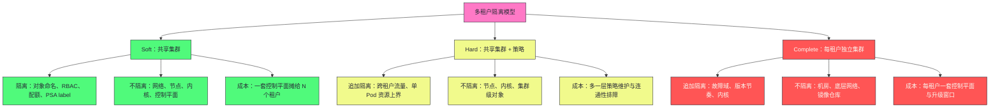
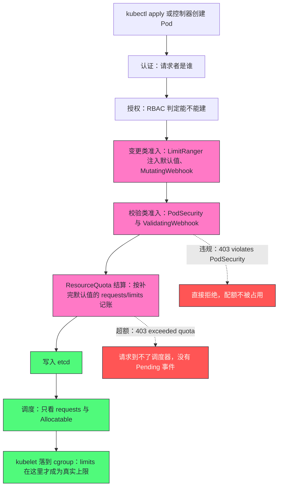
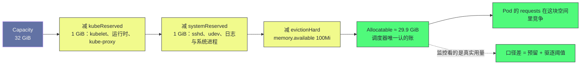
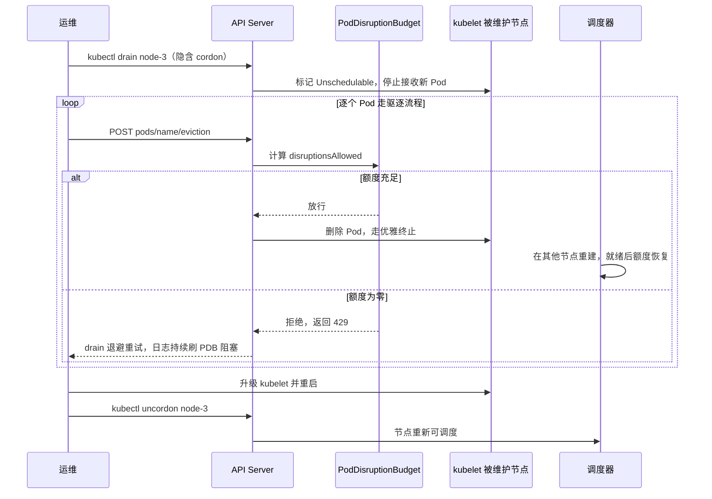
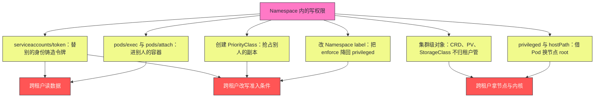

# 16 生产化集群管理：多租户隔离、资源治理与安全加固

**摘要：**

一个集群从"能跑起来"到"能被三支互不信任的团队共用"，中间隔的不是若干个 YAML 文件，而是一整套准入阶段的治理体系。本文沿这条主线展开：多租户隔离到底是什么、为什么裸 Namespace 撑不住生产、抽掉配额与策略之后事故长什么样、每一条策略该落在准入链的哪一段、以及这些手段各自在哪里失效。全文用交易、风控与报表三支团队贯穿始终——三者的资源画像与可信度完全不同，正好把隔离强度与成本的换算关系摊开算清。内容包括三种隔离模型的边界、准入链上 LimitRanger 与 ResourceQuota 的先后顺序、ResourceQuota 的六种 scope 与 PriorityClass 作用域、"超额创建"的两类不同报错、PSA 三档与 version pinning 的解耦手法、RBAC 聚合与 bound token、Secret 静态加密的读写路径、default-deny 网络策略的 DNS 例外、seccomp 与 AppArmor 的默认化、Allocatable 的构成算式、QoS 与驱逐顺序、超卖比的量化口径，以及 PDB、drain 与节点升级之间的卡死与解法。全文用五张图与多张对照表把边界画清，落点在两处换算：隔离强度与运维成本如何互换，配额严格与业务连续如何取舍。

---

## 第 1 章 隔离的光谱：从共享 Namespace 到独立集群

笔者先摆一个贯穿全篇的场景。某家公司一个生产集群，跑着三支团队的工作负载：交易团队的订单服务，对外承诺的是可用性与合规；风控团队的打分服务，P99 延迟按毫秒计，任何抖动都会传导到下单链路；还有一支做报表导出的批处理团队，白天几乎不动，夜里把数据灌进内存做聚合，峰值能吃掉整台机器的 CPU。

三支团队的可信度不一样。交易与风控是"自己人"，报表团队则常常由数据侧的外包同学提交代码；三者的资源画像更不一样，交易平稳、风控吃延迟、报表是典型的尖峰负载。所谓生产化集群管理，要回答的就是这一组问题：把他们放进同一个集群之后，用什么机制保证报表团队的峰值不会变成风控团队的故障，又保证这种保护不至于让报表团队的业务停摆。

### 1.1 一次没有配额的夜跑

先看一段几乎每个共享集群都上演过的剧本。报表团队的导出任务参数写错，把并发从 8 改成 800，副本被控制器逐个补出来。这个 Namespace 没有 ResourceQuota，节点也没有预留，几十个 Pod 几分钟内铺满所有节点，每个都声明"我要 4 核 8Gi"，实际还额外吃了页缓存。

后果不是"报表变慢"这么温和。第一层，节点内存被压到 `memory.available` 阈值以下，kubelet 开始按 QoS 与 OOM 分数挑人杀，被杀的是同一个节点上最不设防的那些 Pod——很可能是风控服务的 BestEffort 边车；第二层，节点上连 kubelet、容器运行时、kube-proxy 都要抢 CPU，控制面与节点的通信开始超时，节点被打上 `NotReady`；第三层，风控服务的副本在其他节点上被重建，但重建需要拉镜像、挂卷、过探针，达标前的那几十秒里，下单链路的延迟从 80ms 抖到 400ms。

笔者的判断是，这类事故的根因几乎从不是"某人不小心"，而是**集群没有在坏行为生效之前拦住它**。坏的参数、错的并发、忘了写 requests 都是必然事件，把治理放在事后告警与救火，等于承认每次都要先故障一轮。

### 1.2 三种隔离模型与它们的边界

K8s 社区把多租户分成 Soft、Hard、Complete 三档，这套分类的价值不在名字，而在每一档究竟隔离了什么、又明确不隔离什么。下图把三档的隔离对象、遗漏项与成本结构摆在一起。



| 层次 | 隔离方式 | 隔离强度 | 成本结构 | 适用场景 |
|------|---------|---------|---------|---------|
| Soft | Namespace | 弱 | 共享一套控制平面 | 内部可信团队、单体业务的多个域 |
| Hard | Namespace + 配额 + NetworkPolicy | 中 | 控制平面共享 + 策略运维 | 多团队/多项目，租户半可信 |
| Complete | 独立集群 | 强 | 每租户一套控制平面与升级窗口 | 强合规、外部租户、不可信负载 |

Soft 这一档最容易被误读成"便宜版的隔离"。它给的是管理边界：对象名在 Namespace 内唯一，RBAC、配额、PSA label 都按 Namespace 生效；不过节点混跑、内核共享、网络默认全通、控制平面只有一份，任何一次控制面故障或内核提权漏洞都由全体租户一起承担。它适合"租户之间不会互相攻击、只是需要各自的工作目录"的场景，也就是笔者所说的合租公寓：门上有各自的锁，厨房和承重墙是共用的。

Hard 这一档补齐的恰是合租公寓里最危险的那两处：流量与资源。NetworkPolicy 让跨租户的 Pod 默认不通（前提是 CNI 真的执行策略，见第 3 章那些"写了却不生效"的坑），LimitRange 与 ResourceQuota 让单个租户既建不出吃满节点的 Pod、也无限不了副本。代价是策略成了需要维护的代码：每加一个服务补一条放行规则，每次连通性故障先怀疑策略。

Complete 这一档把控制平面也拆开。它换来的是三样 Soft 与 Hard 都给不了的东西：故障域独立（对方的 API Server 被打爆不影响你）、版本节奏独立（你可以留在 1.34 而另一租户先上 1.37）、内核隔离（独立节点，或在同一集群叠加 gVisor、Kata 这类隔离运行时）。这笔账也算得清：一套最小生产控制平面就是三台节点，加上 etcd 的磁盘 IOPS 与快照存储，固定开销在租户很小时永远摊不平。真正的决策点因此不是"哪一档更安全"，而是**这个租户的年化风险敞口是否大于一套控制平面的年化成本**——把不可信的外部租户塞进 Hard 集群省下的钱，通常会以一次跨租户数据泄露的价格还回去。

### 1.3 Namespace 究竟隔离了什么

把 Soft 档的边界逐项摊开，能看清哪些东西是靠 Namespace 划开的，哪些根本不在它的管辖范围内。

| 维度 | Namespace 是否隔离 | 具体表现 |
|------|--------------|------------|
| 资源名 | 是 | 同 Namespace 内唯一，跨 Namespace 可同名 |
| RBAC | 是 | Role/RoleBinding 按 Namespace 生效 |
| ResourceQuota | 是 | 配额对象本身是 Namespace 级 |
| Pod Security | 是 | enforce/audit/warn 挂在 Namespace label 上 |
| 网络 | 否 | 默认全通，需 NetworkPolicy 才有隔离 |
| 节点 | 否 | 不同 Namespace 的 Pod 可混跑同一节点 |
| 内核 | 否 | 共享内核，隔离强度取决于运行时与 securityContext |
| 集群级对象 | 否 | Node、PV、StorageClass、CRD、PriorityClass 不归属任何租户 |

表里最容易被忽略的是最后一行。Namespace 只管 namespace-scoped 资源，Node、PV、StorageClass、CRD、PriorityClass 都是集群级对象。租户只要拿到创建 CRD 的权限，就能给所有 Namespace 引入新的 API 与准入语义；拿到创建 PriorityClass 的权限，就能让自己的 Pod 抢占任何低优先级负载。"租户权限"因此有两个面：Namespace 内的面与集群级的面，后者破坏力大得多，必须单独把关。

另外两处边界同样会咬人。其一是删除是异步的：对象一进 `Terminating` 就不再接受新建资源，但只要有 finalizer 没被清掉（卡住的 PVC、残留的聚合 API、已经卸载却还挂着的 webhook 配置），整个 Namespace 就会长期悬在那里，既删不掉也建不了新东西。其二是 `pod-security.kubernetes.io/*` 这类 label 本身就是权限边界——谁能改 Namespace 的 label，谁就能把 enforce 从 restricted 降回 privileged，所以对 Namespace 对象的 patch 权限应当收得比 Namespace 内的业务权限更紧。

### 1.4 为什么 Namespace 不是安全边界

Namespace 不是安全边界这句话如果只当口号，落地时仍然会踩空，因为它背后的机制是"权限面大于命名空间面"。能创建 Pod 的人，在共享节点的集群里就获得了接近节点权限的能力：`privileged: true` 加 `hostPath` 挂载宿主根目录，就是从容器到节点的直通车；`hostNetwork` 加 `hostPID` 让容器直接看见节点的网络栈与进程表；即便不放特权，一个内核提权漏洞也能把同一节点上其他租户的容器一起拖下水。

更隐蔽的是 API 层面的越权路径。拿到了 `pods/exec` 就能进别人的容器；拿到了 `serviceaccounts/token` 就能给别的身份铸造令牌；拿到了 `nodes/proxy` 就等于绕开所有 Namespace 边界直连 kubelet API——这个权限在 RBAC 里看起来只是"读节点代理"，实际等价于"在任意 Pod 里执行命令"。这几条路径的共同点是它们都写在 ClusterRole 里，与 Namespace 的划分无关。

> [!warning] 生产避坑：Namespace 隔离不等于安全隔离
> Namespace 是逻辑隔离，不是安全边界。同集群不同 Namespace 的 Pod 默认可以互通（除非配了 NetworkPolicy），同节点可能混跑不同租户的 Pod（共享内核），集群级对象（CRD、PriorityClass、PV）不归属任何租户。对强隔离需求——外部租户、多租户 SaaS、金融与医疗合规——用独立集群，而不是靠 Namespace 加更多策略去逼近。

---

## 第 2 章 准入链：治理体系究竟落在哪一段

隔离的边界划清之后，要问这些机制到底在哪里生效。这个问题决定了排障时该看哪里：一个 Pod 没出现，可能是授权拒绝、配额满、PSA 拦下，也可能是调度不上——四种原因的现场证据完全不同。

### 2.1 一条链上的四道闸门

Pod 从提交到跑起来，要穿过一条固定顺序的流水线。下图把这条链上的判定点与两类拒绝的落点画在一起。



图里最值得记住的一条是：**调度器看到的 Pod，已经被注入过默认值**。LimitRanger 在变更阶段就把 `default` 与 `defaultRequest` 填进容器，配额随后按补完后的值记账，调度器再按同一份 requests 做 Filter 与 Score。这三个环节用的是同一个数字，只要其中一环的顺序被打乱，后面的账就全错。

另一条同样重要的是拒绝的形态。配额与 PSA 的拒绝都发生在准入阶段，Pod 根本没被创建，所以 `kubectl describe pod` 里不会有它，`kubectl get events` 里能看到一条 `FailedCreate` 或 `Forbidden` 的记录，而不是 `FailedScheduling`。排障时先把这条分清，能省掉一半时间：看到 `Pending` 才该去看调度器，看不到 Pod 就该去看准入链。

### 2.2 ResourceQuota：计量口径与作用域

先看一份典型的 Namespace 配额。

```yaml
apiVersion: v1
kind: ResourceQuota
metadata:
  name: team-a-quota
  namespace: team-a
spec:
  hard:
    requests.cpu: "100"
    requests.memory: "200Gi"
    limits.cpu: "200"
    limits.memory: "400Gi"
    pods: "50"
    services.loadbalancers: "2"
    persistentvolumeclaims: "20"
```

| 配额维度 | 说明 |
|---------|------|
| CPU/内存 | requests 与 limits 的总量上限，两者分别记账 |
| Pod 数 | Namespace 内可存在的 Pod 数量 |
| Service 数 | 按类型分记，`services.nodeports`、`services.loadbalancers` 各自独立 |
| PVC 数 | 声明数量上限，另有 `requests.storage` 记容量 |
| ConfigMap/Secret 数 | 用 `count/configmaps` 这类形式记账 |
| 对象计数通用式 | `count/<resource>.<group>`，譬如 `count/jobs.batch` |

口径混乱几乎都出在名字这一层。对象计数用 `count/` 前缀，计算资源用 `requests.` 与 `limits.` 前缀，存储用 `requests.storage` 或 `<storage-class>.storageclass.storage.k8s.io/requests.storage`。三类混着配，就会出现"配额看着没超却建不出来"的怪象：只配 `pods: "50"` 只数个数，一个 Pod 吃 32Gi 内存也照样放行；只配 `requests.memory` 而不配 `pods`，一堆 requests 为 0 的 Pod 能把 etcd 写爆而配额毫无反应。笔者的经验是两者都配：`pods` 防对象膨胀，`requests.*` 防资源膨胀，缺一个就有一条绕过路径。

作用域（scope）是这份配额体系里最容易被低估的一层。`scopeSelector` 支持 `Terminating`、`NotTerminating`、`BestEffort`、`NotBestEffort`、`PriorityClass`、`CrossNamespacePodAffinity` 六个维度，配合 `In`/`NotIn`/`Exists`/`DoesNotExist` 四种操作符，可以把同一个 Namespace 的额度切成几摊。最有价值的一种用法是给 BestEffort Pod 单设一条很低的配额：

```yaml
apiVersion: v1
kind: ResourceQuota
metadata:
  name: team-a-besteffort-cap
  namespace: team-a
spec:
  hard:
    pods: "5"
  scopeSelector:
    matchExpressions:
      - scopeName: BestEffort
        operator: In
```

这条配额的实际作用是"堵住不写 requests 的捷径"。BestEffort Pod 在 `requests.cpu` 与 `requests.memory` 上的贡献都是零，如果没有这一条，团队只要不写资源声明就能无限扩副本，前面那 100 核的配额一条都拦不住。`Terminating` 与 `NotTerminating` 的口径则按 Pod 是否带 `spec.activeDeadlineSeconds` 区分，适合把批处理的临时 Pod 与常驻服务的额度分开；`PriorityClass` 作用域让"某个优先级以上的 Pod 不计入这条配额"，这条在生产里很实用——集群关键组件的 Pod 不应因为业务 Namespace 的配额满而建不出来。

### 2.3 超额创建时到底报什么错

配额的检查发生在创建时，报错有两类，含义完全不同，混起来就会把配置问题当成容量问题。

第一类是额度真的不够，报错里带着请求量、已用量与上限：

```
Error from server (Forbidden): pods "export-7f9c" is forbidden:
exceeded quota: team-a-quota, requested: requests.cpu=500m,
used: requests.cpu=99, limited: requests.cpu=100
```

第二类是配额存在而 Pod 没声明对应资源：

```
Error from server (Forbidden): pods "export-7f9c" is forbidden:
failed quota: team-a-quota: must specify limits.cpu for: exporter;
requests.cpu for: exporter
```

第二类错误的成因值得说清：只要 Namespace 里有一条配额限制了 `limits.cpu` 或 `requests.cpu`，准入就要求每一个新建容器显式声明它——配额无法为"未声明"记账。这解释了一个常见现象：给老团队加配额后所有服务同时建不出来，报错是 `must specify` 而不是 `exceeded`。解法不是对配额妥协，而是配 LimitRange 补默认值（见 2.4）。

至于计算时机：配额只在对象创建（与少数更新路径）时结算，结果写进 `ResourceQuota.status.used`。这个写入是对同一个配额对象的原子更新，同一 Namespace 高频创建 Pod 时，并发请求会在这一对象上串行化、冲突部分重试——配额因此是 Namespace 内 Pod 创建速度的隐藏上限。运行时用量不进入这笔账：Pod 把 limits 用满是常态，配额不会因为"用量超了"拒绝任何东西，它是准入闸门而不是运行时限额。

一处需要实测的缝隙在原地调整资源上。In-place Pod Resize（1.33 起进入默认开启的 Beta）让 `resources` 可在生命周期内修改，这条路径走 Pod 子资源而非创建路径，是否影响配额的 `used` 在不同版本口径不一。启用这项能力前，造一个超配额的调整请求验证一遍，别假设"创建时拦得住，调整时也拦得住"。

### 2.4 LimitRange：注入时机决定调度账

配额管总量，LimitRange 管个体，两者的分工在 YAML 上一目了然。

```yaml
apiVersion: v1
kind: LimitRange
metadata:
  name: default-limits
  namespace: team-a
spec:
  limits:
    - type: Container
      default:          # 未声明 limits 时注入
        cpu: 500m
        memory: 512Mi
      defaultRequest:   # 未声明 requests 时注入
        cpu: 100m
        memory: 128Mi
      max:              # limits 的上界
        cpu: 4
        memory: 8Gi
      min:              # requests 的下界
        cpu: 50m
        memory: 64Mi
      maxLimitRequestRatio:   # limits/requests 的比值上界
        cpu: 10
        memory: 4
```

`default` 与 `defaultRequest` 的注入只对没有显式设置的容器生效，容器自己写了就按容器自己的来。两处默认值的对应关系有个容易记错的细节：只配 `default` 不配 `defaultRequest` 时，注入的 request 会取 limit 的值；而如果一个 Pod 只写了 limits 没写 requests，API 层面会把 requests 补成 limits——后者意味着**只设 limits 的 Pod 会直接落进 Guaranteed**，与很多人的直觉相反。

被低估的是这段注入对调度的影响：注入的 request 就是调度器记账的那一份，`defaultRequest` 一改，整张容量账单跟着改。一支 60 个副本的团队，`defaultRequest.cpu` 从 100m 调到 500m，调度需求就从 6 核抬到 30 核，按单台 30 核 Allocatable 算要多买一台。反过来压到极低，水位看着空闲，运行时大家在同一批核上互抢，P99 抖动会先于容量告警出现。

`max`、`min` 与 `maxLimitRequestRatio` 三条是校验而不是注入，违反直接拒绝。`maxLimitRequestRatio` 专门防"1m request、4Gi limit"这类畸形配置：这类 Pod 的调度占用几乎为零，运行时却能吃掉整台节点，是配额体系里最隐蔽的漏洞。另外要记住 LimitRange 的三种 `type`：`Container` 管每个容器，`Pod` 管所有容器资源之和，`PersistentVolumeClaim` 管 PVC 的大小上下界——最后一种经常被忘掉，于是有人用 1Ti 的 PVC 把存储类打爆。

> [!info] 核心概念：没有资源声明的集群终将崩溃
> 一个 Pod 不写 limits，就能把整台节点的内存吃光，代价是同节点的其他 Pod 被驱逐或 OOMKilled。LimitRange 的价值不在于"限制"，而在于给"没写"这件事一个确定的默认值——它同时修好了配额记账（消除 `must specify` 报错）与调度口径（让 request 不为零）。缺了它，配额与调度两边都会失真。

### 2.5 Pod Security Standards：三档与版本钉住

PSA 是 PodSecurityPolicy 的替代品。PSP 在 1.21 弃用、1.25 移除，失败之处很典型：集群级资源、绑定关系复杂、默认放行，运维难以判断"某个 Pod 受哪条策略管"。PSA 换了做法——策略不再是对象，而是挂在 Namespace label 上的三档标准。

```yaml
apiVersion: v1
kind: Namespace
metadata:
  name: production
  labels:
    pod-security.kubernetes.io/enforce: restricted
    pod-security.kubernetes.io/audit: restricted
    pod-security.kubernetes.io/warn: restricted
```

三个级别里，`privileged` 不做限制，`baseline` 拦住已知的提权路径（特权容器、host 命名空间、hostPath、不安全 sysctl、内核能力追加等），`restricted` 在 baseline 之上再要求非 root 运行、禁止提权、丢弃全部 capability、并强制声明 seccomp profile。三个模式的作用各不相同：`enforce` 拒绝，`audit` 放行但记审计，`warn` 放行但给客户端返回警告——把三者配成同一级别是常见做法，等于"强制、留痕、提示"三件事一起做。

Restricted 的校验清单值得逐项对照，"以为拦住了其实没拦"大多出在这里。

| 校验项 | Restricted 的要求 | 常见踩空点 |
|------|---------|---------|
| 特权与提权 | 禁止 `privileged`，要求 `allowPrivilegeEscalation: false` | 只写 `privileged: false` 而漏掉提权开关 |
| 用户 | 要求 `runAsNonRoot: true` 且 `runAsUser` 非 0 | 镜像 USER 是数字但 spec 没声明，仍会被拒 |
| capability | 必须 drop `ALL`，最多再加回 `NET_BIND_SERVICE` | 只 drop 了部分能力 |
| seccomp | `seccompProfile.type` 必须是 `RuntimeDefault` 或 `Localhost` | 未声明即视为不满足 |
| 卷类型 | 只允许配置类、临时类与 PVC 等有限类型 | 用了 hostPath |
| 只读根文件系统 | 不在 PSA 校验范围内 | 误以为 restricted 会强制它 |

最后一行需要单独强调：`readOnlyRootFilesystem` 是加固建议，不是 PSA 的准入要求。很多团队以为开了 restricted 就有只读根文件系统，实际没有——这条要自己在安全上下文里写，或者用策略引擎补。

版本钉住（version pinning）是 PSA 里最实用、也最少被写进 checklist 的机制。策略标签可以额外带一个 `-version` 后缀，把判定口径固定到某个语义版本：

```yaml
metadata:
  labels:
    pod-security.kubernetes.io/enforce: restricted
    pod-security.kubernetes.io/enforce-version: v1.33
```

不写 version 时，口径跟着集群版本走。于是集群从 1.33 升到 1.35 的那一刻，同一份 Pod spec 可能突然被拒——不是业务改了，而是策略标准随版本收紧。把 version 钉住，就把"策略升级"从"集群升级"里解耦出来：升级时策略不动，业务改完再单独上调一档，风险窗口从一次大爆炸切成两次小变更。配上 `audit` 先行、`enforce` 后行的顺序，就是新集群上线的标准动作。

PSA 的豁免（exemption）是集群级配置，写在 API Server 的 `AdmissionConfiguration` 里，可按用户名、RuntimeClass、Namespace 三类维度豁免，改它要重启 API Server。所以"给某个 Namespace 开例外"优先用它自己的 label 解决，不要为一次例外动控制平面。

### 2.6 顺序错位会怎么坏

准入链的顺序由 API Server 内置决定，运维改不了，但这不意味着顺序不会出问题。真实会踩的有两种。

第一种是只配其一。只配 ResourceQuota，前面说的 `must specify` 会让所有不写资源声明的服务建不出来；只配 LimitRange，默认值补上了，不过一个 Namespace 仍能无限扩副本把集群吃干。两者是一对，缺一个都用不起来。

第二种是口径混用。配额按 `limits.cpu` 记账，`defaultRequest` 却给了很小的值，于是"限额还有余量、requests 已把节点占满"；反过来同理。调优前先把配额的资源维度与默认值对齐一遍。

---

## 第 3 章 安全加固：从"配了"到"确认生效"

资源治理解决"坏行为破坏可用性"，安全加固解决"坏行为拿走后门钥匙"。两件事在机制上同类——都挂在准入与运行时链路上——但失败形态很不一样：前者失效的现场是告警与 Pending，后者失效的现场通常什么都没有。

笔者喜欢用一把锁来类比这一章：给门装了锁却从不试着拉一下门把手，是安全配置最典型的失败模式。spec 写了、CRI 传了、内核忽略了，三段链路任一段断开，配置都只是审计日志里的一行字。

### 3.1 加固清单与它的读法

| 维度 | 推荐措施 | 关键点 |
|------|---------|---------|
| Pod Security | Namespace label 上 restricted 三处齐配 | 版本钉住，先 audit 后 enforce |
| RBAC | 最小权限，禁用 cluster-admin 常态持有 | 重点收紧集群级动词与子资源 |
| ServiceAccount | 每应用独立 SA，按需关闭 token 挂载 | 用投影 token 而非长期 Secret |
| NetworkPolicy | 每 Namespace 一条 default-deny | 记得放行 DNS |
| Secret 加密 | EncryptionConfiguration + KMS v2 | `identity` 不能放第一位 |
| 审计日志 | 至少 Metadata 级别，写操作全覆盖 | 审计本身也要控读权限 |
| 镜像安全 | 禁止 latest、扫描 + 签名校验 | 准入阶段校验摘要而非标签 |
| API Server | 关闭匿名访问与不安全端口 | 控制面只暴露给可信网络 |

表的读法是"从上往下失效越来越隐蔽"，它与官方的安全检查清单大体对应，可用来补齐自己漏掉的维度。Pod Security 违反会直接报错，RBAC 配错会直接 403，而 Secret 加密配错、NetworkPolicy 被 CNI 忽略、审计策略漏了某类资源，全都没有任何即时反馈——这三类问题会安静地存在很久。

### 3.2 RBAC：聚合机制与真正的越权面

RBAC 的判定路径是：请求带着用户名与组进入授权阶段，authorizer 按用户、组、ServiceAccount 三个索引找出相关绑定，取出引用的 Role/ClusterRole 逐条比对动词、资源与子资源。这个过程每次请求都会重算，绑定数量与组数量直接进入请求延迟；把权限绑到 `system:authenticated` 这类超大组上，等于让每条请求多遍历一批规则，是授权层最常见的性能债。

聚合（aggregationRule）是 RBAC 里最值得单独讲的机制。ClusterRole 可以不写死 rules，而是声明一组 label selector，由控制器把匹配到的其他 ClusterRole 的规则合并进来：

```yaml
apiVersion: rbac.authorization.k8s.io/v1
kind: ClusterRole
metadata:
  name: tenant-admin
aggregationRule:
  clusterRoleSelectors:
    - matchLabels:
        rbac.tenant/aggregate-to-admin: "true"
rules: []   # 由控制器填充，手写会被覆盖
```

内置的 `admin`、`edit`、`view` 就是这么拼出来的，Operator 与 CRD 也可以把自己的规则挂进来。这套机制的两处细节要记住：一是 `rules` 由控制器维护，手写的规则会被覆盖，改权限只能通过新增带 label 的 ClusterRole 来做；二是聚合有传播延迟——新 CRD 上线后，聚合控制器要 reconcile 一轮，`admin` 才拿到对应的权限，这个时间窗里业务会收到 403，是"新 CRD 上线即报权限错误"的标准成因。

最小权限的落点不在动词的多少，而在**资源的敏感度**，这一点常被忽略。下面这些权限看起来都不起眼，实际等价于集群管理员：

- `nodes/proxy`：绕过所有 Namespace 边界直连 kubelet API，可在任意 Pod 内执行命令。
- `pods/exec`、`pods/attach`、`pods/portforward`：进别人的容器、拿别人的流量。
- `serviceaccounts/token`：为任意 ServiceAccount 铸造令牌，身份随意切换。
- `secrets` 的读权限：直接读到别人的凭据，RBAC 的对象边界在这里等于零。
- `escalate` 与 `bind`：自己给自己提权，或把高权限角色绑给自己。
- `certificatesigningrequests/approval`：签发任意身份的证书。

所以授权评审的提问方式应当改一改：不是"这个角色有几个动词"，而是"它能不能碰到 Pod 的 exec、SA 的 token、Secret 的内容、节点的代理"。这三类资源任一项放出去，Namespace 的隔离就已经失效了。

Role 与 ClusterRole 的选择原则也由此而来：能用 Role 就用 Role，因为它的作用域天然被 Namespace 框住；确实需要集群级权限时（节点、PV、CRD），把它单独做成一个 ClusterRole 并只绑给平台侧的组，不要顺手塞进业务角色里。

### 3.3 ServiceAccount 与投影 token

"每应用一个 ServiceAccount、不共享 default"已写进多数团队的规范，但 token 的形态在近几个版本变了，规范还没跟上。

较早的形态是：创建 ServiceAccount 时，控制器自动生成一个存着长期 token 的 Secret，Pod 挂载这个 Secret。这个形态的问题很直接——token 没有过期时间，只要 Secret 还在就一直有效；Pod 被删除、SA 被禁用，token 依然可用。1.24 之后这条自动生成路径被关闭，Pod 挂载的是投影卷（projected volume）里由 kubelet 请求、有明确有效期的令牌，默认一小时，kubelet 会在到期前约八成处重新签发。

更关键的是"绑定"这一层：通过 TokenRequest 拿到的令牌可以绑定到一个具体对象（典型是 Pod），对象一删，令牌随即失效，"永续凭据"变成"小时级 + 对象级"，攻击窗口的量级完全变了。边界也要说清：它保护的是"令牌被拷出去复用"，对"Pod 内进程已被攻破"毫无帮助——攻击者就在 Pod 里，令牌就在文件系统里。

所以 `automountServiceAccountToken: false` 依然是有效的收紧手段：不需要访问 API Server 的工作负载（纯计算、纯转发）不挂令牌，攻击面直接消失。判断标准很简单——容器里有没有代码在调 Kubernetes API；没有就不挂。确实需要集群可见性的组件（监控、日志、CNI）才单独给 SA 并授范围受限的 ClusterRole。

### 3.4 Secret 的静态加密与 etcd 侧风险

默认情况下 Secret 以 base64 编码存在 etcd 里。base64 是编码不是加密，任何人拿到 etcd 数据目录或快照，就能把数据库密码、API Key、证书私钥逐条读出来，静态加密（encryption at rest）要解决的就是这一层。

配置写在一个 `EncryptionConfiguration` 文件里，API Server 通过 `--encryption-provider-config` 加载。这里有两条语义必须记准，它们是配置事故的全部来源：

- **写用第一个，读按顺序试**。providers 列表里排第一的是写入时使用的加密器，读取时会依次尝试列表里的每一个。
- 因此把 `identity` 放在第一位，等于所有新写入都是明文——这是这套机制最常见、也最难被发现的配置错误，因为集群看起来完全正常。

可选的加密器有 `aescbc`、`aesgcm`、`secretbox` 与 `kms`。前三个用的是配置文件里的静态密钥，简单但密钥管理困难：轮换要改配置并重启 API Server，而且密钥文件本身成了另一份需要保护的资产。`kms` 把根密钥交给外部密钥服务（云厂商 KMS 或 Vault），API Server 只持有数据加密密钥（DEK），轮换与审计交给外部服务做。

KMS v2 改变了性能画像。v1 是每个 Secret 的每次加解密都打一次 KMS，Secret 一多，KMS 的 QPS 与延迟直接成为 API Server 的上限；v2 引入 DEK 缓存与周期性轮换，KMS 只负责包住 DEK，对象用 DEK 本地加解密，外部调用从"每对象每次"降到"每轮一次"。KMS v2 在 1.29 转正，v1 已进入弃用轨道。

关于加密，有三处边界比机制本身更重要。

其一，加密保护的只是落盘的 etcd 数据与快照，不保护"能连上 API Server 的人"。谁有 Secret 的读权限，谁就能读到明文，加密一点忙都帮不上——这一层的防线是 RBAC 与审计，不是加密。

其二，改配置不会重写存量对象。把 `identity` 换成 `kms` 之后，历史 Secret 仍然是明文，只有在被更新时才会以新加密器写回。要真正完成迁移，得把全部 Secret 逐条读出来再写回去；十万条 Secret 意味着一次全量的 list 加 update，对 API Server 与 etcd 是一次真实的写放大，得分批、限速、在低峰做。

其三，加密密钥与 etcd 快照是最敏感的两份资产，备份时要保证两者不同处存放——拿到快照又拿到密钥，加密等于没做。etcd 的客户端证书同理：能直连 etcd 的人可以直接读全量数据，绕开 API Server 的一切授权。

### 3.5 NetworkPolicy：default-deny 与它的 DNS 例外

网络隔离的起点是一条"全拒"策略。

```yaml
apiVersion: networking.k8s.io/v1
kind: NetworkPolicy
metadata:
  name: default-deny
  namespace: production
spec:
  podSelector: {}      # 空选择器选中本 Namespace 全部 Pod
  policyTypes:
    - Ingress
    - Egress
```

`podSelector: {}` 的含义是"选中本 Namespace 里的所有 Pod"，把 Ingress 与 Egress 都列进 `policyTypes` 之后，这个 Namespace 的出向与入向流量默认全断，此后每一条允许都要单独写。这套"默认拒绝、按需放行"的模型在多租户集群里是必需品，因为 K8s 网络的默认状态是全通——同一集群里任何 Pod 都能直连任何 Pod，包括数据库。

不过 default-deny 一旦上线，第一件被打断的事往往是 DNS。所有 Pod 的出向流量都被切断时，连 `kube-dns` 的查询也发不出去，表现是所有服务同时报"解析失败"或"连接超时"，看起来像整个集群的网络坏了。所以放行规则里必须有一条专门给 DNS：

```yaml
apiVersion: networking.k8s.io/v1
kind: NetworkPolicy
metadata:
  name: allow-dns
  namespace: production
spec:
  podSelector: {}
  policyTypes:
    - Egress
  egress:
    - to:
        - namespaceSelector:
            matchLabels:
              kubernetes.io/metadata.name: kube-system
      ports:
        - protocol: UDP
          port: 53
        - protocol: TCP
          port: 53
```

这里用到 `kubernetes.io/metadata.name` 这个标签——较新版本会自动给每个 Namespace 打上值为其名字的标签，不必再手动维护系统 Namespace 名单。按 label 而非名字选择对端，是租户 Namespace 一多就能省下大量维护工作的做法。

语义上有三处必须记准。第一，策略是并集——多条策略选中同一个 Pod 时，允许的流量取并集，不存在"某条策略拒绝"这回事，NetworkPolicy 没有 deny 规则。第二，隔离按方向分别成立——一个 Pod 只要被任意一条带 `Ingress` 的策略选中，它的入向就变成"只允许策略里写明的"，出向不受影响。第三，`ipBlock` 与 `namespaceSelector` 混在同一个 `to` 列表里时是"或"的关系，而写在同一个列表项里才是"与"。

至于执行，K8s 只定义 API 与语义，数据面落地的是 CNI 插件：Calico 翻译成 iptables 或 eBPF 规则，Cilium 用 eBPF 策略 map 做决策，语义一致但排障手法完全不同。这里有一个现实的坑：**并非所有 CNI 都支持 NetworkPolicy**。Flannel 单独使用时不做策略，策略对象能被正常创建、`kubectl get` 一切正常，流量却一点没被拦——所以策略上线后必须实测（从一个 Pod 去连本不该连通的另一个 Pod，看是否被拒），而不是看 YAML 是否 apply 成功。

最后一处盲区是 hostNetwork。走宿主网络的 Pod（以及节点自身进程）发出的流量，在多数实现里不受 NetworkPolicy 约束，源地址不是 Pod IP。这意味着 `hostNetwork: true` 的 Pod 可以绕过整个 Namespace 的网络策略——这也解释了 restricted 档位为什么要禁止 host 命名空间。

### 3.6 seccomp 与 AppArmor：默认化的价值

Restricted 的校验清单里，seccomp 与 AppArmor 是最容易"配了却没生效"的两项，因为它们的效果不体现在 API 对象上，只体现在内核里。

seccomp（Secure Computing Mode）给进程的系统调用做白名单。过去的默认值是 `Unconfined`——不声明就完全放开，于是"用了 seccomp"实际等于"少数认真的人用了"。kubelet 的 `--seccomp-default`（配置项 `seccompDefault`）把默认值翻了过来：没显式声明 `securityContext.seccompProfile` 的容器默认套用运行时提供的 `RuntimeDefault`。这个开关是 restricted 能真正落地的前提——没有它，restricted 只管得住显式声明过的那部分 Pod，管不住忘了声明的，而忘了声明的永远是多数。显式写 `Unconfined` 在 baseline 下仍允许但留审计痕迹，在 restricted 下直接被拒。

AppArmor（Linux 内核的强制访问控制模块）的声明方式变过一次。较早只能靠 annotation 写 `container.apparmor.security.beta.kubernetes.io/<容器名>`，1.30 引入了正式的 `securityContext.appArmorProfile` 字段，取值 `RuntimeDefault`、`Localhost`、`Unconfined`，1.31 转正并推荐用字段替代 annotation。两套写法并存期间要确认节点上的运行时认哪一种：较新的 containerd 两者都认，较早的版本只认 annotation，而 dockershim 移除之后那条老路径已经不存在了。这构成一条"声明在 Pod spec、翻译在 CRI、生效在内核"的三段链路，任一段断开，配置都只是纸面文章。

字段之间的语义冲突也要单独点出。`allowPrivilegeEscalation: false` 的作用是阻止 setuid 二进制提权（对应内核的 `no_new_privs`），但 `privileged: true` 会隐式允许提权，两个字段同时写等于前者失效。`readOnlyRootFilesystem: true` 要求应用不写根文件系统，需要写的路径得挂 emptyDir，而很多镜像默认往 `/tmp` 或工作目录写缓存，直接开启会在启动阶段就失败——所以它不是加个字段的事，得先在测试环境把业务流程完整跑一遍。

验证方式只有一个：看运行时实际生效的配置，不看 spec。`crictl inspect <container-id>` 能看到容器的 seccomp profile、capabilities 与 AppArmor 配置，容器内的 `/proc/self/status` 里 `Seccomp` 与 `NoNewPrivs` 两个字段则直接反映内核侧状态。把"看 spec"换成"看现场"，是这一章所有加固项的共同验收标准。

### 3.7 审计日志：记录什么与谁能读

审计日志回答"谁在什么时候做了什么"，配置核心是一份策略文件：按资源、动词、用户、命名空间匹配，给每次请求打上 `None`、`Metadata`、`Request`、`RequestResponse` 四个级别之一。`Metadata` 记请求元数据（用户、时间、资源、动词、URI）不记请求体；`Request` 记请求体；`RequestResponse` 连响应体一起记。

级别选择是一处直接的取舍。`RequestResponse` 在排障与取证时最有用，代价是日志体积与敏感数据泄露风险——记录一个 Secret 的 `get` 响应，等于把明文密码写进了日志文件。`Metadata` 则是绝大多数生产集群的默认选择：它能回答"谁读了哪个 Secret"，但不回答"读到了什么"。

一处容易被忽略的细节是：`Metadata` 级别的 URI 字段本身包含对象名（`/api/v1/namespaces/prod/secrets/db-password`），所以审计日志本身就是情报源——谁能读审计日志，谁就能画出一张"集群里有哪些敏感对象、谁在访问"的地图。审计后端的访问控制因此不是运维便利性问题，而是安全边界的一部分。

策略里还有两个实用开关：`omitStages` 跳过 `RequestReceived` 阶段，把每条请求的日志条数砍掉一半；`omitManagedFields` 去掉 `managedFields` 字段，显著缩小对象写入日志的体积。文件后端还要配 `--audit-log-maxage`、`--audit-log-maxbackup`、`--audit-log-maxsize` 三个轮转参数——不配的话，高并发集群几天就能把盘写满，再由 kubelet 的节点压力驱逐来"清理"日志。

---

## 第 4 章 资源账：Allocatable、QoS 与超卖比

治理与安全都配好之后，剩下的问题是：这台集群究竟能装多少东西，装不下时先牺牲谁。这一章算的是账。

粗算的顺序是固定的五步，每一步的口径都不同，错一步整体就会偏。

| 步骤 | 计算 | 口径 |
|------|------|------|
| 应用资源 | 单副本的 CPU/内存 requests | 取 P95 实测值，不拍脑袋 |
| Pod 数量 | 副本数 × 应用数 × 发布峰值系数 | 含 `maxSurge` 带来的临时副本 |
| 总需求 | Pod 数 × 单 Pod requests | 按 Namespace 汇总后加总 |
| 节点可用 | Allocatable 而非 Capacity | 见 4.1 的三项扣减 |
| 节点数 | 总需求 ÷ 单节点 Allocatable ÷ 目标水位 | 再叠加 N+1 冗余 |

### 4.1 Allocatable 的构成

容量规划里最常见的错误，是把节点的物理资源当成可用资源。这笔账由 kubelet 在启动时算清楚并上报，字段是 `Node.status.allocatable`；调度器只认它，不认 `capacity`。下图是一次完整扣减。



`kubeReserved` 留给 kubelet、运行时与 kube-proxy，`systemReserved` 留给操作系统与 sshd、udev 这类进程。都不预留的后果不是"容量算多了"这么温和：系统进程与业务 Pod 抢内存，抢输的被内核按 `oom_score_adj` 挑走，往往不是最该被杀的那个——节点上最先死的可能是 kubelet，接着节点 `NotReady`，一次内存压力升级成一次节点级故障。

`evictionHard` 里的阈值同样会从 Allocatable 里扣掉，这是"为什么 Allocatable 比 Capacity 少一截"最常见的来源。一台 32GiB 的节点，`kubeReserved` 1GiB、`systemReserved` 1GiB、驱逐阈值 `memory.available<100Mi`，Allocatable 大约剩 29.9GiB。若有人按 32GiB 去做容量规划，最后那 2GiB 的差额会在压测时才暴露，表现为 Pod 大批 Pending 而节点监控显示"内存还有空闲"——监控看真实用量，调度看 Allocatable，两个数字本来就不同源。

预留是静态配置，节点规格变化后要同步调整，两个方向都会出问题：预留过多浪费容量，最直观的表现是节点上没负载却调度不上 Pod；预留过少则驱逐频繁——`memory.available` 跌破软阈值开始驱逐、跌破硬阈值直接触发节点级压力，用户看到的是"Pod 莫名其妙被重建"。软硬两档配合 `evictionSoftGracePeriod` 与 `evictionMinimumReclaim` 还能分层：软阈值先让 Pod 自己缩，硬阈值才动刀。

`ephemeral-storage` 同样要预留，风险还最高。镜像层、容器日志、emptyDir 都记在这本账上，阈值跌破触发的是节点级驱逐而不是单个 Pod 重启——一个日志写疯的 Pod 能把整台节点上的所有 Pod 一起拖下水，而它平时完全不显形。

### 4.2 QoS 与驱逐顺序

节点承压时先杀谁，由 QoS 等级与 OOM 分数共同决定。

| 等级 | 成立条件 | `oom_score_adj` | 驱逐次序 |
|------|---------|---------|---------|
| Guaranteed | 所有容器（含 init 与边车）都声明 requests 与 limits，且两者相等 | -997 | 最后 |
| Burstable | 至少一个容器声明了 requests 或 limits，但不满足 Guaranteed | 按 requests 占比计算，落在 2~999 | 居中 |
| BestEffort | 所有容器都没有声明 requests 与 limits | 1000 | 最先 |

Guaranteed 的判定比多数人以为的严格：Pod 里每一个容器（含 init 与边车）都得满足 requests 等于 limits，只要有一个不满足，整个 Pod 就掉到 Burstable。反过来，只写 limits 不写 requests 的 Pod 会被 API 补成两者相等，直接落进 Guaranteed——同一个"省事"写法，可能让人意外拿到最强保护，也可能让人误以为自己有保护。

Burstable 的分数公式是 `1000 - 1000 × requests/节点内存总量`，并夹在 2 到 999 之间：requests 越大分数越低，越不容易被杀。BestEffort 固定 1000，是内核最先考虑的对象。

这里有一条资源性质的分界必须记住：CPU 是可压缩资源，不够时被 cgroup 限流，Pod 变慢但不被杀；内存是不可压缩资源，不够时只能杀进程。所以 QoS 与 OOM 分数只在内存压力下决定生死，在 CPU 压力下只决定谁被限得多。这条性质直接推出容量规划上的一个不对称结论：CPU 可以超卖，内存在超卖时不会有"变慢"这个中间状态。

kubelet 的节点压力驱逐除了看 QoS，较新版本还会把 Pod 优先级纳入排序，并对"用量超过 requests 的倍数"加权重——requests 写得很小、实际吃满 limits 的 Burstable Pod，会排在用量贴近 requests 的同级 Pod 前面。所以"requests 写小一点"在内存上格外危险：它除了骗过调度器，还会被驱逐器盯上。

### 4.3 超卖比：把容量换算成几个比值

容量规划不该靠感觉，而要靠四个可以算出来的比值。它们各自回答一个不同的问题，混在一起看就会得出错误结论。

| 比值 | 定义 | 参考区间 | 失守的后果 |
|------|------|---------|---------|
| 调度水位 | Σrequests / ΣAllocatable | 70%~80% | 超过 85% 后新 Pod 大面积 Pending |
| 超卖比（CPU） | Σlimits.cpu / ΣAllocatable | 2~4 | 尖峰时全局限流，延迟集体劣化 |
| 超卖比（内存） | Σlimits.memory / ΣAllocatable | 1.2~1.5 | 超过 1.5 后 OOM 与驱逐变成日常 |
| 效率 | P95 实际用量 / Σrequests | 40%~70% | 长期低于 40% 说明 requests 虚高，钱花在空转上 |

举一组具体的数。一个 10 台的节点池，每台 8 核 32GiB，扣掉两类预留与驱逐阈值后单台 Allocatable 约 7 核 28GiB，合计 70 核 280GiB。业务侧 300 个 Pod，每个 requests 200m/512Mi、limits 1 核/2GiB，于是 Σrequests 是 60 核 150GiB，Σlimits 是 300 核 600GiB。

对照上表：调度水位 60/70 ≈ 86% 已越警戒线，新 Pod 开始排队；CPU 超卖比 300/70 ≈ 4.3，偏激进；内存超卖比 600/280 ≈ 2.1，明显过高。结论不是"集群不够用"，而是 requests 与 limits 的比例失衡——CPU 侧 requests 只有 limits 的五分之一，容量在账面上是空的、在运行时是抢的。修正方向两个：把 requests 提到接近实际 P95，或把 limits 压到 requests 的 2 倍以内。

内存超卖比要给得更保守，原因就是 4.2 节那条不对称：CPU 用超了是限流，内存用超了是 OOM。可以接受"CPU 尖峰时大家慢一点"，没法接受"内存尖峰时随机杀掉一批 Pod"，所以 Σlimits 要控制在 Allocatable 的 1.2 到 1.5 倍以内，余量就是给尖峰与突发的缓冲。

数据来源是监控而不是猜：`container_memory_working_set_bytes` 与 `container_cpu_usage_seconds_total` 的 P95、P99 分位对比 requests，就是上表最后一行的效率比值；按团队拆开看，能立刻找出 requests 虚高与虚低两类团队，前者浪费钱，后者制造风险。

### 4.4 冗余与那些不写在 requests 里的容量

调度水位之外，还要留故障余量。三样余量的量级与代价差别很大，先列成表。

| 冗余类型 | 建议值 | 说明 |
|---------|--------|------|
| 节点冗余 | N+1 或 N+2 | 容忍 1-2 个节点故障 |
| 资源缓冲 | 20%~30% | 应对突发流量与重建高峰 |
| IP 预留 | Pod CIDR 充足 | 每节点一个 /24，耗尽时新节点拿不到子网 |

这三个数的成本要算清：N+1 的额外成本是 1/N，20 台的集群是 5%，3 台的集群是 33%——**集群越小，冗余越贵**，这也是小集群倾向于挤在一起来摊成本的原因。资源缓冲与节点冗余不能叠加着算，前者给日常波动，后者给故障。

还有一类容量完全不体现在 requests 上，但它们耗尽时的表现同样是"建不出来"：

- **Pod CIDR**。集群的 Pod 网段要给每个节点分配子网，默认每节点一个 /24，一个 /16 的集群最多容纳 256 个节点——节点数一旦逼近这个数，新节点会拿不到 Pod 子网，表现为节点 Ready 但 Pod 起不来。
- **每节点 Pod 上限**。`maxPods` 默认 110，而以弹性网卡为数据面的 CNI 还要受实例规格的网卡与 IP 配额约束，常见落在 20 到 110 之间。一台"看起来还很空"的节点可能已经因为 IP 用尽而无法再调度 Pod。
- **文件描述符、inotify 实例、conntrack 表项**。这些不是 K8s 的资源，但都在 Pod 密度上去之后成为上限，表现为连接随机失败、文件监听报错。
- **存储与网络带宽**。PV 的 IOPS 与吞吐、节点网卡的带宽，都不参与调度计算，却会在高密度节点上成为真实瓶颈。

这四类的共同点是不在调度器的账本里，不会被 Allocatable 保护，容量评审时要单独列一张清单，按密度与增长趋势逐个核对。

### 4.5 PriorityClass 与抢占的代价

优先级解决的是"资源不够时谁先上"。

```yaml
apiVersion: scheduling.k8s.io/v1
kind: PriorityClass
metadata:
  name: production
value: 1000
globalDefault: false
description: "生产环境 Pod"
```

`value` 越大优先级越高，K8s 内置两个：`system-cluster-critical` 是 2000000000，`system-node-critical` 是 2000001000。业务自定义的值应当显著低于这两个数，避免与系统组件冲突；常见的分层是生产 1000 上下、批处理 100 以内、可中断负载用负数。

抢占的机制是：高优先级 Pod 调度不上时，调度器在候选节点上挑一批低优先级 Pod 驱逐，让出资源。选受害者时调度器计算代价，优先挑"总代价最小"的组合，并参考 PDB——可能违反 PDB 的候选排在后面，但那只是代价偏好，不是硬性禁止。被选中后高优先级 Pod 的状态里会出现 `nominatedNodeName`，同时受害者按正常删除流程清退；受害者若配了优雅终止期，这段时间直接成为高优先级 Pod 的 Pending 时长。

两处必须提醒。第一，`nominatedNodeName` 不是承诺：提名之后集群状态一变，调度器可能把它调度到别处，或重新计算提名。第二，抢占产生的是真实中断，优先级错乱的集群会出现"批处理抢占在线服务"这种反向事故——批任务被设了高优先级，夜里把在线副本赶走，自己跑完退出，留下服务在重建中等探针。优先级分层要与配额、PDB 一起设计。

`preemptionPolicy: Never` 是这套机制的安全阀：命名的优先级仍然生效（排序靠前、驱逐时靠后），但不允许抢占别人的资源，只允许排队等。对"高优先级但不能造成中断"的负载，这个开关比调高 `value` 更合适。

---

## 第 5 章 维护窗口里的事故学：PDB、drain 与升级

治理与容量都就位之后，仍有一类事故专门发生在运维动作本身：节点维护、版本升级、扩缩容。它们的共同点是动作由人发起、影响面由 PDB 约束，而 PDB 一旦配错，问题会以"卡住"而不是"报错"的形式出现。

### 5.1 PDB 的语义

```yaml
apiVersion: policy/v1
kind: PodDisruptionBudget
metadata:
  name: web-pdb
spec:
  minAvailable: 2  # 与 maxUnavailable 二选一
  selector:
    matchLabels:
      app: web
```

| 参数 | 说明 |
|------|------|
| minAvailable | 至少保持多少 Pod 可用，可为整数或百分比 |
| maxUnavailable | 最多允许多少 Pod 不可用，可为整数或百分比 |

PDB 不是"副本数保护"，而是"自愿驱逐的额度控制"。它的工作对象是驱逐（eviction）子资源：`kubectl drain`、集群自动扩缩容的缩容、任何调用 `/eviction` 的组件，都要先问一句"现在能驱逐吗"。API Server 会根据 PDB 的 selector 找到受保护的 Pod，算出当前健康副本数与允许的扰动额度，允许就放行，不允许就返回 429。

额度这样算：`disruptionsAllowed = 当前健康副本数 - 期望健康数`，`minAvailable` 直接给出期望健康数，`maxUnavailable` 用期望副本数减它。两个推论：第一，只有 Ready 的 Pod 才算健康，所有副本都未就绪（探针配错、依赖挂了）时额度为 0，drain 完全推不动；第二，百分比以期望副本数为基数换算，副本数一变额度跟着变，把副本数从 6 缩到 3 时同一个 50% 的含义完全不同。

### 5.2 一次 drain 的完整时序

节点维护的动作看起来只是 `kubectl drain` 一条命令，实际穿过的环节如下图所示。



时序里两个时间点值得停一眼。一是"放行"与"重建"之间的窗口：驱逐只是删掉旧 Pod，新 Pod 要等调度、拉镜像、挂卷、过探针，额度在这段时间是消耗掉的。所以一轮 drain 的耗时不由驱逐速度决定，而由**副本重建速度**决定——镜像拉得慢、探针初始延迟长，drain 就慢。二是"429 重试"那段：drain 遇到 PDB 阻塞不会退出，而是持续退避重试，命令挂在那里，很容易被当成网络卡住。

### 5.3 drain 卡住的三种成因

| 成因 | 现场特征 | 处理方式 |
|------|---------|---------|
| `minAvailable` 等于副本数 | 额度恒为 0，任何驱逐都被拒 | 改策略：留出至少 1 个额度，或先扩副本 |
| 副本全部未就绪 | 探针失败、依赖不可用，健康数为 0 | 先修就绪问题，PDB 此时反而在保护你 |
| 单副本 + 本地存储 | 驱逐成功但新副本无法在别处重建 | 迁到支持多副本的存储，或接受停机窗口 |

三种成因里第二种最容易被误判成"PDB 坏了"。实际 PDB 正在做该做的事：所有副本都不健康时驱逐一个，等于主动制造一次完全不可用。此时该修就绪问题，不是绕过 PDB。

第三种成因暴露了 PDB 的能力边界：它管得住"能不能驱逐"，管不住"驱逐之后能不能重建"。挂本地盘的单副本有状态服务（譬如某些自建数据库）被驱逐后新 Pod 起不来，业务直接不可用——这不是 PDB 的错，而是"有状态 + 单副本 + 本地存储"这个组合本身不具备被维护的资格。

实在需要推进时，`--disable-eviction` 可以绕过 PDB 直接删除 Pod，但这等于自愿放弃可用性保护，只应在明确接受业务中断的窗口里用，并且要记进变更记录。`--ignore-daemonsets` 与 `--delete-emptydir-data` 则是另外两件常备工具：前者跳过 DaemonSet 管理的 Pod（它们本来就该留在节点上），后者允许删除带 emptyDir 的 Pod（数据会丢，所以要显式确认）。

### 5.4 版本偏差与升级顺序

K8s 的发版节奏大约是每年三个小版本、间隔十五周左右，社区只对最近三个小版本提供补丁。当前最新是 1.37（2026-08-26 发布），本文核对时补丁版本为 1.37.2（2026-10-27）；此前依次是 1.36、1.35、1.34、1.33。这意味着一个停留在 1.34 的集群已经处在补丁支持窗口的边缘，安全修复开始变得不及时。

| 组件 | 允许的版本偏差 |
|------|---------|
| kube-apiserver | 最高版本，其他组件的基准 |
| kube-controller-manager / kube-scheduler | 最多比 apiserver 低 1 个小版本 |
| kubelet / kube-proxy | 最多比 apiserver 低 3 个小版本 |
| kubectl | 比 apiserver 高或低 1 个小版本以内 |

偏差策略的意义在滚动升级的可行性：允许先把控制平面推上去、节点慢慢跟。不过它给的是上限不是目标：落在"kubelet 落后三个小版本"的窗口里，要同时验证三段兼容性，任何一段出问题都得在三个版本的组合里定位。合理做法是控制平面升完之后，在一到两个维护窗口内把 kubelet 追平。

升级顺序有一条不能破的规则：控制平面必须逐个次版本升级，不能跳版本；kubelet 也不应跨版本跳。kubeadm 升级控制平面时会先升该节点的 etcd 静态 Pod，再升 API Server、控制器与调度器——"先 etcd 后控制平面"是工具保证的，但要知道它存在，否则升级失败时无法判断卡在哪一步。

| 步骤 | 操作 | 失败时的典型现场 |
|------|------|---------|
| 1. 预检查 | 核对废弃 API 用量、依赖兼容性、备份 etcd | 升级后控制器反复报 API 不存在 |
| 2. 升级控制平面 | 逐个节点升级 etcd 与静态 Pod | apiserver 起不来，kubectl 全部超时 |
| 3. 升级 kubelet | cordon → drain → 升级 → uncordon | drain 卡在 PDB，节点长期处于维护态 |
| 4. 验证 | 组件健康、工作负载就绪、关键链路压测 | 一切"看起来正常"但探针已失效 |

预检查的价值在第一个格子。每个版本都会移除一批旧 API，靠人肉翻 release notes 不现实，可靠依据是 API Server 的指标 `apiserver_requested_deprecated_apis`——它按资源与 `removed_release` 标签统计仍在被调用的已弃用 API。把它做成告警，在升级前几周开始观察，比升级当天用 `kubectl api-resources` 逐个比对有效得多。

### 5.5 回滚的边界与蓝绿

升级失败的第一反应通常是"回滚"，而回滚在这套系统里有两个含义，代价差一个量级。

第一种是 etcd 快照恢复。升级前用 `etcdctl snapshot save` 备份，失败时 `snapshot restore`。这是真正的"时间旅行"：集群回到快照那一刻，此后的所有变更——新建的 Pod、改过的配置、写进去的 Secret——全部消失。更麻烦的是它回不去组件版本：kubelet 已是新版本，etcd 数据回到旧版本，兼容性不会因为恢复而恢复。此外恢复之后 ServiceAccount 令牌、证书与 leader 选举都要重建，控制平面会有几分钟不可用。

第二种是蓝绿集群。新旧两套集群并行，把流量逐步切过去，出问题时切回来。它的回滚是"切流量"而不是"退时间"，代价是需要两套集群同时运行，以及有状态负载的数据迁移。无状态应用的蓝绿很直接：新集群部署同一份镜像，切 DNS 或 Ingress 即可。有状态应用才是难点，两种做法各有代价——停机迁移要在窗口内停写、备份、恢复、切换；双写迁移不停机，但要求应用支持双写，还要额外做一致性校验，校验不过的时候仍然得退回停机迁移。

所以"能不能回滚"这个问题，正确的问法是"回滚的粒度是什么"。etcd 快照的粒度是整个集群，蓝绿的粒度是一个工作负载，前者粗、便宜、代价大，后者细、贵、代价小。生产上的常见组合是：控制平面升级前做快照，工作负载升级用蓝绿或滚动，两个层次各自有对应的回滚手段。

---

## 第 6 章 边界与反例

前面几章讲的都是"怎么做"，这一章讲"什么时候不管用"。反例比正例更能说明机制的边界，因为它们把失效条件暴露了出来。

### 6.1 三则反事实

**没有配额的集群**。1.1 节的夜跑就是标准剧本，再补一个更极端的版本：一个 `for` 循环往 emptyDir 写日志的容器，没有 LimitRange 也没有 `ephemeral-storage` 配额，先把节点盘写满，kubelet 触发节点级驱逐把同节点 Pod 赶走，它们被调度到其他节点后继续写满下一台盘。一次错误的日志级别演变成全集群的连环驱逐，而监控上只表现为"多台节点磁盘告警"。

**没有 PSA 的集群**。一个从网上抄来的 DaemonSet，带着 `privileged: true`、`hostPath: /`、`hostNetwork: true` 三件套，被正常创建、正常运行，然后某天被人发现容器里能读节点的 `/etc/shadow`，也能通过宿主网络访问内网元数据服务。这不是漏洞利用，是配置默认允许。baseline 会把这三个字段全部拦下，restricted 还要求非 root——差别就在"默认放行"与"默认拦截"之间。

**没有 PDB 的维护窗口**。一个 30 副本的服务跨 6 个节点、每节点 5 个副本。没有 PDB，`kubectl drain` 会一次把该节点的 5 个副本全驱逐；运维若为求快开六个终端并行 drain，30 个副本同时消失，调度器要重拉 30 个 Pod，镜像要拉、探针要过，这段时间服务完全不可用。配上 PDB（`maxUnavailable: 1`）后，同样一批命令退化成一串串行等待，总耗时更长，可用性始终保住。

### 6.2 治理过头的反例

治理反向失效同样值得记下，因为它们往往以"业务不可用"而非"安全事件"的形式出现。

**配额过严导致业务无法发布**。一个命名空间的 `pods` 配额是 50，而当天要做一次金丝雀发布，旧的 50 个 Pod 还没退出，新的 10 个就要创建——配额满，发布直接失败。现场很迷惑：流水线报 `exceeded quota`，团队以为是容量不够，实际是配额没给滚动发布留临时空间。峰值副本数是 `maxSurge` 带来的额外副本，配额要按峰值算，而不是稳态副本数。

**LimitRange 的 `max` 卡住合法负载**。一个数据团队的 Pod 需要 8Gi 内存，而 Namespace 的 LimitRange `max.memory` 是 4Gi。报错很明确（超过最大值），但改起来要走一次跨团队的变更流程。根源是把 LimitRange 当成"安全边界"而不是"防呆默认值"——`max` 该拦住的是明显异常的值（譬如 100 核），不是业务真实需要的规格。

**PSA 与遗留负载冲突**。一个跑了五年的老服务，镜像默认以 root 运行，启动脚本要写 `/var/lib/app`。把 Namespace 的 enforce 直接调到 restricted，Pod 立刻建不出来，报错指向 `runAsNonRoot` 与 `readOnlyRootFilesystem`。正确的路径是三步：先配 `warn` 与 `audit` 观察一段时间，把违反项列成清单；再逐个改造镜像与启动脚本；最后才 `enforce`。跳过前两步，等于把一次安全加固变成一次全员发布事故。

**PDB 与 HPA 相互拉扯**。HPA 的 `minReplicas` 是 2、PDB 的 `minAvailable` 是 3，HPA 缩容到 2 之后任何驱逐请求都被 PDB 拒绝，节点永远 drain 不完。两个参数必须对齐：HPA 下限不能低于 PDB 的 `minAvailable`，否则缩容本身就在制造"不可维护"状态——两个组件各自都"配置正确"，缺的是交叉校验。

### 6.3 一张误用对照表

把上述边界收敛成一张表，便于上线前逐项核对。

| 误用 | 典型症状 | 根因 | 正解 |
|------|---------|------|------|
| 只配配额不配 LimitRange | 所有服务报 `must specify` 建不出来 | 配额无法为未声明的资源记账 | 用 LimitRange 补默认值，两者成对配置 |
| 只配 `pods` 不配 `requests.*` | 单个巨无霸 Pod 吃满节点而配额无感 | 计数与计量是两套口径 | 数量与计算资源同时设限 |
| defaultRequest 拍脑袋定 | 集群水位虚高或运行时互抢 | 注入值直接决定调度账 | 按 P95 用量反推，定期校准 |
| 以为 restricted 强制只读根盘 | 审计发现根盘可写 | 该字段不在 PSA 校验范围 | 显式写 `readOnlyRootFilesystem` |
| 不写 PSA version | 集群升级后 Pod 突然建不出来 | 策略口径随集群版本漂移 | 显式 pin 版本，逐档上调 |
| 给业务角色带 `nodes/proxy` | 审计发现可跨租户执行命令 | 子资源权限等价于管理员 | 单独拆分平台侧 ClusterRole |
| `identity` 排在加密器第一位 | etcd 里全是明文 | 写入用列表首个加密器 | 加密器在前，identity 只作读取兜底 |
| default-deny 忘放行 DNS | 全 Namespace 解析失败 | 出向被切断时 DNS 也出不去 | 单独一条 UDP/TCP 53 放行 |
| CNI 不支持 NetworkPolicy | 策略全部生效但流量未被拦 | 执行者在 CNI 而非 API Server | 上线后实测连通性，换支持策略的 CNI |
| PDB 与 HPA 参数不匹配 | 缩容后节点无法 drain | 两个组件的下限缺少交叉校验 | HPA 下限不低于 PDB 的 minAvailable |

### 6.4 越权路径全景

Namespace 的边界在哪些地方会被绕过，一张图看最清楚，每条边都是真实可用的路径而非理论推演。



图里最容易被低估的是 `serviceaccounts/token` 这条边：它同时通向"读数据"与"改准入"两个终点。拿到铸造令牌的能力之后，攻击者可以直接变成某个高权限 ServiceAccount，然后用它的身份去改 Namespace 的 label、改配额、改 PDB——治理体系本身被改写，前面四章的所有配置都失去意义。所以这套体系的信任根不在策略写得多细，而在"谁能改策略"。

---

## 第 7 章 落点：把隔离强度换算成钱

回到开头那三支团队。交易、风控、报表放在一起，最终的方案不会是"选一档隔离模型"，而是一个组合：交易与风控放进一个 Hard 集群，配额与 PDB 按各自的 SLO 配置；报表团队放进另一个集群，因为它的尖峰画像与另外两者差异太大，放在一起无论怎么配配额都在互相伤害；合规要求涉及的数据面单独管控，必要时上 Complete。

这个组合背后是一笔可以算的账。Hard 相对 Soft 的增量成本主要不是机器，而是**策略的维护成本**：每一条 NetworkPolicy 都要在连通性故障时被怀疑一次，每一份配额都要随业务扩张重新校准，每一次 PSA 升级都要过一遍兼容性。Soft 省下的这部分，最终以"某次跨租户影响"的形式偿还。Complete 的增量成本是每租户一套控制平面加一份升级窗口，换来故障域与版本节奏的独立——划不划算，取决于租户是否真的需要一个独立故障域。

三处权衡值得在结论里各留一句。

第一处是隔离强度与成本。隔离既不免费也不线性：Soft 到 Hard 的增量主要是人力，Hard 到 Complete 的增量主要是机器与运维窗口。该不该升级到 Complete，看的不是"安全要求高不高"，而是"一次跨租户故障的业务损失是否大于一套控制平面的年化成本"。

第二处是配额的严格程度与运维负担。配额越严越能防住坏行为，也越容易在业务扩张、发布峰值、临时任务时把正常业务挡在门外。可操作的做法是留两处余量：按滚动发布的峰值副本数而非稳态副本数算 `pods`，并为临时任务单独划一个带期限的 Namespace——把"严格"落在"短期任务不给高配额"上，比整体压低配额有效。

第三处是"配了"与"生效"之间的距离。会安静失效的加固项都是执行链路长的：seccomp 要过 CRI 到内核，NetworkPolicy 要过 CNI 到数据面，Secret 加密要看 providers 顺序，审计要看策略匹配。对这四类，唯一可靠的验收方式是看现场而不是看配置。

由此可见，生产化集群管理不是一组可以勾选的开关，而是一条把风险换算成成本的连续决策线：先把隔离边界划在"权限面"而不是"命名空间面"上，再把治理挂在准入链的正确位置，最后用监控数据把容量与配额校准到业务的真实画像。这三步做完，集群才从"能跑"变成"能共用"。

> [!info] 专栏导航
> 本文是 [[00 专栏导览|Kubernetes 架构深度剖析专栏]] 的第 16 篇，讨论生产化集群管理中的隔离、治理与加固。下一篇 [[17 集群可观测性与故障排查：监控、日志、追踪与诊断]] 转向可观测性体系与故障排查方法。

---

## 参考资料

1. 多租户指南：https://kubernetes.io/docs/concepts/security/multi-tenancy/
2. ResourceQuota：https://kubernetes.io/docs/concepts/policy/resource-quotas/
3. LimitRange：https://kubernetes.io/docs/concepts/policy/limit-range/
4. PodDisruptionBudget 与中断：https://kubernetes.io/docs/concepts/workloads/pods/disruptions/
5. Pod 优先级与抢占：https://kubernetes.io/docs/concepts/scheduling-eviction/pod-priority-preemption/
6. Pod Security Standards：https://kubernetes.io/docs/concepts/security/pod-security-standards/
7. Pod Security Admission：https://kubernetes.io/docs/concepts/security/pod-security-admission/
8. RBAC 授权：https://kubernetes.io/docs/reference/access-authn-authz/rbac/
9. ServiceAccount 与令牌投影：https://kubernetes.io/docs/tasks/configure-pod-container/configure-service-account/
10. Secret 静态加密：https://kubernetes.io/docs/tasks/administer-cluster/encrypt-data/
11. 审计日志：https://kubernetes.io/docs/tasks/debug/debug-cluster/audit/
12. 集群安全检查清单：https://kubernetes.io/docs/concepts/security/security-checklist/
13. NetworkPolicy：https://kubernetes.io/docs/concepts/services-networking/network-policies/
14. 节点可分配资源与预留：https://kubernetes.io/docs/tasks/administer-cluster/reserve-compute-resources/
15. 节点压力驱逐：https://kubernetes.io/docs/concepts/scheduling-eviction/node-pressure-eviction/
16. Pod QoS 等级：https://kubernetes.io/docs/concepts/workloads/pods/pod-qos/
17. 集群升级：https://kubernetes.io/docs/tasks/administer-cluster/cluster-management/
18. 版本偏差策略：https://kubernetes.io/releases/version-skew-policy/
19. API 废弃指南：https://kubernetes.io/docs/reference/using-api/deprecation-guide/
20. kubelet 配置参考（kubeReserved、evictionHard、seccompDefault）：https://kubernetes.io/docs/reference/config-api/kubelet-config.v1beta1/

---

> [!note] 思考题
> 1. ResourceQuota 只在创建时结算，运行时用量不进入这笔账。那么对一个"创建后把 limits 用满"的 Pod，配额究竟约束了它什么？在启用原地调整资源之后，"创建时拦得住"这个前提还成立吗？
> 2. 一个 Namespace 同时配了 `requests.cpu` 配额与 LimitRange 的 `defaultRequest`，把 `defaultRequest` 从 100m 调到 500m 会让集群多买几台机器。请说明这条链路上"默认值"如何一路传导到容量账单，以及哪一环最容易在变更评审里被漏掉？
> 3. PSA 的 version pinning 把"策略升级"从"集群升级"里解耦出来。如果不 pin 版本，一次次版本升级会以什么形式暴露问题？pin 住之后又引入了什么新的维护义务？
> 4. Restricted 并不强制 `readOnlyRootFilesystem`，而很多人以为它强制。请列举三个"以为被策略保护、实际没有"的字段，并说明各自该用什么手段补上。
> 5. Secret 静态加密保护的是落盘数据，对"有 Secret 读权限的人"毫无作用。那么在威胁模型上，加密到底把攻击面缩小了哪一部分？把 `identity` 放在 providers 列表第一位时，为什么集群看起来完全正常？
> 6. default-deny 网络策略上线后，第一件被打断的事往往是 DNS。为什么放行 DNS 需要单独一条规则？如果集群的 CNI 根本不执行 NetworkPolicy，你如何在十分钟内证明这一点？
> 7. Allocatable 是 Capacity 减去两类预留与驱逐阈值，调度器只认它。如果一个团队的容量规划按 Capacity 做，故障会在什么阶段暴露、以什么形态出现？为什么监控上的"内存还有空闲"与 Pod 的 Pending 可以同时成立？
> 8. 抢占会参考 PDB 但不是硬性禁止违反。这个"软约束"的设计动机是什么？在什么场景下它会做出"业务上不可接受但对调度器最优"的选择？
> 9. PDB 卡住 drain 的三种成因里，"副本全部未就绪"最容易被误判成 PDB 故障。此时的正确动作是什么？为什么绕过 PDB（`--disable-eviction`）在这个场景下是最差的选择？
> 10. etcd 快照回滚被称为"时间旅行"，它回不去的是什么？蓝绿升级的回滚粒度为什么不同？请构造一个场景，说明"两者都不适用"时还剩下哪些手段。

**时效说明：** 本文事实基线为 Kubernetes 1.37（2026-08-26 发布，核对时最新补丁为 1.37.2 / 2026-10-27），版本相关口径同时覆盖此前 1.36、1.35、1.34、1.33 四个小版本，社区仅对最近三个小版本提供补丁。Pod Security Standards 的校验项、kubelet 的预留与驱逐参数、AppArmor 与 seccomp 的字段可用性、KMS 版本线均随版本变化；引用前请以对应版本的官方文档、`kubectl explain` 与实际 `crictl inspect` 输出为准。