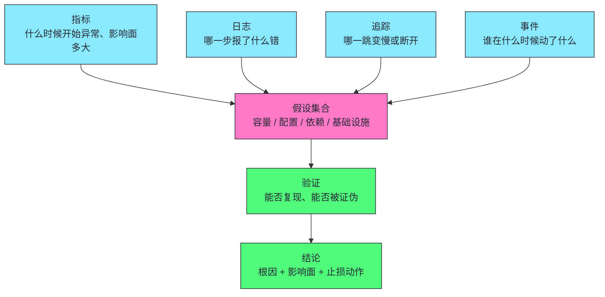
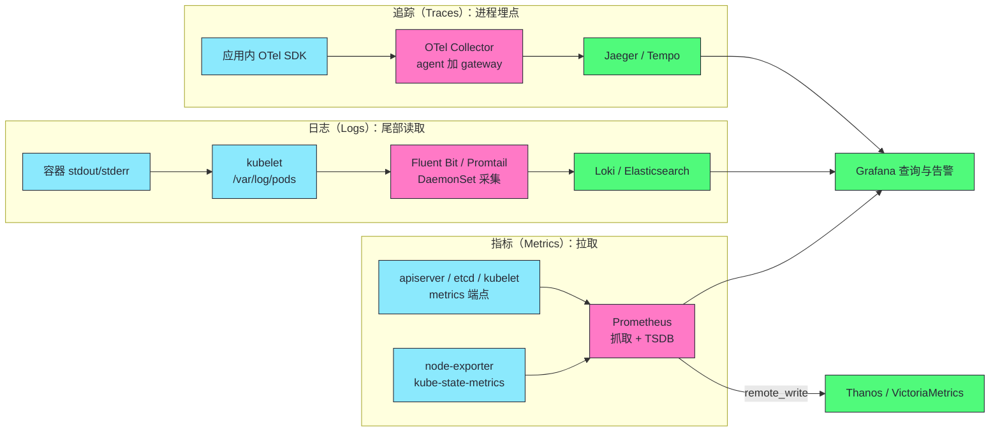
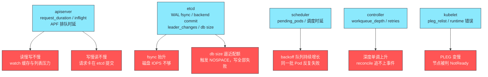
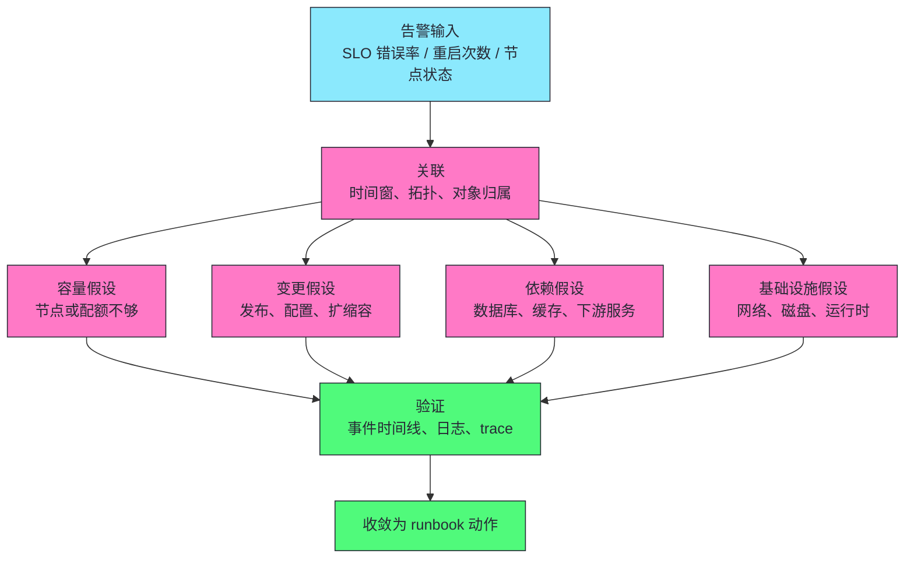
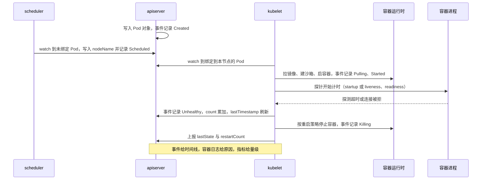

# 17 集群可观测性与故障排查：监控、日志、追踪与诊断

**摘要：**

集群出故障的那一刻，值班的人手上通常只有几块面板和几分钟判断时间，可观测性要解决的正是"该往哪里看"的问题。本文把 Kubernetes 的可观测性拆成四类信号——指标、日志、追踪与事件，逐类说明它们各自回答什么、数据从哪里来、代价落在谁身上；再沿着控制面（apiserver、etcd、scheduler、controller）与数据面（kubelet、容器运行时、探针）两条线，铺开"从症状到根因"的收敛路径。行文按五问推进：这套体系是什么，为什么它长成"四类信号加分层"而不是一块万能大盘，抽掉其中一类会退化成什么样，工程上如何落地，边界又在哪里。中段给出四个黄金信号在 K8s 里的取数位置、控制面关键指标与失效信号的对应关系、一次 Pod 启动失败的信号时序，以及告警从症状指向根因的关联路径；后段回收三处最容易反噬的边界——指标基数、日志成本、追踪采样偏差。落点不在工具清单，而在两处权衡：看得见决定止损的上限，收敛得快决定止损的时间。

---

## 第 1 章 四类信号与三处分叉

### 1.1 一次 Pod 启动失败引出的四组问题

笔者先摆一个贯穿全篇的场景。ordersvc 是一个三副本的 Deployment，跑在自建的 1.37 集群上，某次发布之后只有一个 Pod 反复重启，入口 P99 从 120 毫秒爬到 900 毫秒，值班的人手上只有 Grafana 的几块面板和一个 kubectl。他需要回答四个问题：坏的是哪一个实例，坏在哪一步，坏的时候集群在做什么，这次发布到底动了什么。

四个问题看着是一件事，实际对应四份来源不同的证据。重启次数落在指标里，因为 kube-state-metrics 从 apiserver 的 watch 缓存里把它数了出来；崩溃前最后几十行落在容器日志里，那是由 stdout 写到节点磁盘再被采集走的；探针失败的判定落在 Event 里，那是 kubelet 做出判断后向 apiserver 写的一条记录；慢在哪一跳要看调用链，那由每个进程内的埋点在请求路径上切出来。四份证据分居四个系统，采集点、存储引擎、查询语言、成本模型全不一样，这是后文所有分层设计的起点。

### 1.2 四类信号各自回答什么

把能力边界列清楚，比记住工具名有用。下表按"回答什么、长什么样、从哪里取、回答不了什么"四列铺开，最后两列才是选型时真正要看的。

| 信号 | 回答的问题 | 数据形态 | 取数位置 | 回答不了什么 |
| :--- | :--- | :--- | :--- | :--- |
| 指标（Metrics） | 什么时候开始坏、坏了多少、趋势往哪走 | 带标签的等间隔时序数值 | Prometheus 抓取各组件 `/metrics` | 为什么坏、坏在哪一行代码 |
| 日志（Logs） | 哪一步报了什么错、上下文是什么 | 按时间追加的文本行或 JSON | 节点 `/var/log/pods` 经采集器转发 | 影响面多大、谁还没坏 |
| 追踪（Traces） | 一次请求经过了谁、哪一跳变慢或断开 | 带父子关系与耗时的 span 树 | 应用内 SDK 埋点经 Collector 汇总 | 系统整体是否健康、非请求路径的问题 |
| 事件（Events） | 谁在什么时候对哪个对象做了什么 | 挂在对象上的短生命周期状态记录 | apiserver 的 Event 对象 | 长期趋势、细粒度耗时 |

最容易误解的是事件。它不是日志的一种，虽然长相相似：Event 是 apiserver 里的一等对象，由调度器、kubelet、控制器、节点控制器分别写入，带 `reason`、`message`、`count`、`firstTimestamp`、`lastTimestamp`，默认保留一小时。正因为它是对象，才具备按 involvedObject 检索的能力——某个 Pod 为什么没起来，`kubectl describe` 尾部那一段就够；七天前那次抖动，Event 早就过期了。

> [!info] 核心概念：缺失的不是视图，是可判定的证据
> 排障的每一步都在做"假设—验证"，验证需要能证伪的证据。指标能证伪"是容量问题"，日志能证伪"是配置错"，追踪能证伪"是下游依赖"，事件能证伪"是我看错了时间点"。少一类信号，少的是整整一类判定手段。

### 1.3 为什么是四类信号加分层，而不是一块万能大盘

商业 APM 常把指标、日志、链路叠成一块大盘，点哪都能下钻。演示时很好看，故障现场却很少奏效，原因藏在三处技术分叉里。

第一处分叉在数据模型。时序库的存储单位是"序列"，一条序列由指标名加一组标签唯一确定，压缩靠相邻点差分与标签复用，查询靠倒排索引定位序列，代价随序列数增长。日志的存储单位是"行"，写入是追加，压缩靠分块与重复串消除，查询靠标签缩小范围后扫描内容。追踪的存储单位是"树"，一条 trace 含几十个 span，入口通常是 traceID 或按服务与耗时聚合。三种模型对索引的定义完全不同，塞进一个引擎等于让一套索引同时承担三种访问模式，任何一处优化都会拖慢另外两处。

第二处分叉在采集位置。指标由 Prometheus 主动去拉，拉不到本身就是信息（`up == 0`）；日志由节点上的采集器 tail 文件，天然是"已经发生过"的记录；追踪必须在应用进程里埋点，只有进程自己知道一次调用的起止；事件压根不用采集，它就在 apiserver 里。四个采集点分别位于中心、节点、进程、控制面，物理上无法由同一个 agent 覆盖。

第三处分叉在成本曲线。指标按序列数增长，扩容靠分片与降采样；日志按字节数增长，省钱只有丢弃与缩短保留期；追踪按采样率线性增长，而采样率直接决定"出事时有没有现场"。三条曲线斜率不同，硬凑一个统一账单只会让最贵的那类数据绑架整个体系。

由此才有了**分层**。K8s 的对象模型本身就是分层的：集群、节点、Namespace、工作负载、Pod、容器，而指标的标签体系几乎原样复制了这几层。分层的意义不在画得整齐，而在排障可以沿着层收敛：先确认是单实例、单工作负载、单 Namespace，还是整个节点甚至整个集群，再决定往哪类信号要证据。一块大盘把所有维度平铺，恰恰抽掉了这条收敛路径。

### 1.4 抽掉一类信号会怎样：三个反事实

反事实一：只有指标，没有事件。容器重启计数在涨，曲线很清楚，可它无法区分四种完全不同的故障——节点内存压力触发驱逐、liveness 连续失败被 kubelet 主动杀死、镜像拉取失败后的退避重试、应用启动即 panic。四者在指标上都只是"重启次数上升"，因为指标记录结果而不记录原因；事件里则分别写着 `Evicted`、`Unhealthy`、`Failed`、`BackOff`，`describe` 一眼能分开。缺了事件，值班的人只能猜，猜错方向就会去调内存 limit，而真正的问题是探针超时配得太紧。

反事实二：只有事件，没有指标。Event 默认一小时过期，且只记录离散判断，不记录连续状态。想知道这次故障影响了百分之几的请求、从几点几分开始爬升、是否与昨天的发布窗口重合，只能靠时序数据。事件告诉你"这个 Pod 在 14 点 07 分被杀了七次"，指标才能告诉你"同一时刻错误率是 3% 还是 30%"。

反事实三：只有指标与日志，没有追踪。微服务里最常见的故障形态是"每个服务自己的指标都正常，端到端却慢"，原因往往在依赖调用的长尾——某个下游的 P99 在特定参数下劣化，或者重试把一次超时放大成三次。指标按服务切分，看得见均值；日志按进程切分，看得见每条错误；唯有 trace 把一次请求的三十个 span 排在同一时间轴上，才看得出慢在第 17 跳，而那 200 毫秒里下游只用了 5 毫秒，其余都是重试与排队。**没有追踪就只能靠猜**。

### 1.5 从信号到结论的漏斗

四类信号进到现场，不会自动变成结论，中间要过一道收窄：先用指标锁定时间窗与影响面，再用事件与日志建立假设，最后用追踪或复现做验证。



真正起作用的是中间那层假设集合。四类信号的作用不是拼出一张全景图，而是把假设从四五个压到一两个：指标把时间窗锁在发布后的十分钟内，事件显示同一时刻三个 Pod 被判 `Unhealthy`，日志里那三段都卡在连接池初始化，追踪显示请求在第一个数据库调用处超时——假设只剩"连接池配置在滚动更新时被并发打满"一条，验证只需看重启前后的连接数曲线。

顺序也讲究：先看便宜且覆盖面大的指标与事件，再翻日志，追踪放在最后用于确认而非发现；反过来先翻日志再回头看指标，是新手最常见的低效路径。

### 1.6 成本的形状决定了取舍

可观测性常被当成"装三个组件"的工程，实际它是一份持续付费的账。四类信号的账单位不同：指标按活跃序列数（内存常驻 head block，查询遍历倒排索引），日志按写入字节（对象存储便宜但索引与查询不便宜），追踪按 span 数（采样率一乘就翻倍），事件按写入放大（每条 Event 都是一次 apiserver 写，最终落到 etcd）。

账单位不同，取舍就不能一刀切。合理做法是按"这条路径是否被 SLO 覆盖"分级：被覆盖的关键路径指标全量、日志保留足够长的热窗口、追踪走尾部采样确保错误与慢请求必留；内部工具的指标降采样、日志只留 warn 以上、追踪按头部采样保底。**预算在定义 SLO 时就分配好了**，这也解释了为什么可观测性没法"先上线再补"。

---

## 第 2 章 指标：采集模型与成本边界

### 2.1 拉取模式买的是控制权

Prometheus 用拉（pull）不用推（push），技术后果比它看起来的分量重。采集节奏由 Prometheus 掌握，目标只需在 `/metrics` 暴露端点，不必知道谁在采、多久采一次，也不必本地缓冲。由此得到三样东西：目标端无状态、可以按目标调节超时与间隔、以及 `up` 这个天然健康信号——拉不到就是不可达。

代价同样明确。目标必须从 Prometheus 所在网络可达，跨集群采集要先解决连通性；短生命周期作业跑完就消失，很可能一次都没被抓到；几万个 target 在同一抓取周期形成脉冲式负载，需要靠分片与哈希取模摊开。

短作业的补丁是 Pushgateway，但它常被用错。它是"指标暂存柜"而非队列：推上去的指标会一直留着，直到被同名推送覆盖或被显式删除；不带时间戳校验，也不做过期清理，于是"三小时前那个已经结束的作业"会一直以当前值的面目出现。正确用法是三条：作业结束时 `DELETE` 掉自己那一组、推送时带 `job` 与 `instance` 标签避免互相覆盖、查询侧用 `honor_labels` 与时间过滤挡住陈旧样本。把它当成 Prometheus 的写入端，等于造一个没人打扫的垃圾场。

采集间隔与抓取超时是一对参数。默认间隔 15 秒、超时 10 秒，意味着 10 秒不返回即判失败、失败目标要等下一轮；间隔压到 5 秒精度更高，但写入量与带宽翻四倍，放到 60 秒则把所有短于 60 秒的抖动平滑掉。经验是按 SLO 粒度反推：SLO 窗口五分钟，间隔取 15 秒上下，保证窗口内至少二十个采样点。

### 2.2 服务发现：目标从哪来

K8s 里 Pod IP 随重建而变，写死目标等于自找麻烦。Prometheus 的 Kubernetes 服务发现复用 apiserver 的 list/watch，把 Pod、Service、Endpoints、Node、Ingress 变成候选目标，再由 `relabel_configs` 收窄：只留带 `prometheus.io/scrape=true` 注解的 Pod、只留某个端口名、只留 Running 实例。

两处极易混淆的配置值得说清。`relabel_configs` 作用在抓取之前，改写 target 的标签集合，决定"抓不抓"——一条 `keep` 规则能把不匹配的 target 从服务发现结果里摘掉，此后一次抓取都不会发生。`metric_relabel_configs` 作用在样本入库之前，处理已经抓回的样本，决定"存不存"——丢弃规则只让匹配的序列不进 TSDB，target 本身仍然健康，`up` 依旧是 1。把丢弃规则写进前者的错误极为常见，症状是某个 exporter 莫名从 Targets 页面消失，日志里只有一行 dropped target。

标签冲突由 `honor_labels` 裁决。它默认为 false，服务端配置的 `job`、`instance` 优先生效，目标自带的同名标签被冠以 `exported_` 前缀后保留；设成 true 则反过来，目标自带的 `job`/`instance` 原样保留并覆盖服务端配置。联邦与多集群汇聚时打开它，会把不同集群的同名 job 混成一组，除非目标自带唯一标识，否则不要动这个开关。

### 2.3 基数：压垮 Prometheus 的不是样本数

真正压垮 Prometheus 的不是样本数量而是序列数量，也就是基数（cardinality）。典型来源是把 Pod 名、Pod UID、URL 路径、用户 ID 放进 label——每个不同取值都是一条新序列，head block 常驻内存、倒排索引随标签组合膨胀、查询要遍历的序列数同步上升。更麻烦的是**这种膨胀不可逆**：历史 block 已固化在磁盘上，事后删掉标签定义也收不回来，只能删数据或重建库。

`sample_limit` 是一道硬闸门：单次抓取样本数超限时整个 target 被标记为抓取失败，而不是截断到上限继续。它保护的是 Prometheus 自身的内存，代价是被保护对象直接失去监控，阈值设小了会误伤正常 target。配套的还有 `label_limit` 与 `label_value_length_limit`，三者的取舍方向一致：宁可让一个目标失败，也不让整库被拖垮。

于是标签设计要定在埋点之前。三条规矩：能枚举的才做标签（`status`、`method`、`reason`），高势标识（`trace_id`、`order_id`、URL 路径）只能进日志或 Exemplar；集群级信息用静态 `external_labels` 统一注入，不要每个 exporter 各写一遍；Pod 名这类随重建变化的值，若确实需要就只保留 `pod` 与 `namespace` 两级，别把带随机后缀的名字当维度。

### 2.4 两条采集链的分工

`kube-state-metrics` 与 `metrics-server` 常被当成同一类东西，实际分工完全不同。前者从 apiserver 的 list/watch 生成对象状态指标，譬如期望副本数与可用副本数、Pod 的 phase、PVC 的绑定状态，回答"集群认为该是什么样、实际又是什么样"；后者是 apiserver 的聚合 API（`metrics.k8s.io`），数据取自各节点 kubelet 的 summary 接口，只提供 CPU 与内存这类 resource metrics，供 HPA 与 `kubectl top` 使用，内存里只保留很短的窗口。用 metrics-server 做容量趋势是极常见的误用，它的历史只有几分钟，进程一重启就归零。

| 组件 | 数据来源 | 能回答 | 不能回答 |
| :--- | :--- | :--- | :--- |
| kube-state-metrics | apiserver list/watch 的对象状态 | 期望与实际副本数、Pod 状态、PVC/Service 状态 | 实际 CPU 与内存用量 |
| metrics-server | 各节点 kubelet 的 summary 接口 | 当前用量，供 HPA 与 `kubectl top` | 历史趋势、容量规划 |
| cAdvisor（kubelet 内嵌） | 节点 cgroup 与运行时统计 | 容器级 CPU、内存、网络、文件系统指标 | 对象语义（谁是期望、谁是实际） |
| Node Exporter | 宿主机 `/proc`、`/sys` | 节点 CPU、内存、磁盘、网络 | 容器与 Pod 维度的拆分 |

跨集群汇聚要经过 `remote_write`，链路里有一个预写日志（write-ahead log，WAL）和一组发送队列。队列满时样本被丢弃而不是无限堆积，丢弃与失败都有计数器可查，跨地域写入尤其要盯住 `queue_config` 的 `capacity`、`max_shards` 与 `max_backoff`——跨洋链路的往返延迟会把队列填满的时间从分钟压到秒级。

下图把三条采集链摊在一张图上：指标走拉取、日志走节点文件、追踪走进程埋点，三条链最终在 Grafana 侧汇合，存储与查询各走各的。



### 2.5 四个黄金信号在 K8s 里的取数位置

Google SRE 的四个黄金信号——延迟、流量、错误、饱和度——在 K8s 里最大的问题不是"不知道有这四个"，而是每类信号都有好几个来源，选错来源会让告警失去意义。

| 信号 | 说明与 PromQL 示例 | 在 K8s 的取数位置 | 常见坑 |
| :--- | :--- | :--- | :--- |
| 延迟 | 请求响应时间，`histogram_quantile(0.99, ...)` | 入口网关或应用 SDK 的 histogram；控制面自身的请求时延 | 只看均值；桶边界过粗，分位数退化成插值猜测 |
| 流量 | 请求量，`rate(http_requests_total[5m])` | 业务 counter 的 rate；Pod 网络字节 | 用 `increase` 处理重启归零会低估 |
| 错误 | 错误率，`rate(http_errors_total[5m])` | 入口 5xx 计数；`apiserver_request_total` 的返回码 | 把 4xx 算进错误率；把探针导致的 503 当业务缺陷 |
| 饱和度 | 资源使用率，`cpu_usage / cpu_limit` | 容器工作集与 limit 的比值；节点 allocatable；控制面排队 | 用 usage 代 working set；只看使用率而忽略 CFS 节流 |

延迟最值得展开。延迟不是一个数而是一条分布：P50 描述大多数人体验到什么，P99 描述最慢那一百个人遇到什么，而 SLA 通常承诺的恰恰是后者。Prometheus 的 histogram 只保存桶计数，`histogram_quantile` 在桶内做线性插值，桶边界不合理时 P99 可能落在"1 秒到 10 秒"这种跨度过大的桶里，算出来的值几乎等于猜。经验是按 SLO 门槛布桶：要求 99% 请求在 300 毫秒内返回，那么 250ms、300ms、500ms 这几个边界必须存在。

饱和度在容器场景要额外小心两处。其一是 CPU 节流：`container_cpu_usage_seconds_total` 反映用掉多少，`container_cpu_cfs_throttled_seconds_total` 反映被限流多久，后者才是"延迟为什么抖"的直接证据；limit 设得紧、request 设得松，就会出现使用率看着只有 40% 而 P99 已经开始爬的怪现象。其二是内存的两个口径：`container_memory_usage_bytes` 含页缓存，`container_memory_working_set_bytes` 才是内核判定 OOM 的依据，用前者算水位会系统性高估。

### 2.6 控制面与 kubelet 的关键指标

控制面的指标不像业务指标那样可以"看趋势"，它更像一组判据：某个值一旦越过物理边界，集群就会以确定的方式退化。

| 组件 | 关键指标 | 越界后的失效信号 | 判据 |
| :--- | :--- | :--- | :--- |
| apiserver | `apiserver_request_duration_seconds`、`apiserver_current_inflight_requests` | 读写一起慢，APF 排队时延抬升 | 读请求 P99 超过 1 秒且 inflight 顶格 |
| etcd | `etcd_disk_wal_fsync_duration_seconds`、`etcd_server_leader_changes_seen_total` | 只有写慢，leader 切换期间写入全失败 | fsync P99 超过 10 毫秒要查盘，超过 100 毫秒可判盘不足 |
| scheduler | `scheduler_pending_pods`、`scheduler_e2e_scheduling_duration_seconds` | Pending 堆积，backoff 队列增长 | unschedulable 队列非零且持续一分钟 |
| controller | `workqueue_depth`、`workqueue_longest_running_processor_seconds` | reconcile 落后，对象状态与期望长期不一致 | 深度单调上升超过十分钟 |
| kubelet | `kubelet_pleg_relist_duration_seconds`、`kubelet_runtime_operations_errors_total` | 节点 NotReady，探针与状态上报滞后 | relist 从毫秒级爬到秒级 |
| Pod | `container_memory_working_set_bytes`、`kube_pod_container_status_restarts_total` | OOMKilled、反复重启 | 工作集贴近 limit，重启计数持续上升 |

下图把这些指标与失效信号连起来，便于现场按"哪个信号亮了"直接跳到对应处置方向。



apiserver 一侧要分清两类延迟。`apiserver_request_duration_seconds` 按 verb、resource、scope 分了标签，读请求大多命中 watch 缓存，写请求必须落到 etcd，因此"读慢写不慢"与"写慢读不慢"指向不同根因：前者通常是缓存失效或大量 list（典型是控制器同时重新 list），后者直接把嫌疑转给 etcd。并发侧看 `apiserver_current_inflight_requests` 与 **APF**（API Priority and Fairness，较新版本已 GA）的 `apiserver_flowcontrol_request_wait_duration_seconds`，后者抬升说明低优先级请求正在排队让路。

etcd 一侧的判据更硬。`etcd_disk_wal_fsync_duration_seconds` 是 WAL 落盘耗时，`etcd_disk_backend_commit_duration_seconds` 反映后端批量提交；`etcd_server_leader_changes_seen_total` 出现非零增长就值得追——Raft 在一轮选举期间无法提交写，表现为写请求全部超时。还有一处后果最严重：后端库的 `db size` 逼近配额（默认 2GiB）时触发 NOSPACE，此后所有写请求返回 `mvcc: database space exceeded`，集群进入**事实上的只读状态**——Pod 不能创建、Deployment 不能滚动，而已运行的工作负载看起来一切正常。解局要先 `compact` 再 `defrag`。

scheduler 看队列而不是看延迟。`scheduler_pending_pods` 按 active、backoff、unschedulable 三个队列分别暴露：active 堆高说明调度吞吐跟不上 Pod 创建速度；backoff 增长说明一批 Pod 反复调度失败后进入退避，根因多在节点侧；unschedulable 是确认调度不出去的 Pod，直接看 `FailedScheduling` 的原因。

controller 看 workqueue。`workqueue_depth` 是待处理深度，`workqueue_adds_total` 是入队速率，`workqueue_longest_running_processor_seconds` 是当前最久的处理耗时。判据很直观：深度单调上升意味着处理速度长期低于事件产生速度，典型原因是 reconcile 里做了同步远程调用；`longest_running_processor_seconds` 贴着几十秒不动，通常说明某个 reconcile 卡在 apiserver 请求或网络调用上。

### 2.7 kubelet、PLEG 与探针的观测面

kubelet 指标里最容易被忽略、后果又最严重的是 **PLEG**。PLEG（Pod Lifecycle Event Generator）以固定周期向运行时 relist 一遍所有容器状态，把差异转成事件喂给主循环；`kubelet_pleg_relist_duration_seconds` 记录这次 relist 的耗时，正常是毫秒级。一旦运行时卡住（CRI 调用阻塞、磁盘 IO 打满、进程数暴涨导致 fork 变慢），relist 会从毫秒爬到秒级，kubelet 随之无法及时更新状态，探针与状态上报全部滞后，最终节点心跳超时被判 NotReady，日志里留下 `PLEG is not healthy`。这条链路解释了为什么"节点 NotReady"常与"应用没改任何东西"同时发生：坏的不是应用，是节点上的运行时。

配套还要看 `kubelet_runtime_operations_errors_total`、`kubelet_pod_start_duration_seconds`（镜像拉取慢直接体现在这里）、`kubelet_running_pods` 与 `kubelet_volume_stats_available_bytes`；它们描述的是"节点的执行能力"而非"应用的健康状况"，混进业务告警里，节点一退化就会收到一堆应用告警。

容器指标由 kubelet 内嵌的 cAdvisor 提供，暴露在 `/metrics/cadvisor`，数据来自节点 cgroup 与运行时统计，以 `container_` 前缀区别于 kubelet 自身指标。它的采集是固定周期轮询，因此**峰值可能落在采样间隙**——一个两百毫秒的分配尖峰把容器顶到 limit 被杀，而采样点上曲线纹丝不动。这就是"OOMKilled 但监控里内存没满"的技术来源，处理办法不是提高采样频率（成本翻倍），而是看 `container_oom_events_total` 这类内核事件计数器与 `kube_pod_container_status_last_terminated_reason` 这类对象状态指标。

---

## 第 3 章 日志：三种采集形态与成本的落点

### 3.1 节点上的那一份日志

K8s 对日志只做了一条约定：容器把日志写到标准输出与标准错误，由运行时落盘，kubelet 再把文件暴露出来。路径是 `/var/log/pods/<namespace>_<pod>_<uid>/<container>/`，内容按 CRI 格式逐行记成"时间、流、标签、正文"。这条约定换来了统一的采集入口，代价是把日志的可靠性绑在了节点磁盘上。

轮转由 kubelet 负责，两个参数决定日志能活多久：`containerLogMaxSize` 默认 10MiB，`containerLogMaxFiles` 默认 5 个。合起来意味着单个容器最多保留约 50MiB 的近期日志。这个额度对正常服务勉强够用，对两类场景必然不够：启动即崩的应用在退避循环里反复打印，几十轮下来把窗口冲干净；带 DEBUG 级别的高频访问日志同理。前者正是 `kubectl logs --previous` 有时也看不到现场的原因——崩溃前的日志已被轮转覆盖。

`kubectl logs` 的路径值得说清，它解释了这条命令的边界：请求从 apiserver 转发到目标节点上的 kubelet，kubelet 直接读文件流式返回；`--previous` 读的是上一次容器实例留下的文件（容器重启时旧文件被改名保留）。于是两个限制随之而来：只能看当前节点上的那几份文件，只能看轮转窗口内的内容。跨节点、跨时间窗的检索必须依赖把日志搬到中心存储的那条链路，所以"日志采集"在 K8s 里不是可选组件，而是排障能力的基础设施。

Pod 删除时 kubelet 清掉对应目录，日志与 Pod 生命周期同步终结：**日志随 Pod 一起消失**。对策不是加大轮转额度，而是保证"写盘即转发"，让中心存储成为唯一可信副本。

### 3.2 三种采集形态

采集器放在哪里，决定了隔离性、成本与运维复杂度的三角关系。三种形态都有人用，差别不在优劣而在前提。不妨打个比方：DaemonSet 像每层楼装一台公共饮水机，谁都能接，维护只改一处；Sidecar 像给每个工位配一台净水器，干净到户，但每台都得单独交电费；Node Agent 则像楼外那口自备水井，平时最不起眼，管网出问题时它还在。

| 形态 | 部署对象 | 优势 | 代价 | 适用前提 |
| :--- | :--- | :--- | :--- | :--- |
| DaemonSet（Fluent Bit / Fluentd / Promtail） | 每节点一个 Pod，挂载 `/var/log/pods` | 开销随节点数线性、与 Pod 数量无关；一份配置管全节点 | 采集器能读到本节点所有租户的日志，隔离只能靠后续环节 | 集群以自建为主、租户之间互信 |
| Sidecar | 每 Pod 追加一个采集容器 | 隔离到容器级，可按租户定制解析与多路输出 | 每 Pod 一份常驻内存与 CPU，与业务争抢；短生命周期 Pod 上性价比极低 | 强隔离要求、按应用定制处理链 |
| Node Agent（Vector / Filebeat 等） | 宿主机进程或系统服务 | 不经调度，节点故障时可先落盘再补传 | 与节点生命周期耦合，升级要动主机 | 有主机配置管理能力、追求稳定写入 |

三者的取舍可以概括成：DaemonSet 买的是"一份配置管全部"，Sidecar 买的是"一条日志不外泄给邻居"，Node Agent 买的是"节点上最后一道缓冲"。生产里最常见的组合是二级架构：节点侧用轻量的 Fluent Bit 或 Promtail 只做"读文件、加标签、转发"，集群侧用少量副本的 Fluentd 或 Vector 做解析、脱敏、分流与批量写出。收益有两处，一是把后端连接数从"节点数"降到"聚合副本数"，二是把易变的解析规则从节点侧剥离，改规则不必滚动重启整个 DaemonSet。

多租户过滤要分清两件事。**过滤是成本手段而非隔离手段**：按 namespace 注入 `tenant` 标签、用 drop 规则丢掉健康检查日志、用正则把 token 换成占位符，降低的是存储量与泄露面，但采集器仍能读到全部日志，拿到采集器权限的运维照样能读邻租户的内容。真正的隔离必须落在存储与查询层：Loki 用 `X-Scope-OrgID` 做租户分片并配 per-tenant 限额，Elasticsearch 按租户分索引加角色过滤，或者在网关层把租户身份写进查询条件而应用侧不可覆盖。

日志采样要按流分流而非按行随机：健康检查与访问日志只留聚合统计，错误与警告全留，审计性质的日志全留；随机采样会把一次异常的十行拆成三行，现场就不完整了。

### 3.3 结构化日志：把可查询的字段留在写入侧

非结构化日志的问题是查询只能靠全文匹配：一行 `GET /api/users 200 50ms` 要统计"status=500 的比例"，得写正则抠位置，格式一变规则就废。结构化日志把路径反过来——写入时按字段拆分，查询时按字段过滤与聚合。

```json
// 非结构化日志：只能全文匹配，字段靠正则抠
2026-11-19 10:00:00 GET /api/users 200 50ms

// 结构化日志：字段可直接过滤，trace_id 可与追踪对齐
{"ts":"2026-11-19T10:00:00Z","level":"info","logger":"http.access","method":"GET","path":"/api/users","status":200,"duration_ms":50,"trace_id":"4bf92f3577b34da6a3ce929d0e0e4736","span_id":"00f067aa0ba902b7"}
```

结构化不是把所有东西都塞进 JSON。每个字段都要付写入字节与索引成本，只把"将来会用来过滤或聚合"的字段单列，其余留在 `msg` 或 `detail` 里保留原文。真正的分水岭在那两个追踪字段：`trace_id` 与 `span_id` 必须来自上游请求头解析（W3C 的 `traceparent`），本地随机生成的 ID 只能串起同一进程内的日志，跨服务关联时一文不值。

K8s 自身组件在这一点上走得比多数自研应用早。自 1.19 进入 Beta、较新版本已 GA 的结构化日志，让 kubelet、kube-apiserver、scheduler 可以用 `--logging-format=json` 输出带固定字段（`ts`、`level`、`msg`、`logger`、`v`）的 JSON，采集侧不必再维护一堆正则。组件日志的 `v` 级别还提供了运行期调高能力，排查控制面疑难时只对某个组件临时打开 verbose 即可，不必重启整个集群。

### 3.4 审计日志：四档 level 与它的代价

审计日志（Audit Log）不是应用日志，它记录"谁、在什么时间、通过 apiserver 对哪个对象做了什么、结果如何"，是 K8s 里取证价值最高、也最容易被配错的一类记录。粒度由审计策略的 level 控制，四档之间是成本与信息量的直接交换。

| level | 记录内容 | 典型用途 | 成本 |
| :--- | :--- | :--- | :--- |
| `None` | 不记录 | 排除高频且无取证价值的请求（健康检查、watch 心跳） | 无 |
| `Metadata` | 用户、来源 IP、verb、资源、Namespace、响应码、耗时 | 全集群默认档，够做行为基线与异常检测 | 低，单条约几百字节 |
| `Request` | Metadata 加请求体 | 追查"谁改了什么配置"，如 Deployment、ConfigMap 的变更 | 中，取决于请求体 |
| `RequestResponse` | Request 加响应体 | 敏感资源取证，如 Secret、RBAC 的读取 | 高，且会把凭据内容写进日志 |

判据是"谁能读到这份日志"。全集群配成 `RequestResponse`，等于把所有 Secret 明文与 Token 返回值复制进一份长期保留的文件，这份文件自身的访问控制就成了新的攻击面；只配 `Metadata`，遇到"某个 ServiceAccount 凌晨批量删 Pod"就只能看到动作看不到意图。合理做法是按资源分档：`secrets`、`configmaps`、`rbac.authorization.k8s.io` 与认证相关资源用 `RequestResponse` 且保留较短周期，普通资源的写操作留 `Request`，读操作留 `Metadata`，高频无害请求直接 `None`。

落盘侧有两个必须显式设置的开关。审计日志是追加写，轮转与保留要靠 `--audit-log-maxsize`、`--audit-log-maxbackup`、`--audit-log-maxage` 约束，不设就等于交给磁盘容量兜底；更稳的做法是用 webhook 后端把审计事件推给外部日志系统，让 apiserver 只负责产生而不负责保存，避免审计写盘反噬控制面自身的 IO。

### 3.5 Loki 与 ELK：索引策略决定成本

日志后端的选型几乎完全由索引策略决定。Loki 只索引标签、不索引正文，ELK 建全文倒排索引，这处差异沿着成本、查询能力、运维复杂度三条线放大。

| 维度 | Loki | ELK |
| :--- | :--- | :--- |
| 索引对象 | 仅标签（namespace、pod、container 等） | 全文字段与标签 |
| 存储成本 | 低，正文压缩后进对象存储 | 高，倒排索引常与原文同量级甚至更大 |
| 查询能力 | LogQL，标签过滤加行内扫描 | 全文检索、复杂聚合、Kibana 可视化 |
| 多租户 | 原生按 `X-Scope-OrgID` 分片并配限额 | 靠索引划分与角色过滤自行实现 |
| 运维复杂度 | 组件少，可与 Grafana 共用查询入口 | 集群规划、分片副本、索引生命周期都要专人 |

Loki 的查询模型解释了两类查询的成本差异：先按标签在索引里定位到时间区间对应的日志块（chunk），再在块内做行过滤与解析，所以标签选得越窄越快，而"跨全集群搜一个错误字符串"会把大量块拉出来扫，慢且贵。LogQL 因此被设计成 PromQL 的形状：`{namespace="production"} |= "timeout"` 是过滤，`| json` 是解析，`rate({...}[5m])` 是把日志计数变成指标——最后这条尤其有用，它让"某类错误每分钟出现多少次"直接进告警规则，不必先把它做成埋点。

选型的落点在查询形态而非强弱：以"按对象、按时间窗定位日志"为主的排障用 Loki 更省，需要全文检索与跨部门报表的场景只能上 ELK；混合方案代价是两套采集与两份存储。

---

## 第 4 章 追踪：传播、采样与采样偏差

### 4.1 一次请求如何被串起来

追踪的最小单位是 span，一个 span 记录一次操作的名字、起止时间、属性与状态，span 之间通过父子关系组成树，整棵树由同一个 traceID 标识。跨进程传播靠把 traceID、当前 spanID 与采样标志塞进请求头，下游解析后以父 span 的身份继续。

K8s 里这件事有几处固定的难点，与部署形态强相关。

| 挑战 | 具体表现 | 应对 |
| :--- | :--- | :--- |
| 跨 Pod 传播 context | header 丢失后下游新起一条 trace | 统一 W3C `traceparent`，在框架层透传而非业务层手写 |
| Sidecar 不可见 | Mesh 能生成网络层 span，应用内逻辑仍空白 | 依赖 Envoy 侧 span 拼拓扑，关键路径保留应用内埋点 |
| 异步消息 | 生产者与消费者断成两条互不相干的 trace | 消息头写入 context，消费端恢复后再开子 span |
| 数据库调用 | 驱动不支持自动埋点 | 换成支持 OTel 的驱动或用代理补 span |

W3C 的 `traceparent` 携带 trace-id、span-id 与采样标志，`tracestate` 携带厂商扩展；HTTP 走 header，gRPC 走 metadata，跨协议时要显式转换，否则 header 一丢，SDK 就在下游新起一条 trace，链路从这一跳断成两截。**链路断裂在监控上几乎无感**，排障时却是致命的——你会看到两条各自完整、互不相干的短链路，然后误以为这是两个独立请求。

异步链路最容易断：Kafka 生产者必须把 context 写进消息头，消费者再从中恢复，否则消费端开一条新 trace，生产者侧的 span 再完整也接不上。Service Mesh 能补一部分——Envoy 之类的 sidecar 会为进出流量生成 span 并转发 header，应用不改代码也能拿到网络层调用关系，但补不了应用内部逻辑，也补不了自己吞掉 header 的自研框架。

元数据补齐是另一件事。`k8sattributes` processor 从 Pod 元数据补 `k8s.pod.name`、`k8s.namespace.name`、`k8s.node.name`，靠 apiserver 的 Pod watch 与 IP/UID 关联规则匹配，比让每个应用自己埋这些字段可靠得多——应用通常并不知道自己被 ReplicaSet 派生的那个名字，重启一次就换一个。

### 4.2 头部采样与尾部采样

头部采样在请求入口就做决定，`ParentBased(TraceIDRatioBased(0.01))` 是最常见的组合：根 span 由 traceID 的哈希取模决定去留，子 span 一律跟随父 span，于是一条 trace 要么全采、要么全不采，服务之间不需要协商——采样率是配置项而不是运行状态，这是它能在每个进程里独立执行的原因。缺陷同样直接：错误与慢请求往往只占极小比例，1% 采样下可能一条都没采到，**等到出事时恰恰没有现场**；提到全量又回到成本问题，这正是尾部采样存在的理由。

尾部采样把整条 trace 在 Collector 里缓冲完，再按"有错误、超时、特定属性"决定是否保留，关键链路因此能被保住。代价是同一个 trace 的所有 span 必须汇到同一个 Collector 实例，通常按 traceID 做一致性哈希（consistent hashing）负载均衡，`loadbalancing` exporter 的 `routing_key: traceID` 就是干这个的；缓冲本身要占内存，`decision_wait` 越长判断越准、内存压力越大。一旦 trace 被分散到多个实例，每个实例只看到片段，基于"整条链路是否出错"的判断随之失真——尾部采样的有效性直接依赖路由的正确性。

### 4.3 采样偏差：被采到的样本不能当总体

采样会引入偏差，把追踪数据当指标用时后果最重。头部采样按 traceID 均匀抽样，样本在请求总量上无偏，但在长尾延迟上有偏——慢请求占比小，1% 采样后整段窗口可能一条都没有，于是从 trace 算出的 P99 会系统性偏低，看起来比实际更健康。尾部采样反过来：它刻意保留错误与慢请求，样本在延迟分布上被严重高估，用它算平均延迟会得出"系统一直很慢"的结论。

笔者以为，追踪数据只回答"这一条请求发生了什么"，不回答"整体水平如何"。百分比、分位数、错误率必须回到指标侧，trace 里被保留下来的现场，作用是把指标里那个异常点解释清楚。这也是 exemplar（样本标记）的价值：histogram 的桶上可以挂 exemplar，记录"这个桶里有哪几条 traceID"，于是从分位数尖峰能直接跳到对应 trace，两条数据各自的偏差都不会污染对方。

### 4.4 OTel Collector 的三种部署形态

OpenTelemetry 的 Collector 是可观测性链路里唯一"位置可移动"的组件，它接收 OTLP 或兼容协议的数据，过 processor 加工，再由 exporter 写出。放在哪里，决定了它能做哪些加工。

| 形态 | 部署对象 | 适合承担的职责 | 代价 |
| :--- | :--- | :--- | :--- |
| agent（DaemonSet） | 每节点一个 | 采集节点与容器指标、读节点日志、用 `k8sattributes` 补元数据 | 每节点一份资源；配置变更要滚动整个 DaemonSet |
| gateway（Deployment） | 少量副本加 Service | 尾部采样、批量导出、跨集群汇聚、统一鉴权限流 | 多一跳网络；traceID 哈希路由必须与副本数对齐 |
| sidecar（与应用同 Pod） | 每个工作负载一个 | 强隔离、按租户分流、应用无感知的出入口代理 | 资源随 Pod 数线性增长，与业务争抢 CPU |

主流落地是 agent 加 gateway 的两级结构：agent 贴近数据源只做轻量加工，gateway 承担重活。技术理由是内存——尾部采样要按 `decision_wait` 缓冲整条 trace，占用与"每秒 trace 数乘等待时长"成正比，放在每节点一个的 agent 上，几十个 agent 各缓冲一份，总量远超一份 gateway。`memory_limiter` processor 因此在两级都要配，它按软硬阈值拒绝或丢弃数据，防止 Collector 自己被 OOMKilled——这本身就是一个反讽：用来观测别人内存的组件，自己先因为内存挂了。

---

## 第 5 章 告警：从症状到根因

### 5.1 口径比阈值更能决定告警质量

一条告警是否可信，九成取决于指标口径，一成取决于阈值高低。口径错了，阈值怎么调都是在两种错误之间摆动。

窗口是最先要对齐的参数。`rate(http_requests_total[5m])` 的 5 分钟窗口必须覆盖至少四个采集间隔，否则窗口内点数太少，速率呈锯齿状跳变，告警随采集抖动而响；拉到 30 分钟，一次 30 秒的突发会被平均掉，等告警响时故障已经自愈或已经扩散。经验值是窗口取采集间隔的 4 到 12 倍，并在规则里显式写出这个关系。

`for` 的持续时间是第二道闸门。瞬时越线是噪声，持续越线才是故障；`for: 5m` 意味着条件连续成立五分钟才通知，代价是发现延迟增加五分钟。两个参数要一起调：窗口短而 `for` 长，是用时间换稳定；窗口长而 `for` 短，是慢变量之上又叠了一层延迟。

第三处是"没有数据"这种故障形态。阈值型告警全部失效于同一个盲区：序列消失时，`> 0.9` 这类条件根本不成立，于是采集器挂了、目标被移出服务发现、Pod 被删掉，告警反而静默。补这个洞要专门的规则，`absent(up{job="kubelet"} == 1)` 检测"连序列都没了"，`up == 0` 检测"抓取失败"。**监控系统自身的健康要独立兜底**，否则最危险的一次故障恰恰是最安静的一次。

第四处是分位数的用法。`histogram_quantile` 只能对桶计数插值，不能对已算出的 P99 再求平均，也不能跨实例平均后再取分位；多实例服务要先 `sum by (le)` 聚合桶再算分位。SLO 场景更适合用错误预算燃烧率（burn rate）——"过去一小时错误率是预算允许值的 14.4 倍"比"错误率大于 1%"更能反映用户受损速度。

### 5.2 从症状到根因的关联路径

告警本身只是症状。错误率上升、Pod 反复重启、节点 NotReady，这三类通知都不指向根因，指向根因的是"关联"这一步：把告警按时间窗、拓扑关系与对象归属聚到一起，才看得出它们是不是同一个事件的不同侧面。



关联靠三个维度落地。时间维度最便宜：同一分钟内的告警按开始时间排一遍，先响的往往是根因，后响的是被牵连的——节点磁盘满先响，其上的 Pod 探针失败后响。拓扑维度靠标签：`sum by (node)` 一聚合就能看出"这个节点上的所有 Pod 是否同时异常"。对象归属维度靠 Event：同一 `involvedObject` 上的事件按时间排开，就是这次故障的操作记录。

这张图还规定了抑制规则的写法。抑制的本质是"根因成立时让症状闭嘴"，所以规则必须建立在拓扑上——`NodeNotReady` 抑制该节点上所有 Pod 告警，`KubePodNotReady` 抑制该 Pod 的探针告警；建立在时间上的抑制看似通用，实际会把真正独立的故障一起吞掉。

> [!warning] 生产避坑：没有 runbook 的告警是把定位成本转嫁给凌晨值班的人
> 一条告警至少要说清三件事：它意味着什么、第一步查哪个面板或哪条命令、什么条件下升级到人工介入。这三件事写在告警规则的 annotation 里（`summary`、`description`、`runbook_url`），随规则一起做版本管理，规则改了 runbook 必须在同一次提交里改。写不清处置动作的告警，说明它测的不是可操作状态，应该降级成看板信息而不是通知。

### 5.3 AlertManager 的四个动作

告警从指标变成通知，要经过四个动作，每一个都在对抗同一种失败模式——信息过载。就好比一栋楼的消防警报同时响遍所有楼层，真正起火那一层的铃声反而听不出来。

分组（grouping）按标签把同批告警合并成一条通知。`group_by: [namespace, alertname]` 意味着同一 Namespace 里二十个 Pod 同时探针失败只发一条，通知里写"20 个实例"。粒度是一处取舍：分得太细，通知量与告警量成正比；分得太粗，一条通知里混进互不相关的故障，值班的人又要手工拆分。

抑制（inhibition）按规则压制次要告警，形如"当 `NodeNotReady` 存在时，压制该节点上匹配的告警"。它是降低风暴最有效的手段，也是唯一会造成漏看的手段——规则写错，被压制的可能是真正的根因。因此抑制规则只应基于明确的上游关系，并定期回看"被压制的告警里有多少事后被证明是独立的"。

静默（silencing）是人工的临时屏蔽，用于已知维护窗口或已确认无害的噪声，最大风险是遗忘，与变更单绑定（变更结束即到期）比靠人记可靠。路由（routing）按标签把通知送到不同接收端：`severity=critical` 走电话，`severity=warning` 走即时消息；路由树要与组织中枢对齐，否则告警会发给不拥有该服务的人，而收到的人会习惯性忽略。

---

## 第 6 章 故障排查：从具体到通用的收敛

### 6.1 Pod 级取证

排障的入口几乎永远是 Pod，因为绝大多数故障的可见形态都停在 Pod 状态上。取证顺序是固定的：先看状态与调度结果，再看事件，再看日志，最后进容器。

```bash
# 1. 看状态与所在节点：先确认它压根有没有被调度
kubectl get pod <name> -o wide

# 2. 看事件：kubelet 与调度器把判定写在这里，事件保留一小时
kubectl describe pod <name>

# 3. 看日志：--previous 读上一次容器实例的文件，崩溃现场只在它里面
kubectl logs <name>
kubectl logs <name> --previous

# 4. 进容器确认运行时状态：环境变量、挂载、监听端口
kubectl exec -it <name> -- /bin/sh

# 5. 看容器状态机的细节：lastState、exitCode、restartCount
kubectl get pod <name> -o jsonpath='{.status.containerStatuses}'
```

第 2 步读到的就是事件。`describe` 尾部那一段来自 etcd 里的 Event 对象，由调度器（`FailedScheduling`、`Scheduled`）、kubelet（`Pulling`、`Started`、`Unhealthy`、`Killing`）与节点控制器（`Evicted`、`NodeNotReady`）分别写入，`reason` 是机器可读的类型，`message` 是人可读的解释——Pod 起不来的绝大多数情况，答案已经写在事件里。事件还有两处机制：其一是聚合，同一 involvedObject、同一 reason、同一 message 不会无限追加，而是累加 `count` 并刷新 `lastTimestamp`，于是 `describe` 里那行 "Back-off restarting failed container, 7 times" 是七次重试的合并结果。其二是生存期：默认一小时过期，且 Event 的写入经 apiserver 落盘，大规模集群里高频对象会产生可观的写放大。这也是严肃集群会部署 event-exporter 的原因——既为长期留存，也为给 apiserver 减负。

`--previous` 的边界可以补一条判据：连 `--previous` 都为空，说明容器根本没跑起来过（镜像拉取失败、命令不存在、挂载失败），该看事件；有内容而当前日志为空，说明容器在启动早期退出，重点看退出码。

init 容器是最容易被漏掉的一层：它串行执行，任一失败都会让主容器停在 `PodInitializing`，而 `kubectl logs <pod>` 默认只打主容器，现象就是"日志一片空白、Pod 一直不 Ready"；要看的是 `kubectl logs <pod> -c <init-container>`。

### 6.2 探针：三兄弟与它们制造的连锁故障

探针是 K8s 里配置成本最低、配错概率最高的字段。三种探针职责不同，失败后果也完全不同。

| 探针 | 回答的问题 | 失败后果 | 是否重启容器 | 是否摘除流量 |
| :--- | :--- | :--- | :--- | :--- |
| liveness | 这个容器还活着吗，需要重来一次吗 | 按重启策略杀死并重建容器 | 是 | 否 |
| readiness | 这个实例现在能接流量吗 | 从 Service 的 Endpoints 中摘除 | 否 | 是 |
| startup | 启动完成了没有 | 判定启动失败，杀死容器 | 是 | 否 |

默认参数决定了灵敏度：`periodSeconds` 10 秒、`timeoutSeconds` 1 秒、`failureThreshold` 3 次、`successThreshold` 1 次。翻译成行为就是：连续 30 秒探测失败才动手，单次探测必须在 1 秒内返回。这组默认值对普通 HTTP 服务够用，对启动慢、有 GC 停顿、事件循环会被长任务阻塞的应用都过于激进。

探针的执行位置也要说清。kubelet 在节点上发起 `httpGet` 或 `tcpSocket` 探测，目标地址是 Pod IP，这条路径要经过节点路由与 CNI，可能还要经过 NetworkPolicy 判定；`exec` 探针在容器内 fork 进程执行命令，会消耗该容器的 CPU 配额——CPU 贴着 limit 时，探针自己就可能因 CFS 节流而超时。这是一个自指的陷阱：越忙的实例越容易被判死，而被杀掉重启恰好是它最不需要的处置。

第一种连锁故障是 liveness 过紧引发的重启风暴。滚动发布期间新副本要预热缓存、建连接池、加载模型，CPU 与内存都在高位，liveness 的超时很容易被踩破；kubelet 杀掉容器，重启后从头预热，形成"启动—超时—杀死"的循环，`restartCount` 一路涨到 CrashLoopBackOff。由于重启不是驱逐，PodDisruptionBudget 保护不了它。修法不是调大 `timeoutSeconds`，而是把"启动阶段不该被杀"交给 startup probe。

第二种形态是 readiness 与依赖耦合引发的摘流雪崩。把 readiness 写成"检查数据库连通性"，本意是依赖断了别接流量，实际效果是数据库抖三秒、全部实例同时摘流，上游把请求打到剩余实例（或者没有实例可打），本来只是慢查询，最终变成整站 503。readiness 只该表达"我这个进程能处理请求"，依赖健康交给超时、降级与熔断去兜。

第三种形态是 startup 缺失让慢启动应用永远起不来。JVM 应用、模型加载服务、需要回放日志的组件启动动辄一两分钟，而 liveness 的默认预算只有 30 秒；现象是 CrashLoopBackOff，日志里能看到应用"启动到一半"，却没人把它和探针联系起来。

由此得到最常见的一处误判：**把探针失败当成网络故障**。现象是 `Unhealthy` 事件与连接超时，看起来像 CNI 或 kube-proxy 出了问题。真实原因通常有三种：探针的 `timeoutSeconds` 小于应用的 P99 响应时间（忙时必然超时）、探针路径经过被 NetworkPolicy 拦截的链路（部分 CNI 对来自宿主侧的探针也做策略判定）、节点 conntrack 表被打满导致新建连接失败。区分办法很直接：把同一时刻应用自身的延迟指标与节点 conntrack 用量放在一起看，应用侧 P99 正常而探针侧超时，问题在探针配置或节点网络栈。

### 6.3 一次 Pod 启动失败的信号时序

把三类证据排在同一条时间轴上，能看清它们各自负责哪一段。下图是一次探针失败导致重启的完整时序。



读这张图有三个要点。其一，事件流是唯一贯穿全过程的记录，从调度到拉镜像到探针判定，每一段都有对应 `reason`，这就是排障第一步永远是 `describe` 的原因。其二，容器日志只覆盖"进程活着"的那一段，进程没起来或起来就崩的情况，日志要么为空要么只有几行，必须靠事件补齐上下文。其三，指标滞后且粗粒度，`restartCount` 的抬升发生在重启完成之后，用它定位只能到"什么时候"，到不了"为什么"。

时间对齐是这张图最实用的部分：事件时间戳、日志时间戳与指标采样点的精度不同，时区与时钟偏差必须先校正——节点时钟漂移会让事件与日志相差几十秒，进而得出错误因果，所以 NTP 同步是排障的前提。

### 6.4 节点级排查

Pod 层面确认异常之后，下一步要回答"这是单个实例的问题，还是整个节点的问题"。

```bash
# 1. 节点状态与 Conditions：Ready、MemoryPressure、DiskPressure、PIDPressure
kubectl describe node <name>

# 2. 这个节点上还有谁：判断是否为节点级共因
kubectl get pods --field-selector spec.nodeName=<name> --all-namespaces

# 3. 资源水位：Capacity、Allocatable、Allocated 三者要一起看
kubectl top node <name>

# 4. 上机确认 kubelet 与容器运行时
systemctl status kubelet
journalctl -u kubelet --since "10 min ago"
crictl ps -a
```

节点 NotReady 的判定链条值得完整走一遍。kubelet 周期性更新 Node 对象的 `status.conditions`，把心跳刷到 apiserver；超过 `node-monitor-grace-period`（默认 40 秒）没有更新，节点控制器把节点标成 `NotReady` 并加上 `node.kubernetes.io/not-ready` 污点。工作负载若没有对应容忍，会在默认 `tolerationSeconds`（300 秒）之后被驱逐——这套基于污点的驱逐已取代早期同名参数 `pod-eviction-timeout`。

常见根因各有特征：kubelet 进程崩溃或反复重启，`journalctl` 里能看到启动失败或 panic；kubelet 与 apiserver 网络不通，表现为心跳超时但节点上容器仍在跑；节点资源耗尽，Conditions 里对应 `Pressure` 为 true，kubelet 按 QoS 等级驱逐，BestEffort 先走、Burstable 次之、Guaranteed 最后；运行时变慢导致 PLEG 卡住，日志里是 `PLEG is not healthy`，而 `systemctl status` 看起来一切正常。

资源压力引发的驱逐有一处易误解：被驱逐的 Pod 状态是 `Evicted` 而不是 `OOMKilled`。`Evicted` 是 kubelet 在节点维度做的决策，`OOMKilled` 是内核在 cgroup 维度做的决策；前者说明节点规划有问题，后者说明容器的 limit 或应用的内存行为有问题。

### 6.5 集群级排查

到了这一层，症状不再是"某个 Pod 不好"，而是"所有人都慢"或"什么都创建不出来"。

| 问题 | 先看什么 | 常见根因 |
| :--- | :--- | :--- |
| API Server 慢 | `apiserver_request_duration_seconds` 按 verb 拆开、`apiserver_current_inflight_requests`、APF 排队时延 | inflight 打满、大量 list 击穿缓存、etcd 提交慢 |
| Pod 大量 Pending | `scheduler_pending_pods` 三个队列、`FailedScheduling` 事件 | 容量不足、污点与亲和性不匹配、资源碎片、配额用尽 |
| 节点大量 NotReady | 节点心跳延迟、`PLEG is not healthy`、kubelet 状态 | 运行时卡住、资源耗尽、控制面到节点的网络中断 |
| etcd 不稳定 | `etcd_disk_wal_fsync_duration_seconds`、`leader_changes`、`db size` | 磁盘 IOPS 不足、配额耗尽触发 NOSPACE、成员间网络抖动 |

区分"apiserver 过载"与"etcd 慢"是这一层最关键的一次判断，两者处置方向相反。判据是读写分离：apiserver 过载时读写一起慢，因为请求在进入 etcd 之前就排队了，`inflight` 顶在额度上、APF 等待时延同步抬升；etcd 慢时只有写变慢，读请求仍命中 watch 缓存，而 `etcd_disk_wal_fsync_duration_seconds` 与 `backend_commit` 同步抬升。读慢写不慢还要往第三个方向想：watch 缓存失效或大量 list 涌入（典型是某个控制器反复重启，每次重启重新 list 全量对象）。

不过，Pod 大量 Pending 的判断要落在队列上而不是 Pod 数量上。`scheduler_pending_pods{queue="unschedulable"}` 堆高说明调度器已判定这些 Pod 无处可去，看 `FailedScheduling` 的 message 就能得到原因；`queue="backoff"` 堆高说明这批 Pod 在反复重试，往往是节点刚恢复但容量没跟上；`queue="active"` 堆高是调度吞吐不足，通常伴随 apiserver 写延迟抬升。资源碎片是第四种情形，总量够但没有单个节点能装下，要靠 descheduler 或更细的装箱策略解决，而不是加节点。

### 6.6 常见故障模式与两处高发误判

Pod 的状态字段本身就是一张诊断表，把状态、原因、取证手段对上，能省掉大量试错。

| 故障状态 | 典型原因 | 取证手段 |
| :--- | :--- | :--- |
| Pending | 资源不足、污点与亲和性不匹配、配额用尽 | `describe pod` 看 `FailedScheduling` 的 message |
| ContainerCreating | 镜像拉取慢、卷挂载失败、CNI 分配 IP 失败 | `describe` 看事件，`crictl` 看运行时，卷看 CSI 日志 |
| CrashLoopBackOff | 应用启动即退出、配置缺失、依赖不可达、探针杀死 | `kubectl logs --previous` 与 `lastState.exitCode` |
| OOMKilled | 容器内存超过 limit、瞬时分配尖峰 | `describe` 看 `terminated.reason`，对照工作集与 limit |
| Evicted | 节点内存或磁盘压力 | `describe pod` 看 `Evicted` 与节点 Conditions |
| ImagePullBackOff | 镜像名错、私有仓库认证失败、网络不通 | `describe` 看拉取错误原文，核对 `imagePullSecrets` |
| NotReady（节点） | kubelet 故障、PLEG 卡住、资源耗尽 | `describe node` 的 Conditions 与 `journalctl -u kubelet` |

退避算法解释了一部分"看起来随机"的行为。容器反复退出时，kubelet 按指数退避重启：10 秒、20 秒、40 秒，翻倍到 5 分钟封顶，并在这个状态上停留。于是发布后前几分钟重启日志密集，之后越来越稀疏——不是问题好转，而是重试间隔被拉长。判断该不该介入，看的是"重启后能不能稳定跑过几个探针周期"。

第一处高发误判是把 **OOMKilled** 当成内存泄漏。它只陈述一个事实：cgroup 的内存用量触及 limit，内核杀掉了组内最占内存的进程；是结果不是原因，可能源于 limit 低于峰值、瞬时分配尖峰、口径差异（`usage` 含页缓存，`working_set` 才是判定依据），也可能真是泄漏。看重启前后的工作集趋势：单调上升直到被杀才像泄漏，平稳而偶发尖峰是负载形态，曲线很平却反复被杀说明尖峰落在采样间隙，该去查内核事件计数。

第二处是反方向的误判：把网络问题当成应用故障，这类个案笔者见过不止一次。readiness 连续失败而应用日志干净、CPU 与内存都正常时，先怀疑链路——节点 conntrack 接近上限、NetworkPolicy 挡掉来自宿主侧的探针、Endpoints 已摘干净导致探针打到错误地址；这类故障的特征是"应用侧无感、编排侧震怒"。

### 6.7 kubectl debug 与 crictl 的现场取证

当镜像里没有 shell、或者 Pod 已被判定异常但还活着，常规 `exec` 就不够用，K8s 提供的是临时容器（ephemeral container）。

`kubectl debug --image=... --target=<container>` 会创建一个临时容器，带 `--target` 时与目标容器共享进程命名空间，可以直接 `nsenter -t 1 -m -u -i -n -p` 进去看网络栈与挂载——共享之后目标容器的 1 号进程就是本地的 1 号，这是 `-t 1` 能生效的前提。不带 `--target` 时只是往 Pod 里追加一个独立容器，命名空间各自独立，看不到目标进程，很多"debug 容器里啥也没有"的困惑都源于漏了这个参数。

它有几条硬限制：不能重启，`restartPolicy` 恒为 Never，进程退出即终止；不能单独删除，只能重建整个 Pod；不支持 `resources` 与 `probes`；不参与调度决策——调度器只看原 Pod 的 requests，它申请的 CPU 与内存在准入时不被计算，但 kubelet 会实打实地占用，节点紧张时可能把它推向压力状态。**它是临时附加物**，别指望用它做长期排查入口。`--profile` 控制安全上下文，`sysadmin` 给特权与 `CAP_SYS_ADMIN`，`netadmin` 给网络命名空间相关权限，默认的 `legacy` 几乎什么都做不了。

`kubectl debug node/<node>` 走另一条路：创建一个挂载宿主根文件系统的特权 Pod，宿主文件系统出现在容器内的 `/host`，用来查 kubelet 日志、运行时状态、iptables 规则——这是没有 SSH 权限时少数能窥见节点内部的手段之一。

`crictl ps/logs/inspect/exec` 直连 CRI socket，绕过 apiserver 与 kubelet，适合"kubelet 还活着但 API 不可用"或 apiserver 已挂掉的现场；它需要 `--runtime-endpoint` 指向 containerd 的 socket，或把端点写进 `/etc/crictl.yaml`，否则默认端点对不上，命令只会报连不上。还要注意 crictl 输出的容器 ID 是 CRI 视角的 ID，与 `kubectl` 展示的不是一回事，拿错 ID 去 exec 会得到容器不存在的报错。

### 6.8 边界：可观测性看不到的那部分

这套体系有明确的外沿。状态不一致（期望三副本、实际三副本、指标全绿，但其中一个 Pod 挂的是旧 ConfigMap）、逻辑错误（金额算错、重复扣减，服务一切正常）、从未被观测的路径（没有流量的接口、被开关关掉的分支、只在灾备切换时才走的代码），这三类加埋点都解决不了，属于对账与演练的领域。

---

## 总结

四类信号的分工，说到底是对证据类型的分工：指标回答什么时候坏、坏了多少，日志回答哪一步错了，追踪回答哪一跳慢，事件回答谁在什么时候做了什么。笔者以为验收标准不是"三个都装了"，而是能否从一条告警跳到日志、再从日志跳到那条 trace——trace_id 是缝合四者的线，没有这条线，几个系统只是几排并排的工具，排障时仍要手工拼图。

成本是可观测性的设计约束而非事后账单。数据量随规模增长，采样率、日志级别与保留期是仅有的几道闸门；指标这一侧最容易被忽视，高基数标签一旦写进代码，时间序列膨胀不可逆，事后只能删数据或者重建库。

告警的质量由指标口径决定，而非阈值高低。rate 的时间窗口、`histogram_quantile` 的分位、`for` 的持续时间，共同决定一条告警是指向故障还是制造噪音；没有 runbook 的告警，只是把定位成本转嫁给凌晨值班的人。

排障则是一条从具体到通用的收敛路径：先在 Pod 的事件与 `--previous` 日志里排掉最常见的一层，再上节点看 kubelet 与资源压力，最后才动集群级的 apiserver 与 etcd；反过来从集群级开始，信息量会把根因埋掉。探针、OOMKilled、PLEG 这三处高发误判的共同点是**把结果当成了原因**——看得见的是结果，原因藏在上一层。看得见决定上限，收敛得快决定止损时间，两者都立住，故障才从事故降级为工单。

> [!info] 专栏导航
> 本文是 [[00 专栏导览|Kubernetes 架构深度剖析专栏]] 的第 17 篇，深入可观测性和故障排查。下一篇 [[18 弹性伸缩与多集群：HPA VPA Cluster Autoscaler 与 KubeFed]] 将讨论 K8s 的弹性伸缩和多集群管理。

---

## 参考资料

1. Prometheus 文档：https://prometheus.io/docs/
2. Grafana 文档：https://grafana.com/docs/
3. Grafana Loki 文档：https://grafana.com/docs/loki/
4. Alertmanager 文档：https://prometheus.io/docs/alerting/latest/alertmanager/
5. OpenTelemetry 文档：https://opentelemetry.io/docs/
6. Jaeger 文档：https://www.jaegertracing.io/docs/
7. Kubernetes 资源用量监控：https://kubernetes.io/docs/tasks/debug/debug-cluster/resource-usage-monitoring/
8. Kubernetes 故障排查：https://kubernetes.io/docs/tasks/debug/
9. kube-state-metrics 仓库：https://github.com/kubernetes/kube-state-metrics
10. Google SRE Book：监控分布式系统（四个黄金信号）：https://sre.google/sre-book/monitoring-distributed-systems/
11. PromQL 基础：https://prometheus.io/docs/prometheus/latest/querying/basics/
12. Fluentd 文档：https://docs.fluentd.org/
13. Kubernetes 日志架构：https://kubernetes.io/docs/concepts/cluster-administration/logging/
14. Kubernetes 审计日志：https://kubernetes.io/docs/tasks/debug/debug-cluster/audit/
15. Kubernetes 探针配置：https://kubernetes.io/docs/tasks/configure-pod-container/configure-liveness-readiness-startup-probes/

---

> [!note] 思考题
> 1. Prometheus 用拉取（pull）模式采集指标——它主动访问目标的 /metrics 端点。这与推送（push）模式相比有什么优势和劣势？在 K8s 中 Service Discovery 如何帮助 Prometheus 发现采集目标？短生命周期任务（Batch Job）如何采集指标？
> 2. 结构化日志包含 trace_id 可以关联追踪——但如果应用没有手动传播 trace context（HTTP header），不同服务的日志 trace_id 不同，无法关联。如何确保微服务间的 trace context 传播？Service Mesh（Istio）能自动传播吗？异步消息队列如何传播？
> 3. 故障排查从 Pod 级别开始——但如果所有 Pod 都正常，而集群整体慢（如 API Server 延迟高），如何排查？哪些指标指向 API Server 本身的问题 vs etcd 的问题？如何区分"API Server 过载"与"etcd 慢"？
> 4. 告警必须有 runbook——但如何写好 runbook？runbook 应该包含哪些内容？如何确保 runbook 与告警一致（告警变了 runbook 也更新）？runbook 过时了怎么办？
> 5. Loki 只索引标签不索引内容——这与 ELK 全文索引相比查询能力弱。什么场景适合 Loki？什么场景必须用 ELK？能否用 Loki 替代 ELK？
> 6. OpenTelemetry 统一采集指标/日志/追踪——但应用需要集成 OTel SDK。对于已有应用（譬如用 Prometheus client 的应用），如何迁移到 OTel？迁移成本高吗？
> 7. 故障排查的常见模式——Pending/CrashLoopBackOff/OOMKilled/Evicted/ImagePullBackOff/NotReady。每种故障的典型原因是什么？如何快速定位？有没有自动化排查工具？
> 8. 追踪采样（1% 请求）——如何决定采样率？采样率太低可能漏掉关键请求，采样率太高数据量大。生产中如何平衡采样率与数据量？尾部采样（tail sampling）是什么？

---

> [!info] 时效说明
> 本文事实与版本口径截至 Kubernetes 1.37（2026-08-26 发布，最新补丁 1.37.2 于 2026-10-27 发布），此前的 1.36、1.35、1.34、1.33 在涉及行为差异处已作说明；APF、结构化日志、`events.k8s.io/v1` 等能力在各版本的成熟度不同，文中以"较新版本已 GA"标注，具体以对应小版本的发布说明为准。指标名称与默认参数（探针默认值、日志轮转额度、`node-monitor-grace-period`、`tolerationSeconds`、etcd 后端配额）取自对应版本官方文档的默认值，集群若经参数调优，以实际配置为准。
