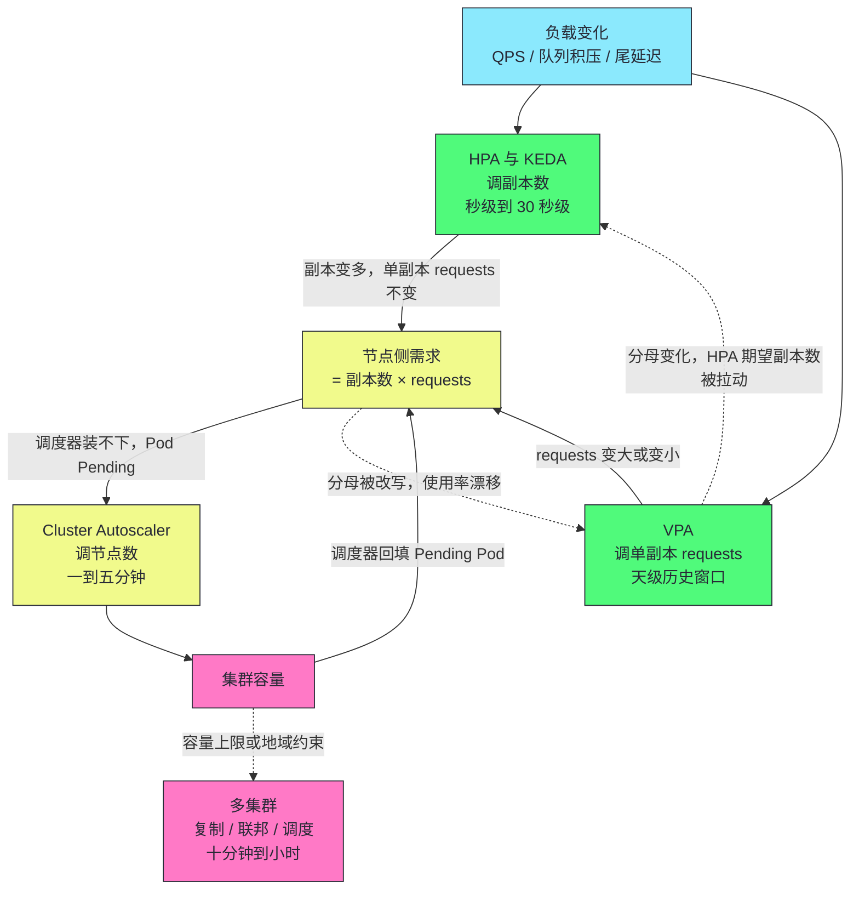
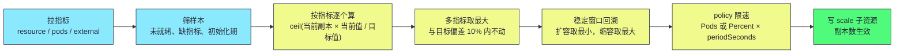
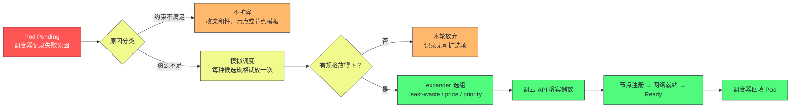
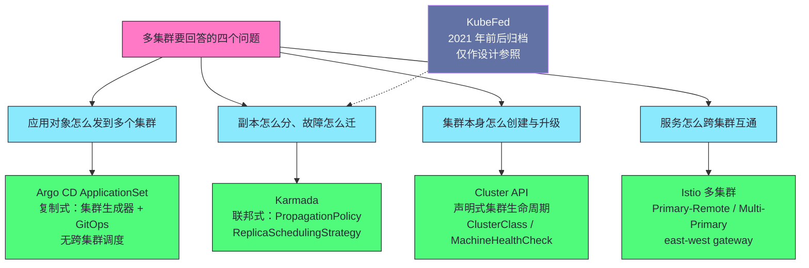
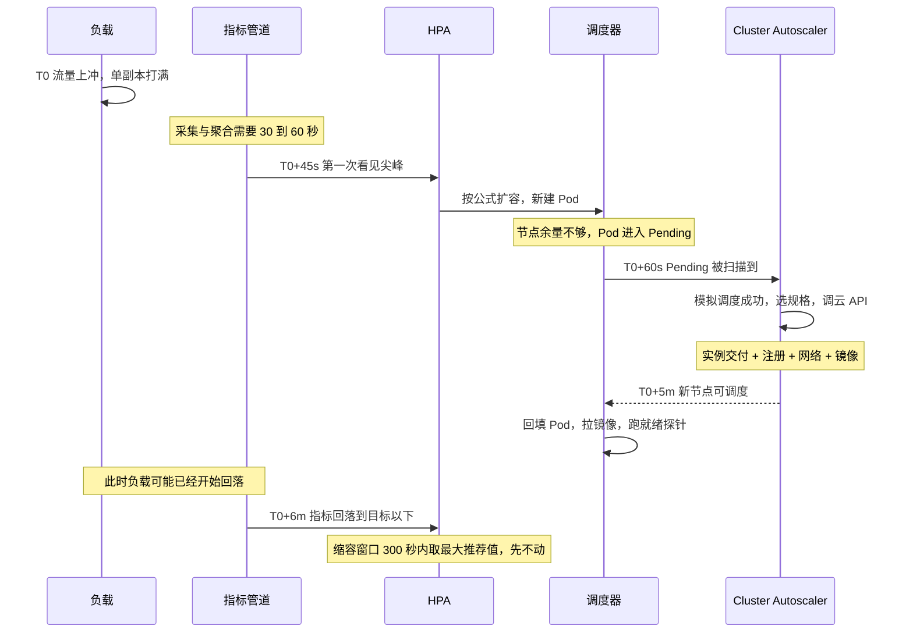

# 18 弹性伸缩与多集群：HPA/VPA/Cluster Autoscaler 与 KubeFed

**摘要：**

弹性伸缩常被简化成一句"负载高了自己加机器"，但在 Kubernetes 里，这句话至少对应四个彼此不能替代的旋钮：副本数、单副本的资源申请量、节点数、集群数。四者落在三条时间尺度上——HPA 的最小反应粒度是 15 秒的同步周期，Cluster Autoscaler 加一个节点要一到五分钟，扩出一个新集群则以十分钟到小时计，任何一层缺位，压力都会推回人工。本文以一套结算服务的日常运行为贯穿案例，按五问推进：弹性伸缩是什么、为什么必须分层、抽掉限速与保护会退化成什么样、四套机制各自如何落地、以及它们在哪些前提下失效。中段拆开 HPA 的比例公式与 `behavior` 限速、VPA 的四种更新模式与原地调整的边界、Cluster Autoscaler 的模拟调度与缩容判定、KEDA 把伸缩信号从资源换成事件的做法；后半段讨论多集群的复制式、联邦式、调度式三种范式及各自的失败模式。全文落点在两处取舍：伸缩速度与稳定性之间的取舍，以及成本与体验之间的取舍。

---

## 第 1 章 弹性的四个旋钮与三层时间尺度

笔者先把范围收窄。这里说的弹性伸缩，指集群在没有人工介入的前提下，依据观测到的信号自行改变资源数量的能力；它不解决单机性能、不替代容量规划，也不承诺省钱——它只是把"看指标、做决定、改数量"这套动作从人手里接过去，交给控制回路重复执行。

### 1.1 一家 24 小时营业的餐厅

设一套结算服务，代号 checkout。稳态时它跑 12 个副本，每个副本声明 500m CPU 与 1Gi 内存、限制 2 核与 2Gi，白天 QPS 在 800 上下，夜里两点掉到 60，大促峰值半小时内冲到 6000；它跑在 6 台 8 核 16G 的托管节点上，另有一条 Kafka 主题承接对账任务，对账消费者平时 2 个、账期日会积压到几万条；再往外，业务要求华东、华北、华南各有一份可接管流量的部署。

把这件事想成一家 24 小时营业的餐厅，四个旋钮就各自落地了。加副本是在同一间店里加服务员——招人快、上手也快，但店里得有位置给人站；加节点是加餐位、甚至换更大的店面，要等施工队进场，慢，且贵;调 requests 是给每张桌子定标配菜量，定大了吃不完浪费，定小了客人不够吃还得加单;按事件伸缩（KEDA）是看外卖单量派骑手，而不是看厨房里厨师忙不忙;多集群则是去另一座城市开分店，供应链、员工、菜单都要重来一遍。

比喻要跟一句限定才不会失真。服务员不是凭空出现的——新副本要先拉镜像、跑完就绪探针才算真正接客，这段时间它在账面上存在、在流量上不存在；餐位也不是搬进来就能坐——新节点要注册、容器网络要就绪、调度器要重新回填，这几步加起来常常比"叫一台机器"本身更耗时间。这两处延迟，是后文所有抖动分析的物理基础。

### 1.2 四个旋钮，三层时间尺度

四个旋钮之间的关系比看上去紧。副本数乘以单副本 requests，就是节点侧要承接的资源需求；节点侧装不下，调度器把 Pod 挂在 Pending；Cluster Autoscaler 看到 Pending 才去买机器；而 requests 本身又是 VPA 的旋钮、同时还是 HPA 计算使用率的分母——也就是说，VPA 动一下 requests，HPA 的判断基准就被改写了一次。

笔者先把这四个旋钮、三层时间尺度与两处耦合画在一张图上：实线是"改变资源数量"的正向路径，虚线是三条互相改写的反馈路径，它们才是弹性系统真正难调的地方。



两张虚线是本文反复要回到的两句话：**requests 既是调度货币，也是 HPA 的分母**；**副本数是 HPA 的输出，同时又是 VPA 推荐值的输入**。凡是在同一个负载上同时打开两个旋钮的团队，迟早会撞上这两条线。

四个旋钮的差异可以一张表列清：伸缩对象不同、信号不同、时间尺度不同，失效的姿态也不同。

| 机制 | 伸缩对象 | 触发信号 | 时间尺度 | 典型失效姿态 |
| :--- | :--- | :--- | :--- | :--- |
| HPA | Pod 副本数 | CPU/内存使用率、Pod 指标、外部指标 | 同步周期 15 秒，分钟级生效 | 指标滞后引起的振荡，扩容追上不尖峰 |
| VPA | 单副本 requests/limits | 历史用量的分位数 | 推荐以天为窗口，生效要重建 | 重建中断服务，与 HPA 互相拉扯 |
| Cluster Autoscaler | 节点数 | 模拟调度失败的 Pending Pod | 扫描 10 秒，加节点一到五分钟 | 有 Pending 也加不出节点，缩容被保护开关挡住 |
| KEDA | Pod 副本数 | 事件源（队列长度、lag、cron） | 轮询默认 30 秒 | 冷启动延迟，分区数封顶，缩到 0 后首单变慢 |

### 1.3 为什么这四件事不能合并成一件

最容易产生的念头是"既然都能自动加资源，做一套就够了"。这个念头在四个地方立刻撞墙。

第一处是状态性。水平加副本只要求应用能复制自己——同一个镜像多起几份，会话与数据都在外部存储里；垂直改 requests 却要求应用能"带着新配额重新出生"，因为容器规格在创建后不可改（原地调整是较新的能力，且只覆盖 CPU 与内存）。有状态服务加副本还要解决成员变更、数据分片与主从归属，成本远高于加一份无状态副本，所以水平的适用面天然比垂直宽。

第二处是决策权归属。到底装得下装不下，只有调度器知道——它掌握全部节点的可分配量、亲和性、污点与拓扑约束；Cluster Autoscaler 不能替调度器做决定，它只做一件事：在"现有容量加上某一类候选规格"的假设下重跑一次模拟调度，试放成功才去买机器。这条职责边界一旦被误解，就会出现"节点加了一堆、Pod 还是 Pending"的场面。

第三处是信号质量。CPU 使用率是一个被平均过的、滞后的、与业务目标只间接相关的量：一个等下游响应的服务，CPU 可能很低而延迟已经爆掉；一个 GC 抖动剧烈的 JVM，CPU 尖峰可能只是回收而不是负载。队列长度、消费 lag、并发连接数这类信号与"还需要多少处理能力"的关系更直接，这也是 KEDA 存在的理由——它把伸缩信号从资源用量换成事件源。

第四处是反事实。只有 HPA 没有 Cluster Autoscaler，扩容会一路扩到 maxReplicas 然后全体 Pending：HPA 看到使用率仍高（因为新 Pod 一个都没跑起来），于是继续加副本，加出来的副本全部排队，集群从"容量不足"退化成"调度队列被垃圾副本塞满"。反过来，只有 Cluster Autoscaler 没有 HPA，负载翻倍时副本数纹丝不动，单副本被压到极限，节点加得再多也没有新副本去用它。**加节点替代不了加副本，加副本也替代不了加节点**，这句话是整章的地基。

### 1.4 弹性真正难的地方：控制回路本身会抖

把四个旋钮接上之后，新的问题立刻出现：它们都会抖。

原因是控制回路的三件固有缺陷：采样有间隔（15 秒或 30 秒才看一次）、观测有滞后（指标要经过采集、聚合、上报才进 HPA）、执行有延迟（Pod 要启动、节点要就绪）。三者叠加，回路就变成了一个"看旧账、下新单"的系统，反馈在时间上错位，错位的反馈在比例控制下会放大成振荡。老式淋浴就是这个模型：手伸过去试水温，觉得凉就把龙头拧大，热水还在管子里走，等它到了已经烫了，于是往回拧，冷水又姗姗来迟——人成了回路里那个滞后的执行器，来回拧就是振荡。

工程上对付振荡只有三种办法：加死区（指标偏离目标一小段就不动）、加阻尼（一段时间内只许朝一个方向走，或者给变化量封顶）、加缓冲（预留一点余量吸收尖峰）。HPA 的容忍度、稳定窗口与 policy 限速，Cluster Autoscaler 的 unneeded-time 与各类跳过开关，VPA 的更新策略与 PDB，本质都是这三种办法的不同写法。后面几章会一处一处对上。

---

## 第 2 章 HPA：一条比例公式与围着它的三道闸

HPA（Horizontal Pod Autoscaler）是四个旋钮里用得最广、也最容易被"配上去就不管"的一个。它在 Kubernetes 1.2 前后以 `autoscaling/v1` 的形态出现，只认 CPU；`autoscaling/v2beta2` 在 1.12 前后引入多指标与 `behavior`，到 1.23 转为 GA，此后一直是本文所用的 `autoscaling/v2`。

### 2.1 控制回路的四个动作

HPA 是 kube-controller-manager 里的一个控制器，默认每 15 秒跑一轮（`--horizontal-pod-autoscaler-sync-period`）。每一轮做四件事：拉指标、算期望副本数、按限速裁剪、把结果写进目标对象的 `scale` 子资源。下图是这一轮循环的内部结构，虚线那一笔是"下一轮再从采集开始"。



写 `scale` 子资源这个细节值得多说一句：HPA 不直接 patch Deployment，而是调用 `/scale` 子资源改 `spec.replicas`。好处是凡是有 scale 子资源的对象都能被接管——Deployment、StatefulSet、ReplicaSet，以及自带 `/scale` 的自定义资源；代价是它不经过驱逐流程——这一点在第 2.6 节会变成一个真问题。

回路健康与否，全写在 HPA 自己的状态里。`kubectl describe hpa` 能看到 `currentMetrics`、`desiredReplicas` 与一组 `conditions`：`AbleToScale` 为 False，说明副本写入被拒绝，常见于目标对象正被别的控制器改动；`ScalingActive` 为 False 且 reason 是 `FailedGetResourceMetric`，基本可以断定 metrics-server 没就绪，或者目标 Pod 没写 `resources.requests`——后者尤其常见，因为使用率的分母就是 requests，没有分母，所谓"使用率"根本不存在。

### 2.2 公式、容忍度与样本筛选

HPA 的全部决策压在一条比例公式上：

```
期望副本数 = ceil(当前副本数 × (当前指标值 / 目标指标值))
```

代入 checkout 的一轮真实采样：当前 5 个副本，平均 CPU 使用率 90%，目标 70%，则 `ceil(5 × 90 / 70) = ceil(6.43) = 7`。公式里没有积分项、没有微分项，只有比例项，因此它属于最朴素的 P 控制：误差越大，动作越大，误差为零就停手。它的收敛点很直观——当平均使用率恰好等于目标值时期望副本数等于当前副本数；它的粗糙也很直观——`ceil` 意味着永远向上取整，小副本数时偏差被放大，5 个副本里加一个就相当于 20% 的跳变。

三道闸依次收窄这个结果。

第一道闸是容忍度（`--horizontal-pod-autoscaler-tolerance`，默认 0.1）。当`当前值 / 目标值`落在 0.9 到 1.1 之间时，HPA 认为"已经达标"，直接不动。这道闸挡掉的不是逻辑错误，而是无意义的微调：没有它，使用率在 69% 与 71% 之间来回跳，副本数就会跟着一拍一拍地动。

第二道闸是样本筛选。未就绪的 Pod、处于初始化观察期的 Pod、以及指标缺失的 Pod，都不会被当作正常样本参与平均。为刚启动的 Pod 划出的两段观察期由 `--horizontal-pod-autoscaler-initial-readiness-delay`（默认 30 秒）与 `--horizontal-pod-autoscaler-cpu-initialization-period`（默认 5 分钟）控制，期内不采信其指标；而指标缺失时，HPA 的处理是分方向的保守——宁可少扩容、也绝不在样本不全时贸然缩容。这条不对称的处理方式很好理解：样本缺失说明观测系统出了问题，问题期间做的减法最容易出错。

第三道闸是多指标取最大。`autoscaling/v2` 允许同时挂多条指标，HPA 对每条指标各算一遍期望副本数，取其中最大的那个。CPU 算出 7、内存算出 5，最终取 7；这个规则保证了没有任何一条指标被"更低的指标"掩盖。不过要注意它的副作用：多指标取最大等价于"最紧的那条指标说了算"，如果其中一条指标常年贴着阈值，它就会成为事实上唯一的控制信号，其余指标只是陪跑。

### 2.3 指标从哪来：三种来源与它们自带的延迟

HPA 能吃五类指标：`Resource`（CPU/内存，来自 Pod 的 requests 与实测用量）、`ContainerResource`（按容器而非整 Pod 计算，sidecar 占资源多时必用）、`Pods`（每个 Pod 的自定义指标，譬如每副本 QPS）、`Object`（某个 K8s 对象的指标，譬如 Ingress 的请求数）、`External`（集群外部的指标，譬如有界队列长度）。它们的提供方、API 组与延迟各不相同，混用之前必须清楚各自的数据从哪里出发、走多远才到 HPA。

| 指标类型 | API 组与提供方 | 数据路径 | 典型延迟 | 何时该用 |
| :--- | :--- | :--- | :--- | :--- |
| `Resource` | `metrics.k8s.io`，metrics-server | kubelet 的 Summary API → metrics-server 聚合 → Metrics API | 采集解析度约 60 秒，叠加 15 秒同步周期 | 无状态 Web 服务，CPU 与负载近似线性 |
| `ContainerResource` | 同上 | 同上，但按容器分别取值 | 同上 | 多容器 Pod，sidecar 用量会稀释主容器 |
| `Pods` | `custom.metrics.k8s.io`，自定义指标适配器 | Prometheus 查询 → 适配器转换 → Custom Metrics API | 取决于抓取间隔与查询步长，通常 30 到 60 秒 | 吞吐可测的服务，比 CPU 更贴近容量 |
| `Object` | 同上 | 对象指标映射到工作负载 | 同上 | 以某个入口对象（Ingress、Service）的指标为准 |
| `External` | `external.metrics.k8s.io`，外部指标适配器 | 外部系统（消息队列、监控库）→ 适配器 | 取决于外部系统的上报频率 | 有界队列、消费 lag 这类"与副本数强相关"的信号 |

延迟账要算清。metrics-server 在较新版本里的默认解析度是 60 秒量级，HPA 每 15 秒读一次，于是"实际发生"到"被 HPA 看见"之间可能隔了半分钟到一分半；自定义指标这条路换成 Prometheus 的抓取间隔（常见 15 到 30 秒）加查询步长，量级相近，但多了一跳适配器，失败面更大。这解释了一个常见困惑：明明 Pod 已经跑满，HPA 的 `currentMetrics` 却还停在几分钟前的低值——不是 HPA 不灵敏，是它手里的数据本来就旧。

### 2.4 behavior：把"扩得快、缩得慢"写成默认值

`autoscaling/v2` 的 `behavior` 字段，把一条长期靠口口相传的经验规则写进了 API 的默认值。它的结构不复杂，但要写对得先把两个方向、三类字段分清楚。

```yaml
apiVersion: autoscaling/v2
kind: HorizontalPodAutoscaler
metadata:
  name: checkout-hpa
spec:
  scaleTargetRef:
    apiVersion: apps/v1
    kind: Deployment
    name: checkout
  minReplicas: 6
  maxReplicas: 60
  metrics:
    - type: Resource
      resource:
        name: cpu
        target:
          type: Utilization
          averageUtilization: 70
    - type: Pods
      pods:
        metric:
          name: http_requests_per_second
        target:
          type: AverageValue
          averageValue: "120"
  behavior:
    scaleUp:
      stabilizationWindowSeconds: 0    # 扩容不等：慢一步就是用户超时
      policies:
        - type: Percent
          value: 100                   # 每 15 秒最多翻一倍，避免一次跳到 max
          periodSeconds: 15
        - type: Pods
          value: 8                     # 但也允许一次加 8 个，小集群里更好使
          periodSeconds: 15
      selectPolicy: Max                # 两条策略取更激进的那条
    scaleDown:
      stabilizationWindowSeconds: 300  # 缩容等 5 分钟：让相位滞后先过去
      policies:
        - type: Percent
          value: 25
          periodSeconds: 60            # 每分钟最多减四分之一，缩得慢一点
```

三个概念必须分清。

其一是稳定窗口（`stabilizationWindowSeconds`）。它不是"对指标做平均"，而是把窗口内所有历史推荐值收集起来，扩容时取最小的那个、缩容时取最大的那个。这个语义很关键：它保证的是"不要因为一次瞬时读数就朝激进方向走"，而不是"平滑一下"。窗口默认扩容 0 秒、缩容 300 秒——扩容方向不设窗口，缩容方向留足 5 分钟。

其二是限速策略（`policies`）。每条策略声明"在 `periodSeconds` 内，副本数最多变多少"，类型可以是 `Pods`（绝对数量）或 `Percent`（相对当前副本数的百分比）。`Percent: 100` 意味着每个周期最多翻倍，这是把指数级放大拉回线性的手段；`periodSeconds` 的合法区间是 1 到 1800 秒，超过 1800 秒的对象会被 API Server 拒绝，因为再长的窗口已经失去"限制速率"的含义。默认的两条扩缩策略都是 `Percent: 100 / 15 秒`，扩方向再加一条 `Pods: 4`。

其三是方向选择（`selectPolicy`）。多条策略之间用 `Max`（最激进）、`Min`（最保守）或 `Disabled`（关掉该方向）裁决，默认 `Max`。`Disabled` 是有用的逃生口：某个服务只允许自动扩容、不允许自动缩容，把 `scaleDown` 整体关掉比设一个超长窗口更明确。

| 参数 | 默认值 | 作用 | 常见误配后果 |
| :--- | :--- | :--- | :--- |
| `scaleUp.stabilizationWindowSeconds` | 0 | 扩容方向的回溯窗口 | 设成几百秒，尖峰来了来不及扩，尾部延迟先炸 |
| `scaleDown.stabilizationWindowSeconds` | 300 | 缩容方向的回溯窗口 | 设成 0，指标一回落就缩，缩完又被打回来 |
| `policies[].periodSeconds` | 15 | 单条策略的速率窗口 | 设得过小等于不限速，一次跳到 maxReplicas |
| `selectPolicy` | `Max` | 多策略裁决方向 | 误用 `Min` 把一个精心设计的激进策略架空 |
| `tolerance`（控制器级） | 0.1 | 偏差死区 | 调到 0.02，指标噪声直接变成副本抖动 |

### 2.5 反事实：没有这三道闸会怎样

设想一个已经把 `behavior` 删干净、容忍度调到接近零的 HPA，看它在 checkout 的一次晚高峰里会发生什么。20 个副本，指标从 70% 冲到 90%，比例公式给出 `ceil(20 × 90/70) = 26`，控制器立刻写 26。副本创建、拉镜像、跑就绪探针，大约 40 秒后新副本开始分担流量，平均使用率被摊薄到 56%；下一轮同步周期读到的就是这个 56%，于是期望副本数变成 `ceil(26 × 56/70) = 21`，控制器又把它写回 21。可 21 个副本对应的是更早那批流量，等到被移除的副本退出、剩余的副本重新分到全部请求，使用率又回到 80% 以上，于是再扩。

稳定窗口的作用正是吸收这段相位滞后。缩容方向留 300 秒，意味着在这 5 分钟里所有推荐值都参与比较、取其中最大的那个——刚才那次"56% 算出 21"的推荐会被窗口里"90% 算出 26"的推荐压住，副本数保持 26 不动，等真实负载稳定下来再决定。**"扩得快、缩得慢"不是风格偏好，而是把非对称的代价写进了默认值**：扩容慢一步，用户超时、重试放大、雪崩；缩容慢一步，只是多付几分钟的机器钱。两者的量级差得远，规则的偏向也就没什么可犹豫的。

不过这条偏向有明确的账单。缩容滞后 5 分钟，意味着流量回落后还要按峰值付费 5 分钟；对一天里有十几次波峰波谷的服务，累计起来是实打实的钱。成本敏感的团队会把 `stabilizationWindowSeconds` 调到 60 到 120 秒，同时用就绪探针的 `preStop` 钩子把连接排空做扎实，用应用侧的优雅退出补上窗口变短后少掉的那层保护。

### 2.6 HPA 的三条边界

HPA 能做的事很确定，不能做的事同样确定，三条边界值得提前记住。

第一条，缩不到 0。`minReplicas` 的下限是 1（`autoscaling/v2` 里不允许 0），因为 HPA 的公式在副本数为 0 时没有意义。要缩到 0，得靠 KEDA 那种在外面把工作负载压到 0 的方案。

第二条，看不见短于同步周期的尖峰。15 秒的采样周期是硬下限，秒级脉冲式流量只能靠缓冲层（队列、令牌桶、预留容量）吸收。

第三条，也是最容易踩的一条：**HPA 的缩容不受 PDB 保护**。PDB（PodDisruptionBudget）保护的是"自愿驱逐"——drain、升级、Cluster Autoscaler 缩容走的都是 eviction 接口；而 HPA 缩容是直接改 `scale` 子资源的 `replicas`，由 ReplicaSet 控制器删 Pod，根本不经过驱逐接口。所以 `minAvailable` 写得再漂亮，也拦不住 HPA 把副本从 26 缩到 21。真正的保护来自三处：`minReplicas` 的下限、稳定窗口的滞后，以及应用侧"收到 SIGTERM 就先摘流量再退出"的优雅终止。

---

## 第 3 章 VPA：把 requests 调准，代价是重建

如果说 HPA 解决的是"要几个副本"，VPA（Vertical Pod Autoscaler）解决的是"每个副本该申请多少资源"。两句话只差一个字，工程后果却完全不同：改副本数是复制，代价接近于零；改 requests 是换规格，就像改衣服尺寸必须先把衣服脱下来——容器一旦创建就改不了，只能重建。这条物理约束决定了 VPA 在所有落地场景里的形态——它更像一位定期出体检报告的医生，而不是一个实时调节的阀门。

### 3.1 三个组件与一份"体检报告"

VPA 由三个部件组成，分工很清楚。Recommender 是一个常驻的 Deployment，从 metrics-server 或历史指标里读出每个 Pod 的 CPU 与内存用量，按分位数算出推荐值，写进 VPA 对象的 `status.recommendation`；Updater 盯着这些推荐值，发现运行中 Pod 的实际 requests 与推荐值偏离过大，就用驱逐接口把 Pod 请出去，让它带着新规格重建；Admission Controller 是一个 mutating webhook，在 Pod 创建的那一刻把推荐值注入 `resources`。

三个部件加上 VPA 对象本身，构成一条闭环：采样 → 推荐 → 注入 → 再采样。闭环里最慢的一环是采样窗口——推荐值不是即时读数，而是基于历史（`--history-length` 默认 8 天、`--recommender-interval` 默认 1 分钟）的统计量，默认取 CPU 与内存各自用量的 P90（`--target-cpu-percentile` 与 `--target-memory-percentile` 默认都是 0.9）。用 P90 而不是平均值，是一处明确的取舍：平均值意味着一半的时间资源不够，P90 意味着一成的时间偏紧，前者会让服务在高峰期持续挨打，后者只是偶尔紧张。

### 3.2 四种更新模式与"能不能不重建"

VPA 的行为由 `spec.updatePolicy.updateMode` 决定。老版本里常见的 `Auto` 是历史写法，后来被明确为 `Recreate`；真正的四种模式如下表。

| 模式 | 行为 | 是否中断 | 适用场景 | 主要风险 |
| :--- | :--- | :--- | :--- | :--- |
| `Off` | 只计算推荐值，写进 status，不动工作负载 | 不中断 | 想先看建议再人工改，或与 HPA 并存时只取数据 | 推荐值无人消费，等于装了不接线 |
| `Initial` | 只在 Pod 创建时注入推荐值，已运行的不动 | 不中断 | 不能中断的服务，等下一次滚动更新生效 | 生效滞后，长生命周期 Pod 可能一直用旧规格 |
| `Recreate` | Updater 驱逐 Pod，重建时注入新值（旧写法 `Auto`） | 逐 Pod 中断 | 无状态服务、批处理 | 重建风暴、与 PDB 抢占、容量瞬时下降 |
| `InPlaceOrRecreate` | 先尝试原地改 requests/limits，不行再回退重建 | 多数情况下不中断 | 较新版本上的延迟敏感服务 | 依赖运行时与内核能力，不是所有场景都能原地改 |

`Recreate` 的细节值得展开。Updater 不是直接 kill 进程，而是走 eviction 接口，因此它受 PDB 约束——`minAvailable` 挡住的时候，Updater 只能等，VPA 的更新于是被 PDB 的余量卡住。除此之外 Updater 还有全局的驱逐速率与容忍比例限制，避免一次把整个 Deployment 掀翻；这套限制的思路和 HPA 的 `policies` 限速一致，都是把"一次性的大动作"切成"多次的小动作"。

`InPlaceOrRecreate` 是绕开重建的一条路，它依赖 Kubernetes 的原地 Pod 资源调整（In-Place Pod Vertical Scaling）能力：该能力在 1.33 进入 beta 并默认开启，较新版本已 GA。它的边界必须提前知道：只覆盖 CPU 与内存两类资源，不能通过它改变 QoS 等级（beta 阶段有这条限制），降内存限制要求节点启用 cgroup v2，Windows 节点不支持，而每个容器还要声明 `resizePolicy`——`NotRequired` 表示改了规格也不重启容器，`RestartContainer` 表示改了就重启。也就是说，原地调整并不是"无损"，它只是把损失从"整个 Pod 重建"缩小到"某个容器重启"，或者干脆缩小到"什么都不发生"。

### 3.3 推荐值为什么会抖，以及怎么让它别抖

Recommender 的输出看起来是个数字，实际上是一条曲线。三个因素会让这条曲线抖：样本窗口太短（几小时的波动被当成趋势）、业务有周期（譬如大促样本把推荐值顶高，节后又降不下来）、以及内存侧特有的 OOM 效应。

内存的推荐比 CPU 难，原因在于失败模式不对称。CPU 给少了，Pod 变慢，但请求还在处理；内存给少了，Pod 直接被 OOMKilled，服务瞬断。所以内存推荐不能只按分位数取值，还要留安全边界，`minAllowed` 与 `maxAllowed`（按容器配置）就是这条边界的上下锚点：`minAllowed` 防的是"推荐值一路下探到不可用"，`maxAllowed` 防的是"某次异常采样把推荐值顶到天上去"。另外还有 `controlledValues` 这个开关——设成 `RequestsOnly` 时，VPA 只改 requests、不动 limits，QoS 等级从 Guaranteed 退化为 Burstable 的风险就被回避了，代价是 requests 与 limits 之间的比例不再自洽。

### 3.4 VPA 与 HPA 为什么不能坐在同一张桌子上

这是本文最需要说清的一处冲突，因为它不是"配置建议"，而是机制层面的相互改写。

HPA 的输入是使用率，使用率 = 实测用量 / requests。VPA 改的正是 requests。于是 VPA 每调一次 requests，HPA 看到的使用率就整体平移一次，而 HPA 并不知道这个平移来自哪里，它只会忠实地按公式重新算副本数。举个具体数字：checkout 的 requests 是 500m，实测 400m，使用率 80%，目标 70%，HPA 把 12 个副本扩到 14；此时 VPA 认为"实际只用了 400m，requests 500m 偏高"，把 requests 调到 450m——使用率立刻变成 89%，HPA 再扩；过一阵 VPA 又把 requests 调回 550m，使用率掉到 73%，HPA 缩回去。**同一份负载，两个控制器给出相反的结论，谁都没有错，错的是它们共享了同一个分母。**

更糟的是时间上的错配。`Recreate` 模式驱逐 Pod 的瞬间，可用副本数下降，剩余副本分摊到更多流量，使用率冲高，HPA 于是扩容；新 Pod 带着新 requests 起来之后，分母变大、使用率骤降，HPA 又开始缩容。两个回路一个以天为周期、一个以 15 秒为周期，快回路追着慢回路的尾巴跑，稳态被反复打断。

业界的通行解法是把两个旋钮分到不同维度上：HPA 管"每副本的处理量"，用 CPU 之外的自定义指标或外部指标；VPA 管"每副本的资源量"，只碰内存或者干脆停在 `Off`。下面这张矩阵大致覆盖了常见的组合及其判断。

| 组合 | 是否可行 | 原因 |
| :--- | :--- | :--- |
| HPA 按 CPU + VPA 按 CPU | 不可行 | 分母被改写，两个控制器互相对抗 |
| HPA 按 CPU + VPA 按内存（`RequestsOnly`） | 有条件可行 | 维度分离，但要防止内存 requests 变化改变 QoS 等级 |
| HPA 按自定义指标（每副本 QPS）+ VPA 按 CPU/内存 | 可行，需压测 | 指标与 requests 解耦，但 VPA 重建期间 HPA 仍会看到容量波动 |
| HPA 按外部指标 + VPA 停在 `Off` | 最稳 | VPA 只出建议、人来改，牺牲自动化换取确定性 |

### 3.5 反事实：requests 配歪的两个方向

没有 VPA 的团队并不是不做资源管理，而是靠经验值、靠复制粘贴、靠"上次出事之后往上加了点"。这条路径的失败很稳定，朝两个方向。

配高了，浪费是隐性的。requests 是调度器预留资源的依据，也是云账单和利用率报表的分母：Pod 声明 2 核却只用 300m，节点上就有一大块容量被"记账占用"却闲着。它的后果不是报错，而是三件事同时发生——节点数量比实际需要多，Cluster Autoscaler 因为"requests 之和超过阈值"而缩不掉节点，容量规划会议上所有人都觉得利用率低但没人知道该改哪个 Deployment。

配低了，代价是显性的。节点被超卖，多个 Pod 抢同一份 CPU，尾延迟抬头；内存一旦触顶就是 OOMKilled，而 OOMKilled 的 Pod 在 `RestartPolicy: Always` 下会被反复重启，形成一个自愈不了的循环。QoS 等级在这里决定了谁先挨刀。

| requests 与 limits | QoS 等级 | 驱逐顺序 | 典型写法 |
| :--- | :--- | :--- | :--- |
| 都未设置 | BestEffort | 最先被驱逐 | 不推荐，HPA 也无法计算使用率 |
| requests < limits | Burstable | 中间 | 最常见，适合有突发需求的服务 |
| requests = limits | Guaranteed | 最后被驱逐 | 延迟敏感服务，代价是失去弹性余量 |

VPA 的价值就在于把这张表从"人手填"变成"数据填"。但它填的是历史，不是未来——大促前的一次性扩容、新版本上线后的内存增长，都不在历史样本里。所以现实中的最佳实践往往是 `Off` 加人工评审：让 VPA 每周产出一份"这些 Deployment 的 requests 明显偏离实测"的清单，由人决定改哪几个。这份清单的价值，远大于自动重建的那点便利。

---

## 第 4 章 Cluster Autoscaler：节点这一层的判断

HPA 与 VPA 都在 Pod 这一侧做文章，Cluster Autoscaler（CA）管的是更下面一层：节点数。它的判断逻辑和前两者有一个本质区别——**它不是根据指标做比例运算，而是做一次模拟调度**。这个设计选择决定了它的能力边界，也决定了它那些"明明有 Pending 却不动"的著名现象。

### 4.1 扩容判定：先试放，再买机器

CA 每 10 秒扫一次集群（`--scan-interval`），把 Pending 的 Pod 挑出来，逐个看它为什么调不上去。原因分两类：一类是资源不够，另一类是约束不满足——亲和性、污点、节点选择器、端口占用、PVC 未绑定。只有前者才进入扩容流程，后者加多少节点都没用。这层判断像叫车之前先量行李：不是车越大越好，而是要有一辆车真能把箱子放进后备厢。

对"资源不够"的 Pod，CA 不直接调云 API，而是先做一次模拟：假设给集群加一台某个规格的节点，把这个 Pod（以及和它一起被打包的其它 Pending Pod）放上去，看调度器会不会成功。试放失败就换下一个候选规格，全部失败就这一轮不动，日志里留下一句"没有可用的扩容选项"。下图是这条路径的完整形状。



多个节点组并存时，选哪个组由 expander 决定，`--expander` 的常见取值如下。

| expander | 选择依据 | 代价 |
| :--- | :--- | :--- |
| `random` | 随机挑一个可行组 | 简单，账单不可预测 |
| `most-pods` | 挑一次能放下最多 Pending Pod 的组 | 倾向大节点，可能长期低利用率 |
| `least-waste` | 挑扩容后剩余资源最少的组 | 最贴合"刚好够"，但规格组合多时计算量大 |
| `price` | 挑单价最低的组 | 需要云厂商价格信息，可能选中性能不足的规格 |
| `priority` | 按配置里的顺序依次尝试 | 可以把业务分级写进扩容顺序，运维意图最明确 |

`priority` 的值本身可以是逗号分隔的 expander 列表，于是"先按优先级挑组、组内再按 least-waste 挑规格"这类复合策略不必写插件就能表达出来。另有两个参数决定了整个流程的时间预算：`--max-node-provision-time` 默认 15 分钟，某个组超过这个时间还没起来就放弃、换下一个组，避免卡在一个永远起不来的组上；`--balance-similar-node-groups` 让打了相同标签的相似节点组保持均衡，防止某一个组被优先打满而对账期扩容时无组可用。

### 4.2 "扩容了却没用上"：节点就绪的四个台阶

CA 最容易背锅的现象是：日志明明写了已扩容，云控制台也确实多了一台机器，Pod 却还挂着。原因是"加了一台机器"与"多了一份可用容量"之间隔着四个台阶，每一级都要时间，任何一级卡住都会让扩容的收益归零。

第一级是实例交付。云 API 返回成功不等于机器可用，虚拟机从创建到 SSH 可达常见 30 秒到 2 分钟。

第二级是节点注册。kubelet 起来之后要注册到 API Server、上报节点状态、被标记为 Ready；默认的心跳间隔是 10 秒，控制器判定 NotReady 的宽限期是 40 秒，所以"机器活了但集群还不知道"是常态。

第三级是网络与存储就绪。CNI 插件要把节点纳入 Pod 网络，CSI 节点插件要注册卷能力；这一段在自建集群里最容易被忽略，因为节点已经 Ready，但新 Pod 起的第一个容器就卡在"网络未就绪"。

第四级是镜像。新节点上没有镜像缓存，`imagePullPolicy: IfNotPresent` 在这里等价于"必须拉"；一个 1.5GB 的业务镜像，走内网仓库也要几十秒到数分钟，若叠加多镜像、私有仓库认证超时，时间还会更长。四面叠加，从"决定扩容"到"Pod 真正接流量"五分钟是常态，十分钟也不稀奇——这也解释了为什么突发流量下 CA 永远慢半拍。

还有一处容易漏算的容量折损：节点的 `allocatable` 小于 `capacity`。8 核 16G 的机器，扣掉 kube-reserved、system-reserved 与驱逐阈值之后，调度器能分配的常常只有 7.8 核与 15G 左右。如果团队按 `capacity` 做容量规划，就会出现"节点看起来还有余量、Pod 却调度失败"的偏差。

### 4.3 缩容判定：一串延迟参数加一套保护开关

缩容比扩容复杂，因为它要回答两个问题：这台节点"该不该走"，以及上面的 Pod"能不能走"。

"该不该走"看利用率。节点上所有 Pod 的 requests 之和低于节点可分配量的一定比例（`--scale-down-utilization-threshold` 默认 0.5）才算候选，而且这个低利用率状态要持续足够久（`--scale-down-unneeded-time` 默认 10 分钟），刚扩容完的节点还有额外的冷却（`--scale-down-delay-after-add` 默认 10 分钟），防止"加了又缩"的抖动。

"能不能走"看约束，四条最常挡路：

| 缩容条件 | 说明 | 相关开关与后果 |
| :--- | :--- | :--- |
| 节点利用率低 | requests 之和低于可分配量的阈值 | 阈值调高会缩得更积极，也更容易误伤 |
| Pod 可迁移 | 没有本地存储、没有裸 Pod、亲和性允许 | 挂 local PV 的节点默认跳过，永远缩不掉 |
| PDB 允许驱逐 | 驱逐不能击穿最小可用数 | PDB 卡住时缩容一直重试，直到超时放弃 |
| 系统组件不挡路 | 跑着 kube-system Pod 的节点默认跳过 | 每台节点都跑 DaemonSet，这一条常是"缩不掉"的根因 |

满足条件的节点会被 cordon 住，然后逐个 Pod 走 eviction 接口驱逐。这里有三个细节。其一，驱逐是"照 PDB 办"的：`minAvailable` 或 `maxUnavailable` 不允许的时候，驱逐请求会被拒绝，CA 会等下一轮再试，而不是硬来。其二，驱逐失败会重试，但单节点的优雅终止有上限（`--max-graceful-termination-sec` 默认 600 秒），超时就放弃这台节点。其三，`--skip-nodes-with-local-storage` 与 `--skip-nodes-with-system-pods` 默认都是 true，这是"节点明明很空却缩不掉"的最常见答案——要么上面挂了本地盘，要么它跑着必须每台都有的系统组件。

还有一道集群级的安全阀：当集群里 NotReady 的节点超过一定数量（`--ok-total-unready-count` 默认 3 台）或比例（`--max-total-unready-percentage` 默认 45%）时，CA 会整体暂停扩缩容。理由很实在——节点批量故障时，Pending Pod 暴增、利用率普遍下降，此时若还按正常逻辑扩容与缩容，等于在故障现场做二次破坏。

### 4.4 反事实：没有 PDB 的缩容踩踏

设想一个没有 PDB 的集群，某个服务 20 个副本散在 10 台节点上。夜里流量回落，CA 判定其中 6 台节点利用率低于阈值，于是并行驱逐。每台节点上的 2 个副本同时收到 SIGTERM，20 个副本瞬间掉到 8 个；应用的优雅终止期是 30 秒，而这 30 秒里剩下的 8 个副本要承接全部流量，使用率冲到 100%，HPA 看到指标后开始扩容——但新 Pod 要调度，而它要去的节点正好在缩容名单里。

这就是缩容踩踏：**缩容的决策单位是节点，而容量风险的单位是服务**，两者不对齐时，一次"节省成本"的操作会变成一次自制的容量事故。PDB 的作用就是把这两者重新对齐——它不管节点，只管服务的最小可用数，于是 CA 的并行驱逐被迫变成串行：想缩 6 台，但某个服务的 PDB 只允许同时少 1 个副本，那就一台一台来。

PDB 也有它的反面。`minAvailable` 设成副本数的 90%，看起来安全，实际上让缩容几乎不可能——任何一台节点上都有该服务的副本，驱逐必然击穿阈值，CA 只能重试到超时。更隐蔽的是"没有控制器管理的 Pod"：裸 Pod 不受 ReplicaSet 重建，CA 默认不会为了缩容去删它（`--skip-nodes-with-local-storage` 之外还有对裸 Pod 的保守处理），这类 Pod 常常是"缩不掉"清单上的常客。

### 4.5 Spot 与混合节点池

成本压力会把话题引到 Spot（竞价实例）上。Spot 的折扣来自云厂商的闲置容量，代价是随时可能被回收，回收通知通常只提前两分钟。CA 对 Spot 的支持方式是把它当作普通节点组：节点没了，Pod 重新 Pending，再触发扩容。这条路径适合无状态、可重入、能容忍中断的服务，不适合有状态服务与长事务——两分钟不足以让一个正在写盘的数据库体面退出。

于是主流做法是混合节点池：基础容量用按量付费的稳定节点，峰值部分用 Spot，通过节点亲和性与污点把不同工作负载分派到不同池子，再配合 `priority` expander 让扩容优先落在便宜的池子上。这里的权衡很直白：Spot 用得越多，账单越低，可被回收的容量占比越高，容量规划的确定性越差。

---

## 第 5 章 KEDA：把伸缩信号从资源换成事件

四个旋钮里最容易被忽略的是"信号选得对不对"。HPA 与 VPA 都建立在资源用量这个信号上，而资源用量有一个先天的弱点：它对"还有多少活没干"几乎没有感知。KEDA（Kubernetes Event-driven Autoscaling）把这个信号换掉了，它是 2019 年开源、2020 年发布 1.0 的项目，如今已是事件驱动伸缩的主流方案。

### 5.1 队列消费者为什么不该看 CPU

设一个 Kafka 消费者，它在一个循环里不断拉取消息、处理、提交位点。当队列里有积压时，这个循环是满负荷的；当队列空了，它大部分时间阻塞在拉取上，但阻塞不消耗 CPU，于是 CPU 使用率同样很低——问题在于这两种状态的差别不在 CPU 上，而在"队列长度"上。

更麻烦的是有积压时的情形。3 个消费者追 1 万条消息、和 3 个消费者追 10 条消息，单副本的 CPU 使用率可能都是 85%：消费循环总是忙的，忙的程度由代码决定，而不是由积压量决定。HPA 拿着这个 85% 去做比例运算，只能得出一个恒定的副本数，涨不上去也降不下来。**资源指标测的是"消耗了多少能力"，队列指标测的是"欠了多少活"，后者才是消费者真正需要的伸缩信号。**

第 1 章那个餐厅比喻在这里落地：看厨师忙不忙对应 CPU 指标，看外卖单量对应队列指标，KEDA 换掉的是后一个信号的来源。它的做法是把这件事拆成两半：自己不做伸缩运算，只负责把事件源的读数翻译成 Kubernetes 的自定义/外部指标，真正的副本数计算依旧交给 HPA。这个分工解释了很多现象——KEDA 的响应速度受 HPA 同步周期约束，它能缩到 0 是因为它在 HPA 之外多做了一步手脚，而不是因为它替代了 HPA。

```yaml
apiVersion: keda.sh/v1alpha1
kind: ScaledObject
metadata:
  name: kafka-scaler
spec:
  scaleTargetRef:
    name: kafka-consumer
  minReplicaCount: 0            # 允许缩到 0，没有消息时不占资源
  maxReplicaCount: 100
  pollingInterval: 30           # 每 30 秒问一次事件源
  cooldownPeriod: 300           # 指标归零后再等 5 分钟才收回副本
  triggers:
    - type: kafka
      metadata:
        topic: orders
        consumerGroup: order-processor
        lagThreshold: "100"          # 平均每副本积压超过 100 条就扩
        activationLagThreshold: "10" # 积压低于 10 条视为空闲，允许回 0
        allowIdleConsumers: "false"  # 副本数不超过分区数
```

### 5.2 缩到 0 是怎么实现的

HPA 的 `minReplicas` 不能为 0，这条限制 KEDA 绕不开，于是它换了个做法：当 `minReplicaCount` 设为 0 时，KEDA 把受管 HPA 的 `minReplicas` 设为 1，然后由自己直接改工作负载的 `replicas`。事件源越过 `activationThreshold` 时，它把副本从 0 拉到 1，把后续伸缩交还给 HPA；指标归零并熬过 `cooldownPeriod` 之后，它再把副本压回 0。

这套分工带来了两个必须知道的后果。其一是观测口径的割裂：`kubectl get hpa` 看到的 `minReplicas` 是 1，而实际工作负载此刻是 0，两者对不上不是 bug。其二是冷启动延迟的构成变复杂了：从 0 到 1 的这一步里既有 `pollingInterval`（默认 30 秒）的观测延迟，也有 Pod 启动时间，如果节点此时也没有余量，还要再叠上 Cluster Autoscaler 的一到五分钟。

`ScaledObject` 与 `ScaledJob` 是 KEDA 的两种资源，前者伸缩长驻服务（譬如 Deployment、StatefulSet），后者伸缩 Job——队列里有多少活就起多少个 Job 并行处理，处理完 Job 自行结束。批处理任务用 `ScaledJob`、长驻消费者用 `ScaledObject`，这条分工背后是"任务的生命周期由数据决定，还是由进程决定"的区别。

| 特性 | HPA | KEDA |
| :--- | :--- | :--- |
| 触发源 | CPU/内存/自定义指标/外部指标 | 50 多个内置 scaler，覆盖消息队列、数据库、云服务与 cron |
| 缩到 0 | 不支持 | 支持 |
| 运算与执行 | 自己算、自己写 | 翻译成指标，交给受管 HPA 执行 |
| 观测节奏 | 同步周期 15 秒 | 轮询默认 30 秒，冷却默认 300 秒 |
| 复杂度 | 低 | 中，多一层 Operator 与适配器要维护 |

### 5.3 反例：分区数封顶与双重冷启动

KEDA 的配置看起来只有几个数字，但每一个都能制造事故。

分区数封顶是 Kafka 特有的约束。一个消费者组里，同一个分区同时只能被一个消费者消费，副本数超过分区数时多出来的消费者只能空转——空转的 Pod 不干活、还占资源，`allowIdleConsumers: false` 就是用来堵这个口的。这条约束值得在设计阶段就定下来：主题的分区数决定了这个消费链路的弹性上限，扩容天花板不是 KEDA 的参数写的，而是建主题时定的。

双重冷启动则是 KEDA 与 Cluster Autoscaler 叠在一起时的特有现象。缩到 0 之后，节点若也因为利用率低被 CA 缩掉，第一个事件到来时就要同时经历"加节点"与"起 Pod"两段延迟，五分钟以上是常态。缓解办法有三条：把 `minReplicaCount` 设为 1，用一台常驻副本换掉整段冷启动；给这类工作负载单独一个不被 CA 缩容的小节点池；或者用 `ScaledObject` 的 `fallback` 配置，在事件源不可达时给出一个保底副本数，避免监控故障被误判成"没有活"而缩到 0。

---

## 第 6 章 多集群：三种范式与各自的失败模式

单集群有规模信封。Kubernetes 社区给出的参考上限大约在 5000 节点、15 万 Pod 这个量级，超出之后 etcd 的写放大、API Server 的读压力、以及一次误操作的影响半径都会变成不可接受的问题。于是规模一上来，多集群就不是选择题而是必答题；难点也从"怎么再开一个集群"变成"这么多集群怎么当成一个用"。

### 6.1 五个动机与它们各自的代价

多集群的动机通常被归成五条，每一条都对应一份运维账单。

| 动机 | 说明 | 隐性代价 |
| :--- | :--- | :--- |
| 地理分布 | 用户就近访问，降低跨地域延迟 | 跨集群服务发现、跨地域数据一致性 |
| 容灾 | 单集群故障时由另一集群接管 | 流量切换机制、备用集群的闲置成本 |
| 强隔离 | 租户之间资源与故障域完全分离 | 集群数量线性增长，治理成本同步上升 |
| 混合云 | 避免厂商锁定，敏感数据留在本地 | 跨云网络互联、镜像与配置双份维护 |
| 规模扩展 | 单集群触及规模信封 | 跨集群的可观测性与容量视图碎片化 |

这五条动机里，只有"强隔离"是真正无法用单集群方案替代的——Namespace 加配额加网络策略能做到逻辑隔离，但共享内核与共享节点这条物理事实改不了。其余四条都有单集群的替代解，只是天花板更低。所以在做多集群决策时，笔者以为值得先问一句：到底是隔离需求逼的，还是规模或者地理需求逼的？前者的答案通常是"必须多集群"，后者则要算一算"多集群的运维成本"与"单集群做到极限的成本"哪个更高。

### 6.2 三种范式：复制式、联邦式、调度式

把多集群工具按"控制面在哪里、决策由谁做"分类，可以归成三种范式。这个分类比按产品名背特性更有用，因为同一范式下的工具失败方式是相似的——好比连锁店可以自营、可以加盟、也可以由总部统一下发选址和排班，三种做法管的东西不是同一件事。

**复制式**：每个成员集群跑一份完整的、相同的配置，由外部系统（GitOps 或 CI）把同一份清单推到所有集群。控制面在集群之外，工具只负责"发"，不负责"选"——哪个应用去哪个集群是人事先写在仓库结构里的。它的优点是简单可靠、审计清晰，Git 提交历史就是变更历史；失败模式是漂移：集群之间的实际状态会慢慢分叉（有人手工改了一处、某个集群的 CRD 版本落后、某个集群的拉取失败了），而复制式工具对"分叉"没有感知，它只保证"发过了"。

**联邦式**：有一个联邦控制面（联邦 API Server 或联邦控制器），把应用对象分发到成员集群并聚合成员状态。相较于复制式，它多了一个"中心"，因此能做副本分配、能做差异化覆盖、能收集各成员集群的健康状态。代价也在这里：中心成了关键路径，中心不可用时整个分发停摆；成员集群失联时语义变得模糊——是保留现有负载，还是按"期望状态"迁移走？不同的工具有不同的默认答案，而这些答案往往写在文档角落而不是设计文档里。

**调度式**：由调度器按资源、地域、成本与策略决定副本落在哪些集群，成员集群更像"资源池"，副本分配是调度结果而不是人工输入。它的上限最高，能做出"按实时负载在集群间挪副本"这种效果；失败模式也最隐蔽——调度需要全局状态，而全局状态本身要靠各集群上报，上报有延迟、有丢失，于是调度决策建立在一张可能过期的地图上。更麻烦的是它与集群内的 HPA 会形成两个层级的弹性，两者都在改副本数，谁说了算必须先定义清楚。

| 维度 | 复制式 | 联邦式 | 调度式 |
| :--- | :--- | :--- | :--- |
| 控制面位置 | 集群外（Git/CI） | 中心集群 | 中心调度器 |
| 谁决定应用去哪 | 人（写在仓库结构里） | 分发策略 | 调度器 |
| 跨集群状态感知 | 无 | 聚合成员状态 | 依赖上报的全局视图 |
| 典型失败模式 | 配置漂移、静默失败 | 中心单点、失联语义模糊 | 过期视图、双层弹性冲突 |

### 6.3 编排工具与它们的职责边界

落到具体产品上，常见的选择是 KubeFed（历史）、Karmada、Cluster API、Argo CD 与 Istio，它们解决的根本不是同一个问题。下图按"解决哪个问题"把它们排开。



| 工具 | 定位 | 关键能力 | 边界 |
| :--- | :--- | :--- | :--- |
| KubeFed | 联邦集群（已归档） | `FederatedDeployment` 一套联邦 API | 2021 年前后归档，新项目不应再选 |
| Cluster API | 集群生命周期 | `Cluster`、`MachineDeployment`、`ClusterClass` 声明式建集群 | 不管集群内的应用 |
| Karmada | 多集群调度 | `PropagationPolicy` 分发、`ReplicaSchedulingStrategy` 分副本、`OverridePolicy` 覆盖差异 | 多一层控制面要自己运维 |
| Argo CD | GitOps 多集群 | ApplicationSet 集群生成器，按标签自动生成 Application | 无跨集群调度，集群选错只能人改 |
| Istio 多集群 | 跨集群服务网格 | 跨集群服务发现、mTLS、流量管理 | 需要跨集群信任与网络互联，不解决对象分发 |

KubeFed 已经归档，`FederatedDeployment` 那套 API 不该再出现在新设计里，但它的设计意图——把对象分发到多个集群、并允许按集群覆盖差异——被后来的工具分别继承了。**选型的判断线其实很清楚**：只做配置分发就用 ApplicationSet，要副本分配与故障迁移就用 Karmada，管集群本身用 Cluster API，跨集群服务通信用 Istio；这四件事经常叠加使用，而不是四选一。

### 6.4 跨集群流量与容灾的两本账

多集群最贵的部分不在建集群，而在"故障时真的能切过去"。这件事有两本账。

第一本是流量账。切换方式无非三种：改 DNS、切全局负载均衡、客户端自己重试到备用地址。DNS 的问题是 TTL——客户端会缓存解析结果，TTL 设 300 秒意味着最长 5 分钟才切完，所以容灾场景常把 TTL 压到 30 秒甚至更低，代价是解析请求量成倍上升。全局负载均衡快，因为它不依赖客户端缓存，但它自己必须高可用，否则容灾方案成了新的单点。客户端切换最快，但要求每个调用方都实现多地址与重试策略，且要防止"两个集群同时收到流量"导致的数据双写。

第二本是数据账。异步复制延迟低、可用性高，但故障切换时备用集群的数据必然滞后，滞后多少决定了丢多少；同步复制不丢数据，但每次写都要等跨地域往返，延迟从毫秒级跳到几十毫秒，写吞吐随之下降。这笔账没有统一答案，只能按业务定：订单与支付通常落在同步或半同步一侧，报表与分析落在异步一侧。

### 6.5 失败模式：脑裂、版本漂移与双层弹性

多集群的失败模式和单集群完全不同，有三种值得单独记住。

第一种是脑裂式的双活。两个集群都认为自己是主，都接受写入，等网络恢复之后数据已经无法合并。这类事故的根因通常不在 K8s，而在"谁是主"这个判断逻辑——依赖心跳、依赖 DNS、依赖一个可能被网络分区影响的仲裁者。工程上的缓解手段是引入带外部仲裁的选主（多数派、租约、以及需要人工确认的强制切换开关）。

第二种是版本漂移。多集群最容易积累的技术债是"版本不一致"：某个集群的 Kubernetes 停在 1.34，另一个已经 1.37，控制面用到的某个 API 在旧集群上不存在，于是同一份清单在两边行为不同。这类问题不会在部署时报错，只会在某次滚动更新或者某个 Operator 升级时突然爆发。可行的治理是把"集群版本"纳入与镜像 tag 同等的变更管理，并用 Cluster API 这类声明式工具把版本写进对象里。

第三种是双层弹性冲突。当 HPA 在成员集群内运行、同时联邦层又在按权重分配副本时，两层都在改副本数：联邦层把 10 个副本按 7:3 分给两个集群，成员集群的 HPA 看到本地使用率高，又各自往上扩，总副本数于是突破预算。这类冲突的正确处理是明确分工——要么联邦层只做上限与配额，让成员集群内的 HPA 全权负责；要么联邦层接管副本分配，把成员集群的 HPA 关掉。**两层弹性同时开着的系统，最终一定会有一层在跟另一层搏斗**。

---

## 第 7 章 组合：把四层接成一条端到端链路

单看每个机制都不难，难的是把它们接起来之后的行为。一条完整的扩容链路通常是这样：

```
流量增加 → HPA 扩容 Pod → 节点资源不足 → Pod Pending
        → Cluster Autoscaler 模拟调度 → 加节点 → 节点就绪
        → 调度器回填 → Pod 拉镜像、就绪 → 真正接流量
```

KEDA 参与时链路会变长一点：

```
Kafka 积压上升 → KEDA 轮询到 lag → 受管 HPA 扩容消费者
              → 分区已满或节点不足 → Cluster Autoscaler 加节点 → 消费者就绪
```

### 7.1 一条扩容链路上的四次等待

把这条链路摊在时间轴上，能看到四次等待，它们各自属于不同的机制，调参也调不到一起——像四棒接力，任何一棒交接慢了，整条链的成绩就慢在那一棒上。下面的时序图画的是 checkout 在一次流量尖峰里的真实节奏：指标滞后、调度等待、节点就绪延迟与缩容窗口四件事叠在一起，最终让"扩容"这件事在用户侧表现为一段几十秒到几分钟的容量缺口。



### 7.2 预留容量：最贵也最快的弹性

既然节点就绪的几分钟绕不过去，唯一的办法就是提前把容量放在那里。工程上最常用的做法是"占位 Pod"：部署一个优先级很低、资源声明与真实业务相同的 Deployment，副本数按需要预留的容量配置，镜像用最小的暂停容器（pause），不装任何业务依赖。它占住节点的可分配资源，让节点不被缩容，也让 Cluster Autoscaler 保持一个"已被占用"的容量水位；当真实业务需要扩容时，调度器的优先级抢占会把占位 Pod 挤走，业务 Pod 立刻拿到资源，等待时间从几分钟缩短到几秒。

```yaml
# 占位 Pod：优先级最低，资源声明与业务一致，只为把容量提前买在节点上
apiVersion: apps/v1
kind: Deployment
metadata:
  name: capacity-buffer
spec:
  replicas: 12
  template:
    spec:
      priorityClassName: overprovisioning  # 业务 Pod 优先级更高，才能抢占它
      terminationGracePeriodSeconds: 0
      containers:
        - name: pause
          image: registry.k8s.io/pause:3.10
          resources:
            requests:
              cpu: 500m
              memory: 1Gi
```

该技巧的另一面是成本：预留的容量在没被用上时就是纯支出。所以预留多少是一道明确的算术题——预热容量 × 单位时间成本，对比"容量缺口期间每分钟的业务损失"。大促前把预留拉到峰值的三成、平时留一成、夜间不留，这类分级策略比"统一预留 20%"更贴近实际。还有一种做法是 KEDA 的 cron scaler 或定时扩容：按已知的流量曲线提前把 minReplicas 拉高，用时间换掉不可控的启动延迟。

---

## 第 8 章 边界与反例

前面各章都留了自己的边界，这一章把最容易踩的两类反例并在一起，因为它们有共同的形状：**每一个机制在它擅长的信号上是准的，一旦信号失真，动作越自动，错得越快**。

第一类反例是指标选错引起的震荡。CPU 使用率并不总是负载的代理：一个 JVM 服务在 GC 高峰期 CPU 会尖峰，但它的处理能力并没有提高，HPA 看到 CPU 高就扩容，扩出来的副本同样是 GC 抖动的进程，整体吞吐不变而资源翻倍；反过来，一个等下游响应的服务在延迟飙升时 CPU 可能很闲，HPA 不会扩容，容量缺口一直存在。选指标的原则不是"哪个好测"，而是"哪个与容量需求单调相关"——每副本 QPS、每副本并发连接、队列长度满足这个条件，CPU 只在计算密集型服务上满足。

第二类反例是外部指标与副本数的线性假设不成立。设队列长度 2000 条、目标值定为每副本 500 条，HPA 会给出 4 倍的扩容；但单副本每秒只处理 10 条、业务又能接受 60 秒等待时，单副本实际能承接 600 条，真实需求只有 4 个副本——目标值定在 500，等于系统性超配了一倍。这还只是常数偏差，调目标值就能修掉；麻烦的是效率随规模下降：副本之间共享下游、或者受锁竞争与分区数限制时，单副本的处理速率会随副本数增加而降低，真实需求的增长于是快于积压的线性增长，而公式仍按线性放大，两边一旦交叉，扩容就永远追不上。这类系统的扩容必须配合下游容量评估与分区规划。

---

## 第 9 章 结语：弹性是一组取舍，不是一个开关

回到 checkout 这个案例。它最终的做法并不复杂：HPA 按每副本 QPS 扩副本，`scaleDown` 窗口 300 秒、每分钟最多缩 25%；Cluster Autoscaler 按 `least-waste` 选组，保留约两成的占位容量应对大促；VPA 停在 `Off`，每周产出一份 requests 偏差清单由人评审；对账链路用 KEDA 按 lag 伸缩，`allowIdleConsumers` 关掉以避免超过分区数；多集群用 ApplicationSet 分发、用全局负载均衡做地域切换，副本分配不在联邦层做，避免与成员集群的 HPA 打架。

这套组合里没有一处是"最优解"，每一处都是取舍。

第一处取舍在伸缩速度与稳定性之间。窗口调短、容忍度调小、限速放宽，响应更快，抖动也更容易发生；反过来则稳但迟钝。判断的依据是业务对"容量缺口"和"容量浪费"的敏感度——面向用户的交易链路宁可多花点钱换稳定，离线计算链路则相反。

第二处取舍在成本与体验之间。预留容量是最贵也最快的弹性，占位 Pod、常驻副本、多集群的备用集群，本质都是"用钱买时间"。这笔钱该花多少，取决于容量缺口每分钟的业务损失，而这个数字往往需要真的出一次事故才会被认真计算。

第三处取舍在自动化与可控性之间。VPA 的 `Recreate` 比 `Off` 自动化程度高，代价是重建风险；联邦层的调度式分发比复制式更"智能"，代价是多一层控制面与一套新的失败模式。自动化每往前走一步，都要有人能回答"它出错时我怎么发现、怎么回滚"。

行文至此，可以把这一章压缩成一句话：**弹性的本质不是"加机器"，而是在正确的时间尺度上加正确的资源**。Pod 层接住秒级到分钟级的波动，节点层接住分钟级到小时级的容量增长，集群层接住地域与隔离需求；每一层都有自己的延迟、自己的成本结构、自己的失败姿态。理解了这些边界，参数才有调的依据，取舍才有算的余地。至于多集群会不会随着调度能力的成熟而收敛成"一个大集群"，目前仍然言之尚早——规模信封在往上走，隔离需求也没有消失的迹象，两条线还会并行很长一段时间。

> [!info] 专栏导航
> 本文是 [[00 专栏导览|Kubernetes 架构深度剖析专栏]] 的第 18 篇，也是收官之作。建议从 [[00 专栏导览]] 开始顺序阅读，建立完整的知识体系。

---

## 参考资料

1. HPA 官方文档. https://kubernetes.io/docs/tasks/run-application/horizontal-pod-autoscale/
2. HPA 算法细节. https://kubernetes.io/docs/tasks/run-application/horizontal-pod-autoscale/#algorithm-details
3. HPA `behavior` 字段. https://kubernetes.io/docs/tasks/run-application/horizontal-pod-autoscale/#configurable-scaling-behavior
4. VPA 仓库与设计文档. https://github.com/kubernetes/autoscaler/tree/master/vertical-pod-autoscaler
5. 原地调整 Pod 资源（KEP-1287）. https://github.com/kubernetes/enhancements/tree/master/keps/sig-node/1287-in-place-update-pod-resources
6. Cluster Autoscaler 仓库. https://github.com/kubernetes/autoscaler/tree/master/cluster-autoscaler
7. Cluster Autoscaler FAQ. https://github.com/kubernetes/autoscaler/blob/master/cluster-autoscaler/FAQ.md
8. KEDA 官网. https://keda.sh/
9. KEDA ScaledObject 文档. https://keda.sh/docs/concepts/scaling-deployments/
10. KEDA Kafka Scaler. https://keda.sh/docs/scalers/apache-kafka/
11. Karmada 官网. https://karmada.io/
12. Cluster API 文档. https://cluster-api.sigs.k8s.io/
13. Argo CD ApplicationSet. https://argo-cd.readthedocs.io/en/stable/operator-manual/applicationset/
14. Istio 多集群安装. https://istio.io/latest/docs/setup/install/multicluster/
15. KubeFed（已归档）. https://github.com/kubernetes-sigs/kubefed
16. Prometheus Adapter. https://github.com/kubernetes-sigs/prometheus-adapter
17. 自定义指标与外部指标. https://kubernetes.io/docs/tasks/run-application/horizontal-pod-autoscale/#support-for-custom-metrics
18. PodDisruptionBudget. https://kubernetes.io/docs/concepts/workloads/pods/disruptions/
19. Kubernetes 规模信封. https://kubernetes.io/docs/setup/best-practices/cluster-large/

---

> [!note] 思考题
> 1. HPA 的使用率分母是 requests 而不是 limits。如果一个服务的 CPU limit 设得远高于 requests，HPA 会在使用率接近 100% 时扩到很多副本，而单副本的绝对用量其实还很低。你会怎么改这套配置，让 HPA 的判断贴合真实容量？
> 2. 稳定窗口是在历史推荐值里取最保守的那个，而不是对指标做平均。这两种语义在"流量先冲高再平稳"的场景下会给出不同的副本曲线，请推演一次并说明差别从哪来。
> 3. HPA 的缩容不经过驱逐接口，因此 PDB 拦不住它。那么 `minAvailable=3` 的 PDB 到底在保护哪些操作？如果要在 HPA 缩容时也保证最小可用数，能靠什么？
> 4. VPA 的 `Recreate` 与 `InPlaceOrRecreate` 在延迟敏感服务上的差别有多大？原地调整不能改变 QoS 等级这条限制，会让哪些配置方案直接出局？
> 5. 一个带 local PV 的 StatefulSet 节点永远不会被 Cluster Autoscaler 缩掉。如果这个集群的账单里有三成来自这类节点，你会从哪几个方向处理？
> 6. KEDA 的 `lagThreshold` 是"每副本平均积压"，而 Kafka 的副本数不能超过分区数。给定单条消息处理耗时与可接受延迟，你会怎么算出这两个数字，并判断是否需要先扩分区？
> 7. 复制式、联邦式、调度式三种多集群范式，各自最容易被忽略的运维成本是什么？如果一个团队只有 3 个集群、5 个团队，你会推荐哪一种？
> 8. 列出你的集群里所有会写 `replicas` 或 `requests` 的组件，包括 HPA、KEDA、VPA、定时脚本与联邦控制面。哪些字段有两个写入者？你打算用什么规则确定所有权？

> 时效说明：本文事实基线截至 2026-11-19，Kubernetes 版本口径为 1.37（1.37.0 发布于 2026-08-26，1.37.2 补丁发布于 2026-10-27），此前版本线为 1.36、1.35、1.34、1.33。HPA 的 `autoscaling/v2`、VPA 的更新模式、Cluster Autoscaler 的默认参数均以该版本线的行为为准；原地 Pod 资源调整在 1.33 进入 beta 并默认开启、较新版本已 GA，具体特性门控状态请以所用版本的 release note 为准。KEDA、Karmada、Cluster API 属于独立演进的项目，默认参数与 scaler 数量随版本变化，引用前请对照官方文档当次版本。