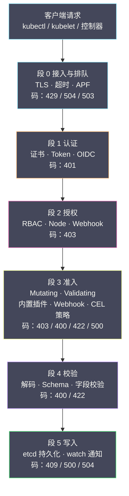
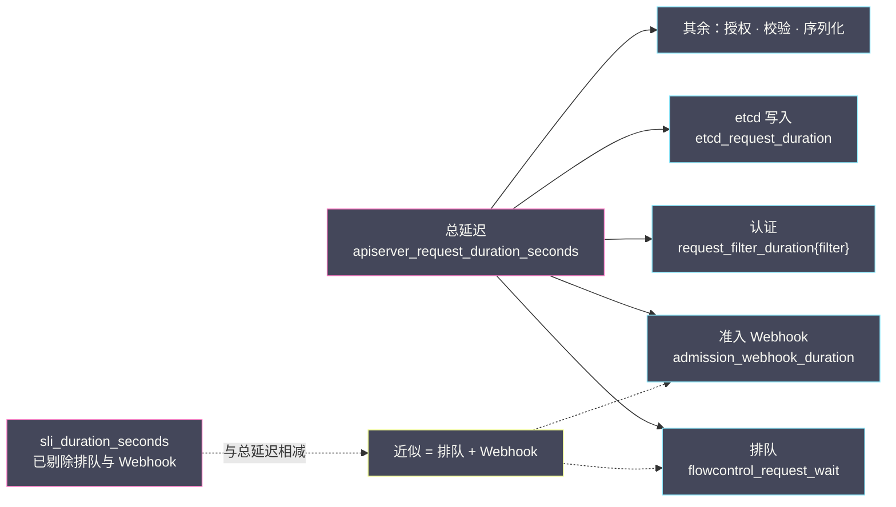
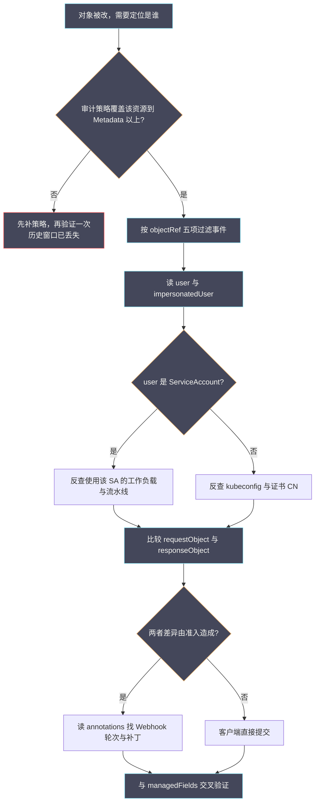
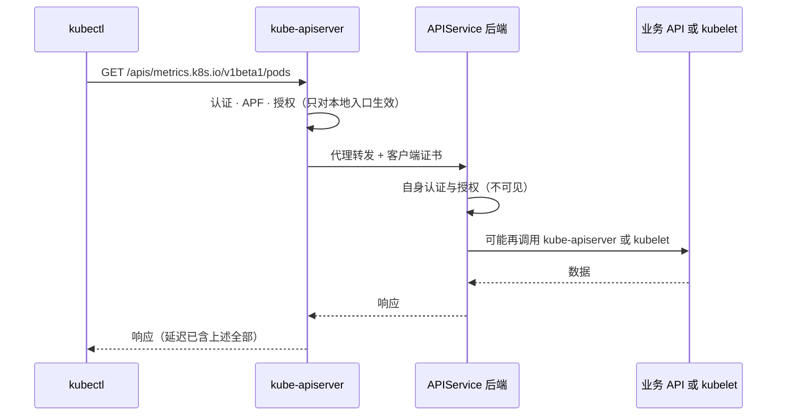

# 01 API Server 的角色与整体架构

**摘要：**

一个三百节点、八千 Pod、日均两千个变更的集群里，值班遇到 API Server 的症状通常只有两句话：「`kubectl apply` 被拒了」和「`kubectl get` 转圈」。这两句话背后可能落在六个完全不同的位置上：排队被拒、认不出身份、权限不足、准入插件拦截、对象校验失败、etcd 写入失败。本文不重讲七重角色与 handler chain 的实现推导（那些在 [[云原生/Kubernetes/Kubernetes架构深度剖析/04 API Server 请求链路：从 HTTP 请求到 etcd 写入|架构深度剖析 04]] 里已经写透），而是把请求管线切成「前置排队 → 认证 → 授权 → 准入 → 校验 → 写入」六段，逐段给出外部可见的痕迹：看哪个指标、读审计日志的哪个字段、错误码说明问题属于哪一层。文章随后把状态码按语义分层，讲清 401 与 403 的归属、403 的四个来源、500 与 503 与 504 的分界；再用一整章讲审计策略的分级、日志体积代价与「谁改了它」的反查流程；最后落到聚合 API 多出来的那一跳，以及四个真实反例。读完应当能回答两件事：这次的请求卡在哪一段，下一次怎样在五分钟内定位到同一段。

---

## 第 1 章 先分段落，再分责任

### 1.1 一次「被拒」与一次「很慢」

凌晨两点，告警群里出现两条消息：应用团队说发布流水线报 `Error from server (Forbidden): deployments.apps "checkout" is forbidden`，平台团队说 `kubectl get pods -A` 超过三十秒才返回，中间还夹杂一次 `unable to retrieve the complete list of server APIs`。两条消息都指向 API Server，但它们是两个完全不同的问题——前者在管线中段被某个策略挡住，后者根本还没走到业务逻辑，卡在了聚合层的发现请求上。

值班常见的错误做法是把两者都当成「API Server 挂了」，然后去翻 `--v=4` 的日志，在一堆 `httplog` 行里找线索。日志里确实有东西：请求方法、URI、响应码、耗时、客户端 User-Agent、源 IP 都在，但它不告诉你请求体是什么、对象叫什么、是谁的哪条策略拒的，而且这些日志会随容器日志轮转消失，留存窗口常常不到一小时。真正能回答「谁、在什么时间、对哪个对象、做了什么、结果如何」的，是审计日志；真正能把延迟拆到段的，是指标。

所以排障的第一步不是查，而是把请求切开。

### 1.2 段的边界由包裹顺序决定

很多文章把处理链画成一条从左到右的直线，实际实现是一层层包裹的洋葱：外层先执行，内层后执行，响应再原路返回。这个包裹顺序决定了同一类错误码出现的先后关系，也就决定了「你看到的现象」能推出「它在哪一段」。

以 1.37 口径的 `staging/src/k8s.io/apiserver/pkg/server/config.go` 中 `DefaultBuildHandlerChain` 为例，从最外层往内层的顺序大致是：审计初始化（AuditInit）、panic 恢复、discovery 完成检查、请求接收时间戳、请求信息解析、HTTP 日志、缓存控制、关闭期 Retry-After、等待组、请求截止、非长请求超时、CORS、**认证**、追踪、**审计**、**身份模拟**、**优先级与公平性（APF）**、**授权**，然后才进入路由与资源处理器，准入插件链与对象校验都在处理器内部。

这段顺序里有四个容易被忽略的推论，它们直接决定了排障时该看什么：

第一，认证在 APF 之外，因此一个认证失败的请求不可能被限流成 429，它只会是 401。反过来，只要 429 出现在响应里，就说明这个请求已经通过认证、也已经完成了身份模拟，问题不在凭证。

第二，APF 包着授权，因此 429 会先于 403 出现。一个没有权限的客户端在集群过载时可能持续收到 429，而不是它「应得」的 403；此时去查 RBAC 是白费力气，该看的是 FlowSchema 与优先级层配置（机制见 [[云原生/Kubernetes/Kubernetes架构深度剖析/04 API Server 请求链路：从 HTTP 请求到 etcd 写入|架构深度剖析 04]] 的 APF 一节与 [[云原生/Kubernetes/kubernetes之API Server/06 API Server 性能调优与高可用|06 性能调优]]）。

第三，审计在认证之内、在 APF 与授权之外，因此 429 与 403 都有审计事件可查，而认证失败走的是另一条失败认证分支（`WithFailedAuthenticationAudit`），记录的事件依然带 `user` 字段，只是那个 user 是 `system:anonymous` 或空身份。

第四，超时与请求截止在认证之外，因此 504 可能发生在还没认完身份的时候。当 OIDC 提供方响应缓慢，你看到的 504 与 etcd 毫无关系，改 etcd 参数只会浪费时间。

把段画出来，并标上每段会产出的码，是理解这张网最快的方式。



### 1.3 每段留下的三类外部痕迹

段内发生的事情在进程里，但段与外部世界的接触点只有三类：指标、审计事件、响应报文（外加容器日志这个易失渠道）。把这三类的覆盖情况列出来，就能看出为什么有些层「很好查」、有些层「只能读错误文本」。

| 段 | 失败码 | 指标覆盖 | 审计可查字段 | 响应与日志补充 |
| :--- | :--- | :--- | :--- | :--- |
| 段 0 接入与排队 | 429 / 504 / 503 | APF 拒绝与排队时长、请求终止计数、inflight | `responseStatus.code`，超时由请求截止过滤器补事件 | `Retry-After`、`Connection: close`；`httplog` 行 |
| 段 1 认证 | 401 | `apiserver_request_total{code="401"}` | `user`、`sourceIPs`、`userAgent`，失败认证分支 | `WWW-Authenticate` 头；客户端 `x509` 错误 |
| 段 2 授权 | 403 | `apiserver_authorization_decisions_total` | `annotations` 里的 `authorization.k8s.io/decision` 与 `reason` | `kubectl auth can-i`；消息里的 User 与 verb |
| 段 3 准入 | 403 / 400 / 422 / 500 | 准入步骤耗时、Webhook 请求与拒绝计数、CEL 策略计数 | `annotations` 里的注入与违规注解、`requestObject` | Webhook 返回体、`failurePolicy` |
| 段 4 校验 | 400 / 422 | 无专门指标 | `responseStatus.message` 是主证据 | `Invalid value: ...`、`unknown field` |
| 段 5 写入 | 409 / 500 / 504 | etcd 请求耗时与错误数、存储对象数、请求终止计数 | `objectRef`、`responseStatus` | watch 的 410 走重新 List（见架构深度剖析 04） |

这张表最重要的一格是段 4 的「无专门指标」。解码失败与 Schema 校验失败没有任何专属的 Prometheus 指标，它们的证据只存在于响应报文的 `message` 和审计事件的 `responseStatus` 里。这也解释了为什么只靠看板永远定位不到「422 是哪个字段错了」——看板只能告诉你「422 变多了」。

---

## 第 2 章 状态码：把「哪一段」先定下来

### 2.1 码是路标，不是根因

HTTP 状态码在 API Server 里的语义比一般 Web 服务更窄也更硬：段决定调用哪个错误构造器，构造器决定码。所以见到码就能先划一个大方向，再去找具体主体。方向错了，后面的证据都会被误读。

| 码 | 语义归属 | 典型响应文本 | 第一份该看的证据 | 常见误判 |
| :--- | :--- | :--- | :--- | :--- |
| 401 | 认证段：认不出你是谁 | `Unauthorized`、`the server has asked for the client to provide credentials` | 证书有效期、Token 过期、`--api-audiences` | 当成 RBAC 权限不足 |
| 403 | 授权段或准入段：知道你是谁，但不许做 | `pods is forbidden: User "..." cannot list ...`、`exceeded quota`、`violates PodSecurity` | 审计里的 `decision` / `reason` 注解、消息主语 | 一律当成 RBAC 缺 Binding |
| 400 | 解码段或请求格式 | `the body of the request was in an unknown format`、`unknown field` | 请求体与 `Content-Type`、`fieldValidation` 取值 | 当成对象字段值不合法 |
| 422 | 校验段：结构对、语义不对 | `Pod "x" is invalid: spec.containers[0].image: Required value` | 响应 `message` 里的字段路径 | 当成准入插件拒绝 |
| 409 | 写入段：并发或已存在 | `the object has been modified`、`already exists`、`Apply failed with N conflict` | 客户端重试逻辑、`managedFields` | 当成 etcd 故障 |
| 429 | 段 0：排队被拒或被限流 | `Too many requests, please try again later.` | APF 拒绝计数与 FlowSchema；前置 LB | 当成认证或授权问题 |
| 500 | 段 3 或段 5：内部错误 | `Internal error occurred: ...`、`failed calling webhook` | Webhook `failurePolicy`、etcd 错误计数 | 一律归咎 etcd |
| 503 | 段 0：服务端尚未能接待 | `the server is currently unable to handle the request` | `apiserver_request_total{code="503"}` 的来源 URI | 当成 502/网络抖动 |
| 504 | 段 0：自身超时 | `Timeout: request did not complete within the allotted timeout` | `--request-timeout` 与当时慢在哪一段 | 直接当成后端慢 |

表里 500 与 503 的分野值得单独说一句。500 是「我尝试处理了，但内部出错」，503 是「我还没有能力处理你这件事」——前者要查具体组件的错误，后者只说明接待条件不具备。API Server 启动过程中，多路复用器与 discovery 尚未装配完成，未注册的路径会由兜底处理器返回 503 而不是 404，原因写在源码注释里：如果此时返回 404，垃圾回收与命名空间控制器会把 404 当成「对象已不存在」而做出破坏性动作。聚合层代理到后端的请求在 `APIService` 不可用时同样返回 503，消息与启动期完全一致，这是排障时最容易混淆的一处，后面第 5 章会展开。

### 2.2 403 有四个来源

权限类故障最容易被简化成「加个 RoleBinding」。但 403 至少能从四个地方产生，它们的根因、修复方式和审计痕迹都不一样。

- RBAC 授权器拒绝。消息形如 `deployments.apps is forbidden: User "system:serviceaccount:prod:deployer" cannot patch resource "deployments" in API group "apps" in the namespace "prod"`，审计事件的 `annotations` 里会带 `authorization.k8s.io/decision: forbid` 以及一条说明为何拒绝的 `reason`。
- Node 授权器拒绝。kubelet 只能访问分配给自己节点上的对象，越界访问会得到 403，消息里的 User 是 `system:node:<node>`，这类拒绝通常意味着节点上跑了不该跑的东西，或者 Pod 被调度到了错误节点。
- 准入插件拒绝。`ResourceQuota` 超额、`PodSecurity` 违反 `restricted` 档，返回的都是 403，消息主语是对象而不是 User。审计事件里 `objectRef` 有对象名，`annotations` 会带 `pod-security.kubernetes.io/enforce-violations` 之类的键。
- 准入 Webhook 拒绝。Webhook 返回 `allowed: false` 时，API Server 采用它给出的状态码（不小于 400 即原样透出，`rejection_code` 标签正是为此存在），所以它可以是 403，也可以是 400 或 422。

区分的方法不是猜，而是把响应消息读完整：授权器拒绝的主语是「User 对 resource」，准入拒绝的主语是「对象违反了某规则」，Webhook 拒绝会带引号里的 webhook 名称。

### 2.3 400 与 422 的分界

409、429 之外还有一对常被混用的码。400 出现在请求还没被理解的时候：JSON 语法错误、`Content-Type` 不被接受、用 protobuf 发了一个只能收 JSON 的端点、在 `fieldValidation=Strict` 下带上未知字段。422 出现在请求已经被解析成对象、但对象不符合 API 约束的时候：必填字段缺失、枚举值非法、字符串不匹配正则、CRD 的 OpenAPI Schema 拒绝。

这个分界对排障的意义在于：400 多半出在客户端序列化或代理改写上（譬如网关改写 `Content-Type`、SDK 与服务端版本不匹配），422 则出在对象内容或服务端 Schema 上（譬如 CRD 升级收紧了校验，旧控制器还在写老格式）。两者的证据都只有响应文本，所以遇到它们时第一件事是把完整响应体打出来。

### 2.4 用 server-side dry-run 切掉最后一跳

`kubectl apply --dry-run=server` 是一个被低估的分段工具：它会让请求完整通过认证、授权、变更准入、Schema 校验与验证准入，但不写 etcd。于是同一个请求在两种模式下的差异就变成了判断依据。

| 现象 | 结论 | 后续动作 |
| :--- | :--- | :--- |
| dry-run 与真写都 403 | 授权段或准入段 | 先看消息主语，区分 RBAC 与准入 |
| dry-run 通过、真写 409 | 写入段的并发冲突 | 查 `resourceVersion`、`managedFields` 与重试逻辑（见 [[云原生/Kubernetes/Kubernetes架构深度剖析/08 ResourceVersion 与乐观并发控制|架构深度剖析 08]]） |
| dry-run 通过、真写 500 | 写入段或 etcd | 查 etcd 错误计数与磁盘、配额 |
| dry-run 也 504 | 段 0 或 Webhook | 看超时发生时的阶段耗时，而不是 etcd |
| 两次都 422 | 校验段 | 读字段路径，与 CRD 或 API 版本对齐 |

需要留意一个副作用：dry-run 并不等于零成本。它会真实调用准入 Webhook、真实计算配额，只是不落盘；如果某个 Webhook 有外部副作用（譬如分配 IP、创建外部资源），dry-run 也会触发它。这是 Webhook 设计里需要自行遵守的约定，不由 API Server 保证。

---

## 第 3 章 六段的外部观测点

### 3.1 段 0：连接、排队与超时

排在身份之前的三件事经常被合并讨论，但它们的证据完全不同。

连接层不在请求管线内。TLS 握手失败时你拿不到任何 HTTP 状态码，客户端报 `x509: certificate signed by unknown authority`、`remote error: tls: handshake failure` 或直接连接被重置。要区分「没有 TLS」与「有 TLS 但没有凭证」，可以先用一个不涉身份的探针：`/readyz` 与 `/livez` 默认允许匿名访问，`curl -k https://<apiserver>:6443/readyz?verbose` 能通说明连接、TLS 与进程自身都正常，剩下的才是身份问题。

超时段的证据是 504 加上一组终止计数。`--request-timeout` 默认 1m0s，超时后由超时过滤器返回 `NewTimeoutError`，同时 `apiserver_request_terminations_total{code="504"}` 加一；如果被超时的处理器还在后台跑（Go 的 goroutine 不会因为客户端超时自动停），`apiserver_request_post_timeout_total` 会继续增长，这个指标的上涨往往和 etcd 抖动、Webhook 卡死同时出现。

排队段的证据是 429 加上 APF 的专用指标。`apiserver_flowcontrol_rejected_requests_total{priority_level,flow_schema,reason}` 直接告诉你请求被哪个优先级层拒绝、属于哪个 FlowSchema、原因是什么；`apiserver_flowcontrol_request_wait_duration_seconds` 告诉你排队等了多久；`apiserver_current_inflight_requests{request_kind}` 则给出当前占用的并发。429 未必来自 API Server：如果 apiserver 前面挂了负载均衡或网关，它们自己的限流也返回 429，此时 API Server 侧的同码计数不会上涨，这个对照本身就能定位责任方。

关闭期的拒绝码也常被认错。apiserver 进入优雅关闭后，`--shutdown-delay-duration` 期间仍正常服务、`/readyz` 立刻变红；延迟结束后新请求被 `WithRetryAfter` 拦下，返回 429 加 `Retry-After` 与 `Connection: close`，而不是 503。看到「429 且连接被关闭」，先确认是不是副本在滚动重启。

### 3.2 段 1 认证：401 只说明「不知道你是谁」

认证段的观测点比较薄，但足够定位。指标侧最直接的入口是 `apiserver_request_total{code="401"}`，它按 verb、resource、scope 分组，能看出是全集群的 401，还是某一类客户端（某个 resource 的高频 401 通常指向某个控制器或 agent 的凭证过期）。

审计侧是主要证据。认证失败的请求走失败认证分支，事件里 `user` 是 `system:anonymous`，`sourceIPs` 与 `userAgent` 决定了「是谁在敲门」。若审计策略把这类请求记成 None，你只能看到计数上涨而不知道来源，这是策略设计里最容易留下的盲区。

笔者建议把判定顺序固定为三步：先确认 401 的分布（全集群还是单客户端），再看 `userAgent` 与 `sourceIPs`，最后才怀疑具体凭证。单客户端 401 优先查证书过期与 ServiceAccount Token 的受众（`--api-audiences` 与 Token 里的 aud 不匹配会直接 401）；全集群 401 优先查认证配置本身，譬如结构化认证配置（`--authentication-config`，1.34 起稳定）里 issuer 或 JWKS 地址配置错误、CA 证书轮换未同步。认证机制本身的取舍见 [[云原生/Kubernetes/Kubernetes架构深度剖析/05 认证、授权与准入控制：K8s 的安全三级防线|架构深度剖析 05]]。

### 3.3 段 2 授权：403 的注释比消息更有用

授权段的专用指标是 `apiserver_authorization_decisions_total{name,type,decision}`，它按授权器类型与名字拆分终局决策，能在 RBAC 拒绝与 Node 拒绝之间先分一次类。授权 Webhook 另有一组 `apiserver_authorization_webhook_duration_seconds` 与失败开放计数，用来判断慢或失败的是不是外部授权服务。

真正好用的是审计注解。RBAC 授权器在拒绝时会把决策和理由写进事件的 `annotations`：`authorization.k8s.io/decision: forbid` 配合 `authorization.k8s.io/reason`，里面往往直接写出「user 不在任何授予该 verb 的 RoleBinding 里」。这比响应消息多了一层因果，在多层 RoleBinding 与聚合 ClusterRole 交织的场景里尤其明显。

验证环节用 `kubectl auth can-i` 配合 `--as`：`kubectl auth can-i get pods --namespace prod --as system:serviceaccount:prod:deployer`。请注意这个命令本身也是一次授权请求（SelfSubjectAccessReview），如果连它都 403，说明发起者的 `can-i` 权限本身缺失，此时的 403 与被测身份无关。授权模型的设计细节见 [[云原生/Kubernetes/kubernetes之API Server/03 授权机制——RBAC 深度解析|03 授权机制]]。

### 3.4 段 3 准入：Webhook 是 403、422、500 的混合产地

准入段的观测点是全管线里最丰富的一段，因为它是唯一有外部进程参与、且参与方可能失败的段。

指标侧有三层。`apiserver_admission_step_admission_duration_seconds{type="admit"|"validate",operation,rejected}` 给出「变更准入」与「验证准入」两个子阶段的耗时与拒绝计数；`apiserver_admission_controller_admission_duration_seconds{name}` 进一步拆到具体内置插件（配额、PodSecurity、LimitRanger）；`apiserver_admission_webhook_admission_duration_seconds{name}` 与 `apiserver_admission_webhook_request_total{name,code,rejected}` 拆到具体 Webhook 名称与返回码。用 CEL 写的 `ValidatingAdmissionPolicy` 走 `apiserver_validating_admission_policy_check_total{policy,policy_binding,enforcement_action,error_type}`，这个指标的价值在于把「策略拒绝」与「表达式求值出错」分开——后者往往是 CEL 里访问了对象上不存在的字段，属于策略作者的问题，不是业务对象的问题。

失败行为的分层比指标更需要记住：

- Webhook 明确拒绝：码值由 Webhook 决定（不小于 400 时原样透出），消息里带 Webhook 名字与它的说明。
- Webhook 调用失败且 `failurePolicy: Fail`（默认值）：API Server 返回 500，消息形如 `Internal error occurred: failed calling webhook "..."`。这类 500 与 etcd 无关，但它是生产里最常见的「500 归错段」。
- Webhook 调用失败且 `failurePolicy: Ignore`：请求放行，`apiserver_admission_webhook_fail_open_count` 加一。这个计数长期非零意味着有一条安全策略在静默失效，属于安全侧的高优先级信号。
- Webhook 超过 `timeoutSeconds`（默认 10 秒）未响应：等同调用失败，按 `failurePolicy` 处理，同时把整条请求的延迟推高，最终可能以 504 收场。

审计侧的价值在于能还原「对象被谁改过」。`requestObject` 记录的是**转换版本之前、默认值填充与准入之前**的对象，`responseObject` 是准入之后回给客户端的对象，两者一对比就是准入干的事。若改动来自 Mutating Webhook，事件的 `annotations` 里会出现 `mutation.webhook.admission.k8s.io/round_0_index_0` 与 `patch.webhook.admission.k8s.io/round_0_index_0` 一类的键，直接点名哪个 Webhook 在第几轮改了哪些字段。这条能力在排查「为什么部署出来的 Pod 多了一个 sidecar」时比翻 Webhook 日志快一个数量级。准入机制与策略引擎选型见 [[云原生/Kubernetes/kubernetes之API Server/04 准入控制器深度解析|04 准入控制器]]。

### 3.5 段 4 校验：只读错误文本的一段

校验段没有专属指标：解码与字段校验是 CPU 上的一次函数调用，不涉及外部依赖，没有被观测的动机。证据只有两处——响应报文的 `message` 与审计事件的 `responseStatus.message`。

好消息是这两处的信息密度很高。`Pod "web-0" is invalid: spec.containers[0].image: Required value` 这样的消息已经给出了字段路径与原因；CRD 的 Schema 错误会给出 `spec.replicas: Invalid value: "three": spec.replicas in body must be of type integer` 之类的类型不匹配说明；未知字段在严格校验下报 `unknown field "spec.template.spec.foo"`。

这一段与段 3 的交界处有一个实操判断：如果消息里出现对象名加 `is invalid`，且字段路径清晰，属于校验段；如果消息里出现 `forbidden`、`denied`、`violates` 或 Webhook 名称，属于准入段。两者都会被客户端打印成一行 `Error from server (...)`，但归属不同，修复路径也不同——前者改对象，后者改策略或授权。

### 3.6 段 5 写入：etcd 的账要看两个方向

写入段的证据分读、写两个方向，这个区分在 etcd 出问题时尤其关键。

写方向的指标是 `etcd_request_duration_seconds{operation,resource,group}` 与 `etcd_request_errors_total`，前者按操作类型拆（create、update、delete、deletecollection），后者给出失败计数；容量侧看 `apiserver_storage_size_bytes`（存储文件实际占用）与 `apiserver_resource_objects`（按 group 与 resource 统计的对象数，1.34 起取代已弃用的 `apiserver_storage_objects`）。写失败最常见的三种表现是：etcd 磁盘 IOPS 打满导致写请求排队进而 504、etcd 配额（默认 2GiB 的后端存储上限）写满导致 `etcdserver: mvcc: database space exceeded` 进而 500、以及 etcd 成员失去 quorum 导致所有写失败。

读方向容易被忽略：List 与 Get 在默认的 `resourceVersion=""` 或 `"0"` 下由 watch cache 提供，不查 etcd；只有带精确 `resourceVersion` 的读才会回源。于是 etcd 短暂不可用时的典型现象是「读还好、写全挂」——`kubectl get` 从缓存返回，`kubectl apply` 报 500。把这条现象当成 etcd 故障的确认信号，比看 `kubectl get` 是否可用更可靠。缓存过旧导致的 410 Gone 与重新 List 的行为，机制在 [[云原生/Kubernetes/Kubernetes架构深度剖析/04 API Server 请求链路：从 HTTP 请求到 etcd 写入|架构深度剖析 04]] 的 watch cache 一节；etcd 自身的运维边界见 [[中间件/ETCD/00 专栏导览|etcd 专栏]]。

写入段还会产出 409，但它几乎从不是故障：创建已存在的对象、更新时 `resourceVersion` 过期、服务端应用（SSA）出现字段所有权冲突，都是乐观并发的正常表达，客户端应当重试或改字段所有权。把 409 当成 etcd 异常去查磁盘，是值班里常见的方向性错误。

### 3.7 一次延迟归因的算法

把段拆开后，延迟归因就变成一个减法问题。`apiserver_request_duration_seconds` 是含全部环节的总时长；`apiserver_request_sli_duration_seconds` 明确不计 Webhook 耗时与 APF 排队等待；两者的差近似就是「Webhook + 排队」的增量。再往下拆，`apiserver_flowcontrol_request_wait_duration_seconds` 单独给出排队，`apiserver_admission_webhook_admission_duration_seconds` 单独给出 Webhook，`apiserver_request_filter_duration_seconds{filter}` 给出认证、授权、模拟等过滤器各自的耗时，`etcd_request_duration_seconds` 给出最后的落盘时间。



这套算法的前提要说清：指标是聚合值，不是单条请求的分解，它只能告诉你 p99 主要花在哪一段。要定位单条请求，得回到审计事件——`requestReceivedTimestamp` 与 `stageTimestamp` 的差就是它在服务端的总耗时。

---

## 第 4 章 审计日志：配置、代价与反查

### 4.1 它回答什么，不回答什么

审计子系统回答五个问题：谁发起的、什么时候、对什么对象、做了什么、结果如何。它不回答「为什么慢」，也不回答「etcd 当时在干什么」——那是指标与 etcd 日志的事。在审计日志里找延迟原因，和在指标里找操作者身份，都是在错误的介质里找答案。

审计事件在请求的特定阶段生成，阶段只有四个：`RequestReceived`（审计处理器刚拿到请求、尚未下传）、`ResponseStarted`（响应头已发、响应体未发，只对 watch 这类长请求生成）、`ResponseComplete`（响应体写完）、`Panic`（处理中发生 panic）。一个普通请求通常产出 `RequestReceived` 与 `ResponseComplete` 两条事件，策略里省掉前者，事件量直接减半，代价是失去「请求进来但没走完」这段时长的对照。

### 4.2 策略：四级、四阶段、首条匹配

审计策略是一个有序规则列表，每条规则给出级别与匹配条件。事件按列表顺序与规则比对，**第一条命中的规则决定级别**，因此兜底规则必须放在最后，否则它会吞掉后面所有更精细的规则。级别只有四档，其代价差异是全章的重点。

| 级别 | 记录内容 | 单事件体积的主要构成 | 相对代价 | 适用场景 |
| :--- | :--- | :--- | :--- | :--- |
| None | 不记录 | 无 | 零 | 高频只读、探针、健康检查 |
| Metadata | 请求元数据：user、verb、objectRef、时间、源 IP、响应码 | 数百字节到一两千字节 | 低 | 全集群兜底级别 |
| Request | 元数据 + 请求体（非资源请求不适用） | 与请求对象同阶 | 中 | 记录「谁提交了什么」的写操作 |
| RequestResponse | 元数据 + 请求体 + 响应体 | 与请求对象加响应对象同阶 | 高 | 少数敏感资源的变更，或短时取证 |

把写操作的级别定在 Request、把读操作与高频心跳定在 Metadata、把 Secret 与 ConfigMap 的读写成 None 或 Metadata（取决于合规要求），是生产中比较稳的组合。有一个细节必须写进策略注释里：`resources` 里的 `pods` **不会**匹配 `pods/status` 或 `pods/log`，子资源要单独列；`namespaces: [""]` 表示集群级资源；非资源 URL 默认不会命中任何 `resources` 规则，需要 `nonResourceURLs` 单独覆盖，否则 `kubectl version`、`/healthz` 这一类请求根本不在审计里。

### 4.3 后端与参数：先把体积账算出来

日志后端把事件按 JSON Lines 写入文件，可以通过 `--audit-log-path` 启用（不设该参数则日志后端关闭，`-` 表示标准输出）。轮转与留存由三个参数控制，它们的默认值加起来就是一个容易被忽略的容量陷阱。

| 参数 | 默认值 | 含义 | 调大的代价 | 调小的代价 |
| :--- | :--- | :--- | :--- | :--- |
| `--audit-log-path` | 未设置 | 日志文件路径，未设置则关闭 | 不适用 | 关闭即无审计，合规缺口 |
| `--audit-log-maxsize` | 100 | 单文件轮转阈值（MB） | 单文件变大，检索变慢 | 文件切得更碎，频繁轮转 |
| `--audit-log-maxbackup` | 100 | 保留的旧文件数量 | 磁盘占用线性上升 | 历史窗口缩短，取证不够回溯 |
| `--audit-log-maxage` | 366 | 按天数保留 | 一年以上文件堆积 | 老文件被提前删除 |
| `--audit-log-format` | json | 事件格式（legacy 为单行文本） | 不适用 | legacy 不便 jq 检索 |
| `--audit-log-mode` | blocking | 同步写，事件写完才返回响应 | 不适用 | batch 异步写会因缓冲溢出丢事件 |
| `--audit-log-compress` | 关闭 | 轮转文件 gzip 压缩 | 不适用（开启省盘） | 不压缩更占盘 |
| `--audit-log-truncate-enabled` | 关闭 | 超限事件截断 | 不适用 | 关闭时超大事件可能整条被丢弃 |
| `--audit-log-truncate-max-event-size` | 102400 | 单事件上限（字节） | 更少截断，体积上升 | 请求/响应体被裁掉，取证失真 |
| `--audit-webhook-mode` | batch | Webhook 后端默认批量异步 | 不适用 | blocking 会拖慢全部请求 |

按默认值算，一个 apiserver 实例的审计文件上限是 100 个备份 × 100 MB，加上当前文件约十吉字节量级；三个副本就是三十吉字节，而且这还不含事件本身的增长速度。`--audit-log-maxsize 0` 会关闭轮转，配合 `maxbackup 0` 就变成「无限增长」，这两个 0 是磁盘被打爆的经典组合。

比磁盘更早出问题的是延迟。日志后端默认 blocking，事件写入完成才放行响应，于是审计磁盘的 fsync 延迟会直接加到每个请求上。症状很有辨识度：所有资源、所有客户端的 p99 一起抬高，`etcd_request_duration_seconds` 完全正常，而 `/var/log` 所在磁盘的 await 很高；把策略从 RequestResponse 降回 Metadata 或者改成 batch，延迟立刻回落。改成 batch 的代价是缓冲溢出时静默丢事件，`apiserver_audit_event_total` 与事件实际落盘数量的差就是丢失量，这个差值在合规审计里是要解释的。

### 4.4 反查「谁改了它」的六个步骤

审计日志最实用的场景不是事后合规，而是当场定位一次非预期变更。以「生产环境的 checkout Deployment 副本数被改成 0」为例，路径是固定的。

第一步，确认策略覆盖。目标资源（`deployments`）必须命中一条级别不低于 Metadata 的规则，否则后面全部无效。这一条要在平时就验证过，不能等出事才发现 `deployments` 落进了某个 None 规则。

第二步，用 `objectRef` 收窄。审计事件的 `objectRef` 带 `resource`、`namespace`、`name`、`apiVersion`、`subresource`，按这五项过滤比按 URI 字符串匹配可靠。

第三步，看 `user` 与 `impersonatedUser`。前者是真实身份（可能是某个 ServiceAccount），后者是管理员用 `--as` 模拟时的目标身份。改副本数这类动作最常见的是某个控制器或流水线 SA；若 `user` 是 `system:serviceaccount:<ns>:<sa>`，下一步是查这个 SA 被哪个工作负载使用。

第四步，比较 `requestObject` 与 `responseObject`。`requestObject` 是客户端提交的原始对象（转换版本、默认值、准入之前），`responseObject` 是最终返回的对象。副本数从 3 变 0，在哪一侧体现，直接区分「客户端的错」与「准入改的」。

第五步，看 `annotations`。Webhook 的注入痕迹、PodSecurity 的违规记录、RBAC 的决策理由都在这里；若请求体里副本数是 3、响应体里是 0，且注解带 `patch.webhook.admission.k8s.io/round_0_index_0`，那就是某个 Webhook 干的。

第六步，与 `managedFields` 交叉验证。`metadata.managedFields` 记录了每个字段管理器、操作类型与时间，能告诉你「哪个 manager 最后写了 `spec.replicas`」。两者对不上时（譬如审计里是人、managedFields 里是控制器），通常是控制器在缓存未同步时做了纠正写回。



用 jq 处理 JSON Lines 是日常操作，一条能直接跑的命令长这样：

```bash
# 筛出审计日志里所有对 deployments 的写操作，再按时间窗收窄
jq -c 'select(.stage == "ResponseComplete"
          and .objectRef.resource == "deployments"
          and (.verb == "update" or .verb == "patch" or .verb == "create"))
       | {t: .requestReceivedTimestamp, user: .user.username,
          ref: .objectRef, code: .responseStatus.code,
          ann: .annotations, auditID: .auditID}' \
   /var/log/kubernetes/audit/audit.log
```

若同时配了 webhook 后端（`--audit-webhook-config-file`），检索交给日志平台，但它的限流参数（默认每秒 10 批、每批 400 条、最多等 30 秒）会挤掉低级别事件，取证窗口与日志后端不一致。

### 4.5 审计子系统自己也会坏

审计是唯一一个「记录失败会反过来影响请求」的旁路系统，它的故障有三个层次，各有一组指标。

事件没生成：`apiserver_audit_level_total{level}` 按级别计数，如果 Metadata 的总数在策略未变的情况下掉到零，说明策略文件没被真正加载（`--audit-policy-file` 路径错、文件内容被挂错、规则写成了空列表——空规则列表在审计策略里是非法的）。

事件生成了但没写出去：`apiserver_audit_error_total{plugin}` 按插件计数，日志后端写失败、webhook 后端调用失败都在这里；而 `--audit-log-mode=blocking-strict` 下若在 `RequestReceived` 阶段写失败，整个请求会被直接拒绝，`apiserver_audit_requests_rejected_total` 即为此准备；这个模式只适合审计后端本地、磁盘可靠的集群。

事件被截断或丢弃：截断默认关闭，此时超大事件会连请求体与响应体一起完整写入，反而让审计写入成为瓶颈；开启截断后，超限事件先丢 `requestObject` 与 `responseObject`，仍超限则整条丢弃。后者意味着「审计文件里没有这条」，而指标只给总数，不会指出是哪条。判断依据是同一时间窗内 `apiserver_request_total` 与 `apiserver_audit_event_total` 的比值——比值突然下降，就是事件在生成之后丢了。

---

## 第 5 章 聚合层：多出来的一跳与转移的责任

### 5.1 路径上多了一段不可见的路

聚合层的机制一句话可以说清：`APIService` 对象在 kube-apiserver 里「认领」一段 URL 路径，此后发往该路径的请求由 kube-apiserver 代理给后端的扩展 API Server，客户端无感。注册方式与代理链路见 [[云原生/Kubernetes/Kubernetes架构深度剖析/04 API Server 请求链路：从 HTTP 请求到 etcd 写入|架构深度剖析 04]] 的聚合层一节，这里只谈运维含义。

对一个请求来说，多出来的东西有三样：一次网络往返（kube-apiserver 到后端 Service 或 endpoints）、一次双向 TLS 的身份校验（`--proxy-client-cert-file` 出示身份，后端用 `extension-apiserver-authentication` 里的 CA 验证）、以及一段在 kube-apiserver 里不可见的后端处理时间。



这张图解释了两件事。其一，`kubectl top pods` 慢的时候，你看到的 `apiserver_request_duration_seconds` 里那一段变长，无法区分「kube-apiserver 代理慢」与「后端慢」，因为入口侧只测到自己的包裹边界。其二，后端自己也是一个 apiserver，它有自己的认证、授权、审计与限流；如果它没有独立部署监控与审计，这一段就是彻底的黑盒。

### 5.2 责任转移：503 与 discovery 的连锁

聚合层最典型的故障形态是「一个扩展 API 挂了，所有 kubectl 命令都变慢或报错」。原因在 discovery：kubectl 在执行任何资源操作之前都要拉取 discovery 数据，把 `pods` 这类短名解析成资源路径、并判断是否 namespaced；聚合发现（aggregated discovery，1.30 起稳定）让这件事收敛到 `/api` 与 `/apis` 两个端点，但这两个端点的内容仍然要覆盖所有已注册的 API 组，包括聚合组。

于是 `metrics-server` 不可用时，`/apis/metrics.k8s.io/v1beta1` 的发现请求超时，`/apis` 的聚合结果不完整，kubectl 报 `unable to retrieve the complete list of server APIs: metrics.k8s.io/v1beta1: the server is currently unable to handle the request`，连带 `kubectl get pods` 也失败或明显变慢——哪怕 Pod 这件事与 metrics 毫无关系。

这类故障的判据是两条命令：`kubectl get --raw /api/v1` 能通说明 kube-apiserver 本体正常；`kubectl get --raw /apis/metrics.k8s.io/v1beta1` 失败说明问题在聚合组。`kubectl get apiservices` 的 AVAILABLE 列与 `status.conditions` 同源，聚合器会周期性探测后端并把结论写进去，所以一张 `kubectl get apiservices` 就能列出所有「借出去的责任」。指标侧对应 `aggregator_unavailable_apiservice{name}`（按 APIService 名给出不可用状态）与 `aggregator_unavailable_apiservice_total{name,reason}`（不可用的原因计数），`aggregator_discovery_aggregation_count_total` 则能看出发现聚合的频次是否异常升高。

还有一个被文档明确写出的约束：发现请求要求从 kube-apiserver 往返在五秒内完成。后端若在跨可用区、跨集群的网络里，或者冷启动时要做大量初始化，五秒很容易被突破，症状是「平时好好的，扩容或重启后 kubectl 整体变卡」。

### 5.3 配置与代价

聚合层的配置面很小，但每条都牵着责任边界。

| 配置项 | 作用 | 改动的代价 |
| :--- | :--- | :--- |
| `APIService.spec.service` | 指到后端的 Service（名、命名空间、端口） | 配错即整组 API 503；改端口要同步改后端监听 |
| `APIService.spec.insecureSkipTLSVerify` | 跳过后端证书校验 | 开启后失去后端身份验证，中间人可以冒充后端 |
| `APIService.spec.caBundle` | 验证后端服务端证书的 CA | 轮换后忘更新会导致该组 API 全部不可用 |
| `--proxy-client-cert-file` / `--proxy-client-key-file` | kube-apiserver 出示给后端的客户端证书 | 证书过期会同时打断聚合代理与准入 Webhook 调用 |
| `--requestheader-client-ca-file` | 校验代理客户端证书，后端据此信任用户头 | 配错导致后端看到的用户身份失真 |
| `--enable-aggregator-routing` | 直接路由到 endpoints IP 而非 Service clusterIP | 绕过 kube-proxy 排查网络问题的利器，但要确认网络策略允许 |
| `--aggregator-reject-forwarding-redirect` | 默认 true，拒绝后端转发的重定向 | 关掉会把后端重定向透给客户端，可能造成请求绕路 |
| `APIService.spec.groupPriorityMinimum` / `versionPriority` | 决定 API 组与版本在发现结果里的排序 | 配错会让 `kubectl` 优先选择错误的版本 |

参数表里最值得单独交代的是证书这条链。kube-apiserver 的客户端证书同时用于代理扩展 API 与调用准入 Webhook，所以「Webhook 全部 500」与「聚合 API 全部 503」可能同时发生，根因是同一张证书过期。此外，聚合代理与准入 Webhook 都属于递归调用场景——后端或 Webhook 在处理请求时可能反过来调用 kube-apiserver，两边的 APF 会同时生效，官方文档明确警告可能出现优先级反转甚至死锁，缓解办法是让这条子调用走高优先级层，或在非 kube-apiserver 的一方关掉 APF。

### 5.4 聚合层里的审计与指标边界

代理请求在 kube-apiserver 侧的审计事件里有痕迹：`requestURI` 是 `/apis/<group>/<version>/...`，`objectRef` 可能为空或只有 `apiGroup`/`apiVersion`，`responseStatus.code` 就是最终透传的码。但它不记录后端内部发生了什么，后端的审计事件在它自己的日志里，两者的 `auditID` 不保证一致（审计 ID 由接收请求的那个 apiserver 生成），因此跨聚合层对齐要用时间窗加 `requestURI`，而不是指望 ID 相同。

指标侧同样只覆盖入口这一段：代理请求的耗时计入入口的延迟直方图，后端内部的认证、授权、限流全部不可见。要让这一跳变得可运维，只有两条路——让后端也暴露自己的指标与审计，或者在 kube-apiserver 前面加一层能按 URI 前缀归因的网关。

---

## 第 6 章 反例与配置总表

### 6.1 只开 `--v=4`，不看审计

`--v=4` 打开的是 `httplog` 行，包含方法、URI、响应码、耗时、User-Agent 与源 IP。它看起来什么都有，实际缺三样：请求体、对象名字、以及是谁的哪条策略决定的。更麻烦的是留存：控制平面以静态 Pod 运行时，容器日志受 kubelet 的 `--container-log-max-files=5` 与 `--container-log-max-size=10Mi` 约束，一个 apiserver 容器只有五十兆左右的轮转窗口，高峰期几分钟就被覆盖。两小时后复盘，日志里什么都没有了。

正确做法是让渠道各司其职：常规日志用于进程级异常（etcd 连接、TLS 配置、启动失败），审计用于请求级取证，指标用于趋势与延迟。

### 6.2 把审计级别一律开到 RequestResponse

「审计越全越好」在磁盘上不成立。RequestResponse 会同时记录请求体与响应体，一条 List 请求的响应体可能是几十兆（八千 Pod 的集群做一次全量 List，响应体量级远超单事件 100 KB 的截断阈值），事件要么被截断得面目全非，要么直接导致审计写入变成瓶颈。默认轮转下每实例十吉字节的账，全量 RequestResponse 几小时就能填满，`maxbackup` 一到就开始删最老的文件，事故发生时最需要的那段窗口恰好被删掉。

合理的做法是分级：全集群 Metadata 兜底，敏感资源与写操作提到 Request，只有取证窗口内需要的极少数资源才上 RequestResponse，并配合截断参数。审计磁盘要单独规划容量与 IOPS，不要和 etcd 的数据盘共用。

### 6.3 聚合层故障导致 `kubectl get` 整体超时

这类故障最容易被误判成「API Server 崩了」。值班看到 `kubectl get pods -A` 超时，第一反应是重启 apiserver 或者扩副本，重启之后症状依旧——因为故障在后端扩展 API Server 上，kube-apiserver 只是替它背了锅。判据在 5.2 节已经给出：`kubectl get --raw /api/v1` 与 `kubectl get --raw /apis/<聚合组>/<版本>` 两条命令就能把责任分开。

处置顺序也是固定的：先确认是哪一组 APIService 不可用（`kubectl get apiservices`），再看该组的后端 Pod 是否在运行、Service 是否有 endpoints、`caBundle` 是否与后端证书匹配，最后才考虑 `--enable-aggregator-routing` 绕开 Service 直接打 endpoints 验证网络路径。把聚合后端当成 kube-apiserver 的一部分、却不给它配监控，是这类故障反复发生的原因。

### 6.4 把 403 一律当 RBAC

第 2 章列过 403 的四个来源，值班里的典型表现是：看到 403 就加 RoleBinding，加完仍然 403，于是开始怀疑 RBAC 缓存。更快的路径是读响应消息的主语：`User "..." cannot ...` 是授权，`exceeded quota` 与 `violates PodSecurity` 是准入插件，带 webhook 名字的是准入 Webhook。三者分别对应改 Binding、改配额、改工作负载，方向完全不同。

| 反例 | 症状 | 常见误判 | 正解 |
| :--- | :--- | :--- | :--- |
| 只开 `--v=4` | 复盘时日志已轮转，缺请求体与对象名 | 认为「日志里有码就够了」 | 审计负责取证，指标负责趋势，日志只管进程异常 |
| 全量 RequestResponse | 审计盘被填满、最老文件被删、写入变慢 | 认为「审计越多越安全」 | 分级策略 + 截断 + 独立磁盘 |
| 聚合组不可用 | 所有 kubectl 命令超时，重启 apiserver 无效 | 重启控制平面、扩容副本 | 分两条 raw 请求确认真身，修 APIService 与后端 |
| 403 一律当 RBAC | 加 Binding 后仍 403，开始怀疑缓存 | 认为「403 就是权限不足」 | 读消息主语与审计注解，区分授权与准入 |
| 429 当认证故障 | 排查 Token 与证书，越查越乱 | 认为「限流不可能出现在这里」 | APF 在授权之外，429 说明已通过认证 |

---

## 第 7 章 收束

把六段、九个码、三类痕迹放在一起，排障就退化成一条固定的判断链：先由状态码定段，再由段选证据，最后由证据定主体。401 只说明身份没被认出来，403 要分清是授权器还是准入，400 与 422 只能读文本，409 是并发的正常表达，429 说明请求已经过了身份关，500 要区分 etcd 与 Webhook，503 是「还没准备好接待」，504 是「自己等超时了」。

审计日志在这条链里承担的角色，是把「谁」和「结果」固化下来，代价是磁盘、内存与延迟；它的每一档级别、每一个轮转参数都在拿这三样东西换取证能力。聚合层则把一段责任借了出去，借出去的那部分在入口侧既不可观测也不可控制，只能靠后端自己的指标与审计补回来。它们都不是配置完就结束的工作，而是要在容量、延迟与可追溯性之间持续校准。

真正决定排障上限的往往不是工具，而是平时有没有把「段」和「痕迹」对齐：策略覆盖到哪些资源、指标保留了哪些 label、聚合后端有没有自己的监控。等到事故来了再补这些，补的都是复盘时已经来不及的那部分。

---

## 参考资料

1. Kubernetes Documentation - Auditing：https://kubernetes.io/docs/tasks/debug/debug-cluster/audit/
2. Kubernetes Documentation - kube-apiserver 参数参考：https://kubernetes.io/docs/reference/command-line-tools-reference/kube-apiserver/
3. Kubernetes Documentation - Metrics Reference：https://kubernetes.io/docs/reference/instrumentation/metrics/
4. Kubernetes Documentation - API Priority and Fairness：https://kubernetes.io/docs/concepts/cluster-administration/flow-control/
5. Kubernetes Documentation - Kubernetes API Aggregation Layer：https://kubernetes.io/docs/concepts/extend-kubernetes/api-extension/apiserver-aggregation/
6. Kubernetes Documentation - Controlling Access to the Kubernetes API：https://kubernetes.io/docs/concepts/security/controlling-access/
7. Kubernetes Documentation - Validating Admission Policy：https://kubernetes.io/docs/reference/access-authn-authz/validating-admission-policy/
8. Kubernetes Source - `staging/src/k8s.io/apiserver/pkg/server/config.go`（`DefaultBuildHandlerChain`）：https://github.com/kubernetes/kubernetes/blob/master/staging/src/k8s.io/apiserver/pkg/server/config.go
9. Kubernetes Source - `staging/src/k8s.io/apiserver/pkg/apis/audit/types.go`：https://github.com/kubernetes/kubernetes/blob/master/staging/src/k8s.io/apiserver/pkg/apis/audit/types.go

---

> [!note] 思考题
> 1. 认证在 APF 之外、APF 又在授权之外：未通过认证的请求完全不进排队，而没权限但已认证的请求要先排队。如果遇到大量伪造 Token 的请求，APF 能起多大作用？你会把限流提前到哪一层，代价是什么？
> 2. 审计日志的 blocking 模式会把审计磁盘的延迟加到每个请求上，batch 模式会在缓冲溢出时静默丢事件。在你的合规要求下，这两个代价哪个更容易接受？
> 3. 聚合层的发现请求要求五秒内往返。如果一个扩展 API 的 P99 稳定在四秒，`kubectl` 的体验会怎样？你会先优化后端还是先调整发现缓存？
> 4. 段 4 校验没有专属指标。假设 422 突然增多而响应文本被中间层截断，你还能用哪些线索定位是哪个字段、哪类客户端？
> 5. 把审计策略里的 `deployments` 从 Metadata 提到 Request 之后，日志体积会涨多少？请给出一个可以先用小流量样本估算的方法，而不是直接在全量集群上试。