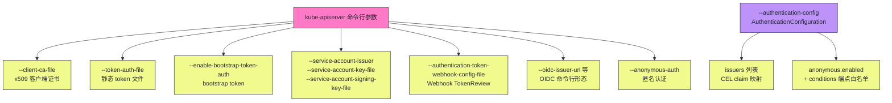
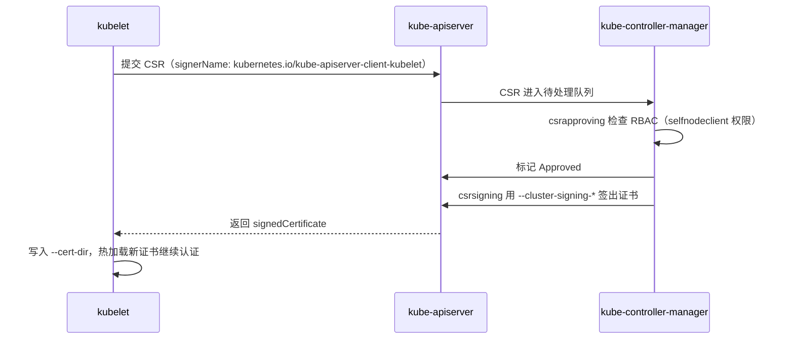
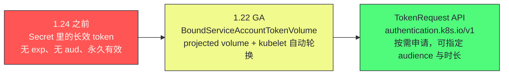
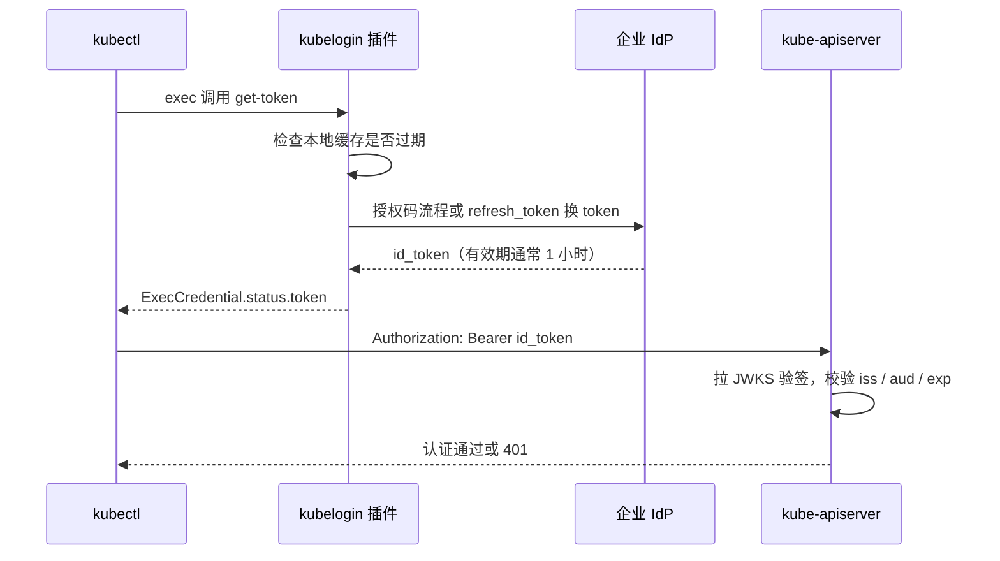
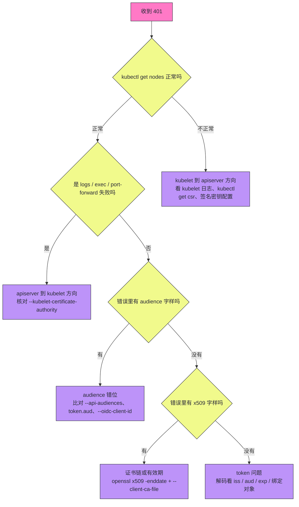

# 02 认证机制深度解析

**摘要：**

一个 300 节点、8000 Pod、日均 2000 个变更的集群，在某个凌晨三点开始收到零星的 401——先是某个 Operator 的调谐循环停了，接着新拉的 Pod 报 `Unauthorized`，最后节点陆续变成 NotReady。这类事故的根因往往不在某个认证器的原理上，而在"它当时是怎么被配上去的、谁负责让它续命"。本文不重讲认证器的实现推导，而是回答三件事：六种认证方式（客户端证书、ServiceAccount Token、OIDC、Webhook Token、静态 Token 文件、匿名）各自的配置入口、默认值与适用场景，哪几个开在生产里等于留后门；证书轮换的真实机制，`cluster-signing-*`、kubelet 的 CSR 自动批准、`--rotate-certificates`，以及 CA 轮换为什么必须"先信任新 CA 再换证书"；认证失败时怎么从一句 `Unable to authenticate the request` 走到那一个配错的参数。最后一章把这些内容压成一份可执行的基线检查表与四条反例，覆盖匿名访问、静态 token 文件、证书到期监控和 ServiceAccount token 轮换。认证链的短路语义与匿名身份判定，机制细节见架构深度剖析 05，本文只讲配置、轮换与排障，以及它们各自失效时在日志里留下的指纹。

---

## 第 1 章 认证的可配置面

K8s 的认证器不是"装上去就完事"的组件，它由 kube-apiserver 的一组启动参数和一份可选配置文件拼装出来。**拼装过程没有校验器**，写错的参数不会让集群报错，只会让某一类客户端在某一天悄悄失去入口——这比直接起不来更麻烦，因为在它被发现之前，集群看起来一切正常。

### 1.1 两条配置路径

apiserver 的认证能力有两类输入。一类是命令行参数，每个认证器一组 flag，`--client-ca-file` 对应 x509，`--token-auth-file` 对应静态 token，`--oidc-*` 一组对应 OIDC，`--authentication-token-webhook-config-file` 对应 webhook；另一类是 `--authentication-config` 指向的 `AuthenticationConfiguration` 资源，用一份 YAML 描述一个有多个 issuer 的 OIDC 配置、用 CEL 表达式做 claim 到用户名的映射，以及匿名认证的端点白名单。结构化认证配置（Structured Authentication Configuration）自 1.30 进入 beta、1.34 转 GA，具体字段以对应版本文档为准。

两条路径在 OIDC 上互斥。同时给出 `--authentication-config` 和任意一个 `--oidc-*` 参数，apiserver 直接拒绝启动；配置文件里写了 `anonymous` 段，也不能再给 `--anonymous-auth`。这个互斥规则在灰度升级时最容易被踩到——运维把新配置文件塞进 systemd unit，却忘了把旧的一串 `--oidc-*` 删掉，重启即失败，而失败信息只告诉你参数冲突，不告诉你该删哪个。

两条路径的取舍也很清楚：命令行参数适合"只有一个 IdP、一种映射"的简单场景，改动成本低；结构化配置适合多 IdP 并存，或者需要按 claim 做条件映射（譬如只在 `email_verified=true` 时才认这个用户）的场景，代价是多一份需要纳入配置管理、并且与命令行动态互斥的文件。

### 1.2 六种方式的配置入口

下图把"参数、配置文件、认证器"三者的对应关系摊开，六种方式各自挂在哪条路径上一目了然。

落到表格里，每种方式的默认状态与关掉的代价需要一起看，因为"默认开着"和"默认安全"是两件事。

| 认证方式 | 开启入口 | 默认状态 | 适用场景 | 开启或关闭的代价 |
| :--- | :--- | :--- | :--- | :--- |
| 客户端证书 | `--client-ca-file` | 不配就没有 | 控制面组件、kubelet、管理员应急通道 | 开启后证书无法吊销，只能等过期；关闭则 kubelet 与控制器全部失去入口 |
| ServiceAccount Token | `--service-account-issuer` 等一组 | 必配，缺则 apiserver 不起 | Pod 内进程、CI/CD、Operator | 关闭等于放弃 Pod 访问 API 的标准路径；签发密钥轮换需要重启 apiserver |
| OIDC | `--oidc-issuer-url` + `--oidc-client-id` 必填 | 不配就没有 | 人类用户、企业 SSO | 开启后 apiserver 必须能访问 IdP 的 discovery 端点；关闭则人只能用证书 |
| Webhook Token | `--authentication-token-webhook-config-file` | 不配就没有 | 自研 IAM、已有统一 token 体系 | 每次认证一次外部调用，默认缓存 2 分钟意味着吊销有延迟；webhook 挂掉就是全集群认证故障 |
| 静态 Token 文件 | `--token-auth-file` | 不配就没有 | 引导期、本机监控代理 | token 永久有效、明文存盘、改文件必须重启且运行期不重读 |
| 匿名 | `--anonymous-auth` | 授权模式不是 AlwaysAllow 时默认开 | 探活端点、版本发现端点 | 关闭会让 `/livez`、`/readyz` 失去匿名可达性；保留则要靠 RBAC 收紧 |

### 1.3 该关掉的与不该关的

静态 token 文件是这批开关里最应该被清退的一个。它读的是 CSV，三列分别是 token、用户名、UID，多组时要写成带双引号的一列；**token 永久有效**，文件在 apiserver 运行期不会被重读，改一次就要滚动重启全部实例。它唯一的合理用途是引导阶段的临时入口，或者跑在本机上的监控代理。集群进入稳态之后还留着它，等于在控制面磁盘上放了一份永续的万能钥匙，而这份钥匙会跟着备份、镜像和交接文档一起扩散。

匿名认证则属于"不能简单关掉"的那一类。默认开是有历史原因的：探活端点 `/livez` 与 `/readyz`、负载均衡器的健康检查、以及一部分发现端点都依赖匿名可达。直接 `--anonymous-auth=false` 会让 `/livez`、`/readyz` 一起失效，进而把负载均衡器变成"全部后端不健康"。更合适的做法是保留匿名、用 RBAC 把 `system:anonymous` 能做的事压到最小，或者在开启了 `AnonymousAuthConfigurableEndpoints` 的版本上，用 `AuthenticationConfiguration` 的 `anonymous.conditions` 把匿名访问限定到 `/livez`、`/readyz`、`/healthz` 三个路径。

bootstrap token 常开的风险不在 token 本身，而在"开了就没人关"。它默认带过期时间，kubeadm 生成的通常是 24 小时，但过期的 token 对应的 Secret 不会自己消失，需要 kube-controller-manager 打开 `tokencleaner` 控制器（`--controllers=*,tokencleaner`）才会被清掉。一个跑了两年的集群里躺着几十个过期 bootstrap token Secret，是相当常见的审计发现。

反代认证（`--requestheader-*`）是最容易被低估的一个。它把"用户是谁"的决定权交给了请求头，apiserver 只校验请求方出示的客户端证书。这套机制必须配 `--requestheader-allowed-names` 限定允许的 CN，否则任何能建立 TLS 连接、且证书被 `--requestheader-client-ca-file` 信任的客户端，都可以靠伪造 `X-Remote-User` 变成任何人。没有反代就不要开它，开了就必须把 CN 白名单写死。

---

## 第 2 章 客户端证书：签发、轮换与过期事故

客户端证书是 K8s 里最古老、也最容易被忽视的认证方式。它稳定到"配好就不用管"的程度，于是所有人都不管，直到某一天一年期的叶子证书同时到期。这一章把证书的账本、签发通道和轮换顺序摊开。

### 2.1 PKI 的账本

kubeadm 部署的集群有两套 CA：`ca` 负责 apiserver、kubelet、controller-manager、scheduler、admin 的证书，`front-proxy-ca` 负责聚合层（`--proxy-client-*`）的双向认证。CA 与叶子的默认寿命差一个数量级：CA 证书默认 10 年（`caCertificateValidityPeriod: 87600h`，也就是 365 天 × 24 小时 × 10），叶子证书默认 1 年。这个 10 年与 1 年的差距，是很多"证书过期事故"的心理根源——大家记住了 CA 十年不用担心，忘了真正先到期的是那一堆一年期的叶子。

`kubeadm certs check-expiration` 是唯一权威的剩余寿命视图，它把 CA 和每张叶子证书的到期时间、剩余天数、是否可续、续期后归属哪个组件一次列全。检查这件事不能靠"升级的时候顺便看"，因为 kubeadm 只在控制面升级时自动续期（`kubeadm upgrade apply` 默认带证书续期，可以用 `--certificate-renewal=false` 关掉），而一年只升级一次的团队，正好卡在叶子到期的时间点上。

这件事在 300 节点的集群上有另一层含义：如果这些节点是在同一批机器上按同一个镜像、同一天加入的，它们的叶子证书就会在同一个星期集体到期，届时不会有"一台一台慢慢坏"的缓冲，而是一次性掉 300 个节点的可用性。把节点加入的时间点打散、或者至少把叶子证书的续期动作提前，是这类集群唯一有效的预防手段。

外部 CA 模式下 kubeadm 完全不管证书：`kubeadm certs renew` 对它签发的证书无能为力，`check-expiration` 也只能告诉你"它不归我管"。这时轮换是 PKI 团队的职责，K8s 侧只剩一条硬要求——apiserver 的 `--client-ca-file` 与 kubelet 的 `clientCAFile` 里必须同时包含新旧 CA，否则轮换窗口内一定出现认证失败。

### 2.2 CSR 是集群内的签发通道

集群内的证书签发走 CertificateSigningRequest API，签约方是 kube-controller-manager 里的 `csrsigning` 控制器。它按 CSR 的 `spec.signerName` 分派签名密钥，几类 signer 的用途与默认有效期值得记住。

| 证书 | signerName | 谁在申请 | 默认有效期 | 轮换主体 | 过期后的症状 |
| :--- | :--- | :--- | :--- | :--- | :--- |
| kubelet 客户端证书 | `kubernetes.io/kube-apiserver-client-kubelet` | kubelet | 1 年 | kubelet 自动申请 + 控制器自动批准 | 节点 NotReady，kubelet 日志 401 |
| kubelet serving 证书 | `kubernetes.io/kubelet-serving` | kubelet（需开 serverTLSBootstrap） | 1 年 | 需自建 approver，核心控制器不批 | `kubectl logs`、`exec`、`port-forward` 失败 |
| 人类用户客户端证书 | `kubernetes.io/kube-apiserver-client` | 管理员或用户本人 | 由 `--cluster-signing-duration` 决定 | 人工重新签发 | 该用户所有请求 401 |
| 聚合层前端证书 | 不走 CSR，由 `front-proxy-ca` 签发 | apiserver（`--proxy-client-cert-file`） | 与 CA 策略一致 | 人工或 cert-manager 一类工具 | 聚合 API（metrics 等）不可用 |
| 控制面自身证书 | 不走 CSR，kubeadm 本地签发 | kubeadm | 1 年 | kubeadm 续期 | apiserver 无法启动、组件互信失败 |

签名密钥由 kube-controller-manager 的一组参数指定。最粗的粒度是 `--cluster-signing-cert-file` 与 `--cluster-signing-key-file`，一把 CA 签所有 signer；更细的粒度按 signer 拆分，`--cluster-signing-kubelet-client-cert-file`、`--cluster-signing-kubelet-serving-cert-file`、`--cluster-signing-kube-apiserver-client-cert-file`、`--cluster-signing-legacy-unknown-cert-file` 各配一套。两组之间不能同时给，给了专用参数就不能再给通用参数，这条约束经常在迁移时被违反。

`--cluster-signing-duration` 是签发时长的上限，CSR 里的 `spec.expirationSeconds` 只能让证书更短、不能更长。真正致命的是"没配"：如果 kube-controller-manager 没有拿到任何 `--cluster-signing-*` 参数，CSR 会一直停在 Pending，kubelet 拿不到新证书，而 apiserver 只是安静地看着。

### 2.3 kubelet 客户端证书的轮换

kubelet 的客户端证书默认一年，kubeadm 在 KubeletConfiguration 里把 `rotateCertificates` 设为 true（命令行形态是 `--rotate-certificates`，已标记为弃用）。轮换的时机不是"到期前一小时"，文档给出的窗口是**剩余寿命的 30% 到 10% 之间**——一年期证书换算下来，落在第 255 天到第 328 天之间的任意时刻。也就是说，证书续期没有可预测的时间点，这既是设计上的好处（避免所有节点同时申请），也让"等到最后一天再看"这种运维习惯彻底失效。

自动批准的前提是 RBAC 到位。首次入群的新节点属于 `system:bootstrappers` 组，需要 `system:certificates.k8s.io:certificatesigningrequests:nodeclient` 这个 ClusterRole 的绑定；已经在跑的节点续期时属于 `system:nodes` 组，需要 `selfnodeclient` 的绑定。这两条绑定在 kubeadm 集群里由 `kubeadm init` 自动创建，在自建集群或收敛过 RBAC 的集群里经常缺一条——结果就是首次入群成功、一年后续期失败，而失败点恰好是所有人都不看的时候。

排障的入口是 `kubectl get csr`。如果是 RBAC 缺绑定，CSR 会一直是 Pending；如果 kubelet 配置里 `rotateCertificates` 被关掉了，压根不会有 CSR；如果证书已经过期，节点先变 NotReady，kubelet 日志里出现的是认证失败而不是证书申请失败，此时真正的线索在 `/var/lib/kubelet/pki/kubelet-client-current.pem` 的到期时间上。

### 2.4 serving 证书为什么不自动批准

kubelet 自己也对外提供 HTTPS 端点，`kubectl logs`、`exec`、`port-forward` 背后的连接正是打到这个端点上。这张 serving 证书默认是 kubelet 自签的，开启 `serverTLSBootstrap`（命令行是 `--rotate-server-certificates`，同样已弃用）之后，kubelet 才会向 CSR API 申请一张由集群 CA 签发的 serving 证书。

核心控制器不批准 serving CSR，这是安全上的刻意选择：一张 serving 证书可以声明任意 IP 和 DNS，如果集群自动批准，任何节点都能为别人的地址申请证书，从而冒充任意服务。要用这个特性，必须自己跑一个批准控制器，或者人工批准，并且按三条标准筛——申请者是 `system:node:<nodeName>` 且属于 `system:nodes` 组、`spec.usages` 只含 `server auth`（可加 `digital signature` 与 `key encipherment`）、SAN 里的 IP 与 DNS 都属于该节点。

apiserver 侧对应的是 `--kubelet-certificate-authority`。不配这个参数时，apiserver 连接 kubelet 只加密不验证身份，等于把 kubelet 端点暴露给中间人；配上但配错，`kubectl logs` 会稳定报 `x509: certificate signed by unknown authority`，而 `kubectl get nodes` 一切正常——因为后者读的是 etcd 里的节点状态，根本不走 kubelet。

### 2.5 CA 轮换：先信任，再更换

kubeadm 明确不支持 CA 轮换，这件事没有一键命令。官方给出的手工流程有明确的顺序，而这个顺序本身就是这套机制的要点：**先让所有消费者信任新 CA**，再用新 CA 重签证书，最后撤掉旧 CA。任何一步提前，都会换来一次全集群范围的认证失败。

顺序大致是：把新旧 CA 一起发给所有控制面节点；kube-controller-manager 的 `--root-ca-file` 改成新旧 bundle 并重启，此后新建的 ServiceAccount Secret 里会带两份 CA；等 Secret 更新完，滚动重启所有使用 in-cluster 配置的 Pod（kube-proxy、CoreDNS、以及所有读 `ca.crt` 的业务进程）；apiserver 的 `--client-ca-file` 与 `--kubelet-certificate-authority` 换成 bundle，scheduler 的 `--client-ca-file` 同步；用新 CA 重签 apiserver 自身证书并滚动重启，同时重启 scheduler；kubelet 的 `clientCAFile` 与 kubelet.conf 里的 `certificate-authority-data` 换成 bundle，滚动重启；更新 `kube-public/cluster-info` 这个 ConfigMap，否则新节点加入时仍按旧 CA 校验；验证无误之后，才把旧 CA 从各处的 bundle 里摘掉。

这里有一个非常具体的坑：kube-controller-manager 的 `--client-ca-file` 与 `--cluster-signing-cert-file` 不接受 CA bundle。如果它们和 `--root-ca-file` 指向同一个 `ca.crt`，而这个文件现在已经变成 bundle，控制器会报错退出。变通办法是把新 CA 单独复制一份文件，让这两个参数指向副本，等 `ca.crt` 不再是 bundle 之后，再把参数改回来并删掉副本。

还有一条顺序上的边界：CA 没换、只换叶子证书，等于让所有客户端去信一张它们没见过的证书链，全集群 401；CA 换了、但 in-cluster 客户端的 `ca.crt` 还是旧的，等于让 Pod 连不上 apiserver，而控制器会以"连接失败"而不是"认证失败"的形式报出来，排障方向完全不同。

---

## 第 3 章 ServiceAccount Token 的三代演进

ServiceAccount Token 是集群里数量最大的凭证。8000 Pod 意味着 8000 份 token 在文件系统里活着，它们的有效期、绑定关系和轮换节奏，直接决定了"一次凭证泄漏能扩散多远"。

### 3.1 三代形态

第一代是 Secret 里的长效 token。1.24 之前，每个 ServiceAccount 创建时会自动生成一个 `kubernetes.io/service-account-token` 类型的 Secret，里面的 JWT 没有过期时间，挂载到 Pod 的固定路径。自动生成这条路径在 1.24 默认关闭（`LegacyServiceAccountTokenNoAutoGeneration`），1.27 移除该特性门控彻底转正。

第二代是 BoundServiceAccountTokenVolume，1.22 GA。kubelet 通过 TokenRequest API 为 Pod 申请一份有 audience、有过期时间、并且绑定到 Pod 对象的 token，用 projected volume 挂载；token 快过期时 kubelet 自动换新的，对容器透明。第三代是显式使用 TokenRequest API，`kubectl create token` 是它的命令行入口，供 CI/CD、外部系统和一次性调试使用。

三代之间的差别不只是"有没有过期时间"，还包括"能不能撤销"和"泄漏后能扩散到哪"。

| 维度 | Secret 长效 token | Bound Token（1.22 GA） | TokenRequest 显式申请 |
| :--- | :--- | :--- | :--- |
| 过期 | 无 | 有，默认小时级，kubelet 提前轮换 | 有，由申请方指定或被上限截断 |
| audience | 无 | 有，默认指向本集群 apiserver | 可指定，可为多个 |
| 绑定 | 无，只绑 ServiceAccount | 绑定 Pod 对象，Pod 删除即失效 | 可选绑定对象，不绑则只受过期约束 |
| 撤销 | 只能删 Secret，会波及所有挂载者 | 删 Pod 即失效 | 等过期 |
| 存储 | etcd 里的 Secret | 节点文件系统 | 调用方内存或密钥管理设施 |
| 典型误用 | 拷进 CI 变量、写进镜像 | 应用启动时读一次就缓存 | 申请了不重试、不刷新 |

### 3.2 legacy token 的危害在哪

legacy token 的 JWT 结构非常简单：`sub` 是 ServiceAccount 名，`iss` 固定为 `kubernetes/serviceaccount`，没有 `aud`，也没有 `exp`。apiserver 验证它时，判断依据是"对应的 Secret 是否还存在"——也就是说，只要那个 Secret 还在 etcd 里，这张 token 就永远有效。

这带来三重后果。其一，**泄漏即永续**，一张被拷进 CI 变量、写进日志、打进镜像层的 token，攻击者可以一直用到 Secret 被删除为止。其二，没有 audience，任何一台信任同一把签发密钥的 apiserver 都会接受它，跨集群复用的风险无法在 token 层面拦住。其三，撤销粒度极差，想废掉一张 token 只能删 Secret，而删 Secret 会同时打断所有挂载它的 Pod——运维在"立即止血"和"不扩大故障"之间没有第三个选项。

1.24 之后仍然可以手工创建 `kubernetes.io/service-account-token` 类型的 Secret 来获得永续 token，这是有意保留的逃生门，不是推荐路径。判断一个集群是否还在依赖这种形态，最快的办法是列一下这类 Secret 的数量，再看它们的 `kubernetes.io/legacy-token-last-used` 标签。

### 3.3 决定 token 行为的那些参数

apiserver 侧与 ServiceAccount Token 相关的参数不多，但每一个都直接影响"token 能用多久、能被谁用"。

`--service-account-issuer` 写进 token 的 `iss`，推荐用 https URL；它一旦改变，所有已签发的 token 立刻失效，等于给全集群换了身份域。`--service-account-key-file` 是验证用的公钥集合，可以给多份，支持新旧密钥并存；`--service-account-signing-key-file` 是签发用的私钥，运行期不重读，轮换必须重启 apiserver。`--api-audiences` 决定 apiserver 接受哪些 audience，不给时默认等于 issuer。`--service-account-max-token-expiration` 是签发时长上限，`--service-account-lookup` 控制是否额外校验 ServiceAccount 对象在 etcd 中仍存在。

最需要单独说清楚的是 `--service-account-extend-token-expiration`。它默认为 true，作用是"把签发出来的过期时间放大"，放大后的值是 **`min(1 年, max_token_expiration_seconds)`**。也就是说，即便调用方在 TokenRequest 里写 `expirationSeconds: 3600`，只要这个开关开着，签出来的 token 有效期可能被拉长到一年。这是为老应用过渡留的兼容口——老代码不认识短期 token，只能靠延长有效期避免突然 401。但当集群里所有客户端都能重读 token 文件之后，这个开关还开着，所谓"短期 token"就只剩名义上的短期。

签发密钥的轮换顺序与 CA 类似：先把新公钥加进 `--service-account-key-file` 的集合，让 apiserver 同时信任新旧两把；再切换 `--service-account-signing-key-file` 指向新私钥，重启 apiserver；观察一个完整的 token 生命周期（至少覆盖一次轮换周期）之后，才把旧公钥从验证集合里移除。跳过中间那步观察期，就会出现"一批 Pod 在重启后集体 401"，而且它们的 token 看起来毫无问题——只是签发密钥已经不在验证集合里了。

### 3.4 清退遗留 token 的三件工具

清理这件事 K8s 给的是组合拳，而不是一条开关。第一件是追踪：`LegacyServiceAccountTokenTracking` 会在 `kube-system` 里放一个 ConfigMap，记录从什么时候开始监控 legacy token。第二件标记：控制器按周期检查自动生成的 legacy token，把长期未使用的 Secret 打上 `kubernetes.io/legacy-token-last-used`，超过阈值再打上 `kubernetes.io/legacy-token-invalid-since`。第三件清理：超过阈值仍未被使用的，直接删除。

阈值由 kube-controller-manager 的 `--legacy-service-account-token-clean-up-period` 控制，默认一年；检查频率是每 24 小时一轮。如果某个服务在读一张已经被标记失效的 token，它会看到三层信号：审计日志里出现 `authentication.k8s.io/legacy-token-invalidated: <secret>/<namespace>` 注解、指标 `invalid_legacy_auto_token_uses_total` 增长、以及明确的"token 已失效"错误。此时把 Secret 上的 `kubernetes.io/legacy-token-invalid-since` 标签去掉，可以临时恢复使用——这是留给"还没迁完就被清理"的缓冲，不该当成长期方案。

### 3.5 轮换的真实节奏

Bound token 的轮换由 kubelet 负责，写法上应用只需要每次用之前重新读文件。projected volume 的更新方式是原子替换符号链接，读到一半的旧 token 和新 token 不会混在一起；但如果应用在启动时把 token 读进变量就不管了，token 过期之后所有请求都会变成 401，而错误信息只有一句 `invalid bearer token`。

client-go 的 in-cluster 配置每次请求都会重读 token 文件，这是它"用起来不用管"的原因；自己用 `http.Client` 加 `Authorization` 头的代码，几乎没有重读逻辑。8000 个 Pod、1 小时有效期，换算下来平均每秒约 2.2 次 TokenRequest，这个量级对 apiserver 不算负担，但如果 8000 个 Pod 在同一个批次里同时启动，峰值会集中在几十秒内，这时候要注意 APF 的优先级配置与审计日志的写入量。

最后一个常被忽略的开关是 **`automountServiceAccountToken: false`**。不需要访问 apiserver 的工作负载，根本不应当有 token 文件——这比任何轮换策略都彻底，因为没有凭证可泄漏。

---

## 第 4 章 OIDC 对接的坑

OIDC 是生产环境里人类用户认证的正解，这一点没有争议：身份由企业 IdP 统一管理、支持多因素、token 短期有效、删用户即可停权限。但"正解"不等于"配起来省心"，这条链路上有四个地方能让人调上一整天。

### 4.1 参数与默认值

| 参数 | 决定什么 | 默认与易错点 | 配错的症状 |
| :--- | :--- | :--- | :--- |
| `--oidc-issuer-url` | 信任哪个 issuer，从它拉发现文档与 JWKS | 必须是 https，且不能带 `.well-known` 路径 | apiserver 启动失败或持续 401 |
| `--oidc-client-id` | token 的 `aud` 必须包含它 | 无默认，必填 | 全部 OIDC 用户 401，错误指向 audience |
| `--oidc-username-claim` | 哪个 claim 当用户名 | 默认 `sub`；非 `email` 的 claim 会自动加前缀 | 用户名与 RBAC 里绑定的对不上，登录成功但 403 |
| `--oidc-username-prefix` | 用户名前缀 | 非 `email` claim 时默认 `(issuer URL)#`，写 `-` 可关闭 | 改了前缀等于让所有既有绑定失效 |
| `--oidc-groups-claim` | 哪个 claim 当组 | 无默认，且必须是字符串数组 | claim 是字符串而非数组时认证器直接报错 |
| `--oidc-groups-prefix` | 组前缀 | 默认 `oidc:` | 与 RBAC 里写的组名不一致，403 |
| `--oidc-required-claim` | 必须存在的 claim | 可重复给多组 key=value | 配了不存在的 claim，全部用户 401 |
| `--oidc-signing-algs` | 接受的签名算法 | 同一页面的两处记载并不一致（RS256 与 RS512），显式指定更稳 | IdP 用 ES256 而这里只放行 RSA，验签失败 |
| `--oidc-ca-file` | 校验 IdP 服务端证书的 CA | 不给则用宿主根证书 | 自签 IdP 报 `x509: certificate signed by unknown authority` |

前缀规则是最容易出事的一条。`--oidc-username-claim` 的值如果不是 `email`，apiserver 会自动把用户名变成 `<issuer URL>#<claim>` 的形式；这个默认值看起来安全，实际上非常不直观——RBAC 里绑的是 `alice`，apiserver 看到的是 `https://idp.example.com#alice`，于是登录成功、权限全无。显式写 `--oidc-username-prefix=oidc:` 之后，用户名变成 `oidc:alice`，绑定关系稳定、可读、也和 `system:` 命名空间隔开。此后如果因为接新 IdP 改了前缀，所有绑定都会失效——这是"登录成功但 403"里最常见的一种，和认证失败的 401 完全不同。

### 4.2 claim 映射的实际麻烦

`groups` claim **必须是字符串数组**。有的 IdP 默认把组发成对象 ID（Entra ID 就是典型），于是 apiserver 里拿到的组名是一串 GUID，RBAC 里写的 `developers` 永远匹配不上；解法是在 IdP 侧改配置，把组换成应用角色（app roles）或者显示名，再让 `--oidc-groups-claim` 指向那个 claim。

用户名不能以 `system:` 开头。apiserver 会对映射出的用户名做校验，只要以 `system:` 开头就直接拒绝，返回 401。这条护栏挡的是"用 IdP 的 claim 冒充 `system:masters`"这类提权路径，代价是某些 IdP 的用户名恰好以 `system:` 开头时，需要在映射里做裁剪。

`sub` 与 `email` 的选择也不是纯偏好问题。`sub` 是 IdP 内唯一且稳定的标识，`email` 可读但会随入职改名、部门调整而变；用 `email` 当用户名，某天改名就会变成"新用户"，权限全部丢失。笔者的做法是用 `--oidc-username-claim=email` 换取可读性，同时在结构化认证配置里把稳定的 `sub` 映射进 `extra`，需要精确定位时从审计日志的 `extra` 字段取。

### 4.3 刷新链路与 kubectl 的两条路

OIDC 的 ID token 通常一小时过期，刷新链路决定了用户会不会每小时被踢一次。

第一条路是 kubectl 内置的 `auth-provider: oidc`。它把 `id_token`、`refresh_token`、`client-id`、`client-secret` 一起写进 kubeconfig，id_token 过期时用 refresh_token 换新的，并把新值写回 kubeconfig。这条路的问题是它依赖 IdP 在刷新响应里返回 `id_token`，有的 IdP 不返回，这条路就直接断掉。

第二条路是 exec 凭证插件，也就是 kubelogin（`kubectl oidc-login`）。kubectl 每次要凭证时调用插件，插件打开浏览器走授权码流程拿 token，缓存起来，把 token 通过 `ExecCredential` 返回给 kubectl。它的好处是把"登录"这件事从 kubeconfig 里拿了出来，`client-secret` 不必落在文件里；代价是每个使用者的机器上都要装插件，且首次登录需要能打开浏览器。

两条路共同的失效点是时钟。JWT 的 `exp` 与 `nbf` 校验没有宽限窗口，控制面节点与 IdP 之间只要漂移出几分钟，就会出现"刚签发的 token 被判过期"或者"token 还没到生效时间"。容器里跑的 apiserver 用的是宿主时钟，宿主要是没开 NTP，症状会表现为间歇性、无规律的 401，而且换个用户、换个 IdP 都复现不了——这类问题先查时间同步，比查配置快得多。

JWKS 的轮换是另一个不在配置里、但会发生的事。IdP 换签名密钥之后，apiserver 依赖发现文档里的 `jwks_uri` 周期性刷新公钥；如果 IdP 把旧公钥立刻撤掉，刷新窗口内的请求会 401。稳妥的做法是 IdP 侧保留新旧公钥一段时间，而不是"切了就算"。

### 4.4 结构化配置带来的变化

`--authentication-config` 的价值在多 issuer 场景才显现出来：一个集群同时接总部 IdP 和子公司 IdP，或者同一 IdP 的两种 claim 形态（人类用户用 `email`，机器身份用 `sub`）。它还能把 claim 到用户名的映射写成 CEL 表达式，做"拼接、裁剪、条件判断"这类命令行参数表达不了的事；发现端点也可以指向集群内的一份副本（`issuer.discoveryURL`），让 apiserver 在内网也能初始化。

迁移时要注意两点：一是它与 `--oidc-*` 互斥，切换必须一次性把旧参数清干净；二是配置文件里的 issuer 顺序与 `claimValidationRules` 会改变认证结果，先用一个测试 API Server 或一套影子集群验证映射结果，再动生产。

---

## 第 5 章 认证失败的排障链

401 是认证阶段的唯一对外信号，但它的成因至少有三类，而且日志里给出的线索并不总是直白。这一章按"先界定方向、再读指纹、最后落到参数"的顺序，把这条链路走一遍。

### 5.1 先分清是哪一侧在报错

第一件事是分清 401、403 和 500 的界限：401 是 apiserver 不认这张凭证，403 是认了但 RBAC 没给权限，500 是认证器自身出了故障（webhook 不可达、JWKS 拉不到、OIDC 初始化失败）。三者的处置路径完全不同，把 403 当 401 去查证书，是最常见的空转。认证链的短路语义、错误分类（"不认识这张凭证"与"认证器自身故障"为什么不能混为一谈）以及 webhook TokenReview 的调用时机与缓存语义，机制细节见 [[云原生/Kubernetes/Kubernetes架构深度剖析/05 认证、授权与准入控制：K8s 的安全三级防线]]；授权侧见 [[03 授权机制——RBAC 深度解析]]。

第二件事是分清"谁在报"。kubectl 报 401，和 kubelet 报 401，指向完全不同的配置。做这件事最快的命令是 **`kubectl auth whoami`**（实验性命令）——它直接问 apiserver"你以为我是谁"，返回用户名和组；能返回就说明认证通了，后面是授权问题。

### 5.2 日志指纹

认证失败时 apiserver 默认就会打 error 级别的 `Unable to authenticate the request`，不需要开 debug。请求在进入认证之前还经过 TLS 终止、头部规范化、审计初始化等环节，完整链路见 [[云原生/Kubernetes/Kubernetes架构深度剖析/04 API Server 请求链路：从 HTTP 请求到 etcd 写入]]。这条日志的 `err` 字段是各个认证器错误的聚合，因为认证链会把每个认证器的错误收集起来一起返回。于是你会看到形如 `[invalid bearer token, verifying certificate ... failed: x509: certificate signed by unknown authority]` 的内容——它同时告诉你"token 这条路也试了、证书这条路也试了"。

| 日志指纹 | 归因 | 处置方向 |
| :--- | :--- | :--- |
| `x509: certificate signed by unknown authority` | 客户端证书的签发 CA 不在 `--client-ca-file` 里 | 核对 CA bundle，确认是否刚做过 CA 轮换 |
| `x509: certificate has expired or is not yet valid` | 证书过期，或节点时钟不对 | `openssl x509 -enddate` 看到期时间，再看 NTP |
| `invalid bearer token` | token 过期、aud 不符、绑定的对象已删除，或签名密钥已轮换 | 解码 JWT 看 `exp`、`aud`、`iss`，再对参数 |
| `unable to match the audience: [...] , accepted: [...]` | token 的 audience 与 `--api-audiences` 对不上 | 比对两边的值，注意多 apiserver 是否一致 |
| `oidc: token is expired` 与时钟相关 | IdP 与 apiserver 时钟漂移 | 校时，再看 id_token 的 `exp` |
| `oidc: authenticator for issuer ... is not initialized` | 启动期没拉到发现文档或 JWKS | 查 apiserver 到 IdP 的网络与 `--oidc-ca-file` |
| `Authentication is disabled` | 认证器压根没配上 | 检查启动参数，通常是配置漏挂载 |

`--v=4` 在认证链上的价值有限，它主要暴露 OIDC 的初始化过程（`oidc authenticator: attempting init: iss=...`）和 JWKS、发现文档的抓取行为；真正的失败指纹在 error 级别日志里。把日志级别当成排障的第一步，往往会让排查停在原地。

### 5.3 audience 的三个错位点

audience 是 401 里最容易被忽略的一维，因为它有三处可以配错。

第一处是 apiserver 的 `--api-audiences`，它决定"哪些 aud 我接受"。第二处是 token 里的 `aud`：Bound token 的 aud 由申请方指定，kubelet 申请时默认指向本集群 apiserver；用 `kubectl create token --audience` 显式申请的 token，aud 就是指定的值。第三处是 OIDC 的 `--oidc-client-id`，它要求 ID token 的 `aud` 包含这个 client id。

当 token 的 aud 不在 `--api-audiences` 里，认证会失败；失败日志里没有"unauthorized"字样，而是 `unable to match the audience`，很容易被当成集群内部错误跳过。更隐蔽的一种情况是多控制面集群：三个 apiserver 的 `--api-audiences` 不完全一致，请求经负载均衡分发后，会呈现"**大约三分之一的请求 401**、同一张 token 重试就成功"的形态。遇到这种规律性失败，先去比对三台 apiserver 的参数，而不是怀疑 token 本身。

### 5.4 apiserver 与 kubelet 的证书错配

这两个方向的错配症状相似、方向相反，用一条命令就能分开：看 `kubectl get nodes` 是否正常。

方向一，kubelet 到 apiserver。kubelet 的客户端证书过期，或者 CA 换了但 kubelet 的 `clientCAFile` 还指着旧 CA，节点会先变 NotReady，kubelet 日志里是 401 或 `x509` 错误，同时 `kubectl get csr` 里可能有一堆 Pending——这说明轮换链路断在了批准或签发环节。处置顺序是：先看 CSR 状态，再看 kubelet 的 `rotateCertificates` 是否为 true，最后看 kube-controller-manager 有没有 `--cluster-signing-*`。

方向二，apiserver 到 kubelet。`--kubelet-certificate-authority` 指向的 CA 与 kubelet 实际出示的 serving 证书不匹配，此时 `kubectl get nodes`、`get pods` 全部正常，只有 `logs`、`exec`、`port-forward` 失败并报 `x509: certificate signed by unknown authority`。这一组的迷惑性在于"集群看起来是好的"，直到有人要看日志才暴露。kubelet serving 证书是自签还是集群签发，决定了这里该配什么：自签就得接受不校验，或者把自签 CA 单独分发之后指向它；集群签发就把签它的那张 CA 放进参数。

### 5.5 一条能走通的排查路径

配套的命令不多，但每条都要知道在看什么。`kubectl auth whoami` 看身份是否如预期；`kubectl get csr` 看轮换是否卡住；`kubectl get secrets -A --field-selector type=kubernetes.io/service-account-token` 看还有多少长效 token；`kubeadm certs check-expiration` 看控制面证书剩余天数；`openssl x509 -in <cert> -noout -dates -subject` 看任意一张证书的到期时间与 CN/O。再加一条：拿到一张可疑 JWT 时，`base64 -d` 解开 payload 段看 `iss`、`aud`、`exp`、`kubernetes.io` 相关 claim，比对着文档猜参数快得多。

---

## 第 6 章 配置基线与四条反例

把前面几章的内容压成一份可执行的检查表，比记住参数更有用。这一章先列四条真实会发生的反例，再给基线。

### 6.1 反例：留 Anonymous 开着

匿名开着本身不是漏洞，匿名加宽松的 RBAC 才是。默认绑定允许匿名访问 `/healthz`、`/version` 这类端点，这些信息单独看价值不大，组合起来却是很好的侦察素材：版本号能对上已知 CVE，健康端点能确认 apiserver 存活。真正的处置不是把 `--anonymous-auth` 关掉（那会连探活一起废掉），而是审视 `system:unauthenticated` 组上的绑定，并且在支持的版本上把匿名限定到三个探活路径。

### 6.2 反例：用静态 token 文件当长期方案

静态 token 文件的问题在于它把三件事叠在了一起：凭证永久有效、明文存在控制面磁盘、变更必须重启全部 apiserver。只要它还在用，就永远存在"这份文件被复制到某台机器上、而没人知道"的可能。它应当只出现在引导期的几小时里，或者在确实需要本机监控代理的场景里，且 token 的使用范围被 RBAC 压到只剩一个只读端点。

### 6.3 反例：CA 与叶子证书没有到期监控

监控这件事有一个很容易被忽略的盲区：apiserver 暴露的 `apiserver_client_certificate_expiration_seconds` 直方图，统计的是"正在使用的客户端证书"的剩余寿命，它看不到控制面自身的服务端证书，也看不到 apiserver 自己的客户端证书。控制面证书的到期只能靠外部巡检——`kubeadm certs check-expiration` 的定期执行，或者对 `/etc/kubernetes/pki` 下每个文件跑 `openssl x509 -enddate` 并和当前时间比对。把这条巡检做进告警，阈值设在 30 天与 7 天两档，比任何事后补救都便宜。

### 6.4 反例：ServiceAccount token 永不轮换

这条反例有两个版本，一个是显性的——还在用 Secret 长效 token；一个是隐性的——已经用上 Bound token，但 `--service-account-extend-token-expiration` 一直开着，签发出来的 token 实际有效期被放大到一年。后者更难发现，因为配置文件看起来完全是"新方案"。判断办法是解一张 Pod 里实际挂载的 token，看 `exp` 与 `iat` 的差值：如果一小时量级的 token 变成了一年，就是它。

### 6.5 基线检查表

| 检查项 | 命令或位置 | 期望结果 |
| :--- | :--- | :--- |
| 静态 token 文件是否在用 | apiserver 启动参数里的 `--token-auth-file` | 不存在，或仅引导期临时存在 |
| 匿名访问范围 | `kubectl get clusterrolebinding -o wide` 中与 `system:unauthenticated` 相关的绑定 | 只有明确的探活与发现端点 |
| bootstrap token 清理 | `kubectl -n kube-system get secrets --field-selector type=bootstrap.kubernetes.io/token` | 无过期残留，或已开 tokencleaner |
| 控制面证书剩余寿命 | `kubeadm certs check-expiration` | 叶子证书大于 30 天，CA 大于 1 年 |
| kubelet 轮换是否开启 | KubeletConfiguration 的 `rotateCertificates` | true |
| serving 证书批准链路 | `kubectl get csr` 中 `kubernetes.io/kubelet-serving` 类 CSR | 有自建 approver 或明确的处理流程 |
| CSR 是否卡住 | `kubectl get csr --field-selector spec.signerName=kubernetes.io/kube-apiserver-client-kubelet` | 无长期 Pending |
| 长效 SA token 存量 | `kubectl get secrets -A --field-selector type=kubernetes.io/service-account-token` | 数量为零或都有明确用途 |
| extend-token-expiration 状态 | apiserver 启动参数 | 迁移完成后为 false |
| audience 一致性 | 各 apiserver 的 `--api-audiences` | 多实例完全一致 |
| OIDC 映射稳定性 | `--oidc-username-prefix`、`--oidc-groups-prefix` | 显式配置，不依赖默认前缀 |
| 时钟同步 | 控制面与 IdP 的 NTP 状态 | 偏差在秒级 |

告警侧的指标比检查表更及时。除了前面提到的证书剩余寿命直方图，`apiserver_authentication_attempts_total{result="failure"}` 的突增是认证故障的第一信号；`apiserver_authentication_duration_seconds` 的尾部分位数上涨，通常意味着 webhook 认证开始变慢或 OIDC 在反复拉 JWKS；`invalid_legacy_auto_token_uses_total` 一旦非零，说明还有服务在读被标记失效的旧 token。

---

## 结语

认证这套机制的有趣之处在于，它的"正确"不体现在配置写得多漂亮，而体现在没人需要管它——证书自己续、token 自己换、IdP 挂掉时有第二条路可走。要做到这一点，代价是必须提前把三件事想清楚：哪些入口该关（static token、泛滥的匿名绑定、没有白名单的反代认证），哪些东西有寿命（CA 十年、叶子一年、Bound token 一小时，三者要分开监控），以及哪些顺序不能颠倒（先信任新 CA 再换证书，先加新公钥再换私钥）。这三件事都不是配置项，而是**运维纪律**；配错一个参数只坏一个功能，漏掉一条纪律会在某个凌晨同时坏掉整个集群。

---

## 参考资料

1. Kubernetes Documentation - Authenticating：https://kubernetes.io/docs/reference/access-authn-authz/authentication/
2. Kubernetes Documentation - Service Accounts：https://kubernetes.io/docs/concepts/security/service-accounts/
3. Kubernetes Documentation - Managing Service Accounts：https://kubernetes.io/docs/reference/access-authn-authz/service-accounts-admin/
4. Kubernetes Documentation - Configure Certificate Rotation for the Kubelet：https://kubernetes.io/docs/tasks/tls/certificate-rotation/
5. Kubernetes Documentation - TLS bootstrapping：https://kubernetes.io/docs/reference/access-authn-authz/kubelet-tls-bootstrapping/
6. Kubernetes Documentation - Manual Rotation of CA Certificates：https://kubernetes.io/docs/tasks/tls/manual-rotation-of-ca-certificates/
7. Kubernetes Documentation - Certificate Management with kubeadm：https://kubernetes.io/docs/tasks/administer-cluster/kubeadm/kubeadm-certs/
8. Kubernetes API Reference - TokenRequest：https://kubernetes.io/docs/reference/kubernetes-api/authentication-resources/token-request-v1/
9. KEP-1205 Bound Service Account Tokens：https://github.com/kubernetes/enhancements/tree/master/keps/sig-auth/1205-bound-service-account-tokens
10. Kubernetes Documentation - Bootstrap Tokens：https://kubernetes.io/docs/reference/access-authn-authz/bootstrap-tokens/

---

> [!note] 思考题
> 1. 集群的 CA 还有一年到期，叶子证书已经全部由这张 CA 签发。如果只续叶子不换 CA，会发生什么；如果只换 CA 不重签叶子，又会发生什么？
> 2. `--service-account-extend-token-expiration` 默认开着是为了兼容，但它让"短期 token"名不副实。在什么条件下可以关掉它，关掉之前该验证哪些客户端的重读行为？
> 3. 多控制面集群里出现"同一张 token 三分之一的请求 401"，从哪三个参数入手能最快定位？
> 4. kubelet serving 证书的核心控制器不自动批准，这是安全设计而非缺陷。如果自建 approver，你会用什么标准判断一张 serving CSR 可以批？
> 5. OIDC 用户登录成功却收到 403，最可能的三处配置在哪里，为什么它们不表现为 401？