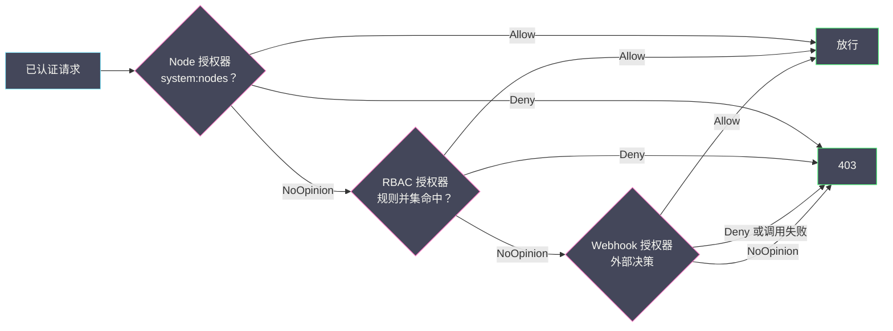
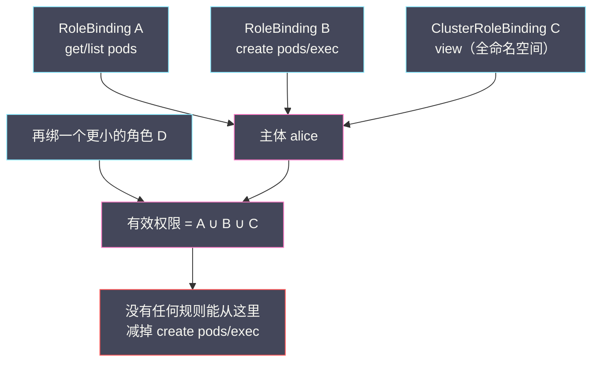
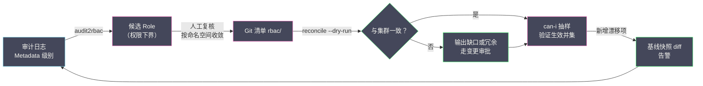
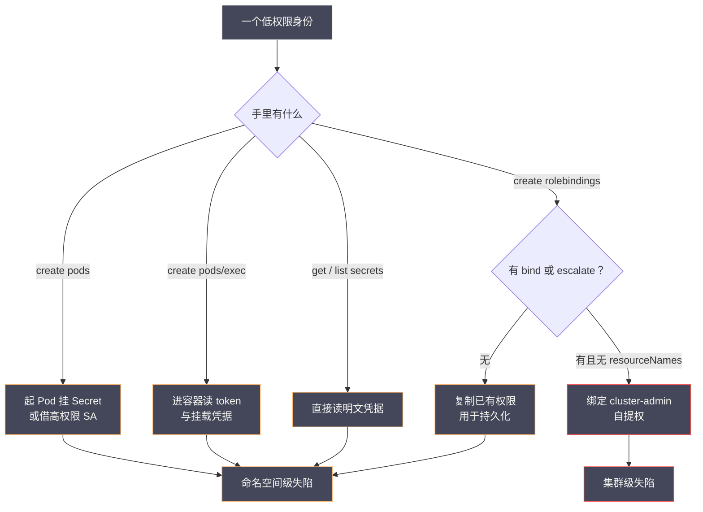
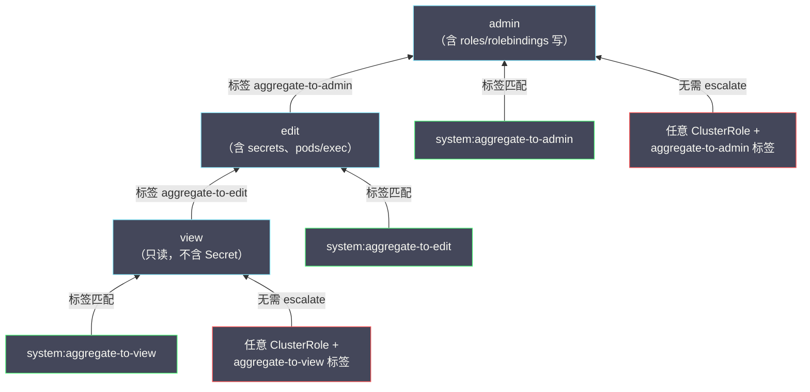

# 03 授权机制——RBAC 深度解析

**摘要：**

授权回答"这个已认证的身份能做什么"。RBAC（Role-Based Access Control，基于角色的访问控制）在 2017 年 Kubernetes 1.8 进入 GA 之后取代 ABAC 成为事实标准，靠的不是表达力，恰恰是它放弃表达力：只保留"把一组权限打成角色、把角色绑给主体"这一条语义。后果是**权限纯加法、没有 deny 规则**——管理员永远不能用一条配置"收回"权限，只能靠不授予、删绑定、改归属来收缩；任何一次"当时的最小权限"都会漂移成"现在的过度授权"。所以本篇不再重讲 Role 字段怎么填（机制推导见 [[云原生/Kubernetes/Kubernetes架构深度剖析/05 认证、授权与准入控制：K8s 的安全三级防线]]），而是回答运维现场的两个问题：怎么证明某个主体此刻实际能做什么，怎么判断手里这条权限已经越权。文章依次展开：四种授权器的管辖范围与选型代价，加法模型的三个审计推论，`kubectl auth can-i --list --as=`、`kubectl auth reconcile` 与审计日志反推这三套手段的用法和盲区，四条真实可走的越权路径各自的判据与封堵，外加聚合 ClusterRole 的盲区、默认角色的匿名边界与 ServiceAccount 的最小权限落地。

---

## 第 1 章 授权器链：四种模式各自管哪一段

### 1.1 一部简短的演进史

2015 年 1.0 发布时，集群只有一个通用授权器：ABAC（Attribute-Based Access Control，基于属性的访问控制），策略写成一行行 JSON，只支持白名单与通配符，改一行要重启 API Server。单团队够用；一旦权限要按命名空间切给几十个团队，策略文件就变成几千行没人敢动的文本，谁有权限、为什么有、什么时候加的，全埋在提交历史里。

2016 年 RBAC 进 Alpha，2017 年在 1.6 转 Beta、1.8 转 GA，kubeadm 随即把默认配置改成 `--authorization-mode=Node,RBAC`。kubelet 那套"只能读自己被调度到的 Pod 所引用的 Secret"的约束交给 Node 授权器，因为按对象引用关系判定的逻辑 RBAC 表达不了；Webhook 授权器留给集群之外的扩展点。ABAC 没有正式删除公告，但官方文档里与它相关的只剩"如何从 ABAC 迁移"一节，CIS Kubernetes Benchmark 也把"关闭 Legacy Authorization"列为检查项。在 1.37 上，生产集群的组合基本只有一种答案：Node 加 RBAC，需要时再加一个 Webhook。

### 1.2 四种模式的管辖范围

授权器不是选一个用，而是排成链：请求按 `--authorization-mode` 里的顺序依次过闸，任一 Allow 就放行，任一 Deny 就 403，全部 NoOpinion 才拒绝。这层短路语义与鉴权结果的缓存机制见 [[云原生/Kubernetes/Kubernetes架构深度剖析/05 认证、授权与准入控制：K8s 的安全三级防线]]，此处只留它对排障的意义——403 不等于"RBAC 拒绝了"，而是"整条链上没有任何授权器愿意放行"。

| 授权模式 | 判定依据 | 典型用途 | 代价与边界 |
| :--- | :--- | :--- | :--- |
| **RBAC** | `rbac.authorization.k8s.io` 组的角色与绑定 | 人类用户、ServiceAccount、Operator 的日常授权 | 只有加法、无法否定；粒度受 resource/verb/name 限制 |
| **Node** | 节点名与"该节点上 Pod 引用了哪些对象"的映射图 | kubelet 访问 API Server | 只认 `system:nodes` 组加 `system:node:<节点名>`；必须配 NodeRestriction 才完整 |
| **Webhook** | 外部服务返回的 SubjectAccessReview 结果 | 对接企业 IAM、按审批/时间窗授权、跨系统统一策略 | 每个决策一次同步 RPC，失败按拒绝；缓存让撤权有延迟 |
| **ABAC** | 逐行 JSON 策略文件 | 1.8 之前的历史集群 | 需重启生效、无法通过 API 审计、已不演进；CIS 要求关闭 |

表里最容易被低估的是 Node 那行最后半句：不启用 NodeRestriction 准入插件，kubelet 仍可改别的节点的 Node 对象、给别的节点上的 Pod 打标签——授权器判请求该不该放行，准入插件判对象内容该不该落库。Webhook 那行的"失败按拒绝"也要点明：用命令行参数配置时它没有失败策略，外部服务超时或返回 5xx 一律按拒绝处理；1.32 稳定的 `--authorization-config` 才把 `failurePolicy` 变成显式选项。**授权 Webhook 的可用性**等于集群 API 的可用性。



### 1.3 两种配置写法与热加载

命令行写法只有一个关键参数 `--authorization-mode=Node,RBAC`，顺序即优先级；配置文件写法 `--authorization-config` 走 `apiserver.config.k8s.io/v1` 的 `AuthorizationConfiguration`（1.29 Alpha、1.30 Beta、1.32 GA），支持链上多个 Webhook、每个 Webhook 独立失败策略、CEL 匹配条件（上限 64 条）与独立的缓存时长。两种写法互斥，同时配置时 API Server 在启动阶段直接报错退出。

| 配置项 | 默认值 | 调大的代价 | 调小的代价 |
| :--- | :--- | :--- | :--- |
| `authorizedTTL` | `5m0s` | 撤权最长延迟 5 分钟，被攻陷身份的可用窗口被拉长 | Webhook 调用量上升，外部策略服务先成瓶颈 |
| `unauthorizedTTL` | `30s` | 新授权生效变慢，工单开完仍报 403 | 失败请求反复打 Webhook，放大故障面 |
| `timeout` | 无默认，必须显式给，上限 30 秒 | 单个 Webhook 卡住时拖慢整条 API 链路 | 外部服务一抖动就批量误拒 |
| `failurePolicy` | 无默认，必须显式给 | 选 `Deny` 时外部服务故障即全集群 403 | 选 `NoOpinion` 时可能静默落到下一个授权器 |
| `matchConditions` | 空（全匹配） | 条件写宽等于没做前置过滤 | 条件写错会让该拦的请求漏到 Webhook 之外 |

配置文件支持热加载：监听文件变化，另加每 60 秒兜底重读；重载不允许增删 Node 与 RBAC 授权器（可调顺序）。想在运行中把 RBAC 摘掉必须重启，重载会被拒绝，而拒绝日志往往埋在 INFO 级别里。

### 1.4 授权层的可观测面

授权阶段的失败绝大多数表现为 403（Webhook 自身出错会变成 5xx），归因只能靠指标和审计日志。`apiserver_authorization_decisions_total` 按授权器类型、名字与决策结果（allowed、denied、no-opinion、error）分列，能区分"RBAC 拒绝"与"Webhook 出错"；`apiserver_authorization_webhook_evaluations_total` 与 `apiserver_authorization_webhook_duration_seconds` 判断外部服务是否是瓶颈。Node 侧的 `node_authorizer_graph_actions_duration_seconds` 出现毛刺时，kubelet 请求整体变慢，表现是 Pod 启动超时而不是 403——上一层问题伪装成本层问题。

归因顺序固定三步：先看审计日志里该请求的 `authorization.k8s.io/decision` 是否为 forbidden、`reason` 落在哪个授权器；再看 `apiserver_authorization_decisions_total` 的标签确认是否大面积拒绝；最后才读 RBAC 对象。

---

## 第 2 章 加法模型的后果：没有 deny，只有不授予

### 2.1 官方文档里的两句话

RBAC 文档对语义的描述只有一句："Permissions are purely additive (there are no 'deny' rules)"。授权总览文档在讲 `AlwaysAllow` 风险时补了更锋利的一句："Kubernetes RBAC does not provide negative (deny) access rules"，所以 `--authorization-mode=AlwaysAllow,RBAC` 与 `--authorization-mode=AlwaysAllow` 完全等价——RBAC 永远不可能把 AlwaysAllow 放行的请求拦下来。

这两句话勾勒出一个特殊模型：授权判断是"多个集合并集"，不是"多条规则顺序匹配、后者覆盖前者"。并集带来可预测性——添加绑定只会让权限变多，这让 RBAC 特别适合声明式管理与 GitOps；但它同时取消了"收紧"这个动作，没有任何配置能表达"除了删除之外都允许"。

### 2.2 推论一：权限只增不减

撤权的可靠方式只有两种：删除绑定，或者修改角色规则。后者受 escalate 校验保护，改角色使其包含自己没有的权限会被 API Server 拒绝，改角色使其缩水则会立刻影响所有引用它的绑定。两条路都不好走，现场做法于是退化成"再绑一个更小的角色"，恰好无效：小的不会覆盖大的。



还有一层更隐蔽的"自动补回"：默认 ClusterRole 与 ClusterRoleBinding 都带 `kubernetes.io/bootstrapping=rbac-defaults` 标签，API Server 每次启动都会补回缺失的规则与 subject；要阻止得打上 `rbac.authorization.kubernetes.io/autoupdate: "false"`。手工删掉默认绑定并期望"它就没了"，会在下次控制面重启后复原。

### 2.3 推论二：配置是历史快照，审计才回答现在

每天 2000 个变更的集群，权限漂移有三个固定来源：临时排查留下的绑定、安装器自带的绑定（Operator、监控、日志采集、Ingress 控制器常把 `secrets`、`pods/exec`、`nodes/proxy` 一并纳入，安装文档只说"需要集群管理员权限执行"）、以及第 5 章要讲的聚合角色被动扩张。

三者的共同点是产生过程完全不经过授权决策：没人被拦下，没人收到告警，配置 diff 里也看不出问题——问题不在任何单个文件里，而在"当前所有绑定的并集"里。审计要回答的正是这个并集，配置文件只能回答"曾经写下的意图"。

### 2.4 推论三：误授无法覆盖，只能收回或改结构

既然不能写 deny，纠正一次过度授权就剩三种手段，代价递增。

| 手段 | 做法 | 代价 |
| :--- | :--- | :--- |
| 删绑定 | 删除多余的 RoleBinding / ClusterRoleBinding | 需先确认无人依赖；删除静默生效、无告警 |
| 改结构 | 拆命名空间、拆 ServiceAccount、把高权限对象隔离出去 | 改动面大，牵动应用清单与 CI 流水线 |
| 上层拦截 | 用 ValidatingAdmissionPolicy 拦高危对象、用 NetworkPolicy 收缩网络面 | 拦的是对象内容而非身份权限，属于补偿控制 |

第三条最容易被当成"授权问题的解法"，其实它拦在另一层：准入发生在授权之后、写 etcd 之前，判据是对象内容而非身份。拥有 `create pods` 的主体被准入策略拦住，不等于权限变小了，只代表当前策略下这条路暂时走不通；策略一改、CRD 一加、或者换一个工作负载类型，路径可能又通了。

---

## 第 3 章 权限审计的三个手段

审计在 RBAC 体系里不是可选项，而是加法模型的必要补偿。三类手段分别回答三个问题：某个主体现在能做什么、集群里的权限与期望差多少、这些权限是谁在什么时候要走的。

### 3.1 用 can-i 模拟任意主体

`kubectl auth can-i` 是唯一一个"站在别人鞋子里看权限"的官方工具：单点模式问"能不能做某件事"，列表模式问"在这个命名空间里都能做什么"。

```bash
# 单点判定：某个 SA 能否在 prod 里创建 Pod
kubectl auth can-i create pods --as=system:serviceaccount:prod:ci-deployer -n prod

# 列表模式：把该 SA 在 prod 里的全部规则打出来
kubectl auth can-i --list --as=system:serviceaccount:prod:ci-deployer -n prod

# 子资源要单独问，pods 的权限不等于 pods/exec 的权限
kubectl auth can-i create pods/exec --as=system:serviceaccount:prod:ci-deployer -n prod

# 集群级资源不在命名空间视图里，必须显式问
kubectl auth can-i get nodes --as=system:serviceaccount:prod:ci-deployer

# 组身份要一起模拟，很多绑定绑的是组而不是人
kubectl auth can-i --list --as=alice --as-group=backend-developers -n prod
```

背后是两条不同的 API：单点判定走 `SelfSubjectAccessReview`，列表走 `SelfSubjectRulesReview`。列表模式有三个边界：它汇总的是"全部 ClusterRoleBinding 加当前命名空间的 RoleBinding"，别的命名空间的 RoleBinding 看不到，所以要逐命名空间跑；响应里有 `incomplete` 布尔字段，配置了 Webhook 授权器或评估出错时会被置为 true；可信方向是单向的——API 注释说"因为授权规则是加法的，一条规则出现在清单里就可以确信主体拥有该权限"，反过来"清单里没有"不等于"权限不存在"。所以 can-i 只能用来确权，不能用来排除。

`--as` 的前提是当前身份有 `impersonate` 动词权限，这是集群里最危险的一类权限：拿到 `users`、`groups`、`serviceaccounts` 上的 `impersonate` 等于可以变成任何人，而且按官方文档它不是命名空间范围的，要授只能用 ClusterRole 加 ClusterRoleBinding。1.35 Alpha、1.36 Beta 并默认开启的 ConstrainedImpersonation 把"模拟"拆成"能模拟哪个身份"与"在模拟态下能执行哪些动作"，只读审计机器人因此可以拿"能模拟所有人、但只能 list 和 watch"的授权。

把 can-i 用成审计而非抽查，关键在"快照加 diff"：对一组固定主体（各团队的 SA、各 CI 身份、每个命名空间里的 `default`）跑 `--list`，规范化后存成基线，下次运行与基线比对，新增的规则就是这段时间漂移出来的权限。

```bash
for subj in system:serviceaccount:prod:ci-deployer \
            system:serviceaccount:data:spark-operator \
            system:serviceaccount:default:default; do
  kubectl auth can-i --list --as="$subj" -n prod > "snapshot/$(echo "$subj" | tr ':' '_').txt"
done
diff -ru baseline/ snapshot/ || true
```

### 3.2 用 reconcile 做清单与集群的对账

`kubectl apply` 不适合管 RBAC。绑定的 `roleRef` 是不可变字段，把绑定从 `view` 改成 `edit` 时 apply 会直接报校验错误、必须删了重建，`kubectl auth reconcile` 会代做并在输出里打印 `reconciliation required recreate`；而且 rules 是集合语义而非字段覆盖，apply 按字段合并，判断不了"这条规则是新增还是已有"，reconcile 则做子集判断：缺失的补上，多余的默认保留。

```bash
# 只看计划，不发请求
kubectl auth reconcile -f rbac/ --dry-run=client
# 走服务端校验，能暴露字段冲突与权限不足
kubectl auth reconcile -f rbac/ --dry-run=server
# 收紧模式：删除清单之外的规则与 subject
kubectl auth reconcile -f rbac/ --remove-extra-permissions --remove-extra-subjects
```

默认的并集模式是审计对账的甜点区：只增不减，适合在 CI 里跑"清单是否被完整落地"，diff 就是"集群里有、清单里没有"的缺口。加上 `--remove-extra-permissions` 后行为反转——规则被整体替换成清单里那一份，这是唯一能清掉历史遗留规则的官方动作，也会连带清掉别人手工补的规则，属于必须走审批的操作。

三个细节必须记住。reconcile 会合并 labels：清单里多写一个 `rbac.authorization.k8s.io/aggregate-to-admin: "true"`，等于把这个角色的全部规则灌进 `admin`，对账工具本身成了提权通道；带 `autoupdate: "false"` 的对象会被判为受保护、直接跳过且不报错；两边都是聚合角色时它不计算多余规则，只计算多余的选择器，于是能发现"聚合条件被加了新标签"，却发现不了"被聚合进来的规则变大了"。

最后一条边界要写进流程：reconcile 只创建与更新，不删除——清单里删掉的 Role 会一直留着，直到 GitOps prune 或清理脚本收走，而孤儿绑定正是漂移最常见的载体。

### 3.3 用审计日志反推"实际用过的权限"

前两个手段回答"现在能做什么"，第三个回答"实际做了什么"。`audit2rbac` 输入一段 Kubernetes 审计日志加一个身份，输出覆盖该身份全部 API 请求的 Role 与 RoleBinding。

```bash
# 从审计日志为某个 SA 反推最小角色，输出后人工审阅
audit2rbac -f audit-2026-11-18.log \
  --serviceaccount prod:ci-deployer > ci-deployer-candidate.yaml
```

它对日志有两个硬要求：必须是 JSON 格式的审计事件（`audit.k8s.io/v1`），因此 API Server 必须事先配过审计策略（策略写法与日志字段见 [[云原生/Kubernetes/Kubernetes架构深度剖析/05 认证、授权与准入控制：K8s 的安全三级防线]]）；`Metadata` 级别就够用，能显著压小体积。结果的可靠性取决于采样窗口——日志保留 7 天的集群，反推只覆盖那一周的行为。

更值得警惕的是方向性。日志记录的是"发生过的请求"，客户端收到 403 之后往往短路：某条路径发现 `list secrets` 被拒，就再也不会尝试 `watch secrets`，日志里永远没有这条请求。所以 audit2rbac 的产出是权限的下界，是"收紧候选清单"而非"发放清单"。更反直觉的是，成功请求都是当时已被授权通过的请求，如果身份本来就绑着过宽的角色，反推只会把过宽复刻一遍——安全用法只有给尚无绑定的新服务生成初始角色，或给已确认过度授权的服务做收缩依据。

反推解决不了"谁有某个权限"这类反向查询。那类问题要用另一组工具：`kubectl-who-can` 直接回答"谁能 create pods/exec"，`rbac-viewer` 把角色、绑定、主体渲染成可检索的图，`rbac-tool` 支持 who-can 与可视化，`rakkess` 输出"主体 × 资源"的权限矩阵，价值都在于把"读上百个 YAML 再心算并集"变成一次查询。

### 3.4 三套手段串成一条流水线

三套手段不是替代关系而是接力：日志说"实际用了什么"，can-i 说"此刻的并集"，reconcile 把意图与现状对齐，最后再用 can-i 抽样复核。



跑通的判据很朴素：随便挑一个 ServiceAccount，能在五分钟内回答它当前拥有哪些权限、分别由哪条绑定带来、最近 30 天有没有实际使用过。答不上来的部分，就是下一次权限事故的入口。

---

## 第 4 章 越权的四条真实路径

### 4.1 先立判据：什么算高危权限

把权限分成"高危"与"普通"不能靠动词——`get` 看起来最无害，`get secrets` 却是直接读凭据；`create` 看起来中性，`create pods` 却等于拿到整个命名空间的凭据集合。可操作的判据只有三条，命中任何一条就按高危管理：

1. **能不能读到 Secret 内容**：直接读（`get`/`list`/`watch secrets`）、间接读（挂载、exec、以高权限 SA 起 Pod）。
2. **能不能以任意 ServiceAccount 身份运行代码**：`create pods` 及全部工作负载变体、`create pods/exec`、`create pods/attach`。
3. **能不能改变"谁能做什么"**：`bind`、`escalate`、创建绑定、改 ClusterRole 的标签、控制准入 Webhook 配置。

第三条杀伤力最大，能一次性把前两条都拿到。官方文档单列了一节"Privilege escalation risks"，入口包括读 Secret、创建工作负载、创建 PersistentVolume（可指定 hostPath）、访问 `nodes/proxy`、`escalate`、`bind`、`impersonate`、创建并批准 CSR、`create serviceaccounts/token`、控制准入 Webhook 配置、修改 Namespace 标签。

### 4.2 路径一：create pods 约等于拿到本命名空间的 Secret

机制不在授权层，而在 Pod 对象的表达能力：Pod 可以挂载同命名空间任意 Secret、ConfigMap、PVC，可以通过 `serviceAccountName` 以任意 SA 身份运行并继承其 API 访问级别。于是"能创建 Pod"等价于"能读该命名空间全部 Secret"加"能借用该命名空间所有 SA 的身份"。

```bash
kubectl auth can-i create pods --as=system:serviceaccount:prod:ci-deployer -n prod
# 间接路径同样致命：会创建 Pod 的工作负载
kubectl auth can-i create deployments.apps --as=system:serviceaccount:prod:ci-deployer -n prod
kubectl auth can-i create jobs.batch --as=system:serviceaccount:prod:ci-deployer -n prod
# 改临时容器等价于进容器
kubectl auth can-i update pods/ephemeralcontainers --as=system:serviceaccount:prod:ci-deployer -n prod
```

它最反直觉的地方是能完全绕过 Secret 的授权对象：审计日志里看不到任何一条 `secrets` 的 GET，只看到一次 `pods` 的 CREATE，几秒后 Secret 内容就从容器环境变量里流走了。要在审计里抓到它，得把"创建 Pod 且 `volume.secret`、`envFrom.secretRef`、`imagePullSecrets` 引用了非本应用 Secret"当成敏感事件，或者按主体白名单——只允许特定构建 SA 在特定命名空间创建 Pod。在这个 300 节点的集群里，prod 之外还有二十多个命名空间，逐命名空间定白名单比逐主体维护更省事。

封堵要分清有效手段与心理安慰。PSA（Pod Security Admission）的 `baseline` 与 `restricted` 管的是特权字段（hostPath、privileged、capabilities、root 用户），完全不限制挂载哪个 Secret、以哪个 SA 运行，用 PSA 防 `create pods` 越权是错配。有效做法有三层：把命名空间当信任边界而不是数据边界；用 ValidatingAdmissionPolicy 按 CEL 限制 `spec.serviceAccountName` 与 Secret 卷的来源；把不需要访问 API 的工作负载的 `automountServiceAccountToken` 关掉。

```yaml
# 示意：限制 SA 与 Secret 卷来源（ValidatingAdmissionPolicy 1.30 起 GA）
apiVersion: admissionregistration.k8s.io/v1
kind: ValidatingAdmissionPolicy
metadata:
  name: restrict-pod-sa-and-secret
spec:
  failurePolicy: Fail
  matchConstraints:
    resourceRules:
      - apiGroups: [""]
        apiVersions: ["v1"]
        operations: ["CREATE", "UPDATE"]
        resources: ["pods"]
  variables:
    - name: allowedSA
      expression: "'ci-deployer'"
  validations:
    # 限制命名空间内可用哪个 SA，防止借身份
    - expression: "object.spec.serviceAccountName == variables.allowedSA"
      message: "only ci-deployer may be used in this namespace"
    # 显式引用 Secret 的 Pod 必须走前缀白名单
    - expression: >
        !has(object.spec.volumes) ||
        object.spec.volumes.all(v,
          !has(v.secret) || v.secret.secretName.startsWith('ci-'))
      message: "only ci- prefixed secrets may be mounted"
```

落地时还要考虑 `envFrom`、`imagePullSecrets`、PVC 间接挂载与工作负载类型的旁路；它的价值在于把"授权层做不到的对象级约束"补在准入层。

### 4.3 路径二：pods/exec 是"进容器"，不是"看日志"

`kubectl exec` 用的是 `pods/exec` 子资源的 `create` 动词，`kubectl attach` 是 `pods/attach`，`kubectl port-forward` 是 `pods/portforward`，三个子资源各自独立授权。看起来是运维便利，实际等价于在容器里拿到 shell：能读环境变量里的凭据、能读挂载的 SA token、能访问该 Pod 能访问的一切内网地址。

```bash
kubectl auth can-i create pods/exec --as=system:serviceaccount:prod:ci-deployer -n prod
kubectl auth can-i create pods/attach --as=system:serviceaccount:prod:ci-deployer -n prod
# 日志也能泄漏信息：view 角色默认包含 pods/log
kubectl auth can-i get pods --subresource=log --as=system:serviceaccount:prod:ci-deployer -n prod
```

这里必须点破一个内置角色的真相：Kubernetes 自带的 `edit` 并不只是"编辑工作负载"。它的规则里包含 `pods/exec`、`pods/attach`、`pods/proxy`、`pods/portforward` 的读写，包含 `secrets` 的读写，还包含 `serviceaccounts` 上的 `impersonate` 与 `serviceaccounts/token` 的 `create`。官方文档的原话是：`edit` "允许访问 Secret 并以命名空间内任意 ServiceAccount 运行 Pod，因此可以用来获取该命名空间内任意 ServiceAccount 的 API 访问级别"。换句话说，把 `edit` 绑给一个开发团队，**等于把这个命名空间的实际 root 交出去**；`view` 是唯一被刻意切成"不含 Secret"的只读边界（但仍含 `pods/log`）。

还有一条常被漏掉的旁路：`nodes/proxy` 的 `get` 不是只读权限。官方文档明确写着，拥有 `nodes/proxy` 访问权的主体可以调用 kubelet API，对节点上任意 Pod 执行命令、读取日志，而且绕过审计日志与准入控制；这类调用走 WebSocket 的 HTTP GET，因此只需要 `get` 动词授权。内置的 `system:kubelet-api-admin` 正是把 `nodes/proxy` 全权与 `nodes/log`、`nodes/stats`、`nodes/metrics` 一并给出。

封堵的做法是区分"会话类权限"与"观察类权限"：只读排障给 `pods/log` 与 `pods/portforward`，`pods/exec` 只给 break-glass 身份并对 `create` 事件实时告警，`nodes/proxy` 一律不给普通主体。审计侧要接受一个事实：`Metadata` 级别只能记录"谁在何时 exec 了哪个 Pod 的哪个容器"，看不到执行了什么命令；即使开到 `Request` 级别，exec 走的是升级连接的流式通道，也只有初始请求的字段可看。

### 4.4 路径三：get secrets 与它的两个孪生兄弟

`get`、`list`、`watch` 在数据暴露上是等价的，在 Secret 上体现得最彻底：`list` 返回所有对象的 `data` 字段，`watch` 建立长连接后持续收到变更，`get` 只是范围最小的一种。官方文档为此专门加了 caution：这三个动词在访问返回数据上等价。

`resourceNames` 是这条路径上最容易被误用的约束。它只对 `get`、`update`、`patch`、`delete` 生效；对 `list` 与 `watch`，只有客户端在请求里带上匹配的 `metadata.name` 字段选择器时才生效——约束依赖客户端行为，不能当安全边界；对 `create` 与 `deletecollection` 完全无效。把"只允许读 `db-password` 这一个 Secret"写成 `resourceNames: ["db-password"]` 配 `verbs: ["get","list","watch"]`，实际效果是"可以 list 全部 Secret"，这是审计里高频出现的假阳性配置。

```bash
for v in get list watch; do
  kubectl auth can-i "$v" secrets --as=system:serviceaccount:prod:ci-deployer -n prod
done
```

封堵层次比前两条清晰：不需要读 Secret 的工作负载一律不授 `list` 与 `watch`；确实要读单个 Secret 的用 `resourceNames` 配 `get`，并接受"不能按名 list"的限制；能改用外部密钥管理的（CSI 的 SecretProviderClass、External Secrets 一类）把凭据从 etcd 搬出去。至于 etcd 静态加密，它只防磁盘与备份泄漏，不改变"有 `get secrets` 就能读明文"这个事实。

### 4.5 路径四：create rolebindings 到自提权

这条路径表面无害，实际有门槛。RBAC 在 API 层内置了提权防护：创建或更新角色时，你要么已拥有该角色的全部权限（范围一致），要么拥有目标角色上的 `escalate`；创建或更新绑定时，你要么已拥有被引用角色的全部权限（范围与绑定一致），要么拥有该角色上的 `bind`。`bind` 检查的对象是 `roles` 与 `clusterroles` 的 `resourceName`，所以"能 bind 哪些角色"可以精确控制。

```yaml
# 官方文档示例：允许 user-1 在指定命名空间授予 admin/edit/view
apiVersion: rbac.authorization.k8s.io/v1
kind: ClusterRole
metadata:
  name: role-grantor
rules:
  - apiGroups: ["rbac.authorization.k8s.io"]
    resources: ["rolebindings"]
    verbs: ["create"]
  - apiGroups: ["rbac.authorization.k8s.io"]
    resources: ["clusterroles"]
    verbs: ["bind"]
    resourceNames: ["admin", "edit", "view"]   # 省略 resourceNames 等于可绑定任意角色
```

正因为有这层防护，单纯拥有 `create rolebindings` 并不能直接变出 `cluster-admin`——它只允许你把"自己已有的权限"复制给别人。但防护有**三个破口**，每个都在现场出现过。

破口一：`bind` 被授在过宽范围上。上面示例里那行 `resourceNames` 一旦被省略，`bind` 就变成"可绑定任意 ClusterRole"，包括 `cluster-admin`；如果再配上 `create clusterrolebindings`，`create rolebindings` 就彻底变成造神权。这类误授在审计里的特征是：同时出现 `bind` 与 `clusterroles`，且没有 `resourceNames`。

破口二：`escalate` 被授出去。它比 `bind` 更直接——取消了"不能造出比自己更强的角色"这条约束，持有者可以把任意规则写进 Role 再绑给自己。两者叠加时风险相乘：先用 `escalate` 造角色，再用 `bind` 绑出去。

破口三：绑定作用域被误读。`RoleBinding` 的生效范围由**绑定对象自己所在的命名空间**决定，与被绑定主体的命名空间无关；官方那个"在 acme 里 bind 一个 myappnamespace 的 SA"的示例读起来像跨命名空间授权，实际仍只限 acme。反过来 `ClusterRoleBinding` 没有命名空间概念，建出来就全局生效。审计必须按"绑定所在命名空间"归类。

还有一层不构成提权、但要盯住的后果：`create rolebindings` 可以做持久化。攻击者不必提升权限，只要把自己已持有的权限绑给一个自己控制的 ServiceAccount，就能在主 token 被吊销之后继续持有同样的访问能力，这类绑定用 can-i 基线 diff 抓比用日志抓更有效。

### 4.6 四条路径的对照与补充

| 路径 | 所需最小权限 | 直接后果 | 审计判据 | 主要封堵手段 |
| :--- | :--- | :--- | :--- | :--- |
| 起 Pod | `create pods` 及 Deployment/Job 等变体 | 读本命名空间全部 Secret、借用任意 SA 身份 | 创建 Pod 且挂载非本应用 Secret、`serviceAccountName` 非默认 | 命名空间信任边界、ValidatingAdmissionPolicy、关闭 automount |
| 进容器 | `create pods/exec`、`pods/attach` | 容器内任意命令、读 token 与挂载凭据 | `pods/exec` 的 create 事件告警 | 只给 break-glass 身份、用日志与 port-forward 替代 |
| 读凭据 | `get`/`list`/`watch secrets` | 直接读明文凭据 | 非白名单主体读 Secret，尤其 `list`/`watch` | 不授 list/watch、`resourceNames` 限 get、外部密钥管理 |
| 改授权 | `create rolebindings` 配合 `bind` 或 `escalate` | 自提权或权限持久化 | 绑定创建事件、`bind` 无 `resourceNames` | 收窄 bind 的 resourceNames、单独审批 |

四条路径的共性可以用一张图收束：左侧是攻击者手里的权限，右侧是它能抵达的失陷面。



补充几个入口：`create serviceaccounts/token` 可为任意 SA 签发短期 token，`impersonate` 直接变成任何人，CSR 的创建加批准能签出任意 CN 的客户端证书。

---

## 第 5 章 聚合 ClusterRole：控制器替你改权限

### 5.1 机制：规则由控制器填充

聚合 ClusterRole 是 RBAC 里唯一一处"权限不是由写入者定义"的设计。对象上只写 `aggregationRule.clusterRoleSelectors`（一组标签选择器），`rules` 留空；kube-controller-manager 里的 clusterrole-aggregation 控制器监听全部 ClusterRole 事件，把选择器匹配到的其他角色规则取并集去重，写进聚合角色的 `rules`。

控制器源码里有一句很坦诚的注释：它不知道依赖图，所以每次事件都把所有聚合角色重新排进队列。这解释了三个行为：改标签、删角色、改名都会被全量重算覆盖；聚合可以嵌套，`view` 通过标签进入 `edit`、`edit` 再通过标签进入 `admin`；写入用服务端应用、字段管理器固定为 `clusterrole-aggregation-controller` 且带强制（Force），会抢走 `.rules` 字段所有权——这是官方文档警告"不要在聚合角色清单里写 `rules`"的技术根因：清单里写 `rules`（哪怕空列表），GitOps 强制应用就会与控制器抢同一字段，反复清空、重填。

### 5.2 盲区：改标签就是改权限

第一个盲区是"规则不在自己名下"。翻 `kubectl get clusterrole admin -o yaml` 看到的是控制面填进去的结果，翻 Git 仓库看到的是空 `rules`：只审清单会漏掉全部聚合进来的权限，只审集群对象又看不出这些权限来自哪几个角色。

第二个盲区更严重：修改被选中对象的标签等于修改聚合角色的权限，而这条路径不需要 `escalate`。给一个只有 `get pods` 规则的角色打上 `rbac.authorization.kubernetes.io/aggregate-to-admin: "true"`，这条规则立刻进入 `admin`；给一个带 `get secrets` 规则的角色打上 `aggregate-to-view`，`view` 这个"不含 Secret 的只读角色"就被扩成能读 Secret。内置角色的标签链让影响面更大：`view` 带 `aggregate-to-edit`、`edit` 带 `aggregate-to-admin`，一次给 `view` 层加规则的动作会同时改变 `edit` 与 `admin`。



第三个盲区是"顺手打标签"：给 CRD 的控制器角色打 `aggregate-to-edit` 标签让 `edit` 用户能管理它，是官方推荐的扩展方式，但它在权限语义上等价于"把该 CRD 的全部权限授予所有持有 `edit` 的主体"，在 Git diff 里却只是一行 `labels:`。

### 5.3 症状：三条典型现场

| 现象 | 机制 | 归因与处置 |
| :--- | :--- | :--- |
| 聚合角色的 `rules` 为空或时有时无 | GitOps 强制应用清单里的 `rules`，与控制器抢字段 | 清单里删掉 `rules` 字段；检查字段管理器冲突 |
| 新打的标签没有生效 | clusterrole-aggregation 控制器未运行（KCM 异常或被裁剪） | 看 KCM 日志与 `--controllers` 参数；新标签不会补算 |
| `view` 突然能读 Secret | 某个带 Secret 规则的角色被打上 `aggregate-to-view` | 按标签反查来源角色，检查标签变更历史 |


### 5.4 封堵：把标签当权限管

既然标签等价于权限，治理就要按权限的标准来。限制谁能 `update`/`patch` ClusterRole 是第一道：改 `metadata.labels` 与改 `rules` 的后果一样重，而 RBAC 无法把两者分开授权，"能改 ClusterRole"本身就是高危权限。第二道是用 ValidatingAdmissionPolicy 对 `aggregate-to-*` 这组标签的变更做主体限制。

```yaml
# 示意：只允许指定组修改聚合标签
apiVersion: admissionregistration.k8s.io/v1
kind: ValidatingAdmissionPolicy
metadata:
  name: guard-aggregation-labels
spec:
  failurePolicy: Fail
  matchConstraints:
    resourceRules:
      - apiGroups: ["rbac.authorization.k8s.io"]
        apiVersions: ["v1"]
        operations: ["CREATE", "UPDATE"]
        resources: ["clusterroles"]
  variables:
    - name: aggLabels
      expression: >
        ['rbac.authorization.k8s.io/aggregate-to-admin',
         'rbac.authorization.k8s.io/aggregate-to-edit',
         'rbac.authorization.k8s.io/aggregate-to-view']
  validations:
    - expression: >
        request.userInfo.groups.exists(g, g == 'platform-security') ||
        !variables.aggLabels.exists(l, has(object.metadata.labels) && l in object.metadata.labels)
      message: "aggregation labels may only be set by platform-security"
```

第三道是把标签纳入审计：ClusterRole 的 update 事件带 `requestObject` 与 `oldObject`（`Request` 级别），对 `.metadata.labels` 做 diff 就能定位"哪次发布悄悄扩大了 `admin`"；`Metadata` 级别采集的集群看不到对象内容，这条检测做不了。

---

## 第 6 章 默认角色与匿名用户的边界

### 6.1 1.14 的那次拆分

2019 年之前的集群里，`system:discovery` 同时绑给 `system:authenticated` 与 `system:unauthenticated`。它的规则是"对 `/api`、`/apis`、`/openapi`、`/version`、`/healthz` 等路径的 `get`"，绑给匿名用户意味着任何能连到 API Server 的网络位置都能列举全部 API 资源、读 OpenAPI 文档、拿到版本号——不是业务数据，却是攻击者踩点的第一手材料。v1.14 把这件事拆开：新增 `system:public-info-viewer`，规则只留 `/livez`、`/readyz`、`/healthz`、`/version`、`/version/`；匿名组只保留这一条绑定，`system:discovery` 与 `system:basic-user` 都改为只绑 `system:authenticated`。升级逻辑写在启动策略里——API Server 启动时会把旧 `system:discovery` 绑定的 subject 复制到 `system:public-info-viewer` 的绑定上。

| 默认 ClusterRole | 默认绑定对象 | 授予内容 | 历史差异 |
| :--- | :--- | :--- | :--- |
| `system:public-info-viewer` | `system:authenticated` 与 `system:unauthenticated` | `/livez`、`/readyz`、`/healthz`、`/version` 的 `get` | 1.14 新增 |
| `system:discovery` | `system:authenticated` | `/api`、`/apis`、`/openapi` 及其子路径的 `get` | 1.14 前也绑匿名组 |
| `system:basic-user` | `system:authenticated` | 创建 `selfsubjectaccessreviews`、`selfsubjectrulesreviews`、`selfsubjectreviews` | 1.14 前也绑匿名组 |
| `system:monitoring` | `system:monitoring` 组 | 健康检查端点与其子路径、`/metrics` 的 `get` | 未绑普通用户 |
| `system:service-account-issuer-discovery` | 全部 ServiceAccount | `/.well-known/openid-configuration`、`/openid/v1/jwks` 的 `get` | 1.20 引入 |
| `cluster-admin` | `system:masters` 组 | 所有资源、所有动词、所有 URL | 硬编码旁路 |

### 6.2 匿名用户可以做什么，怎么查

在 `--anonymous-auth=true`（默认）的集群上，匿名请求被赋予 `system:anonymous` 与组 `system:unauthenticated`，能做什么完全取决于绑定。今天的默认状态是：能读探活端点与版本号，不能列举 API 资源，不能读任何对象。

```bash
kubectl auth can-i --list --as=system:anonymous
kubectl auth can-i get /api --as=system:anonymous
# 谁给匿名组开过口子
kubectl get clusterrolebindings -o json \
  | jq -r '.items[] | select(.subjects[]?.name=="system:unauthenticated") | .metadata.name'
```

判断风险要分清"信息暴露"与"数据暴露"：匿名可读 `/version` 会把版本告诉任何扫描者，但不泄漏业务数据；真正要立刻处置的是"有人给 `system:unauthenticated` 绑定了资源级读权限"。关掉匿名认证不是免费的——探活与部分聚合 API Server 的发现请求会一起失效，所以标准答案是保留匿名认证、把匿名绑定收紧到 `system:public-info-viewer` 这一条。

### 6.3 basic-user 与审计的关系

`system:basic-user` 给每个已认证主体创建 `selfsubjectaccessreviews`、`selfsubjectrulesreviews`、`selfsubjectreviews` 的能力，前两个正是 `can-i` 与 `can-i --list` 的底层 API。它意味着任何持有合法 token 的主体都能低成本枚举自己的权限——对审计工具是基础能力，对攻击者也是方便，所以检测重心应放在"枚举之后的第一个越权动作"上。

### 6.4 两个容易被忽略的默认绑定

`system:masters` 是硬编码在授权器里的旁路：属于这个组的身份拥有全部权限，删掉 `cluster-admin` 的绑定也不影响它；更关键的是 Webhook 授权器收不到这个组发出的请求——官方文档明确写了这一点，这意味着"用 Webhook 做统一审计或策略"的方案在这条路径上失效。kubeadm 生成的 admin kubeconfig 用的就是 `system:masters`，把它分发给多人等于把整条授权链的旁路复制出去。

另一个是 `system:service-account-issuer-discovery`：1.20 之后绑给全部 ServiceAccount，规则只有两个 OIDC 发现端点，意味着任何 Pod 里的 token 都能查到集群的 issuer URL 与公钥——这正是"用泄漏的 SA token 换云上身份"这条链的必需品。

---

## 第 7 章 ServiceAccount 的最小权限

### 7.1 三件事，顺序不能错

ServiceAccount 的权限治理有三件事。第一件是"每个应用一个 SA"，不要共用 `default`：共用之后权限只能取并集，三个应用里只要一个需要读 Secret，`default` 就要拿到读 Secret 的权限。第二件是关掉不必要的自动挂载：`automountServiceAccountToken: false` 可以写在 SA 上，也可以写在 Pod 上，写在 Pod 上会覆盖 SA 的设置。第三件才是挂 RBAC，而且只挂实际需要的动词与资源。

```yaml
apiVersion: v1
kind: ServiceAccount
metadata:
  name: ci-deployer
  namespace: prod
automountServiceAccountToken: false   # 该 SA 默认不注入 token
---
apiVersion: v1
kind: Pod
metadata:
  name: build
  namespace: prod
spec:
  serviceAccountName: ci-deployer
  automountServiceAccountToken: true  # Pod 级设置覆盖 SA 级设置
```

Pod 里没有 `/var/run/secrets/kubernetes.io/serviceaccount/token` 时，先看 Pod 上的字段、再看 SA 上的；都没显式设置时默认挂载，冲突时以 Pod 为准。

### 7.2 从长期 token 到 Bound Token

1.22 之前，Pod 里挂的是长期有效的 Secret token，永不过期也不轮换。1.22 起默认走 BoundServiceAccountTokenVolume：kubelet 通过 TokenRequest API 申请短期 token，以 projected volume 形式挂进容器，到期前自动轮换，claim 里除 SA 身份外还绑定 Pod 的 UID 与受众（audience）。1.24 起（1.26 转稳定）不再为每个 SA 自动创建 Secret token，`LegacyServiceAccountTokenNoAutoGeneration` 特性门在 1.27 被移除，行为成为永久默认。

这套变化对审计有两个直接后果。第一，"token 泄漏"的最长可用窗口从"永久"缩成"剩余有效期"，有效期由 TokenRequest 的 `expirationSeconds` 决定（默认 1 小时），上限受 `--service-account-max-token-expiration` 约束。第二，绑定到 Pod 的 token 在 Pod 被删除后立即失效——TokenReview 会校验 claim 里的对象引用（按 UID 匹配）是否还存在，**回收动作从"删 Secret"变成了"删 Pod"**。

```bash
# 为调试签发一个 15 分钟的 token，而不是去翻长期 Secret
kubectl create token ci-deployer -n prod --duration=15m
# 查某个 SA 现在能做什么
kubectl auth can-i --list --as=system:serviceaccount:prod:ci-deployer -n prod
```

### 7.3 症状与归因

| 症状 | 可能原因 | 判据 |
| :--- | :--- | :--- |
| 容器内找不到 token 文件 | Pod 或 SA 上 `automountServiceAccountToken: false`；或自定义 projected volume 没给 SA token | 看 Pod spec 与实际卷挂载 |
| 401 Unauthorized | token 过期、删 Pod 后仍持旧 token、audience 不匹配 | 看响应头与 token 的 `aud` claim |
| 403 Forbidden | 认证成功但没权限，通常是绑定缺失或绑错命名空间 | `can-i` 模拟加审计日志的 `user.username` |
| 偶发 403 | Webhook 授权器抖动，或缓存窗口内撤权/授权未生效 | `apiserver_authorization_decisions_total` 的 error 维度 |

区分 401 与 403 是这条链上最省时间的一步：401 出在认证层，403 出在授权层。混着排查的典型表现是：拿着过期 token 反复调 RBAC，改了半天绑定，重启 Pod 才发现是 token 过期。另外，`kubernetes.io/enforce-mountable-secrets` 这个限制挂载面的注解在 1.32 被废弃，替代方案是独立命名空间隔离，审计时只能视其为历史遗留的补偿控制。

---

## 第 8 章 配置表、反例与审计基线

### 8.1 关键配置一览

| 配置 | 默认值 | 调大/开启的代价 | 调小/关闭的代价 |
| :--- | :--- | :--- | :--- |
| `--authorization-mode` | kubeadm 为 `Node,RBAC` | 加 Webhook 会引入外部依赖与延迟 | 去掉 Node 会让 kubelet 退回宽权限的 `system:node` 角色 |
| `--authorization-config` | 空 | 多 Webhook、失败策略、CEL 前置条件都需要它 | 只能用命令行参数，无法表达失败策略 |
| `--anonymous-auth` | `true` | 保持默认意味着匿名可读版本与探活信息 | 关闭后健康检查、聚合 API 发现都要带凭证 |
| `--service-account-max-token-expiration` | 以版本文档为准 | 上限放宽会拉长 token 泄漏窗口 | 上限收紧会让长任务频繁续签 |
| `automountServiceAccountToken` | 未设时挂载 | 开启等于把 token 送进容器，扩大窃取面 | 关闭后需要访问 API 的容器要显式挂载 |
| `NodeRestriction` 准入插件 | 不在默认集合内（kubeadm 会显式加） | 不启用则 Node 授权器的细粒度约束被绕过 | 启用后 kubelet 只能改自己的 Node 与 Pod |
| `rbac.authorization.kubernetes.io/autoupdate` | `true` | 保持默认则手工删改默认角色会被补回 | 设为 `false` 后自动补回失效，reconcile 也会跳过该对象 |

### 8.2 四个反例

**反例一：高权限绑给 `default` SA 或 `system:serviceaccounts` 组**。症状是"所有 Pod 都能做某件事"，而且找不到是谁授权的——授权对象是一个组。`system:serviceaccounts` 覆盖集群里所有 ServiceAccount，绑 `view` 就让任意 Pod 能读全集群的非 Secret 资源，绑 `cluster-admin` 就是官方文档里那句"任何能读 Secret 或创建 Pod 的主体都能拿到全集群权限"。修法是换成具体 SA，并在 CI 里禁止 subject 为 `system:serviceaccounts` 的 ClusterRoleBinding。

**反例二：`verbs: ["*"]` 配 `resources: ["*"]`**。症状是"新装的 CRD 自动对所有人生效"。机制不在于当下授予了什么，而在于未来：通配符会把集群今后新增的资源、子资源、自定义动词一并纳入，官方文档的原话是"如果新增了资源类型、子资源或自定义动词，通配符条目会自动授予访问权"。修法是拆成明确的资源与动词清单，用 can-i 的快照 diff 监控新增项。

**反例三：忽略 RoleBinding 的作用域**。症状有两种：用 Role 想授予 Node 或 PV 这类集群级资源，规则写了但不生效；给 RoleBinding 引用 `cluster-admin`，以为只授了子集，实际在该命名空间内拥有全部权限，包括命名空间对象本身。修法是按"绑定对象 → 所在命名空间 → 被引用角色"三段式读。

**反例四：聚合 ClusterRole 被意外扩展**。症状是"没人改过 `admin`，但 `admin` 多了权限"。机制在第 5 章拆过：给任意角色打上聚合标签，规则就进入对应聚合角色，且不需要 `escalate`。修法有三条：标签变更纳入审批；对 `aggregate-to-*` 标签的写入做准入限制；在审计流水线里对 ClusterRole 的 labels 做 diff。

### 8.3 可以照着跑的审计基线

最小基线包含五项：每天跑一次 can-i 快照与基线 diff；每次发布跑一次 `reconcile --dry-run`；每周盘点 `pods/exec` 与 `secrets` 的访问主体；每次变更后检查 ClusterRole 的标签 diff；每月复核 `system:masters` 与 `cluster-admin` 的绑定清单。

```bash
# 1) 高危绑定盘点
kubectl get clusterrolebindings -o json | jq -r '
  .items[] | select(.roleRef.name=="cluster-admin")
  | .metadata.name + " -> " + ([.subjects[]? | .kind + ":" + .name] | join(","))'

# 2) 通配符规则盘点
kubectl get clusterroles -o json | jq -r '
  .items[] | select(any(.rules[]?; (.verbs // []) | index("*")))
  | .metadata.name'

# 3) 聚合标签盘点（谁在往内置角色里灌权限）
for l in admin edit view; do
  kubectl get clusterroles -l "rbac.authorization.k8s.io/aggregate-to-${l}=true" -o name
done

# 4) 匿名与已认证默认面的确认
kubectl auth can-i --list --as=system:anonymous
```

基线的价值不在命令本身，而在"每次都跑、结果可比"：加法模型保证权限只会随时间变多，审计频率低于漂移速度，就等于没有审计。

---

## 第 9 章 收束：可预测性的价格

RBAC 用一套极简语义换来了可预测性：一条绑定只会增加权限、不会改变既有行为，所以声明式管理与 GitOps 才能安全地作用在授权配置上。价格是它无法表达否定、无法表达"除了某操作之外"、无法表达"这个授权只在某些条件下成立"，这类需求都要外移到准入层、Webhook 授权器或命名空间结构上。

加法模型还有一笔更隐蔽的价格：成本从"配置时"转移到了"运行时"。写一条绑定只要几秒钟，判断它是否越权却要读绑定、读角色、算并集、查聚合标签，再看日志里是否真用得到，集群越大这笔成本越高。所以本篇留下的判断不是"如何配置 RBAC"，而是"把审计当成 RBAC 的一部分"：`can-i` 回答此刻的并集，`reconcile` 对齐意图与现状，审计日志反推实际使用，三者各有盲区，必须一起用。至于会不会出现既能表达否定、又不牺牲可预测性的授权模型，目前仍然言之尚早。

---

## 参考资料

1. Kubernetes 文档 - Using RBAC Authorization：https://kubernetes.io/docs/reference/access-authn-authz/rbac/
2. Kubernetes 文档 - Authorization（授权模式与授权器链）：https://kubernetes.io/docs/reference/access-authn-authz/authorization/
3. Kubernetes 文档 - Using Node Authorization：https://kubernetes.io/docs/reference/access-authn-authz/node/
4. Kubernetes 文档 - Role Based Access Control Good Practices：https://kubernetes.io/docs/concepts/security/rbac-good-practices/
5. Kubernetes 文档 - User Impersonation：https://kubernetes.io/docs/reference/access-authn-authz/user-impersonation/
6. Kubernetes 文档 - Service Accounts：https://kubernetes.io/docs/concepts/security/service-accounts/
7. Kubernetes 文档 - kubectl auth can-i 与 kubectl auth reconcile：https://kubernetes.io/docs/reference/kubectl/generated/kubectl_auth/
8. Kubernetes 源码 - RBAC 默认角色与绑定策略：https://github.com/kubernetes/kubernetes/blob/master/plugin/pkg/auth/authorizer/rbac/bootstrappolicy/policy.go
9. Kubernetes 源码 - clusterrole-aggregation 控制器：https://github.com/kubernetes/kubernetes/blob/master/pkg/controller/clusterroleaggregation/clusterroleaggregation_controller.go
10. Kubernetes 源码 - kubectl auth reconcile 的语义合并实现：https://github.com/kubernetes/kubernetes/tree/master/staging/src/k8s.io/component-helpers/auth/rbac/reconciliation
11. audit2rbac（从审计日志反推 RBAC）：https://github.com/liggitt/audit2rbac
12. Kubernetes 文档 - 指标参考（授权相关指标）：https://kubernetes.io/docs/reference/instrumentation/metrics/

---

> [!note] 思考题
> 1. 在 300 节点、8000 Pod、日均 2000 个变更的集群里，把"每天跑一次 can-i 快照 diff"改成"每周一次"，最可能漏掉哪一类权限漂移？
> 2. `view` 默认不含 Secret，但它的规则来自 `aggregate-to-view` 标签。如果某个团队给自己的 CRD 角色打上这个标签，`view` 的语义会怎么变？你会用什么手段在变更评审阶段发现它？
> 3. 一个团队坚持给开发者 `edit` 角色，理由是"只读不够用"。请用本文的判据说明 `edit` 在该命名空间内实际等价于什么，并给出一种既保留开发体验、又不交出新边界的设计。
> 4. audit2rbac 的产出为什么只是权限的下界？在什么场景下用它生成角色是安全的，什么场景下会把历史越权固化下来？
> 5. 如果要求"运维可以管理命名空间内所有资源，但不能删除"，RBAC 本身写不出来。你会选择拆角色、加准入策略，还是换 Webhook 授权器，各自的代价落在谁身上？