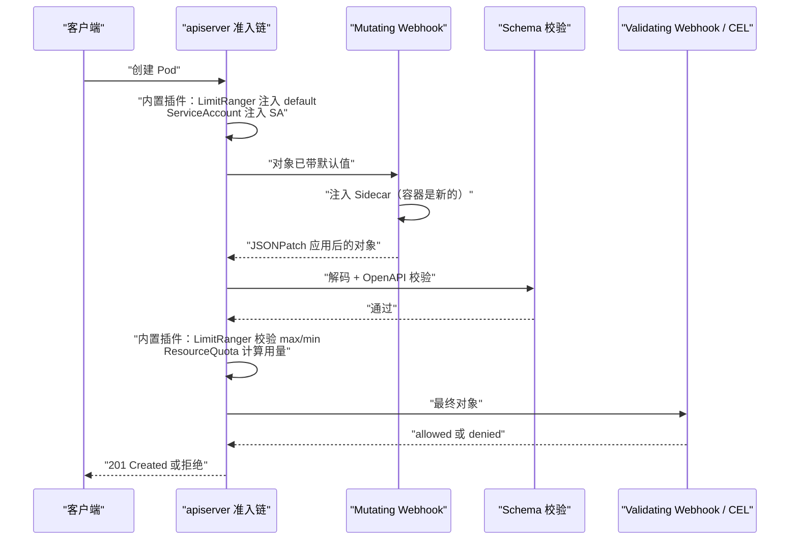
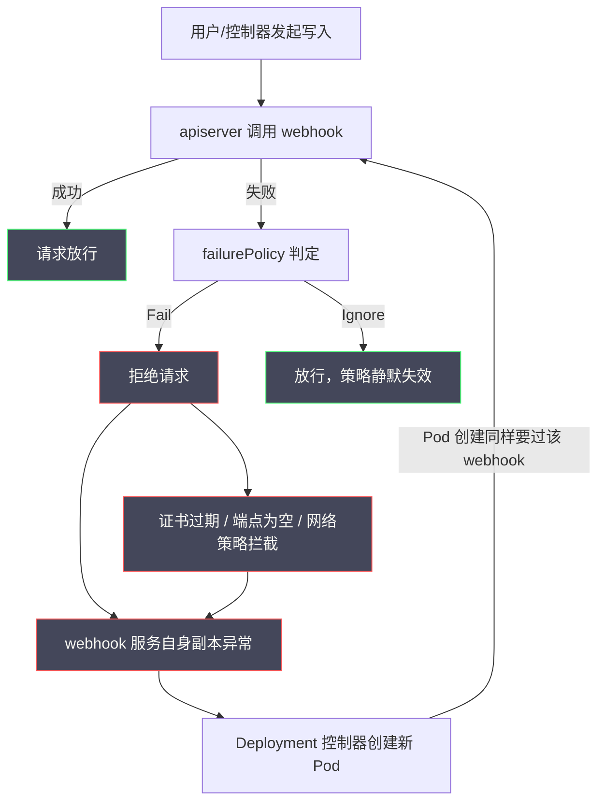
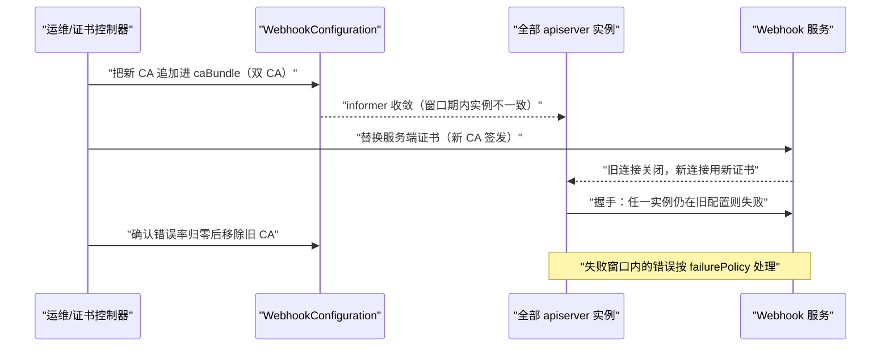
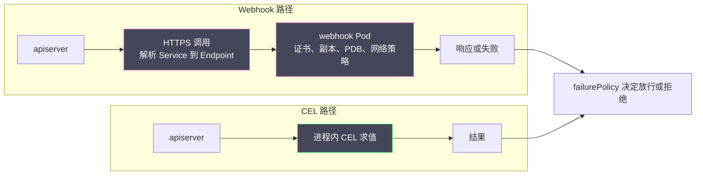
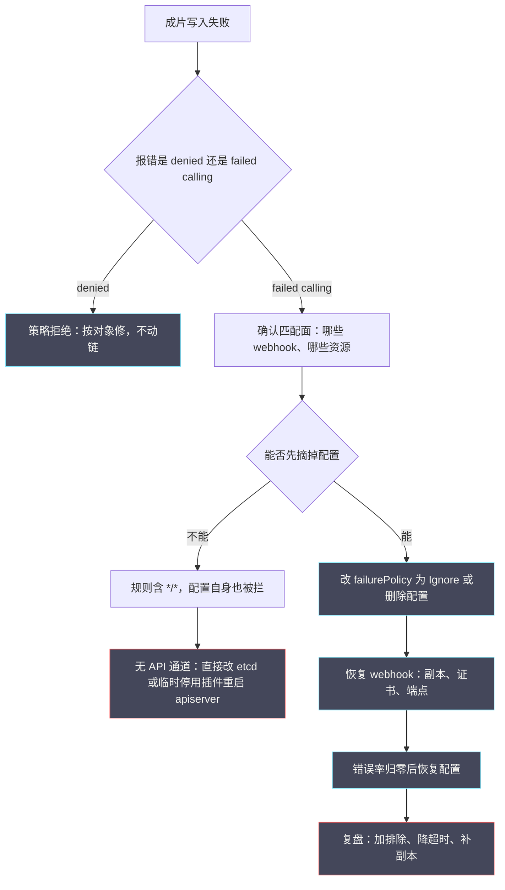

# 04 准入控制器深度解析

**摘要：**

准入控制是认证与授权的下游、etcd 的上游，也是 API Server 请求管线里唯一把外部代码放进同步写路径的地方。本文不重复内置控制器清单，而沿四条线展开：先用 mutating 与 validating 的先后顺序解释 LimitRange 为什么兜不住 webhook 注入的字段，以及这类盲区为什么无法靠"多配一条策略"补上；再逐字段拆解 `failurePolicy`、`timeoutSeconds`、`sideEffects`、`matchPolicy`、`objectSelector` 与 `caBundle` 轮换的语义，说明一个 Pod 级 webhook 如何从"某条策略失效"升级为"全集群写不进去"；随后给出命名空间排除、`Ignore` 的适用边界、多副本加 PDB、超时收敛这四条加固措施的取舍与残余风险；最后把 ValidatingAdmissionPolicy、Gatekeeper、Kyverno 放进同一张成本表，用 `kubectl` 报错与 apiserver 日志的对应关系收束排障路径。准入链在请求管线中的挂载位置与两阶段拆分属于机制推导，见 [[云原生/Kubernetes/Kubernetes架构深度剖析/04 API Server 请求链路：从 HTTP 请求到 etcd 写入|请求链路]] 与 [[云原生/Kubernetes/Kubernetes架构深度剖析/05 认证、授权与准入控制：K8s 的安全三级防线|安全三级防线]] 两篇，本文只回答三个运维问题：怎么配、配错的症状是什么、故障来了先动哪一步。

---

## 第 1 章 写不进去的那一层

不妨设想一个中等规模的集群：300 个节点、8000 个 Pod、日均 2000 个变更，三个 kube-apiserver 实例挂在一个负载均衡器后面，镜像仓库、日志、监控都在 kube-system 里。某个工作日的十点，`kubectl apply` 开始成片返回同一句话——`failed calling webhook "validate.example.com"`；Deployment 不再滚动，HPA 扩出来的副本迟迟不出现，连 `kubectl delete pod` 都失败。此时 etcd 的写入延迟正常，认证没有报错，授权也照常放行，控制平面看上去一切健康。

这就是准入链的典型故障形态：不是"某个功能不可用"，而是"所有写操作在同一个位置排队失败"。

### 1.1 三道防线的分工

[[云原生/Kubernetes/kubernetes之API Server/02 认证机制深度解析|认证]]回答"你是谁"，[[云原生/Kubernetes/kubernetes之API Server/03 授权机制——RBAC 深度解析|授权]]回答"你能不能对这类资源做这个动词"，两者都只读请求的元信息，不读对象的字段内容；准入控制是第一个逐字段阅读对象的关卡，它能把对象改掉，也能一票否决。这个分工决定了三层的失败成本完全不同：认证配置错了，影响某一类身份；RBAC 写错了，影响某个主体对某类资源的动词；准入链配错了，影响所有人在所有资源上的所有写操作，因为**写路径只有一条**。

准入链里同时住着两类东西。一类是编译进 kube-apiserver 二进制的内置插件，通过 `--enable-admission-plugins` 启用，与 apiserver 同生共死；另一类是用户部署在集群里的 webhook 服务，通过 `MutatingWebhookConfiguration` 与 `ValidatingWebhookConfiguration` 注册，是整条写路径上唯一一次跨进程、跨网络的同步调用。内置插件清单与默认值在 [[云原生/Kubernetes/Kubernetes架构深度剖析/05 认证、授权与准入控制：K8s 的安全三级防线|安全三级防线]] 第 4 章已有完整对照，本文只在排序上用到它们。

### 1.2 准入链在管线里的位置

一个写请求走完认证、授权之后，进入准入链，依次穿过内置 mutating 插件、mutating webhook、对象解码与 Schema 校验、内置 validating 插件、validating webhook、CEL 策略，最后才落到 RESTStorage 与 etcd。


图里只有两个颜色：绿色节点跑在 kube-apiserver 进程内，红色节点要把请求发到另一个服务。管线细节——Handler Chain 如何组装、AdmissionReview 如何编解码、失败如何转成 StatusError——见 [[云原生/Kubernetes/Kubernetes架构深度剖析/04 API Server 请求链路：从 HTTP 请求到 etcd 写入|请求链路]] 第 3 章；两阶段拆分的设计理由见 [[云原生/Kubernetes/Kubernetes架构深度剖析/05 认证、授权与准入控制：K8s 的安全三级防线|安全三级防线]] 4.1 节，这里只留一句结论：**红节点才是风险来源**。

### 1.3 三类参与者与三种失败形态

| 参与方 | 执行位置 | 失败形态 | 故障半径 |
| :--- | :--- | :--- | :--- |
| 内置准入插件 | apiserver 进程内 | 逻辑拒绝、配置缺失、版本行为变化 | 单资源、单命名空间 |
| Admission Webhook | 集群内独立服务，HTTPS | 超时、连接拒绝、TLS 失败、5xx、返回体不合法 | 按 `rules` 匹配面，可以是全集群 |
| ValidatingAdmissionPolicy | apiserver 进程内，CEL 求值 | 表达式编译错、运行期代价越界、参数对象缺失 | 单条策略，取决于绑定范围 |
| 策略引擎（Gatekeeper、Kyverno） | 本身即 webhook | 上述 webhook 全部形态，外加引擎自身组件与 CRD 依赖 | 全集群 |

只有 webhook 与策略引擎会把网络、证书、副本数这些分布式系统问题带进写路径，准入链因此是一条同步 RPC 链，而不是一次本地函数调用。

### 1.4 故障半径为什么会扩散

第一层在配置的作用域。两个 webhook 配置都是集群级对象，`rules` 一旦写成 `resources: ["*"]`，覆盖范围就是所有写操作，没有"只对某个命名空间生效"的天然边界，除非用 `namespaceSelector` 自己划。第二层在流量传导。一次 Deployment 滚动触发一批 Pod 创建，每个 Pod 创建都要独立过一遍准入链，控制器失败后指数退避重试，重试又回到同一位置排队，故障于是被放大而非线性呈现。第三层在自愈回路。webhook 服务自己也是 Pod，重建同样要过准入链；准入链因它而失败，它就失去了自我修复的通道。

> [!warning] 准入链的单点比控制平面的单点更隐蔽
> apiserver 是三副本、etcd 是奇数节点、调度器有选主，这些高可用设计都能被架构评审看见；一个 `failurePolicy: Fail` 且只配了一个副本的 webhook，在 YAML 里只是两行字段，评审时很容易滑过去。可它在写路径上的权重，与 apiserver 是同级的。

## 第 2 章 顺序即盲区

准入链的设计意图是让"校验发生在变更之后"，所以 mutating 在前、validating 在后。顺序本身没有问题，问题出在想象：很多人以为"对象最后一定会经过所有校验"，于是把兜底责任交给下游，而**输入都是上一阶段的输出**，任何在某阶段之后才出现的字段，对之前跑过的阶段等于不存在。

### 2.1 谁在什么阶段

把一个 Pod 的创建过程摊开，各参与者的先后与输入来源一目了然。



最关键的一步是 Sidecar 注入之后那个"新容器"。它由 mutating webhook 创建，而生它的那一刻，LimitRanger 的默认值注入早已执行完毕；它是否合规，取决于注入方有没有自己把 `resources` 写全。

| 阶段 | 参与方 | 能否修改对象 | 看到的输入 |
| :--- | :--- | :--- | :--- |
| Mutating | 内置插件（按编译顺序） | 能 | 客户端提交的原始对象 |
| Mutating | MutatingWebhookConfiguration（按 webhook 名称字典序） | 能 | 前面所有变更的结果 |
| 校验 | 解码与 OpenAPI Schema | 不能 | patch 应用后的对象 |
| Validating | 内置 validating 插件 | 不能 | 最终对象 |
| Validating | ValidatingWebhookConfiguration（并行） | 不能 | 最终对象 |
| Validating | ValidatingAdmissionPolicy | 不能 | 最终对象与参数对象 |

### 2.2 LimitRange 为什么兜不住注入的字段

同一个 LimitRange 在两个阶段各干一半活：`Admit` 阶段把 `default` 与 `defaultRequest` 填进没有写资源的容器，`Validate` 阶段检查请求与限制是否落在 `min` 与 `max` 之间。两个半场分别落在 mutating 阶段的开头与 validating 阶段，中间隔着一整轮 mutating webhook，于是同一份 LimitRange 对注入的容器只有一半效力。

**默认值那一半一定不生效**。Sidecar 容器在 `Admit` 跑完之后才被创建，没有被填过 `default`，注入模板若没有显式写 `resources`，它就以"没有 requests、没有 limits"的形态落进 etcd。症状在准入链之后才显形：调度器按 requests 求和时看不见它，节点被超卖；QoS 从 Guaranteed 降成 Burstable，节点内存压力上来时它第一个被驱逐；ResourceQuota 记账为 0，配额形同虚设。这些症状都不指向 webhook。

约束那一半的效果取决于注入方写了什么。注入的容器若显式带着超过 `max` 的 `limits`，validating 阶段会拒绝，`kubectl` 看到的是 `maximum cpu usage per Container is 2, but limit is 4` 这类文本，而肇事者是改写对象的 webhook。若注入的容器什么都不写，就没有可比较的数值，插件是否判它违规取决于实现如何处理"未设置"，任何"靠 LimitRange 给注入字段兜底"的方案都建立在这条未定义的假设上。修法是把责任推回注入方：模板里写死 `resources`，或用 ValidatingAdmissionPolicy 补一条"每个容器都必须有 requests 与 limits"。

这类盲区不止一处。`securityContext` 的默认值要到 kubelet 侧才补，准入阶段的 PodSecurity 检查看不到；`reinvocationPolicy: IfNeeded` 只解决 mutating 之间的覆盖，解决不了"我和内置插件抢同一个字段"。

### 2.3 顺序造成的另外三处盲区

Schema 校验夹在两段之间，意味着一份 JSONPatch 必须同时满足业务意图与 OpenAPI 约束。注入器若 patch 出 schema 上不存在的字段，请求在 schema 校验这一关失败，报错文本指向 patch 应用失败而不是 webhook 拒绝，归因时容易误判成客户端提交有误。

Validating webhook 并行调用，这是性能设计也是语义限制：两个 validating webhook 之间没有先后，谁也不能假设另一个已经跑过。想表达"A 通过才检查 B"这种依赖，只能合并成一个服务，或把条件写进 `matchConditions`。

dry-run 同样穿过整条链。`kubectl apply --dry-run=server` 会真实调用 webhook，只是不落盘，它因此是最好的验证工具，也意味着一个声明 `sideEffects: None` 却偷偷写外部系统的 webhook，会在 dry-run 时真的产生副作用。

### 2.4 判据：先看最终对象，再看报错来源

顺序类问题的诊断顺序与直觉相反。先不要读 webhook 代码，而是先拿最终对象：`kubectl apply --dry-run=server -o yaml -f pod.yaml` 返回 apiserver 处理后的对象，注入结果、默认值、被补的字段都在里面。把它与限值、配额、安全基线逐项对照，就能判断问题是"字段没人补"还是"字段补错了"。

第二步才看报错来源。报错前缀写明了哪一关拒绝：`LimitRanger`、`ResourceQuota`、`admission webhook "x" denied the request`、`ValidatingAdmissionPolicy "y"`。前缀说明哪一关拒绝，不说明谁把对象改成这样；把两件事分开，才不会在错误的组件里翻日志。

## 第 3 章 故障面：决定半径的六个字段

Webhook 配置里真正决定"出故障时影响多大"的只有几个字段。它们都有默认值，默认值在单集群单策略的场景下都合理，放到 300 节点、8000 Pod 的集群里就会放大成事故。

### 3.1 failurePolicy：Fail 会锁死自愈回路

`failurePolicy: Fail` 的语义是"调用失败即拒绝请求"，失败包括超时、连接拒绝、TLS 握手失败、返回 5xx、返回体不是合法的 AdmissionReview、`uid` 对不上。它把 webhook 的可用性与集群的写能力绑在同一根绳上，而 **Fail 的代价是匹配面全灭**。



图里的回环就是"死锁"两个字的来源。副本挂掉、镜像拉不下来、证书过期、Service 的 selector 被改错、NetworkPolicy 把 apiserver 的出口挡在门外，任何一种都会让它无法服务；而它要恢复又必须先创建 Pod，创建 Pod 又要先过它自己。故障于是从"一个 Deployment 不健康"变成"整个集群的写操作停摆"，并且不会自行恢复。

`failurePolicy: Ignore` 走另一条路：调用失败时放行请求。它保住写路径，代价是策略在故障期间静默失效，Pod 照样创建成功，只是没注入 Sidecar、没经过镜像签名校验，这种失效只出现在事后的审计里。

字段默认值值得单独记：admissionregistration.k8s.io/v1 中 `failurePolicy` **默认是 Fail**，没有显式写这个字段的 webhook，默认"宁可拒绝也不放行"。很多故障的起点不是有人选了 Fail，而是没人记得自己没选。

### 3.2 timeoutSeconds：默认 10 秒，上限 30 秒

`timeoutSeconds` 默认 10 秒，允许 1 到 30 秒。准入链对 webhook 调用不做重试，一次超时就是一次失败，由 `failurePolicy` 决定后果。危险之处在它与正常延迟的量级差：健康 webhook 的调用延迟在毫秒到十几毫秒，10 秒的超时意味着一个卡住的连接可以让写请求在准入阶段躺满 10 秒。

把量算出来更直观。日均 2000 个变更，按每个变更平均触发 3 次 Pod 创建估算，一天约 6000 次 Pod 创建；每个 Pod 创建穿过 2 个 mutating 与 2 个 validating webhook，就是 24000 次调用，摊到全天不到每秒 1 次。**平均值毫无意义**。压力出现在集中在几秒内的批量事件：一次 30 副本滚动、一次节点重启引起的 Pod 重建、一次 HPA 扩容。几十个请求同时进入准入链，每个都占着 apiserver 的执行名额等 webhook 返回，等得越久，被占住的名额越多，排队的人越多，延迟从 webhook 一个点扩散到整个 API，而 etcd 指标依然健康。

超时的另一侧是客户端。控制器、`kubectl`、CI 流水线各有自己的超时与重试，apiserver 侧 10 秒的等待被它们感知成"接口慢"，触发重试；重试重新进入准入链，再次等待。超时值越长，单次失败占用的资源越多。

### 3.3 sideEffects 与 dry-run 契约

v1 API 要求显式声明 `sideEffects`，取值只有 `None` 与 `NoneOnDryRun`。这不是给人看的注释，而是准入链判断"这条 webhook 能不能被 dry-run 安全调用"的依据：声明 `None` 承诺调用不改变任何外部状态，声明 `NoneOnDryRun` 承诺请求带 `dryRun` 标记时跳过副作用。

契约被撒谎的后果很具体。一个顺手往外部审计系统写记录、或给工单系统发事件的 webhook，如果声明了 `None`，那么每次 `kubectl apply --dry-run=server`、每次 `kubectl diff`、每次 GitOps 工具的预演，都会真的写一条记录出去。更隐蔽的版本是 webhook 在 dry-run 时创建别的对象：主写操作被抑制，它自己发起的写不在抑制范围内。

### 3.4 matchPolicy：版本转换决定命中与漏网

`matchPolicy` 默认 `Equivalent`："按等价资源匹配"，请求用的是 `apps/v1beta1` 还是 `apps/v1`，只要配置里声明 `apps/v1`，apiserver 都会把对象转换到声明版本再发给 webhook，webhook 只需处理一个版本。

改成 `Exact` 要求请求版本与配置版本完全一致，不一致就不调用。它的用途是精确控制"只拦某一版 API"，代价是同一份资源从别的版本进来就漏网。对 CRD 尤其危险：`served` 与 `storage` 版本可以不同，一次转换就可能让 `Exact` 配置的 webhook 完全不触发。`Equivalent` 也不是没有成本——转换需要 CRD 的转换 webhook 或内部转换逻辑，转换失败时请求在到达准入链之前就以错误结束，报错指向转换而不是策略。

### 3.5 objectSelector 与 namespaceSelector 的求值语义

`namespaceSelector` 按命名空间标签过滤，`objectSelector` 按对象标签过滤，两者都是"不匹配就不调用"，也都容易被误读求值时机。

`objectSelector` 在 UPDATE 上对旧对象与新对象同时求值，任一匹配即调用：给已有 Pod 打上标签的那次更新会触发 webhook，而 webhook 只读新对象时看到的是已经带上标签的版本，无法区分"这次新增"还是"本来就有"。`namespaceSelector` 对命名空间对象本身按其标签求值，对集群级资源（Namespace 之外）**不起过滤作用**，把 `namespaceSelector` 当"总开关"是常见误用。命名空间标签本身可改，改标签等于改策略覆盖范围，谁能改标签谁就能把命名空间移出覆盖。

### 3.6 caBundle：信任根的轮换窗口

webhook 调用走 HTTPS，apiserver 用 `clientConfig.caBundle` 里的 PEM 验证 webhook 服务端证书。信任链只有一个方向：apiserver 验证 webhook，webhook 默认不验证 apiserver，需要对调用方鉴权就得依赖网络边界或客户端证书。

`caBundle` 是配置对象里的静态字节。修改它是一次普通的 API 写，会通过 informer 收敛到所有 apiserver 实例，不需要重启进程；收敛有延迟，窗口期内不同实例的信任根可能不一致，故障表现于是变成"间歇性失败"，这种形态极难归因。

轮换通常分三步：先把新旧 CA 一起放进 `caBundle`，再替换服务端证书（此时两把 CA 都受信），确认错误率归零后移除旧 CA。跳步就制造一个失败窗口，`failurePolicy: Fail` 会把窗口放大成写操作失败。cert-manager 的 cainjector 能自动完成"把 CA 注入 webhook 配置"，代价是把 webhook 的可用性又挂到证书管理组件上。



失败形态有明确的文本特征：`x509: certificate signed by unknown authority` 是 CA 不匹配，`x509: certificate has expired or is not yet valid` 是过期，`... doesn't contain any IP SANs` 是证书缺 SAN——1.19 之后 serving 证书必须带 SAN。三种错误在 `kubectl` 输出里很像，修法完全不同，先看这一行再动配置。

### 3.7 字段总表

| 字段 | 默认值 | 取值变大/改动的收益 | 取值变小的代价 |
| :--- | :--- | :--- | :--- |
| `failurePolicy` | `Fail` | 改 `Ignore` 换来写路径可用，策略静默失效 | 保持 `Fail` 换来安全兜底，webhook 故障即全集群写入失败 |
| `timeoutSeconds` | 10，上限 30 | 超时放宽，对慢 webhook 更宽容，单次失败占用更久 | 超时收紧，故障更快暴露，慢 webhook 的正常请求被误杀 |
| `sideEffects` | v1 必填 | `NoneOnDryRun` 允许 dry-run 触发，能覆盖更多工具链 | `None` 声明不实会让 dry-run 产生副作用 |
| `matchPolicy` | `Equivalent` | 用 `Exact` 精确控制，但版本一换就漏网 | 用 `Equivalent` 版本无关，转换失败会在准入前报错 |
| `rules` | 无默认，必写 | 写 `*/*` 覆盖全，但连改配置的逃生通道一起堵 | 写窄规则少了无关调用，漏配资源等于策略缺失 |
| `namespaceSelector` | 空（匹配全部） | 排除系统命名空间，避免死锁 | 不写等于不排除，自愈回路被切断 |
| `objectSelector` | 空（匹配全部） | 只拦带标签对象，减少调用量 | 漏标对象不受策略约束 |
| `caBundle` | 必填 | 双 CA 重叠轮换，窗口内不中断 | 单 CA 硬切，轮换即失败窗口 |

## 第 4 章 四条加固措施

### 4.1 命名空间排除是死锁的唯一解

`failurePolicy: Fail` 与自愈回路之间的矛盾，不可能靠加副本解决：副本再多，重建副本这个动作本身仍然要过准入链。**结构性解法只有一个**，把 webhook 自己的生存空间从它的管辖范围里摘出去——排除 kube-system，排除 webhook 自身所在的命名空间。

```yaml
namespaceSelector:
  matchExpressions:
    - key: kubernetes.io/metadata.name
      operator: NotIn
      values: ["kube-system", "policy-system"]
```

用 `kubernetes.io/metadata.name` 这个由 apiserver 自动写入的标签，比自定义标签可靠：自定义标签可能被误删，系统标签不会。排除之后，系统组件的写入不再经过该 webhook，死锁回路被切断，webhook 自己也能在故障中重建。

排除的代价是策略洞。kube-system 里的 Pod 不受这条策略约束，任何能往 kube-system 写资源的账号都拿到了一条"绕过策略"的通道。补法不是把策略写宽，而是换一个不会死的执行点：用 ValidatingAdmissionPolicy 覆盖系统命名空间，CEL 在 apiserver 进程内执行，没有网络与副本问题；或者收紧谁能写 kube-system 的 RBAC。权限面与准入面必须成对设计。

> [!info] 排除的边界
> 排除系统命名空间是为了保住自愈能力，不是为了给系统组件开后门。凡是"排除列表"里的命名空间，都应当有独立策略覆盖与更严的 RBAC 限制，否则排除就从可用性手段变成了安全缺口。

### 4.2 Ignore 的适用边界

`Ignore` 不是"降级方案"，而是一种对失败后果的判断：这条策略在故障期间失效，业务是否能承受。判断依据有三条：**失败是否可见**（Ignore 本身静默，必须有别的信号补上）、失效是否可补偿（事后的巡检、控制器修正能否兜住）、业务是否容忍（多租户隔离这类边界不能容忍）。

| 场景 | 建议 | 理由 |
| :--- | :--- | :--- |
| Sidecar 注入、默认值注入 | `Ignore` | 失败可见（Pod 行为异常、日志缺失），可重建补偿，阻塞写路径的代价更高 |
| 标签规范、成本分摊标签 | `Ignore` | 漏标不破坏安全边界，可以事后扫描补齐 |
| 审计类、告警类附加信息 | `Ignore` | 放行不影响数据正确性 |
| 镜像签名、供应链校验 | `Fail` | 放行等于让未签名镜像进入生产，失效不可事后补偿 |
| 多租户边界、网络隔离对象 | `Fail` | 放行即越权 |
| 删除保护、终态对象保护 | `Fail` | 放行会造成不可逆数据损失 |

中间态的做法是把"拒绝"与"提示"拆开：真正需要 Fail 的校验用 Deny 语义，其余用 Warn 或 Audit，后者即使执行失败也不该阻塞写。ValidatingAdmissionPolicy 的 `validationActions` 天然支持这种拆分，webhook 则需要两个独立配置——一个 `Ignore` 的提示型，一个 `Fail` 的强制型。

### 4.3 副本、PDB 与打散

多副本是必要条件而非充分条件。三个副本都在同一节点、同一可用区，或共享同一个有状态后端，等于一个副本。真正需要的是副本数至少 3、PDB 保证滚动期间可用副本不低于 2、`topologySpreadConstraints` 或反亲和把副本摊到不同节点与可用区、独立命名空间与资源配额、用 PriorityClass 保证节点压力下不被优先驱逐。

还有一个易忽略的点：webhook 服务自身的写入不能经过自己。apiserver 调用 webhook 时把 Service 解析到 Endpoint 后直连 Pod IP，不经过 kube-proxy，因此 webhook 的 NetworkPolicy 必须放行 apiserver 的出口地址，否则它会被自己的网络策略切断，症状与"服务挂了"一模一样。

### 4.4 超时要小，且以 p99 为依据

超时值的依据不是"跑得慢的请求别失败"，而是"故障暴露要快、单次失败占用要少"。以 p99 延迟的两到三倍作为起点，通常落在 2 到 5 秒；10 秒的默认值对大集群偏大，30 秒的上限只适合极少数确实需要长计算的场景，而那种场景本身就该重新设计。

超时不是 SLA，只是失败阈值。真实延迟分布看指标而不是日志里的平均值：平均值被大量毫秒级请求稀释，决定成败的是尾部。超时设小之后，慢请求从"成功但拖慢全集群"变成"失败且立即暴露"。

### 4.5 四条措施的覆盖面

| 措施 | 主要解决 | 成本 | 残余风险 |
| :--- | :--- | :--- | :--- |
| 命名空间排除 | 自愈死锁 | 需要补策略覆盖，改 selector | 系统命名空间的策略洞 |
| `failurePolicy: Ignore` | 写路径可用性 | 策略静默失效 | 失效不可见，安全边界弱化 |
| 多副本 + PDB + 打散 | 单点与局部故障 | 资源与调度约束 | 共享后端、证书、服务发现的故障仍未覆盖 |
| 超时收敛 | 延迟扩散与重试放大 | 慢请求失败率上升 | 误杀正常长尾请求 |

四条措施组合起来，能把"webhook 故障导致全集群写不进去"压缩成"webhook 故障导致该策略暂时失效"，但压不到零。剩下的风险靠降级设计吸收：能否在不重启 apiserver 的前提下摘掉一条 webhook 配置，是最后一层保险，而这一层会被 8.1 节里 `*/*` 那个反例直接堵死。

## 第 5 章 CEL：把校验搬回进程内

准入链的结构性风险集中在"红节点"，所以 K8s 社区给出的长期方向是把尽可能多的策略搬回进程内。ValidatingAdmissionPolicy 就是这个方向的产物：策略用 CEL 写，在 apiserver 进程内求值，不依赖网络、证书、副本，也不占用独立的可用性预算。

### 5.1 版本门槛

下表以 1.37 为口径，标注的是每项能力的引入节点；核实不到的阈值不写死。

| 能力 | 引入与成熟度 | 版本口径 |
| :--- | :--- | :--- |
| ValidatingAdmissionPolicy | 1.26 Alpha，1.28 Beta，1.30 GA（`admissionregistration.k8s.io/v1`） | 1.30 起可直接在生产使用 |
| `paramKind` / `paramRef` 参数化 | 随 VAP 进入 v1 | 1.30 起可用，参数对象可以是内置类型或 CRD |
| `matchConditions` | 1.27 Alpha，1.28 Beta，1.30 GA | 用 CEL 在调用前过滤，减少无关请求 |
| MutatingAdmissionPolicy | 1.32 Alpha，1.34 Beta（`v1beta1`），特性门控 `MutatingAdmissionPolicy` | 是否已 GA 以对应版本的特性门控文档为准 |
| CEL 运行期代价上限 | 随 VAP 引入，随版本调整 | 具体阈值以对应版本文档为准 |

版本门槛直接决定选型。1.30 之前的集群只能用 webhook 或策略引擎；1.30 到 1.33 之间可以覆盖校验类策略但没法用 CEL 做变更；1.34 之后 CEL 才具备"变更加校验"的完整能力，而变更策略的稳定性仍以 Beta 对待。

### 5.2 它替掉了什么

把同一条"Pod 必须有 app 标签"的策略分别写成 webhook 与 VAP，差别不在代码量，而在依赖面。



| 维度 | Admission Webhook | ValidatingAdmissionPolicy |
| :--- | :--- | :--- |
| 执行位置 | 进程外，同步 HTTPS | apiserver 进程内 |
| 失败来源 | 网络、TLS、证书、副本、5xx、返回体不合法 | 表达式编译、运行期代价、参数对象缺失 |
| 需要维护的组件 | 服务、证书、Deployment、Service、PDB、NetworkPolicy | 策略与绑定两个对象 |
| 延迟量级 | 毫秒到十几毫秒（含 TLS 与网络） | 微秒到毫秒，随对象规模与表达式复杂度增长 |
| 变更能力 | 有（JSONPatch） | 无，只能校验 |
| 表达能力 | 任意代码，可查外部系统 | 仅请求对象与参数对象，无外部查询 |
| 升级耦合 | 引擎与集群版本各自演进 | 随 apiserver 版本走 |
| 适用策略 | 必须外部依赖、需要变更、需要生成资源 | 结构校验、标签规范、字段约束、跨字段比较 |

这张表的核心结论只有一句：**能用 CEL 表达**的校验，就不该用 webhook 表达。每迁移一条，写路径上就少一个红节点。

### 5.3 结构：策略、绑定与参数

一条策略由两个对象组成：`ValidatingAdmissionPolicy` 定义规则与表达式，`ValidatingAdmissionPolicyBinding` 定义作用范围与处置动作。参数通过 `paramKind` 声明类型、通过绑定的 `paramRef` 引用实例，于是策略逻辑与参数值可以分开演进。

```yaml
apiVersion: admissionregistration.k8s.io/v1
kind: ValidatingAdmissionPolicy
metadata:
  name: require-labels
spec:
  failurePolicy: Fail
  paramKind:
    apiVersion: v1
    kind: ConfigMap          # 参数用 ConfigMap 承载，改动不需要重建策略
  matchConstraints:
    resourceRules:
      - apiGroups: ["apps"]
        apiVersions: ["v1"]
        resources: ["deployments"]
        operations: ["CREATE", "UPDATE"]
  validations:
    - expression: |
        has(object.metadata.labels) &&
        params.data.requiredLabels.split(',').all(r, r in object.metadata.labels)
      messageExpression: "'缺少必需标签：' + params.data.requiredLabels"
---
apiVersion: admissionregistration.k8s.io/v1
kind: ValidatingAdmissionPolicyBinding
metadata:
  name: require-labels-binding
spec:
  policyName: require-labels
  validationActions: ["Deny"]
  paramRef:
    name: required-labels
    namespace: policy-params
    parameterNotFoundAction: Deny
  matchResources:
    namespaceSelector:
      matchLabels:
        policy-enforced: "true"
```

三个细节值得注意。`paramKind` 声明版本与类型，集群里不存在这个 Kind 时策略本身即为非法；`paramRef` 引用的对象缺失时由必填的 `parameterNotFoundAction` 决定后果，设为 `Deny` 时交给策略的 `failurePolicy` 处理，设为 `Allow` 时视为校验成功，比 webhook"参数读不到就崩"可控。参数对象的命名空间与策略作用范围是两件事：参数集中放一个命名空间，策略作用于很多命名空间，改参数即刻影响全部绑定对象，没有灰度，除非用多个绑定分批切。

### 5.4 能力边界

只能校验是第一条限制。到 1.37 为止，CEL 策略还不能改对象，需要默认值注入或 Sidecar 的场景仍然得靠 mutating webhook 或 MutatingAdmissionPolicy（Beta），"全量迁移到 CEL"不成立。

表达力是第二条。表达式只能读请求对象与参数对象，不能查集群里的其他资源，不能调用外部服务。想表达"这个 Service 的选择器必须匹配某个 Pod 集合"，CEL 写不出来，这类判断依赖外部事实，webhook 仍是唯一选择。

运行期代价是第三条。apiserver 对每条表达式做编译期代价估算并在运行期设上限，越界的表达式以错误形式失败，错误是否变成拒绝由 `failurePolicy` 决定。大对象（几 MB 的 CRD、深嵌套配置）配上层列表遍历是最常见的触发方式：`all()` 本身没问题，问题是遍历里再套多层过滤与字符串拼接，代价按规模乘以层数增长。

处置动作是第四条。`validationActions` 可以同时包含 `Deny`、`Warn`、`Audit`：`Deny` 拒绝，`Warn` 在响应里带警告而请求继续，`Audit` 只写审计注解。这让"先观察再强制"的推广路径成立。

### 5.5 迁移判据

| 策略形态 | 建议落点 | 说明 |
| :--- | :--- | :--- |
| 字段必填、取值范围、格式校验 | VAP | 纯对象内判断，没有外部依赖 |
| 跨字段约束（如 min 与 max 的关系） | VAP | CEL 表达能力足够 |
| 标签规范、命名约定、成本分摊 | VAP | 高频策略，适合搬出写路径 |
| 需要外部事实（仓库、CMDB、计费） | Webhook | CEL 无法查询外部系统 |
| 需要变更对象（注入、默认值、重写） | Mutating Webhook 或 MAP | MAP 为 Beta，生产使用需评估稳定性 |
| 需要生成其他资源 | 策略引擎 | VAP 与 MAP 都不生成资源 |
| 需要审计报告与合规视图 | 策略引擎 | CEL 只提供审计注解，不形成报告 |

## 第 6 章 策略引擎：治理能力与依赖代价

Gatekeeper 与 Kyverno 解决的是 CEL 与手写 webhook 之外的另一类问题：策略要集中管理、要有审计与报告、要跨集群一致、要能生成配套资源。它们的共同代价是把一整套控制面组件放进了写路径。

### 6.1 OPA Gatekeeper

Gatekeeper 以 Validating Webhook 的形态运行，把 AdmissionReview 转成 OPA 的策略评估。策略由 `ConstraintTemplate` 定义（内含 Rego），由 `Constraint` 实例化并指定参数与匹配范围；变更能力由 `Assign`、`AssignMetadata` 通过另一个 mutating webhook 实现；审计由独立的 audit 控制器周期性列出资源做批量评估。

它带来 Rego 的表达力与 OPA 生态，代价有三层：Rego 的学习成本、组件依赖（控制器、webhook、审计、CRD）、审计扫描的周期性 API 负载。8000 Pod、几千个 CRD 对象的集群里，一次全量 list 的开销不能忽略。

### 6.2 Kyverno

Kyverno 用声明式 YAML 表达策略，贴近 K8s 原生写法，变更、校验、生成三类规则在一套 `ClusterPolicy` 里表达，配套 `PolicyReport` 提供结果视图，后台扫描把不合规资源列出来。门槛比 Rego 低，代价是复杂逻辑最终退化成大量 YAML 分支，可读性与可测试性在策略规模上去之后反而变差。

两类引擎都自带 webhook，因此第 3 章列出的全部失败形态对它们同样成立，并且多一层：引擎自身的 webhook 配置由引擎管理，`failurePolicy` 的默认值随版本与安装方式变化，升级时可能被覆盖，必须以对应版本的安装文档与 chart 为准。

### 6.3 三方对比

| 维度 | ValidatingAdmissionPolicy | Gatekeeper | Kyverno |
| :--- | :--- | :--- | :--- |
| 策略语言 | CEL 表达式 | Rego | YAML |
| 变更能力 | 无（MAP 单独提供，Beta） | 有 | 有 |
| 生成资源 | 无 | 有限（需外部组件） | 有 |
| 审计与报告 | 仅审计注解 | 有审计控制器 | 有 PolicyReport |
| 组件依赖 | 无 | 控制器、webhook、审计、CRD | 控制器、webhook、报告 CRD |
| 写路径风险 | 无网络调用 | 与 webhook 同级 | 与 webhook 同级 |
| 学习与维护成本 | 低 | 高 | 中 |
| 适合阶段 | 从零建立校验体系 | 已有 Rego 资产、需要治理视图 | 团队偏好 YAML、需要生成与报告 |

### 6.4 什么时候不该引入

判断标准不是集群规模，而是策略数量与组织形态。策略少于十条、没有专职人员维护、也不需要跨集群统一视图时，引入引擎的收益抵不过依赖面：一套新 CRD、一套新 webhook、一条新升级路径，以及"引擎升级与 K8s 版本升级互相牵制"的负担。

引擎的价值出现在**策略成为组织资产**之后：几十条策略、多个集群、需要审计报告与生成资源、需要把策略当代码走 GitOps。到那个阶段，引擎自身的高可用、`failurePolicy` 选择、升级窗口，都要按第 4 章的标准独立评审，而不是"装个 chart 就完事"。

## 第 7 章 排障：从 kubectl 报错到 apiserver 日志

### 7.1 报错判据

| kubectl 输出片段 | 含义 | 下一步 |
| :--- | :--- | :--- |
| `admission webhook "x" denied the request: ...` | 策略主动拒绝，webhook 正常 | 读拒绝理由，核对策略与对象，不是故障 |
| `failed calling webhook "x": failed to call webhook: Post "https://...": context deadline exceeded` | 调用超时，webhook 无响应或过慢 | 查 webhook 侧延迟与副本状态，查网络 |
| `... dial tcp 10.x.x.x:443: connect: connection refused` | 端口不通，服务未监听或被拦截 | 查 Service 端口、Pod 状态、NetworkPolicy |
| `... no endpoints available for service "x"` | Service 没有可用 Endpoint | 查 selector、副本数、readiness |
| `x509: certificate signed by unknown authority` | caBundle 与服务端证书不匹配 | 核对 CA、证书链、轮换是否完成 |
| `x509: certificate has expired or is not yet valid` | 证书过期 | 查证书有效期与自动续期 |
| `... doesn't contain any IP SANs` | 证书缺少 SAN | 重新签发带 SAN 的证书 |
| `... failed to apply patch` 或 Schema 报错 | mutating patch 不合法 | 看 `--dry-run=server -o yaml` 的产物 |
| `ValidatingAdmissionPolicy "x": ...` | CEL 表达式错误或运行期代价越界 | 查表达式、参数对象、对象规模 |
| `Error from server (InternalError)` 包裹上述任一 | 准入失败被包装为内部错误 | 以 InternalError 为起点查 apiserver 日志 |

**拒绝是策略在工作**：报错以 `denied the request` 收尾，要改对象或改策略。**故障是链路不通**：报错里带 `failed calling webhook` 或 `InternalError`，要修可用性。两类混在一起排查会浪费大量时间。apiserver 日志里对应的是同一段错误文本，外加 webhook 名称、资源、用户与请求 ID——拿 `kubectl` 报错里的 webhook 名称去日志里搜，能直接命中同一次调用，再用请求 ID 关联审计记录。

### 7.2 全集群写入失败的处置顺序

处置顺序可以浓缩成一张判定树。



先把"摘掉配置"作为第一反应，而不是"扩容 webhook"。扩容需要在故障中创建 Pod，而创建 Pod 恰好被故障阻塞；摘配置只需要一次 API 写，除非规则把这次写也拦住了。这也解释了为什么 `*/*` 规则最危险：它把 `ValidatingWebhookConfiguration` 自身的更新也纳入匹配，故障期间连"把自己关掉"都做不到，只能绕过 API 直接改 etcd，或以停用准入插件的方式重启 apiserver——后者在托管集群里通常不可用。

### 7.3 延迟归因

准入链造成的延迟有两个特征：不体现在 etcd 指标上，而是体现在 apiserver 的请求耗时里；对所有写操作生效，对读操作无感。先用请求延迟直方图确认"慢在写、不慢在读"（指标口径与请求分类见 [[云原生/Kubernetes/kubernetes之API Server/06 API Server 性能调优与高可用|性能调优与高可用]]），再用准入阶段的耗时指标把范围缩到具体 webhook，最后用 webhook 自身的直方图确认是处理慢还是排队慢。审计日志提供请求级佐证：一个写请求从进入 apiserver 到落盘的时间线，与 webhook 调用时间点对得上，基本可以结案。

指标名以对应版本 `/metrics` 的输出为准，这里只给检索方向：准入阶段耗时、webhook 调用耗时（按 name、type、operation 分标签）、webhook 失败放行计数、webhook TLS 相关计数。前两个回答"慢不慢"，后两个回答"坏了没有"。

### 7.4 三个常见误判

把 CEL 表达式错误当成 webhook 故障。两者报错前缀不同但都表现为写失败；CEL 的问题通常在策略上线时立即出现且范围固定，webhook 的问题随负载或时间变化。

把 webhook 超时当成 etcd 变慢。两者都表现为写延迟上升，区别在读操作：etcd 慢会同时拖慢读，webhook 超时只拖慢写。`kubectl get` 正常而 `kubectl apply` 变慢，先怀疑准入链。

把单个 apiserver 实例的日志当成全局结论。多实例部署时请求被分散，某些实例的 informer 可能还没收敛到最新配置，同一时刻不同实例行为不同，归因前先确认实例间的配置版本一致。

## 第 8 章 反例清单与配置基线

### 8.1 五个反例

反例一：`failurePolicy: Fail` 配单副本。YAML 里两行字，实际含义是把全集群写权限寄托在一个 Deployment 上，节点驱逐、镜像拉取失败、滚动更新卡住都能触发。修法是至少三副本加 PDB，再叠加命名空间排除。

反例二：`rules` 写 `resources: ["*"]`、`apiGroups: ["*"]`。调用量翻几倍，延迟叠到每个请求，还会把改配置的逃生通道一起堵死。修法是收窄到真正需要的资源，用 `matchConditions` 做二次过滤。

反例三：没有任何 `namespaceSelector`。所有命名空间都受管辖，包括 kube-system 与 webhook 自己所在的命名空间，死锁回路完整保留。修法是按 `kubernetes.io/metadata.name` 排除系统命名空间与策略命名空间。

反例四：`timeoutSeconds: 30`。理由是"怕误杀慢请求"，实际效果是每个卡住的请求占用执行名额 30 秒，故障期间把排队放大 3 倍。修法是按 p99 的两到三倍取值，通常 2 到 5 秒。

反例五：声明 `sideEffects: None` 却写外部系统。dry-run、diff、GitOps 预演都会真实产生副作用，且没有任何报错提示。修法是改成 `NoneOnDryRun` 并在 dry-run 时短路，或把副作用移出准入路径。

### 8.2 基线配置

| 项 | 生产 | 预发 | 开发 |
| :--- | :--- | :--- | :--- |
| `failurePolicy` | 安全类 `Fail`，注入类 `Ignore` | 同生产 | 一律 `Ignore` |
| `timeoutSeconds` | 2 到 5 | 5 | 10 |
| 副本数 | 至少 3 | 2 | 1 |
| PDB | `minAvailable: 2` | 可选 | 不需要 |
| 打散 | 跨节点与可用区 | 跨节点 | 无要求 |
| `namespaceSelector` | 排除 kube-system 与策略命名空间 | 同生产 | 可全量匹配 |
| `rules` | 收窄到必要资源 | 同生产 | 可放宽 |
| `matchPolicy` | `Equivalent` | 同生产 | 任意 |
| 证书轮换 | 双 CA 重叠，自动注入 | 同生产 | 手工 |
| 告警 | 失败率、p99 延迟、失败放行计数 | 同生产 | 无 |

### 8.3 体检清单

- 每条 webhook 的 `failurePolicy` 与策略性质是否匹配，安全类与注入类是否分开配置。
- 是否存在只配了一个副本的 `Fail` webhook。
- `rules` 是否还有 `*/*` 这类全量匹配。
- 每条 webhook 是否都有命名空间排除，排除列表里的命名空间是否有替代策略。
- `timeoutSeconds` 是否收敛到个位数，是否有延迟监控。
- `sideEffects` 是否与实际行为一致，dry-run 是否被纳入发布流程。
- `caBundle` 是否有轮换流程，证书有效期是否有告警。
- 准入链总延迟是否被纳入 API Server 的关键指标。
- 摘除 webhook 配置的应急流程是否演练过，权限是否可用。
- 能用 CEL 表达的校验是否已经迁移，迁移后 webhook 的调用量是否下降。

## 结语

准入链的设计意图是让安全策略有一个统一的执行点，这个统一带来的效率与它带来的耦合是同一件事：正因为所有写操作都经过同一条链，一条策略才能覆盖全集群；也正因为如此，链上任何一个环节的可用性问题都会被放大成全集群的写入问题。把校验搬进进程内（CEL）、把变更留给必须变更的地方（mutating webhook 与 MAP）、把治理与报告交给策略引擎，是当前最合理的分层，但它不会消灭风险，只是把风险从"网络与证书"转移到"表达式与版本"。分层的判据始终是同一条：这条策略失效时，集群是**少一层保护还是少一种能力**。答案不同，`failurePolicy` 就该不同。

---

## 参考资料

1. Kubernetes Documentation - Dynamic Admission Control：https://kubernetes.io/docs/reference/access-authn-authz/extensible-admission-controllers/
2. Kubernetes Documentation - Admission Controllers Reference：https://kubernetes.io/docs/reference/access-authn-authz/admission-controllers/
3. Kubernetes Documentation - Validating Admission Policy：https://kubernetes.io/docs/reference/access-authn-authz/validating-admission-policy/
4. Kubernetes Documentation - Mutating Admission Policy：https://kubernetes.io/docs/reference/access-authn-authz/mutating-admission-policy/
5. Kubernetes Documentation - Validating and Mutating Admission Policies 教程：https://kubernetes.io/docs/reference/access-authn-authz/admission-policy-tutorial/
6. KEP-3488 CEL Admission Control：https://github.com/kubernetes/enhancements/tree/master/keps/sig-api-machinery/3488-cel-admission-control
7. KEP-3962 Mutating Admission Policies：https://github.com/kubernetes/enhancements/tree/master/keps/sig-api-machinery/3962-mutating-admission-policies
8. OPA Gatekeeper Documentation：https://open-policy-agent.github.io/gatekeeper/
9. Kyverno Documentation：https://kyverno.io/docs/

---

> [!note] 思考题
> 1. 一个 `failurePolicy: Fail`、匹配所有 Pod、只跑一个副本的 webhook，它的故障半径与 kube-apiserver 全部挂掉相比，哪个更接近"集群不可用"？
> 2. 如果把 Sidecar 注入改成 `failurePolicy: Ignore`，故障期间 Pod 会以什么形态创建出来，业务侧如何发现这种"缺了 Sidecar"的 Pod？
> 3. 你的集群里有一条 `rules` 写成 `*/*` 的 webhook，现在它挂了，在不重启 apiserver 的前提下还有哪些恢复路径？
> 4. 把一条校验策略从 webhook 迁到 ValidatingAdmissionPolicy，收益是去掉一个网络依赖，代价是什么，哪些策略迁不过去？
> 5. 证书轮换的失败窗口内，`caBundle` 双 CA 重叠能覆盖哪些失败、覆盖不了哪些，如果轮换由 cert-manager 自动完成，故障会以什么形态出现？