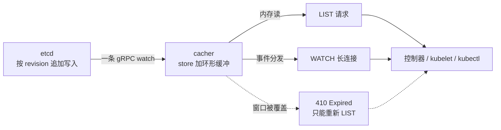
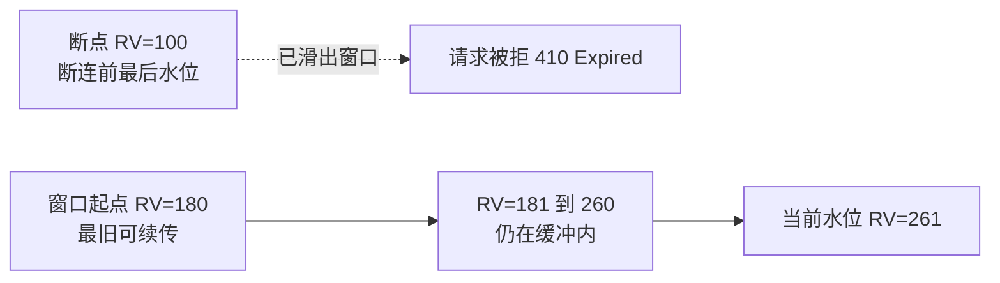
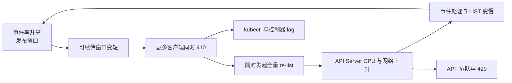
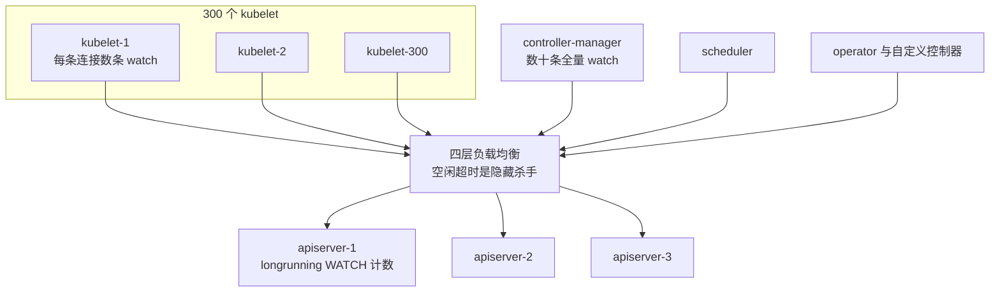
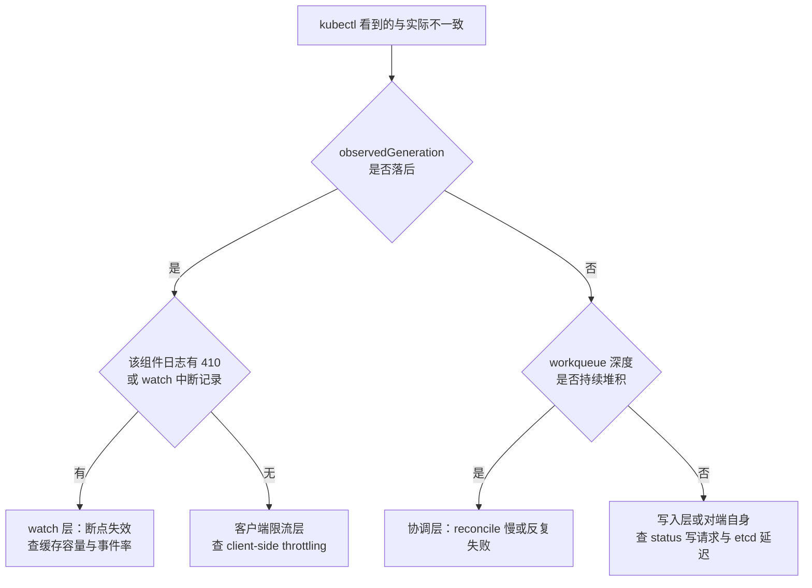
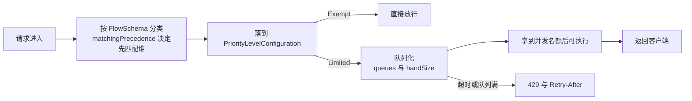

# 05 List-Watch 机制与 Informer 框架

**摘要：**

前几篇写的是请求如何进来、如何在三道门禁之后落进 etcd，这一篇转过来看数据出去的那一侧在运维上长什么形状。API Server 并不把 etcd 的变更流直接转给客户端，而是先落进自己内存里的 watch 缓存（Watch Cache），再分发给成千上万条 watch 连接，这是典型的**缓存换延迟**：拿内存和一段陈旧窗口，换掉 etcd 的读压力与客户端的轮询开销。由此派生的运维问题构成本文主线——resourceVersion 作为水位线的语义与它过期的两条路径；`too old resource version` 怎样把高频事件集群推进"re-list 越勤、追得越慢"的正反馈；`--min-request-timeout`、HTTP/2 多路复用与 GOAWAY 怎样决定重连节奏；控制器缓存不同步与 kubelet 状态漂移这两种"看起来一样"的症状如何分层归因；`--kube-api-qps` 与 `--kube-api-burst` 的默认值、client-side throttling 日志的盲区，以及 API 优先级与公平性（API Priority and Fairness，APF）如何把"谁先说话"变成可配置策略。全文的落点只有一条：把压力挪到可观测、可承受、可回收的那一层，而不是指望某个参数把它消灭。Reflector、DeltaFIFO、Indexer 的实现细节不在这里重讲，读到相关处会给出双链。

---

## 第 1 章 缓存换延迟：watch 在服务端的形态

### 1.1 一次发布窗口暴露的错位

笔者见过的"控制器缓存不同步"工单，十有八九在描述同一类现象：`kubectl` 里 Deployment 的副本数改了三分钟，ReplicaSet 的 `status.observedGeneration` 还停在上一代；或者 Pod 已经 Terminating 二十分钟，节点上的容器却还在跑。这些现象被笼统叫做"缓存不同步"，但成因分布在**四个层次**：etcd 与存储层、API Server 的 watch 缓存层、连接层、以及客户端自身的限流与协调逻辑。分不清层次，动作就会错：把 `--kube-api-qps` 调大、把 watch cache 调大、重启 controller-manager，三招轮着上，问题有时消失有时更重。

先把场景固定下来：300 个节点、8000 个 Pod、日均 2000 次声明式变更的集群，三个 API Server 实例，前面挂四层负载均衡。日均 2000 次变更听起来很闲，但控制面承受的不是"变更次数"而是"事件条数"：一次 Deployment 更新会连带出 ReplicaSet 的增删、上千个 Pod 的创建与状态流转、EndpointSlice 的反复重算，再叠加 kubelet 回写 Pod 状态、node lease 心跳、事件对象（Event）的写入。把 20 分钟的滚动发布压进这个窗口，事件率会从个位数每秒涨到几百每秒，量级差两个数量级。watch 侧的麻烦，几乎都在这两个数量级之间暴露。

### 1.2 cacher 的三段结构只取三个运维属性

服务端的 watch 支持主体是一个叫 cacher 的组件，它为每种资源类型维护一份内存副本：store 保存所有对象的最新版本，供 LIST 直接从内存读；环形缓冲（Ring Buffer）保存最近若干个变更事件，供 WATCH 从断点续推；每个 watch 请求对应一个事件分发器（cacheWatcher），由它把匹配的事件写回客户端的长连接。三段结构如何协作、事件如何扇出、bookmark 如何维持断点前移，机制推导见 [[云原生/Kubernetes/Kubernetes架构深度剖析/06 List-Watch 与 Informer：K8s 的分布式神经系统|架构深度剖析 06]] 第 2 章，这里只取三个与运维直接相关的属性。

第一，etcd 那边只有一条 watch 连接。不管集群里有多少客户端在 watch Pod，etcd 看到的订阅者数量等于资源类型数量。这意味着 watch 的规模瓶颈不在 etcd，而在 API Server 的内存与分发能力上。第二，LIST 与 WATCH 都从内存出，不落 etcd，于是 etcd 的读压力与 watch 客户端数量解耦——这也是"缓存换延迟"这个名字的来由。第三，可续传范围由环形缓冲容量决定，超出这个范围的历史事件已不存在，服务端只能让客户端重来一次。

下图把这条链路与它的两个失败出口画在一起：



### 1.3 可续传窗口是一条除法

环形缓冲的容量以事件条数计，不以字节或对象数计，它的效果因此完全取决于资源的事件率。**可续传窗口**的近似长度是一条除法：窗口秒数约为容量除以每秒事件数。默认容量 100 条时，若某资源稳态每秒产生 10 个事件，窗口约 10 秒；发布窗口里 Pod 事件率到 500 每秒，窗口只剩 0.2 秒。

由此得出两条运维结论。其一，默认值 100 是给小集群和低频资源准备的，它并不"错"，只是不面向发布窗口；把 Pod 的容量提到几千条，窗口就从 0.2 秒拉到十几秒。其二，窗口长度与"陈旧窗口"是两件事：store 里的对象通常只落后 etcd 几毫秒到几十毫秒，环形缓冲的长度不影响 LIST 的新鲜度，只影响断点能不能续上——把两者混为一谈，就会去调十万条缓存来防 410。

### 1.4 容量参数与它的代价

| 参数 | 默认值 | 调大的代价 | 调小的代价 | 判据 |
| :--- | :--- | :--- | :--- | :--- |
| `--watch-cache` | 启用 | 不适用；关掉它等于让 LIST 落到 etcd | 关闭后 etcd 读压力与延迟同步上升 | 只有在排查"缓存本身是否出错"时才临时关闭 |
| `--default-watch-cache-size` | 100 条事件 | 内存与事件回放时间上升，扇出变慢 | 高频资源窗口缩到秒级以下，410 变密 | 按资源事件率的量级分层设定，不全局拉平 |
| `--watch-cache-sizes` | 空 | 单资源内存占用与 cache 初始化变慢，GC 压力上升 | 该资源断连即失效，re-list 频率升高 | 发布期间事件率最高的三类资源优先加 |

配置形式是 `资源名[.组名]#条数` 的逗号列表，譬如 `--watch-cache-sizes=pods#5000,nodes#2000,events#1500`。它调的是事件条数而非对象数，也别指望它解决 LIST 慢的问题——LIST 成本由对象总量与序列化决定，与环形缓冲容量无关。

> [!info] 这一层的定位
> watch 缓存是 API Server 的读路径加速器，把 etcd 的读放大压成常量。它的代价是内存与一个"断点有效期"，不是一致性；缓存陈旧造成的状态错位在毫秒到秒的量级，不构成业务问题。

---

## 第 2 章 resourceVersion：不是时间，是水位

### 2.1 一个不透明字符串的三条规矩

资源版本（resourceVersion）是每个对象 `metadata` 里的一个字符串，值来自 etcd 的全局递增 revision，但 API 层刻意把它定义成不透明值，于是有三条规矩必须守住。第一，**不解析、不比较大小**：数值看起来是数字，但协议没有承诺单调可加，依赖"RV 大小"做判断的客户端都在赌实现细节。第二，不跨集群使用：把一个集群的 RV 拿到另一个集群，或者在 etcd 备份恢复之后继续使用旧 RV，会得到"版本过于超前"的错误，因为恢复后的 revision 可能已经回退。第三，同一个对象在两次读取之间的 RV 变大，只说明它被写过，不说明写了什么。

这三条规矩在排障时用得着。看到 `too large resource version` 这类报错，第一反应该是"这个客户端的 RV 从哪来的"，而不是"服务端的版本号乱了"——常见来源是从同源集群复制过来的清单、从备份恢复的 etcd、以及缓存了旧响应的中间层。

### 2.2 LIST 的三种读语义

watch 的断点永远是 LIST 给的，LIST 的读语义因此决定断点可靠与否。同一个接口，`resourceVersion` 留空、填 0、填具体值，走三条不同路径：

| `resourceVersion` | 语义 | 由谁服务 | 失败或异常表现 |
| :--- | :--- | :--- | :--- |
| 未设置 | 读到最新一致快照 | 需要与 etcd 当前版本对齐，较新版本可由缓存配合完成 | 大集群上这类 LIST 最贵，容易在发布窗口拖慢 |
| `0` | 任意版本，允许陈旧 | watch 缓存内存直读 | 快，但可能读到落后若干毫秒到若干秒的数据 |
| 具体版本 | 精确或"不旧于"该版本 | 版本仍在窗口内则由缓存服务，否则落到 etcd | 版本被淘汰即 410；分页场景用 `NotOlderThan` 更稳 |

配套的 `resourceVersionMatch` 决定"具体版本"是精确匹配（`Exact`）还是"不旧于"（`NotOlderThan`）。分页 LIST 要在多页之间对齐同一快照，`Exact` 在多页之间发生写入时极易退化成 410，`NotOlderThan` 才是分页的常规选择。client-go 的 Reflector 在遭遇过期之后会把重新 LIST 的 `resourceVersion` 置为 `0`，用一次"允许陈旧"的读换取成功率，`reflector.go` 的注释给出的理由正是"避免拿一个已经过期的版本再去要一次全量"。

### 2.3 过期的两个来源

"RV 太旧"至少有两个来源，日志与指标上的痕迹不同，处置方向也不同。

其一是 API Server 侧的窗口淘汰：请求的版本比环形缓冲里最旧的事件还旧，服务端连事件都拿不出来，只能回 `Expired`。它在客户端日志里长这样：`too old resource version: 12345 (67890)`，两个数字是客户端断点与服务端当前水位，量级差距就是"落后了多少"。其二是存储侧的压缩：etcd 定期压缩历史 revision，被压缩掉的版本在存储层已不存在，kube-apiserver 自己就会按 `--etcd-compaction-interval`（默认 5 分钟）发起压缩请求。日志里出现 `etcdserver: mvcc: required revision has been compacted` 这类字样，说明请求已穿透缓存落到存储层，问题在 etcd 侧而不是缓存容量上。

下图把两个来源放在同一条时间轴上，可以看出客户端断点滑出窗口之后，无论服务端多健康都补不回来：



> [!warning] 别把 RV 当时间戳
> RV 只在一个集群的 revision 序列里有意义。用它算"落后多少毫秒"没有根据，用它跨组件比较先后在 etcd 恢复之后会失效。要判断陈旧程度，看的是事件条数与事件率，不是 RV 的差值。

---

## 第 3 章 too old：410 的成因、后果与追不上的循环

### 3.1 报错文本与它的判定位置

`410 Gone` 在 API 层的错误类型是 `Expired`，Status 对象里 `reason` 为 `Expired`，`message` 就是上面那行 `too old resource version`。判定发生在两处：watch 的起始版本低于缓存可提供的范围时，cacher 直接拒绝；LIST 指定了具体版本且该版本已被淘汰时，由存储层拒绝。两处都返回 410，但伴随日志不同——前者之后常跟着一次 `resourceVersion=0` 的 LIST，后者常伴随 etcd 侧的压缩或慢查询。

排查时可手工复现：`kubectl get --raw "/api/v1/pods?watch=1&resourceVersion=1"`，用一个人为设定、肯定过期的版本去触发 410，观察返回的 Status 结构。这一步能确认"服务端在拒绝旧版本"是否正常，从而把怀疑从服务端移到客户端——连手工请求都拿不到 410，问题就不在版本淘汰上。

### 3.2 re-list 的真实成本

客户端收到 410 只能做一件事：丢掉本地缓存，重新 LIST 全量，再用新的 RV 建立 watch。这一步在代码里是自动的，在运维账本上却很贵，成本分三块。第一是对象量与序列化：8000 个 Pod 的全量响应按每对象若干 KB 计，单次就是几十 MB 的编码与传输，每个落在同一资源上的客户端都要付一遍。第二是内存峰值：解析全量快照会让客户端与服务端同时出现内存尖峰，GC 压力随之上升。第三是并发：一次 410 引发一次全量 LIST，而全量 LIST 会占住服务端的并发名额，与正在发布的写请求抢 CPU。

还有个易被忽略的细节：带分页参数的 LIST（`limit` 加 `continue`）在很长一段时间里无法由 watch 缓存服务，会回落到 etcd 存储层，于是分页的 re-list 不但贵，还绕过了本来用于保护 etcd 的那层缓存。以对应版本的实现为准，但这个行为解释了"只是重新 list 一下"为何会把 etcd 的读延迟一起拉起来。

### 3.3 正反馈回路如何形成

单次 410 不难处理，麻烦的是它自我强化。事件率升高让窗口变短，窗口变短让更多客户端在同一段时间失去断点，它们同时发起全量 re-list，re-list 抬高 API Server 的 CPU 与网络占用，事件处理变慢、积压变多，积压又等价于事件率上升。回路在这里闭合。

下图把这个放大过程画成一个环，右侧两个出口是运维实际看到的现象：



回路能否转起来，取决于两个条件是否同时成立：事件率是否足以把窗口压到秒级以下，客户端是否会在同一时刻一起失效。前者由业务节奏决定，后者由部署结构决定——同一批滚动升级启动的控制面组件，启动时间接近、断点接近，失效时间自然接近。很多 410 风暴看起来"毫无征兆"，原因就在这里：它不是故障，而是一群同时起跑、同时撞线的客户端把平均成本的波动放大成了尖峰。

### 3.4 打断回路的手段

打断点有四个，效果由弱到强。加大该资源的缓存容量，把窗口从零点几秒拉到十几秒，让偶发断连不再撞上 410；调整客户端重连抖动，让同时失效的一批客户端错峰 re-list，把尖峰摊成缓坡；降低事件率，从源头减少 Pod 状态与 Event 的写入频次，这一条最治本也最难推，涉及 kubelet 的同步节奏与业务方探针配置；把大 LIST 移出关键路径，用命名空间划分、字段选择器（field selector）或分页把一次全量拆成小批。

四条里只有第一条是改配置，后三条都是改结构或改行为。410 风暴看起来像容量参数问题，实际是"事件率与容忍窗口的比值"问题，参数只能在既有比值上做几十倍的改善，改不了**数量级**的差距。

| 现象 | 可能的层 | 关键证据 | 处置方向 |
| :--- | :--- | :--- | :--- |
| 所有资源同时出现 410 | 存储与压缩 | `mvcc: required revision has been compacted`，etcd 压缩间隔被调短 | 恢复压缩间隔，检查是否有外部工具压缩 |
| 仅 Pod 高频 410 | 缓存容量 | 客户端日志里 RV 差距只有几十条 | 加大 pods 的 `--watch-cache-sizes` |
| 410 与 429 交替出现 | 服务端过载 | `apiserver_request_total{code="429"}` 与 inflight 同升 | 先治过载，再看版本淘汰 |
| 只有某个 operator 报 410 | 客户端自身 | 该组件重启频繁或 watch 建立慢 | 查其重试退避与连接数，不要动服务端 |

---

## 第 4 章 断连与重连：连接层的账

### 4.1 服务端为什么要主动关掉一条好好的 watch

一条 watch 连接不会被无限期保留。客户端未显式指定 `timeoutSeconds` 时，watch 处理器会在 `--min-request-timeout`（默认 1800 秒）之上取随机值作为连接超时，到点主动关闭，并在响应里告知实际生效的值。随机化不是随手为之：几百上千个 watcher 常在同一批滚动升级、同一批重启里起跑，超时若是定值，重连也会挤在同一秒。

于是"watch 断了"在正常集群里是常态。按 30 到 60 分钟一条连接算，2000 条 watch 平均每分钟有几十条在重连，只要续得上断点，客户端完全无感。需要关心的是两件事：重连能否续上断点，以及重连时间是否被打散——前者是第 3 章的问题，后者是负载均衡与客户端退避的问题。

### 4.2 连接数与 stream 数是两个数

这是运维上最容易混淆的一对概念。HTTP/2 把多条逻辑流（stream）复用在同一条 TCP 连接上，watch 是流，不是连接。300 个 kubelet 各建一条连接，连接数是 300；每条连接上跑着若干条 watch（kubelet 至少 watch 本节点的 Pod，通常还有节点对象、lease，以及按需的 ConfigMap 与 Secret），stream 数是连接数的几倍。控制面组件更极端：kube-controller-manager 一个进程内的数十个 informer 共用少量连接、开出几十条 stream。

这决定了两件事。看容量时该数的是 **stream 数**，它与 API Server 的 goroutine、每 watcher 缓冲和内存直接相关；看负载均衡与会话保持时该数的是连接数，因为四层负载均衡按连接分流，一条长连接一旦建立就固定指向某个实例。前者体现在 `apiserver_longrunning_requests{verb="WATCH"}` 上，后者体现在各实例的连接分布上——三个实例的 WATCH 计数相差一倍以上，通常意味着负载不均，而不是某个实例性能差。

下图给出这个集群的连接与 stream 拓扑：



### 4.3 HTTP/2 与 GOAWAY

`--http2-max-streams-per-connection` 限制服务端允许单条连接上并存的 stream 数，默认值在不同版本里可能是 1000，取 0 则交回 Go 标准库的上限；具体数值以该版本 `kube-apiserver --help` 为准。把它调小的直接后果是 watch 建立被排队甚至失败，而不是"限流成功"；调大它只是解除排队，内存并不会因此变好，因为每条 stream 背后都挂着一个分发包。

`--goaway-chance` 是另一个方向的工具，它让服务端按给定概率主动发 GOAWAY 关闭连接，逼客户端重连、重新参与负载均衡。默认值 0 表示关闭；调到很小的正数，可以治"所有客户端都粘在一个实例上"这类历史遗留的不均。不过它会带来重连成本，只在确认存在倾斜、且倾斜无法从负载均衡侧修正时才值得打开。

第三类断连来源不在这两个参数里：负载均衡与中间网络设备的空闲超时。一条不产生事件的 watch 在设备眼里就是空闲连接，被掐掉时客户端只看到连接关闭。bookmark 在这种场景下扮演心跳——它不携带对象、只前移版本，能让空闲的流在中间设备看来是活的。观察到"低频资源的 watch 定时断"，先查设备空闲超时，再看 bookmark 是否生效，而不是先调 `--min-request-timeout`。

### 4.4 参数表与反例

| 参数或设施 | 默认 | 调大的代价 | 调小的代价 | 判据 |
| :--- | :--- | :--- | :--- | :--- |
| `--min-request-timeout` | 1800 秒 | 重连更少，但每个实例的连接更"粘"，滚动升级的断开更集中 | 重连变频繁，re-list 概率上升 | 一般不调，改了要连带评估负载均衡的空闲超时 |
| `--http2-max-streams-per-connection` | 约 1000，以版本为准 | 单连接承载更多 watch，内存与单个连接故障的影响面变大 | 多 informer 组件打开新连接，stream 建立排队 | 组件 stream 数接近上限时再调 |
| `--goaway-chance` | 0 | 客户端重连变多，watch 建立频率上升 | 不适用 | 仅在确认实例间连接倾斜时启用 |
| 负载均衡空闲超时 | 由设备决定 | 空闲连接存活更久，占用设备槽位 | 空闲 watch 被周期性掐断 | 应显著长于 bookmark 的发送间隔 |

一个典型反例是"为了限流把 `--http2-max-streams-per-connection` 调到 10"。表面上客户端能开的 watch 变少了，实际它只会开更多连接绕开限制，服务端的连接建立、认证与初始事件回放反而更频繁，成本从内存挪到 CPU 与 TLS 握手。连接层参数适合做容量整形，不适合做策略控制——策略交给第 7 章的 APF。

---

## 第 5 章 缓存不同步的症状学

### 5.1 三种看起来一样的 lag

"控制器没跟上"在监控和聊天窗口里的描述几乎一致，但代码路径有三条，证据各异。

第一种是真 lag：对象已经变了，控制器的 informer 还没收到事件。它的直接证据是 `metadata.generation` 与 `status.observedGeneration` 的差值——前者在 spec 变化时递增，后者由控制器在真正处理完之后回写，两者的差值就是"控制器还没看到这一代"。这个字段比任何日志都可靠，因为它由语义保证，不依赖采样。

第二种是处理慢：控制器看到了事件，但协调（reconcile）耗时或失败，workqueue 里堆积。此时 `observedGeneration` 可能已经追上，但目标资源没有产生，证据在 `workqueue_depth`、`workqueue_adds_total`、`workqueue_longest_running_processor_seconds` 这些指标上，以及控制器日志里的重试退避记录。

第三种是写入路径问题：控制器已经做完决策，写请求却排不上队或失败。证据在客户端侧的 `rest_client_requests_total{code="429"}` 与 client-side throttling 日志上，与 watch 完全无关。把第三种当成第一种去查 watch，是最常见的误判。

### 5.2 判据：observedGeneration 与它的同类

区分这三条只需要几个固定观察点。Deployment 与 ReplicaSet 都有 `status.observedGeneration`；Node 的 ready 状态由 node lease 与 status 共同表达；Pod 的 phase 由 kubelet 的状态管理器写入，没有 observedGeneration 这种直接字段。对 Pod 而言，比较"节点上真实在跑的容器"与"API 里对象的状态"，比读任何指标都直接。

### 5.3 kubelet 侧的状态漂移

Pod 状态在 kubelet 与 API Server 之间双向流动：kubelet 用 watch 感知"分配给我的 Pod"，用 status 子资源的写请求上报"这些 Pod 现在怎么样"。两个方向都会出问题，症状还相反。

kubelet 看不到删除，表现为 Pod 卡在 Terminating、节点上容器还在跑，成因通常是 watch 断点失效后 re-list 迟迟没完成，或者它连的那台 API Server 正在滚动重启。kubelet 的 watch 带 `spec.nodeName` 字段选择器，re-list 只拉本节点的几百个对象，成本远低于控制面组件的全量 re-list——同一场 410 风暴里它受到的影响最小，这也是"节点侧看着正常、控制面一片混乱"的来源。

kubelet 的状态写不上去，表现为 `kubectl` 显示的状态落后于节点实况，甚至显示一个已经不存在的容器还在 Running。成因在写路径：kubelet 的 `--kube-api-qps` 默认只有 5，`--kube-api-burst` 默认只有 10，一个刚重启、身上跑着上百个 Pod 的节点，光是初始化阶段的读请求加状态写请求就足以把令牌桶耗空，剩下的状态更新只能排队。此时 kubelet 日志里会出现 client-side throttling 的行，而 API Server 侧一切指标正常。这一条把客户端限流与本章的症状直接连了起来。

### 5.4 分层定位

把证据串成一棵树，比挨个试参数有效：



这棵树有个隐含前提：lag 本身是分布式系统的常态，任何基于缓存的控制面都会有几毫秒到几秒的滞后。有诊断价值的是"不自愈的 lag"——同一个对象的 `observedGeneration` 差值只增不减，或者 workqueue 深度单调上升。把常态 lag 当故障处理，只会得到一堆无意义的调参记录。

| 症状 | 优先怀疑的层 | 第一条要看的证据 | 不该先动的东西 |
| :--- | :--- | :--- | :--- |
| rollout 卡住，副本数不推进 | 协调层 | Deployment 的 `observedGeneration` 与 ReplicaSet 事件 | watch cache 容量 |
| 所有控制器同时落后 | 服务端过载 | `apiserver_current_inflight_requests` 与 429 计数 | 各组件的 `--kube-api-qps` |
| 单个 operator 落后 | 客户端 | 该组件日志里的 410 与重连记录 | APF 配置 |
| Pod 卡 Terminating | 连接或写入 | kubelet 日志与节点上容器实况 | Deployment 相关参数 |
| Pod 状态明显落后于节点 | 写入路径 | kubelet 的 client-side throttling 日志 | watch cache |

---

## 第 6 章 客户端限流：qps 与 burst

### 6.1 令牌桶的两个参数

客户端的限流是一个令牌桶（Token Bucket）：`--kube-api-qps` 是令牌补充速率，即长期平均速率；`--kube-api-burst` 是桶容量，即允许的瞬时突发。两个参数描述同一件事的两面：只调 qps 不调 burst，突发能力仍受限于旧容量；只调 burst 不调 qps，突发之后会被更长时间压制，因为桶要按速率补回来。

这个限流器挂在组件的 REST 客户端上，对它发出的所有请求生效——LIST、WATCH 的建立、状态写入、事件（Event）上报。watch 建立之后的推送不消耗令牌，但每次断连重连、每次 re-list 都要。一个组件的 QPS 额度因此是被"读"与"写"共同争抢的，不过这两类请求的紧急程度完全不同。

### 6.2 三组默认值

| 组件 | `--kube-api-qps` | `--kube-api-burst` | 调大的代价 | 调小的代价 | 判据 |
| :--- | :--- | :--- | :--- | :--- | :--- |
| kube-controller-manager | 20 | 30 | 数十个控制器同时提速，服务端可能直接进 APF 队列 | 大批量协调变慢，workqueue 堆积 | 有 client-side throttling 且服务端有余量时小步调 |
| kube-scheduler | 50 | 100 | 调度决策的写回变快，但会与其它组件抢配额 | 调度延迟上升，Pod 在队列里等 | 调度吞吐成为瓶颈、且 inflight 未满时 |
| kubelet | 5 | 10 | 状态上报变快，节点级别可能形成新的写压力 | 状态漂移窗口变长，Pod 启动变慢 | 节点 Pod 密度高、状态明显落后时 |

三组默认值的比例值得琢磨：kubelet 最小，scheduler 最大。kubelet 的数量与节点数成正比，每个都给 50 的话，300 个节点就是每秒上万次请求的潜在压力；scheduler 只有一两个实例，给大一点也不会失控。默认值隐含了"按实例数量分配总额度"的思路：调大单个组件的额度，等于调大整类组件的总额度。

### 6.3 client-side throttling 的日志与它的盲区

触发客户端限流时，client-go 会打出这样一行：`Waited for 1.048632587s due to client-side throttling, not priority and fairness, request: GET:https://...`。这行日志的价值在于后半句——它明确说了这次等待与 APF 无关，是客户端自己在排队。它同时揭示了最大的盲区：被客户端限流拦下的请求**根本没有发出去**，API Server 的 `apiserver_request_total` 里不会有它，服务端的任何指标都不会记录这次等待。

这就给出了一条硬判据：服务端指标一切正常而客户端报慢，先看客户端自己的日志；服务端在 429 或排队、客户端日志里却没有 client-side throttling，问题就在服务端。两侧同时看，才分得清"请求没发出"和"请求发出了但被挡回"。

### 6.4 调大与调小的代价

把 `--kube-api-qps` 从 20 调到 200，直觉上是"让控制器跑快十倍"，实际发生的是把**排队位置**从客户端搬到服务端。客户端不再排队，请求以十倍速率到达，服务端要么用 APF 的队列挡住（客户端看到更长的请求耗时），要么在经典限流下直接给 429。前者只是把等待换了个地方，后者是实打实的失败与重试。更糟的是，被调大的通常是正在出问题的那个组件，而它出问题的原因往往是 reconcile 逻辑慢或反复失败，提速只会让失败次数更多。

反过来，把 qps 调小也不安全。kubelet 的写请求被压到每秒 2 次，一个 300 Pod 的节点重启后要花好几分钟才能把状态汇报完，这期间 `kubectl` 看到大面积状态漂移，运维会以为控制面坏了。

真正该做的判断是：客户端限流只决定排队位置，不创造**容量**。容量由服务端决定，排队位置可在两端之间挪动；两侧都紧时要做的是减少请求量（合并状态写入、缩小 LIST 范围、降低 resync 频率），而不是继续加额度。

---

## 第 7 章 APF：谁先说话

### 7.1 从粗暴拒绝到分类排队

在 APF 之前，API Server 的限流只有两个数字：`--max-requests-inflight`（默认 400）与 `--max-mutating-requests-inflight`（默认 200）。并发超过就拒绝，谁被拒取决于谁先到——一个失控的 CI 流水线能把所有控制器的读请求一起挤掉。这个问题在 1.18 引入 APF 之后有了结构性解法，1.20 起默认启用（`--enable-priority-and-fairness`），`flowcontrol.apiserver.k8s.io/v1` 从 1.29 起提供。

APF 的思路是把请求按属性分类，给每一类分配相对并发份额，并在类内做公平排队。份额是相对的：总并发上限仍是两个 inflight 限额之和，APF 只把这个总量在优先级档之间按份额分配，空闲时可出借。下图是这条处理链：



### 7.2 默认的那张座位表

APF 出厂自带一组引导对象。`exempt` 档完全不受并发限制，探针、健康检查与集群管理员的紧急操作走这里；`catch-all` 兜住所有没被其它规则匹配的请求，份额最小；`global-default` 承接普通用户流量；`workload-high` 与 `workload-low` 承接业务负载，譬如 `workload-low` 的名义份额就是默认档里最大的；系统组件（kubelet、controller-manager、scheduler）在默认流组里已有专门档位，不跟用户流量抢座位。

设计意图很明确：把人能忍受的等待与控制器不能忍受的等待分开。`kubectl get` 多等两秒无妨，scheduler 的写回多等两秒就可能让一批 Pod 迟迟不上节点。

### 7.3 list 与 watch 在座位表上的位置

watch 属于长连接请求，在限流器眼里被划为 long-running，一旦受理就开始流式推送，占住的是连接、内存与 goroutine，不是并发名额。真正消耗并发配额的是 LIST——启动时的初始 LIST、410 之后的 re-list、以及所有基于字段选择器的过滤读。这条区分解释了第 3 章的回路为什么能伤人：410 风暴的伤害不在 watch 本身，而在它引发的 **LIST 洪峰**。

于是配置上有反直觉的结论：想保护控制面，不必给 watch 限流，该给"会触发大 LIST 的客户端"限流。大规模采集器、审计导出工具、以及用 `--watch` 加全量 LIST 自建缓存的自研组件，才是该被单独分类的对象。

### 7.4 一个给发布机器人限速的例子

发布机器人是典型的高突发客户端：一次发布在几十秒内发出成百上千个 PATCH 与 CREATE，之后归于安静。把它单独分到受限档，既保证安静期不排队，又在爆发期把并发压在合理范围：

```yaml
apiVersion: flowcontrol.apiserver.k8s.io/v1
kind: FlowSchema
metadata:
  name: ci-release-bot
spec:
  # 数字越小越先匹配；刻意排在系统组件之后，避免抢走 kubelet 的座位
  matchingPrecedence: 500
  distinguisherMethod:
    type: ByUser
  priorityLevelConfiguration:
    name: workload-low
  rules:
    - subjects:
        - kind: User
          name: ci-release-bot
      resourceRules:
        - verbs: ["create", "update", "patch", "delete"]
          apiGroups: ["apps"]
          resources: ["deployments", "replicasets"]
          clusterScope: false
```

这段配置有三处关键：`matchingPrecedence` 决定它与默认流的相对顺序，写小了会抢系统组件的匹配机会；`distinguisherMethod` 取 `ByUser` 让同一用户的请求在队列内公平排队而不是互相挤占；`priorityLevelConfiguration` 指向已有档位而非新建档位，因为新建档位会稀释其它档的相对份额。

### 7.5 观测与反例

APF 的观测有三个指标足够：`apiserver_flowcontrol_rejected_requests_total` 记录因队列满或超时被拒的请求，`apiserver_flowcontrol_current_inqueue_requests` 记录当前排队量，`apiserver_flowcontrol_request_wait_duration_seconds` 记录排队时长。三者一起看，能区分"拒绝"与"变慢"两种生效方式。

反例有两个常见版本。一个是关掉 APF（`--enable-priority-and-fairness=false`）以求"少一层复杂度"，代价是回到全局 429，一个失控客户端能把 kubelet 的状态上报一起打掉，恢复还要重启 API Server。另一个是把 `--max-requests-inflight` 从 400 加到 4000，认为"并发越高吞吐越大"——上限提高确实能让更多请求同时跑，但每个请求的成本不变，内存与 GC 压力线性上升，最后是所有请求一起变慢。APF 的份额是分配工具，不是扩容工具。

| 对象或参数 | 默认 | 调大或放宽的代价 | 收紧的代价 | 判据 |
| :--- | :--- | :--- | :--- | :--- |
| `--max-requests-inflight` | 400 | 内存与 GC 压力上升，延迟整体变差 | 更多请求被拒，429 上升 | 只在 inflight 长期顶满且单请求成本稳定时才加 |
| `--max-mutating-requests-inflight` | 200 | 写路径并发上升，etcd 写延迟成为新瓶颈 | 写请求排队，控制器写回变慢 | 与 etcd 写延迟一起评估 |
| FlowSchema `matchingPrecedence` | 按引导值 | 数字调小会抢系统组件的匹配机会 | 数字调大会被更宽的规则先吃掉 | 新流组一律排在系统组件之后 |
| `nominalConcurrencyShares` | 按档位 | 该档变快，其它档相对变慢 | 该档排队变长 | 只在确认该档长期排队时调 |

---

## 第 8 章 指标与一次完整归因

### 8.1 指标表

| 指标 | 类型 | 看什么 | 异常形态 |
| :--- | :--- | :--- | :--- |
| `apiserver_request_total` | 计数器 | 按 verb、resource、code 分组，看请求量与错误率 | `code="410"` 或 `code="429"` 在某资源上突然放大 |
| `apiserver_request_duration_seconds` | 直方图 | LIST 与 WATCH 建立阶段的分位延迟 | LIST 的 p99 在发布窗口上台阶 |
| `apiserver_current_inflight_requests` | 仪表 | 按 `request_kind` 分读与写两条 | 长期贴着上限，说明在排队 |
| `apiserver_longrunning_requests` | 仪表 | `verb="WATCH"` 的在册连接数 | 各实例差异过大说明连接倾斜 |
| `apiserver_watch_events_total` | 计数器 | 按 kind 分组的推送事件量 | 某类资源的推送量远超预期，通常是状态写放大 |
| `apiserver_cache_list_total` | 计数器 | 由缓存服务的 LIST 量 | 与 `apiserver_request_total` 的 LIST 量对比，缺口即落到存储层的部分 |
| `apiserver_storage_objects` | 仪表 | 各类资源的对象总量 | 缓慢增长说明有对象没被清理 |
| `etcd_request_duration_seconds` | 直方图 | API Server 视角的 etcd 操作延迟 | 与 inflight 同升，说明排队已经落到存储层 |
| `rest_client_requests_total` | 计数器 | 组件侧按 code 分组的请求结果 | `code="429"` 说明服务端在挡；客户端限流则无记录 |

watch 缓存没有统一的 `watch_cache_*` 指标族，缓存命中情况看 `apiserver_cache_list_*` 与 `apiserver_storage_objects` 这一对，具体命名以对应版本的指标清单为准。

### 8.2 三条查询

```promql
# 各实例活跃 watch 数，判断连接是否倾斜
sum by (instance) (apiserver_longrunning_requests{verb="WATCH"})

# 被版本淘汰打回的 watch 比例，分子就是 410
sum(rate(apiserver_request_total{verb="WATCH",code="410"}[5m]))
  / sum(rate(apiserver_request_total{verb="WATCH"}[5m]))

# 读路径并发是否顶到上限，要与 LIST 延迟一起看
max_over_time(apiserver_current_inflight_requests{request_kind="readOnly"}[5m])
```

### 8.3 复盘：一次卡住的滚动发布

把前面的零件装回去，笔者按顺序走一遍归因。发布十分钟后，`rollout status` 停在 "waiting for deployment ... to be rolled out"，两个 ReplicaSet 的副本数都不对，`observedGeneration` 落后两代。

第一步分辨层次：`observedGeneration` 落后说明 deployment controller 还没看到变更，属于 lag 而非协调失败。第二步看 controller-manager 日志，大量 `too old resource version` 与重新 LIST 的记录指向 watch 层。第三步看服务端指标：`apiserver_request_total{verb="WATCH",code="410"}` 在发布第 3 分钟起跳，`apiserver_current_inflight_requests{request_kind="readOnly"}` 顶到接近上限，`etcd_request_duration_seconds` 的 p99 抬升。

**因果链**到这里清楚：发布窗口把 Pod 事件率推高两个数量级，`--watch-cache-sizes` 仍是默认的 100，可续传窗口压到零点几秒，一批同时起跑的控制面组件同时失效、同时全量 re-list；re-list 争抢并发名额，把 inflight 顶满，进一步拖慢事件处理。

处置顺序因此确定：先给 pods 与 events 加缓存容量，把窗口拉长一个数量级止住出血；再把非关键的采集类客户端分到低优先档，避免它们的大 LIST 与控制面抢并发；最后处理事件率本身——检查 kubelet 的状态上报节奏与业务探针的更新频率，压掉无意义的状态写入。三步做完，同样规模发布里 410 比例回到基线，`observedGeneration` 的追平时间从分钟级回到秒级。

> [!note] 归因顺序
> 先确定是哪一层（版本淘汰、过载、客户端限流、协调失败），再决定动哪个参数。反过来做——先调参数再看现象——得到的永远是"这次好像好了"的经验，而不是可复用的判断。

---

## 第 9 章 配置基线与三个反例

### 9.1 基线

把参数收成一张基线表，取值针对第 1 章 300 节点、8000 Pod 的口径，只作起点，不作结论：

| 参数 | 默认 | 建议起点 | 依据 | 代价 |
| :--- | :--- | :--- | :--- | :--- |
| `--watch-cache-sizes` | 空 | `pods#5000,events#2000` | 发布窗口事件率最高的两类资源 | 单资源内存上升，需与实例规格一起评估 |
| `--min-request-timeout` | 1800 | 保持默认 | 随机化已经在做错峰 | 改动会牵动负载均衡配置 |
| `--http2-max-streams-per-connection` | 约 1000 | 保持默认 | 单个 informer 集合远达不到上限 | 无 |
| `--goaway-chance` | 0 | 0 或极小正值 | 仅在连接倾斜时启用 | 客户端重连增加 |
| kube-controller-manager qps/burst | 20/30 | 40/60 | 数十个控制器的读放大需要余量 | 服务端 inflight 上升 |
| kube-scheduler qps/burst | 50/100 | 保持默认 | 调度吞吐通常不是瓶颈 | 无 |
| kubelet qps/burst | 5/10 | 10/20 | 高 Pod 密度节点的状态上报 | 节点写入压力上升 |
| APF | 默认引导对象 | 只新增流组，不改默认档 | 默认档的份额分配经过调校 | 新流组会稀释其它档份额 |

### 9.2 反例一：把 qps 调到 1000

把 controller-manager 的 `--kube-api-qps` 从 20 调到 1000，是"发布卡住"工单里最常见的动作，方向却常常是错的：客户端排队只是请求被压在自己手里，卡住的根因往往是服务端在版本淘汰与过载里打转。额度放大五十倍之后，洪峰直接打到服务端，APF 队列接住，客户端看到的是每个请求更慢；APF 没兜住就是 429 与重试，失败次数比之前更多。只有在"客户端日志里 client-side throttling 频繁、服务端 inflight 仍有余量"这一种组合下，加额度才对症。

### 9.3 反例二：忽略 APF

第二个反例是压根不看 APF：既不知道默认对象有哪些，也不知道谁在排队。表现为出现 429 后所有人去查业务代码，没人注意 `apiserver_flowcontrol_rejected_requests_total` 上某个档位在放大。多租户集群里这尤其危险：默认的 `catch-all` 兜底档份额最小，一个不属于任何系统流组的采集器被分到这里，它的大 LIST 会把同档其它无名客户端一起拖慢，而受害者与加害者毫无关联。

### 9.4 反例三：watch cache 的两头堵

一头是把容量设到极小。默认 100 条对 Pod 这种高频资源在发布窗口里只剩零点几秒的窗口，等于把每个网络抖动都变成一次全量 re-list。另一头是设到极大，指望"缓存足够大就再也不会 410"——内存与 GC 压力上去了，事件扇出的遍历成本上去了，真正的问题（事件率与 LIST 成本）一点没动。缓存容量只解决"断点能续多久"，解决不了"为什么要频繁断开"和"为什么要全量 LIST"。

### 9.5 收束

把这一整篇压缩成一句话：watch 是拿缓存换延迟，每一次运维动作都是在这个交换上选择**把压力挪到哪一层**。加大缓存，是把压力挪到内存；加大 qps，是把排队挪到服务端；放宽 APF，是把隔离挪到没有；关掉 APF，是把风险挪给所有租户。没有哪个参数能凭空消灭压力，能做的只是让它落在可观测、可承受、可回收的那一层。

机制细节还能顺着读下去：环形缓冲、事件扇出与 bookmark 在 [[云原生/Kubernetes/Kubernetes架构深度剖析/06 List-Watch 与 Informer：K8s 的分布式神经系统|架构深度剖析 06]]；RV 与乐观并发在 [[云原生/Kubernetes/Kubernetes架构深度剖析/08 ResourceVersion 与乐观并发控制|ResourceVersion 与乐观并发控制]]；etcd 的 revision 与压缩在 [[云原生/Kubernetes/Kubernetes架构深度剖析/07 etcd 深度剖析：Raft 共识、MVCC 与 Watch 机制|etcd 深度剖析]]；kubelet 的状态上报链在 [[云原生/Kubernetes/Kubernetes架构深度剖析/13 kubelet 深度剖析：Pod 生命周期与容器运行时接口|kubelet 深度剖析]]；协调循环的节奏在 [[云原生/Kubernetes/Kubernetes架构深度剖析/09 控制器模式与协调循环：从 Deployment 到 Operator|控制器模式与协调循环]]；APF 的完整配置、容量核算与高可用这类整体题目，留给 [[06 API Server 性能调优与高可用]]。

---

## 参考资料

1. Kubernetes Documentation - API Concepts, Efficient detection of changes：https://kubernetes.io/docs/reference/using-api/api-concepts/
2. Kubernetes Documentation - kube-apiserver Command Line Reference：https://kubernetes.io/docs/reference/command-line-tools-reference/kube-apiserver/
3. Kubernetes Documentation - API Priority and Fairness：https://kubernetes.io/docs/concepts/cluster-administration/flow-control/
4. Kubernetes Documentation - kube-controller-manager Reference：https://kubernetes.io/docs/reference/command-line-tools-reference/kube-controller-manager/
5. Kubernetes Documentation - kubelet Reference：https://kubernetes.io/docs/reference/command-line-tools-reference/kubelet/
6. Kubernetes Source - staging/src/k8s.io/apiserver/pkg/storage/cacher：https://github.com/kubernetes/kubernetes/tree/master/staging/src/k8s.io/apiserver/pkg/storage/cacher
7. Kubernetes Source - client-go Reflector：https://github.com/kubernetes/kubernetes/blob/master/staging/src/k8s.io/client-go/tools/cache/reflector.go
8. KEP-1040: Priority and Fairness for API Server Requests：https://github.com/kubernetes/enhancements/tree/master/keps/sig-api-machinery/1040-priority-and-fairness
9. KEP-956: Watch Bookmarks：https://github.com/kubernetes/enhancements/tree/master/keps/sig-api-machinery/956-watch-bookmark

---

> [!note] 思考题
> 1. 同一个资源在默认缓存容量下，把事件率提高十倍，可续传窗口会缩短到十分之一。如果不想加缓存内存，还有哪些办法能把"断连即全量 re-list"的代价降下来？
> 2. `apiserver_request_total{code="410"}` 上升而 `apiserver_current_inflight_requests` 平稳，与两者同时上升，分别指向什么处置顺序？
> 3. kubelet 的状态上报被客户端限流压住时，API Server 侧看不到任何异常。你会用哪三个信号组合来把这类问题从"watch 层"里摘出来？
> 4. APF 默认引导对象里 `catch-all` 的份额最小。一个不属于任何系统流组的批量采集器会落到哪个档，它的邻居是谁，这种"邻居效应"应该如何预防？
> 5. 把 `--min-request-timeout` 调大能让重连变少，但它会与负载均衡的空闲超时、滚动升级的连接断开节奏相互影响。如果要给出一个不改变默认值的替代方案，你会怎么做？