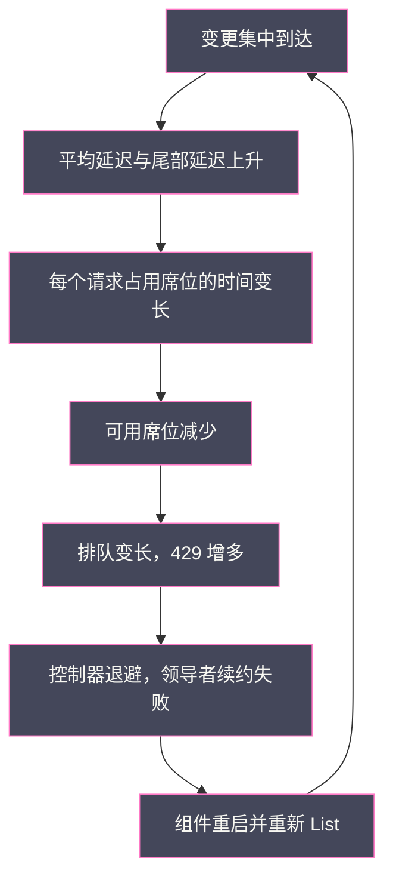
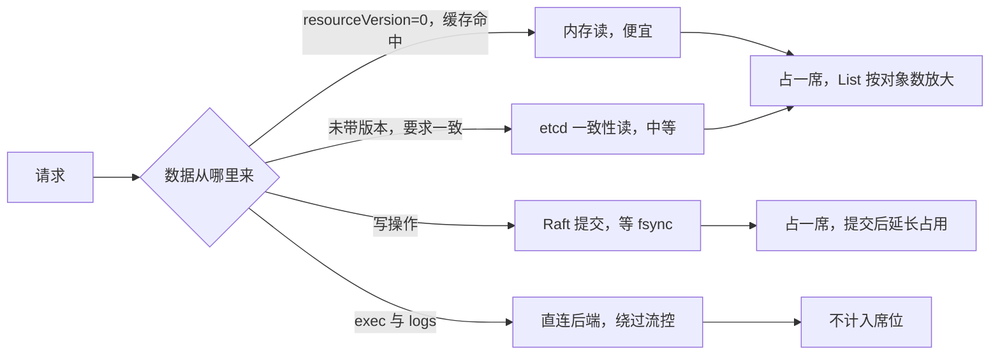
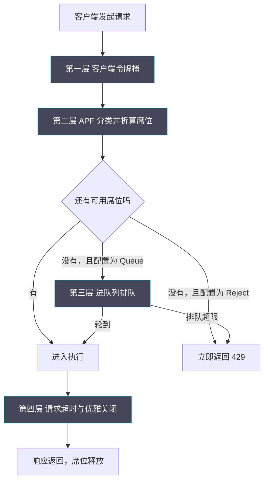
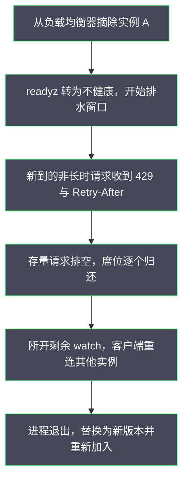

# 06 API Server 性能调优与高可用

**摘要：**

API Server 的容量问题很少以「慢」的面目出现，它更像一串看似无关的故障：kubectl 卡住、kubelet 心跳超时、控制器 leader election 抖动、节点成批 NotReady。本篇把 API Server 当成一个有确定成本模型的系统来拆：先用小法则（Little's Law）把并发、延迟与吞吐绑在一起，解释为什么平均 QPS 不高的集群也会被打出 429；再逐层拆开客户端限流、优先级与公平性（API Priority and Fairness，APF）、队列与超时这四道闸门——客户端限流管源头、APF 管分级、队列吸收突发、超时兜底——给出默认优先级层的份额算术与为特定控制器新建 FlowSchema 的写法；随后把 etcd 的 fsync 延迟当作真正的天花板，看它如何传导成全控制面的过载，并用 429 的四种成因说明拒绝与拒绝之间的差别。收尾给出以节点数与变更频率为输入量的容量估算示例（300 节点、8000 Pod、日均 2000 次变更）、高可用与滚动升级的三条注意，以及三个必须避免的反例；全文的判据都落在可观测指标上，读者可以拿出自己集群的监控逐项核对，本篇只给判据，不给通用答案。

---

## 第 1 章 过载不是一个阈值，而是一条反馈回路

先看一个具体的集群：300 个节点、8000 个 Pod、日均 2000 次变更。上午十点发布窗口打开，三个 Deployment 同时滚动更新。第一分钟，kubectl 的响应从几十毫秒涨到两秒；第三分钟，kubelet 日志里出现 `context deadline exceeded`；第五分钟，kube-controller-manager 的日志里出现成片 429，紧接着是 leader election 失败的记录，几个控制器退出重启，重启之后要重新 List 一遍关心的所有资源，于是 API Server 在还没缓过来时又挨了第二波。

大多数人的第一反应是打开启动参数，把 `--max-requests-inflight` 从 400 调到 2000。这个动作通常能让 429 暂时消失，代价是把保护机制本身拆掉，下一节会解释它为什么必然如此。

### 1.1 拥堵崩溃的形状

网络的拥塞崩溃（congestion collapse）早被研究透：注入流量超过链路容量后排队变长，超时重传把同样数据再发一遍，有效吞吐不升反降，直至接近零。API Server 的过载形状相同，只是「链路容量」不是带宽，而是并发席位。

做一个粗糙的类比：剧院只有 600 个座位，观众进场后不落座，只在过道里慢慢挪动；进来的人越多，每个人挪动的时间越长，同一时刻场内反而容纳不下更多人，因为座位被「正在挪动的人」占着。**席位被消耗的是时间，不是请求编号**，一个占着席位 30 秒的请求，等价于 30 个不占席位的请求从队伍里消失。

由此得到本篇的第一个公式：一次请求的代价等于席位数乘以占用时长。席位由请求形态决定（一次全量 List 不是一席），占用时长由后端决定（等一次 etcd 的 fsync，还是读一次内存）。后面所有调优动作，本质上都是在这两个因子上做乘除法。

### 1.2 三条放大路径

过载之所以从「慢」变成「崩」，是因为三条正反馈路径同时起作用。

尾延迟放大：一个准入 Webhook 卡了 30 秒，它占着的那一席在 30 秒里不能给别人；同层其他请求排队，排队又拉长它们的占用时长，慢三次队伍就长一倍。

重试放大：控制器收到 429 会指数退避，这没问题；但 kubelet 的节点状态上报与租约续期有自己的固定节奏，退不了，也不该退。集群在最难的时候仍然被要求每秒完成几十次心跳写入。

重同步放大：组件被 429 与超时打出重启后缓存是冷的，所有 Informer 要重新 List，而冷缓存的 List 必须回源 etcd——那正是此刻最贵的操作，它把延迟再推高一点，于是更多请求超时、更多组件重启。



### 1.3 保护的目标是按价值拒绝

过载保护的第一原则不是「不拒绝」，而是「按价值拒绝」。集群里的请求并不等价：kubelet 的心跳与租约续期决定节点是否被判死，控制器续约 `leases` 决定是否重新选主，调度器的一次绑定决定 Pod 能否落地；一次 `kubectl get pods --all-namespaces` 的价值低得多，它失败的正确反应就是退避重试。

第二原则是「拒绝要快」。请求被 429 打回，客户端立刻知道该退避；请求被拖到 60 秒超时，它在这 60 秒里一直占着席位，客户端也不知道该不该重试。**快速拒绝比慢慢排队更能保住整体**，这与直觉相反，却与席位模型一致。第三原则是「层级要对得上」：客户端侧、进程内、后端三处闸门各负责一段，缺一段，压力就挤到不该承压的那一段去。

### 1.4 机制部分交给架构篇

请求链路、watch cache、Raft 提交与 MVCC 保留历史的推导，在 [[云原生/Kubernetes/Kubernetes架构深度剖析/04 API Server 请求链路：从 HTTP 请求到 etcd 写入|请求链路]]与 [[云原生/Kubernetes/Kubernetes架构深度剖析/07 etcd 深度剖析：Raft 共识、MVCC 与 Watch 机制|etcd 内部机制]] 里已经展开，本篇只在用到结论时引用，把篇幅留给「配多少、怎么看出来、出了事怎么归因」。

---

## 第 2 章 请求成本的三档模型

### 2.1 数据路径决定成本

API Server 的请求成本不是一个连续谱，而是明显分成三档，分档依据是这份数据从哪里来。

| 请求类型 | 数据来源 | 成本量级 | 主要消耗 | 流控上如何计入 |
| :--- | :--- | :--- | :--- | :--- |
| GET 或 LIST，带 `resourceVersion=0` | watch cache 内存 | 低 | CPU 序列化、响应带宽 | 占席位，List 按预估对象数放大 |
| GET 或 LIST，未指定 `resourceVersion` | etcd 一致性读 | 中 | etcd 读 IOPS、ReadIndex 往返 | 占席位 |
| CREATE、UPDATE、PATCH、DELETE | etcd Raft 提交 | 高 | WAL fsync、多数派往返 | 占席位，提交后还要继续占一小段 |
| WATCH | watch cache 加通知扇出 | 低，初始洪峰除外 | 连接、goroutine、内存 | 只在初始事件爆发阶段占席位 |
| exec、attach、port-forward、logs | 直连 kubelet 的流 | 不计入 | 长连接 | 绕过 APF |



第一档便宜，因为 List 的响应体直接从内存对象缓存序列化出来，没有后端往返，机制见 [[云原生/Kubernetes/Kubernetes架构深度剖析/04 API Server 请求链路：从 HTTP 请求到 etcd 写入|请求链路]] 第 6 章。第二档贵在语义：不指定版本时，默认语义要求读到一个不比此前任何返回结果更旧的版本，这条承诺只能靠 etcd 的一次一致性读兑现。第三档最贵，写入要等多数派把 WAL fsync 落盘。

WATCH 与 exec 这两处容易被误判。watch 的存活时间可能是几小时，按占用时长计费会瞬间吃光席位，APF 把计费截断在初始对象推送完毕那一刻；exec 与日志流则完全绕过 APF，这类请求没有任何席位保护。

### 2.2 席位的放大系数

APF 把并发折成席位（seat），一个普通的单对象 Get 占一席，但有三处例外：全量 List 按预估返回对象数放大；写请求在提交之后还要继续占一小段时间，用来把变更通知扇出给相关 watch；流式 List 在初始阶段按 List 规模计费。慢 Webhook 之所以特别伤，是因为它把占用时长从毫秒拉到秒级，席位数不变，代价涨了三个数量级。

### 2.3 小法则：把并发、延迟与吞吐绑在一起

并发、吞吐、延迟由一个等式固定住，就是排队论里的小法则：占用数等于到达率乘以平均停留时间。放进 API Server 的语境，占用的席位数约等于每秒请求数乘以平均占用时长；反解一下，某一层每秒能处理多少请求，约等于它的席位数除以平均占用时长。

| 平均占用时长 | 支撑 100 QPS 需要的席位 | 600 席在算术上能撑住的 QPS |
| :--- | :--- | :--- |
| 10 ms | 1 | 60000 |
| 50 ms | 5 | 12000 |
| 200 ms | 20 | 3000 |
| 1 s | 100 | 600 |
| 5 s | 500 | 120 |

右列数字大得不真实，这是对的：任何一台机器都跑不到，瓶颈会先落在 CPU、网卡和 etcd 上。这张表要说明的是——**平均负载从来不是 429 的原因**，要让 600 席在 50 毫秒延迟下耗尽需要 1.2 万 QPS，这个量级在 300 节点的集群里不存在。

席位盯的是占用时长，而占用时长在过载时由尾部决定。P99 从 50 毫秒涨到 500 毫秒，同样的席位只能吞吐十分之一的请求，`apiserver_current_inflight_requests` 会先于 429 抬起来，它是比 429 更早的预警信号。

### 2.4 平均 QPS 的错觉

把 300 节点集群的稳态负载拆开：节点状态上报与租约续期各按 10 秒周期，合计每秒 60 次写；控制器的事件驱动写入按日均 2000 次变更摊平只有每秒零点几次；Event 在发布窗口里能到每秒二三十条；再加运维请求。稳态约每秒 100 次，峰值 250 次。

按 50 毫秒的平均写延迟折算，峰值需要十几个席位，距离默认 600 席有近两个数量级余量，日常运行时席位几乎是空的。429 只可能来自三种时刻：缓存冷启动、etcd 尾部延迟抖动、某个客户端行为突变（轮询代替 watch、全量 List 代替字段过滤）。容量模型真正要建模的是「最坏的那十分钟」，不是日均；日均好看而 429 不断，通常是观测窗口选错了。

---

## 第 3 章 读懂延迟直方图

### 3.1 这条直方图的标签结构

`apiserver_request_duration_seconds` 是一个直方图向量，维度是 verb、dry_run、group、version、resource、subresource、scope 与 component。**它没有响应码这一维**，想知道 429 有多少，要去 `apiserver_request_total` 的 `code` 标签里找，这个分离带来一个后果，后面会看到。

scope 把单对象读（resource）、Namespace 级 List（namespace）与集群级 List（cluster）分开，三者目标延迟相差一个数量级：社区的可扩展性文档里，非变更类读在 `scope=resource` 时的目标是 P99 不超过 1 秒，Namespace 级与集群级 List 是 30 秒。混进一个 P99，得到的数字既不代表用户感受，也不对应任何服务目标。component 区分这段耗时是 API Server 服务请求时自己测的，还是它作为客户端去调外部服务时测的，排查聚合层与 Webhook 时这是第一刀。

### 3.2 三种误读

第一种误读是把 WATCH 混进延迟统计。watch 的时长是连接存活时间，动辄几十分钟，完全由客户端决定何时断开；把它算进 P99，P99 就变成「有多少比例的 watch 连接活得久」。watch 的健康该用 `apiserver_longrunning_requests` 与事件发送速率衡量。

第二种误读是拿单条 P99 概括全集群。List 的延迟与返回对象数强相关，8000 Pod 的集群级 List 与单 Pod 的 Get 落在同一条直方图里却代表两个系统，按 verb 与 scope 分组是最低要求。

第三种误读最隐蔽：过载期间 P99 会变好。429 是快速返回的，几毫秒就结束，它们把直方图的低延迟段撑得更胖，P99 反而往下走。只看延迟会得出「集群很健康」的结论，而有效吞吐已经在塌。**快速拒绝会美化延迟指标**，这就是延迟必须与拒绝率、队列长度一起看的原因。

### 3.3 指标组合的判读

| 观测组合 | 延迟直方图 | 429 与队列 | etcd 指标 | 归因 |
| :--- | :--- | :--- | :--- | :--- |
| etcd 慢 | 写请求延迟整体抬升，读基本正常 | 队列积压集中在 workload 层 | WAL fsync P99 明显升高 | 磁盘或 etcd 网络 |
| Webhook 慢 | 仅 CREATE、UPDATE 的 P99 抬高 | 429 集中在该资源的写流量 | etcd 正常 | 准入链路 |
| 席位不足 | 各层延迟普遍抬高 | 拒绝原因以 queue-full 为主 | 正常 | 份额或总量配置 |
| 缓存冷启动 | LIST 的 P99 出现尖峰 | 无明显 429，但 QPS 突起 | 读 IOPS 与请求数齐升 | 组件重启或 410 重同步 |
| 单客户端风暴 | 某一 flow 的等待时间抬高 | 该 flow 的队列长度异常 | 视其为读或写而定 | 客户端行为 |

判读顺序与表格的列序相反：先看拒绝率与 reason，再看延迟落在哪类请求，最后看 etcd；顺序反了就会陷在「API Server 慢」这个笼统结论里打转。

### 3.4 常用的几段查询

```promql
# 按 verb 与 scope 分组，排除长连接动词
histogram_quantile(0.99,
  sum by (le, verb, scope) (
    rate(apiserver_request_duration_seconds_bucket{verb!~"WATCH|CONNECT"}[5m])))

# 429 按层与原因拆开
sum by (priority_level, reason) (rate(apiserver_flowcontrol_rejected_requests_total[5m]))

# 排队时间，execute 区分是否排到
histogram_quantile(0.99,
  sum by (le, priority_level, execute) (
    rate(apiserver_flowcontrol_request_wait_duration_seconds_bucket[5m])))

# etcd 落盘延迟，与 API 写延迟对齐
histogram_quantile(0.99,
  sum by (le, instance) (rate(etcd_disk_wal_fsync_duration_seconds_bucket[5m])))
```

---

## 第 4 章 四层保护：从客户端到超时

### 4.1 第一层：客户端令牌桶

最外层的闸门在每个客户端自己身上：kubelet、kube-controller-manager、kube-scheduler 以及所有用 client-go 写的控制器，内部都有一个令牌桶（token bucket），按固定速率补充令牌，取不到就等待。

| 组件 | 参数 | 默认值 | 说明 |
| :--- | :--- | :--- | :--- |
| kubelet | `--kube-api-qps` / `--kube-api-burst` | 5 / 10 | 单节点对 API Server 的请求节奏 |
| kube-controller-manager | `--kube-api-qps` / `--kube-api-burst` | 20 / 30 | 全部内置控制器共享 |
| kube-scheduler | `--kube-api-qps` / `--kube-api-burst` | 50 / 100 | 调度吞吐的上限之一 |
| 自定义控制器 | client-go 默认值 | 5 / 10 | 未显式设置时的取值 |

这一层把突发削平在源头：300 个 kubelet 各按 5 QPS 工作，最坏情况也只承受 1500 QPS 的节点侧写入。代价是合法的突发也被削平，一次创建 500 个 Pod 的扩容，在 5 QPS 的客户端上要花一百秒。它也最容易被绕过，把 `--kube-api-qps` 设成 0 的部署清单并不少见，理由往往是「怕影响性能」，而一个不受限的控制器足以在几秒内吃穿一台实例的席位。

### 4.2 第二层：APF 的分类与席位

APF 维护两份对象：FlowSchema 决定请求归谁管，PriorityLevelConfiguration 决定这一层拿多少并发；真正决定总量的是 `--max-requests-inflight`（默认 400）与 `--max-mutating-requests-inflight`（默认 200），两者相加才是总并发预算，而且不再区分读写——想按读写分开，就自己写两个 FlowSchema。

**份额决定比例，两个 inflight 参数决定总量**。这是后面所有配置动作的锚点：改份额是在切蛋糕，改 inflight 是在换更大的盘子。多数人只做前者，然后在集群扩容时困惑于「为什么份额调了还是 429」。

### 4.3 第三层：队列与丢弃

席位用完之后请求有两条命：`type: Queue` 的层把它放进队列等，`type: Reject` 的层立即返回 429。

队列不是越大越好，三个旋钮各有代价。`queues` 决定不同 flow 之间的碰撞概率，调大减少互扰、增加内存；`queueLengthLimit` 决定能吸收多大突发，调大少丢请求、但排队时间直接加到端到端延迟上；`handSize` 决定一个 flow 能摸到几个队列，调大降低大 flow 欺负小 flow 的概率，也让少数 flow 更容易吃掉整层容量。一个 flow 的最大队伍是 `handSize × queueLengthLimit`。

队列背后是打散算法（shuffle sharding）：大 flow 被打散到若干队列，小 flow 只与其中少数相交，于是大流量客户端的拥塞传不到小客户端身上。这是 APF 相对早期单计数器限流的实质改进——早期方案里一个客户端占满额度，所有人一起等。

### 4.4 第四层：超时

`--request-timeout` 默认 1 分钟，作用于非长时请求；`--min-request-timeout` 默认 1800 秒，是 List 与 Watch 这类长时请求的最小超时。这两个参数的意义不在「让请求早点失败」，而在「让席位有归还的兜底」。

超时是四层里唯一不依赖客户端配合的机制：客户端可以不理 429、可以无限重试，但它没法阻止服务端把连接掐掉，掐掉之后席位才真正释放。所以 Webhook 的超时必须显著小于 `--request-timeout`，一个卡住的准入调用会把席位占满整个请求周期。优雅关闭也属于这一层：`--shutdown-delay-duration` 默认 0，实际部署通常配到几十秒，给负载均衡器留出摘除实例的时间；较新版本还提供 `--shutdown-send-retry-after`，在排水窗口里给新到的非长时请求回 429 加 Retry-After。

### 4.5 四层为什么不能少一层



| 缺失的层 | 直接后果 | 典型症状 |
| :--- | :--- | :--- |
| 客户端限流 | 单个失控客户端可打满整台实例 | 某控制器的 QPS 与其他所有客户端同步下跌 |
| APF | 所有请求共享一个计数，互相饿死 | 429 无差别出现，leader election 也会失败 |
| 队列 | 任何瞬时突发直接变成 429 | 短促的发布窗口里成片失败，过了就好 |
| 超时 | 席位被僵尸请求长期占用 | 429 持续，但后端 CPU 与 etcd 都不忙 |

---

## 第 5 章 APF 的配置实践

### 5.1 默认清单长什么样

默认配置里有六个建议优先级层，外加两个强制层。建议层会被 kube-apiserver 周期维护，份额与队列参数如下。

| 层名 | 份额 | 可借出比例 | 队列数 | handSize | 队列长度上限 | 服务对象 |
| :--- | :--- | :--- | :--- | :--- | :--- | :--- |
| system | 30 | 33% | 64 | 6 | 50 | 节点组的非健康类请求 |
| node-high | 40 | 25% | 64 | 6 | 50 | 节点健康上报 |
| leader-election | 10 | 0% | 16 | 4 | 50 | 内置控制器的选主请求 |
| workload-high | 40 | 50% | 128 | 6 | 50 | 内置控制器与 kube-system 服务账号 |
| workload-low | 100 | 90% | 128 | 6 | 50 | 其他服务账号，通常是 Pod 里的控制器 |
| global-default | 20 | 50% | 128 | 6 | 50 | 其余流量，例如运维的 kubectl |
| exempt（强制） | 0 | — | — | — | — | system:masters 等豁免请求 |
| catch-all（强制） | 5 | 0% | — | — | — | 未匹配任何 FlowSchema 者，直接 Reject |

两个强制层各有意图。`exempt` 让最高权限组完全不过流控，是防止「配置写坏把集群锁死」的逃生门——管理员若因配错份额把自己 429 了，就再没机会改回来。`catch-all` 只有 5 份份额且配置为拒绝，没被前面规则匹配上的请求都在这里被打回，保证「分类遗漏」不会变成「无限放行」。FlowSchema 的名字与层名并不一一对应，判断归属只看它的 `priorityLevelConfiguration` 字段。

建议清单大约每分钟维护一次：强制对象的 spec 会被纠正；建议对象在标注 `apf.kubernetes.io/autoupdate-spec: "false"` 时由用户控制，否则以 apiserver 认为的正确 spec 为准。这带来一个升级期副作用：新旧版本的 apiserver 意见不一致时，对象会在两种 spec 之间来回改写，直到最后一个旧实例退出。

### 5.2 份额算术

份额不是绝对并发数，而是比例：某一层的并发额度约等于「该层份额 ÷ 全部受限层份额之和 × 两个 inflight 参数之和」。默认参数下，六个建议层加 catch-all 的 5 份合计 245，总预算是 400 加 200，即 600 席。

| 层名 | 份额 | 占总份额 | 默认折算席位 |
| :--- | :--- | :--- | :--- |
| system | 30 | 12.2% | 约 73 |
| node-high | 40 | 16.3% | 约 98 |
| leader-election | 10 | 4.1% | 约 24 |
| workload-high | 40 | 16.3% | 约 98 |
| workload-low | 100 | 40.8% | 约 245 |
| global-default | 20 | 8.2% | 约 49 |
| catch-all | 5 | 2.0% | 约 12 |

取整后可能比 600 多一两席，不影响结论。值得记住的是比例：workload-low 独占四成，node-high 与 workload-high 各占一成六，leader-election 只有百分之四。一个写得很糟的 Pod 控制器理论上能吃掉四成并发，而保证集群不失联的选主流量只有 24 席。

### 5.3 借与还

份额是名义值，实际额度会被周期调整：可借出比例（lendablePercent）乘以名义额度得到能借出去的席位，能借入的上限由其他层愿意借出的量决定，动态额度被夹在两侧边界之间。借还让突发时有余量可调，代价是借出去的份额忙起来要收回，收不回来就排队；leader-election 默认不借出，正因为选主流量的可用性不值得调剂，而周期性借还是 1.26 之后才有的行为。

### 5.4 为特定控制器建 FlowSchema

设想一个具体场景：kube-system 里有一个 ingress 控制器，每 30 秒全量 List 一次 Ingress，把 workload-high 拖得忽快忽慢，同层的 kube-controller-manager 与 kube-scheduler 跟着遭殃。目标是把它的读请求降级到 workload-low，其余请求保持原样。

```yaml
apiVersion: flowcontrol.apiserver.k8s.io/v1
kind: FlowSchema
metadata:
  name: ingress-operator-list
spec:
  # 必须小于 kube-system-service-accounts 的 900，否则永远轮不到这条规则
  matchingPrecedence: 850
  priorityLevelConfiguration:
    name: workload-low
  distinguisherMethod:
    type: ByUser
  rules:
  - subjects:
    - kind: ServiceAccount
      serviceAccount:
        namespace: kube-system
        name: ingress-operator
    resourceRules:
    - verbs: ["list", "watch"]
      apiGroups: ["networking.k8s.io"]
      resources: ["ingresses"]
      clusterScope: true
```

匹配优先级：FlowSchema 按 `matchingPrecedence` 从小到大匹配，第一条命中者胜出。默认清单里 kube-system 服务账号落在 900，新规则必须排在它之前，写成 950 就是一条永不生效的配置；拦普通用户要排在 `global-default` 的 9900 之前，拦服务账号的读流量要排在 `service-accounts` 的 9000 之前。

区分方式：`ByUser` 表示同一用户的请求算一条 flow，`ByNamespace` 按目标资源的 Namespace 拆分，留空则整个 FlowSchema 算一条 flow。这里只有一个服务账号，`ByUser` 就够；多租户共享的控制器用 `ByNamespace`，能让某个租户的异常不至于拖垮其他租户。

改动范围：这条规则只把 list 与 watch 挪到低优先级层，create 与 update 仍走原来的层，整体降级会在它需要写 status 时制造新问题。若改的是默认对象而非新建对象，必须加上 `apf.kubernetes.io/autoupdate-spec: "false"` 注解，否则一分钟内就会被维护循环改回去——这个坑的隐蔽之处在于，改完立刻 `kubectl get` 能看到新 spec，要等一分钟才会发现它悄悄变回去了。

### 5.5 429 的四种成因

| reason 取值 | 含义 | 处置方向 |
| :--- | :--- | :--- |
| `queue-full` | 队列已满，请求没排上队 | 扩总量、加份额，或降低该层负载 |
| `concurrency-limit` | 该层配置为 Reject，没有排队环节 | 改成 Queue，或确认这是有意的隔离 |
| `time-out` | 排到队列的等待上限仍未执行 | 多为后端变慢导致占用时长放大，先看 etcd 与 Webhook |
| `cancelled` | 请求已不在队列（客户端放弃） | 检查客户端超时与重连设置 |

四个取值都出现在 `apiserver_flowcontrol_rejected_requests_total` 的 `reason` 标签里，配合 `priority_level` 与 `flow_schema`，能直接指出「谁在拒绝、为什么拒绝」；没有这几个标签就去猜原因，基本等于蒙。

### 5.6 三个配置陷阱

只加层不改总量：新增优先级层会稀释其他所有层的份额，总量不变时等于从别人碗里夹菜；要真正增加供给，改的是两个 inflight 参数，或者加实例。

只调份额不做观测：份额是比例，调对的前提是知道各层利用率，`apiserver_flowcontrol_priority_level_seat_utilization` 给出「已占席位除以该层限额」，长期贴着 1 的那一层才是要动的。

忽略递归调用：API Server 处理请求时可能回调自己，准入 Webhook 的实现方回头调 apiserver、聚合层把请求转给外部服务再转回来。内外两层都被流控时会出现优先级反转甚至死锁——内层占着高层席位等外层释放，外层正等内层返回。处理办法是把内层请求划到更高的豁免层，或让聚合层不参与流控。另有一条边界：APF 管不到 exec 与日志流，「开几百个 `kubectl exec` 占满连接池」要靠连接数限制解决。

---

## 第 6 章 etcd 是真正的天花板

### 6.1 写延迟几乎等于落盘延迟

一次 CREATE 的端到端延迟里，反序列化、准入、watch cache 更新加起来的占比很小；大头是 etcd 把提案写进 WAL、fsync 到本地盘、等多数派确认、再提交。所以 **API Server 的写入 P99 与 etcd 的 fsync P99 之间几乎是线性关系**：盘抖一下，API 就抖一下。

这也是 etcd 必须独占磁盘的根本原因。与日志、镜像层共享的盘会让 fsync 的尾部从毫秒跳到几十毫秒，API Server 没有反制手段，它只能等，等的时候席位一直被占着。Raft 的多数派确认还要叠一层网络往返，跨可用区部署时随往返时延（RTT）放大。

### 6.2 从盘抖动到 429 的传导链

把这条链拆成三段，每一段都能在指标上看到：etcd 的写入变慢，API Server 上每个写请求的占用时长变长，席位在同样 QPS 下被占得更久，队列开始积压，最后以 `queue-full` 或 `time-out` 的形式变成 429。

| etcd 侧信号 | API Server 侧信号 | 用户可见症状 |
| :--- | :--- | :--- |
| `etcd_disk_wal_fsync_duration_seconds` P99 升高 | 写请求延迟 P99 同步升高，执行中席位上升 | apply、patch 变慢，随后出现 429 |
| `etcd_server_leader_changes_seen_total` 增长 | 写延迟出现周期性尖刺 | 每隔一段时间有一批请求超时 |
| `etcd_server_proposals_failed_total` 持续增长 | 写请求超时与重试 | 客户端重试放大，队列持续积压 |
| `etcd_mvcc_db_total_size_in_bytes` 逼近配额 | 写入开始失败 | 所有变更类操作报错，集群进入只读 |
| `etcd_disk_backend_commit_duration_seconds` 升高 | 读延迟跟随升高 | List 与 Get 一起变慢 |

链上的中间变量始终是席位的占用时长。扩容实例对 etcd 抖动无效的原因也在这里：席位变多，但每个写请求仍要等同样的 fsync，队列只是从一个长队变成几个同样长的队。

### 6.3 `--etcd-servers` 的多端点与分流

`--etcd-servers` 接受一串端点，客户端在它们之间轮转并在失败时故障转移。写请求发到哪个成员都行，非 leader 会转发给 leader，所以「只指向 leader」不可行——leader 会漂移。把端点配成本地成员能省一次转发，是同机部署（stacked 拓扑）的隐性收益，但本地成员不是 leader 时仍躲不掉。多端点的主要价值是故障切换，不是性能。

真正做分流要用 `--etcd-servers-overrides`，按资源组把不同资源的读写导向不同的 etcd 集群，最典型的分流对象是 Event：高频、低价值、写入量随故障放大而暴涨。社区的可扩展性文档把「Event 存储在独立的 etcd 实例或集群」直接列为服务目标成立的环境前提之一——Event 混在主库里既抢 fsync 又撑大库，一个循环报错的控制器能在几分钟内制造出几十万条。

```bash
# 语法：group/resource#servers，多个覆盖用逗号分隔
--etcd-servers-overrides="/events#https://etcd-events-1:2379,https://etcd-events-2:2379"
```

### 6.4 压缩与库增长

`--etcd-compaction-interval` 默认 5 分钟，由 API Server 向 etcd 发起压缩。压缩跟不上写入时，多版本历史开始堆积，库文件变大，快照变慢，碎片整理（defrag）窗口变长，最终触到配额让 etcd 进入只读。机制在 [[云原生/Kubernetes/Kubernetes架构深度剖析/07 etcd 深度剖析：Raft 共识、MVCC 与 Watch 机制|etcd 内部机制]] 第 5 章，这里只留一个判据：如果 `etcd_mvcc_db_total_size_in_bytes` 的增长曲线与集群规模的增长曲线不匹配，先查压缩是否在推进，再查是否有对象被高频改写。

字节数上限还有一处错配：kube-apiserver 的 `--max-request-bytes` 默认 3MB，etcd 的 `--max-request-bytes` 默认 1.5MB。一个 1.5MB 到 3MB 之间的对象能通过 API Server 的检查，却在 etcd 那里被拒，报错大致是请求过大；只盯着 API Server 的参数，会以为限制没有生效。

### 6.5 换盘还是加实例

四种组合，判据就清楚了。etcd 的 fsync P99 高、API 写延迟同步高，答案是换盘或让 etcd 独占盘，加实例只会给同一块盘再加压力。etcd 各项正常、单实例 CPU 打满、流量以读为主，答案是加实例。两边都正常而 429 频繁，答案是配置，不是算力。只有 List 慢而写没问题，答案在缓存与响应体，机制见 [[云原生/Kubernetes/Kubernetes架构深度剖析/04 API Server 请求链路：从 HTTP 请求到 etcd 写入|请求链路]]，容量见本篇第 8 章。

---

## 第 7 章 高可用架构的三条注意

### 7.1 会话无关

API Server 是无状态的，状态全在 etcd 里（组件分层见 [[01 API Server 的角色与整体架构]]）。多实例加负载均衡器的部署因此有一个前提：均衡器不能做会话保持。

watch 断线重连时客户端带着 `resourceVersion` 续传，落到另一台实例也能接上，前提是那台的 watch cache 覆盖得住这个版本，否则回 410 让客户端重新 List。正是这条性质让「一台实例下线」不等于「挂在它上面的 watch 全失败」；均衡器一旦开了会话保持，实例重启就会让承载的 watch 同时断开并重连。

### 7.2 `--advertise-address`

这个参数决定 API Server 认为自己对外是哪个地址，它会被写进 `kubernetes` 服务的端点，也影响节点与聚合层回连的地址，因此有三个坑：多实例各自配置自己的节点地址是对的，配成同一个 VIP 就失去区分度；配成 `127.0.0.1` 会让集群内客户端拿到不可达的端点；证书 SAN 必须覆盖这个地址与客户端实际使用的 VIP 主机名，否则 kubelet 报证书校验失败。

### 7.3 长连接的分摊

HTTP/2 的多路复用让一个节点上的所有 watch 共用一个 TCP 连接：kubelet 的 pod watch、configmap watch、租约 watch 都在同一条连接上跑到同一台实例。**连接级均衡不等于请求级均衡**，300 个节点分摊到 3 台实例，期望是每台 100 个节点，实际分布取决于连接建立的时间顺序，偏差可以很大。

更麻烦的是重启。一台实例重启后只有新连接会落到它身上，老 watch 还挂在另外两台上，于是重启后的实例长期偏闲、另外两台长期偏忙，这个失衡不会自己收敛。`--goaway-chance` 用来治它：给一个很小的比例（默认 0，实践中常见 0.001 量级），实例对随机一小部分请求回 GOAWAY，客户端重连时可能落到别的实例，把长连接慢慢洗匀；代价是少量请求被中断。

### 7.4 滚动升级的版本偏差窗口

多实例滚动升级期间，集群里同时存在两个版本的 apiserver，这个窗口里有三件事要处理。

版本偏差：同一个 HA 控制面里，最旧与最新的 kube-apiserver 之间只能差一个 minor 版本，这是社区版本偏差政策的硬约束；升级方向也有讲究，kubelet 不得新于 apiserver，所以先升控制面再升节点，kube-controller-manager 与 kube-scheduler 同理。

配置抖动：第 5 章提到的建议 APF 对象维护在双版本窗口里会互相覆盖，对默认 FlowSchema 做过定制又没加注解时，规则可能反复变化，表现为「升级期间某个控制器突然开始 429」。

排水：`--shutdown-delay-duration` 要覆盖健康检查周期加上摘除时间，否则摘除完成之前仍有新请求打进来；窗口里配合 `--shutdown-send-retry-after`，让新请求立刻去别的实例，而不是挂在半路等超时。



最后一条纪律关于并发度：3 台实例的集群，滚动升级的不可用实例数必须是 1。同时重启 2 台，剩下 1 台要接住全部流量，席位不够，一次正常升级会演变成 429 雪崩——配置上做到三副本、操作上按单副本节奏动作，是「高可用部署」最常见的失效方式。

---

## 第 8 章 容量估算

### 8.1 四个输入量

容量估算的输入量有四个：节点数、Pod 数、变更频率、watch 连接数，它们的权重并不相同。

**节点数比 Pod 数更能决定稳态 QPS**。节点状态上报与租约续期按节点、按固定周期发生，与 Pod 数无关：300 个节点、10 秒周期，两项加起来每秒 60 次写，不随业务冷热变化，是集群的底噪。Pod 数影响两件事：List 的响应体大小（8000 Pod 的全量 List 在几十 MB 量级）与每台实例 watch cache 的内存。变更频率决定事件驱动的流量与 Event 写入量。

### 8.2 从规模到 QPS

以 300 节点、8000 Pod、日均 2000 次变更为例，把各项拆开估算。

| 流量项 | 计算式 | 结果 | 备注 |
| :--- | :--- | :--- | :--- |
| 节点状态上报 | 300 节点 ÷ 10 秒 | 30 次/秒 | 写，与 Pod 数无关 |
| 节点租约续期 | 300 节点 ÷ 10 秒 | 30 次/秒 | 写，写的是 coordination 组的 Lease |
| 控制器事件驱动 | 2000 次变更/天，每次连带约 8 次调用 | 摊平约 0.2 次/秒，发布窗口峰值约 5 次/秒 | 写为主 |
| Event 写入 | 每次变更 2 到 3 条，发布窗口集中 | 峰值约 20 次/秒 | 高频低价值 |
| 运维与用户请求 | kubectl、巡检脚本、监控采集 | 约 5 次/秒 | 读为主 |
| 合计 | — | 稳态约 100 次/秒，峰值约 250 次/秒 | 保守取峰值 3 倍 |

表里的周期与连带调用数都是假设，落地时用自己集群的 `apiserver_request_total` 按 verb 与 resource 分组统计替换。方法比数字重要：按节点固定周期产生的是底噪，按变更频率产生的是脉冲。

### 8.3 从 QPS 到实例数

实例数由两个约束取大：席位约束与故障域约束。

席位约束用小法则算：单实例 600 席，平均占用 30 毫秒，算术上限是 2 万 QPS。300 节点集群的峰值 250 QPS 分摊到 3 台，每台 83 QPS，按 50 毫秒的写延迟只需要 5 席左右。结论很清楚——**在这个规模上席位从不是约束，实例数是按故障域定的**：三个可用区各一台，滚动升级时保持两台在线。

故障域约束还要叠加一条常被忽略的前提：社区的可扩展性文档把「集群变更率不超过每秒 20 次」列为服务目标成立的前置条件，变更率是 Pod spec 的创建、更新、删除加上用户发起的请求。发布窗口里如果变更率冲过每秒 20 次，后面的延迟数字就不再受任何承诺保护，此时应当先降速发布，而不是先加实例。

### 8.4 示例推算

合起来看：稳态约 100 QPS、峰值约 250 QPS，3 台实例、每台 600 席，峰值时每台占用 5 到 10 席，利用率不到 2%，瓶颈不在并发。

它真正的瓶颈是两处。一是 etcd 的写入 fsync：每秒 60 次的节点心跳与租约写入是底噪，发布窗口叠上每秒几十次对象写入后，fsync 尾部延迟先变差，再把写请求的占用时长放大，最后以 429 的形式回到 API Server 上。二是每台实例的 watch cache 内存：8000 个 Pod 的对象在每个实例各存一份，对象变大（注解塞得太满之类）会等比例放大内存。

放大到 3000 节点、8 万 Pod，结论会变：节点心跳与租约变成每秒 600 次写，Event 与控制器写入同步放大，watch 连接从一千多条变成一万多条，此时需要 5 台实例，并且要把 Event 拆到独立的 etcd，否则底噪会先把主库的 fsync 吃满。

### 8.5 扩容的边际收益

加实例有两个上限。负载均衡器无法把已有长连接重新洗牌，新实例分到的主要是新连接（除非打开 goaway 洗匀），所以「加一台」的短期效果远小于「加一台并重启其余实例」。etcd 的总写入能力也不会因实例变多而变强：写入在 Raft 日志里排队，实例越多并发提案越多，落盘仍然串行。运维重点因此从「加实例」转向「减请求」：把轮询换成 watch、把全量 List 换成字段过滤，省下来的是 fsync 次数。

---

## 第 9 章 参数表与三个反例

### 9.1 参数总表

| 参数 | 默认值 | 作用 | 调大的代价 | 调小的代价 |
| :--- | :--- | :--- | :--- | :--- |
| `--max-requests-inflight` | 400 | 与下一项相加构成 APF 总席位 | 保护变弱，并发 List 的内存峰值与 etcd 写入突发失去闸门 | 席位不够，队列积压，低价值请求挤占高价值请求 |
| `--max-mutating-requests-inflight` | 200 | 同上，历史上用于区分读写 | APF 下已不区分读写，调大只等于放宽总量 | 写请求更早排队 |
| `--enable-priority-and-fairness` | true | 是否启用 APF | — | 退回单计数器模型，watch 脱离并发约束 |
| `--request-timeout` | 1m | 非长时请求超时 | 僵尸席位驻留时间变长 | 正常的长耗时请求被误杀 |
| `--min-request-timeout` | 1800s | List 与 Watch 的最小超时 | 影响有限 | watch 频繁重连，重连风暴 |
| `--max-request-bytes` | 3MB | 单个请求体上限 | 大对象写入压力传导到 etcd | 大 ConfigMap 与 CRD 写不进去 |
| `--etcd-compaction-interval` | 5m | 向 etcd 发起压缩的间隔 | 压缩不及时，历史版本堆积 | 压缩过于频繁，etcd 额外负担 |
| `--etcd-servers` | 空 | etcd 端点列表 | 端点过多增加故障探测开销 | 单端点，失去故障转移 |
| `--etcd-servers-overrides` | 空 | 按资源组分流到不同 etcd | 多套 etcd 的运维复杂度上升 | Event 混在主库，抢 fsync |
| `--goaway-chance` | 0 | 随机让客户端重连以洗匀长连接 | 更多请求被中断 | 长连接分布长期不均 |
| `--shutdown-delay-duration` | 0 | 摘流量后延迟关闭的时长 | 升级变慢，实例空转 | 排水未完成就退出，请求失败 |

### 9.2 反例一：把上限调到极大

最常见的错误动作，是把 `--max-requests-inflight` 从 400 调到 2000 甚至 5000，理由是「429 太多了」。结果是 429 短暂消失，随后内存与 etcd 一起出问题：各层席位按比例膨胀几倍到十几倍，保护在数值上还在、实际已经失效；几个大 List 同时序列化就能把实例内存顶起来；etcd 承受的并发写入同步放大，fsync 队列变长，写延迟上升，最后 429 又回来了，而这次拒绝的是更关键的请求。

正确的顺序是先看拒绝的 reason 与 priority_level，确定是容量问题还是性能问题；再看 `request_wait_duration_seconds`，确定是排队超时还是队列满；最后才决定调总量、调份额，还是修后端的慢。**上限不是一只更大的水桶，而是一笔写进配置的预算**，该由容量模型算出来，而不是由当下的焦虑决定。

### 9.3 反例二：关掉 APF

`--enable-priority-and-fairness=false` 会把系统退回单计数器模型：所有请求共享一个并发额度，谁先来谁占，一个客户端就能占满，其他人一起等；这套模型在 1.20 之前是唯一选择，问题不是不够快，而是不区分价值。

更隐蔽的副作用是 watch。APF 关掉之后 watch 不再受 `--max-requests-inflight` 约束，这条豁免在大集群里等于给「watch 风暴」开了绿灯：几千个 watch 同时建立、同时重连，没有一处计数会拦住它们。还有一笔隐性成本：`apiserver_flowcontrol_*` 指标全部消失，第 3 章的判读有一半依赖它们。

### 9.4 反例三：单实例承载全集群

单实例部署在测试环境里很常见，在生产环境里它至少会以三种方式出事。进程重启：滚动升级、证书轮换、配置变更都要重启 apiserver，没有第二台可以顶，重启期间所有写失败、所有 watch 断开。etcd 端点切换：单实例在成员故障的重连窗口里，写请求全部排队。节点扩容：300 台 kubelet 同时重连，所有 List 与 watch 压在同一台实例上，冷缓存让每次 List 都回源 etcd。

三类事故的共同点是爆炸半径等于全集群，而多实例的成本只是几台机器与一个负载均衡器，换来的却是把爆炸半径压缩到「一次排水窗口」。

### 9.5 收束

把这一篇压成三句话。过载保护的本质是按价值分配稀缺的并发，手段是分级、排队与快速拒绝，而不是把上限调大。席位、队列与超时是三个可调的旋钮，etcd 的 fsync 是不可调的底座。容量估算的第一输入量是节点数，第二是变更频率，Pod 数只决定响应体大小与内存占用。

---

## 参考资料

1. Kubernetes Documentation — API Priority and Fairness：https://kubernetes.io/docs/concepts/cluster-administration/flow-control/
2. kube-apiserver 命令行参考（各参数默认值）：https://kubernetes.io/docs/reference/command-line-tools-reference/kube-apiserver/
3. SIG Scalability — Kubernetes SLIs/SLOs：https://github.com/kubernetes/community/blob/master/sig-scalability/slos/slos.md
4. KEP-1040 — API Priority and Fairness 设计提案：https://github.com/kubernetes/enhancements/tree/master/keps/sig-api-machinery/1040-priority-and-fairness
5. APF 默认配置对象源码（bootstrap/default.go）：https://github.com/kubernetes/kubernetes/blob/master/staging/src/k8s.io/apiserver/pkg/apis/flowcontrol/bootstrap/default.go
6. Kubernetes 版本偏差政策：https://kubernetes.io/releases/version-skew-policy/
7. Kubernetes Documentation — Considerations for large clusters：https://kubernetes.io/docs/setup/best-practices/cluster-large/

---

> [!note] 思考题
> 1. 如果一个集群的 429 全部来自 `workload-low` 且 reason 是 `time-out`，你会先扩实例、先调份额，还是先查后端？判断依据是哪几个指标的组合？
> 2. `--max-requests-inflight` 的默认值 400 是社区在特定规模下测出来的经验值。换成 3000 节点的集群，这个数字该按什么逻辑重算，输入量从哪里获得？
> 3. 把 Event 拆到独立的 etcd 之后，`--etcd-servers-overrides` 只影响 apiserver 侧的读写路径，Event 的 watch 与压缩仍然走同一套机制。这种分流方案的边界在哪里？
> 4. 滚动升级期间出现的「某个控制器突然开始 429」，可能是版本偏差、配置抖动、排水不当三者之一。设计一套能在五分钟内区分它们的方法。
> 5. 假设你的集群要接入一个每 10 秒全量 List 一次所有 Pod 的巡检工具。除了给它单独建 FlowSchema 降级，还有哪些改动可以让它对集群的伤害下降一个数量级？