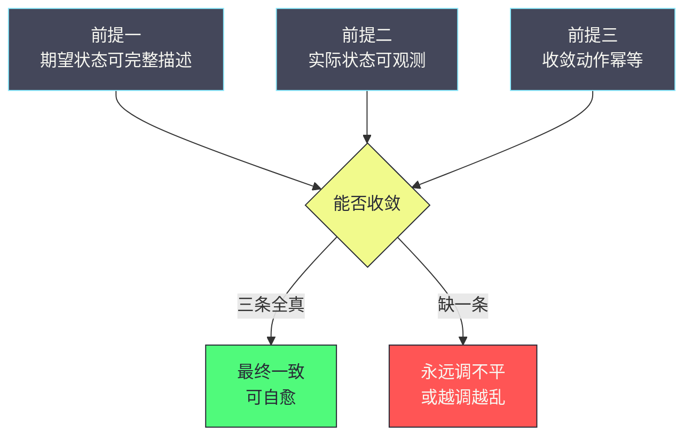
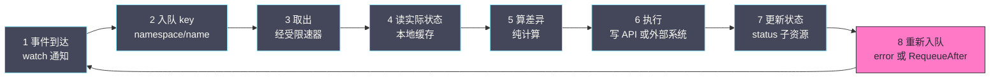
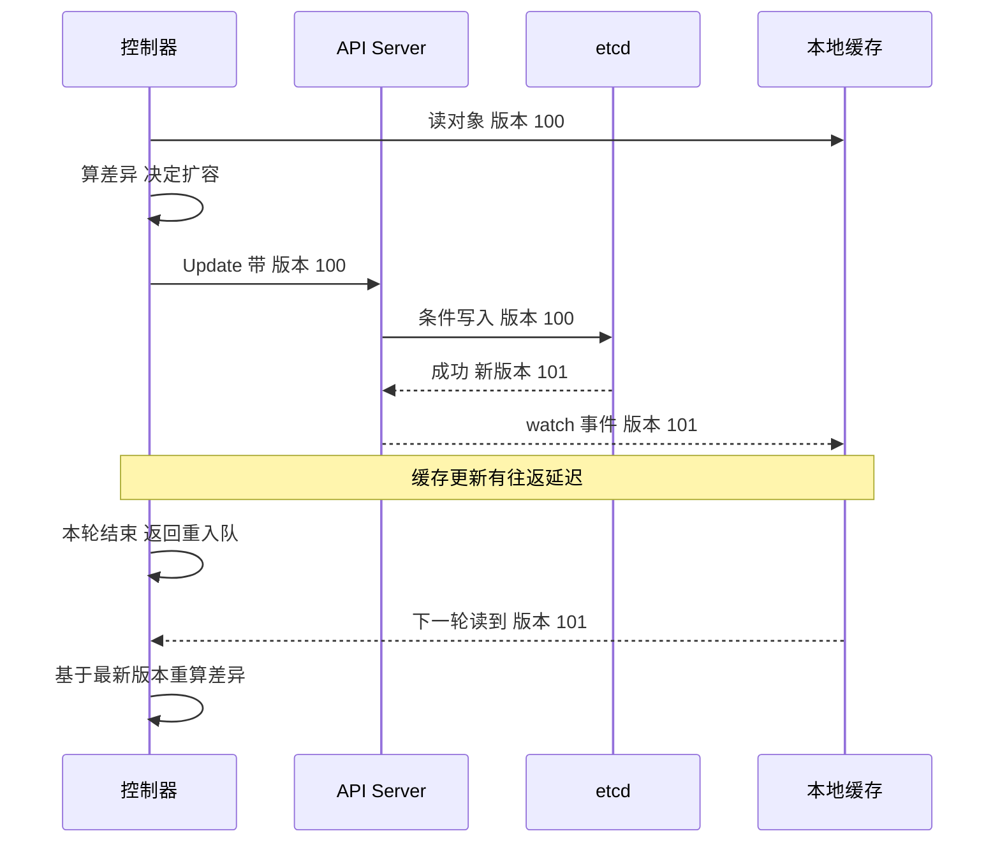
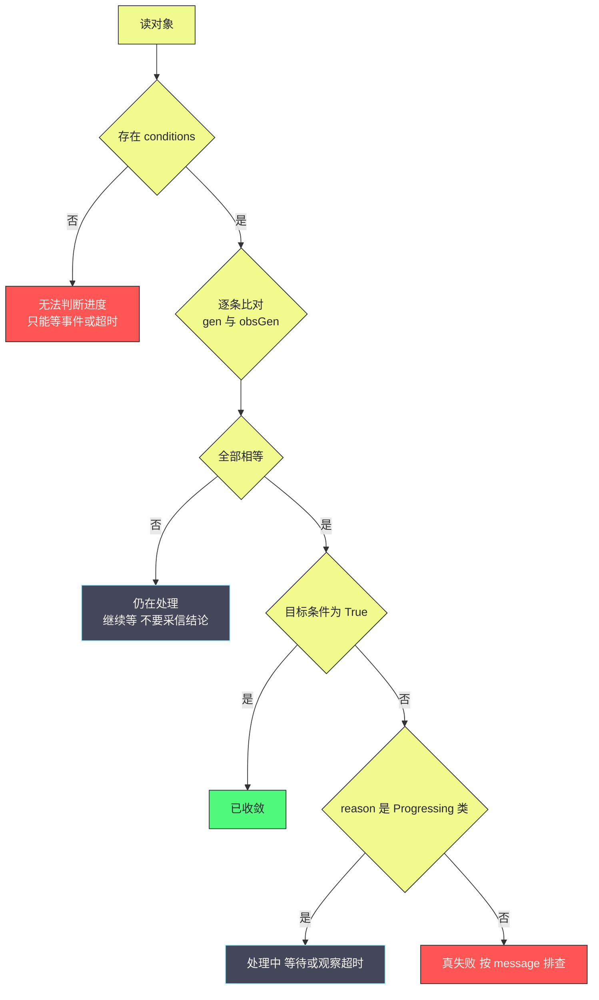
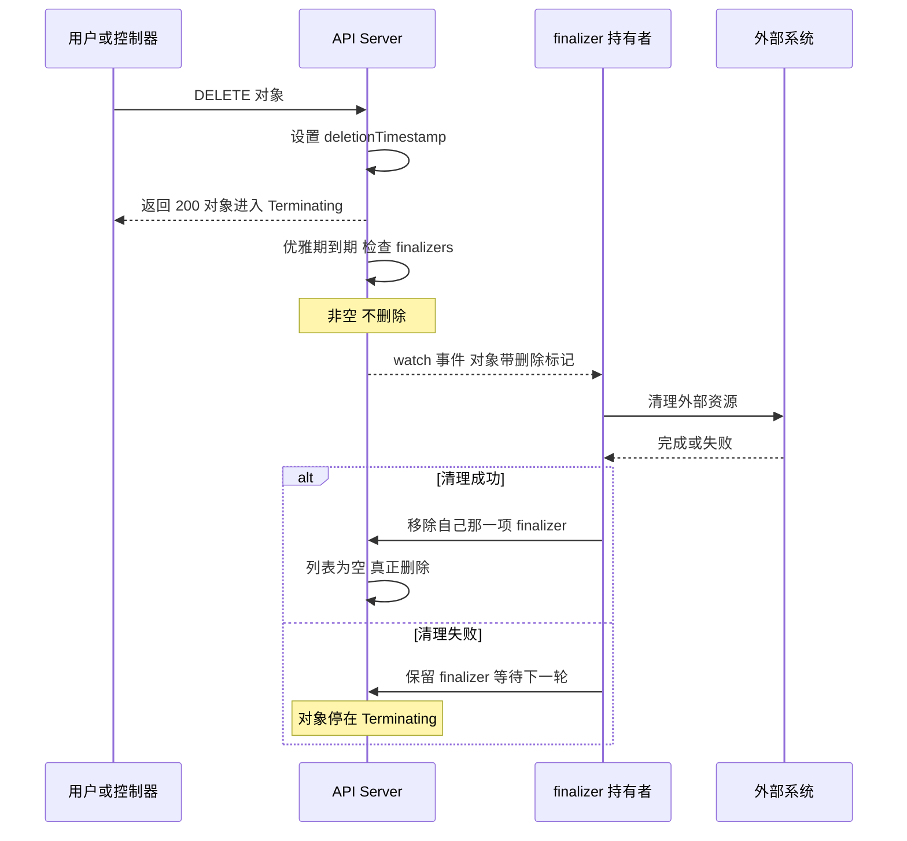
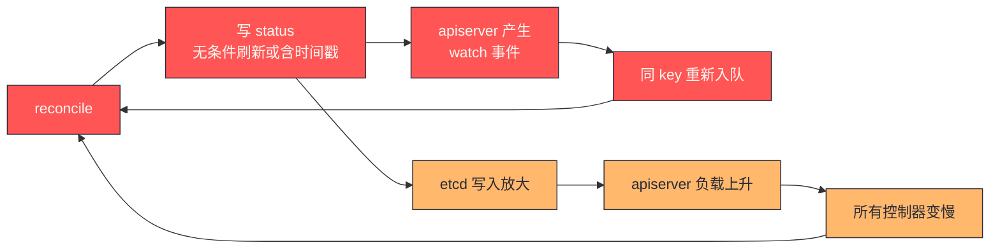

# 01 控制器模式与协调循环

**摘要：**

控制器模式在 Kubernetes 里常被讲成一句口号：声明期望状态，控制器负责把实际状态推过去。口号的代价是它把成立条件全部省略了，于是在生产里最常见的故障不是控制器写错，而是需求从一开始就不适合用控制器表达。本篇把控制器模式当成一套可判定的工程范式来处理：先拆出声明式 API 成立的三个前提，即期望状态可完整描述、实际状态可观测、收敛动作幂等，并给出缺任一条时的现场症状与判据；再按 watch 到入队、取出、读实际状态、算差异、执行、更新状态、重新入队的八步，解释为什么每一轮都必须重新入队，以及为什么控制器的投递语义只是"至少一次"。状态表达部分落在 `status.conditions` 与 `observedGeneration` 上，说明缺了后者就无法区分"已经处理过"和"还没看到"。之后转向这套范式固有的局限：跨资源没有事务、顺序依赖只能编译成状态条件、外部副作用不可回滚、用户与控制器争夺同一字段。删除路径单独成章，讲 finalizer 与 ownerReference 的级联策略，以及对象删不掉时的排查顺序。最后用四个真实形态的反例收束，包括循环内阻塞、外部调用不去重、等待被写进循环导致自激、finalizer 移除逻辑有 bug。

---

## 第 1 章 声明式 API 的三个前提

### 1.1 一个调不平的现场

某中型生产集群有四十个节点、三千余个 Pod，跨三个可用区，团队自研了一个 `CacheCluster` 的 Operator，管理两百多个缓存实例，每个实例是一主两从加一个云上负载均衡。某天值班时收到告警：某个实例的 `CacheCluster` 资源在四十分钟里持续报 `Ready=False`，控制器日志每秒打印两次同样的一行——`reconcile finished, phase=WaitingForLB`，既没有报错，也没有进展。

把这行日志翻成业务语言：控制器认为自己在等云厂商的负载均衡就绪，而它判断"就绪"的唯一依据，是上一次自己写在 `annotations` 里的一个字符串。真正的问题是云上那个负载均衡早在半小时前就建好了，只是控制器再也没去查过；它守着一条过期的事实，反复执行同一段空转逻辑，永远不会收敛。

这个现场几乎覆盖了控制器模式所有的失效方式：期望状态描述得不完整，实际状态取不到，动作不幂等，等待被塞进了循环里。把口号展开成一套能判定"某件事到底该不该用控制器做"的范式，需要从声明式 API 的三个前提说起。

先问一个更基本的问题：为什么需要循环，而不是一段执行到底的脚本？脚本的中断代价是状态不明——执行到第三步失败，脚本不会回来接着做，人再跑一次之前得先判断前两步到底成没成。声明式把"执行序列"换成"终态比较"，中断的代价就从"状态不明"降为"下一轮重来"。这个转换不是免费的，它要求下面三条同时成立。

三个前提需要逐一拆开。声明式 API 的契约是：用户提交一份终态描述，系统持续把世界推向这份描述。这份契约要成立，必须有三个前提同时为真——`spec` 能把用户想要的终态写全，`status` 能把世界的真实情况读回来，控制器的每一次动作重复执行都不产生额外后果。三者缺一，系统的表现就不是"收敛得慢一点"，而是"永远调不平"，或者更糟，越调越乱。



### 1.2 前提一：期望状态可完整描述

`spec` 描述的是**终态**，不是过程。用户可以写 `replicas: 3`，因为这描述了一个任何时刻都能被观察到的数值；用户写不出"滚动更新期间任何时刻至少有两个实例可用"，因为那是一个过程约束，只能在若干个离散时刻被抽样检查。Kubernetes 对过程约束的处理办法是把它近似成一个或几个终态字段：`maxSurge` 与 `maxUnavailable` 把"过程中不许太糟"翻译成"每批允许的偏差上限"，`minReadySeconds` 把"稳定多久才算数"翻译成一个时长阈值，`progressDeadlineSeconds` 把"卡住了要报警"翻译成一个超时。这些字段的共同点是它们都可被观察、可被比较，因此能进 `spec`。

反过来看，有三类需求天生写不进 `spec`。第一类是过程与速率约束，只能近似，近似就意味着有一整类中间状态不受保护。第二类是时间语义，譬如"每天凌晨两点执行"，`CronJob` 的 `spec` 里没有"执行"这个动作，只有 `schedule` 这个可被求值的表达式——控制器每一轮做的事是"现在是否跨过了一个计划时间点"，而不是"睡到两点再醒来"。第三类是外部事实，譬如"等 DNS 解析生效"，这类事实不在 etcd 里，无法成为期望状态的一部分，只能退化为 `status` 里的观察结论。

`CacheCluster` 那个现场就踩在这条上。产品要求"扩缩容时主节点不漂移"，团队第一版把它写成了 `spec.migrateOnScale: true`——一个布尔开关。这个字段描述的是"我想要的行为方式"，而不是"我想要的结果"，控制器读它读不出"漂移做完了没有"，于是每一轮都只能重启一次迁移流程或者空转。第二版把需求重写成可观察事实：`status.members[].role` 记录每个成员当前角色，`status.conditions` 里增加 `MembersStable` 条件，`spec` 只剩副本数与拓扑约束。改完之后控制器终于有了明确的"差异"可算：`status.members` 里角色分布与 `spec` 的拓扑要求是否一致。

笔者倾向于把判据写得更硬一些：一个需求如果无法翻译成"控制器在一轮里能读到、能比较、且比较结果稳定"的字段组合，它就不该进 `spec`。这条判据能挡掉大部分"控制器写不对"的抱怨——多数时候不是代码写错了，而是需求本来就不是一个终态。

### 1.3 前提二：实际状态可观测

第二个前提常被默认成立，其实它是最容易破的。观察链路上至少有三段延迟：kubelet 上报 Pod 状态有自己的周期与节流，apiserver 到控制器之间隔着 Informer 的本地缓存，控制器自身的处理还要排队。三段叠加，意味着控制器在写完一次变更之后立刻去断言结果，几乎必然失败。凡是在 `reconcile` 末尾写"检查是否成功，失败则报错"的代码，本质上都在和这三段延迟对赌。

更麻烦的是压根观测不到的状态。云厂商的负载均衡是否真的把后端摘干净了，Kubernetes 内部没有任何字段能表达；外部数据库的主从延迟更不在视野内。`CacheCluster` 的第一版处理办法是"我发过请求了，就在 `annotations` 里记一笔"，把注解当成外部世界的影子。这在工程上有个名字，叫**影子状态**（shadow state），它是必要的恶，但代价明确：影子状态会撒谎。发请求成功不等价于外部动作成功，进程在发请求与写注解之间崩溃，两者就永久失配。

影子状态失控之后，系统的行为会从"协调"退化成"猜测"：控制器不再比较现实，而是比较自己的记忆，于是现实越偏越远，而且没有任何机制能把它拉回来。补救手段只有两类：一是定期跑一次全量对账，用外部系统的 List 覆盖影子状态；二是干脆把外部事实暴露成可查询字段，让控制器每一轮都去读真实值。前者的代价是"错一段时间自己好"，后者的代价是"每轮都要一次外部调用"，都要在延迟与准确性之间选。

判据同样可以写死：如果一个状态无法通过 List 或 Watch 拿到的字段表达，那么"收敛"这件事本身就无法验证，此时控制器写出来的 `Ready=True` 只是一个声明，不是结论。

### 1.4 前提三：收敛动作幂等

幂等容易理解错。它不是 `Reconcile` 函数这个整体的属性，而是 `Reconcile` 调用到的每一个动作的属性。函数本身往往很自然地幂等——读一遍状态、算一遍差异、没有差异就直接返回；真正不幂等的是中间那一步"调用外部 API 创建负载均衡"。控制器被重复调用的概率不是"偶尔"，而是**必然**，重复到多少次取决于事件频率、重启次数与冲突重试次数，这些都不受控制器控制。所以每一个带外部副作用的动作，都必须自己承担去重责任。

按层次看，幂等要求从易到难分三段。第一段是本地计算，天然幂等，不构成问题。第二段是 Kubernetes API 写入，语义上已经被设计成可重复：`create` 遇到同名对象返回 `AlreadyExists`，`update` 靠 `resourceVersion` 做条件写入，`patch` 本身就只表达差异。第三段是外部副作用，这一层没有任何现成保证，必须由控制器自己造出幂等键、去重表或者可查询的既有状态。

`CacheCluster` 那个"等负载均衡"的死循环，根因其实落在第三段。控制器调云 API 创建 LB 时没有传幂等键，重试时云厂商各自返回了新的资源，两天后账单上出现了十七个同名负载均衡。团队的第一反应是把重试次数调小，这治不了根——重试次数与"至少一次"的投递语义无关，只要控制器可能重复执行，重复副作用就可能发生。

### 1.5 缺一条的症状对照

三个前提的缺失在现象上各有特征，把症状与判据放在一起，排查时能省掉大量猜测。

| 缺失的前提 | 现场症状 | 判据 | 补救方向 |
| :--- | :--- | :--- | :--- |
| 期望状态不可完整描述 | `conditions` 在 `True` 与 `False` 之间抖动，或长期 `Ready=False` 且 `reason` 说不清卡在哪 | `status` 里出现"正在迁移""等待生效"这类形容词，但找不到对应的可比较字段 | 重构 `spec`，把行为开关换成结果字段 |
| 实际状态不可观测 | 控制器记录与外部资源实际数量长期不一致 | 影子注解里的值与外部系统 List 的结果对不上 | 引入定期全量对账，或把外部事实暴露成字段 |
| 收敛动作不幂等 | 外部资源重复创建，配额与账单异常增长 | 同名或同语义的外部资源份数大于实例数 | 确定性命名加幂等键，`AlreadyExists` 视为成功 |

三行症状有一个共同点：它们都不会表现为"控制器崩了"，而是表现为"控制器一直在正常工作，只是工作没有意义"。这也是控制器类故障最难排查的地方——所有指标都健康，`reconcile` 次数稳定、错误率为零、队列不积压，唯独世界没有变。

---

## 第 2 章 调谐循环的形状

### 2.1 八个步骤与每步的失败面

把协调循环（reconcile loop）画成一条流水线，比画成"观察、比较、执行"三步更接近工程现实。这条流水线在实现上固定是八步，每一步都有自己的失败方式。



第一步是事件到达。控制器并不处理事件内容，它只从事件里提取一个 key，通常就是命名空间加名字。从事件到 key 的转换由事件处理器完成，不同资源、不同关系对应不同映射规则，机制细节见 [[09 控制器模式与协调循环：从 Deployment 到 Operator|控制器模式全景]]。为什么不把整个对象塞进队列？对象可能很大，一个几千行的 CR 在内存里排队会放大占用；更重要的是事件会成风暴，同一个对象在一秒内改十次就会产生十个事件，而处理十次与处理一次的结果完全相同。入队这一步是整个设计里最先剔除冗余的地方。

第二步是入队，第三步是取出。取出要经过限速器，这是"至少一次"语义里唯一带节奏的部分：失败过的 key 会被指数退避，成功的 key 应当被 `Forget` 掉，否则历史失败会把后续所有重试都拖到很晚。client-go 的默认限速器对每条 key 用 5 毫秒起步的指数退避、上限 1000 秒，再叠加一个整体 10 QPS、桶容量 100 的令牌桶（以对应版本源码为准）。这个参数组合对"偶发失败"够用，对"批量失败"就不够——两百个对象同时失败，前 100 次重试会瞬间打满令牌桶，后面的排队，表现是整体变慢而不是报错。

第四步读实际状态，第五步算差异。这两步在理想情况下是纯函数：输入是缓存里的对象快照，输出是一组待执行动作，不产生任何副作用。把这两步写成纯函数是控制器可测试性的全部来源——绝大多数单元测试只需要喂一个对象进去，断言输出的动作列表。

第六步执行，第七步更新状态，这两步才是真正会失败的地方。第八步重新入队，是整条流水线里最容易被写错、也最容易被误解的一步。

### 2.2 为什么要重新入队

很多人的第一反应是：既然已经算出了差异、也执行了动作，顺手在同一轮里再读一次、再算一次、直到差异为零不就行了？把循环收在函数内部，看起来还省了队列开销。

这个想法在 Kubernetes 里一定失败，原因有两个，都与乐观并发有关。

第一个原因是写入时的版本冲突。控制器手里的对象带着一个 `resourceVersion`，写回时 apiserver 会拿它做条件写入，一旦期间有别人改过对象，写入被拒绝并返回 409。此时控制器唯一能用的最新版本，只能从下一次读里拿到——而"下一次读"要么发生在同一个函数里重新 `Get`（增加了 apiserver 压力，且破坏了"只读缓存"的一致性前提，细节见 [[08 ResourceVersion 与乐观并发控制|乐观并发控制]]），要么发生在下一轮 `reconcile` 里。后者是框架设计者选的那条路：冲突不是错误，只是一个"再来一次"的信号。

第二个原因是自己写下的变更要绕一圈才能被自己看见。控制器第 7 步写 `status`，这次写进入 apiserver、落进 etcd、再经 watch 回到本地缓存，这中间有明确的往返延迟。如果控制器在同一个函数里"写完立刻读缓存"，读到的仍是旧值，于是它会认为动作没生效，再执行一次——这就是 read-your-own-write 的经典失效。把这一轮结束掉，让这次写以事件的形式回来，重新触发一轮，读到的就一定是最新值。



"重新入队"在工程上的含义比字面更宽：它可以由三种方式触发。返回 `error`，队列按退避策略重排；返回 `RequeueAfter`，到期后重排，用于表达"我知道现在还不能推进，等一会儿再说"；或者什么都不返回，靠控制器刚才那次写入产生的事件自然触发下一轮。第三种最优雅，也最依赖"写入确实发生了变化"，如果一次 `reconcile` 什么都没写，就没有下一轮——这恰好是收敛的标志。

由此可见，控制器从来不"等待"，它只**登记意图**然后退出。把时间从循环里摘出去，是这套范式能扛住几百个对象同时推进的根本原因。

### 2.3 一次只推进一小步

由此引出一条实践上极重要的约束：**一次 `reconcile` 只推进一小步**。所谓"一步"的粒度，应当是一个可被观察、可被下一轮读到的状态变化，而不是一次 API 调用。

原因还是失败恢复。假设一次 `reconcile` 里连续做了四件事：创建 PVC、等绑定、创建 StatefulSet、等就绪。如果第三步失败，前两步的成果要不要保留？控制器重启后从哪一步继续？它没有答案，因为中间进度根本没写进任何地方，重启即归零。反过来，如果每一步推进后都把"做到哪了"写进 `status`，重启就只是重新读一遍进度，然后从断点继续。

这条约束的代价是延迟。每一步一轮 `reconcile`，一轮至少一次往返，四步就是四次往返；如果业务要求"三秒内完成"，这种粒度就太粗。此时的解法不是把四步塞进一轮，而是承认这套范式的收敛时间本来就是秒级到分钟级，把对延迟敏感的部分移到别处——准入 webhook 里做同步校验，调度器里做即时决策，而不是指望控制器快。[[05 Scheduler 调度流程与算法|调度器]]之所以被单独拆出来，本质上就是因为"选节点"这件事要求近乎实时的同步决策，不适合用异步收敛的方式做。

### 2.4 队列语义带来的两个代价

入队时按 key 合并，这个优化很便宜，但有代价。

第一个代价是**中间过程彻底丢失**。同一个对象在一秒内被改了三次，队列里只会有一个 key，控制器只会看到"当前的最终样子"。任何依赖"改了几次"的逻辑都会错——这也正是 level-triggered 设计的要求：控制器的输入必须是状态，不能是事件序列。曾经有一类控制器想实现"每次 spec 变化都记一条审计"，做法是在 `reconcile` 里比较 `generation` 与上次记录的 `generation` 得出"变了几次"，结果是合并之后永远只会得到 1。审计、计费这类需要完整序列的需求，不能建在协调循环上，得建在 apiserver 的审计日志或事件流上。

第二个代价是观测精度下降。队列深度只能告诉你"有多少 key 待处理"，不能告诉你"处理慢在哪里"。控制器一旦变慢，队列深度上升是唯一信号，而它同时可能来自事件风暴、外部 API 变慢、并发度不够三种原因，需要配合 `reconcile` 的耗时直方图才能定位。

至于 Informer 与 workqueue 的内部实现——反射器如何做 List 补偿、队列如何在处理期间重排——属于机制层内容，这里不再展开，读者可参见 [[06 List-Watch 与 Informer：K8s 的分布式神经系统|List-Watch 与 Informer]]。

---

## 第 3 章 幂等：控制器只保证至少一次

### 3.1 投递语义

控制器的调用语义是**至少一次**（at-least-once），没有任何"恰好一次"的保证。这个结论不需要看源码就能推出来：事件可能重复投递，控制器重启后会把所有对象重放一遍，写入冲突会触发重试，多副本在 leader 切换窗口内可能各跑过一轮。四类来源叠加，重复不是异常，是常态。

由此推出一个设计上的硬约束：`Reconcile` 必须能在"上一轮可能已经执行过一部分"的前提下正确继续。它不是一次事务，而是一次"续跑"。

### 3.2 三类重复的具体形态

第一类是事件重复。同一个对象在短时间内多次变更，队列合并后仍可能触发多轮；`Resync` 周期到了也会无差别地把所有对象重新入队一轮，哪怕什么都没变。

第二类是重放。控制器重启、leader 切换、配置热加载，任何一种都会让本地缓存重建，随后所有对象被当作"新对象"处理一遍。此时如果控制器在启动时执行"初始化"逻辑，就会把已经存在的资源再建一次。

第三类是冲突重试。写入被拒后按退避重排，重排意味着整个函数从头再跑一遍，包括那些不涉及写入的前置动作，譬如给外部系统发通知。

三类重复的共同点是它们都发生在"控制器之外"，无法通过代码逻辑消除，只能在动作设计上吸收。

### 3.3 给外部动作造幂等

去重手段按可靠性从高到低排列，选哪种取决于外部系统愿意配合到什么程度。

| 去重手段 | 适用场景 | 代价 | 失效条件 |
| :--- | :--- | :--- | :--- |
| 确定性命名加 `create-if-not-exists` | 外部资源可自定义唯一标识，如 LB 名称、DNS 记录名 | 名称长度与字符集受限，需要把实例标识编码进名字 | 外部系统允许同名多份 |
| 幂等键或客户端 token | 云 API 支持 `ClientToken`、`Idempotency-Key` 一类参数 | 需要确认该参数的有效窗口，通常是分钟级到小时级 | 窗口内重复能去重，窗口外不能 |
| 外部去重表或唯一约束 | 自建服务，可写数据库 | 多一次存储依赖，表本身要清理 | 表写入与外部动作不在同一事务里 |
| 先读后写（`List` 后判断） | 外部系统可查询且查询结果可靠 | 查询与创建之间有竞态窗口 | 并发度较高时几乎必现重复 |
| 影子状态注解 | 外部系统完全不可查询 | 注解会撒谎，需要定期对账 | 进程在动作与写注解之间崩溃 |

最常见的错误是把第四种当成主方案。`List` 之后判断"不存在则创建"，在单线程下没问题，在并发下就是竞态：两个 worker 同时 `List` 到空，然后各自创建。这种竞态在低负载时不出问题，在扩容、故障恢复这种"一瞬间几十个对象同时重试"的场景下必然暴露，而且表现是间歇性的，极难复现。

真正稳的组合是第一种加第二种：名字由控制器确定性地算出，同名创建返回 `AlreadyExists` 视为成功；同时在请求里带幂等键，挡住"名字相同但语义不同"的边缘情况。

### 3.4 创建、更新、删除各自的幂等写法

创建的正确写法是直接 `Create`，并把 **`AlreadyExists` 视为成功**，而不是先 `Get` 再 `Create`：

```go
// 先 Get 再 Create 之间有竞态窗口，并发时会重复创建
// 直接 Create 并容忍 AlreadyExists，才是幂等的
err := c.client.Create(ctx, obj)
if apierrors.IsAlreadyExists(err) {
    return nil // 目标状态已经存在，本轮无需再做
}
return err
```

更新要区分场景。全量 `Update` 需要带上 `resourceVersion`，冲突概率高；`Patch` 只表达差异，冲突概率低，适合"改一两个字段"的场景。状态更新必须走 `status` 子资源，避免和 `spec` 的写入互相覆盖。

删除是三个动作里最容易被忽略幂等的：`NotFound` 应当视为成功，而不是错误。如果删除外部资源时把 `NotFound` 当失败返回，控制器会在这个 key 上无限退避重试，对象永远无法完成清理——`finalizer` 卡死的成因里，这一条占了相当比例。

还有一个容易漏的点：`generateName`。用 `generateName` 让 apiserver 追加随机后缀，可以避免命名冲突，但它天然不幂等——每次调用都会生成新名字，重复调用就得到多个对象。它只适合"允许多份"的场景，譬如一次任务派生的多个 Pod；对于"必须唯一"的外部资源，必须用确定性 `name`。

---

## 第 4 章 状态的表达：conditions 与 observedGeneration

### 4.1 status 是机器契约

`status` 常被当成给人看的备注，实际上它是 API 的一部分，被大量机器消费者读取：`kubectl wait` 靠它判断是否继续等，`kubectl rollout status` 靠它判断滚动是否完成，HPA 靠它读当前指标与伸缩状态，GitOps 工具（Argo CD、Flux）靠它判断资源是否健康，其他 Operator 可能直接把你的 `status` 当作输入。这意味着 `status` 的字段名、`reason` 的取值、条件的语义都是对外承诺，改起来和改 `spec` 一样需要版本化。

由此可以推出一条设计原则：`status` 只放**结论**，不放过程日志。`conditions` 的 `message` 是给人排查用的，允许变化；`reason` 是给程序判断用的，必须是稳定枚举，不能把错误详情拼进去。

### 4.2 conditions 的字段语义

`conditions` 是 `[]metav1.Condition`，每个元素描述对象在某个维度上的状态。

| 字段 | 语义 | 常见写错的形态 |
| :--- | :--- | :--- |
| `type` | 条件维度，如 `Ready`、`Progressing`、`MembersStable` | 用动词短语，如 `CreatingLB`，导致条件无法长期存在 |
| `status` | 三态：`True`、`False`、`Unknown` | 用字符串 `"true"`，或被当作"有没有出问题"而不是"这个维度成立不成立" |
| `reason` | 稳定的 CamelCase 枚举，程序据此分支 | 把错误信息截断拼进去，同一原因产生无数取值 |
| `message` | 人类可读详情，允许随排查需要变化 | 写空，或写入超大文本导致对象膨胀 |
| `lastTransitionTime` | `status` 发生变化的时间点 | 每次 `reconcile` 都刷新，导致"已持续多久"永远算不出来 |
| `observedGeneration` | 这条结论对应的 `metadata.generation` | 不填，或填了但不更新 |

`lastTransitionTime` 的写法最常出错。正确语义是"`status` 这个值变成当前的时刻"，只有值真的变了才更新。如果控制器每一轮都无条件刷新，会造成三个后果：无法回答"这个故障持续了多久"；每次都产生一次真实的写入，进而产生一次 watch 事件，进而触发下一轮 `reconcile`，形成自激；下游所有读条件的组件被无意义唤醒。`apimachinery` 提供的 `meta.SetStatusCondition` 一类工具会替你做"只在变化时更新"的判断，但它比较的是哪些字段、是否包含 `reason`，不同实现有差异，升级依赖时要确认一遍。

另一个常见问题是条件的顺序不稳定。`conditions` 是数组，有些实现每次重建时把条件按处理顺序追加，于是同一个对象两次 `reconcile` 产生的数组顺序不同，`patch` 计算出差异，写入，触发事件——又是一次自激。稳妥做法是固定生成顺序，或者直接用服务端 apply 配合列表合并键。

`status` 顶部还常有一个 `phase` 字段，用单一枚举表达整体阶段。`phase` 的可读性好，但它把多维状态压成一维，一旦有"两个维度各自独立"的需求就必须再造字段；社区近几年更倾向用多个 `conditions` 表达，`phase` 只作总结。老资源类型（如 `Pod`）的 `phase` 无法更改，笔者给新 CRD 的建议是不要引入 `phase`——它一旦存在，就一定会有人写死依赖它。

### 4.3 observedGeneration：区分"处理过"与"还没看到"

`generation` 是 `metadata` 里的一个整数，只有 `spec` 变化才递增，`status` 与 `metadata` 的修改不会让它变动。`conditions[].observedGeneration` 记录的是"这条结论是基于哪一代 `spec` 得出的"。

不妨还原一个现场：用户改完 `spec` 之后立刻看 `status`，看到的 `Ready=True` 是上一代的结果，而系统无法自证。有了它，四种情形可以明确区分：

| `generation` | `observedGeneration` | 条件 | 结论 |
| :--- | :--- | :--- | :--- |
| 5 | 5 | `Ready=False`、`reason=Progressing` | 已看到新 `spec`，正在处理，属于正常进行中 |
| 5 | 3 | `Ready=True` | 结论陈旧，不能采信，需要继续等 |
| 5 | 5 | `Ready=True` | 真正收敛 |
| 5 | 缺失 | 任意 | 该控制器不维护进度，无法判断 |

这张表能直接解决一类高频误判。运维改完配置后 `kubectl get` 看到 `Ready=True`，就认为变更生效，实际上控制器可能还没醒过来。加上 `observedGeneration` 之后，判据变成一句可执行的话：**`generation` 等于 `observedGeneration`** 才算这一代处理完。



为什么顶层的 `status.observedGeneration` 不够？因为一个对象上的不同条件往往由不同控制器写入。以 `Deployment` 为例，`Available` 与 `Progressing` 由 Deployment 控制器维护，`ScalingLimited` 由 HPA 写到自己的 `status` 上，`ReplicaFailure` 由 ReplicaSet 控制器上卷。每个写入者的处理进度各自独立，所以进度必须挂在每条条件上，而不是对象上。这也是 API 约定层面对条件的标准要求。

### 4.4 排查时的读法

`conditions` 的原始 JSON 很难读，排查时通常只取几个关键字段：

```bash
# 打印每条条件的类型、状态、原因与观察到的代数
kubectl get cachecluster cache-01 -o jsonpath='{range .status.conditions[*]}{.type}{"\t"}{.status}{"\t"}{.reason}{"\t"}{.observedGeneration}{"\n"}{end}'

# 确认 spec 是否已被控制器看过：两个数相等才说明这一代处理完
kubectl get cachecluster cache-01 -o jsonpath='{.metadata.generation}{" / "}{.status.observedGeneration}{"\n"}'
```

脚本里等待资源就绪时，`kubectl wait` 必须给 `--timeout`。条件永远不满足时它不会自己退出，而"条件永远不满足"恰恰是控制器类故障的典型形态；没有超时的 `wait` 会把 CI 流水线挂死在原地，看起来像构建卡住，实际上是控制器没收敛。

---

## 第 5 章 范式的边界：四件它做不到的事

### 5.1 跨资源没有事务

一次 `reconcile` 只写一个对象是常态，只要涉及两个以上对象，就立刻失去原子性。典型场景是"改配置并重启"：先改 `ConfigMap`，再触发 `Deployment` 滚动。无论哪个顺序，都存在一个中间态被外部观察到——先改配置，则有一段时间配置是新的、进程还跑着旧的；先滚动，则新进程启动时读到旧配置。

这个中间态无法消除，只能缩小暴露面或让它无害。把 `ConfigMap` 当成不可变对象、内容变了就换个名字建新的，是把"两次写"压缩成"一次指针切换"的通用手法：控制器先创建 `web-config-a1b2c3`，再更新 `Deployment` 的 `spec.template` 引用它，切换是一瞬间完成的，中间态只剩下"新 `ConfigMap` 已存在但无人引用"，无害。代价是对象数量随版本增长，清理责任必须显式安排——通常挂在 `revisionHistoryLimit` 一类字段上，或者由控制器自己回收旧名字。

这套手法背后是一般性的思路：在没有事务的系统里模拟原子，靠的是**把多次写降为一次写**，而不是"想办法让多次写不被打断"。所有分布式系统里所谓的原子切换，本质都是**指针替换**。

另一个现实约束是回滚。控制器通常不保留旧值，`Deployment` 之所以能回滚，是因为它额外维护了 `ReplicaSet` 的历史（细节见 [[02 Deployment 控制器深度解析|Deployment 控制器]]）；自定义控制器如果没显式设计历史，一旦推进到新状态就没有回头路。因此涉及"必须可回滚"的变更，要么借用 `Deployment` 这类内置对象承载，要么在 CR 里自己维护 `spec` 的上一版本快照——两者都是在为"不能撤销"付账。

### 5.2 顺序依赖只能编译成状态条件

用户经常描述顺序："先建主库，再建从库，最后挂负载均衡。"这句话里有三个动作和两个依赖，隐含"前一个成功才能开始后一个"。协调循环没有"顺序"这个原语，它只有"当前状态"和"差异"。所以顺序必须被翻译成一串**可观察的条件**：主库不存在时不处理从库；主库存在但 `Ready` 不为真时不处理从库；从库两个都 `Ready` 时才处理负载均衡。

`StatefulSet` 的有序部署就是这套翻译的范例：固定名加序数（`-0`、`-1`、`-2`），控制器逐序检查前一个是否就绪，就绪才创建下一个。它没有用任何"等待"或"睡眠"，只是把"顺序"变成"每轮只处理第一个不满足条件的位置"。具体策略见 [[03 StatefulSet 控制器深度解析|StatefulSet 的有序策略]]。代价同样明确：扩容速度被串行化，一个序数卡住会阻塞它之后的所有成员，且不加特殊处理时无法跳过。

顺序在三种关系上各有表达工具：

| 关系 | 表达工具 | 能表达什么 | 不能表达什么 |
| :--- | :--- | :--- | :--- |
| 归属与生命周期 | `ownerReference` | 子对象随父对象一起删除 | 创建顺序，父子可以任意先后创建 |
| 删除顺序 | `finalizer` | 删除前必须完成的清理 | 创建顺序；多个 finalizer 由不同控制器并行摘除，彼此先后不可控 |
| 推进顺序 | `conditions` 加状态字段 | 每一步的前置条件 | 并发度控制，同一层内并行执行需要自己用信号量实现 |

常见的错误是用 `time.Sleep` 或"重试若干次后放弃"来表达顺序。睡眠不解决任何问题，它只把不确定性从"提前执行"变成"延后执行"，在负载高时照样失败，而且让 `reconcile` 的耗时长到不可预测。

### 5.3 外部副作用不可回滚

Kubernetes 的删除是幂等的、可重放的，外部世界的动作不是。创建一台云主机可以再删掉，发一条通知发出去就收不回，扣一笔款更无法靠"再做一次反向操作"抹平——反向操作本身会失败，而失败之后系统处在"已扣款、未退款"的状态，协调循环对此无能为力，因为它只能比较期望与现状，无法表达"这笔钱必须恰好扣一次"。

判断一个外部动作能不能放进控制器，标准是它能否被"再做一次"或者"反向再做一次"安全地消除。可创建可删除的资源（负载均衡、DNS 记录、对象存储桶）满足条件，反例是可创建但不可删除的资源（某些配额、某些外部账号）；不可逆的通知与计费动作不满足条件。

不可逆动作的正确位置是一次性任务，而不是长期的协调循环。`Job` 的语义比 `Reconcile` 更适合承载这类动作：它有明确的完成与失败终态，`backoffLimit` 限制重试次数，`completions` 约束成功次数，而且一旦完成就不会被"再协调一遍"——这套语义恰好对应"这件不可逆的事只能做有限次"。具体行为见 [[04 DaemonSet Job CronJob 控制器解析|Job 与 CronJob 的行为细节]]。

如果一定要在控制器里做不可逆动作，工程上通行的补救是"意图表"模式：先把动作意图写进 `status`（包括一个全局唯一的请求标识），再执行外部动作，成功后把结果与标识一起记下。重放时先读意图：已执行过且结果已记录，就跳过；已执行但结果未知，就带着同一个标识去外部系统查询——这要求外部系统支持按键查询或按键去重。代价是每次不可逆动作都多一次持久化写，而这笔写本身也可能失败，所以意图表也好、幂等键也好，都只是把重复概率压到很低，不能压到零。

### 5.4 与用户争夺同一字段

最后一个边界不是技术问题，是权限问题。协调循环隐含一个假设：`spec` 归用户，`status` 归控制器，双方不越界。这条边界在真实系统里经常被踩。

第一种踩法在用户侧。用户用 `kubectl edit` 改一个字段，编辑器把整个对象提交回去，这本身没问题；问题出在用户以为"我只改了副本数"，实际上还顺手把控制器写进去的 `metadata.annotations` 覆盖成了旧值，控制器下一轮发现注解不符预期又改回来，用户看到"我改的东西被改回去了"。类似地，用户手工改 `Deployment` 的 `spec.replicas`，而 HPA 每十几秒会按自己的计算写回一次，两方各自覆盖，谁也不知道最终值由谁决定。

第二种踩法在控制器侧，典型的例子是 HPA。它必须写 `spec.replicas`，于是和用户的手工 `scale` 天然冲突。Kubernetes 的妥协是引入 `scale` 子资源，让两方都通过它写入，仍然没有解决"谁是权威"，最终靠用户自觉——要手工扩缩，先关掉 HPA。这类冲突**没有技术解，只有约定解**。

第三种踩法来自声明式工具本身。服务端 apply 用字段管理器（field manager）记录"哪个客户端拥有哪个字段"，两个管理器拥有同一字段时，后申请的一方收到冲突：`Apply failed with 1 conflict`。这条报错经常被误读成"权限不足"，实际含义是"这个字段已经有人声明所有权"。处理方式是显式指定 `--force-conflicts` 接管，或者改用不同的管理器名重新划分字段归属——前者会让原管理器的期望状态失效，后者需要两边协调。

第四种踩法最不易察觉：控制器升级后语义变了。新版本的 CRD 加了默认值、改了校验、调整了字段含义，于是升级瞬间控制器会按新语义批量"纠正"存量对象。这些纠正本身都合法，合在一起就是一次大规模变更，可能触发几十个实例同时滚动。控制器类项目升级前必须做的事因此很固定：先在小范围命名空间验证新版本的纠正范围，再评估全量升级带来的变更风暴。

---

## 第 6 章 finalizer：删除路径上的闸门

### 6.1 删除是一条四步路径

`kubectl delete` 并不直接抹掉对象，它走一条四级路径：apiserver 收到删除请求后设置 `metadata.deletionTimestamp` 与 `deletionGracePeriodSeconds`；优雅期到点之前，容器进程有机会自行退出；优雅期结束后，apiserver 检查 `metadata.finalizers` 是否为空；只有为空才真正从 etcd 删除对象。任何一项 `finalizer` 存在，对象就停在 `Terminating` 状态，一直等到有人把它摘掉。



两级闸门的作用不同，不能互相替代。优雅期是给进程的、会自行到期的闸门；`finalizer` 是给外部清理的、**不会自行到期**的闸门。前者到期自动放行，后者必须有代码主动放行。所以"删不掉"从来不是优雅期的问题，只可能是 `finalizer` 没人摘。

### 6.2 卡住的五种成因与排查顺序

对象长时间 `Terminating`，成因可以收敛到五类，排查顺序应当固定，从最便宜的判断开始。

| 成因 | 症状 | 判据 | 处置 |
| :--- | :--- | :--- | :--- |
| 控制器不在运行 | 所有该控制器管理的对象都删不掉，不止一个 | 对应 operator 的 Pod 不存在或一直在重启 | 恢复控制器，让它把欠的清理补完 |
| 清理逻辑持续失败 | 日志里有规律的重试记录，间隔按指数增长 | 控制器日志里同一 key 反复出现，错误来自外部 API | 修外部依赖或权限，不要摘 finalizer |
| finalizer 名字不匹配 | 控制器在跑，日志里却完全看不到这个 key | 对象上的 `finalizers` 字符串与代码里的常量不一致 | 用 `patch` 修正 finalizer 字符串，然后等控制器处理 |
| 写入被拦或无权 | 控制器日志里移除动作报 `Forbidden` 或 webhook 拒绝 | 事件里有 `Forbidden`，或验证 webhook 的拒绝日志 | 补 RBAC，或调整 webhook 规则 |
| 依赖链阻塞 | 父对象 `Terminating`，子对象也 `Terminating` | 逐层看子对象的 `finalizers`，最底层那个才是元凶 | 从最底层解，上层会自行完成 |

第三行是最容易误判的。控制器在跑、日志正常、指标健康，唯独那个对象删不掉，原因往往是"添加时用的字符串与移除时用的字符串不一致"——中间改过一次常量，老对象上留的还是旧名字。判据很直接：控制器日志里根本没有这个对象被处理的记录，那就不是处理失败，是压根没被当成自己的对象。

排查动作按下面的顺序执行，每一步都能排除一整类可能：

```bash
# 1 确认卡在哪个 finalizer，这是唯一决定性的线索
kubectl get cachecluster cache-01 -o jsonpath='{.metadata.deletionTimestamp}{"\n"}{.metadata.finalizers}{"\n"}'

# 2 确认它属于哪个控制器：finalizer 的域名前缀就是归属线索
kubectl get cachecluster cache-01 -o jsonpath='{.metadata.finalizers[*]}{"\n"}'

# 3 确认那个控制器还在不在，以及它在处理什么
kubectl get pods -n cache-system -l app=cache-operator

# 4 在控制器日志里按对象名检索，区分"处理失败"与"从未处理"
kubectl logs -n cache-system -l app=cache-operator --tail=2000 | grep cache-01
```

四步走完，结论只有两种：控制器知道自己该清理但清不掉，或者控制器根本不知道这个 `finalizer` 属于自己。前者去修清理逻辑与外部依赖，后者去修 finalizer 字符串或恢复控制器。

### 6.3 强摘的代价

实在无法恢复控制器时，最后一招是直接摘掉 `finalizers` 字段。这个动作的语义是**跳过清理**，它会带来三类后果，且都不可回滚：外部资源泄漏，云上负载均衡、DNS 记录、存储桶继续存在并继续计费；同名重建冲突，新对象创建时因为外部资源已存在而失败，控制器报"已存在但不归我管"；状态永久失配，如果外部资源后来被别人手工删掉，本地再也无从追溯。

安全顺序因此必须是先外部后本地：确认外部资源清单，逐项判断是保留还是删除，删完再摘 `finalizer`。顺序反过来，等于把"我知道还剩什么"这个唯一的信息来源丢掉。

摘除本身用 `patch` 而不是 `edit`，避免手抖改到其他字段：

```bash
# 只移除指定的一项，保留其他控制器仍需要的 finalizer
kubectl patch cachecluster cache-01 --type=json \
  -p='[{"op":"remove","path":"/metadata/finalizers/0"}]'
```

### 6.4 设计 finalizer 的四条约束

第一，添加时机必须早于"可能被删除"的时点。最稳的做法是在创建对象时就把 `finalizer` 写进 `metadata`，而不是等第一次 `reconcile` 再补。补写的窗口里对象完全可能被删掉，一旦删掉，清理逻辑永远不会触发，外部资源就漏了。代价是创建者需要拥有写 `finalizers` 的权限，很多集群的 RBAC 默认不给，需要显式放开。

第二，清理必须有截止时间。`reconcile` 拿到的 `context` 应当带超时，外部调用也应当有独立的超时；无上限的等待会让这个 key 永久占用一个 worker，且退避重试会把负载稳定地压在外部系统上。清理失败要把原因写进 `status.conditions`，否则运维只能靠日志猜。

第三，名字必须是限定名（qualified name），形如 `example.com/cleanup`。内置资源一直拒绝非标准名，错误信息是 `name is neither a standard finalizer name nor is it fully qualified`，只有 `kubernetes`、`orphan`、`foregroundDeletion` 三个标准名例外；对自定义资源而言，1.29 之前 apiserver 漏掉了这项校验，1.29 起开始对不合规的名字返回告警，社区里不少 Operator 因此集中改过一次 finalizer 字符串。升级集群前清点一下自己项目里的 finalizer 命名，能省掉一轮告警风暴。

第四，不要在带 `finalizer` 的对象上做"删了再建同名"的自动化。删除是异步的，对象会在 `Terminating` 停留不确定的时长，此刻创建同名对象会被 apiserver 拒绝或者创建出并列的两个，两种结果都不好。需要替换语义时，用新的名字加引用切换，而不是复用名字。

`finalizer` 还有一个组合效应值得单独提。`Namespace` 的删除本身是一次前台级联删除——namespace 控制器清空内部所有资源后才移除自己那一项 `kubernetes` finalizer。因此 namespace 卡在 `Terminating` 时，元凶几乎总是里面某个残留的自定义资源带着没人处理的 `finalizer`，而不是 namespace 本身有问题。排查要往里走一层。

---

## 第 7 章 ownerReference 与级联删除

### 7.1 三种传播策略的行为差异

`ownerReference` 声明归属，垃圾回收器据此在父对象删除后处理子对象。传播策略决定"删除的顺序与阻塞语义"，三者的差别不止是删得快慢，还包括调用方在什么时刻拿到返回、父对象在什么时刻消失。

| 策略 | 删除顺序 | 请求返回时机 | 父对象状态 | 适合的场景 |
| :--- | :--- | :--- | :--- | :--- |
| `Background` | 先删父，GC 异步删子 | 立即返回 | 马上消失 | 默认选择，绝大多数场景 |
| `Foreground` | 先删子，全部删完才删父 | 等子对象清完才返回 | 长时间 `Terminating` | 需要"删干净才算删掉"的语义 |
| `Orphan` | 只删父，子对象脱钩保留 | 立即返回 | 马上消失 | 迁移控制器、保留数据 |

`Background` 是默认值，原因是大多数调用方只关心"父对象没了"，子对象的清理可以异步。`Foreground` 的代价常被低估：父对象会带着 `foregroundDeletion` finalizer 停在 `Terminating`，直到所有 `blockOwnerDeletion` 为真的子对象消失；如果某个子对象自己又带 `finalizer`，父对象就会一直等，形成"父等子、子等外部"的链式阻塞。一个有一千个 Pod 的 `Deployment` 用前台删除，删除过程可能持续几分钟，期间任何针对它的脚本都会读到"还在删"。

`Orphan` 的用途比较特定：把资源从一个控制器的管辖里摘出来交给另一个。比如把手工维护的 `Deployment` 迁到 Operator 管理，可以先 `orphan` 删除旧的父对象（保留 Pod 与服务），再让 Operator 接管同名对象。用错方向的后果是资源泄漏——`orphan` 之后没有人负责回收，子对象会一直存在，直到有人手工清点。

### 7.2 判定细节与三个坑

垃圾回收器判定归属用的是 **`uid`** 而不是 `name`。名字可复用，删掉一个叫 `web` 的 `Deployment` 后再建一个同名对象，两者 `uid` 不同；如果按名字判定，旧子对象会被错误地挂到新父对象上。它对排查的影响很具体：看到子对象的 `ownerReferences[].name` 与现存的父对象同名，仍要核对 `uid`，否则会得出错误结论。

第一个坑是跨命名空间引用。`ownerReference` 不允许指向其他命名空间的对象，apiserver 不会在写入时拦住（历史原因），垃圾回收器发现后会把子对象当作孤儿并发出事件，`reason` 为 `OwnerRefInvalidNamespace` 一类。表现是"子对象建出来了但永远不会被回收"，且没有任何报错传回给创建者。跨命名空间的所有权只能用别的方式表达，譬如在子对象上打标签，由控制器自己枚举清理。

第二个坑是类型消失。自定义资源实例的 `ownerReference` 指向另一个自定义类型，如果那个 CRD 先被删除，垃圾回收器无法解析这个 kind，只能放弃处理，于是子对象永久保留。删除 CRD 前必须先清空它的所有实例，这条纪律在 [[06 Operator 模式与自定义控制器|Operator]] 的卸载流程里必须写死。

第三个坑是把 `blockOwnerDeletion` 当护栏。它只在 `Foreground` 下生效，`Background` 下垃圾回收器不看这个字段；它也不能"阻止误删"，只是"排定删除顺序"。想防止误删，手段是 `finalizer` 加 RBAC 收紧，不是 `blockOwnerDeletion`。

### 7.3 选型

多数情况下不需要显式指定策略，默认的 `Background` 就是对的。需要认真选择的场景有三类：删除操作需要"可验证地完成"——用 `Foreground`，让调用方在返回时确信子对象已清空；需要保留子对象做数据迁移或控制器切换——用 `Orphan`，并且必须为"谁来接管"写清楚后续步骤；父子之间还要经过外部清理——两者叠加，此时应当接受"删除是分钟级操作"，配上超时与告警，而不是指望它秒级完成。

有一类误用值得单独指出：把级联删除当成"批量清理工具"。为了快速删掉一个命名空间里的所有资源，有人会给一个对象挂上几百个子对象的 `ownerReference`，然后删父对象。这样做的问题是清理过程完全异步，出错时无法定位到具体的子对象，而且中途失败会留下半清理状态。批量清理应当用标签选择器加循环删除，让每一步都有明确的返回码。

---

## 第 8 章 反例：四个把集群拖垮的 reconcile

### 8.1 在 reconcile 里做长时间阻塞

最典型的写法是这样的：控制器在 `reconcile` 里调用外部 API 创建负载均衡，然后原地轮询，直到状态变成 `Active` 才继续。每次调用带三十秒超时，两百六十个实例各等一次，一个 worker 轮完一圈要一百三十分钟（示例推算）；队列深度单调上升，新变更排在老变更后面，而老变更的重试又不断插到队首。

调大 `MaxConcurrentReconciles` 看起来能缓解，实际是把问题从"排队"变成"打爆下游"。并发数乘以单次外部调用耗时，就是给外部系统的稳定压力；并发数不是可随意调大的旋钮，它的上限由外部系统的容量决定，不是由本地 CPU 决定。

正确的做法是把"等待"从函数里搬出去：检测到外部资源尚未就绪，就把结论写进 `status.conditions`（`Progressing`，`reason=WaitingForExternal`），返回 `RequeueAfter`，让这一轮立即结束。等待变成了**一次有意的、有上限的重排**，worker 立刻可以去处理别的对象。`RequeueAfter` 的间隔要随等待轮次增长，否则等价于把轮询频率调高。

### 8.2 不做去重直接调用外部 API

`CacheCluster` 的十七个负载均衡就是这一条的结果。控制器重试时每次都调用创建接口，云厂商每次都返回一个新资源，本地记录只保留最后一个，另外十六个散落在云上无人认领。这类问题的排查成本极高——本地视角一切正常，只有账单和云控制台能看出来。

判据可以做成例行检查：按标签列出外部资源，数量与实例数比对。数量只多不少时，先去查控制器的重试逻辑，而不是去查云厂商。正确写法在 3.3 与 3.4 已经给出，核心是让名字由控制器算出、让 `AlreadyExists` 成为成功路径。

### 8.3 把"等待外部系统"写进循环导致热循环

热循环的形态比想象中多，最常见的有三种。

第一种是无条件重排：函数末尾固定返回 `RequeueAfter: time.Second`，不管有没有推进。两百多个对象每秒重排一次，就是两百多次 `reconcile`，每次至少读一次缓存、写一次 `status`，写又触发事件，事件又触发下一轮。

第二种是刷新动作自己制造差异。控制器每轮都把状态重写一遍，但没有判断"值是否真的变了"，于是 `lastTransitionTime` 被刷新、`message` 里的详情被重写、条件数组的顺序被重排——任一项都足以让这次写入真的发生。这类代码的作者通常坚信"我写的值没变"，而 apiserver 看到的对象确实变了。

第三种最隐蔽：schema 里放进天然会变的值。`message` 里拼时间戳，`annotations` 里记"最后处理时间"，`conditions` 里塞随机后缀——这些字段让对象永远处于有差异的状态，`patch` 永远算得出变更，而写入方始终认为自己在写常量。



判据是**比率而不是绝对值**：如果 `workqueue_adds_total` 的增长速率与 `reconcile_total` 基本相同，说明每次处理都产生了一次新入队，自激成立。正常状态下前者应当明显小于后者，因为大部分 `reconcile` 什么都不写，不会产生后续事件。第二个判据是 etcd 的写 QPS 与对象数量是否呈正比——稳态系统里写 QPS 应当接近"变更速率"，而不是"对象数除以周期"。

量化一下代价：两百个对象每秒重排一次，每轮一次 `status` 写入，就是每秒两百次 etcd 写（示例推算）。这个数字单独看不大，但它会以 watch 事件的形式广播给所有关注该类型的客户端——控制器自己、监控、GitOps 的 health 检查、可能还有若干 Operator。放大倍数等于 watcher 数量，而每个 watcher 收到事件后还可能再触发自己的工作。热点由此扩散，最终表现为"集群里所有控制器都变慢了"，而问题源头只是一个忘了判等。

正确写法是三件事：写之前判等，值没变就不写；用 `patch` 而不是全量 `update`；任何时间戳、随机数都不要进被同步的字段，需要记录时间就落到日志里。

### 8.4 用 finalizer 但移除逻辑有 bug

最常见的两种 bug。第一种是覆盖式写入：控制器为了改 `status` 拿了一份对象的旧副本，改完 `status` 后对整个对象调用 `update`，把 `metadata.finalizers` 从旧副本里"复活"回来——刚刚摘掉的 `finalizer` 又出现了，下一轮继续摘，再复活，对象永远删不掉。这类问题的特征是 `finalizers` 字段在日志里反复出现移除成功的记录，但对象始终 `Terminating`。

第二种是条件写反：移除 `finalizer` 的代码放在"对象存在"分支里，而对象进入删除中之后先命中 `deletionTimestamp` 分支就直接 `return` 了，移除逻辑永远执行不到。表现与第一种相似，但日志里连"移除成功"都没有。

两种 bug 的修法都很小：改 `status` 用 `status` 子资源的 `patch`，不要碰整个对象；移除 `finalizer` 用 `patch` 按名字移除，不要用全量写；删除分支里的每个 `return` 都要能回答"这一轮我该不该推进进度"。`finalizer` 相关的 bug 一旦上线，代价是对象永久无法删除，只能靠强摘收拾，而强摘又会漏掉外部清理——一个几十行的疏忽，最后要花几个小时对齐云上资源。

### 8.5 让循环可观测

围绕协调循环只需要盯三个指标：`workqueue_depth` 反映积压，`workqueue_adds_total` 与 `workqueue_retries_total` 反映入队速率与重试速率，`controller_runtime_reconcile_total{result="error"}` 与耗时直方图反映失败与变慢。三个指标一起看，能区分三类问题：深度上升且重试上升是外部依赖故障；深度上升而错误率正常是并发度不足或单次耗时过长；重试正常但入队速率异常高是自激。

日志规范同样重要。每次 `reconcile` 打一行结构化日志，带 key、耗时、结果、推进了哪一步；不要打印对象全文。两百个对象每秒一轮、每轮打几百行 YAML 的日志量，会先把日志系统压垮，然后才是集群。

---

## 第 9 章 总结

控制器模式的本质是一次交易：用"一个持续运行的幂等函数"换"用户只需描述终态"。交易里付出的代价是异步、最终一致、无法表达事务；换来的收益是系统在任何单点故障之后都能自行回到正轨，以及运维动作从"执行脚本"变成"提交声明"。

这套范式适用的判据可以收敛成三条：目标状态能被字段完整描述，实际状态能被读取验证，动作重复执行不产生新后果。三条全真，控制器是最高效的表达方式；缺任一条，写出来的控制器都会长期处于**在跑、但没用**的状态，而这类故障恰恰最难被指标发现。

第 8 章列的四个失效形态——循环内阻塞、外部调用不去重、等待被写进循环、`finalizer` 移除有 bug——都不是设计层的错误，而是把"异步收敛"当成"同步过程"来写的后果。协调循环不提供事务、不提供顺序、不提供恰好一次，它只提供一个反复重来的机会。把不可恢复的事情藏进这个循环，等于让系统反复踩同一个坑。

`finalizer` 与 `ownerReference` 代表另一种取舍：删除路径上必须在"删干净"和"删得快"之间选一个，Kubernetes 把选择权交给资源定义者，同时也把责任交了过去。删不掉的对象不会自己好，级联删除的异步性也不会自己变得可预期。

由此可见，控制器写得对不对，很少取决于代码技巧，而取决于建模时有没有把"什么是可观察的终态"想清楚；以笔者所见，这项工作无法由框架代劳。

---

## 参考资料

1. Kubernetes Documentation, [Controllers](https://kubernetes.io/docs/concepts/architecture/controller/)
2. Kubernetes Documentation, [Owners and Dependents](https://kubernetes.io/docs/concepts/overview/working-with-objects/owners-dependents/)
3. Kubernetes Documentation, [Finalizers](https://kubernetes.io/docs/concepts/overview/working-with-objects/finalizers/)
4. Kubernetes Documentation, [Garbage Collection](https://kubernetes.io/docs/concepts/architecture/garbage-collection/)
5. Kubernetes API Conventions, [Typical Status Properties](https://github.com/kubernetes/community/blob/master/contributors/devel/sig-architecture/api-conventions.md)
6. client-go workqueue 默认限速器实现，[default_rate_limiters.go](https://github.com/kubernetes/kubernetes/blob/master/staging/src/k8s.io/client-go/util/workqueue/default_rate_limiters.go)
7. kubernetes/kubernetes issue [#119445](https://github.com/kubernetes/kubernetes/issues/119445)，自定义资源 finalizer 命名格式未校验的问题与修复
8. Kubernetes Documentation, [Custom Resources](https://kubernetes.io/docs/tasks/extend-kubernetes/custom-resources/custom-resource-definitions/)
9. Michael Hausenblas, Stefan Schimanski. *Programming Kubernetes*. O'Reilly, 2019，第 6 章

---

> [!note] 思考题
> 1. 如果一个控制器管理的对象同时被用户手工修改 `spec.replicas`、又被 HPA 通过 `scale` 子资源写入，谁该是最终权威？在不引入新资源类型的前提下，有没有办法让这种争夺变得可预期？
> 2. 把 `ConfigMap` 内容写进名字里（内容哈希作为后缀）来实现原子切换，代价是对象数量随版本增长。旧对象应该由谁删除，删除时机与 `revisionHistoryLimit` 这类字段是什么关系？
> 3. 一个对象的 `conditions` 里同时有 `Ready=True` 和 `Progressing=True` 且 `observedGeneration` 都等于当前 `generation`，这两条结论冲突吗？请给出至少两种可能的解释，并说明各自该看哪个字段来判断。
> 4. 若外部云 API 只支持"创建"不支持"按名字查询"，控制器的幂等还能做到什么程度？此时把不可逆动作放进 `Job` 是否会更好？
> 5. 集群里出现大量对象停在 `Terminating`，你的排查顺序是什么？在什么条件下你会同意强摘 `finalizers`，又在什么条件下坚决不摘？