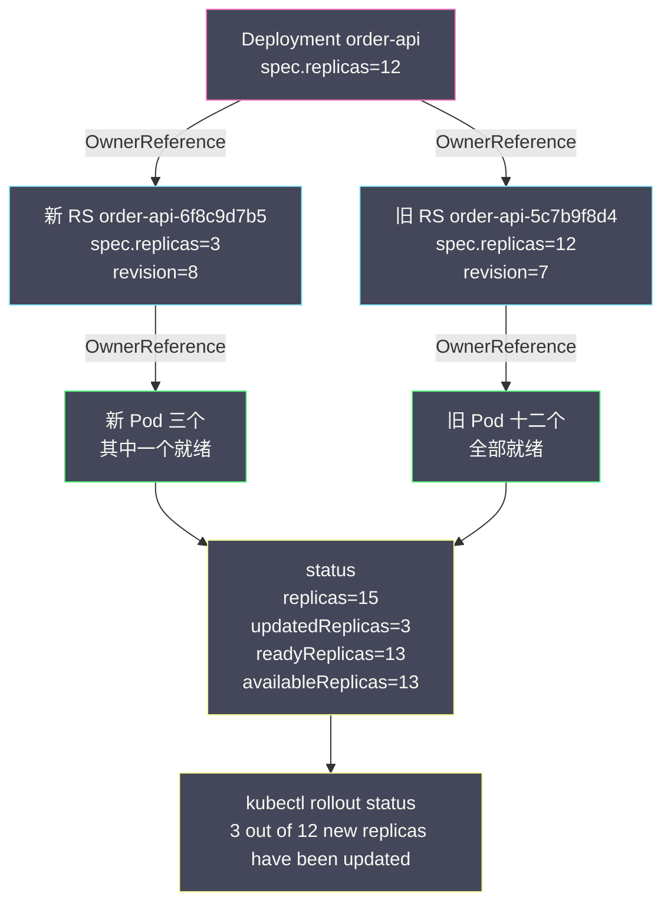
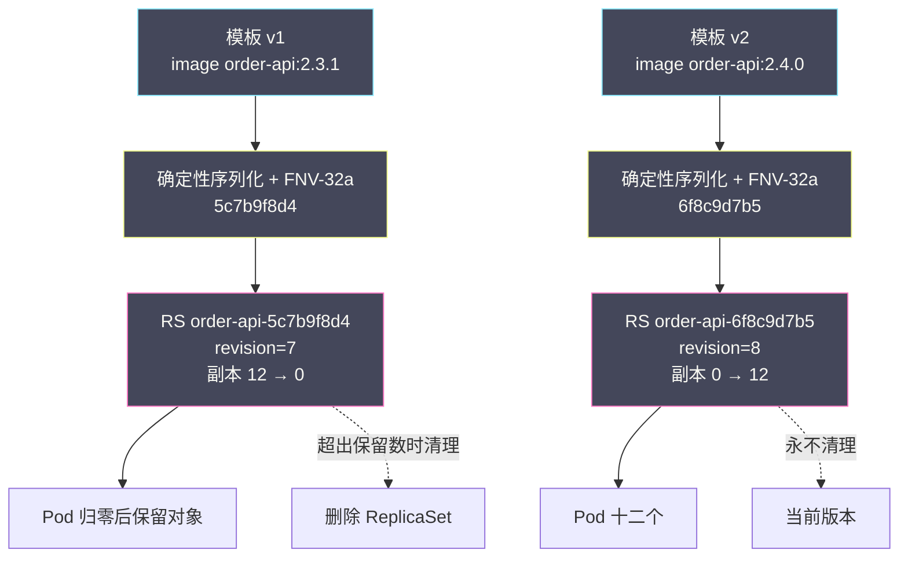
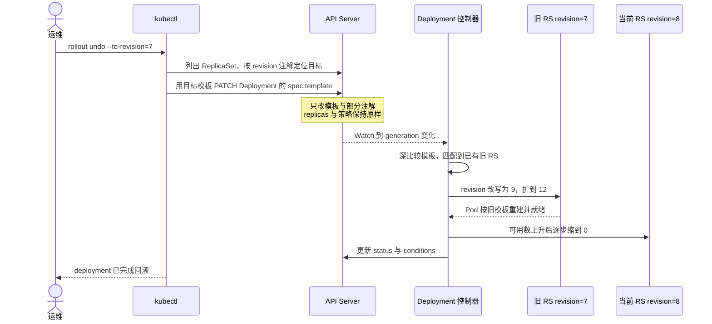
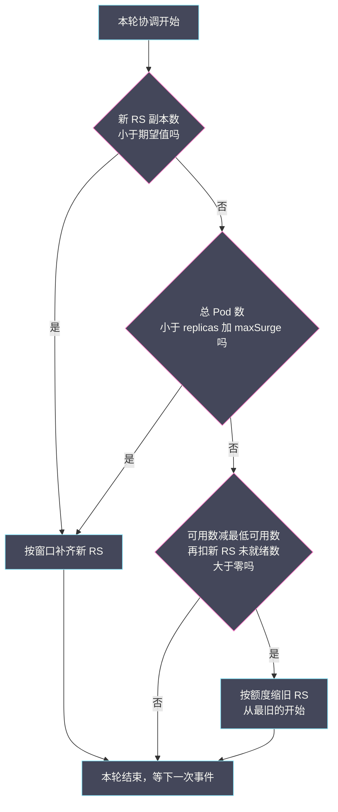
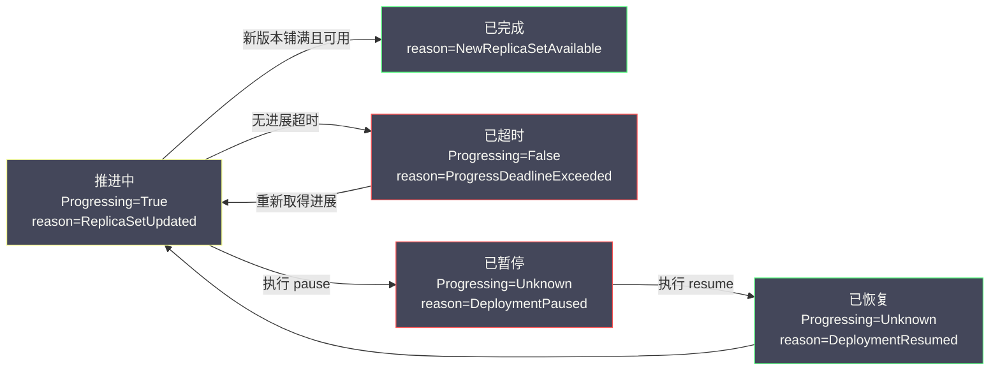
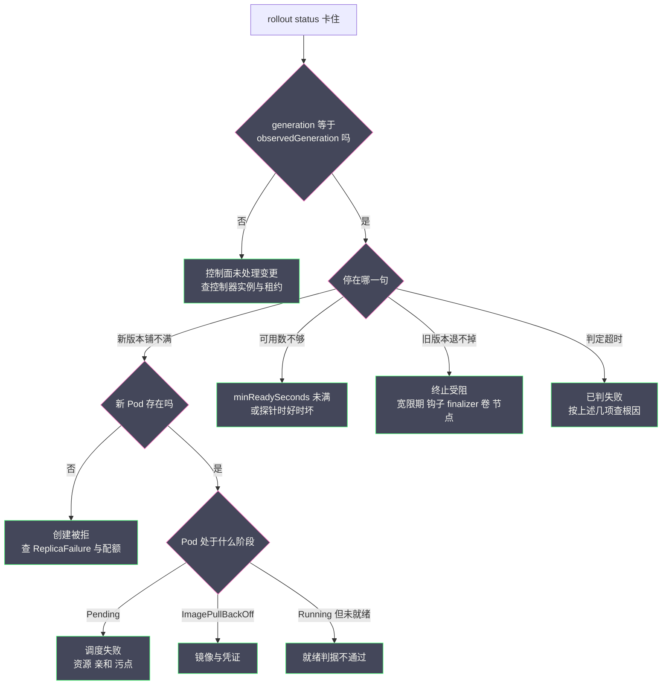

# 02 Deployment 控制器深度解析

**摘要：**

Deployment 是绝大多数无状态服务在 Kubernetes 上的默认落点，但它的行为细节常被一句"滚动更新"掩盖。本文从一个具体问题切入——为什么一次 `kubectl apply` 成功、镜像也没错的发布，会卡在 `kubectl rollout status` 里几十分钟不动。围绕这条主线，文章拆解四组机制：Deployment 如何借 `pod-template-hash` 把模板变更分裂成新的 ReplicaSet，`revisionHistoryLimit` 保留的到底是什么，以及"回滚"实际回的是旧 ReplicaSet 的模板而不是重放历史；`maxSurge` 与 `maxUnavailable` 从百分比到整数的向上、向下取整算术，为什么两处都为 0 会走到两条不同的兜底路径；`Available`、`Progressing`、`ReplicaFailure` 三个 condition 各自表达哪一层含义，`Progressing=False` 的五个 reason 分别对应什么现场；最后把 `kubectl rollout status` 卡住的六种成因逐条落到判据、事件关键词与首查命令上，包括常被误诊的 PDB 冲突。文中另给出暂停与恢复的真实语义、两种金丝雀做法的代价对比、与 HPA 共存时的字段所有权问题，以及三条会导致"退不回去"的反例。写作对象是对 Kubernetes 已有基本使用经验、需要为团队发布流程定标准的工程人员；文中的判据表可以直接当排障清单使用，栅栏算术部分则给出了校验自身集群参数是否留有真实容量余量的方法。

---

## 第 1 章 发布卡住时，先看四个数字

一次发布最容易被误判的时刻，是终端打出 `deployment.apps/order-api configured` 的那一秒。这条输出只说明对象的期望状态已经写入 etcd，至于集群有没有朝这个期望移动一米，它一个字都没说。笔者见过的事故里，运维同学反复确认镜像标签、反复重跑流水线，唯独没有打开 Deployment 的 status，把一个"配额不够导致新 Pod 创建被拒"的问题排查了四十分钟。

所以判断发布状态的第一动作不是看 Pod，而是看 Deployment 对象自己的四个数字。它们由 Deployment 控制器在每一轮协调末尾根据 ReplicaSet 的状态汇总写入，是整条链路上唯一被持续维护的汇总视图。

| 字段 | 含义 | 发布卡住时的读法 |
| :--- | :--- | :--- |
| `status.replicas` | 该 Deployment 名下所有 ReplicaSet 的 Pod 总数，含旧版本、含正在终止的 | 大于 `spec.replicas` 说明旧 Pod 还没走完；小于它说明新 ReplicaSet 没扩到位 |
| `status.updatedReplicas` | 与当前 Pod 模板一致的那个 ReplicaSet 的 Pod 数 | 长期小于 `spec.replicas`，新版本就没有铺满 |
| `status.readyReplicas` | 通过就绪判据的 Pod 数 | 与 `updatedReplicas` 有差距，说明新 Pod 起来了但没就绪 |
| `status.availableReplicas` | 就绪且持续满足 `minReadySeconds` 的 Pod 数 | 与 `readyReplicas` 有差距，说明刚就绪、还没被算作可用 |
| `status.observedGeneration` | 控制器最后处理到的 `metadata.generation` | 小于 `metadata.generation`，控制器根本没看这次变更 |

这四个数字的组合能定位到层。`replicas` 大于期望而 `updatedReplicas` 已经追平，问题在旧版本退出；`updatedReplicas` 停在某个值不动，问题在新版本创建或就绪；`readyReplicas` 追不上 `updatedReplicas`，问题在就绪判据；`availableReplicas` 追不上 `readyReplicas`，问题在 `minReadySeconds` 那段观察窗。四种情况的处置方向完全不同，用一句"发布卡住了"概括它们，等于放弃了唯一可靠的分诊依据。

下图是一次典型卡顿中各层对象与 status 数字之间的对应关系，新版本只推进到三个 Pod 就停住，旧版本的十二个 Pod 还在服务。



这张图概括了全篇要讨论的三条链：控制器把模板变更翻译成版本分裂，栅栏参数决定每一轮允许多少副本换手，status 与 conditions 把过程表达成可读的信号。三者断一条，表现都是同一个"卡住"，但病灶在不同层。控制器之间通过 Watch 传递信号的协调范式，属于另一条线索，这里只交代到"Deployment 控制器只操作 ReplicaSet、不直接碰 Pod"这一层，范式本身可参见 [[01 控制器模式与协调循环]] 与 [[云原生/Kubernetes/Kubernetes架构深度剖析/09 控制器模式与协调循环：从 Deployment 到 Operator|架构深度剖析专栏的控制器一章]]。

---

## 第 2 章 版本分裂：ReplicaSet 与 pod-template-hash

### 2.1 中间那层为什么不能省

如果 Deployment 直接管理 Pod，滚动更新会立刻遇到一个无法表达的状态：新旧两个版本的 Pod 同时存在，需要两组独立的副本计数，而 Deployment 的 `spec.replicas` 只有一个数字。ReplicaSet 的存在不是为了多一层封装，而是为了让"副本数"这个标量可以被复制成多份，每份绑定一个不可变的 Pod 模板。Deployment 于是退化成一个小型编排器：算出每一轮该给哪个 ReplicaSet 多少副本，剩下的创建、删除、重启补位交给 ReplicaSet 控制器。

这个分工带来一个不明显但重要的性质：ReplicaSet 的 `spec.replicas` 是它可以被独立缩放的字段，因此在发布期间直接改某个 ReplicaSet 的副本数是可能的，只不过下一次 Deployment 协调会按比例折算，把人工调整抹平。这一点在第 7 章讨论金丝雀时会再用到。

还有一条常被忽略的推论：Pod 的 `ownerReference` 指向 ReplicaSet 而不是 Deployment。这解释了为什么 `kubectl delete pod` 既不会改变版本，也不会让发布前进或后退——它只是让 ReplicaSet 补一个新副本上来。想让某个版本的副本数变化，必须动 ReplicaSet 或 Deployment 的副本数；想换版本，必须动模板。

### 2.2 pod-template-hash 的生成方式

模板一变就产生新 ReplicaSet，判断"变没变"靠的不是字符串比较，而是哈希。控制器对 `spec.template` 做一次确定性序列化——字段排序后的深打印，保证同样内容每次得到同样字节流——再喂进 FNV-32a 得到 32 位无符号整数，最后把它的十进制表示逐字符映射到一个去掉了元音和易混字符的字母表 `bcdfghjklmnpqrstvwxz2456789`。去掉元音是为了避免哈希值拼出不宜出现在对象名里的单词，去掉 `0`、`1`、`o`、`l` 是为了避免人工抄写时的歧义。uint32 的十进制表示最多十位，所以这个标签最长十个字符，实际取值绝大多数正好十位。

这个值就是 **pod-template-hash**，它会被注入三个地方：ReplicaSet 的名字后缀（`<deployment 名>-<hash>`）、ReplicaSet 与它管理的 Pod 的 `pod-template-hash` 标签、以及 ReplicaSet 的 Label Selector。三处一致，换来一个很强的隔离性质：不同版本的 ReplicaSet 的选择器互不相交，任何一个 ReplicaSet 都不可能误认领别的版本的 Pod，哪怕它们的业务标签完全相同。

> [!info] 命名与长度
> Pod 名由 ReplicaSet 名加五位随机后缀组成，因此在 Deployment 名、十位 hash、五位后缀叠加之后，名字长度会迅速接近容器主机名与 DNS 标签的边界。笔者建议把 Deployment 名控制在四十字符以内，尤其是需要用 Pod 名做主机名或注册到服务发现里的场景。

同一模板并非永远只对应一个哈希。理论上 32 位哈希会碰撞，两个内容不同的模板算出同一个值，此时创建 ReplicaSet 会遇到名字冲突，控制器把 `status.collisionCount` 加一，再把该计数以小端序掺进哈希输入，得到一个不同的值。于是可能出现两个模板完全相同、哈希不同的 ReplicaSet，控制器在比对"哪个是当前版本"时用忽略哈希标签的深比较，并在多个候选中确定性地选最早创建的那个——这解释了为什么 `kubectl get rs` 偶尔会显示两个几乎一样的对象。

### 2.3 归属关系靠两条腿走路

ReplicaSet 与 Deployment 之间的归属有两条独立的线：Label Selector 匹配与 `OwnerReference` 认领。控制器列出同一命名空间下所有匹配 `spec.selector` 的 ReplicaSet，对没有 OwnerReference 或 OwnerReference 不指向自己的对象补上引用，这个过程称为认领（adopt）；反过来，有引用但标签不再匹配的对象会被移除引用，称为释放（orphan）。两条线同时存在，是为了兼顾两类历史遗留：手工创建的 ReplicaSet，以及从早期 API 版本升级上来的对象。

`spec.selector` 在 `apps/v1` 里不可变。改动它会让已有 ReplicaSet 突然与新选择器错位，控制器只能释放它们再重新认领，语义上等于重建，因此准入校验直接拒绝。真正需要换选择器的场景，正确做法是新建 Deployment 再切流量，而不是原地改字段。

### 2.4 哪些改动会分裂出版本

判断一次改动会不会触发发布，只需要问一个问题：它落在 `spec.template` 里面还是外面。

| 改动位置 | 举例 | 是否产生新 ReplicaSet | 是否消耗 revision |
| :--- | :--- | :--- | :--- |
| 模板内的镜像 | `spec.template.spec.containers[0].image` | 是 | 是 |
| 模板内的环境变量、资源、卷、探针 | `env`、`resources.limits`、`volumes` | 是 | 是 |
| 模板内的业务标签 | `spec.template.metadata.labels.app` | 是 | 是 |
| 模板内的注解 | 配置校验和、`kubectl.kubernetes.io/restartedAt` | 是 | 是 |
| 模板外的副本数 | `spec.replicas` | 否 | 否 |
| 模板外的更新策略 | `maxSurge`、`maxUnavailable`、`type` | 否 | 否 |
| 模板外的观察窗与历史 | `minReadySeconds`、`progressDeadlineSeconds`、`revisionHistoryLimit` | 否 | 否 |

这张表有两处反直觉。一是模板里的注解也算模板：很多团队用 Helm 或 Kustomize 在模板里塞一个配置文件的校验和，于是每次改 ConfigMap 都会分裂出一个 ReplicaSet，历史版本被这种"顺带发布"消耗掉。二是 `kubectl rollout restart` 走的正是这条路——它往模板注解里写一个时间戳，靠哈希变化骗出一次完整滚动，因此它不是"原地重启容器"，而是一次完整的新版本发布，同样消耗 revision 与历史槽位。

下图把模板变更、哈希与 ReplicaSet 生命周期串在一起，右侧的虚线是 `revisionHistoryLimit` 起作用的位置。



---

## 第 3 章 回滚回的是什么

### 3.1 revision 是一个计数器，不是版本号

每个 ReplicaSet 上都有一个 `deployment.kubernetes.io/revision` 注解，Deployment 自己也有一份，记录"当前生效的 revision"。新 ReplicaSet 创建时，控制器取所有旧 ReplicaSet 中 revision 的最大值加一作为新值，再把这个值抄到 Deployment 上。这是一套单调递增的计数器，与镜像标签、提交哈希都没有对应关系。

由此可以解释两个常见困惑。其一，删除旧的 ReplicaSet 不会让 revision 回退，计数器只增不减。其二，回滚之后 revision 号会继续增长：把一个旧 ReplicaSet 重新激活时，控制器发现它的 revision 小于当前最大值，就把它的注解改写成最大值加一，而它原来的 revision 号被追加到 `deployment.kubernetes.io/revision-history` 注解里留档。这个留档有长度上限，超长后最早的记录会被截掉，所以极端情况下历史里的号段看起来会断。

回滚引起的历史编号变化可以直接观察到，下面的输出是示例推算：三次正常发布之后回滚到 revision 1，那个 ReplicaSet 的编号被改写成 4，于是历史里的 1 消失、4 出现。

```bash
kubectl rollout history deployment/order-api
# REVISION  CHANGE-CAUSE
# 1         <none>
# 2         <none>
# 3         <none>

kubectl rollout undo deployment/order-api --to-revision=1

kubectl rollout history deployment/order-api
# REVISION  CHANGE-CAUSE
# 2         <none>
# 3         <none>
# 4         <none>
```

| 对象 | 键 | 作用 |
| :--- | :--- | :--- |
| Deployment | `metadata.generation` | 每次 spec 变更自增，控制器用它判断有没有漏掉变更 |
| Deployment | `deployment.kubernetes.io/revision` | 当前生效的 revision 号 |
| ReplicaSet | `deployment.kubernetes.io/revision` | 该版本自己的 revision 号，回滚与历史查询的依据 |
| ReplicaSet | `deployment.kubernetes.io/revision-history` | 该 ReplicaSet 曾被赋予过的历史号，用于留档 |
| ReplicaSet | `deployment.kubernetes.io/desired-replicas` | 上一次同步时的期望副本数，缩放检测用 |
| ReplicaSet | `deployment.kubernetes.io/max-replicas` | 允许的最大副本数，与上一条一起参与比例折算 |

### 3.2 undo 的机械动作

`kubectl rollout undo` 不是一个服务端操作，也没有"时间倒流"的语义。它的实际动作分三步：先在服务端按 revision 注解找到目标 ReplicaSet，取它的 `spec.template`；再把这份模板（剔除 `pod-template-hash` 标签）与目标 ReplicaSet 的部分注解打包成一个 patch，发给 Deployment 的 `spec.template`；最后把作用交给控制器，由它完成一次正常的滚动替换。

这个实现决定了回滚的边界，几条都值得记住：

- 回滚**只恢复 Pod 模板**与部分注解，不恢复 `spec.replicas`、更新策略、`minReadySeconds`、`progressDeadlineSeconds` 与 `revisionHistoryLimit`。副本数保持回滚那一刻的值，这对接了 HPA 的 Deployment 反而是好事，容量不会被一起拖回旧值。
- 处于暂停状态的 Deployment 不能回滚，kubectl 会直接拒绝并提示先恢复。这是一个很实际的死锁点：有人为了"先停一下"执行了 pause，出了事故想 undo，却被拒绝。
- 目标 revision 的 ReplicaSet 已被清理时，命令报 `unable to find specified revision N in history`，此时唯一的退路是往前修，而不是往后退。
- 若 Deployment 当前模板与目标版本已经一致，命令返回跳过提示，不产生任何变更，因此可以安全地重复执行。
- 不指定 `--to-revision` 时，目标取 revision 第二大的那个 ReplicaSet，而不是"上一次发布"——一旦中间发生过多次回滚，两者可能不是同一件事。

`kubectl rollout history` 里的 CHANGE-CAUSE 列来自 ReplicaSet 上的 `kubernetes.io/change-cause` 注解，这个注解由控制器从 Deployment 的同名注解复制而来。kubectl 的 `--record` 参数早已废弃，现在可行的做法是在提交变更的同时给 Deployment 打上这个注解，让它随新 ReplicaSet 一起落档。

### 3.3 回滚也是一次滚动发布

控制器接到新的模板后，比对逻辑与一次普通发布没有区别：用忽略哈希的深比较在已有 ReplicaSet 中找到模板一致的那个——很可能就是那个副本数已经缩到零的旧版本——把它重新当作"新 ReplicaSet"扩容，把当前版本逐步缩容。因此回滚**不新建 ReplicaSet**，只复活一个已有对象，它同样受 `maxSurge` 与 `maxUnavailable` 约束，同样要等 Pod 就绪，同样可能卡住。

有一点经常被忽略：旧 ReplicaSet 的 Pod 在缩容到零时就已被删除，回滚是把它们按旧模板重新创建出来，而不是把旧进程找回来。新起来的 Pod 缓存是冷的、连接池是空的、本地缓存目录是空的，因此回滚完成后的头几十秒，服务往往比事故前更慢。把回滚当作一次"小规模重新发布"来安排观察窗口，比把它当作"撤销键"更接近事实。

下图是 undo 从命令行到控制器完成替换的完整时序。



### 3.4 revisionHistoryLimit 保留的是什么

`spec.revisionHistoryLimit` 默认 10，只统计"旧的" ReplicaSet，当前版本不计入。清理动作发生在滚动完成或暂停期间：控制器把旧 ReplicaSet 按 revision 排序，对超出保留数的对象逐个检查，只有副本数已经是零、且 `generation` 已被观测到的才真正删除，正在终止的对象会被跳过。因此调小这个值的代价不是立即生效的，它会在若干次发布之后逐渐显现。

把它设为 0 意味着每次发布完成后，上一个版本立刻被清理。发布顺利时看不出问题，一旦新版本有故障，可用的退路只剩"往前修"，而前向修复通常比回滚慢一个数量级。设为 1 也不够：回滚之后，原来的回滚目标变成当前版本，原来的当前版本退成历史，此时若发现回滚目标本身也有问题，第二次回滚已无对象可用。实践上取 5 到 10，既能应付连续两次误判，又不会让 `kubectl get rs` 的输出长到没人看。

---

## 第 4 章 栅栏算术：maxSurge 与 maxUnavailable

### 4.1 百分比解析成整数的规则

两个栅栏参数都可以写成整数或百分比，最终都由控制器解析成绝对数。规则很短：`maxSurge` 按百分比乘以期望副本数后向上取整，`maxUnavailable` 向下取整，写整数则原样使用。解析完成后，发布期间允许的总 Pod 数上限是 `replicas + maxSurge`，允许的最低可用数下限是 `replicas - maxUnavailable`，这两个值就是每一轮换手的全部约束。

**取整方向不对称**带来的后果比想象中大。以 25% 为例，副本数为 1 到 3 时 `maxSurge` 解析为 1（向上取整保证至少多出一个），而 `maxUnavailable` 解析为 0（向下取整吃掉小数）。也就是说对于小规模 Deployment，默认的 25%/25% 实际等价于"零不可用、只靠溢出扩新"，这与很多人的直觉相反——他们以为默认配置允许 25% 的容量损失。

| replicas | maxSurge 25% 解析值 | maxUnavailable 25% 解析值 | 发布期间最大 Pod 数 | 最低可用数 |
| :--- | :--- | :--- | :--- | :--- |
| 1 | 1 | 0 | 2 | 1 |
| 3 | 1 | 0 | 4 | 3 |
| 4 | 1 | 1 | 5 | 3 |
| 6 | 2 | 1 | 8 | 5 |
| 12 | 3 | 3 | 15 | 9 |
| 18 | 5 | 4 | 23 | 14 |
| 25 | 7 | 6 | 32 | 19 |

表里的数字是示例推算，换成别的副本数按同一规则重算即可。它至少说明两件事。其一，栅栏是"相对量"，同一个 Deployment 在不同副本数下允许的中断规模完全不同，HPA 把副本数从 12 拉到 18 时，`maxUnavailable` 解析值悄悄从 3 变成 4，发布期间的风险面跟着变大。其二，小副本数的服务几乎必然走"先扩再缩"，因此对节点空闲容量的要求比大服务更刚性。

### 4.2 两处都为 0 的两条路径

"两个都为 0"是这个参数组合里最容易出错的地方，而它其实分成**两条完全不同的路径**。

显式把两者都写成零，会被准入校验直接拒绝，错误信息是 `may not be 0 when maxSurge is 0`。也就是说 `maxSurge: 0` 搭配 `maxUnavailable: 0%` 这类写法根本提交不上去，不存在"提交成功但行为异常"的中间态。

另一条路径是解析后落到零。控制器在算出两个值之后检查一次：如果都为 0，就把 `maxUnavailable` 强制改成 1。源码注释给的理由很实在——校验层本不该让用户同时写零，但 `maxUnavailable` 的百分比会被向下取整，所以必须兜底，而兜底选择改 `maxUnavailable` 而不是 `maxSurge`，是因为溢出可能因配额扩不出来。举个会踩中的组合：`replicas: 3`、`maxSurge: 0`、`maxUnavailable: 25%`，解析结果是 0 和 0，控制器兜底后变成"不允许溢出、允许一个不可用"，看起来接近用户本意，但这段行为不写在 API 校验里，只有读过代码或者踩过才知道。

### 4.3 一次协调只做一个方向

滚动更新常被描述成"一个一个替换"，实际粒度粗得多。控制器每轮只做一个方向的动作：先尝试扩新，如果扩了就直接返回；没扩成才尝试缩旧。扩新的目标是把总 Pod 数一次补到 `replicas + maxSurge` 的上限，缩旧的额度是当前可用数减去最低可用数，一次缩到位，且按创建时间从旧到新依次缩。真正的"一步一个"只能靠参数强约束出来——`maxSurge: 1` 加 `maxUnavailable: 0`。

这个设计还带来一个不太直观的细节：缩旧的额度要先扣掉新 ReplicaSet 里尚未就绪的 Pod 数。道理是那些未就绪的 Pod 已经占着"不可用"名额，如果再按可用数去缩旧，总体可用性会跌破下限。源码里那句注释写得很直白——把滚动更新期间新版本的不可用也算进额度，否则一次节点故障就会把可用数砸穿。

把两个参数代进这套规则，就能看出颗粒度是怎么被决定的。以十二副本的默认 25%/25% 为例（示例推算，`maxSurge` 与 `maxUnavailable` 都解析为 3，总 Pod 上限 15、最低可用 9）：第一轮新 ReplicaSet 直接扩到 3，总 Pod 变成 15；第一个新 Pod 就绪后可用数是 13，缩旧额度等于 13 减 9 得 4，于是旧 ReplicaSet 一次从 12 缩到 8，总 Pod 落到 11；下一轮再把新 ReplicaSet 从 3 补到 7，总 Pod 回到 15。整个发布期的总 Pod 数就在 15 与 11 到 12 之间的谷底反复摆动。把 `maxUnavailable` 改成 0，同一条时间线立刻退化成一换一：新扩 3、就绪 1 个、旧缩 1 个、新补 1 个，总 Pod 在 15 与 14 之间小幅摆动，直到新版本铺满。想让发布平稳可控却又要快，真正需要调的是 `maxSurge`，而不是把 `maxUnavailable` 加大。



### 4.4 Recreate 的语义与代价

`Recreate` 策略的流程完全不同：先把所有旧 ReplicaSet 缩到零，等旧 Pod 真正消失（包括处于终止中的），才创建新 ReplicaSet 并扩容到期望数量。它的价值在于保证任意时刻只有一个版本在跑，适合数据库 Schema 不兼容、独占文件锁、端口绑定这类不能并存两个实例的应用；代价是整段切换期间 `availableReplicas` 为零，`Available` 条件变 False，所有流量无处可去。

Recreate 与 `progressDeadlineSeconds` 的配合也有坑。缩容阶段旧 Pod 正在优雅退出，这段时间控制器没有任何"进展"可报告，如果优雅退出耗时加上新 Pod 启动耗时超过 `progressDeadlineSeconds`，发布会被标记成超时失败，尽管它按部就班在走。用 Recreate 的应用应当把 `progressDeadlineSeconds` 设得明显大于"旧 Pod 全部退出加新 Pod 全部就绪"的观测值。

---

## 第 5 章 conditions：三个视角的体检报告

### 5.1 observedGeneration 是前提

`metadata.generation` 在每次 spec 变更时自增，控制器处理完一轮后把这个值写进 `status.observedGeneration`。两者不相等，说明控制器还没看到或还没处理这次变更，此时 status 里的任何数字都是上一个版本的陈述，拿它做判断会得到彻底错误的结论。判断发布状态的第一个动作因此不是看 conditions，而是先确认这两个值相等。

`observedGeneration` 长期落后通常指向控制面本身：`kube-controller-manager` 的 Deployment 控制器没在跑、租约丢失、与 API Server 的连接异常、或者控制器缓存同步失败。这类问题的特征是影响面广——同一时刻你改的所有 Deployment 都不会动，而不是只有某一个卡住。

### 5.2 Available 说的是下限，不是完成

`Available` 的判据是一条不等式：可用副本数不低于 `replicas - maxUnavailable` 的解析值。满足为 True，reason 是 `MinimumReplicasAvailable`；不满足为 False，reason 是 `MinimumReplicasUnavailable`。注意它衡量的是"最低服务水平"，与"发布是否完成"没有关系。发布进行到一半、新旧混合、可用数刚好等于下限时，`Available` 是 True，`Progressing` 也是 True，此时 `kubectl get deploy` 的 READY 列会显示类似 `9/12`。

把 `maxUnavailable` 设得越大，这个下限越低，`Available` 越容易保持 True——这也是为什么不能只看 `Available` 判断健康度。真正需要盯的是 `Available=False`，它意味着服务已经在赔付 SLA。

`kubectl get deploy` 的输出与这些字段一一对应：READY 列是就绪副本数与期望副本数的比值，UP-TO-DATE 列是 `updatedReplicas`，AVAILABLE 列是 `availableReplicas`。发布过程中盯这三列的变化方向，比翻 Pod 列表省事；唯一的例外是旧 Pod 停在终止态，此时 UP-TO-DATE 可能已经追平而 AVAILABLE 还没到位，两个数字的差就是尚未退干净的旧副本。

### 5.3 Progressing 的五种 reason

`Progressing` 描述"这次发布还在不在往前走"。它在正常推进时是 True，伴随一组会变化的 reason：新 ReplicaSet 刚创建时是 `NewReplicaSetCreated`，控制器在已有对象上找到匹配模板时是 `FoundNewReplicaSet`，正在推进时是 `ReplicaSetUpdated`，全部完成时是 `NewReplicaSetAvailable`。超出 `progressDeadlineSeconds` 仍未取得进展时变成 False，reason 为 `ProgressDeadlineExceeded`。

这个条件还有两个不常见的状态。暂停时它是 `Unknown`，reason 为 `DeploymentPaused`；恢复时也是 `Unknown`，reason 为 `DeploymentResumed`，随后才回到正常推进。之所以用 `Unknown` 而不是 `False`，是为了避免暂停被误判成失败——如果暂停被写成 False，那么用 `Progressing=False` 做告警的规则会在每次人工暂停时误报。反过来，任何依赖 `Progressing == True` 判断"发布正常"的脚本，都要额外排除 `Unknown` 这个分支。

`Progressing` 的 `lastUpdateTime` 只在检测到进展时刷新，因此"当前时间减去它"就是停滞时长，这个差值比任何轮询间隔都更适合做告警窗口。控制器本身也会在被标记超时之前安排一次定时重入，所以不需要外部反复戳它。

### 5.4 ReplicaFailure 只反映 API 层的拒绝

`ReplicaFailure` 是从 ReplicaSet 的失败条件搬运上来的，reason 只有 `FailedCreate` 与 `FailedDelete` 两种，消息里带着原始错误，例如配额不足时那句 `exceeded quota`，或者创建 Pod 被准入策略拒绝时的原文。它**只表达创建或删除被拒绝**，不表达调度失败、镜像拉取失败、就绪失败。

这条边界很关键：Pod 因为节点资源不足而 Pending，`ReplicaFailure` 不会出现；Pod 因为配额不足而根本没被创建，`ReplicaFailure` 才会是 True。换句话说，看到它为 True，去查准入与配额；看到它缺失，别急着排除故障，因为最常卡的调度问题根本不在它的观测范围内。同一时刻它最多只反映一个失败源，多个 ReplicaSet 同时失败时先报的那个会占住位置。

下表把三个条件的 status、reason 与现场含义并排放置，可以当作查询字典使用。

| 条件 | 状态与 reason | 表达什么 | 典型现场 |
| :--- | :--- | :--- | :--- |
| `Available` | True / `MinimumReplicasAvailable` | 可用数达到 `replicas - maxUnavailable` 的下限 | 发布中途、新旧混合但服务达标 |
| `Available` | False / `MinimumReplicasUnavailable` | 可用数跌破下限 | 全量停机、Recreate 切换中、大批 Pod 同时不健康 |
| `Progressing` | True / `NewReplicaSetCreated` | 刚为新模板创建 ReplicaSet | 发布刚开始，新 RS 副本数为零或很小 |
| `Progressing` | True / `FoundNewReplicaSet` | 在已有对象中找到匹配模板的 ReplicaSet | 回滚、或重复提交同一模板 |
| `Progressing` | True / `ReplicaSetUpdated` | 正在推进，且最近有进展 | 正常滚动中，每有 Pod 就绪就刷新时间 |
| `Progressing` | True / `NewReplicaSetAvailable` | 新版本已铺满且可用 | 发布成功 |
| `Progressing` | False / `ProgressDeadlineExceeded` | 超过 `progressDeadlineSeconds` 无进展 | 新 Pod 一直不就绪、旧 Pod 杀不掉、扩不出来 |
| `Progressing` | Unknown / `DeploymentPaused` | 人工暂停，更新被冻结 | 金丝雀观察期、批量改字段期间 |
| `ReplicaFailure` | True / `FailedCreate` 或 `FailedDelete` | 创建或删除 Pod 被 API 拒绝 | 配额、准入策略、ServiceAccount 权限 |

### 5.5 用 conditions 做告警

conditions 是 Deployment 上最稳定的告警信号源，因为它由控制器维护、语义固定、不随副本数变化。用 kube-state-metrics 采集后，两条规则就能覆盖绝大多数发布事故：`kube_deployment_status_condition{condition="Progressing",status="false"}` 持续一段时间，说明发布已经判定失败；`kube_deployment_status_condition{condition="Available",status="false"}` 持续一段时间，说明服务已经跌破最低可用。前者配合 `kube_deployment_status_replicas_updated` 与 `kube_deployment_spec_replicas` 的差值，可以区分"扩不到位"与"缩不下去"。

告警窗口不能设得太短。`progressDeadlineSeconds` 默认 600 秒，`Progressing=False` 最早也要在那之后出现，若规则要求 1 分钟内触发，永远不会命中；反而是 `Available=False` 会在发布的第一秒就可能出现，窗口设得太短会让每次正常发布都报一次警。



---

## 第 6 章 rollout status 卡住的六种成因

### 6.1 先看它在等哪一句

`kubectl rollout status` 的实现极简：把 Deployment 对象读出来，按固定顺序检查几个不等式，第一个不满足的就打印成一句话，继续 watch。判断顺序与输出文案是固定的，知道这个顺序，就等于拿到一张分诊表。

| 输出文案 | 对应的判据 | 说明 |
| :--- | :--- | :--- |
| `Waiting for deployment spec update to be observed...` | `generation > observedGeneration` | 控制器还没处理这次变更，问题在控制面 |
| `deployment "x" exceeded its progress deadline` | `Progressing` 的 reason 为 `ProgressDeadlineExceeded` | 命令直接报错退出，不再等待 |
| `Waiting for ... N out of M new replicas have been updated...` | `updatedReplicas < spec.replicas` | 新版本没铺满，卡在创建或就绪 |
| `Waiting for ... N old replicas are pending termination...` | `replicas > updatedReplicas` | 旧版本退不干净 |
| `Waiting for ... N of M updated replicas are available...` | `availableReplicas < updatedReplicas` | 新 Pod 就绪了但没被算作可用 |

这张表把六种成因分成四组：控制面滞后、新版本铺不满、旧版本退不掉、可用数不够。卡在哪一句，就去查对应的那一层，比无差别地翻 Pod 描述快得多。

> [!warning] 默认永不超时
> `kubectl rollout status` 的 `--timeout` 默认值为零，含义是永不放弃。流水线里直接调用它，一次卡死就会占住整个执行器直到被人手工取消。发布脚本应当显式设置超时，并且把超时视为失败而不是"再看看"。

### 6.2 成因一：新 ReplicaSet 的 Pod 排不上队

这是最常见的一类，症状是 `updatedReplicas` 与 `readyReplicas` 一起停住，`kubectl get pods` 里能看到新 Pod 处于 Pending。需要先分清两个子类，因为处置方向相反。

第一个子类是 Pod 创建成功但调度不出去。`kubectl describe pod` 的 Events 里会给出一句容量报告，譬如 `0/12 nodes are available: 12 Insufficient memory`，或者 `3 node(s) had untolerated taint`。常见原因是新版本把 `requests` 调大了、节点池没有对应规格、必需的节点亲和标签写错、拓扑分布约束在当前节点数下不可满足。

其中最隐蔽的一种是硬反亲和与溢出的冲突：三个节点、三个副本、`requiredDuringSchedulingIgnoredDuringExecution` 按主机名反亲和，此时 25% 的 `maxSurge` 会解析出 1，需要多出一个 Pod 的落脚位置，而反亲和规则不允许同主机两个副本，于是新 Pod 永远 Pending。这类配置的修法是把 `maxSurge` 设为 0、`maxUnavailable` 设为 1，改走原地替换，或者给节点池补机器。

第二个子类是 Pod 根本没被创建，`updatedReplicas` 一直为零，同时 `ReplicaFailure` 为 True。此时去 describe ReplicaSet，事件里会出现 `Error creating: pods ... is forbidden: exceeded quota`。配额是按命名空间总量卡的，发布期间的峰值是 `replicas + maxSurge`，所以配额刚好等于副本数时，溢出空间被配额吃掉，新版本一个都起不来。这类事故的排查顺序应该是先看配额余量，再看节点。

### 6.3 成因二：镜像拉不下来

症状是 Pod 处于 `ImagePullBackOff` 或 `ErrImagePull`，`updatedReplicas` 会涨到 `maxSurge` 允许的上限后停住，`readyReplicas` 不动。`kubectl describe pod` 的事件里能看到 `Failed to pull image` 后面跟的具体错误：`401 Unauthorized` 指向凭证，`manifest unknown` 指向标签写错或镜像没推上去，`toomanyrequests` 指向仓库限流。

排查时要注意 `imagePullSecrets` 的作用域是 Pod 所在的命名空间，而发布往往发生在新命名空间（新环境、新集群）里，Secret 没跟过去的情况非常普遍。另一个常见陷阱是把 `latest` 与 `imagePullPolicy: Always` 一起用，每次扩 Pod 都去仓库拉最新标签，仓库抖一下就会把发布拖成事故，并且同一个 Deployment 的不同副本可能跑的是不同镜像内容。

看事件时还要注意时效。集群事件默认只保留一小时左右，一个卡了半天的发布，最早的失败事件很可能已经被清理，此时补充信息要从 ReplicaSet 的状态与 Pod 的容器状态里找，而不是期待事件还在列表里。`ErrImagePull` 与 `ImagePullBackOff` 的区别也值得留意：前者是第一次拉取失败，后者是进入退避重试，后者出现说明同一份配置已经重试过多轮。

### 6.4 成因三：就绪判据一直不通过

症状是 Pod 处于 Running 但 READY 是 `0/1`，事件里反复出现 `Readiness probe failed`。`updatedReplicas` 能涨到溢出上限，`readyReplicas` 不涨，`availableReplicas` 更不涨。探针本身的语义——探测周期、失败阈值、启动探针与就绪探针的分工——属于生命周期话题，可参见 [[03 健康检查与就绪探针]]，这里只列发布场景下的三类高频错配。

一类是探针指向的端点写错。容器端口与探针端口不一致、`httpGet.path` 写成了健康检查路径而应用把该路径放在另一个端口、`tcpSocket` 探测的端口被应用延迟监听。

一类是时序错配。应用启动需要 40 秒，`initialDelaySeconds` 却写了 5 秒，探针在应用还没开始监听时就失败；失败次数超过阈值后 Pod 被判定不就绪，而就绪探针不会重启容器，于是它就那样挂着等下一次成功。这类问题在发布期间会放大：旧版本全部在服务，新版本一直不就绪，控制器停在溢出上限，既不前进也不回退。

一类是外部依赖未就绪。新版本引入了新的下游连接，或者连接池在启动时预热，探针端点依赖下游可用。此时发布卡住的实质是依赖没到位，改探针参数只会把问题藏起来。

### 6.5 成因四：progressDeadlineSeconds 到期

`progressDeadlineSeconds` 默认 600 秒，语义是"多久没有取得任何进展就算失败"。它计时的起点是 `Progressing` 条件的 `lastUpdateTime`，只要有新的 Pod 变成可用，这个时间就被刷新。因此它区分的是"慢"与"停"：一个启动需要 90 秒的服务，十二个副本分四轮推进，整场拖到六分钟也不会超时，因为每 90 秒就刷新一次计时；而一个启动就卡住的应用，在 600 秒后立刻被判定超时。

判定超时之后，控制器不会自动回滚，也不会停止尝试。它做的事只有两件：把 `Progressing` 置为 False 并写入 `ProgressDeadlineExceeded`，然后在下一次协调中继续按栅栏推进。所以 `kubectl rollout status` 会因为这句 reason 直接报错退出，流水线会红，但集群仍然在往失败的方向继续走。这个行为经常被误解成"超时会自动恢复"，实际不会。

超时阈值应当按"单批耗时"而不是"整场耗时"来定。默认的 600 秒对绝大多数服务已经很宽松：单批从创建到就绪 80 秒的发布，每隔 80 秒就有一次进展，永远不会踩线。会踩线的往往是单批耗时本身就长的服务，譬如冷启动 200 秒再叠加 60 秒 `minReadySeconds`，一批就接近 300 秒，此时把阈值压到 300 秒以下必然误报。反过来，启动只要几秒的服务把阈值缩短到 300 秒，可以把"卡死"的发现时间砍掉一半，代价是偶发的节点抖动会变成流水线红灯。

### 6.6 成因五：maxUnavailable 与 PDB 的纠缠

这一条在社区讨论里经常被写成"PDB 会卡住滚动发布"，实际情况要精确得多。PDB 只约束通过 Eviction API 发起的自愿中断，也就是 `kubectl drain`、evict 调用、descheduler 与集群自动缩容这类动作；Deployment 缩容旧的 ReplicaSet 是直接删除 Pod，不走 Eviction API，因此 **PDB 不参与滚动更新**，也拦不住。官方文档对此有一句明确的表述：因滚动升级而被删除或不可用的 Pod 会占用中断预算，但工作负载资源在做滚动升级时并不受 PDB 限制。

所以真正的冲突不是"PDB 让发布卡住"，而是发布把可用数压到 PDB 红线附近之后，任何节点维护都推不动，反过来让人误以为发布出了问题。它有三种可辨识的形态。

形态一是发布期间可用数刚好处在 `maxUnavailable` 的下限。此时 PDB 的已中断数已经顶满，`kubectl drain` 的驱逐请求全部被拒，节点维护挂起，如果这个节点上还有别的 Pod 在等资源，排队的 Pod 会连带 Pending。

形态二是 PDB 与副本数设置成了死锁。单副本 Deployment 配 `minAvailable: 1`，这个 Pod 永远不可驱逐，节点永远无法下线；`minAvailable` 等于副本数时同理。这种配置在容量规划上看着保守，实际把整个集群的维护通道堵死。

形态三是发布与维护同时进行。滚动更新把可用数压到下限，同时恰好触发节点缩容，自动缩容器发现 PDB 不允许中断，于是既不缩节点也不腾空间，新 Pod 继续 Pending，形成互相等待。

处置原则是把发布期与维护期的预算分开算。发布期间的最低可用是 `replicas - maxUnavailable` 的解析值，PDB 的 `minAvailable` 应当明显低于这个值，例如十二副本、`maxUnavailable: 3` 时最低可用是 9，`minAvailable` 取 6 到 8 之间才有可能在发布期间腾出维护窗口。另外注意滚动升级占用的预算会随时间恢复，告警规则里用平均值而不是瞬时值判断。新版本还引入了针对不健康 Pod 的驱逐策略，允许 drain 时对已经失联的 Pod 不再死守预算，字段与版本可用性以对应文档为准。

### 6.7 成因六：旧 ReplicaSet 的 Pod 停不下来

症状是 `kubectl rollout status` 显示 `N old replicas are pending termination`，而 `kubectl get pods` 里旧 Pod 处于 Terminating 且长时间不消失。此时 `status.replicas` 大于 `status.updatedReplicas`，差值就是还在退出流程里的旧 Pod；新版本其实已经铺满，卡的是收尾。

根因按出现频率排：`terminationGracePeriodSeconds` 被调得很大（有人为了"优雅"设成 300 秒），再叠加 `preStop` 里的 sleep，一个 Pod 要占据五分钟；容器主进程忽略 SIGTERM，只能等宽限期结束被 SIGKILL；`preStop` 脚本里调用了外部接口且没有超时控制；Pod 带 finalizer 而对应的控制器没有清理；挂载的块存储卸载失败，事件里出现 `Multi-Attach error`；节点处于 NotReady，kubelet 无法完成终止流程，Pod 就一直挂着。

诊断上先看节点状态，节点不健康时优先修节点而不是删 Pod；节点健康时看 Pod 的 `deletionTimestamp` 与容器状态，判断是卡在进程退出、卡在钩子还是卡在卷。`kubectl delete pod --force --grace-period=0` 只是把对象从 API Server 抹掉，节点上的容器可能仍在运行并继续抢占资源，只有在确认容器已经死透或节点已失联时才适合使用。优雅停机的完整机制属于另一条线索，可参见 [[04 优雅停机与滚动更新的零停机]]。

需要区分一种"看起来卡、其实在动"的情况：旧 Pod 处于 Terminating 但每秒钟都有新的 Pod 完成退出，`N old replicas` 的数字在下降。这时候不需要干预，只需要把观察窗口拉长；如果这个数字超过十分钟不动，才是真的卡住。

下表把六种成因与它们的判据、首查命令、处置方向并排放置。

| 成因 | 卡在哪句话 | 关键判据 | 首查命令 |
| :--- | :--- | :--- | :--- |
| 新 Pod 排不上队 | 新版本铺不满 | Pod 处于 Pending，事件报节点容量不足 | `kubectl describe pod` 看 Events |
| 创建被配额拒绝 | 新版本铺不满 | `ReplicaFailure` 为 True，`updatedReplicas` 为零 | `kubectl describe rs`、查 ResourceQuota 余量 |
| 镜像拉不下来 | 新版本铺不满 | Pod 为 `ImagePullBackOff` 或 `ErrImagePull` | `kubectl describe pod` 看拉取错误码 |
| 就绪判据不通过 | 可用数不够 | Pod 为 Running 但 READY `0/1` | 手工请求探针端点、看探针失败事件 |
| 发布超时判定 | 命令直接报错 | `Progressing` 为 False 且 reason 为超时 | `kubectl describe deploy` 看 conditions |
| PDB 与维护互锁 | 不卡发布，卡维护 | 驱逐请求被拒，出现 `Cannot evict pod as it would violate the pod's disruption budget` | `kubectl get pdb`、`kubectl drain` 的输出 |
| 旧 Pod 停不下来 | 旧版本退不掉 | Pod 处于 Terminating、节点 NotReady 或卷卸载失败 | `kubectl get pod`、`kubectl get node`、`kubectl describe pod` |

下图把分诊路径串成一个决策树，从卡住的那一刻走到具体成因。



---

## 第 7 章 暂停、金丝雀与发布编排

### 7.1 paused 到底冻结了什么

`spec.paused` 是 Deployment 上一个不显眼的布尔字段，但它改变的是**协调路径**，而不只是一个开关。控制器检测到暂停后走的是"只缩放不发布"的分支：不创建新的 ReplicaSet，不推进新旧替换，但**照常做副本数同步**。也就是说暂停期间 HPA 改 `replicas` 依然会生效，ReplicaSet 依然会跟着缩放，只是模板变更被压住不执行。

这个语义有几个直接后果。暂停期间可以把镜像、环境变量、资源限制、注解一次性改完，恢复时控制器只看最终模板，因此只产生一次版本分裂与一次滚动，而不是三次；如果不用暂停而连续提交三次变更，控制器可能来不及合并，产生三个 ReplicaSet 并被 revision 历史吞掉三个槽位。暂停期间 `Progressing` 是 `Unknown` 加 `DeploymentPaused`，因此不会因为"长时间没进展"被判超时——这一点对需要在中间态观察很久的金丝雀很重要。暂停期间不能执行 `rollout undo`，想回滚必须先恢复。暂停期间执行 `kubectl rollout restart` 或改镜像同样只压住模板不推进，这可以用来把"换进程"与"改配置"合并成一次发布；反过来说，如果只想重启而不改配置，暂停会让它看起来毫无反应，这一点容易被误判成控制器故障。

暂停也有代价：它把发布放进一个无人看管的状态。笔者见过暂停后忘记恢复、以为发布已完成，结果三周后才发现集群里跑的还是旧镜像的案例。任何使用暂停的流程都应当有配套的超时恢复机制，而不是靠人记。

### 7.2 两种金丝雀做法

Deployment 本身没有金丝雀字段，所有金丝雀都是在它之上拼出来的，主流有两类，代价差别很大。

第一类是多 Deployment 加流量权重。做法是复制一份 Deployment，改名为 `order-api-canary`，副本数取总量的一个小比例，让两个 Deployment 共享同一个业务标签，由 Service 选中两组 Pod；流量比例大致等于副本数比例。若需要更精确的比例，就在入口层做权重，例如网关或 Ingress 的金丝雀规则，把百分之几的请求导向 canary 的 Service。这种做法的比例可控、可观测性好（Pod 标签就能区分版本）、失败时删掉 canary 的 Deployment 即可，代价是发布期间需要额外的配额与节点容量，HPA 要配两份，指标要按版本拆标签才能看出差异。

第二类是单 Deployment 停在中间态。做法是发起发布后立刻暂停，此时新 ReplicaSet 只扩到 `maxSurge` 允许的数量，新旧版本同时服务，比例由溢出窗口决定。它的成本几乎为零，不需要第二份 Deployment，但比例不可精确控制（十二副本、`maxSurge: 3` 时新版本最多占约百分之二十），无法做到百分之一，而且中途不能改策略，恢复即放量，失败的影响面就是全量。它适合"确认一下新镜像能不能起来"这种低风险验证，不适合真正按比例放量的灰度。

还有第三种做法常被尝试然后失败：直接改新 ReplicaSet 的 `spec.replicas` 来手工分配比例。ReplicaSet 的副本数确实可以直接改，但 Deployment 控制器在检测到缩放事件后会按比例折算所有活跃 ReplicaSet 的副本数，人工调整在一两轮协调内就被抹平。要用这条路，必须先把 Deployment 暂停——而暂停只冻结版本推进，不冻结缩放，所以这个办法仍然不可靠。

| 维度 | 多 Deployment 加权重 | 单 Deployment 停在中间态 |
| :--- | :--- | :--- |
| 比例精度 | 由副本数或入口权重决定，可到个位数百分比 | 由 `maxSurge` 决定，粗粒度且随副本数变化 |
| 资源成本 | 双份配额与节点容量，HPA 两份 | 只占用溢出窗口的空间 |
| 观测 | Pod 标签区分版本，指标可拆 | 只能靠 ReplicaSet 名区分 |
| 回滚粒度 | 删掉 canary 的 Deployment，主版本不受影响 | 只能整体回滚，新版本已承接全量流量 |
| 失败影响面 | 限定在权重范围内 | 恢复即全量 |
| 流程复杂度 | 需要改名、双份清单、网关规则 | 一条 pause 加一条 resume |

---

## 第 8 章 与 HPA 共存时的字段所有权

### 8.1 谁写哪个字段

Deployment 与 HPA 的冲突之所以难查，是因为两者并不抢同一个字段。HPA 通过 `scale` 子资源写 `spec.replicas`；Deployment 控制器写的是 `status` 与各个 ReplicaSet 的 `spec.replicas`；发布流程改的是 `spec.template`。三个写入者各管一段，理论上并行不悖，但一旦有第四个写入者插手，问题就出现了。

发布期间 HPA 仍在正常工作，控制器之间没有"发布时暂停伸缩"的协调机制。于是出现几种典型的相互干扰。

其一是比例折算。发布进行中 HPA 缩容，控制器会把要减掉的副本按比例摊到新旧两个 ReplicaSet 上，缩容时优先削旧的版本，扩容时优先补新的版本。结果是副本数看起来在正常变化，但新版本占比忽高忽低，指标跟着抖动。

其二是指标混算。HPA 计算利用率时把新旧版本的 Pod 都算进去，两个版本的 CPU 画像往往不同，算出来的平均值不代表任何一个版本的真实负载。HPA 对未就绪 Pod 有保护机制：新 Pod 在初始化期内的 CPU 采样会被跳过，就绪判定的初期还有一段延迟窗口，默认分别是五分钟与三十秒。发布节奏快于这两个窗口时，HPA 的决策依据基本是旧版本的画像。

其三是溢出空间被吃掉。HPA 把副本数顶到配额或节点容量上限时，`maxSurge` 允许的那部分空间已经不存在，新 Pod 要么被配额拒绝，要么 Pending。这类事故的表现是"平时发布都好好的，一到流量高峰就卡住"，根因不在发布配置，而在容量水位。

这笔账可以用算术看清（示例推算）：命名空间 CPU 配额 12 核，单 Pod requests 500m，副本数上限就是 24；HPA 的范围也配到 24，于是流量高峰时副本数刚好把配额吃满，`maxSurge` 解析出的那几个溢出位置在配额里并不存在。发布开始时新 ReplicaSet 的第一个 Pod 就撞上配额，`ReplicaFailure` 变 True；同一时刻 HPA 看到利用率仍然偏高，继续要求扩容。两边在争同一份额度，谁也不会退。修法不在发布参数，而在把 HPA 的上限压到配额之下，给发布留出溢出的余量。

### 8.2 GitOps 才是真正的三方冲突

比 HPA 与控制器冲突更常见的是 HPA 与声明式交付的冲突。Git 仓库里的清单写着 `replicas: 12`，HPA 把它改到 20，下一次 GitOps 同步发现集群状态与仓库不一致，把副本数改回 12，HPA 再改回 20，如此往复。表现是副本数周期性抖动、事件里反复出现更新、监控图上出现锯齿。

这个问题没有"配得更好"的解法，只有所有权规则：**replicas 只能有一个写入者**。用 HPA 的 Deployment，清单里应当彻底省略 `replicas` 字段，或者在交付工具里显式忽略该字段的差异。省略字段在多数模板引擎里都可行，而"忽略字段"依赖具体工具的能力，选型时需要确认。

| 写入者 | 写的字段 | 冲突表现 | 处置 |
| :--- | :--- | :--- | :--- |
| 运维或流水线 | `spec.template` | 正常发布，可能消耗大量 revision | 合并变更，或用暂停合并多次修改 |
| HPA | `spec.replicas` | 与清单值抖动、指标混算 | 清单省略副本数，或交付工具忽略该字段 |
| Deployment 控制器 | `status`、ReplicaSet 的副本数 | 人工改 ReplicaSet 副本数被折算抹平 | 不要直接改 ReplicaSet |
| PDB | 不写字段，只约束驱逐 | 维护窗口被拒 | `minAvailable` 明显低于发布期最低可用 |

---

## 第 9 章 三条会导致退不回去的反例

### 9.1 revisionHistoryLimit 设为零

把 `revisionHistoryLimit` 设成 0，发布完成后旧 ReplicaSet 立刻被清理，好处是对象数量干净、`kubectl get rs` 只有一行。代价是回滚能力归零：`kubectl rollout undo` 找不到目标版本，报 `unable to find specified revision N in history`，唯一的退路是重新提交旧镜像并等待一次完整发布。故障现场的时间成本恰好在这时最高——排查要时间，重新构建要时间，重新发布还要等 Pod 逐个就绪。

更麻烦的是它把"回滚"变成了"再一次发布"，而这一次发布的模板可能与事故前并不完全一致：有人顺手改了资源、有人顺手调了副本，于是"退回去"变成了"退到某个中间态"。保留几个版本的成本只是几个空对象的存储与几行 kubectl 输出，用这点成本换一条确定可用的退路，是明显的划算。

### 9.2 maxUnavailable 设成 100%

`maxUnavailable: 100%` 在校验层面合法（只限制不超过 100% 这一侧），在行为上等价于 Recreate：控制器允许把全部旧 Pod 一次性缩到零，然后靠 `maxSurge` 扩新。如果 `maxSurge` 是 0，就是标准的一次性全停；如果 `maxSurge` 是 25%，它会先扩出四分之一的副本，再把旧的全部删掉，剩下一批半启动的 Pod 顶着全部流量。

这个配置最危险的地方在于它的表现具有误导性。发布开始后 `Available` 立刻变 False，`availableReplicas` 归零，Service 的 Endpoints 被清空，请求直接返回连接失败；而 `Progressing` 仍然是 True，因为控制器确实在往前走。只看 `Progressing` 的监控会认为发布正常。这个参数应当只在明确接受停机、并且有对应排期的时间窗里使用，不应作为"加快发布"的常用手段——想加快发布，调大 `maxSurge` 才是正确方向，它**增加的是容量而不是中断**。

### 9.3 用 Deployment 跑有状态服务

Deployment 的 Pod 是可互换的：名字随机、创建无序、存储需要额外声明。把有状态服务塞进 Deployment 会连续踩三个问题。其一是存储，多个副本挂同一个 PVC 时，`ReadWriteOnce` 的卷只能被一个节点挂载，其余副本会卡在卷挂载失败；即使强行用共享文件系统，并发写入的语义也要应用自己保证。其二是身份，Pod 名每次重建都变，集群内部的成员发现、主从选举、数据分片都失去稳定标识。其三是顺序，Deployment 的滚动更新不做任何顺序保证，主节点与从节点可能同时重启，多数派瞬间丢失。

这几个问题不是配置能补的。需要稳定标识、有序启停与独立存储的工作负载，应当交给 [[03 StatefulSet 控制器深度解析]]；需要每个节点一份的交给 [[04 DaemonSet Job CronJob 控制器解析]]。判断标准很简单：如果重建 Pod 之后应用需要重新分配身份或者重新同步数据，它就不该跑在 Deployment 上。

### 9.4 另外三条短反例

`maxSurge` 配硬反亲和、节点数刚好等于副本数，发布必然卡在 Pending，第 6 章已经拆过，修法是改用原地替换或扩节点池。`progressDeadlineSeconds` 设得比单批启动时间还短，正常发布也会被标成超时，随后告警与流水线一起红，这类误报会迅速训练团队忽略告警。`kubectl rollout pause` 之后忘记 resume，Deployment 停在中间态，`Progressing` 一直是 `Unknown`，既不告警也不推进，直到下一次有人想发布才发现。

下表把最常见的判据组合与结论放在一起，供排障时对照。

| 观察到的组合 | 结论 | 下一步 |
| :--- | :--- | :--- |
| `Progressing=False`，reason 为 `ProgressDeadlineExceeded` | 发布已判定失败，但控制器仍在重试 | 按新 Pod 就绪与旧 Pod 退出两条线查根因 |
| `Progressing=Unknown`，reason 为 `DeploymentPaused` | 有人暂停了发布 | 确认是否要恢复，暂停不影响缩放 |
| `Available=False`，`availableReplicas` 为零 | 服务已无可服务副本 | 立即回滚或恢复旧版本容量，此时中断预算已被占满，drain 会被拒 |
| `ReplicaFailure=True`，reason 为 `FailedCreate` | 创建 Pod 被 API 层拒绝 | 查配额、准入策略、ServiceAccount 权限 |
| `replicas > updatedReplicas` 且差值长时间不降 | 旧 Pod 退出受阻 | 查节点状态、优雅期、finalizer、卷卸载 |
| `updatedReplicas < spec.replicas` 但 Pod 全部就绪 | 控制器还没处理完变更或扩新被挡 | 查 `observedGeneration` 与配额余量 |
| READY 长期停在 `9/12` 且 conditions 全绿 | 发布滞留在中间态 | 查是否暂停、是否 PDB 与维护互锁 |

---

## 第 10 章 结语

滚动发布常被当作"安全"的同义词，但它安全的来源不是机制本身，而是三条链同时通畅：模板变更能被正确翻译成版本分裂，栅栏算术能为每一轮换手留出真实的容量空间，状态与条件能把过程如实表达出来。任何一条断开，机制都会安静地停在那里，既不报错也不推进，把判断权交回给人。

因此配置 Deployment 时真正需要想清楚的不是"用不用滚动更新"，而是三个具体问题：这一轮换手需要多少空闲容量，这个容量在配额与节点池里是否存在；新版本"可以接流量"的判据由谁定义，它是否覆盖了启动与依赖；旧版本退出需要多久，这个时长是否被 `progressDeadlineSeconds` 与运维窗口容纳。三个问题都有确定答案时，默认参数往往就够用；任何一个没有答案时，调参只是把不确定性挪了个位置。

---

## 参考资料

1. Kubernetes 文档 · Deployments：https://kubernetes.io/docs/concepts/workloads/controllers/deployment/
2. Kubernetes 文档 · ReplicaSet：https://kubernetes.io/docs/concepts/workloads/controllers/replicaset/
3. Kubernetes 文档 · Disruptions（PodDisruptionBudget 与滚动升级的关系）：https://kubernetes.io/docs/concepts/workloads/pods/disruptions/
4. Kubernetes 文档 · Horizontal Pod Autoscaling（未就绪 Pod 的指标处理）：https://kubernetes.io/docs/concepts/workloads/autoscaling/horizontal-pod-autoscale/
5. Kubernetes 源码 · Deployment 控制器：https://github.com/kubernetes/kubernetes/tree/master/pkg/controller/deployment
6. Kubernetes 源码 · 栅栏解析 `ResolveFenceposts`：https://github.com/kubernetes/kubernetes/blob/master/pkg/controller/deployment/util/deployment_util.go
7. Kubernetes 源码 · `kubectl rollout status` 实现：https://github.com/kubernetes/kubernetes/blob/master/staging/src/k8s.io/kubectl/pkg/polymorphichelpers/rollout_status.go
8. Kubernetes 源码 · `kubectl rollout undo` 实现：https://github.com/kubernetes/kubernetes/blob/master/staging/src/k8s.io/kubectl/pkg/polymorphichelpers/rollback.go

---

> [!note] 思考题
> 1. 一个十二副本的服务用默认的 25%/25% 发布，节点池已经没有空闲位置，而 `maxUnavailable` 被设成 0。发布会在哪一步停住，为什么此时控制器一次扩新也做不成；除了加机器与调栅栏，还有哪些办法能让它走完。
> 2. `kubectl rollout undo` 不恢复 `spec.replicas`。对一个没有接 HPA 的服务，这意味着回滚后副本数是什么值，这个行为在什么场景下是优点、什么场景下是风险。
> 3. `revisionHistoryLimit` 设为 1 与设为 5，在"连续两次误判、需要退两级"的场景里差别在哪，取值继续加大时成本又体现在哪里。
> 4. PDB 拦不住 Deployment 缩容，却拦得住 `kubectl drain`，这两条路径在 API 层面的差异是什么，为什么这个差异会让发布与维护窗口互相干扰。
> 5. 用单 Deployment 暂停在中间态做金丝雀，新版本占比由哪个参数决定，为什么直接改新 ReplicaSet 的副本数不可靠。
> 6. `Progressing=False` 与 `Available=False` 同时出现时，先看哪一个，两者的处置节奏为什么不同。