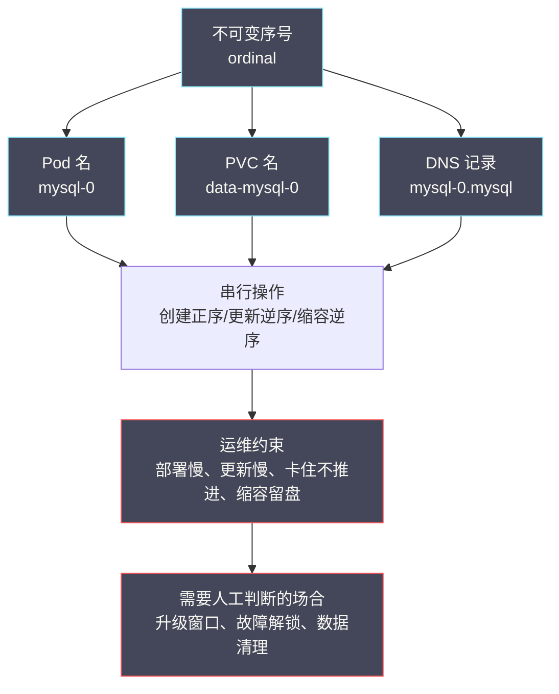
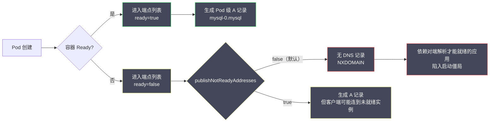
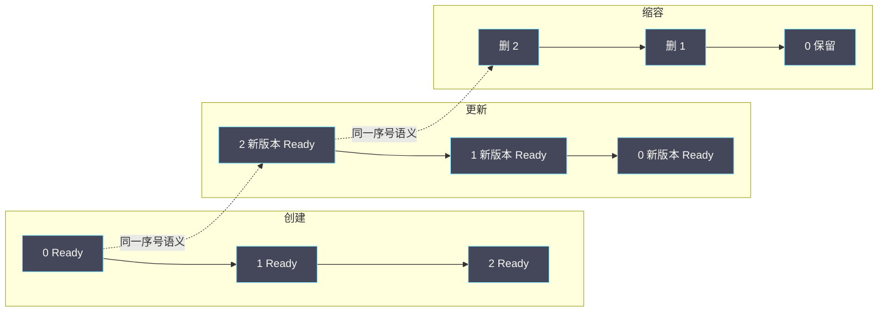
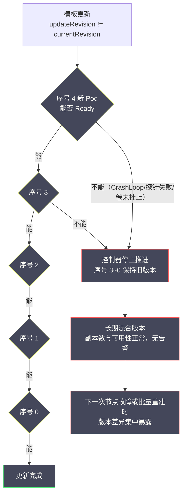
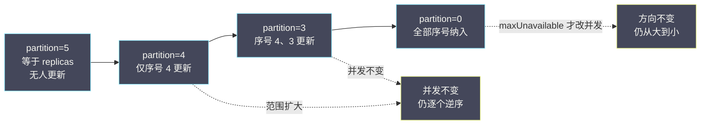
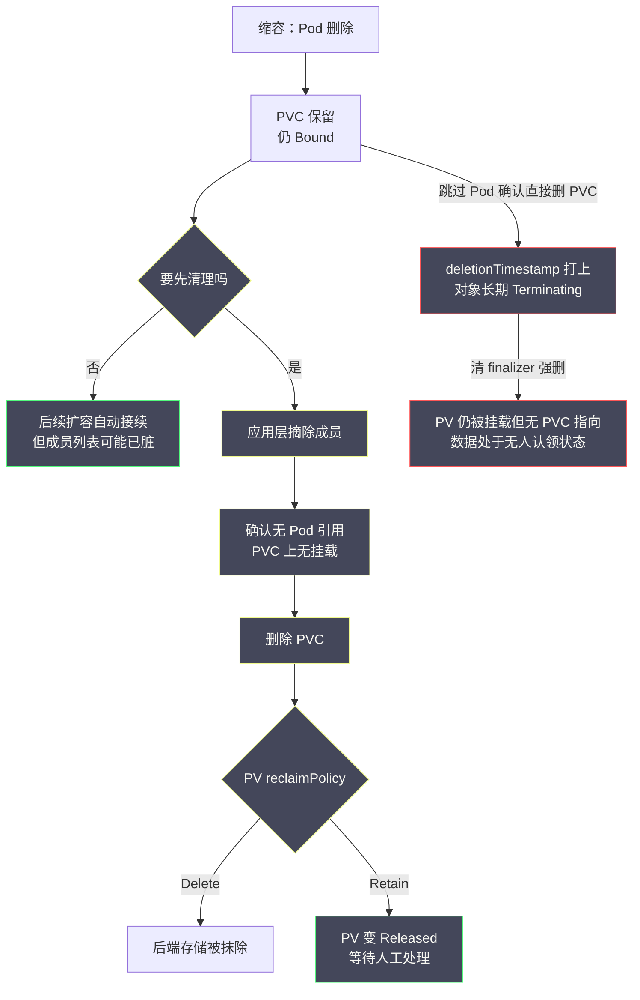

# 03 StatefulSet 控制器深度解析

**摘要：**

一套有状态集群的升级，最容易被忽略的信息不是升级本身，而是它停在了第几个序号上。StatefulSet 给有状态应用四份保证：稳定的网络标识、稳定的存储绑定、有序的部署与终止、有序的滚动更新；这四份保证全部用并行度换来，代价以"串行"的形式写进日常运维——一次二十副本的更新可能以小时计，一个卡住的序号能让整个工作负载停在半旧半新的状态且不触发任何可用性告警，默认保留策略留给下一次扩容的是一块来历不明的盘。本文把四份保证逐条拆成"机制、买到什么、支付什么"，重点落在有序在创建、更新、缩容三个执行面上的不对称性，滚动更新卡住时的判据与处置（partition 分批、OnDelete 手动控制、回退的真实成本），缩容与数据之间的几类错配，以及与 PDB、节点故障、可用区绑定叠加后的失效形态。文中不复述协调循环与卷绑定链的机制推导，这两件事分别落在 [[01 控制器模式与协调循环|协调循环]] 与 [[01 持久化存储——PV PVC StorageClass 与 CSI|PV/PVC 的运维细节]] 里；文末三条反例针对最常被踩的三个坑：无状态服务误用 StatefulSet、Parallel 配依赖拓扑、缩容后手工删 PVC。

---

## 第 1 章 四份保证与四笔账单

### 1.1 一次停在半路的升级

凌晨的发布窗口里，一套 12 副本的 Kafka 把镜像推到了新版本。滚动更新从 `kafka-11` 开始，一路推到 `kafka-1` 就停住了：`kafka-0` 仍是旧镜像，控制器不再往前推，集群里十一个新版本加一个旧版本混跑了两周，直到有人顺手敲了一条命令看镜像分布。期间没有任何告警——副本数够、可用性满、消费延迟正常，故障恰好藏在"一切正常"里。

这个形态在 StatefulSet 上不是偶发，而是机制的直接后果。Deployment 的更新单元是"一个可互换的副本"，某个副本起不来，滚动就在那里等着，其他副本该更新照样更新，最坏情况是整体覆盖率下降；StatefulSet 的更新单元是"一个序号"，序号之间被一条串行的链锁死，某一环断了，后面所有环都不动。同一件事在两种控制器上的失效半径完全不同，原因只有一个词：有序。

### 1.2 把保证拆成合同

Kubernetes 文档把 StatefulSet 的价值归纳为四份保证，这种归纳容易让人误以为它是一组互相独立的特性开关。实际上四份保证是同一套设计的四个面：控制器为每个副本分配一个不可变的序号，用这个序号同时决定 Pod 的名字、DNS 记录、PVC 名字和所有操作的先后，于是身份、存储、顺序三件事被同一个键绑在了一起。绑定的收益是**可预测性**，成本是任何绕开序号的操作都会同时破坏三件事。

| 保证 | 实现机制 | 买到了什么 | 支付了什么 |
| :--- | :--- | :--- | :--- |
| 稳定网络标识 | `<statefulset>-<ordinal>` 命名、headless Service 提供 Pod 级 DNS | 名字可写进配置、证书、监控与备份脚本，重建不改地址 | 名字即身份，改 serviceName 等于换一批成员；DNS 记录随 Ready 状态出现与消失 |
| 稳定存储绑定 | `volumeClaimTemplates` 按序号生成 PVC，PVC 不随 Pod 删除 | 同序号重建挂回同一块盘，数据接续 | PVC 长期残留、模板不可变、序号与数据的对应关系无人代管 |
| 有序部署与终止 | 创建正序等 Ready、删除逆序等终止 | 主节点先起、从节点后起，缩容先删从节点 | 部署时间从并行变串行，一个序号卡住全批停摆 |
| 有序滚动更新 | 逆序、先删后建、同序号不并存 | 主节点最后停机，版本兼容性被真实流量验证 | 无 surge、更新窗口等于副本数乘以单台重启时间，卡住后只能人工解锁 |

这张表是笔者为全文定的骨架，后面每一章都在回答其中一行的"支付了什么"，以及这笔账在什么条件下会变成事故。

### 1.3 一个贯穿全篇的集群

后面的例子都取自同一个中等规模集群：18 个节点，三个可用区各 6 个；跑着三套有状态工作负载——5 副本的 MySQL 主从（`mysql-0` 为主库）、12 副本的 Kafka 集群、3 节点的 etcd。存储统一用云盘，StorageClass 设了 `volumeBindingMode: WaitForFirstConsumer`；每套工作负载配一个 headless Service。

这三套负载恰好覆盖了"需要有序"的三种不同理由，混为一谈是很多配置错误的源头。MySQL 主从要的是启动顺序：从库启动时必须能连上主库，主库没就绪，从库的初始化就是一次必然失败的连接。Kafka 要的是**成员自组织**：节点之间靠成员协议互相发现并协商出一个控制器，启动顺序不重要，但任何一个节点在 Ready 之前必须先能解析到对端。etcd 要的是多数派：滚动更新期间不能同时下线两个节点，否则三节点集群直接失去 quorum，这不是"顺序偏好"而是存活条件。



上图想说明的是因果链的长度：序号是唯一的根，串行是它必然的中间产物，运维约束是串行在时间维度上的投影。理解这条链之后，"能不能把 StatefulSet 调快一点"这类问题就有了答案——能调的只有链的中段（`podManagementPolicy`、`maxUnavailable`、`minReadySeconds`），根不会变。

### 1.4 保证不覆盖的四件事

四份保证读起来像是"有状态应用的完整方案"，但它们只管编排层。数据一致性、选主与故障转移、备份与恢复、跨可用区容灾，这四件事 StatefulSet 一件都不做。它能让 `mysql-0` 这个名字一直存在，但不能保证这个名字背后始终是同一个主库——主库挂了之后谁接任，取决于应用自己的选主逻辑或者 [[06 Operator 模式与自定义控制器|Operator]] 接管的状态机。把 StatefulSet 当成数据库高可用方案，是这套机制最典型的误读：它提供的是可被高可用方案利用的**稳定骨架**，骨架本身不会自己站起来。

---

## 第 2 章 稳定网络标识：名字是真的，地址不是

### 2.1 两个被控制器写死的字段

StatefulSet 创建的每个 Pod，其 `metadata.name` 是 `<statefulset 名>-<ordinal>`，ordinal 从 0 开始递增到 `replicas - 1`；较新版本还提供 `spec.ordinals.start` 把起点从 0 挪到别的值，用于与既有集群的序号对齐（该字段的可用范围以对应版本文档为准）。与名字一起被写死的还有两个内部字段：Pod 的 `hostname` 被设为 Pod 名，`subdomain` 被设为 `spec.serviceName`，这两个字段是 DNS 记录的输入，不是给人配置的旋钮。

由此产生三条硬约束，每一条都在运维里出现过代价。名字可写进配置，于是从库的 `master-host`、证书的 SAN、监控的时间序列标签、备份脚本里的目录名，都可以用 `mysql-0.mysql` 这种形式固化下来，重建换节点、换 IP 都不用改配置；名字就是身份，于是"删掉重来"在 StatefulSet 上是危险动作，删掉 `mysql-1` 再让它重建，接回的是同一份数据和同一个成员位置，但应用侧可能还记着它的旧 IP 与旧成员 ID；名字的集合由 `replicas` 决定，于是序号不是一个可以自由分配的编号，扩容只能往高处加，缩容只能从高处减，中间不能挖空。

### 2.2 稳定的是名字，不是地址

这是最常被混淆的一点。Pod 重建后 IP 一定会变，除非集群装了固定 IP 的插件；所谓"稳定网络标识"，稳定的是名字到当前 IP 的那条解析路径，不是 IP 本身。所以应用侧要满足两个条件才能享受这份保证：服务端监听 `0.0.0.0` 而不是某个具体地址，客户端按名字连接而不是把解析结果缓存成常量。

第二条在实践中经常被长连接破坏，譬如从库与主库之间那条永不主动断开的复制连接。DNS 记录有 TTL，Pod 重建后旧 IP 在 TTL 窗口内仍会被解析到；而持有长连接的客户端连这个问题都遇不到，它压根不会再解析——连接对象一直指向旧 IP，直到 TCP 超时或对端复位。表现是"主库重建完成，但从库复制卡在重连"，日志里是连接被重置。判据在客户端侧：连接池是否配置了最大生命周期、失败重试时是否重新解析。这类问题不能靠 Kubernetes 解决，它属于客户端必须承担的语义。

### 2.3 headless Service 究竟发了哪几条记录

StatefulSet 的 `spec.serviceName` 指向一个 headless Service（`clusterIP: None`），DNS 记录由 CoreDNS 与端点对象共同生成，机制见 [[07 NetworkPolicy与CoreDNS——网络安全策略与集群DNS|CoreDNS 与集群 DNS]]。对一套名为 `mysql` 的 StatefulSet，会看到三类记录：

| 记录 | 解析结果 | 何时存在 | 典型用途 |
| :--- | :--- | :--- | :--- |
| `mysql-0.mysql.default.svc.cluster.local` | 该 Pod 的 IP | 该 Pod 在端点列表中且 Ready | 从库连主库、成员按名字互连、证书 SAN |
| `mysql.default.svc.cluster.local`（Service 名本身） | 全部 Ready Pod 的 IP 集合 | 至少一个 Pod Ready | 客户端广播式访问全体成员 |
| `_3306._tcp.mysql.default.svc.cluster.local` | 各 Pod 的端口与主机名 | 端口有名字时才生成 | 服务发现协议按 SRV 查端口 |

短名 `mysql-0.mysql` 在同一命名空间内可用，跨命名空间要补全到 `mysql-0.mysql.<namespace>`。这里有个容易忽略的细节：headless Service 的 `selector` 决定哪些 Pod 进入端点列表，而 `serviceName` 只决定 DNS 记录的域后缀，两者不必指向同一批 Pod——把 `serviceName` 指向一个 selector 为空或指向别的标签的 Service，Pod 会被创建、DNS 记录却一条也不会出现；指向一个带 ClusterIP 的普通 Service 同样不报错，但 Pod 级记录不会生成。两种情形的表现一致："Pod 都 Running，但 `mysql-0.mysql` 解析失败"，排查时先确认 Service 的 `clusterIP: None` 与 `selector`。

### 2.4 ready 是 DNS 的开关

默认情况下，只有 Ready 的 Pod 才会进入端点列表，也就只有 Ready 的 Pod 才有 DNS 记录。这条规则的动机是让 Service 不把流量导向未就绪的实例，放到 StatefulSet 上却会制造一个自指的僵局：某个需要与对端协商才能就绪的应用（Kafka、ZooKeeper、Cassandra 这类靠成员协议组集群的软件），在启动阶段就要解析对端名字，而对端此时也没 Ready，于是双方的 DNS 查询都返回 NXDOMAIN，谁也无法先就绪。

`publishNotReadyAddresses: true` 是为此准备的开关：打开后未 Ready 的 Pod 也会进入端点列表并拿到 DNS 记录，启动阶段的互相发现得以完成。但它是把**双刃剑**，打开之后所有消费这个 headless Service 的客户端也会看到未就绪的地址，连接会打到还没开始服务的实例上；同时 Pod 已经崩溃但对象仍在时，DNS 依然返回它的 IP，客户端拿到的是一个黑洞地址。所以这条开关的使用边界很清楚：只给集群内部成员发现专用的 Service 打开，对外提供服务的入口不要打开。判据在端点对象上——`kubectl get endpointslice -l kubernetes.io/service-name=mysql -o wide` 看端点的 `ready` 条件，配合一次 `kubectl exec` 进去 `nslookup mysql-1.mysql` 即可确认记录是否发布。

`podManagementPolicy` 与 DNS 的交集只有一处，却常被忽略：OrderedReady 下记录是逐个长出来的，成员协议在启动早期看到的名单天然不完整，应用必须能处理"同伴稍后出现"；Parallel 下所有 Pod 同时创建，端点列表一次性齐备，未 Ready 的部分仍受 `publishNotReadyAddresses` 约束。前者要求应用容忍名单增长，后者要求应用容忍名单一次性到齐但多数不可用。



### 2.5 稳定标识的第三个消费者：证书与配额

名字稳定带来的收益不止于配置。双向 TLS 的证书可以把 `mysql-0.mysql.default.svc.cluster.local` 写进 SAN，Pod 重建、换节点、换 IP 都不需要重签，签发与轮换的复杂度随之下降；监控侧可以用序号做时间序列的维度，把"第 3 个副本的写入延迟"单独拉出来看；资源配额按序号切分也成立，因为序号集合是有限的。

这些便利都有一个共同的前提：序号是稳定的，而序号背后的实例可以是新的。证书不重签意味着身份凭据跨实例复用，如果某个序号的 Pod 曾经被入侵或被误配，重置它的身份就不是删 Pod 能完成的——证书还在，需要单独吊销。把序号当成长期身份使用，等于把"身份轮换"这件事从平台层挪到了流程层，这是使用稳定标识时很少有人预先算到的一笔账。

### 2.6 不可变字段：serviceName 与 selector

`spec.serviceName` 与 `spec.selector` 在 StatefulSet 创建之后不可修改，对它们的更新会被 apiserver 直接拒绝。这条校验堵住了一条很长的故障链：如果允许改 serviceName，Pod 的 `subdomain` 需要重写，DNS 记录需要重发，而 `subdomain` 在 Pod 创建后同样不可变，只能删除重建，重建又意味着整批 Pod 的身份在短时间内集体失效。

不可变带来的实际约束是：给 StatefulSet 改名（包括改 Service 名）在语义上等于解散旧集群、建立新集群，必须走"建新、迁数据、下线旧"的路径，而不是改一个字段。反过来说，这也是把名字认真起好的理由——`mysql-0.mysql` 这种名字一旦进了证书 SAN 和应用配置，改名成本远高于改名带来的收益。

---

## 第 3 章 稳定存储：PVC 由模板生成，但不是 StatefulSet 的孩子

### 3.1 三个名字与三种用途

`volumeClaimTemplates` 里的每个模板会在创建 Pod 时被实例化成 PVC，命名规则是 `<模板名>-<statefulset 名>-<ordinal>`。模板名叫 `data`、StatefulSet 名叫 `mysql`，序号 1 对应的 PVC 就是 `data-mysql-1`。这个命名的价值不在可读性，而在三件具体的事。

第一是对账。`replicas` 与 PVC 集合的差集可以直接算出来：序号 0 到 `replicas-1` 应当各有一块 `data-mysql-<ordinal>`，多出来的是缩容残留，缺的是异常。第二是备份与恢复的寻址，按序号遍历 PVC 就能做逐成员快照，恢复时也是按序号灌回去。第三是排障时的定位，Pod 卡在 Pending 时，第一反应就是去看同名 PVC 的状态与事件，这条线索链不需要查询任何映射表。

### 3.2 没有 ownerReference 的那些后果

默认情况下，StatefulSet 创建 PVC 时不给它设置指向自己的 ownerReference。于是 PVC 的生命周期与 Pod、与 StatefulSet 都解耦：删 Pod 不删 PVC，缩容不删 PVC，`kubectl delete statefulset mysql` 默认只级联删除 Pod，PVC 留在原地。这是安全设计——一次误删不至于连数据一起销毁——但它让**孤儿 PVC**成为常态，清理责任落在人身上。

围绕这套默认行为有一组连锁语义值得厘清。用 `--cascade=orphan` 删除 StatefulSet 时，Pod 也会被保留下来，对象成为孤儿；此时以同名重建 StatefulSet，控制器会发现序号 0 的位置上已经有一个同名 Pod，但它的 ownerReference 不指向自己，于是报"该 Pod 已存在且不受本控制器管理"并停止推进。正确的恢复顺序是先删掉这些孤儿 Pod（PVC 保留，数据不受影响），再让新的 StatefulSet 按序号重建它们。这条路径是误删 StatefulSet 之后的标准恢复动作，顺序反了会卡在一个看起来很像"控制器坏了"的状态上。

同一条机制也决定了一件事：StatefulSet 的名字进了 PVC 名。以新名字重建 StatefulSet，控制器会按新名字生成 `data-mysqlv2-0` 这样的全新 PVC，与旧数据毫无关系——旧盘还在，但没人认领。这类"数据在、映射断"的形态比数据丢失更难排查，因为从 Pod 上看一切正常，只是数据是空的。

### 3.3 volumeClaimTemplates 是不可变字段

StatefulSet 的更新校验只放行少数几个字段：`replicas`、`ordinals`、`template`、`updateStrategy`、`persistentVolumeClaimRetentionPolicy`、`minReadySeconds`，其余一律拒绝，`volumeClaimTemplates`、`selector`、`serviceName`、`podManagementPolicy` 都在拒绝之列。这不是静默忽略，是**准入层的显式报错**，`kubectl apply` 会直接失败。

这条校验有三个运维推论。其一，改存储容量不能改模板，已有的 PVC 根本不会被重新渲染，正确做法是直接对 PVC 发起扩容，前提是 StorageClass 允许扩容，细节见 [[01 持久化存储——PV PVC StorageClass 与 CSI|PV 扩容的三层前提]]。其二，想换 StorageClass、改访问模式、增加第二个卷模板，都只能重建 StatefulSet；而重建会改变 PVC 名字，等于要求做一次数据迁移。其三，"先改模板，等滚动更新把新配置带上去"这个在 Deployment 上成立的直觉，在这里不成立——提交就会被拒，轮不到滚动更新。`podManagementPolicy` 同属不可变之列，意味着 OrderedReady 与 Parallel 之间没有回头的路，选错了只能重建整个工作负载。

### 3.4 保留策略：两种策略与它的版本账

`persistentVolumeClaimRetentionPolicy` 把"删不删 PVC"从默认行为变成了可配置项，字段有两支：`whenDeleted` 管 StatefulSet 被删除时，`whenScaled` 管缩容时。默认两支都是 `Retain`；改成 `Delete` 时，控制器会给 PVC 加上指向 StatefulSet 的 ownerReference，由垃圾回收器按所有者关系删除。

| 配置 | StatefulSet 删除时 | 缩容时 | 适合的场景 | 风险 |
| :--- | :--- | :--- | :--- | :--- |
| 默认（Retain / Retain） | PVC 保留 | PVC 保留 | 数据比存储成本重要的一切场合 | 孤儿盘持续计费，清理靠人 |
| whenDeleted: Delete | PVC 自动删除 | PVC 保留 | 整套下线、临时环境 | 误删 StatefulSet 即销毁数据，且取决于 PV 回收策略 |
| whenScaled: Delete | 视 whenDeleted | PVC 自动删除 | 无状态化的分片、可重算的缓存层 | 缩容即丢数据，扩回来是空盘 |
| Delete / Delete | 全删 | 全删 | 一次性压测、CI 环境 | 生产环境基本不该出现 |

这张表的版本背景必须讲清楚，因为它是"写了不生效"的典型来源：该能力以特性门 `StatefulSetAutoDeletePVC` 引入，1.23 为 alpha（默认关闭），1.27 转 beta 并默认开启，1.32 转 GA。在特性门关闭的版本上提交这段字段，apiserver 会当作未知字段静默裁剪——`kubectl apply` 成功、`kubectl get -o yaml` 里看不到该字段、行为完全不变。实践中更常见的组合是 `whenDeleted: Delete` 配 `whenScaled: Retain`：整套下线不留垃圾，日常缩容保住数据，两头的风险各取所需。

---

## 第 4 章 有序：一个串行状态机

### 4.1 创建面：等的是 Ready，不是 Running

创建顺序从序号 0 开始，前一个 Pod 进入 Ready 才创建下一个。这里的谓词是 Ready 而不是 Running，Ready 又由 readinessProbe 与 `minReadySeconds` 共同决定。`minReadySeconds` 默认 0，意味着探针第一次通过就算就绪，控制器立刻推进下一个序号——对有状态应用这是危险的默认值：数据库完成崩溃恢复、重放完 WAL、建好复制连接，往往发生在端口监听之后的几十秒到几分钟，而只查端口的探针早就绿了。

这个语义的边界在 4.5 节会给出算术：串行等待乘以单台启动时间，构成部署与更新的总时长。更重要的是它决定了"卡住"的判定标准——判断一个序号是否推进，看的不是 Pod 是否创建出来，而是它是否 Ready。

### 4.2 更新面：逆序、先删后建

滚动更新从最大序号开始递减。每个序号的处理是"删除旧 Pod、等它完全终止、用新模板创建同名新 Pod、等它 Ready"，然后才轮到下一个序号。**先删后建**不是实现偷懒，而是硬约束：同一序号不能同时存在两个 Pod，否则它们会争抢同一个 PVC，而 RWO 卷只允许一个节点挂载。这条约束也解释了为什么 StatefulSet 没有 `maxSurge`——Deployment 靠"新副本先起、就绪后删旧副本"实现零中断，StatefulSet 在结构上就做不到，它的更新窗口里那个序号一定是不可用的。

逆序的理由是可用性设计：把序号 0 留到最后，先让从节点或跟随者升级，旧主节点仍在服务，新旧版本之间的协议兼容性由真实流量当场检验，验过了才轮到主节点自己。反过来先升主节点，旧版本从节点一旦协议不兼容就会断开同步，故障面从"部分读请求降级"扩大到"整个复制链路中断"。

### 4.3 缩容面：从最大序号开始

缩容同样从最大序号开始递减，并且等前一个完全终止再处理下一个。这条规则在"主库在序号 0"的假设下是贴心的，但它只是把"序号大的是从节点"这个应用约定当成了前提——StatefulSet 并不知道谁是主库，它只知道序号。如果应用把主库放在 `mysql-2`（有些部署确实这么做，为了让主库最后被创建），缩容就会先删主库，一次例行缩容变成一次主库强制下线。

### 4.4 三个执行面的不对称

把三个执行面并排放，会看到一组很容易记错的**不对称**：`podManagementPolicy` 只作用于创建与删除，不作用于更新；`maxUnavailable` 只作用于更新，不作用于创建与缩容；`partition` 只作用于更新，且只改变范围不改变顺序。

| 执行面 | 方向 | 等待条件 | 受 podManagementPolicy 影响 | 受 maxUnavailable 影响 |
| :--- | :--- | :--- | :--- | :--- |
| 创建与扩容 | 0 递增到 N-1 | 前一个 Ready（含 minReadySeconds） | 是，Parallel 下同时创建 | 否 |
| 滚动更新 | N-1 递减到 0 | 旧 Pod 终止完成、新 Pod Ready | 否，默认仍逆序逐个 | 是，大于 1 时允许跨序号并行 |
| 缩容 | N-1 递减到 0 | 前一个终止完成 | 是，Parallel 下同时删除 | 否 |

这里的"Parallel 下同时删除"值得单独强调：缩容顺序在 Parallel 模式下失去保证，`mysql-4`、`mysql-3` 会一起被删。如果应用假设"缩容总是先删从节点"，切到 Parallel 之后这个假设不再成立，而踩坑的时间点通常在缩容而不是在切换当天。



### 4.5 有序的账怎么算

有序的代价可以算出来，只是没人算。以下为示例推算，数值随镜像、存储后端、探针与网络条件变化，仅用于建立量级直觉。

一套 12 副本的 Kafka，单台从容器启动到 Ready 需要 100 秒（加载日志段、加入 ISR），优雅终止 30 秒，卷附着 15 秒。滚动更新在默认 `maxUnavailable: 1` 下逐个推进，单台窗口是 100 加 30 再加 15，约 145 秒，12 台接近 29 分钟；如果新版本引入了索引重建，单台 Ready 时间翻倍，整个窗口就超过一小时。同样的负载换成 Deployment 的 `maxSurge: 25%`，三台并行推进，四轮结束，量级差异在两个数量级上。

部署阶段更极端。20 副本、单台 45 秒，OrderedReady 串行约 15 分钟；Parallel 理论上一两分钟，但真实瓶颈会转到镜像仓库带宽与存储后端的创建限流上，二十块云盘同时创建容易触发 API 限流，部分 PVC 创建失败后重试，总时长可能并不比串行短——这是实践中 Parallel 收益被高估的原因之一。

容量规划也被这个机制改写。Deployment 在滚动更新期间可以临时多出 surge 份额的副本，StatefulSet 不会，所以维护窗口内的可用副本数等于 `replicas` 减去正在重建的数量；PDB 只给下限，不提供上限外的余量。核算峰值能力时，必须按 `replicas - maxUnavailable` 算，而不是按 `replicas` 算。

最后一笔账在自动扩缩容上。HPA 的默认同步周期是十几秒，它按当前指标算目标副本数；StatefulSet 扩容是串行的，新副本在 Ready 之前不摊薄指标，于是 HPA 下一轮看到指标仍然高，继续加副本。对突发流量，这一组合的典型表现是副本数被推得远高于实际需要，随后又因为指标回落而缩容，缩容同样受有序约束而变慢。对有状态负载，更稳的做法是关掉 HPA 或给它加上限速，机制细节在 [[11 Scheduler 调度算法：预选、优选与扩展机制|调度与弹性]] 一侧。

### 4.6 Parallel 的适用边界

`podManagementPolicy: Parallel` 让创建与删除同时进行，不等待就绪。它能用的情况有三类：成员关系完全自组织且启动幂等（Kafka、部分 Cassandra 部署）；每个 Pod 是独立分片，分片之间没有启动依赖（按主键分片的存储层）；副本数很大且容忍首启竞态（临时压测集群）。

失去的东西也要一并算清：创建顺序没了，所有副本同时向同一个后端拉镜像、同时建卷、同时发起成员协商，瞬时压力集中；缩容顺序没了，先删主库这种事故从"不可能"变成"看运气"；控制器替你挡住启动风暴的那层缓冲没了，应用必须自己处理"对端还没起来"的所有异常路径。还有一个常见误解需要澄清：Parallel 不改变滚动更新的顺序，更新依然逆序、依然逐个，所以指望用它加速升级的人会失望。

### 4.7 扩容与更新交错

控制器在一次协调里先处理副本数差异、再处理版本差异，这个顺序意味着扩容与更新会互相排队。正在滚动更新时把 `replicas` 调大，新序号会先按新模板创建出来（模板已经变了），于是集群在短时间内同时存在三种状态：旧版本的低序号、正在被替换的中间序号、新版本的高序号。从版本分布上看这像一次错乱，实际是两条路径共用同一个模板的结果。

反过来，在扩容尚未完成时改模板，控制器会先把副本数补齐再开始更新，补齐过程本身是串行的，于是"改个镜像"的生效时间被前一次扩容拖长。运维上的结论很直接：扩容与发布不要排在一起，两次操作之间留出等待 `rollout status` 结束的间隔。这套交错在 Deployment 上同样存在，但那里的两个动作都是并行的，用户感知不到；在 StatefulSet 上它们都被串行放大，感知得到。

---

## 第 5 章 滚动更新卡住：链式后果与处置

### 5.1 停摆的结构

控制器每次协调只做一步：找到最大序号的待更新 Pod，删掉、等终止、建新的、等 Ready，然后返回，等下一次协调。这个"一次一步"的结构意味着整条链的推进速度由最慢的一环决定，而某一环不 Ready 时，链就停在那里，更小的序号一个都不会动。

停摆的危险不在于它坏，而在于它**安静**。服务仍然可用——其他序号在正常服务；副本数与就绪数对得上——卡住的只是版本；延迟和错误率没有变化——混合版本在协议兼容时不会有任何表现。于是监控不响，值班不动，混合版本状态存活数周，直到某次节点故障触发一次大规模重建，新旧版本在同一时刻互换角色，问题才暴雷。把**版本一致性**做成一条独立指标（同 selector 下 Pod 镜像的 distinct 计数），是这种情况下唯一有效的探测手段。



### 5.2 判据：三条命令与四个字段

判断"是否卡住、卡在哪个序号"有一条固定路径，笔者的习惯是从粗到细走三步。先看 `kubectl rollout status statefulset/mysql --timeout=30s`，卡住时它会明确报出"等待某个序号就绪"或"等待某个 revision 的滚动更新完成"，这一句就把范围缩到序号上。再看 `kubectl get statefulset mysql -o jsonpath` 读出四项信息：`status.updatedReplicas` 与 `status.replicas` 的差值说明还有几个没更新，`status.currentReplicas` 是仍停留在旧 revision 的副本数，`currentRevision` 与 `updateRevision` 是否相等说明更新是否完成。最后按序号列出 Pod 的版本与节点：

```bash
kubectl get pods -l app=mysql \
  -o custom-columns='NAME:.metadata.name,READY:.status.containerStatuses[0].ready,IMAGE:.spec.containers[*].image,NODE:.spec.nodeName,DELETING:.metadata.deletionTimestamp'
```

这条命令的输出能一次分辨三种形态：某序号 Pod 版本仍是旧的（控制器确实停在那之前）、某序号 Pod 版本是新的但不 Ready（卡在这一台）、某序号 Pod 带 `deletionTimestamp`（卡在终止而不是启动）。第三种最容易被误判成"控制器不干活"，实际上控制器在等旧 Pod 完全消失，因为同名新 Pod 建不出来。

### 5.3 根因分类

卡住的根因集中在六类，每类的判据都在事件里。新版本启动失败：`CrashLoopBackOff`、`ImagePullBackOff`，看 `kubectl logs --previous`。探针过严：Pod `Running` 但 `Unhealthy` 事件反复出现，探针阈值与 `initialDelaySeconds` 需要按应用的冷启动时间调，譬如数据库首次启动要重放 WAL，端口早开了，可接受查询还要等一分多钟。卷没绑上：PVC `Pending`，事件可能是 `waiting for first consumer`，也可能是 StorageClass 不存在。旧 Pod 终止不动：`preStop` 挂住、finalizer 未清、卷卸载重试，表现为旧 Pod 长期 `Terminating`。跨节点抢卷：`Multi-Attach error`，机制与处置在 [[01 持久化存储——PV PVC StorageClass 与 CSI|PV/PVC 的运维细节]] 里已经拆过，这里只补一句 StatefulSet 特有的部分——旧 Pod 没走完，新 Pod 就必然抢不到同一块 RWO 卷，两个问题会互相等待。调度不上：`node(s) had volume node affinity conflict` 或资源不足，Pod 停在 `Pending`，此时连容器都没启动过。

### 5.4 为什么不能跳过

面对卡住，第一反应往往是"跳过这个序号，先把后面的更完"。这个操作在 StatefulSet 上不存在，原因是三重约束叠加：同一序号不能有两个 Pod，所以没有"新建一个再删旧的"这条路；PVC 按序号命名且 RWO 独占，所以不存在"临时换个序号顶上"这条路；应用侧的成员关系按序号建立，即使技术上能错序，应用也会拒绝。

能做的只有三件事：回退模板、缩小更新范围、把节奏交给人工。这三件事对应 `partition` 与 `OnDelete`，选择哪条取决于"坏版本已经推到第几个序号"。

### 5.5 partition 分批与回退的真实成本

`partition` 的语义是"只有序号大于等于它的 Pod 才更新"。它有两个正确用法，一个常见误用。

灰度推进是第一个用法：先把模板改好、把 `partition` 设成 `replicas`，此时没有任何 Pod 更新（但 `updateRevision` 已经变化，可以确认模板生效），观察准备情况；然后每次把 `partition` 减一，只放一个序号出去，盯住这个序号的启动日志与业务指标，再继续。这条路径把一次全量风险切成 N 次单台风险，代价是操作次数变多、窗口变长。

回退是第二个用法，也是最容易被高估的一个。StatefulSet 没有 Deployment 那种"按历史版本一键回滚"的能力——客户端没有为它实现回滚动作，控制器也只认"模板当前是什么"这一件事。所谓回退，是把模板改回旧内容，让控制器发起一次新的滚动更新；方向仍是从最大序号往下，于是最先被替换的是序号最大、当前跑着坏版本的那些 Pod。这意味着：在序号 11 处卡住、只有一台受影响时回退，成本是一台；在坏版本已经推到序号 0 之后回退，第一次替换就是主节点。**停在越早越便宜**，是对"卡住要立刻处置"最直接的理由。

误用则是把"把 partition 调高"当成回滚。调高 `partition` 只是缩小了"应当更新的集合"，已经更新过的 Pod 不会被打回旧版本——控制器不会因为 `partition` 升高而重建它们。想真正回退必须改模板，这一点在应急时最容易被记反。

### 5.6 OnDelete：把节奏交给人和它的三个代价

`OnDelete` 策略下，模板变更不会触发任何自动更新，只有 Pod 被删除（无论是人删、节点驱逐还是控制器重建）时，新建的 Pod 才使用新模板。它把节奏完全交给人，代价有三个。

其一，进度没有保证。`rollout status` 在 `OnDelete` 下给不出"还剩几个"的可靠信号，人必须自己记录哪些序号已经更新过，多人协作时很容易漏。其二，**维护窗口会顺手升级**。节点维护触发的驱逐删除 Pod，重建时用的是当前模板——如果模板早就改成了新版本，一次例行 drain 就变成一次未经评审的版本升级，而且发生在最不该发生的时间点。其三，与 `partition` 互斥：`updateStrategy.type` 只能二选一，没法一边灰度一边手动确认。

它适合的场合因此很窄：共识系统或数据库，每一次重启都需要人工确认成员状态、数据校验与选主结果，且团队有能力维护一份手工进度表。其余场合，`partition` 加 `RollingUpdate` 的自动化程度更合适。

### 5.7 三个时间参数

`minReadySeconds` 决定新 Pod Ready 之后还要稳多久才算完成，它挡的是"起来就崩"的版本——没有它，一个坏版本会在几十秒内铺满整批副本。代价是整个窗口被拉长为该值乘以副本数：设 60 秒、12 副本，光这一项就多出 12 分钟。`terminationGracePeriodSeconds` 决定旧 Pod 的终止上限，它同时是缩容与更新窗口的一部分，设得比应用真实关闭时间短会留下未刷盘的进程，设得过长会把每个序号的窗口硬拉长。`maxUnavailable` 大于 1 时才允许跨序号并行，但它不改变推进方向，也不解除"同一序号先删后建"的约束——把它当成"StatefulSet 的 maxSurge"会得出错误的时间估算。

### 5.8 revision 能查到什么，不能查到什么

控制器每变更一次模板就留下一个 `ControllerRevision` 对象，用 `revisionHistoryLimit`（默认 10）限制保留数量。它是排查时唯一能看到"这个序号当前属于哪个 revision"的入口：

```bash
# ControllerRevision 名形如 mysql-<hash>，revision 字段即模板的版本号
kubectl get controllerrevision \
  -o custom-columns='NAME:.metadata.name,REVISION:.revision,AGE:.metadata.creationTimestamp'
# 再看某个序号当前归属哪个 revision
kubectl get pod mysql-1 -o jsonpath='{.metadata.labels.controller-revision-hash}{"\n"}'
```

这里必须把能力边界说清楚：revision 是**记录**，不是**回滚机制**。它让排查能回答"哪几个序号还停在旧模板上"，但不提供"回到某个 revision"的命令。原因回到 4.2 节的约束上——回滚需要创建新 Pod，而新 Pod 必须占用同一序号，于是回滚只能表现为"用旧模板再滚一遍"，由此继承全部有序成本。知道 revision 的存在却以为它等价于 Deployment 的历史版本，是应急时最容易踩空的一步。

再看 `partition` 灰度推进的时间线，把范围与并发分开看会更清楚：



图中的虚线是这套机制最容易被误读的地方：把 `partition` 一路调到 0 不等于"一次性全量铺开"，它只是把更多序号放进待更新集合，实际推进速度仍由 `maxUnavailable` 与单台启动时间决定。

---

## 第 6 章 缩容之后：数据、成员与容错

### 6.1 缩容删掉的是什么

`replicas` 从 5 改为 3，控制器删除序号 4 和 3 的 Pod，PVC `data-mysql-4`、`data-mysql-3` 保留（默认策略下）。删除顺序在 OrderedReady 下是逆序且逐个等待终止，在 Parallel 下是同时删除。事件上能看到 `SuccessfulDelete`，`kubectl get pvc` 里两块盘仍然存在，`Bound` 状态也没有变化——Pod 没了，PVC 与 PV 的绑定关系不受影响。

这块盘在后续的时间里处于一种暧昧状态：它不属于任何运行中的 Pod，但也不是垃圾，重新扩容时会被接回去。管理这套状态的责任完全在人——集群里没有任何对象记录"这块盘的数据还有没有价值"。

### 6.2 回扩能接续的前提在应用侧

把 `replicas` 改回 5，控制器创建序号 3、4 的 Pod，挂回原来的 PVC，数据接续。存储侧的动作到此为止，应用侧的故事才开始。

Kafka 的成员关系存在控制器维护的元数据里，缩容时被删掉的节点如果没先从集群里摘除，重新加入时会带着旧的 member ID 与旧的日志目录，与集群记录的成员状态冲突，轻则触发一次不必要的重新分配，重则让分区进入不可用状态。etcd 类似，成员列表里还留着已删除的成员，新 Pod 启动后加入集群会被拒绝，需要先 `member remove` 再加回。MySQL 从库相对简单，数据目录还在，起起来按 GTID 接续即可，但如果主库在此期间 purge 了它需要的 binlog，就必须重做全量。判据很简单：把应用的成员列表与 Pod 列表对账，两者不一致就是脏状态。

### 6.3 手工删 PVC 的顺序

清理残留 PVC 是必要的运维动作，但顺序错了会把"清理"变成"制造故障"。PVC 上有一个保护性 finalizer（`kubernetes.io/pvc-protection`），只要还有 Pod 在用它，删除请求只会给它打上 `deletionTimestamp` 而对象不会消失。这个保护在缩容后反而会制造误解：有人看到 PVC 一直 `Terminating`，以为集群出问题，于是去清 finalizer，结果在 Pod 仍挂载该卷时把 PVC 对象删了，留下一个仍在被使用、但已经没有 PVC 指向的 PV。

正确的顺序是三步：先在应用层把成员摘除，再让 Pod 消失（缩容或删除），最后删 PVC。跳过第一步会留下脏成员状态，跳过第二步会让 PVC 卡在 `Terminating`。三步都做完之后，删 PVC 才会连带触发 PV 的回收，回收行为取决于 PV 的 `reclaimPolicy`——`Delete` 会真正抹除后端数据，`Retain` 会留下一块 `Released` 状态的盘等待人工处理。



### 6.4 名字相同、数据不同

最阴的一种错配不需要任何违规操作就能发生。缩容到 3 之后，有人按"清理残留"把 `data-mysql-3`、`data-mysql-4` 删了；两周后流量上来，扩容回 5，控制器按模板创建新的 `data-mysql-3`、`data-mysql-4`——名字与原来一模一样，内容是空盘。此时如果备份脚本按 PVC 名字取数据，它取到的是新盘并且会认为备份成功；如果监控按 PVC 名字统计使用量，曲线会从零重新长起来，看起来像"业务重建了索引"。

这类问题没有技术手段能自动发现，因为名字、标签、序号全都对，错的只有**这块盘的历史**。可用的缓解手段是给 PVC 加创建时间告警（新建的 PVC 出现在一个有历史的工作负载里本身就是异常），以及在备份系统里记录卷的唯一标识（PV 名或卷 ID）而不是 PVC 名。命名规则把可预测性买给了你，也把"同名不同命"的风险一并塞了进来。

### 6.5 保留策略的组合

回到 `persistentVolumeClaimRetentionPolicy`，它的两个分支应当按工作负载的生命周期分别设置，而不是全套统一。整套下线的场景（临时环境、压测集群）用 `whenDeleted: Delete` 清干净；数据库这类数据比机器贵的负载，两支都保持 `Retain`，把清理做成一个有审批的定期任务；分片可重算的缓存层可以开 `whenScaled: Delete`，但要确认扩容路径不会因为空盘而触发全量预热把下游打挂。

这套策略能解决"垃圾盘"的问题，解决不了"该不该删"的判断。凡是把 `Delete` 打开的地方，都要接受一个前提：删除 StatefulSet 这个动作被提升为不可逆操作，与 `kubectl delete` 其他任何对象的心理预期不再一致。

### 6.6 缩容的隐形降级：quorum 算术

共识类负载的缩容有两层后果，第二层经常被漏算。第一层是成员关系：被删掉的成员如果没先从集群里摘除，它仍然留在成员列表里，序号重新扩回来时应用会以"成员已存在"为由拒绝加入——etcd 需要 `member remove` 后再 `member add`，Kafka 需要让控制器完成分区重分配。第二层是容错能力，它随副本数变化，且变化点在缩容那一刻而不是故障那一刻。

三节点 etcd 的多数派是 2，能容忍 1 台故障；缩到 2 个节点，多数派仍是 2，但已经不能容忍任何一台故障——集群从"可自愈"变成"任一台离线即失去写能力"，这个**隐形降级**在 `kubectl scale` 成功的输出里毫无提示。四节点缩到 3 是另一种情形，多数派从 3 降到 2，看似容忍的故障数都是 1，但第二次故障来临时集群只剩两个节点，写能力立刻消失——余量被吃掉了一层，只是账单要等到下一次故障才结。这类算术必须在缩容评审时写出来，因为副本数是人改的，容错能力是系统算的，两者之间没有校验拦住你。

同理，缩容与滚动更新不该同时进行。更新期间每个序号都有一段不可用窗口，缩容期间可用副本数本来就在下降，两条曲线叠加时 quorum 可能被瞬间击穿，而两条命令各自看起来都很安全。

---

## 第 7 章 与 PDB、节点故障、可用区的交互

### 7.1 PDB 管的和不管的

`PodDisruptionBudget` 约束的是自愿中断（Voluntary Disruption），也就是通过驱逐子资源发起的删除：`kubectl drain`、descheduler、Cluster Autoscaler 缩节点。它不管的东西同样重要，而且经常被误以为管：

| 操作 | 是否受 PDB 约束 | 说明 |
| :--- | :--- | :--- |
| `kubectl drain` 与驱逐 API | 是 | 预算不足时驱逐被拒，drain 会一直等待（默认无超时） |
| `kubectl delete pod` | 否 | 直接删除，绕过预算 |
| StatefulSet 缩容 | 否 | `replicas` 变更不走驱逐，预算不参与 |
| 滚动更新 | 否 | 控制器自己的删除动作，不受预算约束 |
| 节点故障、OOM、kubelet 崩溃 | 否 | 非自愿中断，预算无法阻止 |
| Cluster Autoscaler 缩节点 | 是 | 走驱逐，因此会被预算卡住并可能让缩容失败 |

这张表最实用的一行是"缩容不受约束"。节点要下线而 PDB 又不放行时，先缩容再扩容是一种合法的绕过手段——它绕过了预算，但没有绕过有序性，重建仍然是逆序逐个。代价是缩容期间容量真实下降，且应用侧的成员关系需要处理。

### 7.2 三类 drain 死锁

第一类是预算本身不可能满足。`minAvailable: 2` 配 `replicas: 2`，`disruptionsAllowed` 恒为 0，drain 会无限等待。判据是 `kubectl get pdb -o wide` 里 `ALLOWED` 为 0；处置只能改预算或手动删 Pod（手动删不受预算限制，但会失去保护的语义）。

第二类是预算被不健康的 Pod 占住。某个序号卡在 `Pending` 或长期 `Terminating`，它既不算可用副本、又还在计数里，`disruptionsAllowed` 一直是 0。较新版本提供了 `unhealthyPodEvictionPolicy: AlwaysAllow` 让驱逐器在预算不足时也能清掉明显不健康的 Pod（该字段在 1.27 以 beta 提供、其后转 GA，以对应版本文档为准）。没有这个字段的版本只能手动删。

第三类是跨节点的并发驱逐。三节点 etcd 的 PDB 设 `minAvailable: 2`，看起来安全，但两个节点的 drain 同时发起时，驱逐接口各自按提交时刻的可用数计算预算，两笔请求都可能通过校验、各自删掉一个 Pod。PDB 的计数不是互斥锁，它挡不住并发请求在同一瞬间各取所需，也不理解这些 Pod 在应用里构成几个 quorum。这类约束只能靠流程保证：一次只 drain 一个节点，等成员状态恢复再动下一个。

### 7.3 节点失联：Pod 卡在 Terminating

节点不可达时，节点控制器在若干分钟后给 Pod 打上 `deletionTimestamp` 并尝试驱逐，但由于 kubelet 不可达，Pod 对象不会真正从 API 中消失。对 StatefulSet 来说这是致命的：被删除的序号 N 的 Pod 对象还在，控制器不会创建同名的新 Pod，于是这个序号在整个失联期间都不存在可用实例——副本数靠应用层其他成员顶，但如果失联的正好是主库或 quorum 成员，业务会真实中断。

更麻烦的是恢复动作的风险不对称。强制删除（`--force --grace-period=0`）能让控制器立刻重建，但如果节点只是网络分区而没真故障，譬如交换机端口抖动、kubelet 卡在不响应系统调用的状态，两个同名 Pod 会同时挂同一块卷——云盘的 attach 保护通常能挡住第二个（报 `Multi-Attach`），本地盘挡不住，结果是数据损坏。判据在卷的类型上：云盘可以相对放心地强删并等待 attach 保护生效，local PV 必须先确认节点确实死亡或彻底断电。这段判定没有自动化捷径，是所有有状态集群 RTO 的实际下界。

### 7.4 卷的可用区绑定：两个不同阶段的报错

云盘是可用区级资源，PV 在创建时就绑定了可用区，Pod 只能调度到该可用区的节点上。这条约束会在两个完全不同的阶段报错，判据不一样，处置也不一样。

调度阶段失败的事件是 `node(s) had volume node affinity conflict`，Pod 停在 `Pending`，此时卷从未尝试挂载。它说明集群里该可用区没有可用的节点——节点下线、被打上污点、或剩余节点资源不足。处置方向是恢复该可用区容量，而不是重试 Pod。

附着阶段失败的事件是 `Multi-Attach error` 或 `FailedAttachVolume`，Pod 停在 `ContainerCreating`。前者是同一块 RWO 卷被另一个节点持有（旧 Pod 未卸载完成，或者两个 Pod 误用了同一 PVC），后者是附着请求本身失败，常见原因是节点与卷不在同一个可用区。两者的处置完全不同：前者要等或清理旧挂载，后者要求节点与卷在同一可用区。

对 StatefulSet 来说，这套绑定关系意味着**迁移能力为零**：Pod 名绑定 PVC，PVC 绑定 PV，PV 绑定可用区，三者是同一条链。一份跨三个可用区的三副本集群，必须靠副本分布与调度约束在部署时就摆好，而不是指望故障后重建。`topologySpreadConstraints` 与节点亲和可以做到每个可用区一个副本，剩下的是应用自己的多数派容忍度——这部分机制不在 StatefulSet 手里。

### 7.5 三种存储拓扑的结局

同一场节点故障，三种存储给出三种完全不同的结局，这张表决定了故障预案该怎么写。

| 卷类型 | Pod 能否在其他节点重建 | 数据安全 | 恢复时间取决于 | 常见误区 |
| :--- | :--- | :--- | :--- | :--- |
| 云盘（RWO，单可用区） | 同可用区可以，跨可用区不行 | 安全，卷不随节点消失 | 旧节点卸载完成或强制删除的时机 | 以为 StatefulSet 会自动做跨可用区迁移 |
| 网络文件系统（RWX，跨可用区） | 任意节点都可以 | 安全，但并发写入语义要应用负责 | 挂载点恢复与后端可用性 | 把 RWX 当成高可用，忽略并发写保护 |
| 本地盘（local PV） | 只能在原节点 | 随节点一起失联 | 节点能否修复上线 | 强删 Pod 让它在别的节点起，结果是空数据 |

第三行是最危险的一类。local PV 的 `nodeAffinity` 会把 Pod 锁在节点上，节点不回来这个序号就永远回不来；而有人为了"让服务先跑起来"，用强制删除加删除 PVC 的方式把它调度到别的节点，得到的是一个空数据实例加入了集群。对这类负载，副本数与跨节点反亲和才是唯一的容错手段，节点修复流程必须与 Pod 恢复流程分开设计。

### 7.6 维护窗口怎么排

把上面几条叠起来，可以得到一个排期规则：有状态负载的节点维护必须串行到"一次一个节点，且等应用成员状态恢复之后再动下一个"。单台的重建时长是可以算的，仍以示例推算——调度 10 秒、卷附着 40 秒、容器启动 90 秒、`minReadySeconds` 60 秒，约 3.5 分钟；如果被维护的节点上恰好挂着同一套 StatefulSet 的两个序号（反亲和没做严时很常见），这两个序号只能串行重建，窗口翻倍到 7 分钟。

排期时还要避开两个叠加。其一是避开滚动更新窗口，更新期间每个序号已有不可用窗口，维护再来一次等于把可用副本数压到 `replicas - 2`。其二是避开故障处置窗口，某个序号已经卡在 Terminating 时再开一个维护任务，判断"是谁把副本弄没的"会多花几个小时。节点维护看起来是基础设施操作，它对有状态负载的影响面却由应用的有序语义决定——这也是容量与排期必须由懂应用的人参与的原因。

---

## 第 8 章 五类故障的判据与处置

笔者把前面各章的机制落成一张排障表，症状到判据的映射可以直接用。笔者把五类形态按发生位置分成两组：前三类卡在"Pod 还没跑起来"这一段，判据都落在事件上，排查路径是从事件指向依赖对象；后两类卡在"Pod 跑着但状态不对"这一段，判据落在对象字段上，排查路径是从字段回推是哪一层没有收敛。分组的意义在于缩短排查顺序——先确认停在哪一段，再去找那一段的证据，不要一上来就翻控制器日志。

| 形态 | 看得到的现象 | 判据 | 根因 | 处置 |
| :--- | :--- | :--- | :--- | :--- |
| 更新停在某序号 | `rollout status` 一直等待 | `updateRevision` 与 `currentRevision` 不同，`updatedReplicas` 小于 `replicas` | 该序号新 Pod 起不来或探针不过 | 按 5.2 的顺序定位，优先回退模板 |
| Pod Pending | 事件 `waiting for first consumer` 或 `FailedScheduling` | PVC 状态 `Pending`，Pod 未调度 | 卷未绑定、节点资源或亲和约束 | 卷侧问题见 PV/PVC 篇；调度侧看事件里的节点过滤原因 |
| ContainerCreating | 事件 `Multi-Attach error`、`FailedMount` | 卷名与旧节点上的挂载 | 旧 Pod 未终止或卸载失败 | 先让旧 Pod 走完，不要在控制面反复删新 Pod |
| Terminating 不动 | Pod 带 `deletionTimestamp` 长期存在 | `kubectl get pod -o yaml` 看 finalizer 与 `preStop` | 应用不响应 SIGTERM、卷卸载重试、节点失联 | 分三类：调 grace、查卸载、确认节点状态 |
| 版本长期混合 | 业务正常，无告警 | 同 selector 下镜像 distinct 计数大于 1 | 更新卡住后没人发现 | 建版本一致性指标，纳入例行巡检 |

表里第一行和第二行是日常最常见的两类，它们的区别在**控制器有没有在推进**：前者是推进到某处停住，后者是从来没推进过。判据差一个字段，处置差一个方向，混在一起排查会浪费大量时间。

---

## 第 9 章 三个反例

### 9.1 用 StatefulSet 跑无状态服务

理由通常是"反正它也能跑"或者"以后可能要加卷"。代价是白拿全部有序成本：部署从并行变串行，二十副本的首次上线从分钟级变成十几分钟；滚动更新没有 surge，每个副本都有一段真实不可用窗口；PDB 不参与更新流程，挡不住这段窗口；HPA 的串行扩容把弹性响应变成滞后；一个序号起不来会让整批更新停摆，而无状态服务本可以把坏副本隔离掉继续推进；序号身份还会污染可观测性——日志、指标、追踪里全是 `web-0`、`web-1` 这种无意义标签，按副本聚合时变得困难。

判断该用哪个控制器，三个问题够了：有没有人需要按序号访问单个 Pod？每个副本是否需要自己的独立卷？启动是否有真实的先后依赖？三个都是否，Deployment 就是正确答案。三个里有一个是"是"，才轮到 StatefulSet。

### 9.2 Parallel 配依赖拓扑

把 `podManagementPolicy` 改成 Parallel 去"加速启动"，在依赖拓扑上与直接关闭有序保证等价。Kafka 的十二个节点同时启动，各自尝试成为控制器，选主需要几轮协商，期间部分节点因为无法建立连接而退出重启，最终虽然能组起来，但首启时间比串行还长；MySQL 主从同时启动，从库在启动阶段连不上主库，初始化脚本失败退出，重启循环直到主库就绪，日志里是一串"连接被拒绝"；如果用 Parallel 做缩容，主从会同时下线，业务在中途彻底不可用。

这类改动的诱因往往是"启动太慢"，而真正该调的是 `minReadySeconds` 与探针参数，或者把初始化逻辑从前台启动路径里挪出去。Parallel 不是提速开关，它是**语义开关**。

### 9.3 缩容后手工删 PVC

链条在 6.4 节已经拆过，这里补一个常见的变体：缩容到 3 之后，有人确认"业务只需要前三个"，把 `data-mysql-3`、`data-mysql-4` 删了；当晚因为告警阈值误配，HPA 或值班把副本数改回 5，控制器创出两个空盘，两个新成员加入集群。对 Kafka，这触发了两个分区的重新分配与大量数据搬迁，把一次误配放大成一次持续数小时的 IO 风暴；对 etcd，新成员以空状态加入后触发快照同步，集群在同步期间写入延迟翻倍。

这条链上没有任何一步是"错误操作"——删 PVC 是清理，扩容是响应告警。错的是它们没有共享同一个前提：序号背后的数据是否还有价值。把这个前提显式化，靠的是流程（清理前确认工作负载的扩容计划）与工具（给 PVC 打上"待清理"标记并设置观察期），而不是靠记住。

---

## 第 10 章 选型的边界

笔者把全文收束成一组判断。StatefulSet 值得用，当且仅当至少一条成立：应用需要按固定名字定位特定成员（主库、分片、选主节点）；每个副本需要独立且长期保留的存储；启动或关闭存在真实的先后依赖，且违反顺序会造成不可恢复的状态。

反过来说，四份保证的账单都能被明确认领，才轮到它上场：能接受部署与更新按副本数线性变长，能接受没有 surge 的容量核算方式，能维护一份 PVC 清理流程，能在更新卡住时做出"回退还是继续"的判断。这四条里任何一条做不到，问题不会在部署当天出现，会在半年后的某个凌晨出现。

StatefulSet 的设计取舍值得单独说一句。它用"不可变序号"把**并行度换成了确定性**，这个交换在编排层是划算的——它让"第几个副本"成为一个可以被配置、被备份、被证书引用的稳定坐标，代价是把所有时间维度的成本都摊到了操作者身上。这也是为什么围绕有状态负载的成熟方案最终都会走向 Operator：Operator 不是替代 StatefulSet，而是把"谁先起、谁后停、数据什么时候可以删"这些必须由应用知识回答的问题，从人的记忆里搬进代码。骨架由 StatefulSet 提供，判断由 Operator 承担，这大概是当前这套抽象能做到的合理分工。

---

## 参考资料

1. Kubernetes Documentation - StatefulSets：https://kubernetes.io/docs/concepts/workloads/controllers/statefulset/
2. Kubernetes Documentation - StatefulSet Basics：https://kubernetes.io/docs/tutorials/stateful-application/basic-stateful-set/
3. Kubernetes Documentation - Run a Single-Instance Stateful Application：https://kubernetes.io/docs/tasks/run-application/run-single-instance-stateful-application/
4. Kubernetes Documentation - Disruptions（PDB 与自愿中断）：https://kubernetes.io/docs/concepts/workloads/pods/disruptions/
5. Kubernetes Documentation - DNS for Services and Pods：https://kubernetes.io/docs/concepts/services-networking/dns-pod-service/
6. KEP-1847 StatefulSetAutoDeletePVC：https://github.com/kubernetes/enhancements/tree/master/keps/sig-apps/1847-autoremove-statefulset-pvcs
7. KEP-961 maxUnavailable for StatefulSet：https://github.com/kubernetes/enhancements/tree/master/keps/sig-apps/961-maxunavailable-for-statefulset
8. Kubernetes Source Code - pkg/controller/statefulset：https://github.com/kubernetes/kubernetes/tree/master/pkg/controller/statefulset

---

> [!note] 思考题
> 1. 一套 12 副本的 StatefulSet 在默认参数下更新需要半小时，如果把 `maxUnavailable` 设为 3，窗口缩短到十分钟，代价是什么？对共识系统与主从系统，这个代价是否相同？
> 2. `publishNotReadyAddresses` 能解开启动僵局，也让客户端可能连到未就绪实例。有没有办法只对成员发现开放、对业务流量保持过滤？
> 3. 缩容留下的 PVC 究竟是资产还是负债？在什么条件下你愿意让 `whenScaled: Delete` 生效，又用什么机制防止误删？
> 4. 节点失联后 Pod 卡在 Terminating，强制删除与等待节点恢复之间如何取舍？这个取舍与卷类型、应用选主机制的关系是什么？
> 5. 如果把"版本一致性"做成一条监控指标，你会怎么定义它的分母与分子？它能否覆盖滚动更新卡住与部分回退两种情形？