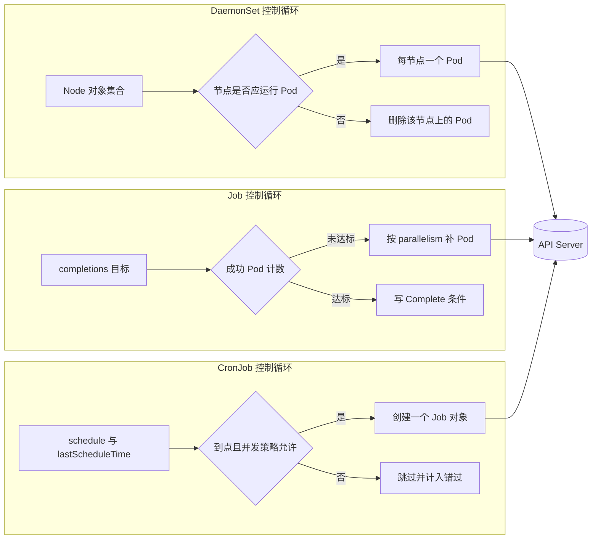
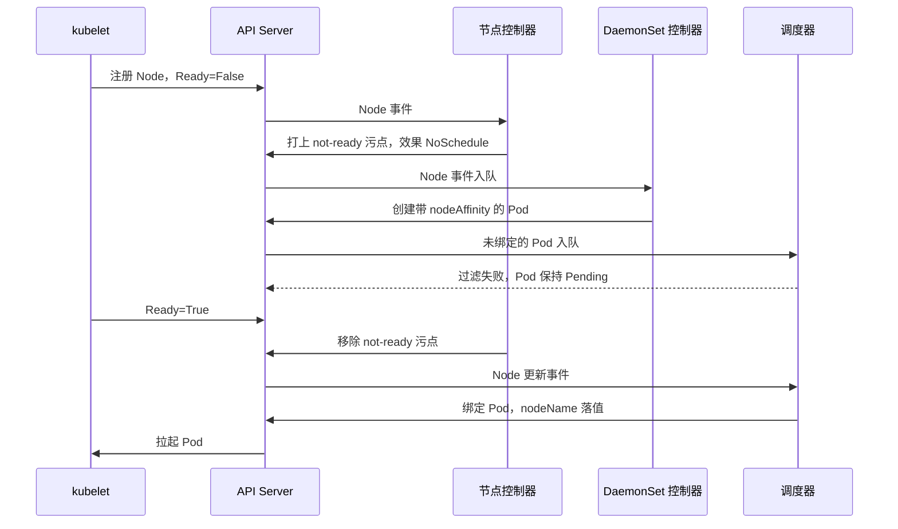
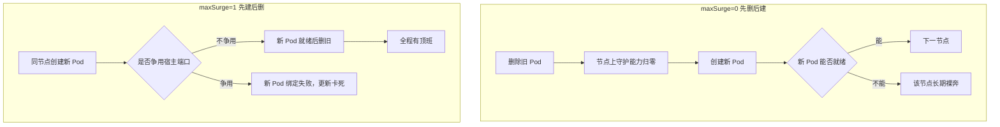
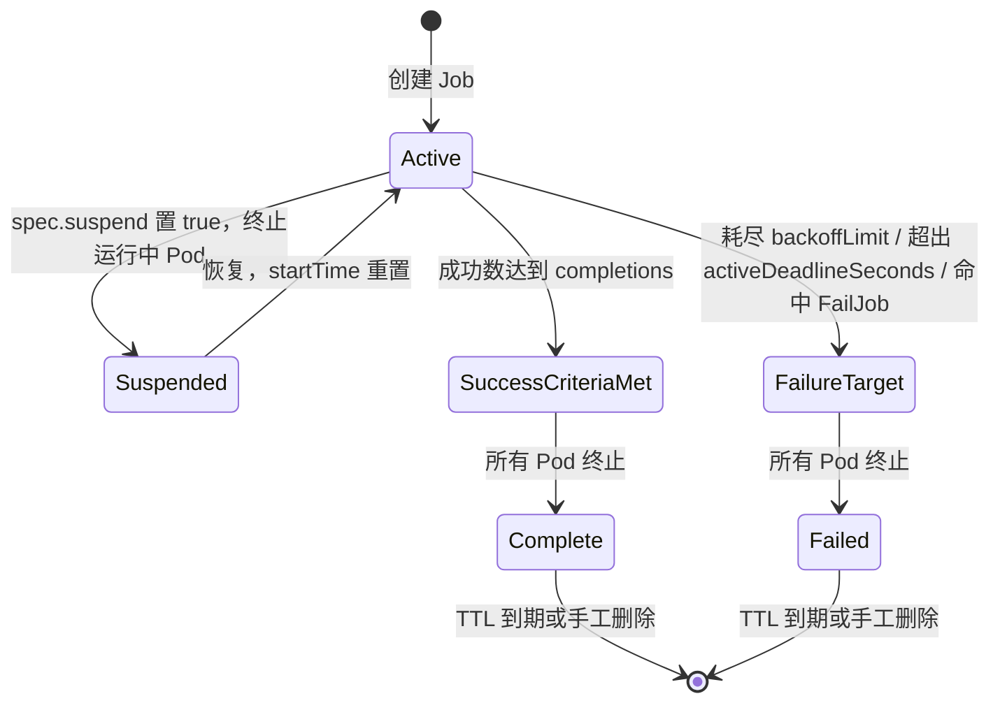
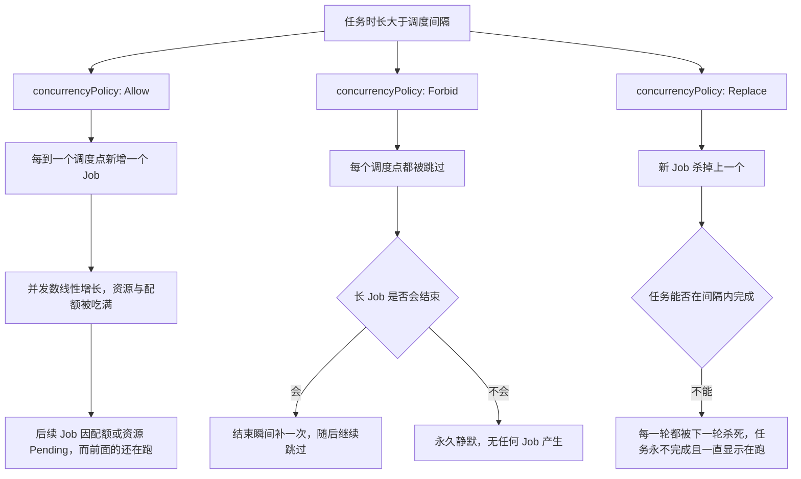

# 04 DaemonSet Job CronJob 控制器解析

**摘要：**

ReplicaSet 用 replicas 描述期望态，StatefulSet 用序号描述期望态，而 DaemonSet、Job、CronJob 的期望态锚在别处：DaemonSet 锚在节点集合上，节点增删即副本增删；Job 锚在"成功完成 N 个 Pod"这种一次性目标上，达标即终态；CronJob 干脆不描述任何持续存在的对象，只在每个 cron 时刻派生一个 Job。锚点不同，失败形态就完全不同——Deployment 部署失败的表现是副本不足但旧版本还在服务，DaemonSet 失败往往表现为某个节点上的基础设施静默缺失，Job 失败表现为一个终态标签加一堆没人看的 Failed Pod，CronJob 失败则表现为"该跑的任务根本没跑"而控制台一切正常。本文以一个 120 节点的生产集群为例，逐层拆解这三类控制器的期望态表达、调度与更新路径、失败判定与清理机制，并给出可直接照着查的判据：DaemonSet 的 nodeAffinity 与七条默认容忍如何与污点交互、`maxSurge` 为什么与 `hostNetwork` 互斥；Job 的 `backoffLimit` 与 `activeDeadlineSeconds` 谁先触发、`podFailurePolicy` 怎样把可重试与不可重试分开；CronJob 的 `concurrencyPolicy` 三种取值在"任务时长大于调度间隔"这一种情形下如何走向三种不同的病理。落点是取舍：这三类控制器都不是"配置对了就没事"的对象，它们的正确性依赖对账机制的边界，边界之外必须由外部告警、清理策略与人工流程补上。

---

## 第 1 章 三种不数副本的控制器

如果把集群里所有工作负载对象按"期望态从哪来"排一遍，会发现 `replicas` 只是其中一种表达方式。Deployment 与 StatefulSet 的契约是"始终有 N 个 Pod 存在"；DaemonSet 的契约是"每个符合条件的节点上必须有一个我的 Pod"；Job 的契约是"累计有 N 个 Pod 成功退出，此后我不再需要任何 Pod"；CronJob 的契约更轻，它只承诺"在每个 cron 时刻派生一个 Job 对象"，至于那些 Job 跑成什么样，它自己不管。四种契约的语汇不同，控制器用来对账的输入就不同，判定的边界也不同。

打个不太精确的比方：Deployment 签的是常驻人数合同，考勤表上每天要在岗 N 人；DaemonSet 签的是工位合同，每间有人办公的房间里必须有一个安全员；Job 签的是项目合同，搬完这批货就结项，中间换几拨人都没关系；CronJob 签的是排班表，每天八点派人过去，人去不去、干完没干完，是下一层的事。这个类比往下走会失真，因为真实系统里安全员自己就是"房间能办公"的前提，而这恰恰是 DaemonSet 事故的主要来源。

### 1.1 期望态的四种来源

| 控制器 | 期望态的表达 | 对账输入 | 达标后的对象状态 |
| :--- | :--- | :--- | :--- |
| Deployment | `spec.replicas` 个同质 Pod | Pod 集合与模板哈希 | Pod 持续运行，无终态 |
| StatefulSet | `spec.replicas` 个带序号的 Pod | Pod 序号、PVC 绑定 | Pod 持续运行，无终态 |
| DaemonSet | 节点集合 × 每节点一个 Pod | Node 对象、节点标签与污点 | Pod 持续运行，无终态 |
| Job | `spec.completions` 个成功退出 | Pod 相位成功计数 | Job 进入 Complete 或 Failed 终态 |
| CronJob | 每个 cron 时刻一个 Job | 上次调度时间、活跃 Job 列表 | 派生出的 Job 各自独立终态 |

这张表里最值得盯住的是最后一列。前两类控制器没有"结束"这个概念，它们的对账永远在进行，偏离一眼就能看出来——副本少了，`kubectl get deploy` 的 READY 列会立刻变成 2/3。DaemonSet 也没有终点，但它偏离的可见度远不如副本数那么直接；Job 与 CronJob 派生出的对象则有明确的终点，终点一过控制器就不再工作，于是"已经结束"和"从未开始"在监控面板上经常显示成同一个绿色。

### 1.2 锚点决定失败形态

DaemonSet 的失败不会让任何人立刻看到红色。假设 120 个节点里有 3 个节点的 CNI Pod 因为镜像拉取失败起不来，`kubectl get ds -n kube-system` 的 DESIRED 仍是 120，只是 READY 变成 117；这 3 个节点上的业务 Pod 因为拿不到网络而全部卡在 ContainerCreating，但业务方的视角是"我们的服务没起来"，不是"CNI 坏了"。**责任域的错位**让这类故障的平均定位时间远长于 Deployment 的同类故障。

Job 的失败形态相反：它非常显眼地报告自己失败了，但失败之后没有下文。`BackoffLimitExceeded` 之后 Job 就停在 Failed 上，控制器不再重试任何东西，也几乎没有人会主动去看——数据仓库里少了一天的分区，往往要等到下游报表出问题才被发现。CronJob 是三种里最安静的：如果 `concurrencyPolicy: Forbid` 加上一个永远跑不完的 Job，这个 CronJob 会从某天开始永久跳过所有调度，事件只出现在 CronJob 对象上，而 CronJob 对象本身没有"我正在跳过调度"的状态字段。

| 失败形态 | 立刻可见的信号 | 真正致命的后果 |
| :--- | :--- | :--- |
| DaemonSet Pod 起不来 | DS 的 READY 列小于 DESIRED | 单节点基础设施缺失，节点上其他 Pod 连带失效 |
| DaemonSet Pod 被驱逐 | DS 的 READY 短暂下降后回升 | 采集断点造成的监控盲区与告警漏报 |
| Job Pod 反复失败 | Job 的 COMPLETIONS 停在 0/N | 数据缺片，且缺片位置不可知 |
| Job 完成后残留 | 大量 Completed Pod 与 Job 对象 | API 对象膨胀、节点 Pod 配额被占 |
| CronJob 跳过调度 | 几乎没有信号 | 该跑的作业一次都没跑，且没人知道 |

### 1.3 贯穿全篇的集群

后面的讨论都落在一个中等规模的生产集群上：120 个节点分三个可用区，`kube-system` 里跑着三个 DaemonSet——网络插件（`hostNetwork: true`，每节点 96Mi 请求）、节点指标采集（每节点 30Mi）、日志采集（每节点 80Mi）；业务侧每天有两个批处理 Job（一个导出、一个回填），另有每 6 小时一次的数据库备份 CronJob。按 `requests` 粗算一层：120 ×（96 + 30 + 80）MiB 大约是 24GiB，这 24GiB 是任何业务 Pod 都拿不到的部分。这个数字本身不大，但它是全集群统一扣减的，意味着每个节点的 Allocatable 都被提前削掉了同样多——这就是 DaemonSet 与 Deployment 在容量视角上的根本差异：后者的副本数可以按负载伸缩，前者的副本数刻在节点数量上，节点扩容多少，预留就跟着涨多少。以下涉及具体数字处均为示例推算，用于展示量级与算法，不代表任何真实集群的实测值。

### 1.4 一个共同的机制前提

三类控制器都只能看见 API 对象，看不见"服务是否真的在干活"。DaemonSet 判断节点健康用的是 Node 对象的 Ready 条件，Job 判断任务成功用的是容器进程的退出码，CronJob 判断该不该调度用的是 cron 表达式与 `status.lastScheduleTime`。这些信号都是间接的，间接就意味着可以被绕过：节点 Ready 而 CNI 已经死了、退出码 0 而数据没写完、调度时间到了而任务逻辑在空转。第 8 章会把这条前提具体化成三种静默失效，这里先立住它——控制器的正确性只覆盖到它能观测的那一层，再往下的可信度必须靠探针、校验与对账作业自己建立，这也是后文所有"配置基线"的出发点。

下面的图把三类控制器各自的对账输入与输出摆在一起，可以看出它们共享同一个协调循环范式（这套范式的通用结构在 [[01 控制器模式与协调循环]] 里拆过），分歧点全在输入取自哪里。



---

## 第 2 章 DaemonSet：以节点为副本单位

### 2.1 控制器在数节点，不在数 Pod

DaemonSet 的协调循环每一轮做四件事：列出全部 Node，按模板里的 `nodeSelector`/`nodeAffinity`/`tolerations` 判断每个节点"应不应该有我的 Pod"，对应该有的节点检查是否已有 Pod，多退少补。判断节点是否应运行时，控制器只用了三类条件——节点标签与亲和性、污点与容忍、节点是否被标记为不可调度；它**不判断资源是否足够**，因为在 API 层面它看不到节点的实时余量。资源可行性是调度器的活，这一点在第 2.2 节会带来一个常见的错配。

用 `kubectl get ds -o wide` 看到的那几个状态字段，正好对应这四件事的结果：

| 字段 | 含义 | 异常时的读法 |
| :--- | :--- | :--- |
| `desiredNumberScheduled` | 按规则应运行 Pod 的节点数 | 与节点总数不符，多半是选择器或容忍写错了 |
| `currentNumberScheduled` | 已创建出 Pod 的节点数 | 小于 desired，说明 Pod 创建被卡住 |
| `numberMisscheduled` | 运行在不该运行节点上的 Pod 数 | 大于 0，通常是手工改过 Pod 或节点标签发生迁移 |
| `numberReady` | Ready 的 Pod 数 | 小于 current，问题在容器启动或探针 |
| `updatedNumberScheduled` | 已用新模板的 Pod 数 | 更新卡住时停在某个值不动 |
| `numberAvailable` | Ready 且维持 `minReadySeconds` 的 Pod 数 | 与 numberReady 的差值就是更新节奏的瓶颈 |
| `numberUnavailable` | 比期望少的可用 Pod 数 | 大于 0 时滚动更新不会继续推进 |

排查顺序就按这张表从上往下：先确认期望值对不对（选择器层），再看期望的 Pod 有没有被创建出来（控制器层），最后看创建出来的 Pod 有没有跑起来（kubelet 层）。把这三层混在一起看，是这类故障最常被拖长的地方。

### 2.2 调度权的移交

DaemonSet 的 Pod 在早期是不经过调度器的：控制器直接把目标节点写进 `spec.nodeName`，kubelet 看到字段有值就拉起来。这个做法带来三个后果：Pod 从来没有 Pending 阶段，可观测性上与其他 Pod 不一致；控制器不知道优先级，节点满了也不会触发抢占；所有调度约束（资源、端口、拓扑）都被绕过。Kubernetes 1.11 引入 `ScheduleDaemonSetPods` 特性（Alpha），1.12 转为 Beta 并默认开启，之后转 GA 并删掉了控制器里的调度代码，从此 DaemonSet Pod 与普通 Pod 走同一条路径，过滤与打分的完整流程见 [[11 Scheduler 调度算法：预选、优选与扩展机制]]。

现代实现的做法是：控制器在创建 Pod 时给它加上一条只认节点名的硬亲和性，然后交给默认调度器真正绑定。

```yaml
# 控制器为 DaemonSet Pod 注入的亲和性，节点名由控制器填写
spec:
  affinity:
    nodeAffinity:
      requiredDuringSchedulingIgnoredDuringExecution:
        nodeSelectorTerms:
          - matchFields:
              - key: metadata.name
                operator: In
                values: ["worker-17"]
```

这里有个容易被传错的细节，笔者核对过调度器侧的实现：调度器并不会识别"这是 DaemonSet"这类对象类型，它只看到一条针对 `metadata.name` 的 `matchFields` 约束；`NodeAffinity` 插件在 PreFilter 阶段会把这条约束解析成候选节点集合，直接把**候选集收敛成那一个节点**，其余过滤器照常执行。所以所谓"DaemonSet 的调度由 nodeAffinity 实现"，准确说法是"DaemonSet 的特殊性被编码进了一条普通 Pod 也能写的字段里"。常有人猜测 DaemonSet Pod 会参与 `DefaultPodTopologySpread` 之类的均衡打分，实际上候选节点只剩一个时，均衡类打分没有比较对象，这类担心不成立。

由此产生四个可以观测到的行为变化，值得在排查时心里有数：

- Pod 会以 Pending 状态存在，也就意味着有 `FailedScheduling` 事件可看，这是好事。
- Pod 会参与抢占：若给 DaemonSet 配了高优先级，节点资源不够时调度器会驱逐低优先级的业务 Pod 来腾位置。
- Pod 会受 `NodePorts`、`NodeResourcesFit`、`PodTopologySpread` 等全部过滤器的约束，节点上宿主机端口被业务 Pod 占了，DaemonSet Pod 一样起不来。
- 模板里的 `spec.template.spec.affinity.nodeAffinity` 只用于控制器筛选节点，创建出来的 Pod 上这条亲和性会被替换成上面那条按节点名的约束。若有人指望在 DaemonSet 模板里写 `preferredDuringScheduling` 来影响落点，那是无效的：DaemonSet 的落点由节点集合决定，不由调度器挑。

如果集群里配了多个调度器，`spec.template.spec.schedulerName` 也能改，但改错就是灾难：新调度器若不认识 `matchFields` 这条节点名约束，Pod 会永远 Pending，而 DaemonSet 的状态字段显示 Pod 已经创建，看起来一切正常。判据是 Pod 上有 nodeAffinity、`spec.nodeName` 为空、事件里出现调度器特有的拒绝信息——只看 DaemonSet 对象是发现不了的。

### 2.3 节点加入时的时序

新节点从注册到跑上 DaemonSet Pod 之间有一段真空期，这段真空期的长度决定了集群扩容的"可用延迟"。典型时序是这样的：kubelet 向 apiserver 注册 Node 对象，节点控制器发现 Ready 条件为 False 或 Unknown，给它打上 `node.kubernetes.io/not-ready:NoSchedule` 污点；DaemonSet 控制器因 Node 事件入队，创建出带节点名亲和性的 Pod；调度器过滤时发现这条 NoSchedule 污点没有被容忍，Pod 停在 Pending；等到 kubelet 报告 Ready=True、节点控制器摘掉污点，Pod 才开始绑定并启动容器。



这段时序解释了 DaemonSet 默认容忍里最容易被误读的一条。文档那张表上，`node.kubernetes.io/not-ready` 的容忍效果写的是 `NoExecute`，而且不带 `tolerationSeconds`——意思是"节点出问题时不驱逐我已经在跑的 Pod"，它**并不等于**"允许在 NotReady 的节点上启动新 Pod"。这两种语义经常被混为一谈，于是出现一类错误判断：有人看到节点 NotReady，以为 CNI Pod 一定能上去救场，实际上去不了，因为挡住它的是同名的 NoSchedule 污点，而默认容忍没覆盖这个效果。

反过来说，如果某个节点上的 CNI Pod 已经在跑，节点因为网络故障变 NotReady，这个 Pod 不会被节点控制器驱逐，容器还在，网络插件就还有机会把节点救回来——这正是官方文档所说的死锁避免机制。真正需要显式加 `not-ready:NoSchedule` 容忍的场景是"节点必须先有它才能变 Ready"的引导类组件，通常由发行版在 CNI 的 DaemonSet 里预先配好。

### 2.4 七条默认容忍与它们的边界

DaemonSet 控制器会为每个 Pod 补齐一组容忍，除非模板里已经存在同 key 同效果的条目。这七条的完整清单与作用如下：

| 容忍 key | 效果 | 作用 |
| :--- | :--- | :--- |
| `node.kubernetes.io/not-ready` | `NoExecute` | 节点 NotReady 时不驱逐已运行的 Pod |
| `node.kubernetes.io/unreachable` | `NoExecute` | 节点失联时不驱逐已运行的 Pod |
| `node.kubernetes.io/disk-pressure` | `NoSchedule` | 磁盘压力下仍允许调度新 Pod |
| `node.kubernetes.io/memory-pressure` | `NoSchedule` | 内存压力下仍允许调度新 Pod |
| `node.kubernetes.io/pid-pressure` | `NoSchedule` | PID 压力下仍允许调度新 Pod |
| `node.kubernetes.io/unschedulable` | `NoSchedule` | 节点被 cordon 后仍允许调度 |
| `node.kubernetes.io/network-unavailable` | `NoSchedule` | 仅当 Pod 使用 hostNetwork 时添加 |

这七条覆盖了三类压力类污点、两类故障类污点、一种运维态（cordoning）与一种网络态。它们的共同设计意图是"节点级基础设施要比业务 Pod 更耐命"：业务 Pod 在内存压力下被驱逐是为了保护节点，而监控与日志 Pod 正是记录这次驱逐的那双眼睛，让它先跑掉等于自毁证据。网络不可用那条则专为 hostNetwork 的 CNI Pod 准备——节点网络还没配好时，这类 Pod 往往正是配网络的那个。

边界在于这七条都是**控制器补的默认值**，模板里显式写了同 key 的容忍就以模板为准。一个常见的错误是复制粘贴了某个老版本的清单，把 `not-ready` 写成带 `tolerationSeconds: 300` 的条目，意图是"忍耐五分钟"，实际效果是把无限容忍降级成五分钟——五分钟后节点控制器驱逐这个 Pod，CNI 或日志采集随之消失，节点从"有问题但还能自救"变成"彻底失联"。这类改动在 CR 评审里极难看出来，因为它看起来只是加了一个参数。

### 2.5 hostNetwork 的两个连带问题

集群级 DaemonSet 有相当比例要跑在宿主机网络上：[[02 CNI体系详解——插件规范、调用链与主流实现对比|CNI 插件]]要改宿主机的路由与 iptables，日志采集要读宿主机路径并对接本地 socket，节点指标的某些采集项也依赖宿主机命名空间。一旦 `hostNetwork: true`，两个普通 Pod 不会遇到的约束就出现了。

第一个是**端口记账的错位**。调度器的 `NodePorts` 过滤器只看容器端口里的 `hostPort` 字段，宿主机端口冲突会让 Pod 直接 Pending，事件里写的是 `node(s) didn't have free ports for the requested pod ports`，这类问题好查。而 `hostNetwork: true` 的容器根本不用 `hostPort`，它直接占用宿主机的网络命名空间，调度层没有这个占用信息；两个 hostNetwork 的 DaemonSet 都要绑 9100 端口时，调度器会愉快地把两个 Pod 都放上去，冲突在容器启动时才以 `bind: address already in use` 暴露，表现为 CrashLoopBackOff 或 `CreateContainerError`，`kubectl describe pod` 里只能看到退出码与容器日志。判据很直接：Pod 已 Running 过的次数大于 0、容器日志首行是绑定失败、节点上同时存在另一个 hostNetwork 且端口相同的 Pod。

第二个是 DNS 策略。`hostNetwork: true` 的 Pod 默认拿不到集群 DNS 的解析能力，kubelet 会把它当成宿主机进程处理，除非显式写 `dnsPolicy: ClusterFirstWithHostNet`。这一条对需要访问 Service 名称的采集组件是硬伤：设了 `ClusterFirst` 但没设 `ClusterFirstWithHostNet`，`dnsPolicy` 会被静默降级成 `Default`，容器里 `nslookup kubernetes.default` 直接失败，而组件自身通常只是打一行连不上 apiserver 的日志然后继续跑，从 Ready 状态看不出任何异常。

```yaml
apiVersion: apps/v1
kind: DaemonSet
metadata:
  name: node-net-agent
  namespace: kube-system
spec:
  selector:
    matchLabels:
      app: node-net-agent
  template:
    metadata:
      labels:
        app: node-net-agent
    spec:
      hostNetwork: true          # 需要改宿主机路由，必须共享网络命名空间
      dnsPolicy: ClusterFirstWithHostNet   # 不写这行就会被降级成 Default
      priorityClassName: system-node-critical  # 资源紧张时优先保住它
      tolerations:
        - key: node-role.kubernetes.io/control-plane
          effect: NoSchedule
      containers:
        - name: agent
          image: registry.example.com/net-agent:1.8.3   # 固定 tag，禁用 latest
          resources:
            requests:
              cpu: 50m
              memory: 96Mi
            limits:
              memory: 256Mi
```

`priorityClassName` 值得单独提一句。DaemonSet Pod 是否能在资源紧张的节点上站住，取决于它的优先级是否高于本地已有 Pod：调度阶段高优先级可以触发抢占，运行阶段 kubelet 的节点压力驱逐也按优先级从低到高挑受害者。集群级的 DaemonSet 一般应该挂 `system-node-critical`，业务 Pod 抢占它等于自断监控与网络，这个决定应该在部署时就做掉，而不是等事故发生后再补。

---

## 第 3 章 DaemonSet 的更新、回滚与自噬

### 3.1 更新单位是节点，不是 Pod

DaemonSet 的 `RollingUpdate` 与 Deployment 的滚动更新名字相同，语义差得很远。Deployment 的 `maxUnavailable` 说的是"允许有百分之几的副本不可用"，因为同质副本之间可以互相顶班，少一个还有九十九个在服务；DaemonSet 的 `maxUnavailable` 说的是"允许有多少个节点同时处于旧 Pod 已删、新 Pod 未就绪的窗口"，而这个窗口里**没有任何替代者**——那个节点上的日志采集、指标上报、网络转发就是真空中。

| 维度 | Deployment 的 maxUnavailable | DaemonSet 的 maxUnavailable |
| :--- | :--- | :--- |
| 计数对象 | 副本 | 节点 |
| 默认值 | 25% | 1 |
| 百分比基数 | `spec.replicas` | `status.desiredNumberScheduled` |
| 缺一个的后果 | 剩余副本分担流量 | 该节点的守护能力彻底缺失 |
| 有无顶班机制 | 有，剩余副本即可 | 只有 `maxSurge` |

`maxUnavailable` 与 `maxSurge` 有一条硬约束：两者不能同时为 0，因为那意味着既不允许删旧也不允许起新，更新永远无法推进。`maxSurge` 的默认值是 0，也就是默认采用"先删旧、再起新"的逐节点替换；调大它才变成"先起新、等新 Pod Ready 且维持 `minReadySeconds` 之后再删旧"。

还有一类状态会让可用性判断与更新进程同时失真：节点处于 NotReady，而它的 Pod 对象还在。`numberUnavailable` 是按期望可用数与实际可用数之差算的，NotReady 节点上的 Pod 不再计入可用，缺口就长期挂着；与此同时控制器不会为这个节点补建 Pod，因为它认为该节点已经有 Pod 了。结果是 `numberUnavailable` 恒大于 0，滚动更新按规则不再推进，连带其他节点的更新一起停住。因此这里的判断标准不是"Pod 在不在"，而是"Pod 是否可用"；处置只能人工介入，确认节点确实失联后把它从集群里摘掉（删 Node 对象或驱逐），让 DaemonSet 重新计算节点集合。

### 3.2 maxSurge 与 hostNetwork 的互斥

`maxSurge` 是 DaemonSet 更新里唯一的顶班手段，它的实现方式是允许同一个节点上短暂存在两个属于该 DaemonSet 的 Pod。这个**同节点两 Pod**的前提，直接把 hostNetwork 类 DaemonSet 挡在门外：两个 Pod 共享宿主机网络命名空间，若它们要绑同一个端口（CNI 的健康检查端口、采集组件的 metrics 端口），新 Pod 一定启不来，`maxSurge` 就变成"卡住更新"的开关。实践中不少集群把 CNI DaemonSet 的 `maxSurge` 调成 1，然后困惑为什么更新停在第一个节点不动，原因就在这里。



两条路各有各的代价。前者的风险是"新版本有 bug 时，节点在无人守护的状态下等着你去修"；后者的风险是"端口资源决定了它根本用不了"。判断标准很朴素：看 DaemonSet 的容器是否需要独占宿主机端口或宿主机路径。独占端口的，老老实实用 `maxUnavailable: 1` 逐节点替换，把风险限制在单节点；不独占端口的（纯粹的指标采集、日志 sidecar 转发的变体），用 `maxSurge: 1` 换取更新期间的服务连续性。

### 3.3 更新卡住的三类原因

`kubectl rollout status ds/xxx` 长时间不返回是最常见的求助信号。官方文档列了三类原因，笔者的经验是它们有清晰的排查顺序。

第一类是资源不足导致新 Pod 调不上去。`maxUnavailable: 1` 意味着旧 Pod 已经删了，新 Pod 要重新在同一个节点上抢资源，而这个节点上业务的 `requests` 加起来可能刚好把余量吃满——旧 Pod 删掉释放出的那点资源不够新 Pod 用（新旧版本 requests 不同时尤其如此）。判据是 `kubectl get pods -o wide -l app=xxx` 与 `kubectl get nodes` 对差集，找出没有新 Pod 的节点，再看那个节点上新 Pod 的 `FailedScheduling` 事件。

第二类是新版本自身起不来，镜像不存在、启动命令写错、探针配置不兼容。这种情况下更新会停在第一个节点，`updatedNumberScheduled` 停在 1 左右，Pod 显示 CrashLoopBackOff 或 ImagePullBackOff。处置不是继续等，而是把模板改回去——文档明确说新的 rollout 不会被之前失败的 rollout 阻塞，改回旧镜像即可。

第三类没那么直观：`minReadySeconds` 与集群时钟偏移。`numberAvailable` 的判断依赖 Pod 的 Ready 时间戳与控制器所在主机的时间比较，控制面与节点时钟差得多，DaemonSet 会认为 Pod"还没维持足够久"，迟迟不删旧 Pod，表现为更新极慢但不报错。这类问题在 NTP 漂移的虚拟化环境里偶有出现，判据是 `numberReady` 早已等于 `updatedNumberScheduled`，而 `numberAvailable` 迟迟不跟上来。

### 3.4 回滚与它的两个约束

DaemonSet 的回滚由控制器为每个模板版本保存的 ControllerRevision 支撑，`kubectl rollout history ds/x` 能看到版本列表，`kubectl rollout undo ds/x` 回到上一版。它有两条约束容易在事故里踩到。

第一条，回滚本身也是一次滚动更新，走同一套 `maxUnavailable`/`maxSurge` 规则，也受同样的卡死条件影响。把一个因为端口争用而卡住的更新回滚回去，回滚同样会卡在同一个位置——它只换目标模板，不改变"新旧 Pod 要在同一节点上并存"这个现实。正确顺序是先把 `maxSurge` 调回 0 再回滚，让替换退化成"先删后建"。

第二条，回滚只回滚模板，不回滚已经写下的副作用。CNI 的版本更新往往伴随宿主机上二进制、CNI 配置目录与 iptables 规则的变更，旧 Pod 重新拉起之后，这些落在宿主机上的东西仍停在出问题的那个版本。DaemonSet 的资源模型里没有"卸载脚本"这一环，回滚的完整性取决于容器启动时是否做了幂等的修复动作，这一点应当在选型阶段确认，而不是等回滚失败时才发现。

### 3.5 OnDelete 的用途

`OnDelete` 策略在模板更新后不自动删任何旧 Pod，只在你手工删除某个节点上的 Pod 时用新模板重建。它看起来原始，但在两处有用。一处是需要精确控制爆炸半径的灰度：先改模板并设 `OnDelete`，然后挑一个非核心业务的节点删 Pod 验证新版本，确认无问题再逐批删。另一处是 DaemonSet 自身出问题的自保——把策略切成 `OnDelete` 相当于按下了更新的暂停键，避免一个错误的模板在几分钟内传染到 120 个节点。

代价是它需要人工驱动，且漏掉节点的风险很高。用了一段时间后一定要用 `updatedNumberScheduled` 与 `desiredNumberScheduled` 的差值对账，差值大于 0 就说明还有节点跑着旧版本，而这个差值不会自己消失。

### 3.6 自噬：断的是别人的前提

DaemonSet 与前三类工作负载最根本的区别在于，它提供的往往是"其他 Pod 能够运行"的前提。CNI Pod 挂了，该节点上新 Pod 全部卡在 ContainerCreating；日志采集挂了，该节点的 stdout 从此没人收集；监控采集挂了，该节点在面板上变成一片空白而不是红色。这种"守护者自己失能，导致被守护者连带失能"的结构，笔者习惯叫它**自噬**。

默认配置下不会发生自噬，靠的是第 2.4 节那两条无限期 `NoExecute` 容忍。会打破它的有四条路径：

- 模板里给 `not-ready`/`unreachable` 显式加了 `tolerationSeconds`，把无限容忍改成了限时容忍，超时后节点控制器驱逐 Pod。
- 平台自建了业务污点（譬如"仅允许特定工作负载"的准入污点），而 DaemonSet 模板没有对应容忍，节点被标记后 DS Pod 被驱逐且无法重建。
- 优先级设置过低，节点资源紧张时调度器或 kubelet 优先牺牲它，而 `system-node-critical` 类业务 Pod 反而活得好好的。
- 人为操作失误：批量 `kubectl drain` 时用了 `--ignore-daemonsets --delete-emptydir-data --force`，DaemonSet Pod 被删掉后节点被 cordon 长期不 uncordon，Pod 因为 `unschedulable` 容忍能回来，但如果节点同时被打了别的污点就回不来。

自噬的现场有几组稳定的判据。节点上的业务 Pod 大面积停在 ContainerCreating，`kubectl describe pod` 显示 `failed to set up sandbox: network plugin is not ready`；节点本身 Ready=True，因为 kubelet 的 Ready 判定不包含 CNI 数据面的可用性；DaemonSet 在该节点上的 Pod 不存在或处于 CrashLoopBackOff；`kubectl get events -n kube-system --field-selector involvedObject.name=<ds-pod>` 能看到 `Killing`/`Evicted` 记录。处置顺序是先恢复 CNI Pod（必要时把节点 cordon 掉，避免新 Pod 继续往里调），再排查 CNI 为什么起不来，最后回看是谁驱逐了它——这一步经常被跳过，于是同样的自噬在几天后重演。

有一个细节值得写进值班手册：自噬期间的监控会同时失真。节点指标采集不上来，告警系统看不到这个节点的异常，值班同学只能从业务侧的 5xx 上升曲线倒推。这也是为什么集群级 DaemonSet 的可用性监控不能只看它自己的 Ready 数，还要有一条"每个节点都有该 DaemonSet 的 Ready Pod"的断言式检查——用 Prometheus 表达就是拿节点总数与 `kube_daemonset_status_number_ready` 做差，差值大于 0 持续若干分钟即告警。

---

## 第 4 章 Job：把"完成"变成可判定条件

### 4.1 三种完成语义

Job 的判定规则只有一句话：成功退出的 Pod 数达到 `completions`，Job 就算完成。围绕这句话，控制器把任务分成了三种形态，靠 `completions` 与 `parallelism` 两个字段的取值组合来区分。

| 形态 | `completions` | `parallelism` | 完成判定 | 适用任务 |
| :--- | :--- | :--- | :--- | :--- |
| 单实例 | 1（或不设） | 1（或不设） | 那一个 Pod 成功 | 一次性初始化、迁移 |
| 固定完成数 | N | M（默认 1） | 累计 N 个 Pod 成功 | 可分片、分片数已知 |
| 工作队列 | 不设（null） | M | 任一 Pod 成功，且所有 Pod 终止 | 分片数未知、由队列分发 |

两个字段都不设时都按 1 处理，这是最常见的单实例形态。工作队列形态的判定规则值得单独记住：只要有一个 Pod 以退出码 0 结束，控制器就不再创建新 Pod，等所有仍在跑的 Pod 终止后把 Job 标成 Complete——这个设计假设是"某个 worker 退出 0 意味着队列已空"，而这个假设在真实任务里经常不成立。

固定完成数形态下，`parallelism` 可以随时改，改大改小都不影响 `completions`；`parallelism: 0` 的效果等同于暂停，Job 不再创建新 Pod，但已运行的 Pod 不会被终止。这个行为和 `spec.suspend` 不同：后者会把所有未完成的 Pod 终止掉（发 SIGTERM，走正常宽限期），恢复时新建 Pod 并从当前时间重置 `startTime`。

### 4.2 Indexed 与 NonIndexed

`completionMode` 在 1.24 转入 GA，它决定了 Pod 与"第几片"之间的对应关系。`NonIndexed` 是默认值，所有 Pod 完全同质，谁先成功都算数；`Indexed` 要求 `completions` 非空，每个 Pod 拿到一个从 0 到 `completions - 1` 的索引，且"每个索引各有一个成功 Pod"才算完成。

索引的传递有四条通道，各有适用边界：Pod 注解 `batch.kubernetes.io/job-completion-index`；Pod 标签同名（需要 1.28 之后的 `PodIndexLabel` 特性，默认开启）；Pod 主机名 `$(job-name)-$(index)`（配合 headless Service 可以做索引间的 DNS 互相发现）；容器环境变量 `JOB_COMPLETION_INDEX`。生产上最常见的是环境变量，因为应用代码不用改；做 MPI、参数服务器这类需要索引间通信的任务时，主机名这条更重要。

`Indexed` 有一个不显眼但很重要的容忍度：同一个索引可能出现多个 Pod（节点故障后重建、kubelet 重启、驱逐都可能触发），只有第一个成功的 Pod 计入完成数，其余同索引的 Pod 会被控制器删掉。这意味着索引级任务同样要写成幂等的——同一个分片被算两遍的事故，在这类 Job 上真实发生过。

`NonIndexed` 的陷阱在语义层：它把"第几个 Pod 成功"和"第几个分片成功"完全解耦。假设一个导出任务把 100 个分片写成 `completions: 100, parallelism: 10`，某个 Pod 因为分片里没有数据而直接退出 0，这个 0 同样计入完成数，于是 100 个成功 Pod 可能只覆盖了 97 个分片——Job 显示 Complete，数据少了三片，而且没有任何事件提示。这类问题的正确解法不是调参，而是换语义：要么用 `Indexed` 让索引与分片一一对应，要么把"没有数据"处理成非零退出码并配合 `podFailurePolicy` 的 `Ignore` 动作。

### 4.3 完成判定为什么会错

把所有"Job 显示成功但结果不对"的案例归因，大致落在三处。

第一处是退出码语义与控制器语义不一致。控制器只认退出码 0 与 Pod 相位 Failed（相位定义见 [[02 Pod 生命周期深度解析]]），它不知道你的应用把"跳过"、"部分成功"、"降级成功"都写成了 0。

第二处是工作队列形态的提前收工。队列为空时 worker 退出 0 是标准写法，但如果队列服务在某一刻短暂不可用，worker 拿到的是"读不到任务"而不是"没有任务"，退出 0 之后整个 Job 就完成了；剩余分片既没有 Pod 在处理，也不会被重新调度。防御手段是让 worker 区分"队列空"与"队列不可达"，后者必须非零退出，同时给 Job 设 `activeDeadlineSeconds` 兜底。

第三处是成功判定与清理的时序被误读。控制器的顺序是先写 `SuccessCriteriaMet` 条件触发 Pod 终止，等所有 Pod 真正终止后再写 `Complete` 条件；这两步之间有间隔，`terminationGracePeriodSeconds` 越长间隔越大。于是存在一个窗口：Job 还没显示 Complete，但成功已经确定，此时若上游依据 `status.succeeded` 判断"可以开始下游任务"，会判断成还没完成；若依据条件里的 `SuccessCriteriaMet`，则能提前推进。反过来，如果下游逻辑在 Job 刚 Complete 时立刻读取输出，也可能撞上 Pod 尚未完全退出的时刻。



这张状态机里有两处需要说清。`FailureTarget` 与 `Failed` 之间的间隔就是"Job 已经注定失败，但 Pod 还在"的窗口，它由 `terminationGracePeriodSeconds` 决定；判断一个 Job 是否已经失败，看 `FailureTarget` 比看 `Failed` 早一步，这在编排失败重试的上游控制器里很重要。`Suspended` 回到 `Active` 会重置 `startTime`，也就重置了 `activeDeadlineSeconds` 的计时——这个细节在第 5.2 节还会用到。

---

## 第 5 章 Job 的失败策略

### 5.1 backoffLimit 的两套计数

`backoffLimit` 默认 6，它数的是"重试次数"，但**计数的口径有两条**，任一条触顶 Job 就判失败：一是相位为 Failed 的 Pod 数量；二是在 `restartPolicy: OnFailure` 下，所有处于 Pending 或 Running 状态的 Pod 里容器重启的累计次数。第二条是很多人不知道的：同一个 Pod 里的容器原地重启累计 6 次，足以让 Job 直接判失败，此时集群里连一个 Failed Pod 都没有。

失败 Pod 的重建带指数退避，从 10 秒开始翻倍（10s、20s、40s……），单次间隔封顶 10 分钟。这个封顶封的是单次等待，不是总时长：`backoffLimit: 6` 意味着六次重试分别等 10、20、40、80、160、320 秒，累计已超过十分钟，再加上每次失败 Pod 自身的运行时长与 `terminationGracePeriodSeconds`。若任务本身要求"5 分钟内必须给出结论"，光靠 `backoffLimit` 是保证不了的，必须配合 `activeDeadlineSeconds`。

`backoffLimit` 设为 0 是合法且有意义的：不允许任何重试，第一次失败即判 Job 失败。这个配置适合"失败一定意味着配置错误"的场景，配合 `podFailurePolicy` 的 `FailJob` 动作可以把"快速失败"做得更精细。

### 5.2 activeDeadlineSeconds 的优先级

文档明确写了 `activeDeadlineSeconds` 优先于 `backoffLimit`：Job 的运行时长一旦超过这个上限，无论重试次数是否用尽，Job 立即被判失败，所有运行中的 Pod 被终止。也就是说前者管的是"总共允许多久"，后者管的是"允许试几次"，两者是**两道独立闸门**，谁先到算谁。

这里有一个常见误设在 Pod 层的错误。`activeDeadlineSeconds` 在 Job 的 spec 与 Pod 的 spec 上都存在，语义完全不同：设在 Job 上是整个 Job 的生命周期上限；设在 Pod 模板上是那一个 Pod 的运行上限。后者超时后 Pod 被终止、Job 把它算作一次失败并创建新 Pod，于是"给 Job 设了超时"的意图落空，变成"每个 Pod 最多跑多久"——如果任务本身是长任务，这个值设小了会陷入"每次都不够用、每次都被杀"的死循环。判据是 `kubectl get job -o yaml` 里 `spec.activeDeadlineSeconds` 为空而 `spec.template.spec.activeDeadlineSeconds` 有值。

`suspend` 与 `activeDeadlineSeconds` 的交互也值得留意。Job 被挂起再恢复时 `startTime` 会被重置，超时计时随之重启。这意味着用 `suspend` 做"夜间暂停、白天继续"的长任务，实际永远碰不到超时上限；反过来，如果想用 `activeDeadlineSeconds` 限制总时长，就不能靠 `suspend` 来挪动执行窗口。

### 5.3 podFailurePolicy：把可重试与不可重试分开

默认的失败处理只有一个维度：这颗 Pod 失败了，计数加一。但失败的原因差别很大——节点优雅关机导致的驱逐是可重试的，配置写错导致的启动失败是不可重试的，用同一个计数器处理两者，要么浪费重试预算，要么在配置错误时傻等十分钟。`podFailurePolicy` 就是为这件事设计的，它 1.25 以 Alpha 引入、1.26 进入 Beta、1.31 转为 GA，门控名与具体行为以对应版本文档为准。

规则是一个有序列表，每条规则用容器退出码（`onExitCodes`）或 Pod 条件（`onPodConditions`）匹配，命中第一条即生效、后续规则忽略。动作有四个：`FailJob` 立即把整个 Job 判失败并终止所有运行中的 Pod；`Ignore` 不计入 `backoffLimit`，直接重建 Pod；`Count` 走默认计数逻辑；`FailIndex` 只在按索引退避的场景里用，把某个索引直接判失败。

```yaml
apiVersion: batch/v1
kind: Job
metadata:
  name: nightly-export
spec:
  backoffLimit: 6
  activeDeadlineSeconds: 3600       # 硬上限，避免 backoffLimit 慢慢耗
  completions: 12
  parallelism: 4
  completionMode: Indexed
  podFailurePolicy:
    rules:
      # 配置类错误：重试没有意义，直接失败，让人介入
      - action: FailJob
        onExitCodes:
          containerName: exporter
          operator: In
          values: [2, 78]
      # 抢占或驱逐：不计入重试预算，重建即可
      - action: Ignore
        onPodConditions:
          - type: DisruptionTarget
      # 其余失败走默认计数
      - action: Count
        onExitCodes:
          operator: NotIn
          values: [0]
  template:
    spec:
      restartPolicy: Never            # 使用 podFailurePolicy 时必须为 Never
      containers:
        - name: exporter
          image: registry.example.com/exporter:2.4.1
          command: ["/bin/exporter", "--shard=$(JOB_COMPLETION_INDEX)"]
```

用这个策略有三条硬性前提。第一，Pod 模板的 `restartPolicy` 必须是 `Never`，因为 `OnFailure` 下容器在 Pod 内原地重启，没有"Pod 失败"这个事件可供规则匹配。第二，规则只匹配相位为 `Failed` 的 Pod；带删除时间戳但还没进入终态的 Pod 被视为"正在终止"，此时会保留 `batch.kubernetes.io/job-tracking` 终结器直到进入终态。第三，一旦设了 `podFailurePolicy`，`podReplacementPolicy` 的默认值会变成 `Failed`，也就是等旧 Pod 真正终态之后才创建替补，同一时刻运行中的 Pod 数不会超过 `parallelism`；若没设策略，默认是 `TerminatingOrFailed`，Pod 一进入终止就立刻补一个，运行数可能短暂超过 `parallelism`。这条差异会直接影响"同时占多少 GPU/多少内存配额"，在大规模并行任务里必须算清楚。

`Ignore` 与 `DisruptionTarget` 的组合是这套机制最有价值的部分。抢占、API 发起的驱逐、基于污点的驱逐都会给 Pod 打上 `DisruptionTarget` 条件，这类失败与代码质量无关，重试通常能过；把它们排除在重试预算外，才能让小规格、可被抢占的实例类型真正跑得起长任务。

### 5.4 restartPolicy 的选择与"Pod 无限重启"

`Never` 与 `OnFailure` 的选择经常被当成风格问题，实际它决定了故障的可见性。

`Never` 下 Pod 失败就死，控制器创建新 Pod，失败现场被保留下来（Pod 对象与容器日志都在），`backoffLimit` 耗尽后 Job 判失败，每个失败 Pod 的原因可以逐个 `kubectl describe`。代价是 Pod 数量等于尝试次数，`parallelism` 大、重试多时 API 对象增长很快。

`OnFailure` 下容器在同一个 Pod 内重启，Pod 数量不增长，但失败现场会被覆盖：`kubectl logs` 默认只给最近一次，要看历史得加 `--previous`，且只保留一份。更麻烦的是它把"重试"藏进了 Pod 内部——Job 的状态一直是 Active，`kubectl get job` 看起来"正在跑"，只有进入 Pod 看 `RESTARTS` 列才会发现已经重启了十几次。等到 Job 判失败时，控制器会把这个 Pod 终止掉，此刻现场只剩最后一次的值。官方文档因此建议调试期用 `Never`，或者把日志外送到日志系统。

"Job 一直不完成"还有两个与 `restartPolicy` 无关的原因，判据各不相同。

一是 Pod 卡在 Pending 无法调度（资源不足、污点不容忍、亲和性不满足）。Pending 不是失败，`backoffLimit` 根本不会被消耗，`activeDeadlineSeconds` 也不会因为"没跑起来"而特别处理——它只按时间算。没有这个时间上限兜底，Job 会无限期 Active。判据是 `kubectl get pods` 里 Pod 状态 Pending、事件 `FailedScheduling`。

二是镜像拉取失败。`ImagePullBackOff` 的 Pod 相位仍是 Pending，容器在 `Waiting`，同样不计入失败计数。一个镜像 tag 拼错的 Job，在没有任何超时配置的集群里可以挂上几个星期，期间只有 `kubectl describe pod` 里的 `ErrImagePull` 事件——而这类 Job 通常没人会去看，因为它"还没失败"。

### 5.5 新字段的适用边界

除了上述几个主字段，Job 上还有一批更细的旋钮，它们在近几个版本里陆续引入，是否可用取决于集群版本与特性门控，使用前应以对应版本文档为准。

`backoffLimitPerIndex` 允许每个索引独立计算失败次数，配合 `maxFailedIndexes` 限定整体可容忍的失败索引数，适用于"个别分片脏数据、整体不该全部重跑"的场景，同时还带来 `FailIndex` 这个动作。`successPolicy` 允许 Indexed Job 在部分索引成功时就宣告成功，适用于蒙特卡洛模拟、Leader-Worker 这类"只要关键角色成功即可"的任务。`podReplacementPolicy` 控制替补 Pod 的创建时机，前文已述。`spec.suspend` 在 1.24 转入 GA，是做队列调度时最常被外部控制器拨动的开关。

这些字段的共同点是把"完成"与"失败"从两个布尔量细化成了多条件的判定，代价是配置空间急剧膨胀。笔者的建议是只在遇到具体问题时逐项加，不要一上来把能设的都设一遍——一个设了六种失败规则的 Job 出了问题时，判定链路本身就是排查负担。

---

## 第 6 章 Job 的清理：TTL 与"Pod 留不留"

### 6.1 完成之后，Pod 去哪了

默认情况下，**什么都没发生**。Job 进入 Complete 后，它创建的 Pod 仍然留在 API 里，状态是 Succeeded，日志还在，节点上仍占着一个 Pod 名额。失败路径同样如此：Job 判 Failed 之后，那些 Failed 相位的 Pod 会被保留下来作为现场，一个都不会自动删除。没有 `ttlSecondsAfterFinished` 的 Job 会一直留着，直到有人手工删除或者外部清理工具介入。

这件事的代价是复利式的。以一个每分钟提交一次的导出作业为例，由外部脚本直接创建 Job、不设 TTL，一天下来就是 1440 个 Job 与 1440 个 Pod，一周接近两万个对象。这些对象会被 kube-state-metrics 逐个采集，被 `kubectl get pods -A` 逐个列出，被每一条按 namespace 扫全量的脚本逐个读取；apiserver 的 watch 事件、etcd 的存储与快照体积、备份恢复的耗时都跟着涨。数量到了十万级，`kubectl get pods -A` 这种日常操作本身就会变成事故源。

节点侧的账更难算清。终止态的 Pod 在对象被删除前仍计入节点的 Pod 数上限，一个跑了半年批处理、从不清理的节点池，很可能满了但负载并不高，新 Pod 因此调不上去，报的是 `Too many pods`。这类问题的定位成本很高，因为从 CPU、内存指标上完全看不出异常。

### 6.2 ttlSecondsAfterFinished 的语义

TTL 机制在 1.23 转入 GA，由 kube-controller-manager 里的 TTL 控制器实现。字段 `ttlSecondsAfterFinished` 设在 Job 上，计时起点是 Job 进入终态（Complete 或 Failed）的时刻，到期后控制器删除 Job，并级联删除它名下的 Pod。

| 取值 | 行为 |
| :--- | :--- |
| 不设 | 永不自动清理，只能手工删 |
| `0` | 完成即刻进入可删除状态，通常几十秒内消失 |
| 正整数 N | 完成 N 秒后被删除，期间 Pod 与日志可查 |

几个细节值得写进规范。它同时适用于 Complete 与 Failed 两种终态，所以"失败的 Job 要留久一点以便排查"可以靠设大值实现，而不是靠不设。删除是级联的，Pod 会跟着走，这正是它优于手工 `kubectl delete job` 的地方——直接删 Job 对象时，对于不受上层控制器管理的 Job，默认策略可能只删 Job 而把 Pod 留下，官方文档专门提醒过这一点，并建议给 Job 设 TTL。TTL 控制器属于可选控制器，若集群用 `--controllers` 白名单启动 kube-controller-manager 时漏掉了它，字段设了但没有任何效果，也不会报错，这类静默失效要在集群初始化清单里核对。

TTL 与"保留多久"之间要做一次取舍。保留时间太短，出事时对象已被删，只剩日志系统里的碎片；太长，又回到对象堆积。经验值是把 TTL 设成"覆盖一个完整的排查周期"：日常批处理 10 到 30 分钟足够，涉及资金或对账的任务按天，而 CronJob 派生的 Job 应当优先用 CronJob 的 `historyLimit` 控制条数、用 TTL 控制时长，两者配合使用。

### 6.3 三条清理路径的分工

| 路径 | 作用对象 | 触发方式 | 典型误用 |
| :--- | :--- | :--- | :--- |
| Job 的 `ttlSecondsAfterFinished` | 单个 Job 及其 Pod | 基于终态时间，自动 | 设得过短，事故现场被删 |
| CronJob 的 `successfulJobsHistoryLimit` / `failedJobsHistoryLimit` | 该 CronJob 派生的 Job | 基于条数，自动 | 设成 0 后连 Job 都不留，无法回溯 |
| 手工或外部脚本 | 任意 | 人驱动或定时任务 | 删了 Job 留下 Pod |

三者的语义不同：`historyLimit` 管条数，TTL 管时长，手工管例外。它们会互相覆盖——若 Job 同时被 CronJob 的 `historyLimit` 与 TTL 管辖，**先到者生效**。这个交互有个隐蔽副作用：`historyLimit` 默认保留 3 个成功 Job、1 个失败 Job，本来足够回溯；但如果 TTL 设成了 300 秒，而调度间隔是 6 小时，那么每次调度结束后 5 分钟内 Job 就被删了，等你第二天想看"上次为什么慢"时，对象与 Pod 日志都不在了，`kubectl describe cronjob` 的 `Last Successful Time` 仍在更新，看起来一切正常。

### 6.4 终结器与"Pod 卡在 Terminating"

从 1.26 起，Job 控制器通过 `batch.kubernetes.io/job-tracking` 终结器记账：创建 Pod 时加上它，确认该 Pod 已计入 Job 状态后才移除。这解决了一类历史问题——控制器在 Pod 完成与状态更新之间崩溃，重启后无法知道这个 Pod 是否已被计数，早期实现靠扫描 Pod 列表来猜。有了终结器，账目是精确的，代价是 Pod 的删除被推迟到控制器确认之后。

于是出现一个现象：Job 被删除时其 Pod 短暂卡在 Terminating。多数情况几秒就恢复，但若 Job 控制器本身不可用（kube-controller-manager 挂了、选主失败、RBAC 被改坏），这些 Pod 会一直卡着，`kubectl delete pod --force --grace-period=0` 也删不掉——因为卡住它的不是容器，而是对象的终结器。判据是 `kubectl get pod -o yaml` 里 `metadata.finalizers` 还带着这个 key，事件里没有任何容器相关错误。处置是修好 Job 控制器，让它完成记账，而不是删 Pod。

---

## 第 7 章 CronJob：时间也是一种期望态

### 7.1 调度语义与精度

CronJob 的控制器不做"在 02:00:00 触发"这件事，它做的是"定期扫一遍，看有没有到期的调度时刻"。这个**扫描周期大约是 10 秒**，所以调度时刻的精度取决于控制器何时跑到这一轮，晚几秒到十几秒是常态。对时间精度有硬要求的场景（对账窗口必须卡在整点、报表必须与上游批次对齐），应当在任务内部处理时间语义，而不是依赖 CronJob 的触发时刻。

`schedule` 的表达式支持标准的 5 字段与 `@daily` 一类宏。字段里的最小单位是分钟，秒级调度无从表达，这一点在选型时就要接受。另一个边界是命名：CronJob 名称最长 52 个字符，因为控制器会在名字后追加字符生成 Job 名，而 Job 名上限是 63。

时区在 1.27 转入 GA，字段是 `spec.timeZone`。不设时区时，`schedule` 按 kube-controller-manager 进程所在主机的本地时区解释——这一条是跨集群迁移时最常见的意外：同一个 CronJob 清单，在控制面为 UTC 的集群上跑在凌晨 2 点，在控制面为东八区的集群上就跑在上午 10 点。显式写 `timeZone: "Asia/Shanghai"` 是唯一稳妥的做法。注意 `schedule` 里用 `CRON_TZ` 或 `TZ` 变量指定时区从未被支持，写了会被校验直接拒绝。

夏令时是时区设为有 DST 的区时才会遇到的第二层问题。"春季跳表"那天的 2 点不存在，这次调度被跳过；"秋季回拨"那天的 1 点出现两次，按本地时间解释的规则只会触发一次。对凌晨执行的对账类作业，这两天的行为差异必须提前用测试集群验证一遍，而不是靠推理。

1.32 之后，CronJob 创建的 Job 上会带 `batch.kubernetes.io/cronjob-scheduled-timestamp` 注解，记录"原本应该调度的时间"，与 Job 实际的创建时刻区分开。这个注解的价值在补跑排查：看到一个 Job 的创建时间比预期晚了两小时，注解能告诉你它是被延迟创建的，还是它本来就是这个时间点的调度。

### 7.2 startingDeadlineSeconds 的双向作用

这个字段的官方描述是"Job 错过计划时间后允许的最晚启动时长"，但它实际影响两件事，方向相反。

第一件事是判定：控制器发现某个调度时刻已过，会算出"现在距那个时刻多久"，超过 `startingDeadlineSeconds` 就跳过这一次（未来的调度不受影响）。设成 200，意味着一份备份可以在预定时间后 200 秒内启动；超过就放弃，等下一个周期。

第二件事是计数窗口：当这个字段被设置时，控制器统计"错过次数"的时间范围从"上次调度时间至今"收缩为"最近 `startingDeadlineSeconds` 秒"。这个副作用非常关键——它决定了控制器重启、控制面短暂失联、集群整体抖动之后，CronJob 会不会一口气补跑一堆历史调度。

还有一个硬下限：小于 10 秒的取值可能导致作业根本不调度，因为控制器的扫描周期就是 10 秒。设成 1 秒不是"更快补跑"，而是"永远赶不上"。

### 7.3 超过 100 次错过之后

控制器对"错过次数"设了上限。当错过的调度超过 100 次，它会记录一条 `TooManyMissedTimes` 的 Warning 事件，事件消息大致是"too many missed start times. Set or decrease .spec.startingDeadlineSeconds or check clock skew"，然后**仍然为最近一次错过的时间点创建一个 Job**，更早的那些永久放弃。

这个行为与更早的实现不同，是一处真实的版本差异。1.22 之前用的是旧版控制器，新版控制器以 `CronJobControllerV2` 门控替换它（1.20 Alpha、1.21 Beta、1.22 GA 并清掉旧实现），旧实现在同一情形下的事件是 `FailedNeedsStart`，消息是"cannot determine if job needs to be started: too many missed start time (> 100)"，并且**不创建任何 Job**。两者对运维的含义完全不同：前者是"补了最近一次，历史丢了一部分"，后者是"一次都没补"。跨版本升级的集群，基于事件名的告警规则要跟着改，否则会出现"告警还在，但已经不再触发"的空转。

判断当前集群处于哪种行为，除了看版本，还可以直接看事件与 Job 列表：事件是 `TooManyMissedTimes` 且存在一个创建时间远晚于计划时间的 Job，就是新行为；事件是 `FailedNeedsStart` 且该时间段内一个 Job 都没有，就是旧行为。

### 7.4 concurrencyPolicy 的三种语义

| 取值 | 上一个 Job 还在跑时的行为 | 适用前提 |
| :--- | :--- | :--- |
| `Allow`（默认） | 照常创建新 Job，两者并发 | 任务幂等、资源可叠加 |
| `Forbid` | 跳过本次，计入错过 | 任务不能并发，且时长稳定小于间隔 |
| `Replace` | 删除正在运行的 Job，用新的替代 | 只关心最新一轮结果 |

`Forbid` 还有个容易被忽略的细节：当上一个 Job 结束时，控制器仍会考虑 `startingDeadlineSeconds`，可能立刻补一次——也就是说 `Forbid` 不是"跳过就彻底放弃"，而是"在截止时间内补"。

把"任务时长大于调度间隔"这个条件代入三种取值，会得到三种完全不同的病理，这也是 CronJob 最难排查的一类问题：



`Replace` 那条最阴险。任务永远完不成，但 CronJob 的 `status.active` 一直非空、Job 对象一直存在、Pod 一直在跑，从任何"有没有在运行"的视角看都是健康的；只有去翻 CronJob 的事件、发现每一轮都伴随一次 Job 的删除记录，或者注意到 `status.active` 里那个 Job 名字每隔一个周期就换一次，才会意识到每一轮都没跑完。

`Allow` 那条的量化后果可以用示例推算看清：一个每 5 分钟触发、单次耗时 20 分钟、单个 Pod 请求 2GiB 的作业，稳态并发是 4 个 Job，占用 8GiB；如果节点池的空闲容量只有 6GiB，从第 3 个 Job 开始就会有一部分 Pod 卡在 Pending，而前两个 Job 正常跑完——现象是"有时成功有时缺数"，而不是干脆全挂。

### 7.5 suspend 的真实语义

`spec.suspend` 置 true 会停止后续调度，但不影响已经在跑的 Job。把它当成"暂停按钮"之前，需要知道三件事：挂起期间错过的调度同样计入错过次数；恢复时若没设 `startingDeadlineSeconds`，控制器会立即为最近一次错过的调度创建一个 Job，更早的不补；`suspend` 变更不需要改模板，因此不会触发滚动更新之类的连锁反应。

实践中它有两个正当用途：一是维护窗口前挂起批处理，避免与人工操作抢资源；二是作为应急开关，当某个 CronJob 的作业开始破坏数据时先挂起再排查。不恰当的用法是"临时关掉某个作业"——挂起之后很容易忘记恢复，而挂起状态只有一个布尔字段，不会出现在任何告警里，除非专门为它配一条规则。

---

## 第 8 章 CronJob 的三种静默失效

### 8.1 一个每分钟跑的作业为什么停了三个月

这是 `Forbid` 与长任务叠加的经典现场。某集群的巡检 CronJob 每分钟触发一次，任务是扫全量节点，正常情况下 20 秒结束。某次集群扩容到 400 节点后，扫描耗时涨到 90 秒，超过了 1 分钟的间隔——从那一刻起，每一轮调度都被跳过，而每一轮都被记为"错过"。因为任务本身在 90 秒内结束，控制器在它结束时补了一次，于是现象变成"每两分钟跑一次"，看起来只是变慢，没人察觉。等到节点数继续增长、扫描耗时超过 5 分钟，补跑窗口也开始失效，作业彻底停摆，而 CronJob 对象上只有一条已经滚动过去很久的 `TooManyMissedTimes` 事件。

判据是把三样东西放在一起看：CronJob 的 `status.lastScheduleTime`（上次"应该"调度的时间，仍在更新）、`status.lastSuccessfulTime`（上次成功的时间，停滞）、以及 Job 列表的数量与时间分布。前者在走、后者不动，就是"**在调度但没跑成**"。

### 8.2 控制器重启之后

kube-controller-manager 的 CronJob 控制器重启（升级、选主切换、节点驱逐）会让所有 CronJob 短暂失去驱动。恢复之后的行为取决于 `startingDeadlineSeconds` 是否设置，而这两种行为在缺乏专门告警时都只表现为"作业晚跑了一会儿"，从常规面板上看不出区别。

设了 `startingDeadlineSeconds: 200` 的集群，控制器只看最近 200 秒内的错过，超过的抛弃；没设的集群，控制器从"上次调度时间"一路算到现在，只要总数不超过 100 就逐个补——这意味着一次 30 分钟的控制器不可用，会让每分钟触发的 CronJob 在恢复瞬间补起 30 个 Job 的创建请求，压向 apiserver 与工作负载。这个"补跑风暴"在调度频繁、控制面又不稳定的集群里是真实存在的，规模大到一定程度会连带影响其他控制器的处理延迟。

把 `startingDeadlineSeconds` 设成略大于调度间隔是一个稳妥的折中：既允许正常的几秒抖动，又不会在长时间故障后补跑一堆过期任务。代价是故障期间的调度会被放弃——对幂等、周期性的任务可以接受，对必须精确一次的任务不可接受，后者不该用 CronJob 表达。

### 8.3 时区、时钟与 DST

时区未显式设置时用控制面本地时区，这是第 7.1 节提过的迁移陷阱；第二个陷阱是控制面与工作节点之间的时钟偏移。CronJob 的调度判定在控制面完成，Job 里任务的实际时间语义却由节点与业务代码决定，两者不一致时，会出现"Job 在计划时间创建、任务却按另一套时间逻辑判断是否该处理当天的数据"这类错位。

第三个是 DST 边界，只影响时区设为有夏令时地区的 CronJob。它无法通过偏移量修复，只能通过在测试环境把系统时区与集群时区都设成目标值、把日期调到切换日来验证。对财务、对账类作业，值得为这两天单独准备人工核对流程。

### 8.4 Replace 不是"取消"

`Replace` 在文档里的描述是"用新的 Job 替换当前正在运行的 Job"。实现上是删除旧 Job 对象，旧 Job 的 Pod 收到 SIGTERM，走 `terminationGracePeriodSeconds` 的宽限期后被杀。也就是说被替换掉的这一轮任务不是"被跳过"，而是"被执行到一半被中断"。

对幂等任务这没问题，下一轮会重做；对非幂等任务（写了一半的文件、发出了一半的通知、扣了一半的账），中断意味着脏状态。选用 `Replace` 之前必须回答一个问题：这个任务被随时打断，会不会留下需要人工修复的中间态？如果会，正确做法是让任务支持从中断点续跑，或者改用 `Forbid` 加一个明显小于间隔的 `activeDeadlineSeconds`，用超时来保证任务不会无限拖长。

---

## 第 9 章 三类共有的反例与配置基线

### 9.1 三个必须点名的反例

第一类是 DaemonSet 使用 `latest` 标签或可移动 tag。DaemonSet 的镜像一旦不可定位，回滚就失去了基准，你无法回答"上一个版本是什么"；配合 `imagePullPolicy: Always`，不同节点在不同时刻可能拉到不同 digest，于是同一个 DaemonSet 在 120 个节点上跑着多个版本，`kubectl describe ds` 显示的镜像名完全相同。更糟的是节点重启：重启后 kubelet 按当时的 `latest` 拉取，节点上的版本会无声地漂移，而 DaemonSet 不会因此触发滚动更新，也就没有任何事件。改法是用不可变 tag 或 digest，并把镜像版本写进模板。

第二类是 Job 不设 `activeDeadlineSeconds`。`backoffLimit` 只保证"失败次数有上限"，不保证"时间有上限"。前文已列出三种迟迟不把 Job 推到终态的情形：Pod 卡 Pending 无法调度、镜像拉取失败、容器在 Pod 内反复重启而计数尚未触顶。没有时间上限的 Job 会无限期 Active，而"Active"在监控里通常不算异常。改法是给每个 Job 设一个略大于正常耗时的值，让它在异常时以 `DeadlineExceeded` 明确失败。

第三类是 CronJob 的 Job 时长超过调度间隔。第 7.4 节已经把三种取值的病理拆开，这里补一条判断方法：把最近 20 次 Job 的 `completionTime - startTime` 拉出来算 P95，与 `schedule` 的间隔做比较；P95 超过间隔的一半，就应当调间隔、拆任务，或者给 Job 设一个小于间隔的 `activeDeadlineSeconds`。这项检查可以自动化，作为新建 CronJob 的准入项——评审时看不到时长分布，是这类问题反复出现的根本原因。

### 9.2 一份可执行的配置基线

| 对象 | 字段 | 建议取值 | 理由 |
| :--- | :--- | :--- | :--- |
| DaemonSet | 镜像 | 固定 tag 或 digest | 保证回滚有基准、节点版本不漂移 |
| DaemonSet | `resources.requests` | 按实测 P95 设置 | 全集群统一扣减，低估会引发成片 Pending |
| DaemonSet | `priorityClassName` | `system-node-critical` | 资源紧张时保住节点基础设施 |
| DaemonSet | `updateStrategy.rollingUpdate.maxUnavailable` | 1 | 逐节点替换，爆炸半径最小 |
| DaemonSet | `maxSurge` | 仅非 hostNetwork 时设为 1 | 避免同节点端口争用导致更新卡死 |
| DaemonSet | `minReadySeconds` | 10 到 30 | 过滤启动即崩的版本 |
| Job | `backoffLimit` | 3 到 6 | 够覆盖瞬时故障，又不至于拖太久 |
| Job | `activeDeadlineSeconds` | 正常耗时的 2 到 3 倍 | 给异常一个确定终点 |
| Job | `restartPolicy` | `Never` | 保留失败现场，便于逐 Pod 排查 |
| Job | `ttlSecondsAfterFinished` | 按排查周期定 | 避免对象堆积 |
| CronJob | `timeZone` | 显式指定 | 消除控制面时区差异 |
| CronJob | `startingDeadlineSeconds` | 略大于调度间隔 | 抑制补跑风暴 |
| CronJob | `concurrencyPolicy` | 依幂等性而定，默认不选 `Allow` | `Allow` 在长任务下会累积 |
| CronJob | `jobTemplate.spec.activeDeadlineSeconds` | 小于调度间隔 | 保证不出现跨轮堆积 |

### 9.3 告警与判据

| 对象 | 指标或查询 | 阈值建议 | 说明 |
| :--- | :--- | :--- | :--- |
| DaemonSet | `kube_daemonset_status_number_ready` 与节点总数之差 | 大于 0 持续 5 分钟 | 覆盖"该节点没有守护 Pod"的断言式检查 |
| DaemonSet | `kube_daemonset_status_number_misscheduled` | 大于 0 | 通常是手工改 Pod 或节点标签迁移 |
| Job | `kube_job_status_failed` 出现新增 | 任意新增即告警 | 失败本身可能合理，但需要人确认 |
| Job | Job 处于 Active 的时长 | 超过正常耗时 2 倍 | 发现"永远不结束"的 Job |
| CronJob | 距 `lastSuccessfulTime` 的时长 | 超过 2 个调度周期 | 覆盖跳过、失败、静默停摆三类 |
| CronJob | `kube_cronjob_spec_suspend` | 等于 1 超过 24 小时 | 防止挂起后忘记恢复 |

这些规则的共同思路是把"控制器认为正常"与"业务认为正常"分开：控制器的状态字段只说明它自己完成了对账，说明不了任务是否真的产生了价值。CronJob 尤其如此，它的状态里没有任何字段表示"这次调度被跳过了"。

---

## 第 10 章 边界：什么时候不该用这三类对象

DaemonSet 的边界在"每节点恰好一个"这个形式上。它无法表达"每节点两个"，也不能表达按节点分组的差异化部署，后者只能靠多建几个 DaemonSet 加节点选择器实现，管理成本随组合数上升。节点级二进制若不需要随集群生命周期管理，用宿主机的 systemd 单元或静态 Pod 更省事，尤其在集群引导阶段——那时 apiserver 可能还没有，DaemonSet 根本无从谈起，发行版普遍把 CNI 的首个实例做成静态 Pod 或由引导脚本安装，正是这个原因。节点上的 CNI 二进制与配置到底从哪来，可以顺着 [[01 kubelet 与 Pod 的创建流程]] 的路径去看。

Job 的边界在"依赖编排"上。Job 只表达单个任务的完成条件，不表达任务之间的依赖、重试策略的差异化、失败后的通知级联。需要 DAG、需要跨 Job 传递参数、需要整体重跑的批处理平台，应当用 JobSet、工作流引擎或队列系统把 Job 当作执行单元来编排；把这些逻辑硬塞进一个 Job 的容器里，等于在容器内重建一个调度器。

CronJob 的边界在"精确"二字上。它不保证精确一次，不保证不并发（除非配 `Forbid`），不保证触发时刻，也不保证故障期间的补偿。需要这些保证的任务，要么在业务层加分布式锁与幂等键，要么换用外部调度系统。文档本身也提醒 CronJob 创建 Job 是"大致每个调度时刻一次"，存在创建两个或一个都不创建的情形，因此任务必须幂等——这句话不是免责声明，而是使用前提。

这三类控制器在设计上的共同取舍是：**用最小的状态表达最常见的意图**，把复杂语义留给上层控制器。DaemonSet 只记住"节点集合"，Job 只记住"还差几个成功"，CronJob 只记住"上次调度时间"。状态越少，协调循环越简单、越不容易出错，但也意味着它能替你承担的责任越少。把它们当成"配置对了就自动正确"的对象，是所有生产事故的共同起点；把它们当成一组有明确观测边界的原语，在该补告警的地方补告警、该设超时的地方设超时、该外接编排的地方外接编排，才是这三类对象在真实集群里的正确用法。

---

## 参考资料

1. Kubernetes Documentation - DaemonSet：https://kubernetes.io/docs/concepts/workloads/controllers/daemonset/
2. Kubernetes Documentation - Jobs：https://kubernetes.io/docs/concepts/workloads/controllers/job/
3. Kubernetes Documentation - CronJob：https://kubernetes.io/docs/concepts/workloads/controllers/cron-jobs/
4. Kubernetes Documentation - TTL-after-finished：https://kubernetes.io/docs/concepts/workloads/controllers/ttlafterfinished/
5. Kubernetes Documentation - Pod failure policy 实践：https://kubernetes.io/docs/tasks/job/pod-failure-policy/
6. Kubernetes Enhancement Proposal 548 - ScheduleDaemonSetPods：https://github.com/kubernetes/enhancements/tree/master/keps/sig-scheduling/548-schedule-daemonset-pods
7. Kubernetes Enhancement Proposal 1591 - DaemonSet update surge：https://github.com/kubernetes/enhancements/tree/master/keps/sig-apps/1591-daemonset-surge
8. Kubernetes Enhancement Proposal 19 - CronJob 稳定化与控制器重写：https://github.com/kubernetes/enhancements/tree/master/keps/sig-apps/19-Graduate-CronJob-to-Stable
9. Kubernetes 1.31 发布说明 - Pod 失效策略进阶至 GA：https://kubernetes.io/blog/2024/08/19/kubernetes-1-31-pod-failure-policy-for-jobs-goes-ga/

---

> [!note] 思考题
> 1. 集群里有一个 `maxSurge: 1` 的 CNI DaemonSet，容器使用 hostNetwork 并监听 9099 端口。滚动更新为什么会在第一个节点停住？如果必须保留顶班能力，可以怎样改造这个 DaemonSet 的端口模型？
> 2. 某个 Job 的 `backoffLimit` 设为 10、`restartPolicy` 为 `OnFailure`，Pod 的 `RESTARTS` 涨到 11 后 Job 直接判失败，此时集群里没有任何 Failed 相位的 Pod。请解释这个现象，并说明为什么调试期应当改用 `Never`。
> 3. 两个集群配置了完全相同的 CronJob（每 5 分钟一次，任务耗时 8 分钟，`concurrencyPolicy: Allow`，未设 TTL）。三个月后一个集群的该 CronJob 仍在正常产出，另一个已经因配额耗尽而全部 Pending。除了资源规模，还有哪些配置差异会造成这种分化？
> 4. 一个 CronJob 的事件里出现 `TooManyMissedTimes`，但 Job 列表中存在一个创建时间晚于计划时间两小时的 Job。这说明当前是哪种控制器行为？如果换成 1.21 的旧集群，同一现场会看到什么？
> 5. 有人说"给 Job 设了 `ttlSecondsAfterFinished: 3600` 就等于设置了历史保留策略"，这个说法在 CronJob 场景下哪里不成立？