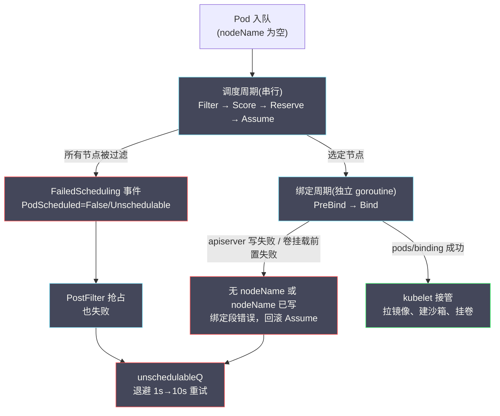
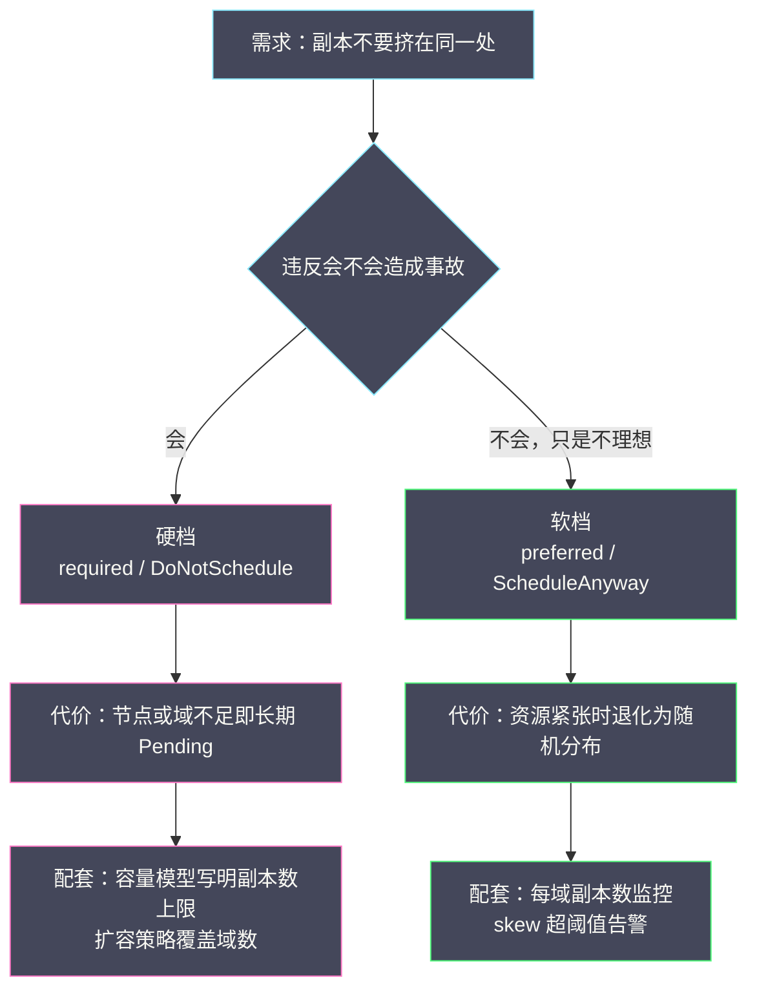
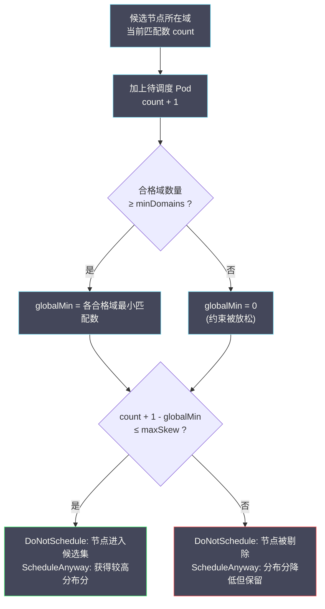
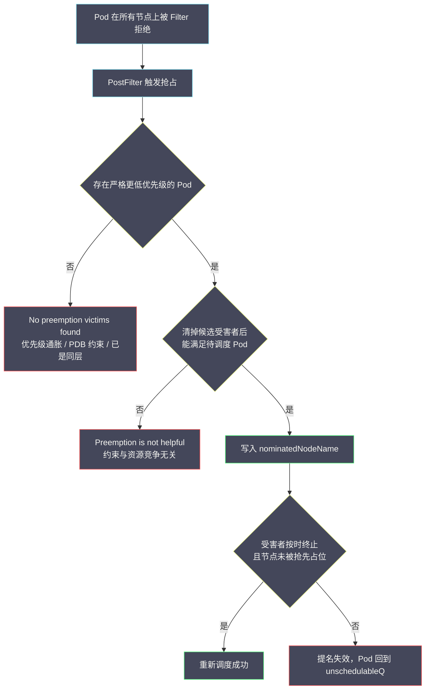
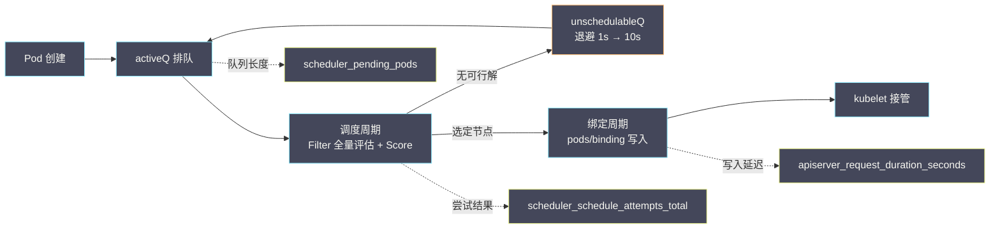
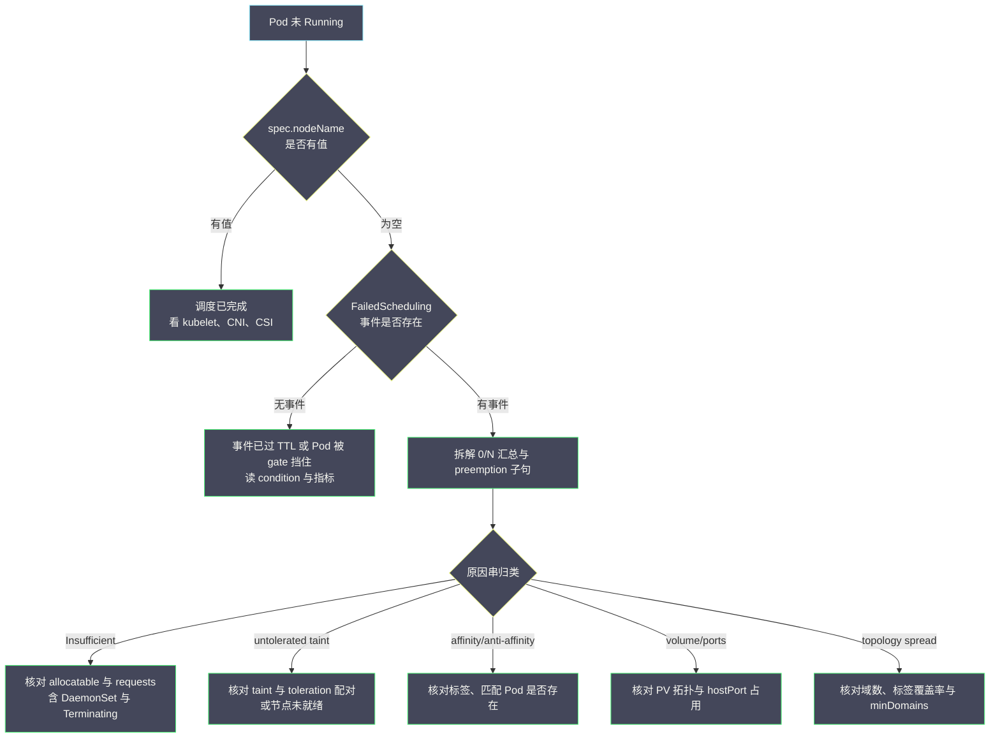

# 05 Scheduler 调度流程与算法

**摘要：**

凌晨把某个无状态服务的副本数从 20 调到 60，十分钟后有一半 Pod 卡在 Pending，事件写着「0/12 nodes are available: 12 Insufficient cpu」，可上午的容量报告还说这群机器 CPU 分配率不到 60%——这类自相矛盾的现场，是调度问题最容易把人带偏的地方。本文从运维与实现的视角拆解调度：先把调度器的两段流程（调度周期与绑定周期）分开，用失败落在哪一段决定该看事件、看 condition 还是看 kubelet 日志；然后逐条拆解 `FailedScheduling` 事件里的原因汇总，把「0/12 nodes are available」还原成六类可验证的物理事实——资源不足、taint 不容忍、亲和冲突、PVC 拓扑绑定、端口独占、节点条件；再讨论调度质量的三个旋钮、Pod 拓扑分布的 `maxSkew` 与 `minDomains` 实际判据、优先级与抢占的失效路径，以及调度吞吐、Pending 队列长度与 `scheduling_attempt_duration_seconds` 的读法；最后给出四个把集群锁死的写法与一套可执行的处置顺序。文中所有判据都落在可以直接用 `kubectl` 与 `/metrics` 验证的字段上，不做主观推测。核心主张只有一句：调度失败几乎从来不是调度器的错，它是约束系统无解的可观测外化。

---

## 第 1 章 调度的两段：失败落在哪里，决定你看什么

### 1.1 调度周期与绑定周期

kube-scheduler 对每个待调度 Pod 做的第一件事是**调度周期**（scheduling cycle）：从队列里取出 Pod，基于本地缓存对所有节点跑一遍 Filter，给通过筛选的节点打分，选出一个节点，再把这个 Pod 以"假定已调度"的方式写进调度器缓存（Assume）。这一段在一个进程内是串行的，一次只处理一个 Pod，理由很直接——决策必须建立在同一份节点视图上，否则 Filter 判可行、Score 打完分，节点已经被另一个调度决策占走，前面算出的解当场作废。

第二段是**绑定周期**（binding cycle）：把 `spec.nodeName` 通过 `pods/binding` 子资源写进 API Server，让 kubelet 依靠自己的 List-Watch 发现"这个 Pod 归我了"。这一段被挪进独立的 goroutine，因为它主要成本是一次 apiserver 往返，慢归慢，却不影响下一次决策；两段如何拆分、扩展点如何排序、缓存如何同步，属于调度框架的机制范畴，机制推导见 [[11 Scheduler 调度算法：预选、优选与扩展机制]]，不再重复。运维视角上调度的全部难点，都从这个拆分开始：失败发生在哪一段，决定了你该读哪一类证据。



由此可以把"Pod 没起来"分成三种完全不同的故障，判据分别在事件、condition 和容器状态上：

| 失败段 | 典型现象 | 判据 | 该看哪里 |
| :--- | :--- | :--- | :--- |
| 调度周期 | Pod 长期 Pending，`spec.nodeName` 为空 | `PodScheduled=False`，reason 为 `Unschedulable`，事件含 `0/N nodes are available` | 事件汇总、节点标签与 taint、节点 Allocated resources |
| 绑定周期 | Pod 有 nodeName 但容器不出现，或 nodeName 写不进去 | `PodScheduled` 仍为 False 且事件消息带插件名或 apiserver 错误；或 nodeName 已写、容器停在 ContainerCreating | scheduler 日志、kubelet 的 `FailedAttachVolume`/`FailedMount` |
| 已调度未启动 | nodeName 有值，`PodScheduled=True`，容器 Waiting | 容器状态与事件（拉镜像失败、sandbox 创建失败、卷挂载失败） | [[13 kubelet 深度剖析：Pod 生命周期与容器运行时接口]] |

第三种经常被误报成"调度失败"，因为用户在控制台上只看到 Pod 不 Running。判据其实一眼可辨：`kubectl get pod -o wide` 里 NODE 列有值，调度器就已经交卷了，后面的账要算在 kubelet、CNI 或 CSI 头上。

### 1.2 Assume 与回滚：一本必须平的账

调度器缓存维护的是"节点上已分配 requests 的总和"，这份账本与 etcd 里的真实 Pod 从来不是严格同步的，两者靠 Assume 和 Forget 两个动作对齐。选定节点后调度器先 Assume，把 Pod 记进缓存，让后续调度立刻看到这部分资源已被占用；如果绑定周期失败，就必须 Forget 掉这个假定的 Pod，把资源还回账本。这条链路上任何一环中断——apiserver 长时间不可写、插件在 PreBind 返回错误后没有走完整的清理路径——都会在缓存里留下一个**幽灵占位**：节点上并没有这个 Pod，但调度器以为它占着 2 核 4 Gi。

幽灵占位的现场很有辨识度：`kubectl describe node` 的 Allocated resources 与该节点真实 Pod 的 requests 求和对不上，一部分节点明明有 Pod 跑着却显示可分配资源为负，重启 scheduler 之后一批原本 Pending 的 Pod 忽然调度成功。遇到这种形态，不要先去改 Pod 的 requests 或扩节点，先重启调度器验证账本是否被重建——这是少数"重启就能修"的调度故障，代价是重启期间调度停摆，需要确认控制面高可用实例的其余副本可接管。

### 1.3 失败之后 Pod 去了哪里

调度失败的 Pod 不会立刻重试，它被放进 unschedulableQ，并按 `podInitialBackoffSeconds`（默认 1 秒）到 `podMaxBackoffSeconds`（默认 10 秒）的退避节奏等待；更关键的是，它主要在"集群状态可能已经变了"的信号出现时才被搬回活跃队列——节点被增删改、Pod 被增删、PVC 状态变化，以及队列自身的定期清理。这条规则解释了运维中最常见的两个误判：

- 新节点刚加入，Pod 不会秒级重试，要等新节点注册、Ready、informer 把节点推给调度器，通常三十秒到一分钟。此时删 Pod 重建毫无收益，因为约束没变，重建出来的 Pod 一样进 unschedulableQ。
- 反过来，如果新节点一直 NotReady、被打了不该有的 taint、或者标签与 Pod 的 nodeSelector 不匹配，那么它根本不会让 unschedulableQ 里的 Pod 变成可行解。扩了节点却没反应，绝大多数情况是节点侧没准备好，而不是调度器没有重试。

还有一条容易被忽略的代价：一次失败比一次成功贵得多。调度成功时调度器只要找到足够数量的可行节点就可以提前收手，失败时却必须把所有节点都评估完才能给出"没有可行解"的结论，这个非对称性在第 7 章会直接决定调度器 CPU 的形态。

---

## 第 2 章 FailedScheduling 事件的逐条拆解

### 2.1 一条事件的三段结构

绝大多数调度失败只产生一条事件，形式如下：

```text
Warning  FailedScheduling  0/12 nodes are available: 3 Insufficient cpu,
5 node(s) had untolerated taint {node-role.kubernetes.io/control-plane: },
4 node(s) didn't match Pod's node affinity/selector.
preemption: 0/12 nodes are available: 8 Preemption is not helpful for scheduling,
4 No preemption victims found for incoming pod.
```

这条文本可以机械地切成三段：`0/12` 是"可行节点数 / 本次评估节点数"；中间那串逗号分隔的条目是"按原因聚合的节点计数"；`preemption:` 之后是 Filter 全灭后抢占插件给出的结论。三个部分各回答一个问题——还有没有救、被什么挡住、抢占了为什么也没用。

分母值得单独说一句。它是调度器这次实际评估的节点数量，正常情况下等于它缓存里的节点总数；如果与 `kubectl get nodes` 的数量对不上，说明调度器的节点视图是旧的，可能是新节点还没进 informer，也可能是节点被删除后缓存尚未清理。这条判据的用处在于把责任分流：**分母不对，问题在视图同步**；分母对而原因集中在同一类，问题在约束。分子则永远是 0——只要有可行节点，这条事件就不会出现。

事件本身是聚合的：同一个 reason 加同一段 message 会被事件聚合器合并成 `x87 over 15m` 这样的计数，apiserver 侧的事件默认只保留一小时。这意味着一个卡了两小时的 Pod，`kubectl describe pod` 里可能一条失败事件都看不到，只剩下 condition。长期 Pending 的排查**不能依赖事件**，condition 与指标才是可追溯的信息源。

### 2.2 原因串与插件的对照

**原因串**是各 Filter 插件自己写的英文短语，把常见形态列出来，排查时可以按图索骥：

| 事件里的原因串 | 出自哪个 Filter | 真实含义 | 先查什么 |
| :--- | :--- | :--- | :--- |
| `Insufficient cpu` / `Insufficient memory` | NodeResourcesFit | 节点 allocatable 减去已分配 requests 后不足 | 节点 Allocated resources、requests 是否虚高、DaemonSet 占用 |
| `Insufficient ephemeral-storage` | NodeResourcesFit | 本地临时存储 requests 超限 | 容器写本地盘的量、镜像与日志占用 |
| `Insufficient nvidia.com/gpu` | NodeResourcesFit | 扩展资源计数不足 | 每节点 GPU 数、是否被非 GPU Pod 占位 |
| `node(s) had untolerated taint {k: v}` | PodToleratesNodeTaints | 节点 taint 没有对应 toleration | 节点 taint、工作负载 toleration 的 key/value/effect 是否配对 |
| `node(s) didn't match Pod's node affinity/selector` | NodeAffinity | 节点标签不满足 required 条件 | 标签是否存在、值是否漂移、operator 语义 |
| `node(s) didn't match pod affinity rules` | InterPodAffinity | 目标拓扑域内没有可跟随的 Pod | 被跟随的 Pod 是否真的存在、是否同在命名空间 |
| `node(s) didn't match pod anti-affinity rules` | InterPodAffinity | 目标拓扑域内已有冲突 Pod | 副本数与节点/域数量、topologyKey 粒度 |
| `node(s) didn't have free ports for the requested pod ports` | NodePorts | `hostPort` 或 hostNetwork 端口被占 | 节点上已有 Pod 的 hostPort、CNI 是否真的映射了端口 |
| `node(s) had volume node affinity conflict` | VolumeBinding | PV 的拓扑与节点所在域不一致 | PV 的 nodeAffinity、StorageClass 的绑定模式 |
| `node(s) didn't find available persistent volumes to bind` | VolumeBinding | 没有满足条件的 PV 可绑定 | PV 容量、class、accessModes 供给是否足够 |
| `node(s) were unschedulable` | 节点可调度性 | 节点 `spec.unschedulable=true` | 是否被 cordon、维护窗口是否忘了解除 |
| `Too many pods` / `node(s) had no available pod slots` | NodeResourcesFit | 达到 kubelet 的 maxPods 上限 | 单节点 Pod 密度、DaemonSet 数量 |
| `node(s) exceeded the maximum volume count` | NodeVolumeLimits | 单节点挂载卷数量到顶 | 每节点 PVC 数、云盘挂载上限 |
| `node(s) didn't match pod topology spread constraints` | PodTopologySpread | 分布约束不满足或域标签缺失 | maxSkew、域数量、topologyKey 的标签覆盖率 |

同一批节点被多个原因同时排除时，汇总会同时出现多条；哪一条在前、条目的先后顺序，在不同版本里并不构成契约，不要写脚本按位置解析。

### 2.3 preemption 子句的三种读法

抢占子句只有寥寥几十个字符，信息量却不小，常见形态有三种。

一种是 `Preemption is not helpful for scheduling`。它的含义不是"没有低优先级 Pod 可杀"，而是"即便把这个节点上所有可驱逐的低优先级 Pod 都清掉，这个 Pod 仍然过不了 Filter"。这几乎总意味着约束与资源竞争无关：需要 GPU 而节点没有 GPU、需要特定 zone 而该 zone 的节点全被 taint、PVC 绑在别的 zone。此时加节点有用，改 requests 有用，调优先级没用。

另一种是 `No preemption victims found for incoming pod`。它说明节点上找不到严格更低优先级、且驱逐后能凑出资源的受害者；PDB 也会让受害者"找不到"，但抢占对 PDB 只是把违反次数计入代价，并不绝对禁止，所以这条经常与"优先级通胀"同时出现——所有人的优先级都一样高，谁也不能驱逐谁。

第三种是抢占子句里重复出现与前面相同的原因串。这说明驱逐模拟跑完之后仍然卡在同一个约束上，直接指向配置错误而不是容量不足。

### 2.4 事件的文本契约有多强

原因串是给人看的英文措辞，不是 API。同一语义在版本之间改过写法，不同发行版与本地化文档里也可能出现变体，拿正则去匹配"didn't match node selector"之类的字符串做自动归因，升级一次就会静默失效。更稳的做法有两个：一是读 Pod 的 `PodScheduled` 条件，较新的版本会在消息里附带 `UnschedulablePlugins` 或 `PendingPlugins` 字段直接指名插件（字段与文案以对应版本文档为准）；二是绕开文本，直接用调度器指标按结果分类统计，把"哪一类失败在涨"作为告警维度。

### 2.5 三处信息源的分工

事件、条件、日志、指标四者各有寿命与粒度，混用会浪费时间：

| 信息源 | 保留时长 | 能回答什么 | 局限 |
| :--- | :--- | :--- | :--- |
| Event | 默认 1 小时，且被聚合 | 最近一次失败的原因汇总、抢占结论 | 会过期，条目是聚合后的计数 |
| Pod condition | 跟随 Pod 生命期 | 当前是否可调度、reason 与 message、指名的插件 | 只有最新状态，无历史 |
| scheduler 日志 | 由日志策略决定 | 单个 Pod 在每个节点上的具体拒绝理由 | 量大，只适合短窗口打开 `-v=4` |
| Prometheus 指标 | 长期 | 失败率、队列长度、延迟分位 | 只有聚合，没有单 Pod 归因 |

实际路径是：告警用指标，定位用事件，复现用日志。把日志级别长期开到 `-v=4` 是一种昂贵的习惯，它会让调度器在高 Pending 场景下被自己的日志拖慢。

---

## 第 3 章 调不上去的六类成因

事件里的原因串描述的是"现象层面"的拒绝理由，落到运维动作上还得还原成物理事实。把生产集群里反复出现的场景归档，绝大多数可以归入六类，且每一类的判据与处置路径完全不同：

| 类别 | 事件特征 | 关键判据 | 处置方向 |
| :--- | :--- | :--- | :--- |
| 资源不足 | `Insufficient cpu/memory/...` | 节点 allocatable 与已分配 requests 之差 | 调 requests、扩节点、纳入 DaemonSet 占用 |
| taint 不容忍 | `had untolerated taint` | 节点 taint 与 Pod toleration 的配对 | 补 toleration 或清理 taint |
| 亲和冲突 | `didn't match ... affinity` | 节点标签、匹配 Pod 是否存在 | 修标签、降级为软约束、改用拓扑分布 |
| PVC 拓扑绑定 | `volume node affinity conflict` | PV 的 nodeAffinity 与节点 zone | 改绑定模式、对齐 zone、检查 PV 供给 |
| 端口独占 | `didn't have free ports` | 节点上 hostPort 与 hostNetwork 占用 | 改 Service、专用节点池、端口规划 |
| 节点条件 | `not-ready` 等内置 taint | 节点 Conditions 与 unschedulable 标志 | 修节点、解除 cordon、等 CNI 就绪 |

### 3.1 资源不足：requests 的账本

调度器看的是 requests 的总和，不是实际用量，这一点决定了"资源不足"永远要先核对账本而不是核对监控。节点的可分配量由三部分扣减而来：capacity 减去 kube-reserved、system-reserved，再减去 eviction-hard 预留。以一个 16 Gi 内存的节点为例，capacity 16 Gi，kube-reserved 与 system-reserved 各 1 Gi，eviction-hard 预留 100 Mi，allocatable 就只剩约 13.9 Gi；如果容量报告拿 capacity 当分母，结论自然乐观。这是示例推算，实际以 `kubectl describe node` 里的 Allocatable 为准。

第二层是**隐性占用**。所有 DaemonSet 的 requests 同样计入账本，一个 0.1 核 200 Mi 的日志采集器看起来微不足道，十来个 DaemonSet 叠加就是 1 核 2 Gi 的固定成本，还会随 DaemonSet 数量增长而增长。第三层是宽限期里的 Pod：处于 Terminating 的 Pod 在真正从 etcd 删除之前，requests 仍然占着位置，一次大规模滚动发布或节点驱逐之后紧接着扩容，很容易撞上这层。

反过来还有一类更隐蔽的麻烦：requests 根本没写。容器不声明 requests 时它按 0 计入，Filter 永远判它放得下，调度看起来一路顺畅，问题被推迟到运行时——kubelet 在节点压力下按 QoS 等级驱逐，Burstable 与 BestEffort 的 Pod 先死，表现为"调度成功但 Pod 反复被驱逐"，与 Pending 是完全不同的现象。给命名空间配 LimitRange 兜底默认 requests，是低成本的对策，代价是默认值可能与真实用量偏离，需要定期用真实用量校准。

排查路径很轻：`kubectl describe node` 的 Allocated resources 段落给出各资源的 requests 与 limits 占比，把目标节点的数值与 Pod 的 requests 相加即可验证。常见的"节点还有 2 Gi 却放不下 1 Gi 的 Pod"，多半是 Allocatable 与 Capacity 的差、加上 DaemonSet 与 Terminating 三类叠加造成的。

### 3.2 taint 与 toleration 的配对

这类失败的事件文本最直白，`{key: value}` 会原样打出来，难点在配对规则。toleration 匹配 taint 要求 key 相同，operator 为 `Equal` 时还要求 value 相同，effect 也相同或为空；`operator: Exists` 则忽略 value，只要求 key 存在。实践中最高频的错误是 effect 写错：节点 taint 是 `NoExecute`，toleration 却写了 `NoSchedule`，两者不匹配，事件里那句话看着一模一样，改了半天没效果。

第二高频的是把"节点可调度性"与"taint"混为一谈。`kubectl cordon` 置的是 `spec.unschedulable=true`，事件文本是 `node(s) were unschedulable`，节点上并没有新 taint；而 `kubectl drain` 会先 cordon 再驱逐，维护结束后如果只记住了"删 taint"而忘了 `uncordon`，节点就会以"可调度性关闭"的形态长期闲置。这类节点的特征是 `kubectl get nodes` 显示 SchedulingDisabled，一眼可辨，却经常在容量报告里被算成可用容量。

第三类发生在新节点上。节点刚注册时并不 Ready，会被自动打上 `node.kubernetes.io/not-ready:NoSchedule`；CNI 尚未就绪时还可能出现 `network-unavailable`。这类 taint 会在条件恢复后自动移除，所以"新节点刚加入时扩的副本没排上去，两分钟后又自己好了"，属于正常时序，不是配置问题。

还有一类没有事件：`PreferNoSchedule` 的 taint 只影响打分，不会让节点被排除，因此当一个专用节点池只打了 `PreferNoSchedule` 时，普通 Pod 会在没有更好选择时"漏"进去，而事件里什么都不会写。要真正隔离节点池，必须用 `NoSchedule` 或 `NoExecute`。

### 3.3 亲和与反亲和的冲突

节点亲和的第一处坑在布尔逻辑。`nodeSelectorTerms` 之间是"或"的关系，每个 term 内部的 `matchExpressions` 之间是"与"的关系；把三个候选机型写进同一个 term 的三条 expression，实际表达的是"同时属于三种机型"，结果没有任何节点满足。这种错误在 YAML 上很整齐，事件里只有一句 `didn't match Pod's node affinity/selector`，看不出是逻辑写反了。

第二处坑在 operator 对"缺失标签"的处理。`NotIn` 与 `DoesNotExist` 对没有该标签的节点同样为真，所以一条本意是"排除小机型"的 `NotIn` 规则，会因为部分节点没有机型标签而把它们全部放行；而 `In` 遇到空 values 直接判不匹配。标签治理一旦松动——节点池模板改版后标签改名、部分老节点从未打标——required 亲和就会以"部分节点被莫名排除"的形式发作。

Pod 亲和还有一处更棘手的**死锁形态**。`requiredDuringSchedulingIgnoredDuringExecution` 的 podAffinity 语义是"目标拓扑域里必须已经存在至少一个匹配的 Pod"，如果被跟随的那个 Pod 自己也在 Pending（比如它依赖另一个更晚创建的组件），两个 Pod 互相等待，谁都调不上。这种互锁在事件里表现为 `didn't match pod affinity rules` 出现在所有节点上，只看单个 Pod 完全看不出问题，必须把匹配到的 Pod 一起看。它也是"分批上线新组件"时最典型的自伤方式：先上线依赖方，再上线被依赖方。

命名空间是第三处默认值陷阱。podAffinity 与 podAntiAffinity 的 labelSelector 默认只在本命名空间内匹配，跨命名空间必须显式写 `namespaces` 字段（空列表表示所有命名空间）。同一个应用在灰度与生产两个命名空间各部署一套时，反亲和规则不会跨命名空间生效，副本可能落在同一个节点上，而配置看起来完全正确。

### 3.4 PVC 的拓扑绑定

存储把拓扑约束带进了调度，这是六类成因里唯一"改 Pod 配置无效"的一类。判断入口先看绑定模式：`volumeBindingMode: Immediate` 的 StorageClass 在 PVC 创建时就绑定 PV，由 PV 控制器从可用 PV 里挑选，落在哪个可用区并不受调度侧控制；`WaitForFirstConsumer` 则推迟到 Pod 调度时按节点反推可用区。前者在多可用区集群里制造的问题很典型——PVC 绑到了 zone A 的 PV，而节点池此时只剩 zone B 的容量，所有 zone B 的节点都被判 `volume node affinity conflict`。

事件文本能区分两种失败。`didn't find available persistent volumes to bind` 指向 PV 供给：没有容量、class、accessModes 都满足的 PV 可用，这是存储侧的问题，节点再多也没用。`had volume node affinity conflict` 指向拓扑：PV 已经绑定，但它的 `nodeAffinity` 不覆盖候选节点所在的域。前者的排查动作是看 PV 池与 StorageClass，后者的排查动作是看 PV 的 nodeAffinity 与节点 zone 的交集。

更容易被忽略的是多 PVC 的交集为空。一个 Pod 挂两块卷，一块在 zone A，一块在 zone B，任何单节点都不可能同时满足，于是每个节点都被判拓扑冲突，事件里 12 个节点全部出现在同一类原因下。此时扩容只会增加同一条原因串的计数。本地盘或实例存储型的 local PV 把这件事推到极端：卷与节点绑死，节点一旦缩容，依赖它的 Pod 就永久 Pending。

最后一层是 attach 阶段的上限。即便卷绑定成功、Pod 也完成了调度，云盘挂载数量上限仍可能在 PreBind 或 kubelet 侧失败：Pod 的 nodeName 已经写上，容器停在 ContainerCreating，kubelet 报 `FailedAttachVolume` 或 `FailedMount`。这是绑定周期失败，与 Filter 无关，但它常被归入"调度故障"，因为在没有 nodeName 与有 nodeName 之间，用户的观感是一样的。存储对象的行为细节与 CSI 调用链见 [[01 持久化存储——PV PVC StorageClass 与 CSI]]。

### 3.5 端口独占：hostPort 与 hostNetwork

端口不是 requests 里的资源，它是节点级的独占资源，因此既不参与资源核算，也不受 ResourceQuota 约束，容量规划时最容易漏。两种写法会把端口变成节点资源：一是显式声明 `hostPort`，二是使用 `hostNetwork: true`——后者会让容器声明的所有 containerPort 隐式成为节点端口，即使 Pod spec 里一个 hostPort 都没写。

`NodePorts` 插件只读 Pod spec，不关心 CNI 是否真的做了端口映射。如果集群的 CNI 没有启用 portmap 能力，spec 里写的 hostPort 在节点上根本没有被占用，调度器依然会把它当成已占端口，于是出现"节点上明明没有进程监听，Pod 却报端口冲突"的**假冲突**。这类故障的定位动作不是看 `ss -lntp`，而是遍历该节点上所有 Pod 的 hostPort 声明。

这种约束的实际后果有两个：一个 Deployment 用 hostPort，它的副本数就永远不能超过节点数；不同团队使用同一个 hostPort 号时，冲突不在命名空间边界上，而是在节点边界上，两个命名空间各自"看起来没问题"，一起扩就互相挤。需要固定入口端口的场景，正确做法是走 Service（ClusterIP、NodePort 或 LoadBalancer）加 Ingress，把端口管理从 Pod 挪到 Service；确实需要 hostNetwork 的边缘场景（如负载均衡器、监控抓取代理），应当配专用节点池，把端口号当作节点池的约定写进文档，而不是散落在各工作负载的 YAML 里。

### 3.6 节点条件：not-ready 与其他内置 taint

节点状态异常时，Node 控制器会打上内置 taint，其中影响调度的是 `not-ready` 与 `unreachable`。这类失败在事件里的形态与普通 taint 完全一样，都是 `had untolerated taint {node.kubernetes.io/not-ready: }`，所以看到内置 key 时应当直接把排查方向切到节点本身：kubelet 是否在运行、容器运行时是否健康、节点与 apiserver 之间是否网络可达、磁盘是否写满导致 kubelet 无法上报状态。

时序参数决定了"故障发生后多久影响调度"：kubelet 默认每 10 秒续约一次节点租约、状态变化即时上报，控制器在超过宽限期（默认 40 秒）没收到心跳时把节点置为 NotReady 并打上 taint，而 Pod 默认带 300 秒的 `not-ready` 与 `unreachable` 容忍，所以节点故障后大约 40 秒开始不接受新 Pod，约 5 分钟后节点上的 Pod 才被驱逐重建。这个时间差是容量规划里的隐性成本：故障期间集群少了一整个节点的可调度容量，而上面 Pod 的资源请求仍然占着账本。

其余内置条件 taint 分别对应内存压力、磁盘压力、PID 压力与网络不可用，效果都是 `NoSchedule`，条件恢复后自动移除。它们会造成短窗口的不可调度，与正在进行的扩容叠加时尤其明显——新节点刚起来就报磁盘压力，Pod 又全部退回 unschedulableQ。处理这类问题的顺序是先让节点条件恢复，再去看 Pod 的调度配置，反过来做只会浪费一轮排查。

---

## 第 4 章 调度质量的三个参数

Pod 调度成功只说明"存在可行解"，不说明这个解是好解。把一批 Pod 放上去之后，可能出现三种不满意的结果：副本挤在同一个故障域、新扩容的节点一直空转、老节点持续被填满而新节点得不到流量。决定这些结果的旋钮主要有三个，它们的共同结构是同一个约束的**硬档**与**软档**：硬档买确定性，软档买利用率。

| 参数 | 生效阶段 | 违反时的后果 | 该用硬档的场景 | 代价 |
| :--- | :--- | :--- | :--- | :--- |
| `nodeAffinity` required | Filter | 节点直接被排除，可能导致无解 | 硬件属性（GPU、机型）、合规边界 | 新节点池无法被复用，容量弹性下降 |
| `nodeAffinity` preferred | Score | 只是排在后面，仍可落上去 | 主力池优先、成本分级 | 偏好会被其他插件的分差淹没 |
| `topologySpread` DoNotSchedule | Filter | 分布不满足即不调度 | 跨可用区容灾副本 | 域数不足时造成永久 Pending |
| `topologySpread` ScheduleAnyway | Score | 分布不满足也调度，只是分数低 | 批处理、可容忍倾斜的服务 | 资源紧张时分布退化为随机 |
| `podAntiAffinity` required | Filter | 违反即不可调度 | 同节点双副本就是事故的场景 | 副本数与节点数绑死，扩容失效 |
| `podAntiAffinity` preferred | Score | 同域也照放 | 高可用的"尽力而为" | 没有保证，节点少时形同虚设 |

选档的逻辑可以画成一条很短的判断链——先问违反这条规则会不会造成事故，再问代价由谁承担：



### 4.1 nodeAffinity 的权重

`preferredDuringSchedulingIgnoredDuringExecution` 的每一项带一个 1 到 100 的 `weight`，同一个节点匹配多个 preference 时权重累加，最终作为该插件的原始分进入归一化与加权求和。这里有一个容易被误判的性质：权重 100 的偏好最多也只贡献 100 分，而其他 Score 插件之间的分差可能超过 100——镜像本地性、资源均衡、Pod 亲和三个插件各贡献几十分的反向差异，就足以让"设了最高权重"的节点落选。遇到"权重都拉满了还是跑到备用池"，先算一下其他插件的分差，这通常是正常行为，不是 bug。

更常见的用法是分档而不是分胜负：主力池给 100、备用池给 50，表达"优先但允许溢出"。主力池有空位时 Pod 落在主力池，满了之后备用池的节点仍能通过 Filter，只是分数低，于是自动溢出。这套做法的失效场景是主力池与备用池的资源利用率差异巨大——主力池接近满载时 LeastAllocated 给它的分数很低，此时偏好能否把票拉回来，取决于两项分差的相对大小。

真正需要守住边界时，preferred 是无效的：它不参与 Filter，任何情况下都不能阻止 Pod 落到不该去的节点池。要阻止就必须上 required，而 required 的直接后果是新节点池无法承接存量工作负载，容量弹性下降一档。这组取舍没有中间态，只能选择接受其中的一档。

### 4.2 whenUnsatisfiable 的两档语义

`topologySpreadConstraints` 的 `whenUnsatisfiable` 常被解释为"考虑不考虑分布"，更准确的说法是"分布能否否决这次调度"。取 `DoNotSchedule` 时，插件在 Filter 阶段工作，不满足 skew 的节点直接从候选集里剔除；取 `ScheduleAnyway` 时，插件在 Score 阶段工作，skew 只作为打分的信号，节点始终留在候选集里，最坏情况下 Pod 会落在最不均衡的域上。

这个区别决定了故障形态的差异。`DoNotSchedule` 的失败是显性的——Pod Pending，事件给出 `didn't match pod topology spread constraints`，运维看得到；`ScheduleAnyway` 的失败是隐性的——Pod 全部调度成功，只是分布难看，直到某个可用区出故障才发现容灾副本挤在一起。前者容易治（放宽约束或加域），后者只能靠监控提前发现。

选择上有一条经验：容灾语义的副本用 `DoNotSchedule`，弹性语义的副本用 `ScheduleAnyway`。跨三个可用区的无状态服务、每个区至少要有一个副本，这属于容灾语义；离线批处理按可用区均摊 CPU，这属于弹性语义，倾斜几个副本不值得付出 Pending 的代价。

### 4.3 podAntiAffinity 的 required 与 preferred

反亲和的两种写法差别不在"严格程度"，而在"是否参与否决"。required 进 Filter，节点上只要已经有一个匹配 Pod，该节点就被剔除；preferred 进 Score，按节点上匹配 Pod 的数量扣分，数量越多分越低，但永远不否决。

决定用哪一种的判据很朴素：违反这条规则会不会造成事故。同一个 StatefulSet 的两个副本落在同一个节点上，节点故障一次损失两个副本，可能影响仲裁，这是事故，用 required；无状态服务的两个副本落在同一节点，节点故障仍然只损失这两个副本、其余副本继续承接流量，这属于可用性折损，用 preferred 就够，再叠加按 hostname 的拓扑分布把分布拉匀。

代价要算清楚。required 反亲和把"副本数与节点数"绑成了硬关系，副本数一旦超过可用节点数，超出的副本永远 Pending（第 8 章会展开）；preferred 反亲和在节点数远多于副本数时几乎总能满足，在节点数接近副本数时开始失效，失效时不会有任何告警，只能靠"每节点副本数"的监控发现。

还有一笔性能账。InterPodAffinity 需要在调度器缓存里按节点维护匹配 Pod 的索引，节点与 Pod 规模上去之后，它是 Score 阶段最贵的插件之一；required 的反亲和还会让 Filter 阶段多一轮逐节点检查。集群跨过数千节点时，反亲和的粒度应当从 hostname 放宽到 zone——拓扑域越少，索引与检查的开销越小，而高可用语义往往并不需要节点级粒度。

---

## 第 5 章 Pod 拓扑分布的实践

### 5.1 skew 的准确判据

多数材料把 `maxSkew` 概括成"任意两个域的匹配 Pod 数最大差不超过 N"，这个说法在域都非空时与实现一致，在出现空域时给出完全相反的结论。Kubernetes 的判据是单侧的：候选节点所在域在加一个匹配 Pod 之后的数量，减去所有合格域的**全局最小值**，不超过 `maxSkew` 才允许调度。

以三个可用区、计数分别为 3、1、1 的场景推算一遍（示例推算）：候选节点在 A 区时，加一得 4，全局最小值是 1，skew 为 3，超过 `maxSkew=1`，A 区的节点被剔除；候选节点在 B 区时，加一得 2，skew 为 1，通过；C 区同理。于是下一批 Pod 只能落到 B 与 C，直到三者追平。这个单向判据保证的是"不允许把差距继续拉大"，而不是"差距必须缩小"，所以它能在副本数不是域数整数倍时自然收敛。

真正让人困惑的是**空域**。假设集群刚扩了一个新的可用区，该区匹配 Pod 数为 0，全局最小值随之变成 0，此时任何域只要加一后数量超过 `maxSkew` 就被剔除——`maxSkew=1` 意味着所有已有副本的域都不再接受新 Pod，所有新 Pod 都被赶向新可用区，直到它的计数追平。这条机制在弹性扩容时是好用的（新域会被自动填满），但若新可用区的节点因为 taint、标签缺失或资源不足而不可用，Pod 就会陷入"只能去那里、去了又不行"的永久 Pending，事件里报的是分布约束不满足，根因却在节点侧。



### 5.2 字段语义与常见误配

| 字段 | 语义 | 缺省行为 | 常见误配 |
| :--- | :--- | :--- | :--- |
| `maxSkew` | 单侧偏差上限，按"域加一后减全局最小"判定 | 必填 | 当成"两域最大差"，在空域场景算错 |
| `topologyKey` | 拓扑域的节点标签名 | 必填 | 标签覆盖不全，部分节点不构成域 |
| `whenUnsatisfiable` | 硬档或软档 | 必填 | 容灾副本用软档，故障时才暴露 |
| `minDomains` | 合格域数量下限，不足时全局最小按 0 计 | 不设置时按 1 处理 | 集群实际域数小于该值时约束被永久放松 |
| `labelSelector` | 参与计数的 Pod 集合 | 必填 | 匹配范围过宽，把其他应用的 Pod 算进来 |
| `matchLabelKeys` | 在 selector 上追加当前 Pod 的标签值 | 不追加 | 滚动更新期间新旧副本互相干扰计数 |
| `nodeAffinityPolicy` | 计算域时是否遵守 Pod 的节点亲和 | Honor | 与 required 亲和组合时产生"域很多但都用不上"的错觉 |
| `nodeTaintsPolicy` | 计算域时是否剔除带 taint 的节点 | Ignore | 不可用节点所在域照样计数，分布看着满足实际不均 |

后三个字段出现的版本较晚，`minDomains` 自 1.25 引入，`matchLabelKeys` 与两个 policy 字段在后续版本中逐步稳定，具体 GA 版本与是否需要特性门以对应版本文档为准。升级前先确认目标版本的字段支持情况，比事后排障便宜得多。

### 5.3 minDomains 的实际效果

`minDomains` 解决的是一个很具体的场景：集群有多个可用区，但当前只有一部分可用区有节点，`DoNotSchedule` 加 `maxSkew=1` 会让 Pod 在现有域之间严格均摊，一旦某个域的节点用完，Pod 就 Pending；扩容组件看到的是"有节点能满足部分 Pod"，未必会去增加可用区。把 `minDomains` 设成期望的域数量之后，当合格域不足时全局最小值按 0 计算，**约束被放松**，Pod 允许堆在现有域里调度成功。

这个放松是有代价的：Pod 一旦调度成功，扩容组件就失去了增加可用区的动机，最后集群长期停留在"少一个可用区"的状态，而分布看起来严重倾斜。也就是说 `minDomains` 把"立刻 Pending"换成了"慢慢地失去容灾能力"，它适合与明确的扩容策略配套使用，不适合单独开启。

还有一个反向误配：`minDomains` 设得比集群真实域数还大。此时约束永远处于放松状态，`topologySpread` 退化成一条几乎不生效的软约束，配置看起来极其严格却什么也没保证。判断方法很直接——数一下 `kubectl get nodes -L topology.kubernetes.io/zone` 里不同取值的个数，与 `minDomains` 比一比。

### 5.4 分布仍然不均的六种原因

第一是上一节说的 `minDomains` 触发放松，域不足时约束自动失效。第二是 `nodeTaintsPolicy` 默认取 `Ignore`：某个可用区的节点全部被 cordon 或打上维护 taint，但该区在计数里仍然存在，调度器认为分布已经满足，实际可用的域之间却严重倾斜。这两条都属于"约束被自己绕过去了"。

第三是拓扑标签覆盖不全。部分节点没有 `topology.kubernetes.io/zone` 标签（自建机房无可用区概念、节点池模板漏打），它们不构成任何域；硬档下这类节点通常被判不满足约束，软档下它们是不受分布约束的落点，Pod 落上去之后统计口径与实际感知就分裂了。排查的第一步永远是 `kubectl get nodes -o wide` 或 `-L <key>` 核对打标覆盖率，而不是直接调 `maxSkew`。

第四是滚动更新。Deployment 的旧 ReplicaSet 与新 ReplicaSet 的 Pod 都带着同一个 `app` 标签，`labelSelector` 匹配 `app` 时新旧副本一起计数，过渡期内 skew 会剧烈抖动；`matchLabelKeys` 把 `pod-template-hash` 纳入 selector 之后，计数只针对当前版本，旧副本逐步退出时才不会被算进来。副本规模大、发布频繁的服务，这个字段的收益非常直接。

第五是其他 Filter 先把候选集收窄了。资源不足、taint 不匹配、亲和规则让某些域不可达，`DoNotSchedule` 下表现为 Pending，`ScheduleAnyway` 下表现为"能塞的地方尽量塞"，两种都不叫"分布失败"，但都让最终形态与预期不符。

第六是把数量当成了资源。拓扑分布只约束匹配 Pod 的个数，不约束 CPU 与内存；三个可用区各两个副本看起来很均匀，但某个区的节点配置只有其他区的一半，负载自然倾斜。这种情况要靠节点池规格对齐来解决，改 `maxSkew` 不会有任何效果。

### 5.5 把它变成可观测的指标

拓扑分布是最不适合靠事件排查的机制，因为软档下它根本不产生事件。可用的观测方式是定期计算分布偏差：按 `topologyKey` 把节点分组，统计每个域上匹配某种 label 的 Pod 数量，取最大值与最小值之差作为 skew 指标，与 `maxSkew` 比较后告警。数据来源可以是 `kube_pod_info` 加 `kube_node_labels`，也可以由发布流水线在扩容后直接查询 API。

实践上建议把 `maxSkew` 当作 SLA 参数写进服务定义，而不是随手填 1：跨可用区容灾副本的 skew 必须小于容灾副本数（否则相当于没有容灾），离线任务的 skew 只要不超过一个可接受的运维阈值即可。阈值定下来之后，硬档与软档的选择就变成了"这个服务是否愿意为了分布付出 Pending 的代价"，问题会清晰很多。

---

## 第 6 章 优先级与抢占的运维面

### 6.1 PriorityClass 的值域与分级

用户自建的 PriorityClass 取值上限是 10 亿（1000000000），两个内置的 `system-cluster-critical` 与 `system-node-critical` 分别是 2000000000 与 2000001000，留给系统组件独占。`globalDefault` 在整个集群里只能有一个，Pod 没有写 `priorityClassName` 时按它取值；引用不存在的 PriorityClass 会在准入阶段直接拒绝创建，这一点让"删掉旧 PriorityClass 再上线新 Pod"变成一次可预见的发布失败。

优先级在 Pod 创建时被解析成一个整数值写进 `spec.priority`，之后修改 PriorityClass 的 `value` 不会影响已经存在的 Pod。这条性质意味着调整优先级分级需要重建工作负载，不能靠改对象完成；也意味着"临时把某个 PriorityClass 调高"只在新建 Pod 上生效，滚动发布发到一半时行为会出现新旧混杂。

分级的经验是三层足够：平台关键组件一层、在线服务一层、离线与批处理一层，取值之间留出足够的间隔（譬如十万、一万、一千），给后续插入留余地。层级过多会导致团队各自申请"就比上面那个高一点"的位置，最终形成**优先级通胀**——所有人都在同一个档次，抢占退化为排队，`No preemption victims found` 会在事件里大量出现。

抢占的判定链可以按"有没有受害者、赶走之后放不放得下、提名能不能兑现"三层来看：



### 6.2 抢占没有生效的六种路径

抢占是调度失败之后的兜底动作，它的失败形态比调度失败更隐蔽，因为 Pod 依旧 Pending，事件里只是多了一段结论。受害者如何挑选，这里只留一句与运维相关的结论：调度器先比较各候选方案的 PDB 违反数，违反少的方案优先，其次才是受害者数量与优先级高低，完整的两段打分与提名语义见 [[11 Scheduler 调度算法：预选、优选与扩展机制]]。这个顺序带来两个可预期但常被误判的结果：一个规格很大的高优先级 Pod 一旦 Pending，可能一次性驱逐十几个小 Pod，影响面与"只是一个 Pod"的直觉不符；低优先级工作负载即使没被点名，也可能因为"凑数最方便"而被选中，所以它们同样需要 PDB 与可恢复的设计。

常见路径可以归为六种：

- 找不到严格更低优先级的受害者。优先级相同也不行，抢占只允许驱逐比自己低的 Pod；所有在线服务都设成同一档时，谁也抢不动谁。
- 受害者受 PDB 保护。抢占对 PDB 只是"计入违反数、优先选违反少的方案"，当所有方案都要违反预算时，插件会放弃，而不是强行突破。
- 驱逐了也放不下。受害者是若干个 0.5 核的小 Pod，待调度 Pod 需要 8 核且不能跨节点拼凑，凑出来的资源仍然不够。
- 待调度 Pod 自身的约束把候选集缩得很小。required 节点亲和、PVC 拓扑、反亲和把可用节点限定在一两个域，抢占只在这个域里找受害者，域外的空闲节点帮不上忙。
- 提名了但没有兑现。`nominatedNodeName` 只是意向不是预留，提名之后其他 Pod 先占位、或提名节点状态变化，Pod 会重新排队再来一轮。
- Pod 自己写了 `preemptionPolicy: Never`，它照常按优先级排队，但从不发起抢占。

前四种的判据都在抢占子句里：逐条读 `Preemption is not helpful for scheduling` 与 `No preemption victims found` 的出现比例，再结合 Pod 的约束一起看，比盯着节点资源快得多。

### 6.3 抢占风暴：驱逐了却调不上

最坏的情况是**抢占风暴**：抢占与重建形成循环——高优先级 Pod 的约束本身无解（比如要求某个没有容量的可用区），每一轮调度都会跑一次全节点的抢占模拟，选出一批受害者驱逐，受害者的工作负载控制器立刻重建它们，重建后的 Pod 又成了下一轮的候选受害者。观测上的特征很明确——同一批 Pod 的年龄普遍只有几十秒、节点上 Pod 的创建次数持续上升、`scheduler_preemption_attempts_total` 与 `scheduler_preemption_victims` 同步增长，而待调度 Pod 的 Pending 时长不变。

这类循环的处置顺序不能反：先修高优先级 Pod 的约束（看抢占子句里重复出现的原因串），再考虑调整优先级分层。给受害者加 PDB 只会让抢占更难，把"频繁驱逐"换成"长时间 Pending"，并没有解决约束无解这个根因。把高优先级 Pod 的数量压到少数，也是降低影响面的直接手段——高优先级不是标签，它是能挤掉别人的特权，赋予面越窄越好。

### 6.4 preemptionPolicy: Never 的用途与误用

`Never` 的价值在于切断"以邻为壑"的路径，而不是提升自身地位。离线批处理、报表任务、数据补跑这类工作负载，业务上可以等，但没有理由把在线服务挤下去，把它们统一设成 `Never`，既保留了高优先级排队的好处，又消除了它们发起抢占的副作用。

常见的误用是把它理解成"不会被抢占"。`Never` 只约束它不发起抢占，不阻止它成为别人抢占的受害者；一个 `Never` 的低优先级 Pod 在资源紧张时仍会被驱逐。另一种误用是拿它当"降低优先级"的替代品：`Never` 的 Pod 仍然按优先级参与队列排序，优先级高就会先拿到资源，这一点与降低 `value` 完全不同。

还有一种场景值得单独提：当集群里存在"偶发需要大块资源"的批处理时，把这些任务设成 `Never` 并放在单独的命名空间，配合配额限制总量，可以把抢占行为限制在预期的范围内，而不必依赖每个人都记得不去抢占。

### 6.5 与 PDB、伸缩组件的交界

PDB 不是抢占的硬保护，它保护的是自愿驱逐（走驱逐 API 的那条路），抢占属于系统认为必要的那一类，可以绕过预算，只是把绕过的次数记进代价函数。运维上应当把 PDB 理解为"降低被选中的概率"，而不是"禁止选中"；把关键服务的可用性完全押在 PDB 上，迟早会在一次资源紧张里同时丢掉预算与副本。

与扩容组件的交界则更微妙。扩容组件通常在"没有节点能容纳 Pending Pod"时触发，而抢占的存在让它看到"如果再挤一挤也许能放下"，两者的判断依据不同，同时开启时容易出现"既在驱逐、又在扩容"的拉锯。稳妥的做法是把抢占限制在极少数关键工作负载上，其余工作负载依赖扩容与配额，让扩容组件有一个清晰的信号。

---

## 第 7 章 调度器的性能信号与容量账

### 7.1 五个必看的指标

调度器的健康度可以用少量指标覆盖，前提是分清队列、结果、延迟三层：

| 指标 | 类型 | 读法 | 异常判据 |
| :--- | :--- | :--- | :--- |
| `scheduler_pending_pods{queue=...}` | Gauge | 按 active、backoff、unschedulable 三个队列分别看 | unschedulable 持续增长代表约束或容量问题，不是性能问题 |
| `scheduler_schedule_attempts_total{result=...}` | Counter | 按 scheduled、unschedulable、error 分类的尝试次数 | unschedulable 占比上升，说明失败成为常态 |
| `scheduler_scheduling_attempt_duration_seconds{result=...}` | Histogram | 单次调度尝试的耗时分布，看 p99 而非均值 | p99 持续上升且伴随队列积压 |
| `scheduler_pod_scheduling_attempts` | Histogram | 每个 Pod 直到成功为止尝试了几轮 | 分布右移说明退避重试在放大负载 |
| `scheduler_framework_extension_point_duration_seconds{extension_point=...}` | Histogram | 拆到 Filter、Score、Bind 各扩展点的耗时 | 某一扩展点独占大头，指向插件而不是节点规模 |

指标名在版本之间有过调整，早期以 `scheduler_e2e_scheduling_duration_seconds` 为端到端延迟，后来的版本以 `scheduler_scheduling_attempt_duration_seconds` 为准，具体可用名称以目标集群 `/metrics` 的实际输出为准——先 `kubectl get --raw /metrics | grep scheduler_` 确认，再写查询语句与告警规则，这一步比查文档可靠。

一次调度从入队到容器启动会穿过好几段，每段的耗时归属不同，指标只能告诉你总账：



### 7.2 延迟的分解与一笔推算

一次成功的调度，端到端时间由三段构成：排队等待、调度周期的计算、绑定周期的写入。排队等待里最容易被忽略的是退避——每次失败至少间隔 1 秒、最多 10 秒，一个曾经失败过五轮的 Pod，其"调度延迟"的主体是退避而不是计算。这也是为什么 `scheduler_pod_scheduling_attempts` 的分布比延迟分位更能反映体感：用户看到的是 Pod 从创建到 Running 的时间，而这段里大部分可能耗在排队。

计算部分的量级可以做一次示例推算。假设集群有 3000 个节点、启用了十二个 Filter 插件、单个插件在单个节点上的耗时是 15 微秒，那么一次失败的全量评估约为 3000 乘 12 乘 15 微秒，约 0.54 秒；如果此时 unschedulableQ 里有 800 个 Pod 按 10 秒的退避周期重试，相当于每秒发起 80 次全量评估，需要约 43 个核的持续算力。这个数字只是用来判断趋势的量级，不是任何版本的基准，但它说明了一件事：调度器的 CPU 消耗与"卡在队列里的 Pod 数量"成正比，而不是与集群规模成正比。

### 7.3 失败路径没有早停

调度成功的路径是有**早停**的：调度器只需要找到足够数量的可行节点就可以停止评估，评分范围由 `percentageOfNodesToScore` 控制，该值缺省时按集群规模推算（节点数很少时评估全部节点，规模越大百分比越低，具体公式以对应版本文档为准）。失败的路径没有这个优惠：只有当所有节点都被评估完、所有插件都返回不满足时，才能得出"无可行解"的结论，并生成那条带原因汇总的事件。

这条**非对称性**把配置错误直接放大成性能事故。一条写错的 required 反亲和、一个指向不存在标签的 nodeSelector，会让一批 Pod 永久处于失败路径，每个 Pod 每次重试都要对全集群做一遍完整评估；Pod 数量越大、节点越多，调度器越接近饱和，而此时从指标上看到的只是 CPU 高、队列长，很容易被误判成"集群太大调度器撑不住"，从而去调调度器的并发与限流参数，或者加调度器副本。调参不会让错误约束消失，只会让它更快地把资源烧完。

正确的缓解顺序是：先按事件归因修掉约束（第 3 章的六类成因），再看队列是否回落；如果失败率正常而延迟仍高，再考虑调整评分范围、精简不必要的 Score 插件、或者把绑定周期的瓶颈交给 apiserver 扩容解决。

### 7.4 从信号到动作

| 观测到的信号 | 更可能的含义 | 动作 |
| :--- | :--- | :--- |
| unschedulable 队列持续增长 | 约束无解或容量不足 | 按事件归因，修约束或扩容量 |
| active 队列堆积且延迟上升 | 吞吐跟不上入队速度 | 查抢占总比、插件耗时，必要时分片多调度器 |
| backoff 队列周期性波动 | 失败 Pod 在退避重试 | 与 unschedulable 一起看，通常是同一批 Pod |
| `framework_extension_point_duration_seconds` 中 Bind 占比高 | apiserver 写入慢而非调度计算慢 | 查 apiserver 的 binding 子资源延迟与限流 |
| 延迟正常但 Pod 起得慢 | 不是调度问题 | 转 kubelet 与镜像拉取链路 |

---

## 第 8 章 四个把集群锁死的写法

下面四种写法在评审时都显得"更稳妥"，它们的共同点是用硬约束表达了本可以软处理的偏好，代价往往在扩容、故障或发布时才兑现。

| 写法 | 触发条件 | 现场判据 | 替代方向 |
| :--- | :--- | :--- | :--- |
| `nodeSelector` 绑定机型标签 | 节点池换标签或扩容新机型 | `didn't match Pod's node affinity/selector` 只出现在新节点 | 软亲和分档，或池级 taint 做隔离 |
| required 反亲和加 hostname | 副本数超过节点数或域数 | `didn't match pod anti-affinity rules` 计数等于节点数 | 拓扑分布加软反亲和 |
| `hostPort` 暴露服务 | 副本数超过节点数，同号端口冲突 | `didn't have free ports` 而节点资源充裕 | Service 暴露，专用池承载宿主网络 |
| `topologySpread` 忽略 `minDomains` | 域数与副本数不匹配 | 分布严重倾斜却无事件，或长期 Pending | 明确域数并配套扩容策略 |

### 8.1 用 nodeSelector 做硬绑定

把机型、代次、池名写进 `nodeSelector`，在最初几个月看起来很舒服：工作负载精确落在预期节点上，成本归属清楚。问题出现在节点池迭代时——新一批机器的标签按新规范命名，老工作负载的 nodeSelector 依然指向旧标签，于是新节点扩容出来无人认领，老节点满负荷后新副本全部 Pending。容量报告上会同时出现两个信号：整体利用率不高，Pending 数量在涨；这两个信号互相矛盾，正好是这类问题的指纹。

事件里的判据很干净：`didn't match Pod's node affinity/selector` 只出现在新节点上，老节点一条也没有。`kubectl get nodes --show-labels` 把两代标签并排看，问题一眼可见。正确做法取决于真实意图：要"优先用新机型"就用 `nodeAffinity` preferred 分档；要"物理隔离"就用节点池 taint 加对应的 toleration，让隔离语义落在节点池上而不是机型标签上。标签本身的治理也需要约束，前缀、值域、打标责任人在节点池模板里固定下来，而不是依赖人工。

### 8.2 用 required 反亲和把集群锁死

`requiredDuringSchedulingIgnoredDuringExecution` 配 `topologyKey: kubernetes.io/hostname`，是"每个节点最多一个副本"的标准写法，也是"副本数必须小于等于节点数"的硬声明。副本数 30、节点 24 时，第 25 个副本会永远 Pending；节点故障缩到 20 台时，会有 10 个副本无处可去。把 topologyKey 换成可用区更极端——可用区的数量往往一年才变一次，副本数超过域数部分的 Pod 永久 Pending，而且扩容节点完全没有帮助。

事件里的判据是 `didn't match pod anti-affinity rules` 的节点计数恰好等于节点总数或域总数，这条巧合就是"完全没有位置"的代名词。正确的写法是把"不要在一起"与"要均匀"分开：均匀用拓扑分布表达（它能表达"尽量"，也能表达"必须"），不要在一起用软反亲和表达；确实需要硬隔离时（同节点双副本会导致脑裂），把"副本数不超过节点数"写成容量模型里的显式约束，并让弹性的上限与之对齐。

### 8.3 用 hostPort 造成不可调度

一个 Deployment 声明 `hostPort: 8080`、副本数 12，节点 10 台，结果就是永远有两个副本 Pending，而节点的 CPU 与内存还剩一半。这类失败在资源报告里完全看不到——端口不是 requests，不参与分配率计算，容量报告会一直显示"资源充足"。更麻烦的是跨团队冲突：另一个命名空间的服务用了同一个端口号，两边的副本数各自都在扩张，谁先扩谁占位，失败者的 Pending 事件里只有一行端口冲突，看不出是被谁占了。

第 3 章提过的假冲突也属于这一类：CNI 没有实现 portmap 时，spec 里的 hostPort 并不会真的占用节点端口，但调度器依旧按"已占用"处理，运维在节点上用 `ss` 看不到任何监听，会怀疑调度器算错。另外，hostNetwork 的 Pod 即使没写 hostPort，容器声明的每个 containerPort 都成了节点端口，这一点在计算占用时常被漏掉。

需要固定监听端口的场景，把端口管理交给 Service；确实需要宿主网络的组件（负载均衡器、日志采集、监控代理），放专用节点池并做端口规划，DaemonSet 的形态本来就与"每节点一个"匹配，不会引发副本数超出节点数的问题。

### 8.4 忽略 minDomains 的拓扑分布

`topologySpreadConstraints` 的配置被复制粘贴得最厉害：`maxSkew: 1`、`topologyKey: zone`、`whenUnsatisfiable: DoNotSchedule` 三件套从三可用区集群搬到只有两个可用区甚至一个可用区的集群，行为完全不同。只有一个可用区时，硬档下所有节点都同属一个域，skew 判定不产生偏差，Pod 能正常调度，看起来没问题；一旦加上第二个可用区，约束开始生效，而新可用区的节点如果还没就绪，Pod 就会在"必须去新区"与"新区不可用"之间卡住。

`minDomains` 的忽略则以另一种方式表现：域数不足时它应当起作用却没有设置，或设置了但比真实域数大，导致约束长期处于放松状态——Pod 全部堆在第一个可用区，调度器却认为分布满足。这两种形态都需要先数清域数，再决定这一条约束到底要表达什么：是"必须跨域"，还是"尽量跨域"，还是"跨域但域不够时可以退让"。

---

## 第 9 章 处置顺序与干预手段

排障的路径可以压缩成一张判断图，先分流再深挖，避免一上手就翻调度器日志：



手段的选择要按"见效时间与代价"排序，而不是按"改动大小"排序：

| 手段 | 见效时间 | 代价与风险 | 适用场景 |
| :--- | :--- | :--- | :--- |
| 修 Pod 的约束后重新发布 | 分钟级，取决于发布链 | 需要走发布流程，可能影响其他副本 | 标签错误、硬约束过严、requests 虚高 |
| 给节点打标签、去 taint、uncordon | 秒到分钟 | 集群级影响，可能引入不受控的 Pod | 节点池标签漂移、维护后遗留 |
| 扩节点池或调扩容上限 | 数分钟到十几分钟 | 成本，且新节点可能又不满足约束 | 真实容量不足、域数不足 |
| 调整 PriorityClass 与抢占策略 | 分钟级 | 影响所有引用该类的 Pod | 抢占风暴、优先级通胀 |
| 重启调度器 | 秒级 | 控制面短暂停摆，需确认多副本 | 缓存账本漂移、Assume 未回滚 |
| 重平衡（驱逐再调度） | 小时级，分批进行 | 驱逐带来真实的服务抖动 | 历史遗留的分布倾斜 |

有三件事属于"看起来在处置、实际在制造噪声"：反复删除 Pending 的 Pod，约束没变结果一样，只是让事件重新计时；不看事件就扩节点，扩完仍然 Pending，还多出一批空转机器；把 required 一次性全改成 preferred 来"恢复调度"，Pending 消失了但隔离与容灾同时失效，问题从可见变成不可见。

回到第 1 章开头的现场，把**三本账**对齐就能解释全部矛盾：容量报告的 58% 是按 capacity 与实际用量算的，而 Filter 用的是 allocatable 与 requests 之和；12 台节点里有一部分 requests 被 DaemonSet 与处在宽限期的 Terminating Pod 占着；60 个副本的 requests 总量超过了剩余可分配量，所以每一台节点都返回 `Insufficient cpu`。三个数字都对，只是不在同一个账本上，这也是调度失败排查的基本姿态——先把"谁在跟谁比"问清楚，再去怀疑调度器。

---

## 第 10 章 结语

调度器只做一件事：在给定约束下找一个可行解，找不到就把原因写进事件。它既不会替你判断这条约束是否合理，也不会因为资源利用率难看而调整你的 Pod。生产里绝大多数调不上去的故障，根因在约束本身——一条指向旧标签的 nodeSelector、一条比节点数还多的反亲和、一个把端口变成独占资源的 hostPort、一份忽略域数的拓扑分布；而绝大多数"调度结果不理想"，根因在把软约束当成了硬保证，或者把硬约束当成了偏好。

这些配置的共同点是用确定性换利用率，或者反过来用利用率换确定性，没有一种选择能同时拿满。运维能做的是让这种交换显式化：硬约束写进容量模型并配套扩容策略，软约束写进监控并定期核对实际分布，失败信息则通过事件、condition、指标三层保持可归因。调度质量不是调度器的参数问题，它是一份写在 YAML 里的容量与容灾承诺是否被认真对待的问题。

---

## 参考资料

1. Kubernetes Documentation - kube-scheduler：https://kubernetes.io/docs/concepts/scheduling-eviction/kube-scheduler/
2. Kubernetes Documentation - Scheduling Framework：https://kubernetes.io/docs/concepts/scheduling-eviction/scheduling-framework/
3. Kubernetes Documentation - Taints and Tolerations：https://kubernetes.io/docs/concepts/scheduling-eviction/taint-and-toleration/
4. Kubernetes Documentation - Pod Topology Spread Constraints：https://kubernetes.io/docs/concepts/scheduling-eviction/topology-spread-constraints/
5. Kubernetes Documentation - Pod Priority and Preemption：https://kubernetes.io/docs/concepts/scheduling-eviction/pod-priority-preemption/
6. Kubernetes Documentation - Assigning Pods to Nodes：https://kubernetes.io/docs/concepts/scheduling-eviction/assign-pod-node/
7. Kubernetes Enhancements - minDomains in Pod Topology Spread：https://github.com/kubernetes/enhancements/tree/master/keps/sig-scheduling/3022-min-domains-in-pod-topology-spread
8. Kubernetes Source Code - pkg/scheduler/framework/plugins：https://github.com/kubernetes/kubernetes/tree/master/pkg/scheduler/framework/plugins

---

> [!note] 思考题
> 1. 一个 Deployment 用 required 反亲和把副本分散到每个节点，副本数随流量在 10 到 40 之间伸缩，集群固定 24 个节点。扩容到这个约束无法满足时，你更愿意改约束还是改节点数，判断依据是什么？
> 2. 拓扑分布的 `minDomains` 把"立刻 Pending"换成了"慢慢失去容灾"，如果你的可用区扩容是由人来排期的，这个参数该不该开？
> 3. 抢占子句里同时出现 `Preemption is not helpful for scheduling` 和重复的原因串，说明问题不在资源竞争。你能从这条线索反推出待调度 Pod 的哪几个字段值得优先检查？
> 4. 调度器缓存的资源账本与 etcd 真实状态存在窗口期，`Assume` 之后绑定失败要靠 `Forget` 回滚。如果怀疑账本已经漂移，除了重启调度器，还有哪些观测手段可以确认？
> 5. 把一批离线任务的 PriorityClass 设成 `preemptionPolicy: Never` 之后，它们仍然可能在资源紧张时被驱逐。这个结果符合业务预期吗，你会怎么向业务方解释？
> 6. 若一个集群的 `scheduler_scheduling_attempt_duration_seconds` p99 持续上升，而 `scheduler_schedule_attempts_total` 的失败率没有变化，你会先查 apiserver 还是先查节点数量，为什么？

---