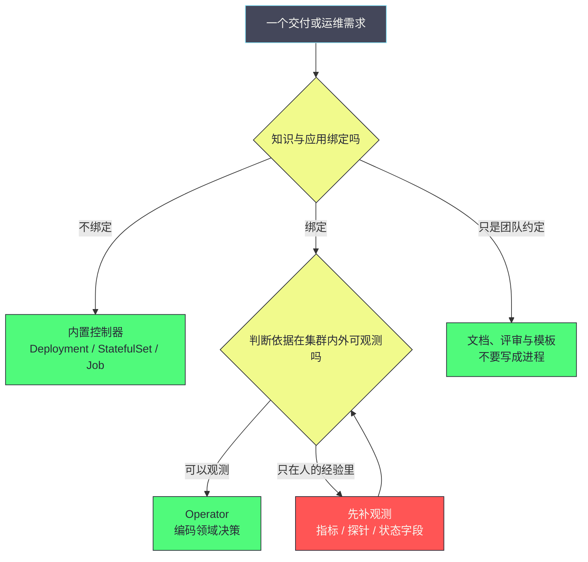
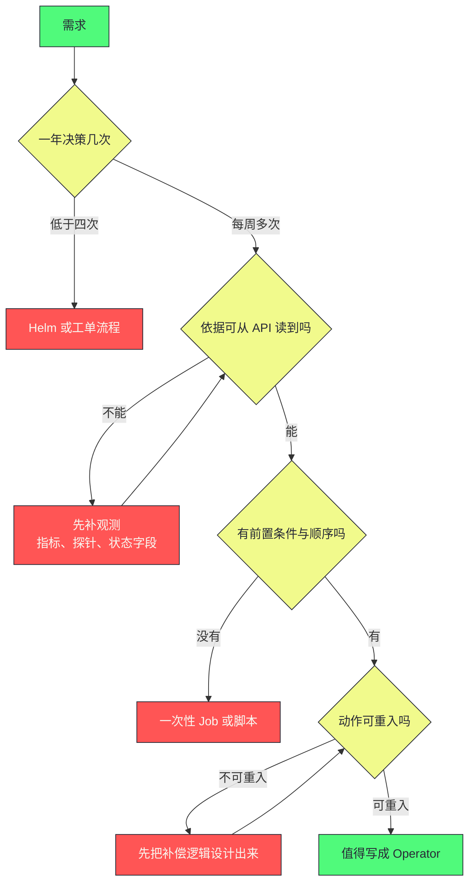
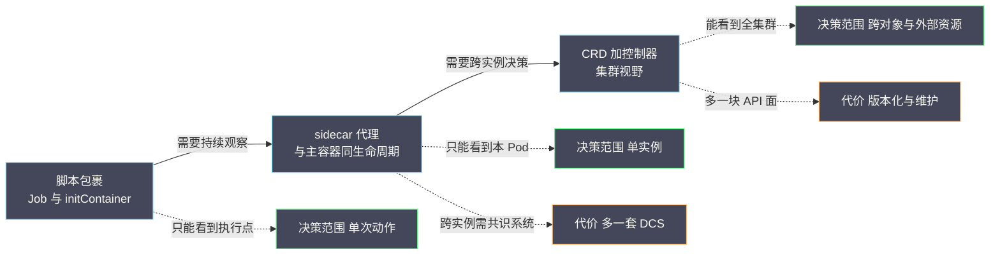
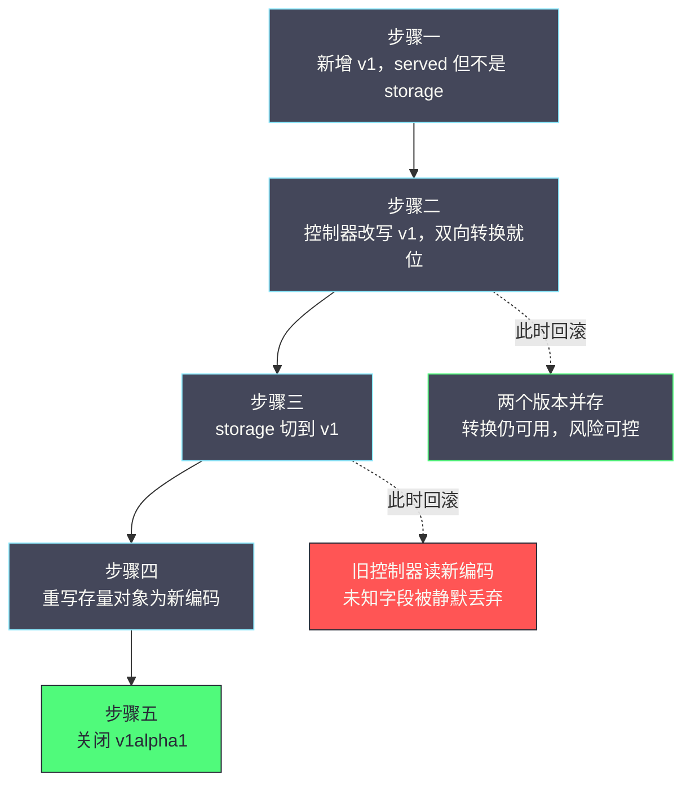
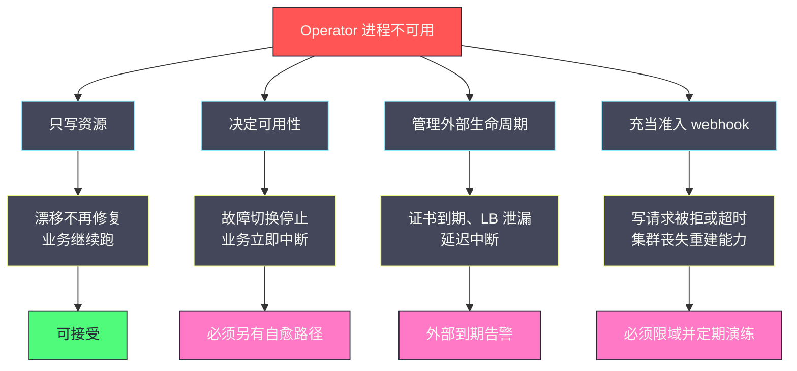
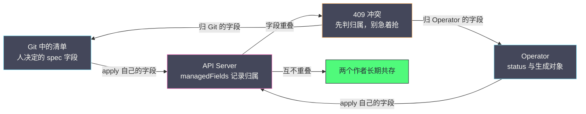

# 06 Operator 模式与自定义控制器

**摘要：**

Operator 在中文技术圈常被讲成 Kubernetes 的"终极扩展能力"，于是团队面对任何稍微复杂一点的交付需求，第一反应都是写一个 Operator。本篇把问题反过来问：什么时候值得写，写下去之后要付哪些账。前半部分先给出准确定位——Operator 编码的不是部署动作，而是领域专家在具体事件下做的判断；接着给出四条正向判据与四条反向信号，用"Kafka Topic 治理"这个需求的完整判定过程做示范，并把实现分成脚本包裹、sidecar 代理、CRD 加控制器三层，逐层列出能力边界与代价。后半部分拆 CRD 本身的账：`v1alpha1` 到 `v1` 的转换 webhook 如何变成一条新的可用性依赖，`kubectl` 生态需要补齐哪些子资源与列，storage 版本迁移的正确顺序，以及回滚 Operator 时两条静默丢字段的路径。之后讨论控制器质量的五条判据、"Operator 挂了会怎样"的四种依赖形态、与 GitOps 争夺同一字段的四类冲突，以及 OperatorHub 的质量参差、CRD 膨胀与三维护兼容矩阵。结尾用五个反例收束：给无状态服务写 Operator、把 CRD 字段留成自由 map、把业务逻辑塞进 reconcile、status 里没有 conditions、把 Operator 当成配置注入器。

---

## 第 1 章 装得进去，未必撤得出来

### 1.1 一次资产盘点

一支八人的 SRE 团队维护着三个集群，生产一百二十个节点、预发二十个、测试十个。季度资产盘点要求回答一个问题：集群里有哪些不是 Kubernetes 原生的 API 对象，各自归谁。第一行命令是 `kubectl get crd | wc -l`，输出 63。

逐条对照下来，能立刻说清归属的四十八条，剩下十五条里，九条来自一个一年半前试用过、后来 `helm uninstall` 过两次的 Operator，另有六条连 API group 都不敢确认是谁注册的。真正的麻烦在清理阶段：删掉已经没人用的 CRD 之前，得先确认下面还有没有 CR 实例。查下去发现七个 CR 卡在 `Terminating`，删除时间戳是几个月前——它们的 finalizer 由那个已被卸载的控制器负责移除，控制器不在了，这个闸门就永远合不上。最后只能人工去 Kafka 那边核对 topic 实际状态、确认外部资源归属，再逐个强摘 finalizer。

装进去只要一个 `kubectl apply`，撤出来要三小时。这条不对称是理解 Operator 代价的起点：它往集群里租下的不只是几十个对象，还是一块**扩展出来的 API 面**，以及这块 API 面上所有存量数据的解释权。

### 1.2 它编码的不是部署，是判断

把 Operator 说成"自动部署有状态应用"，听起来最容易懂，但按这个理解去判定需求一定会跑偏，因为任何 Helm chart 加上一个失败重试循环都符合描述。更准确的定位是：Operator 把**领域专家在具体事件下做的判断**，编码成一段可以在无人值守时反复执行的决策逻辑。

判断的归属决定了工具的选择，而不是反过来。

| 决策场景 | 谁在做决定 | 决定发生的时刻 |
| :--- | :--- | :--- |
| 渲染一份清单 | 写 chart 的人 | 一次，`helm upgrade` 时 |
| 迁移前检查 schema | 写脚本的人 | 一次，Job 执行时 |
| 主库挂了切不切 | 值班的人 | 每次故障，人必须在场 |
| 分区该不该再扩 | 控制器代码 | 持续，每轮协调时 |

四种安排的分界线不在"自动化程度"，而在**判断从谁的身上挪到了哪里**。挪进常驻进程的好处是决策不再依赖人的响应速度和记忆；代价是这个判断一旦写错，错误也会以代码的速度被持续重复执行，而且没有人会在中途喊停。这也是为什么本篇的顺序是先判据、后实现——写错一个脚本最多跑一次，写错一个控制器会跑一整年。

### 1.3 适用域从哪来

Operator 概念由 CoreOS 的 Brandon Philips 在 2016 年提出，动因很具体：数据库、消息队列这类系统搬上 Kubernetes 之后，manifest 能表达"要几个副本、挂哪个存储类"，表达不了"主库挂了怎么切、备份做完没有、升级要不要先升从库"。

内置控制器已经把与应用无关的通用编排知识编码完了。ReplicaSet 知道怎么维持副本数，Deployment 知道怎么滚动，StatefulSet 知道怎么给每个成员一个稳定身份和启动顺序，Job 知道失败重试到几次为止。这些知识对任何应用都成立，所以可以放进 Kubernetes 本体，由所有使用者共享。

剩下的知识与具体应用强绑定：MySQL 的复制拓扑与半同步确认，Kafka 的分区再平衡与 ISR 收缩，Ceph 的 PG 分布与恢复限速。这类知识既不适合塞进 Kubernetes 内核——内核不可能认识每一种数据库，也不适合留在人的脑子里——人的可用性在四个选项里最差。Operator 是这两个极端中间的那一层。

所以判定的第一步是三元划分：这个需求里的知识，属于通用编排知识、应用领域知识，还是本团队的运维约定。三者分别对应内置控制器与 Helm、Operator、内部平台与文档。把这三种混在一起看，就会得出"什么都需要 Operator"的结论，而实际上大多数"需要"落在了第三类——约定应该写在文档和评审流程里，不该写成一个常驻进程。



协调循环本身怎么运转、informer 与 workqueue 如何配合，属于机制层的内容，[[云原生/Kubernetes/Kubernetes架构深度剖析/09 控制器模式与协调循环：从 Deployment 到 Operator|控制器模式与协调循环]]一文已经拆得很细；CRD 的结构字段与 controller-runtime 的组件也已在[[云原生/Kubernetes/Kubernetes架构深度剖析/12 CRD 与 Operator 模式：自定义控制器与扩展 K8s|CRD 与 Operator 模式]]里讲完。本篇只回答两个问题：该不该写，写了要付什么。

---

## 第 2 章 判据：要持续决策，不要一次部署

### 2.1 两种需求的形状

部署需求和运维需求的差别**不在复杂度，而在形状**。部署需求有终点，运维需求没有。

| 维度 | 部署需求 | 运维需求 |
| :--- | :--- | :--- |
| 终止条件 | 资源创建完成即结束 | 永续，只要系统还在跑 |
| 正确性定义 | 结果与清单一致 | 偏离之后能收回来 |
| 失败处理 | 人重跑一次 | 系统自己重试并退避 |
| 验收方式 | diff 为空 | 状态收敛、告警消失 |
| 典型变更频率 | 随版本发布 | 随故障与负载，随时 |
| 合适工具 | Helm、Kustomize | 控制器 |

Helm 这类交付工具的模型是"渲染、提交、结束"，提交之后世界怎么变，工具不再表态，它的代价与边界在[[05 应用交付——Helm Kustomize 与 GitOps|应用交付工具链]]里已经算过。Operator 补的正是"提交之后"这一段：那份被提交的清单，谁来保证它在三个月后仍然是当初想要的样子，谁来在数据库主库挂掉时做那个决定。

把运维需求塞进部署工具，表现是每次出问题都要人上去重新 apply 一遍。这个动作很多团队已经做得太熟练，以至于不再被认为是缺陷。

### 2.2 四条正向判据与四条反向信号

判据要能被回答，不能停留在"复杂就该用"。下面**四条正向判据**按顺序问，任一条答案为否，都应当停下来。

| 判据 | 问法 | 通过的样子 | 不通过的样子 |
| :--- | :--- | :--- | :--- |
| 决策反复发生 | 这个判断一年做几次 | 每周、每天甚至每分钟 | 一季度一次都不到 |
| 依据可观测 | 判断所需的现场状态从哪读 | 能从 API、指标或探针读到 | 只有人看监控截图才能判断 |
| 有前置条件 | 动作能不能一次做完 | 需要先 A 后 B，且期间要保持某个中间态 | 一次 apply 就能写全 |
| 动作可重入 | 重复执行会怎样 | 幂等，或者有明确的补偿 | 重复执行会重复扣款、重复下发 |

四条全过，才轮到讨论实现层次。除此之外还有四条反向信号，出现任何一条都应当把方案退回去重想：

- 需求的全部内容是"把这些对象创建出来"，一次 apply 能写完。
- 决策频率低到每个季度一次，写自动化的回本周期超过三年。
- 判断依据不可观测，控制器只能靠人喂结论，那它只是一个更贵的工单系统。
- 团队里找不到一年后愿意接手这段代码的人，而这段代码会成为集群里唯一没人读得懂的组件。

最后一条常被忽略，但它比技术判据更硬。一个无人维护的 Operator 比没有 Operator 更糟：它占着一块 API 面，阻止别人重新设计，还可能在某个 K8s 版本升级后突然崩溃。

### 2.3 一次完整的判定

设想一个具体需求：团队用 Kafka 承载日志与埋点，topic 数量在一年里从四十个涨到三百个。每次变更——新建 topic、扩分区、改 retention——都要提工单，由值班同学在 Kafka 上手工执行。有人提议写一个 Operator。

逐条过判据。频率：一年约一百二十次变更，平均每周两三次，属于反复发生。依据：分区数、ISR、retention 都能从 Kafka 的 Admin API 读到，虽然不在 Kubernetes 的 API 里，但控制器完全可以自己去拉，可观测这一条成立，只是要多维护一个客户端。前置条件：分区数只能增不能减，扩容之后要等再均衡完成才能确认结果，改 retention 前要确认没有消费者依赖旧的保留时长，顺序依赖明确。可重入：创建 topic 在已存在时是幂等返回，alter 操作同样幂等，成立。至于"错了多疼"：分区数不可回退，一次误操作无法撤销，这一条给的是正向理由，机器来守这条规则比人可靠。

四条全过，结论是这个需求值得写，但只写 topic 生命周期这一小块，不碰集群部署。集群部署交给现成的 chart，因为那部分需求属于"一次 apply 能写完"，不满足第三条判据。

接着算账。人工成本：一百二十次变更，每次含审批、执行、核对约二十分钟，一年四十小时上下。自研成本：首版按十二人日估算约九十六人时，之后每年跟着 Kubernetes 版本与 Kafka 版本做回归约五人日，CRD 与 Operator 的版本维护、值班交接、文档另计。光看这两组数字，两年之内自研是亏的。

这笔算术是笔者最想让读者记住的部分：拿**省人力**当理由，通常撑不住。Operator 真正的收益来自另外两处——不可回退的操作被机器挡住，以及变更不再需要等一个特定的人在线。前者降低的是事故率，后者降低的是响应时延，两者都不出现在工时表上，所以容易被算漏。



### 2.4 反例：只是打包部署

最常见的一类错误 Operator，是把 Helm chart 改写成了一个 CRD 加一个只做 `CreateOrUpdate` 的控制器。它的特征是 CR 的 `spec` 与它生成的 StatefulSet 的 `spec` 几乎同构，字段一一对应，reconcile 里没有任何"看现场决定动作"的分支。

这种写法会带来四笔账。第一笔是行为与直觉冲突：用户 `kubectl edit` 改了一个字段想临时调整，控制器下一轮就把它改回去，而用户并不知道自己改的是"期望状态"还是"运行时状态"。第二笔是多了一个必须常驻的进程，也就多了一条控制面故障路径，具体的传播方式见第 5 章。第三笔是它与 Helm 或 GitOps 抢同一个对象的字段，冲突形态见第 6 章。第四笔是 CRD 从此成为要版本化的公共 API，要付第 4 章那一整章的账。

有一条可操作的判据：把 CR 的字段和它生成对象的字段做一次映射，如果八成以上是一一对应的，且 reconcile 里没有依赖外部状态的分支，那它就是一个穿了 Operator 外衣的 chart。退回 Helm 更便宜，还能少一个常驻进程。

---

## 第 3 章 三个实现层次

判定"值得做"之后，下一个问题是做到哪一层。脚本包裹、sidecar 代理、CRD 加控制器，这三层不是从低级到高级的进化关系，而是三种不同的所有权安排，它们能看到的"世界范围"不同。

### 3.1 层次一：脚本包裹

脚本包裹把领域知识写成一段一次性执行的代码，挂在明确的生命周期点上。典型场景是数据库升级前做 schema 兼容性检查：一个 Job 跑检查脚本，输出结构化结果或直接以退出码表态，不通过就中止后续流程。

能力边界很清楚：能在指定时刻执行一段带领域知识的动作，判定结果就是退出码，重试语义由 Job 的 `backoffLimit` 与 `ttlSecondsAfterFinished` 提供，这些字段的行为细节在[[04 DaemonSet Job CronJob 控制器解析|Job 与 CronJob 的行为细节]]里有完整讨论。适合它的需求是"动作有终点，失败重试的代价可以接受"，譬如初始化目录权限、导入初始数据、校验版本兼容性。

代价有三处。脚本没有跨对象的视野，它拿不到集群里别的对象状态，要拿就得给 ServiceAccount 授权，而一旦开始读别的对象再决定做什么，它已经在做控制器的事了，只是用了一种更难维护的方式。Job 的重试语义是"重跑整个容器"，脚本必须自己处理"上次跑到一半"的残留，这段逻辑通常比脚本主体还长。执行结果留在日志里，没有结构化的状态可以被下游查询或告警，于是"上次迁移到底成没成"这个问题永远需要人去翻日志。

### 3.2 层次二：sidecar 代理

sidecar 代理把领域知识放进一个与主容器同生命周期的进程里。Patroni 与 PostgreSQL 同 Pod 部署，是这条路线最常见的形态：它通过本地 socket 检查实例状态，通过数据目录判断是否需要拉起或降级，再通过一个分布式配置存储与其他成员协调选主。

它的优势在于视野的"深度"而不是"广度"。sidecar 能看见主容器的进程、数据目录、本地连接，这些细节通过 API 是拿不到的；它也可以持续观察，而不是只在某个 hook 上被调用一次。代价是它只看得到自己这一个 Pod，跨实例的决定必须另想办法：要么交给一个中心角色（那就回到了控制器），要么交给一个分布式共识系统。Patroni 选了后者，代价是集群里多出一套共识基础设施，收益是没有单点——这是一笔很典型的"把中心决策下移到数据面"的交易，值不值取决于你对控制面停摆的容忍度。

**原生 sidecar** 让这条路更顺：把 `restartPolicy: Always` 写在 init container 上，该容器会在主容器之前启动、在主容器之后退出。这个能力在 1.28 引入 Alpha，1.29 转为 Beta 并默认启用，之后的 GA 版本以对应版本文档为准。它解决两件实际的事：一是生命周期顺序，备份类 sidecar 必须在主进程停止之后才能跑完全量，普通容器做不到这个时序；二是 Job 类 Pod 里普通容器会阻止 Pod 进入完成状态，而 sidecar 不会。

```yaml
# 原生 sidecar：先于主容器就绪，后于主容器退出
initContainers:
  - name: backup-agent
    image: registry.example.com/backup-agent:1.4.2
    restartPolicy: Always        # 这一行把它从 init container 变成 sidecar
    volumeMounts:
      - name: data
        mountPath: /var/lib/mysql
containers:
  - name: mysqld
    image: mysql:8.0
```

代价清单同样具体。sidecar 崩溃会拖住整个 Pod 的就绪判定，kubelet 在计算 Pod 是否 Ready 时把 sidecar 算在内，一个不重要的日志采集容器能让主业务 Pod 永远不就绪。资源占用按 Pod 数线性放大，三百个实例各加 100m CPU，就是三十核的固定开销。日志与主容器混在同一个流里，排查时必须按容器名过滤，运维手册里要写清这一点。

用 sidecar 做集群级决策是明确的反模式：每个副本各持一份判断，结果是脑裂，或者同一个外部动作被重复执行若干次。

### 3.3 层次三：CRD 加控制器

CRD 加控制器换来的是集群级视野和表达能力：能 list 与 watch 其他对象，能把"先 A 后 B"的顺序编译成 status 里的阶段，能管理集群外的资源（云负载均衡、DNS 记录、证书），能被 kubectl 与 GitOps 当作一等公民，能通过 RBAC 精细控制谁能创建什么。

代价同样是集群级的：一个必须高可用的常驻组件，一块需要版本化的 API 面，一条新的控制面故障路径，以及一份长期的维护责任。四笔账在后四章逐一展开。



| 维度 | 脚本包裹 | sidecar 代理 | CRD 加控制器 |
| :--- | :--- | :--- | :--- |
| 决策范围 | 单次动作 | 单实例持续状态 | 跨对象与集群外资源 |
| 能否表达顺序 | 靠脚本内部分支 | 靠本地状态机 | 能，编译成 status 阶段 |
| 能否管外部资源 | 能，但无回收路径 | 能，限于本实例 | 能，配合 finalizer |
| 是否需要新 API | 否 | 否 | 是，且要版本化 |
| 常驻开销 | 无 | 按 Pod 数线性 | 一个高可用组件 |
| 失败影响面 | 单次任务 | 单个 Pod | 全部受管对象 |

社区流传的 Operator 五级成熟度模型（基本安装、无缝升级、全生命周期、深度洞察、自动驾驶）常被当作质量刻度，但它更像能力刻度。第 1、2 级本质上还是打包与版本推进，Helm 能做到大半；**第 3 级**才是 Operator 的本来面目——备份恢复、故障切换、扩缩容决策；第 4、5 级在 OperatorHub 里很少见，多数出现在演示里。判断一个 Operator 值不值，看它在第 3 级上覆盖了多少真实运维决策，比看它自称第几级可靠。

### 3.4 怎么选层

| 需求形状 | 选层 | 理由 |
| :--- | :--- | :--- |
| 一次性初始化、迁移前检查 | 脚本包裹 | 有终点，失败重跑代价可接受 |
| 本实例的持续健康判断与自愈 | sidecar 代理 | 需要本地细节，不需要集群视野 |
| 需要跨实例选主与拓扑维护 | 控制器，或 sidecar 加共识系统 | 中心决策与去中心决策的取舍 |
| 需要管理云上资源并回收 | 控制器加 finalizer | 只有它能在删除路径上执行清理 |
| 只是把对象创建出来 | 都不用 | Helm 或 Kustomize |

选层的关键问题只有一个：这个判断需要看到多大的世界。看到的东西越小，越应该往下走；把只涉及本 Pod 的判断放进控制器，譬如把数据目录的检查也做成一个 CRD，等于平白放大爆炸半径；把需要跨实例的判断放进 sidecar，等于让每个副本各说各话。

---

## 第 4 章 CRD 的代价

### 4.1 发布即合同

CRD 一旦被别人 `apply` 过，`spec` 就是一份合同。Kubernetes 内置资源的 API 演进有弃用策略兜底，一个字段从标记弃用到真正移除通常要跨若干个大版本；CRD 没有这层保护，版本怎么演进完全由 Operator 作者自己安排，集群不提供任何默认的兼容性保证。

| 版本标识 | 隐含承诺 | 允许的破坏性变更 | 迁移成本落在谁身上 |
| :--- | :--- | :--- | :--- |
| `v1alpha1` | 随时可破 | 字段可增可删可改名 | 使用者，通常要改代码 |
| `v1beta1` | 尽量不破 | 可增字段，避免删改 | 使用者，跟着改即可 |
| `v1` | 视为稳定 | 只能增，且需提供转换路径 | 作者，要写转换与迁移 |
| `v2` | 语义变更 | 需要新 group 或新的转换链 | 双方，成本最高 |

团队最容易犯的错是把内部 CRD 直接开在 `v1`，理由是"我们自己的东西不会变"。半年后要改字段结构，才发现补一套转换链的成本，远高于当初多花两天做版本规划。反过来，对外发布的 CRD 长期停在 `v1alpha1`，等于明示"这东西随时会碎"，实际支持成本更高——使用者会各自 fork 一份 schema。

### 4.2 转换 webhook 的隐藏成本

CRD 的 `served` 版本与 `storage` 版本可以不同，落在 etcd 里的只有一种编码，其他版本的读写都要经过转换。转换只支持两种策略：结构同构时用 `None`，结构不同时必须用 webhook。

```yaml
apiVersion: apiextensions.k8s.io/v1
kind: CustomResourceDefinition
metadata:
  name: mqclusters.mq.example.com
spec:
  group: mq.example.com
  conversion:
    strategy: Webhook
    webhook:
      conversionReviewVersions: ["v1"]
      clientConfig:
        service:
          name: mq-conversion
          namespace: mq-system
          path: /convert
        caBundle: LS0t...    # 随证书轮换，忘了更新就是全量读写失败
  versions:
    - name: v1alpha1
      served: true
      storage: false
    - name: v1
      served: true
      storage: true
```

这段**转换 webhook 配置**看起来只是几行 YAML，实际引入的成本有四笔。

第一笔是新的可用性依赖。apiserver 在处理任何非存储版本的读写时，会向这个 webhook 发一个 HTTPS 请求。webhook 不可达，这些请求直接失败。"我只用 `v1`，转换挂了跟我无关"是错的：只要 `v1alpha1` 还是 `served: true`，任何指定了该版本的 list 或 watch 都会走转换，而集群里总有别人的脚本还在用旧版本。

第二笔是它自己的运维面。TLS 证书要有人轮换，`caBundle` 要跟着更新；Service 与 Endpoints 要存在；webhook 要多个副本，要就绪探针，最好还有 PDB。这已经是一个小型在线服务的运维量。

第三笔是转换必须双向无损。hub-and-spoke 模型下，etcd 里只存 hub 版本，`v1alpha1` 读出来是 `v1` 转过去的，写回去又要转回来。任何一侧丢掉信息，round-trip 之后就不可逆——这类 bug 在测试里极难发现，通常表现为"某个字段改了一次之后自己变回去了"。转换逻辑必须配 round-trip 测试。

第四笔是删除顺序。删 CRD 之前要先摘掉 `conversion` 引用，否则 CR 的读出与删除都可能失败，而删除 CRD 又是带走全部 CR 的操作，两者叠在一起很容易卡死。

结论是不值得省的地方别省，但能不上就别上：`strategy: None` 的代价几乎为零，前提是设计阶段就把结构差异吃掉——新字段可选、旧字段保留但忽略。真的需要 webhook 时，让它只做字段搬运，不要在转换里做业务判断，因为它是同步路径，任何阻塞都会直接放大成 API 延迟。

### 4.3 kubectl 生态适配

一块新 API 能不能用，不只由 API 决定，还由它在值班动线里的读法决定。故障时值班同学的第一反应是 `kubectl get` 和 `kubectl describe`，这两个命令如果在新对象上给不出信息，新 API 就只存在于 YAML 里。

| 子命令 | 原生资源 | CRD 默认行为 | 补齐方式 |
| :--- | :--- | :--- | :--- |
| `get` | 有 READY、STATUS 等列 | 只有 NAME 与 AGE | `additionalPrinterColumns` |
| `scale`、HPA | 可用 | 不可用 | `scale` 子资源与副本数路径 |
| `rollout status` | Deployment 等三类 | 不支持 | 自己等 `status.conditions` |
| `get all` | 包含主要内置资源 | 不包含 CR | 自建视图或仪表盘 |
| `explain` | 有完整 schema | schema 留空则无输出 | 显式声明字段 |
| `delete` | 即时删除 | 可能卡在 finalizer | 运维手册写清超时与顺序 |
| `events` | 控制器主动发 | 不发就没有 | 在关键失败点发 Event |

`additionalPrinterColumns` 的收益比它看起来大。没有它，`kubectl get mqclusters` 只剩名字和创建时间，值班要判断二十个实例的状态就得 describe 二十次，按每次三秒算是一分钟，而三分钟往往就是一次故障的开始。列的设计要窄而稳：一列表示可用性，一列表示"正在做什么"，比塞五列数值有用。

```yaml
additionalPrinterColumns:
  - name: Ready
    type: string
    jsonPath: .status.readyReplicas
  - name: Phase
    type: string
    jsonPath: .status.phase
  - name: Age
    type: date
    jsonPath: .metadata.creationTimestamp
```

`scale` 子资源的作用更硬：HPA 的扩缩目标依赖 scale 子资源读写副本数，没有它，自定义资源不能作为 HPA 的 `scaleTargetRef`，`kubectl scale` 也不认这个对象。想让人用熟悉的 `kubectl scale` 而不是 `kubectl patch` 改副本数，就得把子资源声明出来。

```yaml
subresources:
  status: {}
  scale:
    specReplicasPath: .spec.replicas
    statusReplicasPath: .status.availableReplicas
    labelSelectorPath: .status.selector
```

这里有一个容易写错的地方：`statusReplicasPath` 要指向真正可用的副本数，而不是期望副本数。指向期望值，HPA 会按一个虚高的数字计算利用率，扩缩方向会反掉——副本还没起来，指标看起来已经很宽裕，于是一直往下缩。

`rollout` 相关的子命令只认 Deployment、StatefulSet、DaemonSet 三类，任意 CR 都没有 `kubectl rollout status`。这意味着 CI 里"等升级完成"这一步必须改写：轮询 `status.conditions` 里的进度条件，或者由 Operator 暴露一个稳定的"就绪代"字段。GitOps 工具的处境相同，Argo CD 对未知类型只能报进度未知，要自定义健康检查脚本才认得出 CR 的状态。

**条件名称**本身就是接口的一部分。流水线里普遍用 `kubectl wait --for=condition=Ready` 等待就绪，这条命令把条件名硬编码进了脚本；某个版本把 `Ready` 改成 `Available`，所有流水线会在没有任何报错的情况下一直等到超时，人只会看到"部署很慢"。所以条件名应当与字段同等管理，只能新增、不能替换，旧名至少保留一个发布周期。

另一个容易被忽略的差异在 `--dry-run` 的两条路径上。`--dry-run=server` 走的是与真实写入相同的链路，CRD 的 schema 校验、CEL 规则、准入 webhook 都会生效；`--dry-run=client` 只做本地语法检查，对 CR 的自定义字段一无所知。CI 里如果只用后者检查 CR 清单，本该在提交阶段被挡住的字段错误会一路推迟到部署时，而部署时的报错由执行变更的人承担。

### 4.4 存储版本与降级

**存储版本**只能有一个标记为 `storage: true`，切换它不会重写已存对象——存量对象仍是旧版本的编码，读取时按需转换。这个细节最容易被误解成"切完就迁完了"，实际上迁移还没开始。

正确的顺序有五步，每一步都能停下来：

1. 加新版本，`served: true`、`storage: false`，让客户端先能读写。
2. 控制器改为写新版本，双向转换就位并通过 round-trip 测试。
3. 把 `storage: true` 切到新版本，此后新写入使用新编码，存量对象不动。
4. 主动重写存量对象，读出来用新版本写回。可以脚本逐个 replace，也可以用 Kubernetes 在 1.30 之后提供的 `StorageVersionMigration` 一类迁移 API，其成熟度以对应版本文档为准。
5. 确认没有旧版本客户端之后，把旧版本设为 `served: false`。

这个顺序的价值在于"任何一步都能停"：每一步之后集群都处于能读能写的稳定状态，而不是必须一口气做完。反过来，如果一次性把 `served` 与 `storage` 全切，一旦某步出问题，你既没有旧编码可以回退，也没有旧客户端可以对照。

真正需要警惕的是**降级**。把 Operator 回滚到旧版本，是看起来最安全的动作，但它有两条静默丢字段的路径。

第一条在 schema 层。CRD 的 schema 里不存在的字段，写入时会被 apiserver 静默剪掉。旧版本的 Operator 如果带着一份从旧代码生成的 schema 执行 `kubectl apply`，新字段就从 schema 里消失了，存量对象的下一次写入会把这些字段抹掉。

第二条在客户端。旧 Operator 的 Go struct 不认识新字段，读到对象后如果做的是 Update 而不是 Patch，整份对象被写回，未知字段随之丢失。这条路径连 schema 都没变，纯靠一次读改写就完成了数据丢失。

两条路径的共同点是都没有报错，也没有事件，只有某个功能在几天后莫名其妙地不生效。笔者建议把回滚当成一次有损操作来对待：回滚窗口期内冻结 CR 的写入，优先用 Patch 而不是 Update，回滚前备份 CR 对象，并且把"CRD 版本"与"Operator 版本"作为同一个发布单元管理。

还有一条底线：删除 CRD 会级联删除它的全部 CR，一条命令就能带走业务数据。所以 `customresourcedefinitions` 的 delete 权限应当收在管理员手上，普通开发者只给 CR 的读写权限。



---

## 第 5 章 质量判据与缺席时的行为

### 5.1 五条判据

一个 Operator 写得好不好，不需要读完全部代码就能判断，五条判据都能在一分钟内验出来。

| 判据 | 失效时的症状 | 一分钟验法 |
| :--- | :--- | :--- |
| 幂等 | 同一轮重复执行产生额外动作 | 手动改一个 annotation 触发一轮，看写请求增量 |
| 可收敛 | 卡在某个阶段不动，也不知卡在哪 | 看 status 里是否有进行中的条件与原因 |
| 可观测 | describe 的 status 只有阶段字段或空 | 检查是否有条件、原因与已观察到的代数 |
| 不阻塞 | 单轮协调几十分钟，队列积压 | 看协调延迟与队列深度的指标 |
| 可归因 | 日志是自由文本，事件为空 | 检查失败路径的 Event 原因是否稳定枚举 |

幂等与可重入的推导属于范式本身，[[01 控制器模式与协调循环|协调循环的范式]]已经讲透，这里只说一条 Operator 特有的用法：`observedGeneration` 与 `generation` 是否相等，是判断"控制器有没有看过当前这份 spec"的唯一机器可读信号。它比日志可靠，因为日志会滚动，而这两个数字始终在对象上。

可观测这条还要求指标。controller-runtime 内建了 `controller_runtime_reconcile_total`、`controller_runtime_reconcile_errors_total`、`controller_runtime_reconcile_time_seconds` 三组指标，没有接出这些指标的 Operator 在故障时只能靠 grep 日志。指标之外还要看队列：协调延迟上升但错误率为零，通常意味着某一轮阻塞了，队列在积压。

状态要能收敛，还要求每一轮只推进一小步。一次协调里把所有事做完的写法，一旦中途失败就回到原点，用户看到的是"什么都没变"，也看不到失败在哪一步；分成若干步、每步在 status 里留一个阶段，失败就能被定位到具体动作，下一轮也能从那里继续。

### 5.2 缺席的四种形态

设计评审时最有用的问题不是"Operator 怎么写"，而是"它挂了会怎样"。按职责分，Operator 与业务的关系有四种，风险递增。

| Operator 的职责 | 缺席时的表现 | 业务能否自我维持 | 设计对策 |
| :--- | :--- | :--- | :--- |
| 只创建与修复资源 | 不再修复漂移，也不再推进升级 | 能，继续运行 | 可以接受，补告警即可 |
| 决定可用性 | 主库挂了没人切 | 不能，业务中断 | 数据面自愈与中心决策分离 |
| 管理外部生命周期 | 证书到期、负载均衡泄漏 | 不能，延迟中断 | 给外部对象单独设到期告警 |
| 充当准入 webhook | 相关对象创建全部失败 | 不能，写入路径被冻结 | 缩小选择器范围并演练 |

第三种最危险，因为它不是立即故障，而是**延迟中断**。证书还有七十天到期，Controller 挂了没人续，七十天内一切正常，第七十一天全站失败。这类故障的排查时间通常很长，因为故障现场与原因相距三个月。凡是 Operator 管理外部生命周期的地方，譬如证书、DNS 记录、云负载均衡，都必须给外部对象单独设一条到期告警，不能只依赖 Operator 自己上报。

第四种的爆炸半径最大。mutating webhook 的 `timeoutSeconds` 默认十秒，最大三十秒；如果它挂在 Pod 创建的路径上，而 `failurePolicy` 的默认值就是 `Fail`，那么每个 Pod 创建请求都要等满 `timeoutSeconds` 才失败。按示例推算，Deployment 的控制器按批重试，每批一两个 Pod，每轮失败要等满一个超时，把一百个 Pod 拉起来需要几分钟到十几分钟；如果是节点故障后的批量重建，这个时间还要乘以队列里的积压量。此时集群不是"慢了一点"，而是丧失了重建能力。

因此准入 webhook 的设计要点与普通组件相反：缩小 `namespaceSelector` 与 `objectSelector` 范围，把失败策略定成与风险相称的取值，并且在上线前演练一次"把 webhook 杀掉"的后果。演练比评审可靠，因为评审只能发现写下来的问题。



### 5.3 声明式依赖的边界

Operator 的高可用靠选主：多副本部署，只有一个实例真正协调，机制在[[云原生/Kubernetes/Kubernetes架构深度剖析/12 CRD 与 Operator 模式：自定义控制器与扩展 K8s|CRD 与 Operator 模式]]里讲过。但选主只保证 Operator 自身不脑裂，它解决不了切换间隙里没人协调的问题，那个间隙通常是几秒到几十秒。

真正要回答的是另一个问题：暂停三十秒，世界会不会变坏。判断方法也很直接——把 Operator 停掉三十分钟，逐条列出会发生什么。列得出来而且都能接受，才算通过；列不出来，说明依赖关系还没摸清，这比任何设计评审都有效。

还有一条约束值得单独记：Operator 的恢复时间目标必须小于它所守护业务的恢复时间目标。一个 RTO 两分钟的数据库，配一个切换要五分钟的 Operator，等于没有。

### 5.4 测试矩阵：三层各能测出什么

控制器的测试常被写成"单测覆盖率多少"，但覆盖率回答不了关键问题——它测不出 schema 剪枝、测不出准入拒绝、也测不出 kubelet 的行为。三层测试各自能覆盖的范围是明确划分的，选错层次等于没测。

| 层次 | 工具 | 能测出 | 测不出 |
| :--- | :--- | :--- | :--- |
| 单元 | fake client | 分支逻辑、状态计算、错误分支 | schema 校验、并发冲突、字段剪枝 |
| 集成 | envtest 真实 apiserver 与 etcd | 准入、默认值、status 子资源、乐观并发 | kubelet 行为、Pod 真正启动、外部系统 |
| 端到端 | kind 或真实集群 | 完整生命周期、滚动、故障切换 | 规模效应与云上外部依赖 |

fake client 的陷阱在于它太宽容。它不执行 CRD 的 schema 校验，也不做 4.4 节说的字段剪枝，因此"字段被静默丢弃"这类 bug 在单测里永远暴露不出来。凡涉及 CRD schema、版本转换、status 子资源写入的代码，必须用 envtest 覆盖，因为它背后是真实的 apiserver 与 etcd，只有在那里才能观察到"写入被接受但字段消失"这种行为。

envtest 的另一头是它没有 kubelet。Pod 对象可以被创建，状态却永远是假的，控制器里"等 Pod Ready"的分支在集成测试里进不去。很多 Operator 的单测与集成测试都很漂亮，上线后第一件事就是卡在等一个永远不会来的状态，原因就在这里：真实世界里 Pod 会失败、会被驱逐、会在镜像拉取上卡住，而这些状态只能靠 end-to-end 覆盖，或者在集成测试里手工注入。

外部依赖同理。云负载均衡、DNS、对象存储都应当在测试里用可编程的替身，但删除路径必须在真实环境跑一次——finalizer 的清理逻辑只有在对象被删除时才走到，而它恰恰是最容易写错、也最容易在测试里被跳过的一段。

---

## 第 6 章 与 GitOps 争字段

### 6.1 冲突的实质

GitOps 的前提是 Git 为期望状态的唯一来源，集群应当无条件收敛到 Git 的内容。Operator 的前提是期望状态由控制器根据现场计算得出，控制器有权把自己的结论写回对象。两个前提在不同字段上成立时相安无事，落在同一字段上就是互斥的。

所以这不是工具之间打架，而是**两个作者对同一字段的主张**。凡是字段有唯一所有者，问题就不存在；没有明确归属的字段，才会在每轮同步里来回震荡。

### 6.2 四类冲突

| 类别 | 具体形态 | 表现 | 处理方式 |
| :--- | :--- | :--- | :--- |
| 回写 spec | 副本数、当前版本、阶段字段 | 每轮同步后对象抖动，事件里连续 Update | 忽略差异，或让 Git 不写这些字段 |
| 生成对象 | Operator 创建的子资源不在 Git | 本身无害，但有人会顺手写进 Git | 明确所有权：生成对象不由 GitOps 管 |
| status | Git 清单里带 status | apply 被 status 子资源拒绝 | status 永不进 Git |
| 内部状态 | Operator 把进度记在 annotation | 同步抹掉后每轮重算 | 内部状态进 status，不进 metadata |

第一类最典型的是副本数。HPA 与 GitOps 对 `spec.replicas` 的主张天然冲突，配置方式在[[05 应用交付——Helm Kustomize 与 GitOps|应用交付的字段归属处理]]里有具体写法。Operator 的情况比 HPA 更复杂：它回写的不只是副本数，还包括版本、阶段、外部引用等一整组"由控制器算出来的字段"。逐个字段打补丁不可维护，正确做法是维护一份"哪些字段归控制器"的清单，让 Git 只写人决定的字段。

第三类由机制决定，不是风格问题。启用了 `status` 子资源的 CRD，普通 update 无法修改 status，所以 Git 里带 status 的清单会 apply 失败，或者 status 被静默丢弃。这一点比 HPA 的差异处理更硬，没有配置空间。

第四类常被误判成漂移。Operator 在 annotation 上记进度、记"上一次处理到的资源版本"，这些 annotation 一旦被 GitOps 同步抹掉，控制器会以为一切都没做过，从头再跑一遍。表现是同步之后 reconcile 次数突增、外部动作重复执行。解决办法不是加忽略规则，而是把状态放回 status——`metadata.annotations` 属于用户与系统共同写入的区域，`status` 才是控制器的地盘。

### 6.3 字段所有权与 Server-Side Apply

Server-Side Apply 把字段所有权从约定变成机制：它用 `managedFields` 记录每个 field manager 拥有哪些字段，冲突时返回 409 而不是静默覆盖。对 Operator 来说，这意味着可以让控制器只接管它该管的字段。

```go
// 只 apply 控制器拥有的字段，冲突时报错而不是覆盖
obj := buildDesired(cr)
err := r.Patch(ctx, obj, client.Apply,
    client.FieldOwner("mq-operator"))
// 收到 409 时应当判断归属，而不是直接加 ForceOwnership 抢过来
```

不过 SSA 只让冲突显式化，不会消除冲突，而且它自己有边界：列表字段默认按 atomic 处理，控制器一旦 apply 就整份接管列表，用户对列表的局部修改会被判成冲突或被覆盖。要支持"用户与控制器共同维护一个列表"，schema 里必须声明 `listType` 与 `listMapKey`，这属于设计阶段的工作，事后补不了。

所以 SSA 是工具，解法仍然是分工：Git 管 `spec` 里由人决定的字段，Operator 管 status 以及它生成的对象，两边都不碰对方的地盘。



### 6.4 Operator 自身的版本

Operator 自己的 Deployment、它的 CRD、它管理的 CR，是三个发布单元。升级顺序错了会出现两种错配：新的 CRD 配旧的 Operator，旧代码不认识新字段，一次读改写就把字段丢了，路径见 4.4 节；旧的 CRD 配新的 Operator，新字段的 apply 直接被 schema 拒绝。

对策是把三者排成有序的三段：先 CRD，再 Operator，最后 CR。GitOps 的同步波次（sync wave）正好能表达这个顺序，具体机制见[[05 应用交付——Helm Kustomize 与 GitOps|应用交付的同步波次]]。这也说明一件事：Operator 的升级窗口本质上是一次 API 升级，不能用滚动发布的心态对待——滚动发布期间新旧两个版本的 Operator 会同时存在，而它们对同一个 CRD 的理解可能不一样。

---

## 第 7 章 生态现实

### 7.1 目录里的质量参差

OperatorHub 一类目录的价值在于"有一个统一入口能看到别人踩过的坑"，而不是质量担保。目录里的成熟度标签由发布者自己填，认证流程主要覆盖打包规范与元数据完整性，不覆盖控制逻辑是否正确。装上之后能不能用，取决于作者在多少真实环境里跑过。

抽检一个 Operator 只需要看几处，顺序按投入产出排：

| 检查项 | 看什么 | 危险信号 |
| :--- | :--- | :--- |
| CRD 版本 | 是否 `apiextensions.k8s.io/v1`、schema 是否完整 | 停在 `v1beta1`，或 schema 大段留空 |
| 状态表达 | status 里有没有条件与原因 | 只有 `phase`，或者 status 是空的 |
| 权限 | ClusterRole 的规则范围 | 直接给 `cluster-admin` |
| 清理路径 | 有没有 finalizer、删得掉吗 | 有 finalizer 但没写清理逻辑 |
| 镜像 | 仓库归属与 tag 策略 | 用了 `latest`，或仓库与项目无关 |
| 活跃度 | 最近提交与发布节奏 | 一年没有提交，而 K8s 每季度一个版本 |
| 兼容声明 | 是否写明支持的 K8s 版本区间 | 只有一句"兼容 Kubernetes" |

按这张表过一遍，多数问题在十分钟内就能发现，譬如权限一栏写着 `cluster-admin` 的，基本可以直接放弃。其中"status 里只有 phase"这一条几乎可以直接判定该 Operator 在故障时无法定位：没有条件就没有原因，没有原因就只能读日志。

### 7.2 CRD 膨胀

按示例推算，二十个 Operator、每个平均三个 CRD，就是六十个；再加上监控、证书、CNI 这些基础组件各自带来的若干个，`kubectl get crd | wc -l` 落在一百上下并不罕见。数量本身不是问题，问题是它带来的三件事。

第一是归属不清。没有人说得清某个 CRD 是谁装的，装它的那个 Helm release 可能早就被 uninstall 了。治理动作是给 CRD 打标签，记录它由哪个 Operator、哪个 release 引入，并把 CRD 纳入资产清单而不是当成隐形对象。

第二是孤儿 API。残留的 CRD 带着 CR，下一次装同 group 的 Operator 时会撞版本；更糟的情况是新 Operator 读到旧 schema 的对象，字段对不上，一次写入就把数据剪掉了。

第三是发现与读取的成本。每个 CRD 都会出现在 discovery 文档里，CRD 越多，`kubectl get` 首次调用越慢，这一点在[[云原生/Kubernetes/Kubernetes架构深度剖析/12 CRD 与 Operator 模式：自定义控制器与扩展 K8s|CRD 与 Operator 模式]]里有具体讨论。它不是致命问题，但会让每次排查的第一步都多花一两秒。

盘点可以用三行命令完成，按 group 分组，再和 `helm list` 对齐：

```bash
# 1 列出全部 CRD 及其 group
kubectl get crd -o custom-columns=NAME:.metadata.name,GROUP:.spec.group
# 2 找出没有归属标签的
kubectl get crd -l '!app.kubernetes.io/managed-by'
# 3 与已安装的 release 对齐
helm list -A
```

### 7.3 三维护兼容矩阵

Operator 的兼容性要按**三个维度**一起看，任一条不匹配都可能表现为"能装上但行为不对"。

| 维度 | 谁做承诺 | 典型踩坑形态 |
| :--- | :--- | :--- |
| Operator 对 Kubernetes | Operator 作者，通常承诺若干个小版本 | API 弃用后旧 Operator 直接崩 |
| Operator 对被管应用 | Operator 作者，与升级路径绑定 | 跨大版本跳跃升级不被支持 |
| CRD 对 Operator | 作者自己，要求同版本发布 | 新字段被旧控制器读改写丢字段 |

Kubernetes 的组件版本偏斜策略只覆盖控制面与 kubelet 之间，不覆盖 CRD 与 Operator。所以"集群升了一个小版本，Operator 还能用吗"这个问题必须由 Operator 的作者回答，而作者的答案写在 release note 里，不在你的 runbook 里。

对策是把这份矩阵抄进自己的升级 runbook：当前 Operator 版本、当前 K8s 版本、当前应用版本、目标版本，以及从现状到目标的完整路径。镜像用 digest 钉住，不要用浮动 tag，因为一次"顺手升到最新"很可能同时踩中三个维度的不兼容。

### 7.4 自研还是采用

| 判据 | 倾向采用现成 | 倾向自研 |
| :--- | :--- | :--- |
| 领域知识归属 | 公开、文档齐全 | 只在你团队内部 |
| 是否差异化 | 不构成竞争力 | 是核心竞争力或特殊拓扑 |
| 维护能力 | 没有控制器开发与运维经验 | 有稳定投入的人 |
| 故障责任 | 可以由上游分担 | 只能自己扛 |

社区里有一种"不要自研 Operator"的立场，理由是绝大多数团队低估了维护成本。这个立场在用现成组件管理 MySQL、PostgreSQL、Kafka 的场景下成立，因为那些领域知识已经被几百个团队验证过，自己再写一遍只是重新踩一遍别人的坑。

但内部系统的领域知识不可能出现在目录里。此时自研是唯一选项，要做的不是说服自己不要写，而是把维护预算先写进计划：一年几次 Kubernetes 升级回归、负责人离职后谁接手、CRD 的版本怎么演进、出问题时的止损手段是什么。这四个问题答不上来，代码写得多漂亮都不该上线。

### 7.5 五个样本的分类

把几个被广泛使用的 Operator 放进前面的框架里过一遍，比记它们的名字有用：

| Operator | 编码的领域决策 | 实现层次 | 它缺席时 |
| :--- | :--- | :--- | :--- |
| prometheus-operator | 抓取目标与告警规则的生成与校验 | 控制器 | 监控配置不再随 CR 变化，旧规则继续生效 |
| cert-manager | 证书的申请、续期与轮换 | 控制器，管外部生命周期 | 静默到证书到期，然后全站失败 |
| Strimzi | Kafka 集群与 topic 的编排、滚动升级 | 控制器 | 集群继续服务，升级与扩缩停止 |
| Rook | Ceph 的拓扑编排、OSD 准备与扩缩容 | 控制器 | 存储继续读写，容量与故障恢复停止 |
| Patroni 一类方案 | 单实例降级、选主与跟随 | sidecar 加共识系统 | 主库故障无人切换，业务中断 |

看最后一列能得出一条规律：它缺席时的表现，取决于它编码的决策离数据面有多近。越靠近可用性决策（选主、切换），缺席越致命；越靠近编排决策（升级、扩缩容），缺席越像一次暂停。这也解释了为什么数据库的选主逻辑通常不放在中心控制器里，而是下移到实例侧的共识系统——把致命的决策放到离数据最近的地方，把可以暂停的决策放到中心。

---

## 第 8 章 五个反例

### 8.1 给无状态服务写 Operator

起点通常是一句"我们有四十个前端服务，手工建太麻烦"。这句话的真实需求是批量创建，而批量创建的正确工具是带模板的 chart 加 CI 里的一次渲染，不是控制器。

写出来的 Operator 只做三件事：创建 Deployment、创建 Service、把 ConfigMap 的某个值拷进环境变量。它没有任何"看现场决定动作"的分支，能提供的唯一能力是漂移修复，而无状态服务的漂移已经被 Deployment 的滚动更新与探针覆盖。

代价是四十个 CR 加一个必须常驻的控制器，以及一块新的 API 面。需求本身用一句"给每个服务建一个 chart 目录"就能满足，多出来的部分全是负债。判据很简单：无状态、不涉及外部资源、没有顺序依赖，三条同时成立就不该是 Operator。

### 8.2 把 CRD 字段留成自由 map

为了让"配置将来好扩展"，把整块配置塞进一个**自由 map**：

```yaml
# 反例：整个 config 是个自由 map，写什么都能进 etcd
properties:
  config:
    type: object
    x-kubernetes-preserve-unknown-fields: true
```

这四条后果会依次出现。校验失效：key 拼错也能写进 etcd，错误从"apply 时被拒绝"推迟到"控制器运行时才炸"。演进不可能：不知道哪些 key 在被使用，因此没法判断哪个能删。工具链失效：`kubectl explain`、`--dry-run=server` 的校验、编辑器的补全、typed client 全部失去依据。交叉校验没有落点：CEL 规则的字段路径必须是 schema 里声明过的，自由结构里没有路径可写。

正确的写法是显式字段加跨字段约束，把校验成本放在写的人身上，而不是值班的人身上：

```yaml
properties:
  replicas:
    type: integer
    minimum: 1
  retentionDays:
    type: integer
    minimum: 1
    maximum: 365
  x-kubernetes-validations:
    - rule: "self.replicas <= 7"
      message: "单集群副本数不超过 7，超过需要走容量评审"
```

确实需要透传第三方原生配置时，给它一个带类型的 `raw` 字段并在文档里注明其不稳定性，是可行的折中；让整个 CR 变成自由结构不是。

### 8.3 把业务逻辑塞进 reconcile

用 Operator 编排业务任务——订单补单、报表生成、跨系统对账——是把 reconcile 当成了调度器。它会在四处出问题。

投递语义不匹配：协调是"至少一次"，订单补单多跑一次就是重复发货。缺少事务：跨资源操作没有原子性，业务要求的一致性模型与最终一致模型对不上。故障域合并：控制面一出问题，业务跟着停摆，本来可以独立演进的两个系统被绑在一起。可观测性错位：业务的追踪链路不在控制面里，业务问题最终要在 controller 的日志里翻。

判定方法只有一个问题：这段逻辑的正确性是否要求"恰好一次"或者"必须在一个事务里"。要求，就不能放在 reconcile；只是把一个状态推向目标、且重复执行无副作用，才可以考虑。运维决策与业务决策的分界就在这里——前者的错误可以靠重试收敛，后者不能。

### 8.4 没有 conditions 的 status

症状是 `kubectl describe` 里 status 只有一个 `phase: Running`，或者干脆是空的。出问题时唯一的线索是日志，而日志会滚动、会被采样、会在 Pod 重启后消失。

代价是连锁的。告警无法基于对象状态，因为 `kube-state-metrics` 读不到条件；值班无法在不看代码的情况下判断控制器有没有处理过当前 spec，因为缺 `observedGeneration`；GitOps 的健康检查无从下手，Argo CD 的自定义健康检查需要 status 里有可判定的字段，没有就只能报"进度未知"。

一套最小的条件集只需要三项：能否使用、正在做什么、为什么不能使用。每项带稳定的原因枚举与人可读的说明，说明里给出下一步动作。这是把可观测性从"外包给 grep"收回到对象上的最小成本，也是最容易被省掉的一项。

### 8.5 把 Operator 当成配置注入器

第五类反例没有那么显眼：用协调循环把一个 ConfigMap 的键值同步成另一个对象里的环境变量、启动参数或配置文件。需求听着合理——"我们的配置文件要跟着上游主题变化"，但这份同步用投影卷、Kustomize 的替换器或一次 CI 渲染就能完成，不需要一个常驻进程。

代价在于它把"配置生效"这个动作绑在了控制器的可用性上。控制器正常运行，配置改动要等下一轮协调加上一次 Pod 滚动才生效；控制器挂了，配置改动永远不生效，而由于它看起来只是一个普通 ConfigMap，没有人会把"配置没生效"和"某个 Operator 挂了"联系起来。更隐蔽的是滚动风暴：控制器把内容写进 Pod 模板，模板一变就触发滚动，模板里的字段如果没有做稳定排序或没有做值比较，每一轮协调都会产生一个新的模板哈希，Pod 被反复重建。

判定很简单：如果这个动作的结果可以由一次渲染完全确定，它就不该发生在集群里。集群里的控制器适合处理"结果取决于现场"的事情，而配置注入的结果取决于 Git 与模板，两者都不在集群里。

---

## 第 9 章 总结

Operator 的定位不是"自动部署有状态应用"，而是把领域专家在具体事件下的判断编码进控制循环。它解决的问题是"有状态系统的运维需要有人在场判断"，不是"部署太麻烦"。这一定位决定了判据的形状：需要判定的不是"能不能自动化"，而是这个判断一年会发生多少次、判断依据是否可观测、动作能不能重入。

代价是四笔账叠在一起的：一块需要版本化的 API 面，一个有自身故障路径的常驻组件，一份与 GitOps 争夺字段所有权的分割协议，以及一份长期的维护责任。这四笔账不会因为 Operator 写得好而消失，只会在写得好的时候变得可控。

所以结论不是"该写"或"不该写"，而是先回答三个问题：这个判断一年发生几次，判断错了有多疼，一年后谁在读这段代码。三个问题都能诚实回答的团队，写出来的 Operator 通常也能活过下一个 Kubernetes 版本。

---

## 参考资料

1. Kubernetes Documentation - Operator pattern：https://kubernetes.io/docs/concepts/extend-kubernetes/operator/
2. Kubernetes Documentation - Versions in CustomResourceDefinitions（多版本与转换）：https://kubernetes.io/docs/tasks/extend-kubernetes/custom-resources/custom-resource-definition-versioning/
3. Kubernetes Documentation - Custom Resources（structural schema 与校验）：https://kubernetes.io/docs/tasks/extend-kubernetes/custom-resources/custom-resource-definitions/
4. Kubebuilder Book - Multiversion tutorial（hub-and-spoke 与 conversion webhook）：https://book.kubebuilder.io/multiversion-tutorial/conversion
5. Kubernetes Documentation - Horizontal Pod Autoscaling（自定义资源的 scale 子资源）：https://kubernetes.io/docs/tasks/run-application/horizontal-pod-autoscale/
6. CNCF TAG App Delivery - Operator White Paper：https://github.com/cncf/tag-app-delivery/blob/main/operator-wg/whitepaper/Operator-WhitePaper_v1-0.md
7. OperatorHub：https://operatorhub.io/
8. Argo CD Documentation - Diffing（ignoreDifferences 与字段归属）：https://argo-cd.readthedocs.io/en/stable/user-guide/diffing/
9. Kubernetes Enhancement Proposal 753 - Sidecar Containers：https://github.com/kubernetes/enhancements/tree/master/keps/sig-node/753-sidecar-containers
10. Kubernetes Documentation - Server-Side Apply：https://kubernetes.io/docs/reference/using-api/server-side-apply/

---

> [!note] 思考题
> 1. 你们集群里 `kubectl get crd | wc -l` 的输出是多少，逐条说得出归属吗？如果说不出，谁应该负责这件事。
> 2. 如果明天把你们依赖的某个 Operator 停掉三十分钟，列出会发生什么；这份清单里有几项会导致业务中断？
> 3. 一个 CRD 要从 `v1alpha1` 演进到 `v1`，你可以在"同构加字段"与"上转换 webhook"之间选，什么条件下必须选后者？
> 4. HPA 与 GitOps 争 `spec.replicas` 的所有权，还有哪些字段会出现同类冲突，你们现在是忽略差异还是取消一方的写权限？
> 5. 你最近一次决定"写个 Operator"的需求，按持续决策、可观测、可重入、值得四条过一遍，还成立吗？