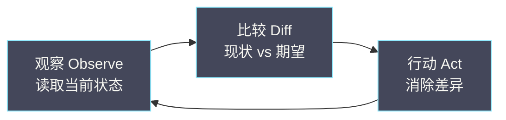
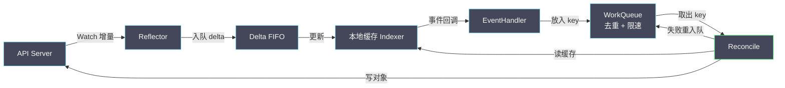
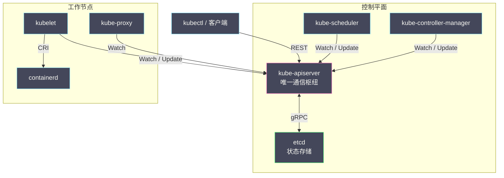
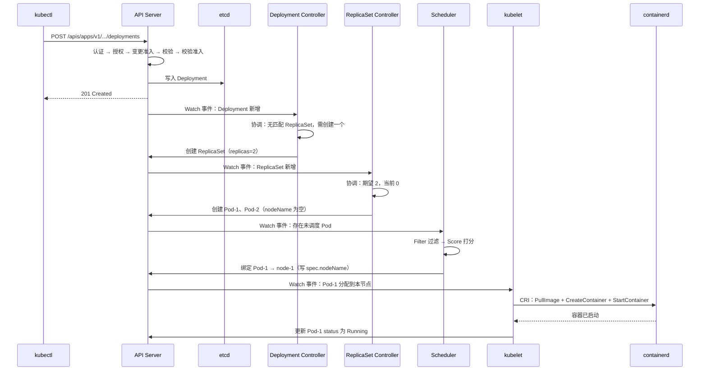

# 01 Kubernetes 的诞生与设计哲学

**摘要：**

Kubernetes 常被描述成"Google 把 Borg 开源了"，这个说法流传很广，却经不起推敲——K8s 与 Borg 的代码几乎没有交集，连调度模型都做了根本性调整。真正被继承下来的是另一件东西：**一套在数万台机器上被反复验证过的、关于"如何让集群自己活下去"的经验**。本文从 2004 年投入使用的 Borg 讲起，经过 2013 年那篇只做实验、从未产品化的 Omega 论文，落到 2014 年面向外部用户重新设计的 Kubernetes，先回答"这三代系统各自解决了什么、又留下了什么教训"，再逐一拆解由此沉淀出的五条设计原则——声明式 API、控制器模式、面向终态、Level-triggered、松耦合架构。每一条原则都会走完"是什么、为什么出现、不这样会怎样、代价是什么"四步，因为**只记住原则的名字，等于什么都没记住**。文中还会专门用一章讨论这些原则彼此冲突的地方，以及一个违反原则的自研控制器会在生产上如何失败。读完这一篇，你应该能对任何一个 K8s 行为反问一句"它是哪条原则的产物"，而不是靠背命令去应付。

---

## 第 1 章 集群管理的三代演进

### 1.1 问题的起点：当故障成为常态

在讨论 Borg 之前，不妨先把问题摆正。集群管理之所以成为一门独立的工程学科，不是因为"机器变多了"这么简单，而是因为**机器的数量越过某个阈值之后，运维的基本假设会集体失效**。

单机时代的运维模型建立在几个默认前提上：机器是可靠的，故障是月级甚至年级事件；应用是少数几个，每个应用独占一批资源；部署是天级操作，可以停机窗口；容量规划靠经验估算，利用率低一点也无所谓。当规模从一台机器扩张到一万台机器时，这四个前提同时崩塌——一万台机器的集群，按千分之二的日故障率计算，每天都有二十台机器在坏；应用数量从几个变成数千个，任何一次手工发布都会变成一场战役；而资源利用率如果还停留在三成，等于每年把七成的机房预算直接扔掉。

Google 在 2004 年前后撞上的正是这堵墙。他们给出的答案不是"招更多运维"，而是**把整个数据中心抽象成一台计算机**，让一个叫 Borg 的系统去承担所有"哪台机器、什么时候、跑什么"的决策。这个抽象后来成为整个云原生世界的原点，但它带来的连锁反应远比"自动化部署"要深——一旦系统开始替人做决策，它就必须自己处理决策失败，于是"自愈"从一个附加功能变成了架构的前提。

### 1.2 第一代 Borg：把数据中心当成一台机器

Borg 于 2004 年起在 Google 内部投入使用，此后运行了十余年，管理着从搜索引擎、Gmail 到 YouTube 的几乎所有生产负载。2015 年，Google 在 EuroSys 上发表了 *Large-scale cluster management at Google with Borg*，外界才第一次看到它的完整设计。一篇论文要等系统跑了十一年才公开，这件事本身就说明了经验的稀缺性。

Borg 的架构可以概括为"一个逻辑上集中、物理上冗余的主控 + 一群无状态的机器"。一个 Borg 管理的机器集合被称为 **cell**，论文给出的中位规模约为一万台机器；每个 cell 有一个逻辑上的 **BorgMaster**，用 Paxos 在五台机器上做副本，负责维护 job、task、alloc 的全部状态；另有一个调度器，负责把 task 绑定到机器上。用户通过 **BCL（Borg Configuration Language）** 描述作业，提交的是一个 JSON 兼容的配置文件，里面写的是"我要多少个副本、每个副本要多少 CPU 和内存、跑哪个二进制、带什么参数"。

这套设计里有三处细节，后来被 K8s 原样继承了下来。

**第一处是资源抽象的分层。** Borg 里最小的资源单位不是机器，而是 **alloc**——一段被预留的、包含 CPU、内存、端口的资源切片。多个 task 可以共享一个 alloc，于是一个 alloc 就变成了"一组必须同生共死的进程"的载体。这个思路在 K8s 里演化成了 Pod：调度器调度的对象不是容器，而是一个共享网络命名空间和存储卷的容器组。笔者以为这是整个演进中最重要的一次抽象升级——它承认了"有些进程天生就该待在一起"这个工程事实。

**第二处是优先级与抢占。** Borg 把负载划分为若干优先级带，从最关键的监控系统、到生产服务、到批处理、再到可以随时被驱逐的免费层。高优先级任务可以抢占低优先级任务的资源，被抢占的任务重新排队。这个机制让 Google 得以把在线服务的空闲资源卖给批处理，把整体利用率推到远高于行业平均的水平。K8s 早期并没有等价的能力，直到 **PriorityClass 与抢占（Preemption）** 在 1.8 之后逐步成熟，才补上了这块拼图——这也从侧面说明，有些能力不是设计时想不到，而是必须等调度器与驱逐机制都稳定之后才敢加。

**第三处是声明式的作业描述。** BCL 描述的是期望状态，而不是操作步骤。用户写"我要三个副本"，Borg 负责把现实拉向这个描述；某个 task 挂了，Borg 会补一个新的。这一点常被误解为"K8s 发明了声明式"，实际上声明式的思想在 Borg 时代就已经是默认做法，K8s 做的是把它从"内部工具的使用习惯"提升为"对外 API 的强制契约"。

**还有一处不那么显眼、却影响深远的设计：资源的超卖与回收。** Borg 并不按用户申请的额度去预留物理资源，而是根据历史用量估算每个 task 的真实消耗，把"申请了但没用满"的那部分空间再卖给别的负载。这个做法的前提是必须有一套足够精细的用量画像，以及一套在资源紧张时能立刻收回空间的手段——后者正是优先级与抢占存在的理由。K8s 在这条路上走得谨慎得多，早期的调度器只看 `requests`，把 `limits` 交给 cgroups 去执行，直到 **VPA** 与 **descheduler** 成熟之后，才逐步具备类似"按实际用量调整申请额度"的能力。这个差异不是能力高低，而是责任边界不同：Google 可以对自己的内部负载做统一画像，K8s 面对的是无数互不认识的租户，超卖一旦失手就是互相踩踏。

再看 Borg 的调度器内部。它把一次调度拆成两个阶段：**可行性检查（feasibility checking）** 找出所有能满足约束的机器，**打分（scoring）** 在候选里挑最优。打分函数是若干维度的加权组合——资源利用率是否均衡、是否会把同一作业的副本打散、机器上是否已经有该作业的镜像。这套"先过滤再打分"的两段式结构，被 K8s 原样继承，只是把可插拔性做得更彻底：K8s 的 Filter 与 Score 都变成了插件，第三方可以在不改核心代码的前提下插入自己的判断。今天你写一个 GPU 拓扑感知的调度插件，用的正是 Borg 在 2004 年就定下的形状。

不过 Borg 也留下了两个明显的包袱。其一是主控的集中程度过高，调度决策全部串行地穿过一个调度器，当 cell 规模继续膨胀、每秒需要做出的调度决策达到数千个时，这个瓶颈就变得刺眼。其二是 Borg 的用户是 Google 内部工程师——他们熟悉分布式系统，能读懂复杂的 BCL，也愿意为了一次错误的配置读三遍文档。这两个包袱，正好是 Omega 和 Kubernetes 各自的起点。

### 1.3 第二代 Omega：把调度器变成可并行的

2013 年，Google 在 EuroSys 上发表了 *Omega: flexible, scalable schedulers for large compute clusters*。Omega 不是 Borg 的替代品，而是一次**关于调度架构的实验**——它要验证的问题是：能不能让多个调度器同时工作，而不牺牲一致性？

Borg 的做法是集中式调度：所有决策排队进入同一个调度器，天然没有冲突，但也天然有上限。Omega 的做法叫**共享状态调度（Shared-state Scheduling）**：把整个 cell 的状态放进一个基于 Paxos 的集中式持久化存储里，多个调度器各自读取这份状态、各自独立地做决策，然后用**乐观并发控制**去提交结果。两个调度器同时看中了同一批资源，先提交的成功，后提交的发现版本已经变了，重新读一遍再试。

这个设计在思想上非常漂亮：它把"调度"从"一个必须串行的关键路径"变成了"一组可以并行、可以失败重试的乐观事务"。但它也暴露了一个残酷的现实——**乐观并发在冲突率高的场景下会退化**。当集群资源紧张、大量调度器争抢同一批空闲资源时，重试次数会急剧上升，实际吞吐反而不如集中式。Omega 最终没有成为 Google 的生产系统，原因之一就在这里。

更值得记取的是 Omega 论文里那句近乎自嘲的判断：共享状态调度的收益，取决于"冲突的概率"与"重试的代价"这两个量的乘积。冲突少的时候，并行带来的吞吐提升远大于重试开销；冲突多的时候，多个调度器实际上是在互相踩脚，谁都走不快。这个判断后来在 K8s 身上以另一种形式重现——K8s 的调度器默认只有一个活跃实例（靠 Leader Election 保证），看似退回了集中式，但它把"并发"转移到了别处：多个 Pod 的调度在单个调度器内部是串行处理的，而控制器的协调则是大量并行的。**K8s 没有解决 Omega 提出的问题，而是绕开了它——把需要串行的部分收窄到最小，把可以并行的部分尽量放大。**

Omega 给 K8s 留下的三样东西，每一样都能在今天的 K8s 里找到对应物。**第一样是"调度器可以是独立进程"**——既然调度器只是共享状态的一个客户端，它就没有理由必须长在主控里，于是 K8s 的 kube-scheduler 成了一个可以替换、可以并存的独立组件。**第二样是"所有状态放在一个支持事务的存储里"**——这个存储后来由 etcd 承担，而乐观并发控制则变成了 `resourceVersion` 与 409 Conflict。**第三样是"冲突是可以被重试消解的"**——这条信念直接塑造了 K8s 控制器的写法：协调失败不是异常，而是常态，重试是设计的一部分。

### 1.4 第三代 Kubernetes：把内部经验翻译给外部

2014 年 6 月，Google 宣布开源 Kubernetes。理解这次开源的定位非常重要：**它不是把 Borg 的代码整理一下放出来，而是一次面向陌生用户的重写**。

重写的动机并不神秘。Borg 的用户是内部工程师，K8s 的用户是全世界——包括那些没听过 Paxos、分不清容器和虚拟机的开发者，也包括那些必须把系统跑在自己机房里的企业。用户群体一变，设计的优先级就全变了：Borg 可以要求用户学习 BCL，K8s 必须让用户用一份 YAML 就能上手；Borg 可以对内部团队统一发版，K8s 必须允许第三方在不改主仓库的前提下扩展能力。

这个"面向陌生人设计"的约束，解释了 K8s 身上许多看起来多余的东西。为什么要有 API 组和版本号？因为要让不同团队独立演进。为什么要有 CRD？因为不能让所有人都来提 PR。为什么要有 admission webhook？因为策略必须由集群所有者定义，而不是由 K8s 作者定义。**这些机制在当时都不是技术上的最优解，而是"必须让外人也能参与"这一社会性约束的产物**。

2015 年 7 月，K8s 发布 1.0；同月，Google 联合 Linux 基金会成立 CNCF，并把 K8s 作为首个项目捐了出去。这个动作常被当作公关事件，但从架构史的角度看，它是"编排之战"的转折点——一个中立的治理结构，让所有云厂商都能放心地把 K8s 当作底座，而不必担心被 Google 卡住。

### 1.5 三代之间真正传承的东西

把三代系统放在一张表里对照，能看到一条清晰的收敛路径：

| 维度 | Borg（2004） | Omega（2013） | Kubernetes（2014） |
| --- | --- | --- | --- |
| 调度架构 | 集中式，单调度器 | 共享状态，多调度器并行 | 独立调度器 + 乐观并发 |
| 状态存储 | 主控内存 + Paxos 副本 | 集中式 Paxos 存储 | etcd |
| 资源抽象 | alloc（资源切片） | alloc | Pod（容器组） |
| 描述方式 | BCL 声明式 | 声明式 | YAML/JSON 声明式 API |
| 用户群体 | Google 内部工程师 | 研究原型 | 外部开发者与平台团队 |
| 扩展方式 | 改 Borg 代码 | 改 Omega 代码 | CRD + 控制器，不改核心 |

由此可以看到，三代系统之间传承的不是代码，也不是某个具体算法，而是**一组关于"什么该由系统负责"的判断**：系统负责把现实拉向描述、负责在失败后重试、负责把资源切片而不是切机器、负责让不同角色在不互相阻塞的前提下协作。K8s 的所谓"设计哲学"，说到底就是把这组判断写成了可执行的契约。

### 1.6 一条贯穿始终的张力：低门槛与高天花板

在进入原则细节之前，还有一条隐含的设计张力值得先摆出来，因为它能解释后面很多看起来自相矛盾的选择：**K8s 既要让一个刚学会写 YAML 的人当天就能跑起来，又要让一个平台团队能在它上面造出一个完整的 PaaS**。

这两个目标在工程上通常是互斥的。为新手优化，就要减少必填字段、提供默认值、隐藏复杂度；为专家优化，就要暴露尽可能多的旋钮、允许替换每一个环节。K8s 的做法不是折中，而是**分层**：核心 API 只保留最小语义，所有领域相关的复杂性都被推到扩展点上去。

这个分层在几个地方表现得特别清楚。Pod 的字段足够简单，一个镜像加一个名字就能跑；但同一个 Pod 又允许挂 init 容器、sidecar、拓扑约束、安全上下文、资源限额，专家可以把每个角落都填满。Service 的默认形态只是一个 ClusterIP 加一组端口；但同一个对象又支持 Headless、ExternalName、拓扑感知路由、流量策略，足以支撑服务网格的底层需求。API 本身只提供内置资源；但 CRD 让任何人都能注册新类型，且注册之后与内置资源享有完全一致的工具链待遇。

用一句话概括这条张力：**K8s 提供的是原语（Primitives），不是成品（Solutions）**。原语的优点是组合自由，缺点是组合的责任在用户身上——你必须自己决定要不要装 ingress controller、要不要上服务网格、用 Helm 还是 Kustomize。这也解释了为什么初学者常觉得 K8s "什么都不给"，而平台团队觉得它"什么都能做"：他们看到的其实是同一套接口的两个面。

明白了这一点，后面五条原则就不再是零散的美德，而是同一条设计路线的不同侧面——它们都在做同一件事：**把复杂度从"必须理解"变成"可以延后理解"**。

---

## 第 2 章 编排之战的胜出逻辑

### 2.1 2014 至 2017 年的三国格局

K8s 开源时，容器编排并不是一片空白。当时有三个主要玩家：Docker 公司自己的 **Swarm**、UC Berkeley AMPLab 出身、被 Twitter 与 Airbnb 大规模使用的 **Mesos + Marathon**、以及刚出生的 Kubernetes。

三者的定位差异很大。Swarm 的卖点是"和 Docker 无缝集成"——一条 `docker swarm init` 就能把几台机器组成集群，学习成本几乎为零。Mesos 的卖点是"通用资源调度器"——它把 CPU 和内存抽象成资源，再通过 framework 把资源分配给上层框架，Marathon 只是其中一个 framework，Spark、Chronos 也能跑在同一个 Mesos 上。K8s 的卖点在当时最不性感：一套啰嗦的 REST API 和一堆 YAML。

把三者的设计取舍摊开来看，胜负的伏笔其实早就埋好了：

| 维度 | Docker Swarm | Mesos + Marathon | Kubernetes |
| --- | --- | --- | --- |
| 抽象层次 | 服务（service） | 资源（resource offer） | 对象（API object） |
| 扩展方式 | 等官方发版 | 写 framework（门槛极高） | CRD + 控制器（门槛低） |
| 状态存储 | 内嵌 Raft（早期） | ZooKeeper | etcd |
| 调度粒度 | 单容器 | 框架自行决定 | Pod |
| 治理结构 | Docker 公司 | Apache 基金会（但生态分散） | CNCF 中立托管 |
| 学习曲线 | 极低 | 极高 | 中等 |

这张表里最容易被忽略的是"抽象层次"这一行。抽象层次决定了系统的**能力上限**，也决定了生态的**生长空间**——服务抽象只能长出配置模板，资源抽象只能长出调度框架，只有对象抽象能长出完整的控制器生态。

2016 年前后，Swarm 一度凭借 Docker 的装机量占据优势；Mesos 则在大型互联网公司里稳住了通用调度的位置。转折发生在 2017 年：Docker 公司在 Docker Enterprise Edition 中宣布原生支持 Kubernetes，等于承认自己在编排层的竞争中退场。此后 Swarm 逐渐退居"单机多容器"的场景，Mesos 则在容器编排这条线上被边缘化，Mesosphere 也在 2019 年改名 D2iQ，转向别的方向。

### 2.2 胜出的三重逻辑

事后总结 K8s 胜出的原因，常见的说法是"Google 的背书"和"CNCF 的中立治理"。这两条都对，但都不足以解释技术层面的胜负。笔者以为真正起作用的是三重逻辑，而且它们互相咬合。

**第一重是可扩展性带来的生态位优势。** Swarm 的能力边界由 Docker 公司定义，用户想要一个新特性，只能等官方排期；Mesos 虽然支持 framework，但 framework 的开发门槛极高，需要理解两层调度的资源报价协议。K8s 的 CRD 加控制器模式把门槛降到了"写一个 Go 程序，Watch 一批对象，改一批对象"——这个门槛低到足以让 Istio、Prometheus Operator、Argo CD、Tekton 这样的项目在几年内长出来。生态一旦形成正反馈，后来者要追的就不是一个产品，而是一整个插件市场。

**第二重是抽象层次选对了。** Swarm 抽象的是"服务"，Mesos 抽象的是"资源"，K8s 抽象的是"对象"。服务抽象太窄——它只能表达"跑几个副本、暴露什么端口"，遇到有状态应用、批处理、守护进程就力不从心；资源抽象太宽——它把"如何编排"完全留给了上层框架，导致每个框架都要重复实现一遍副本管理、滚动更新、服务发现。对象抽象恰好落在中间：它把"编排语义"收进核心，把"领域语义"留给扩展。

**第三重是治理结构消解了厂商疑虑。** 这一点常被低估。如果 K8s 始终是 Google 的项目，AWS、Azure、阿里云在押注时都要考虑"会不会被上游卡脖子"；捐给 CNCF 之后，任何一家云厂商都可以放心地把 K8s 做成自己的托管服务，因为规则不再由单一公司制定。商业上的安全感，直接转化成了基础设施层面的采用速度。

### 2.3 一个反事实推演：如果 Swarm 赢了

反事实推演的价值在于暴露"我们习以为常的东西其实并非必然"。假设 2015 年胜出的是 Swarm，今天的云原生会是什么样子？

最直接的变化是**扩展方式**。Swarm 的扩展依赖 Docker 官方，那么"平台工程"这个职业可能根本不会以现在的形态出现——企业要做的是等待官方版本，而不是自己写 Operator。其次，**声明式的粒度会粗很多**：Swarm 的 service 抽象不支持自定义控制器，意味着任何"业务特定的运维知识"都无法被编码进系统，只能留在人的脑子里。最后，**多集群与 GitOps 的形态会完全不同**：K8s 的 API 可以被任意客户端读写，才有了 Argo CD 这种"把 Git 当唯一真相源"的工具；如果编排层的 API 不可编程，这类工具就无从谈起。

这个推演说明的道理，与后文所有原则共享同一个底色：**K8s 的胜利不是因为它每一项都做得更好，而是因为它把"让别人在它上面继续建造"当成了第一优先级**。这个选择牺牲了短期的简洁性，换来了长期的生态位。

---

## 第 3 章 五大设计原则

### 3.1 声明式 API：只说要什么

**声明式（Declarative）** 的含义是：用户提交一份对最终状态的描述，系统负责计算从当前状态到该状态的路径。与之相对的是**命令式（Imperative）**：用户逐步下达指令，系统逐步执行。

这个区分在教科书里显得很轻，落到工程上却是一道分水岭。命令式的典型形态是一段部署脚本：

```bash
# 命令式：每一步都要人告诉系统怎么做
ssh node-a "docker run -d --name web nginx:1.25"
ssh node-b "docker run -d --name web nginx:1.25"
ssh node-c "docker run -d --name web nginx:1.25"
# 如果 node-b 宕机，脚本不会知道，也不会补一个新副本
```

声明式的形态则是一份对象描述：

```yaml
apiVersion: apps/v1
kind: Deployment
metadata:
  name: web
spec:
  replicas: 3                      # 我要三个副本，怎么做到由系统决定
  selector:
    matchLabels:
      app: web
  template:
    metadata:
      labels:
        app: web
    spec:
      containers:
        - name: nginx
          image: nginx:1.25
```

两者的差别不止是"写法"，而是**失败时的行为**。命令式脚本执行到一半失败，系统停留在一个不确定的中间态——两个副本起来了、一个没起来、脚本已经退出、没人知道下一步该做什么。声明式系统则没有"中间态"这个概念，只有"当前状态与期望状态的差距"，差距存在就继续收敛，失败只是让收敛慢一点。

顺带说明一处细节：上面那份 YAML 里 `spec.selector` 与 `template.metadata.labels` 必须对得上，这不是格式要求，而是"Deployment 如何找到自己的 Pod"的全部依据。这套基于标签的关联机制，是 [[04 Label Selector 与松耦合设计]] 的主题。

把时间线拉长一点看，声明式并不是 K8s 的原创。2005 年前后的 Puppet、2009 年的 Chef、2014 年的 Terraform，走的都是"用代码描述终态、由工具负责收敛"的路子，配置管理领域早就把这条路线摸熟了。K8s 与它们的区别在于**收敛的持续性**：Puppet 和 Chef 的收敛发生在一次 agent run 里，run 结束就结束，两次 run 之间系统漂移了也没人管；Terraform 的 apply 是一次性动作，执行完就退出，后续的漂移要靠 `plan` 重新发现。K8s 把收敛做成了一个**永不退出的常驻循环**，对象的期望状态始终在场，任何偏离都会被下一次协调发现。

这个区别听起来只是"频率不同"，实际影响却很大。一次性收敛的系统里，"当前状态"是一个需要重新采集的外部事实；常驻收敛的系统里，"当前状态"本身就是集群里的一等对象（也就是 status），可以被查询、被审计、被其他组件消费。前者像是定期体检，后者像是持续监护——**只有后者才能支撑"自愈"这个承诺**。

声明式的价值可以拆成四条，每一条都对应一个具体的工程痛点。

**幂等性**：同一份描述提交十次和提交一次，结果一样。这一条看似平常，却是 GitOps 的地基——Argo CD 每隔几分钟就把 Git 里的描述重新 apply 一遍，靠的就是幂等。

**自愈**：系统持续比较现状与期望，差异即行动。这一条让"运维"从"盯着告警手动补副本"变成了"检查系统是否还在收敛"。

**可审计**：描述可以进 Git，变更历史就是 `git log`。"谁在什么时候把副本数从 3 改成 5"这个问题，在命令式体系里要靠翻操作日志，在声明式体系里是一条 commit。

**可协作**：多个角色（用户、控制器、准入 webhook、HPA）会同时修改同一个对象，声明式配合乐观并发控制，能让每次修改都基于最新版本，冲突显式暴露而不是静默覆盖。

不过声明式并非没有代价。它把"如何做"交给了系统，也就把"如何调试"变成了黑盒问题——用户看到的是"我改了 YAML，但没生效"，需要理解控制器、调度器、kubelet 三层的协调才能定位。这一点在第 4 章还会展开。

### 3.2 控制器模式：观察、比较、行动

如果声明式回答的是"用户怎么表达意图"，控制器模式回答的就是"系统怎么把意图变成现实"。

一个控制器本质上是一个永不结束的循环，做三件事：**观察**当前状态、**比较**当前状态与期望状态的差异、**行动**消除差异。这个循环在 K8s 的语境里叫 **Reconcile Loop（协调循环）**，也叫控制循环。



这个模式并非 K8s 的发明，物理世界里到处都是它的影子。**空调的恒温器**就是最经典的例子：用户设定 25℃，传感器读到 28℃，差值是 3℃，于是启动制冷；制冷到 25℃ 时差值归零，停止；温度回升到 26℃，差值又出现，再次启动。请注意恒温器的一个关键特征——**它不记得自己五分钟前是否开过制冷**，每次判断都只看"现在多少度、目标多少度"。

这一点非常重要，因为它解释了 K8s 控制器为什么能扛住重启。以 ReplicaSet 控制器为例，它的协调逻辑可以写成这样一段伪代码：

```text
reconcile(replicaSet):
    desired = replicaSet.spec.replicas          # 期望 3 个
    current = listPods(matching selector)       # 当前 2 个
    diff    = desired - len(current)            # 差 1 个

    if diff > 0:      createPods(diff)          # 补 1 个
    elif diff < 0:    deletePods(-diff)         # 删掉多余的
    # diff == 0 时什么都不做
```

整段逻辑里没有任何"上次处理到哪了"的状态。控制器进程被杀掉再拉起来，它读到的仍然是"期望 3、当前 2"，于是继续补一个。**这种无状态性，是 K8s 能在组件频繁重启的分布式环境里保持正确的前提**。

真实控制器当然比这段伪代码复杂，但复杂的地方不在算法，而在**如何把成千上万个对象的变化高效地喂给一个串行的协调函数**。K8s 的答案是三段式管线：Informer 负责把 API Server 的变更同步到本地缓存，WorkQueue 负责把"需要协调的对象 key"排队去重，Reconcile 负责消费队列。三者各司其职，缺一不可。

Informer 的价值在于**把读压力挡在本地**。每个控制器都持有一份自己关心的对象的完整缓存，协调时读缓存而不是读 API Server——在数万 Pod 的集群里，这个差别决定了 API Server 会不会被打爆。WorkQueue 的价值在于**把突发流量削平**：同一个对象在一秒内被改了十次，队列里只会留一个 key，协调函数只跑一次；协调失败时按指数退避重新入队，而不是立刻重试把下游压垮。Reconcile 则被要求做到幂等——同一个 key 处理一次和处理三次，结果必须一样。



这条管线解释了控制器代码里一个反直觉的现象：**你几乎看不到"事件处理逻辑"**。事件回调只做一件事——把 key 丢进队列，剩下的全部交给 Reconcile。这正是电平触发原则在代码层面的体现：事件只是"叫醒"，状态才是"依据"。

K8s 内置了数十个控制器——Deployment、ReplicaSet、StatefulSet、DaemonSet、Job、Node、EndpointSlice、Namespace、ServiceAccount、Garbage Collector 等等，它们都跑在 kube-controller-manager 这一个进程里。这些控制器的逐个实现，在 [[云原生/Kubernetes/kubernetes控制器和调度器/00 专栏导览|控制器和调度器专栏]] 里有完整展开；本文只关心它们共享的那套形状。放在同一个进程主要是为了运维方便（管一个进程比管几十个进程简单），但逻辑上它们彼此完全独立：各自持有自己的 Informer 缓存，各自跑自己的协调循环，互不阻塞。任何一个控制器的 Reconcile 卡住，只会拖慢它自己负责的那类资源，不会让别的控制器停摆——这也是一种故障隔离，只不过隔离的粒度是"控制器"而不是"进程"。

### 3.3 面向终态：spec 与 status 的契约

控制器模式讲的是"怎么循环"，面向终态讲的是"循环围绕什么展开"。K8s 的答案是：围绕每个对象的 **spec** 与 **status** 这对字段。

传统的运维脚本是**过程驱动**的：先停 A，再启 B，然后改 C 的配置，最后重启 D。这类脚本的脆弱之处在于它对"顺序"的依赖——第三步失败，前两步的副作用已经发生，系统停在一个既不是旧状态也不是新状态的地方，只能靠人判断如何回滚。

K8s 是**终态驱动**的：用户只写"最终要什么样"，系统从任何起点出发都能走到那里。这个能力的技术基础，就是 spec 与 status 的分离。

```yaml
apiVersion: apps/v1
kind: Deployment
metadata:
  name: web
spec:                       # 用户写：期望状态
  replicas: 3
  template:
    spec:
      containers:
        - name: nginx
          image: nginx:1.25
status:                     # 控制器写：当前状态
  replicas: 2
  readyReplicas: 2
  updatedReplicas: 2
  conditions:
    - type: Available
      status: "True"
```

控制器的工作，就是不断把 `status` 拉向 `spec`。`status.replicas` 是 2、`spec.replicas` 是 3，就补一个；补上之后两者相等，就什么都不做。这对字段的完整语义（谁有写权限、走哪个子资源、哪些对象根本没有 status）在 [[03 API 对象模型与 GVR 体系]] 里有专门的拆解。

这里有一个容易被忽略的机制细节：**spec 与 status 的写入权限是分离的**，它们走的是不同的 API 子资源路径。

```text
PUT /apis/apps/v1/namespaces/default/deployments/web          # 用户改 spec
PUT /apis/apps/v1/namespaces/default/deployments/web/status   # 控制器改 status
```

分离的理由很实际：如果两者共用一个路径，用户一次 `kubectl apply` 就可能把控制器刚写进去的 status 覆盖掉，反之亦然；更麻烦的是，status 的写入不应该触发完整的准入校验链，否则一个 webhook 的抖动就能让整个集群的状态汇报卡住。**把"用户意图"和"系统汇报"拆成两条写入通道，是 K8s 对象模型里最实用的一处设计**。

顺带一提，并非所有对象都有 status。ConfigMap、Secret 这类"纯数据"对象就没有——它们没有"当前状态"可言，只有用户给定的内容。这个例外恰好印证了规则：status 的存在意义是承载"系统对现实的观测"，没有观测需求的对象自然不需要它。

### 3.4 Level-triggered：只看现在，不问来路

这一条是五条原则里最精妙、也最容易被跳过的。它的名字借自数字电路：**边缘触发（Edge-triggered）** 只在信号跳变的瞬间响应，**电平触发（Level-triggered）** 只要信号处于某个电平就持续响应。

差别用一个温度报警的例子就能说清。边缘触发的规则是"温度从 24℃ 跳到 26℃ 的那一刻报警"——如果你当时不在，或者系统正好重启，这个瞬间就永远错过了，哪怕温度一直停在 26℃。电平触发的规则是"只要温度高于 25℃ 就报警"——不管你什么时候来看，只要条件还成立，报警就还在。

分布式系统里，**事件是会丢的**。网络会抖，进程会崩，消息队列会积压。如果 K8s 是边缘触发的，那么"创建 Deployment 的事件"一旦在控制器重启期间丢失，这个 Deployment 就永远不会有 Pod——系统不会自愈，只会静默地卡住。

考虑这样一个时间线：

```text
T1  用户创建 Deployment，replicas=3
T2  Deployment Controller 收到事件，创建了 2 个 Pod
T3  控制器崩溃，重启
T4  控制器恢复运行
```

边缘触发的实现会在 T4 之后无事可做——"创建事件"已经消费过了。电平触发的实现会在 T4 之后重新读一遍现状："spec 说 3 个，现在 2 个"，于是补上第 3 个。

**K8s 的控制器全部是电平触发的**：Watch 事件只是"提前叫醒"的手段，不是决策的依据。即使一个事件都没收到，控制器也会通过周期性的 **Resync** 把本地缓存里的所有对象重新入队一遍，逼着自己重新对账。这里有个容易误解的细节——Resync 并不会重新访问 API Server，它只是把缓存里已有的对象重新投递给事件处理器，所以代价远低于一次全量 List；kube-controller-manager 对多数控制器使用的重新同步周期是 12 小时，可以通过 `--min-resync-period` 调整。Resync 因此更像一次兜底的自我怀疑，而不是一次周期性的全量拉取。

两种触发模型放在一起对比，差异一目了然：

| 维度 | Edge-triggered | Level-triggered |
| --- | --- | --- |
| 决策依据 | 发生了什么事件 | 现在是什么状态 |
| 事件丢失 | 永久错过，系统卡死 | 无影响，下次对账自动补齐 |
| 组件重启 | 需要重放事件流才能恢复 | 直接读当前状态即可恢复 |
| 重复事件 | 可能被重复处理，需要去重 | 天然幂等，重复处理无副作用 |
| 计算成本 | 只在事件到来时计算 | 周期性重算，存在无效协调 |
| 典型失败模式 | 漏事件导致状态漂移 | 收敛延迟、状态抖动引发自激 |

K8s 选后者，是因为在分布式环境里"事件一定丢"不是概率问题而是时间问题。真正需要权衡的从来不是"要不要电平触发"，而是"用多长的周期兜底"——周期太短，无效协调吃掉 CPU；周期太长，异常状态的发现会变慢。

这条原则对写 Operator 的人有直接的约束力。Reconcile 函数必须做到"给定当前状态，算出该做什么"，而不能依赖"我是被哪个事件触发的"。实践中常见的错误是在 Reconcile 里判断事件类型（是 ADD 还是 UPDATE），然后走不同分支——这种写法在重启、缓存重建、Resync 之后必然出错，因为那时根本没有"事件类型"这回事。

### 3.5 松耦合：所有对话都经过同一个前台

最后一条原则管的是组件之间怎么说话。K8s 的答案是：**谁也不许直接找谁，所有通信都经过 API Server**。这种形态被称为 **Hub-and-Spoke（轮毂-辐条）**。



这张图里最值得琢磨的是几条"不存在"的连线：调度器和 kubelet 之间没有连接，控制器和容器运行时之间没有连接，kube-proxy 和 Service 的后端 Pod 之间也没有连接。所有信息都通过 API 对象中转。

具体来说，调度器决定了一个 Pod 该去哪个节点之后，它做的唯一一件事是**把 `spec.nodeName` 写进去**。kubelet 在自己的 Watch 流里看到"有一个 Pod 被分配到了我这儿"，才开始拉镜像、起容器。调度器从始至终不知道 kubelet 的存在。同理，Deployment 控制器从不创建容器，它只创建 ReplicaSet 对象；ReplicaSet 控制器只创建 Pod 对象；真正碰容器的是 kubelet。

这条铁律在实现上还有一层更硬的约束：**只有 API Server 直接与 etcd 通信**，其余所有组件都是 API Server 的客户端。这层约束有三重含义，每一重都对应一个具体的工程收益。其一，API Server 封装了 etcd 的读写细节，对外只暴露结构化的 REST 语义，组件不需要知道 key 长什么样、序列化用什么格式。其二，所有写入都必须穿过认证、授权、准入三道关卡，没有任何组件能绕过权限检查直接改集群状态——这既是安全边界，也是"谁改的"能被审计的前提。其三，API Server 提供了统一的 Watch 接口，组件不需要各自去连 etcd 的 Watch，也就不会出现"每个组件一份连接、连接数随组件数线性膨胀"的局面。这条约束背后 etcd 的读写语义，见 [[06 etcd 与 Kubernetes 的状态存储]]。

顺带说一个常被忽略的细节：API Server 与客户端之间还存在**版本协商**。客户端可以在 `Accept` 头里声明自己能理解的 API 版本，服务端据此把对象转换成对应版本返回；而 etcd 里只存一份，以"存储版本"序列化。这套机制让多个 API 版本可以同时对外服务，而不需要在存储层维护多份副本——第 03 篇会展开讲它的实现。

这种"绕远路"的设计带来三个直接收益。

**组件可替换**：每个组件只依赖 API Server 的 REST 契约，不依赖别人的内部实现。想换一个调度器？只要它能读 Pod、写 `nodeName`，其余组件一无所知。

**故障可隔离**：调度器挂了，已运行的 Pod 不受影响，只是新 Pod 暂时排不上队；控制器管理器挂了，自愈暂停，但流量照跑。真正会拖垮整个集群的只有 API Server 和 etcd 两个组件——这也解释了为什么高可用设计的所有重点都落在这两者身上。

**行为可观测**：所有状态变更都经过 API Server，都能进审计日志。"谁在什么时候改了什么"有唯一答案，不存在绕过前台的私下交易。

代价同样存在。API Server 成了绝对的性能与可用性瓶颈——它的每一次抖动都会放大成整个集群的抖动；而"所有组件都 Watch 同一个 API"意味着对象数量、Watch 数量、序列化开销会随集群规模一起膨胀。K8s 后续引入的 API 优先级与公平性（APF）、Watch 缓存、protobuf 编码，本质上都是在给这个中心枢纽减负。

---

## 第 4 章 原则的边界与代价

任何一条原则被讲成"最佳实践"的时候，通常就意味着它快要被误用了。这一章专门讲五条原则失效的地方。

### 4.1 声明式表达不了顺序

声明式擅长表达"最终是什么样"，不擅长表达"先做什么、后做什么"。当业务本身带有强顺序语义时，硬套声明式会非常别扭。

K8s 给出的应对不是"让声明式变强"，而是**引入受控的命令式边界**。数据库迁移这类必须"跑完才能启动主服务"的需求，用 **Init Container** 表达——它在主容器之前运行，成功退出才继续；一次性任务用 **Job** 表达——它允许 Pod 正常退出，不像 Deployment 那样强制重启；需要严格顺序的多步流程，则往往交给 **Operator** 用一个状态机去驱动，而不是试图用 YAML 的字段顺序去暗示执行顺序。

这条边界的意义在于：**声明式是一种接口风格，不是一条宗教戒律**。该用 Job 的时候用 Job，该在容器里写脚本的时候写脚本，只要最终状态仍然是可描述、可对账的，就不算背离原则。

### 4.2 Level-triggered 的收敛成本

电平触发换来的是健壮性，付出的是**收敛延迟**和**无效协调**。

收敛延迟是显性的：从 `kubectl apply` 到 Pod 真正 Running，中间要经过 API Server 写入、控制器创建 ReplicaSet、控制器创建 Pod、调度器绑定、kubelet 拉镜像、容器启动，任何一环慢一点，端到端就是秒级甚至分钟级。对需要"秒级弹性"的场景，这个延迟必须靠预扩容、HPA 的预测性指标或者绕过控制面的快速通道来弥补。

无效协调是隐性的，也更值得警惕。因为控制器不看事件、只看状态，所以每次 Resync 都会把所有对象重新算一遍——在数千个对象的集群里，这意味着大量"什么都没变、但也要走一遍"的计算。更麻烦的是**状态抖动**：如果某个字段每次协调都会变（譬如控制器每轮都往 status 里写一个新的时间戳），那么它就会触发自己的下一轮协调，形成自激循环。这类问题在自研 Operator 里非常常见，症状是 API Server 的 QPS 居高不下、etcd 写入量异常。

### 4.3 非目标：克制也是一种设计

K8s 官方文档专门列了一节"非目标（Non-goals）"，这在技术文档里并不常见，却极有信息量。

它明确说：K8s 不限制支持的应用类型，但也不提供数据库、消息队列、缓存这类应用级服务；它不管理源代码，不负责构建镜像；它不内置日志、监控、服务网格。这些能力全部由生态项目以扩展的方式提供。

这个克制常被误解为"功能不全"，实际上是**接口设计的必然选择**。如果 K8s 把数据库做成内置能力，那么它就必须为数据库的版本、备份、故障转移负责，而这些需求的差异大到无法用一套抽象覆盖；一旦内置，生态里的方案就失去了生长空间。**把边界画在"编排原语"这一层，让上层自由组合，是它能成为平台而不是产品的根本原因**。

### 4.4 原则之间的冲突

五条原则并非总是一致，它们在具体场景里会互相拉扯，而 K8s 的很多"奇怪行为"正是这种拉扯的产物。

**声明式与即时性的冲突**。声明式系统追求的是"最终一致"，天然带有收敛延迟。可现实中有些操作需要立刻生效——譬如紧急摘除一个有问题的实例。K8s 的处理方式是给声明式留一个"快通道"：`kubectl delete` 会立刻设置 `deletionTimestamp`，让对象马上进入终止流程，而不必等控制器慢慢对账。但即便在这个快通道里，真正的删除仍然要等 finalizer 清空、容器优雅退出——**声明式的骨架没有被打破，只是在骨架上开了一扇小门**。

**电平触发与资源消耗的冲突**。为了健壮性，控制器必须不断重算；为了性能，又不能无休止地重算。K8s 的调和手段是"分级":普通对象靠 Watch 事件驱动，只在必要时才计算；关键状态靠 Resync 兜底，周期拉长到小时级；而真正高频的场景（譬如节点心跳）干脆不走协调循环，改用 Lease 这种轻量对象来承载。**同一套原则，在不同对象上允许有不同的实现强度**。

**松耦合与性能的冲突**。所有通信都经过 API Server，意味着每一次状态变更都要多一次网络往返、一次序列化、一次持久化。K8s 没有放弃这条原则，而是用缓存和批量来补偿：Informer 让读操作基本不落到 API Server，EndpointSlice 把一个大对象拆成多个小对象以降低单次变更的影响面，protobuf 编码把序列化开销压到 JSON 的几分之一。**这些优化都不是原则的例外，而是原则的补丁**。

看清这些冲突之后，就能理解为什么 K8s 的代码里充满了"看起来可以更简单"的设计：它们多半是为了同时满足两条互相矛盾的要求，而被迫做出的折中。架构评审时如果只拿一条原则去质问某个设计，通常会得到"你说得对，但另一条原则不允许"这样的回答——这不是推诿，而是权衡的常态。

---

## 第 5 章 原则的落地：一个 Pod 的一生

原则讲到这里都是抽象的，不妨把它们压进一个具体场景里看一遍。

### 5.1 从 kubectl apply 到容器运行

用户执行 `kubectl apply -f web.yaml`，提交一个 `replicas: 2` 的 Deployment。



这张时序图里没有一次同步调用。每个箭头都是"某个组件写了一个对象"或者"某个组件读到了对象变化"，没有任何一方在等另一方的回包。**整条链路的正确性，靠的是每个环节都能被重放、被重试**——这正是前四节讲的那些原则拼起来的样子。

### 5.2 节点宕机之后

再看自愈。假设 node-2 突然断电，上面跑着这个 Deployment 的一个 Pod。

1. kubelet 停止续租它在 etcd 里的 Lease，Node Controller 在一段时间后把节点标记为 `NotReady`。
2. 超过容忍窗口后，Node Controller 给该节点上的 Pod 打上删除标记，Pod 进入 `Terminating`。
3. ReplicaSet 控制器对账时发现可用副本只剩 1 个，而期望是 2 个，于是创建一个新 Pod。
4. 调度器把这个新 Pod 绑到健康节点，kubelet 拉起容器。

全程没有人工介入。如果第 3 步执行到一半控制器崩了，重启后它读到的仍是"期望 2、可用 1"，继续补——因为它是电平触发的。如果调度器此刻不可用，新 Pod 会一直停在 `Pending`，等调度器恢复后自动被处理——因为状态还在那里，没人需要"重发一次事件"。

这条链路之所以能成立，前提是每一步的中间结果都被持久化成了对象。**K8s 的自愈能力，本质上是"把过程状态外化成对象状态"的副产品**，而不是某种独立的魔法。

### 5.3 反例：一个违反原则的控制器长什么样

原则讲完，不妨看一个反面例子。假设有人要写一个控制器，负责把一批 ConfigMap 同步到外部配置中心。一个"符合直觉"的写法是这样的：

```text
onEvent(configMap):
    if event.type == "ADDED":
        external.create(configMap)          # 新增时创建
    elif event.type == "MODIFIED":
        external.update(configMap)          # 修改时更新
    elif event.type == "DELETED":
        external.delete(configMap)          # 删除时删除
```

这段代码在测试环境里跑得很好，上线后却会出现三类问题，而且每一类都能追溯到某条被违反的原则。

**第一类：重启即失忆**。控制器重启期间发生的变更全部丢失——重启前最后一个 MODIFIED 没被处理，外部配置中心就永远停在旧版本。这是违反电平触发的直接后果：它以"事件"为决策依据，而事件没有持久化。

**第二类：重复执行即出错**。Watch 重连后，Informer 会把缓存里的对象重新投递一遍，ADDED 事件可能被重复触发，`external.create` 就会因为"已存在"而报错。这是违反幂等性的后果：协调函数没有做到"跑几次结果一样"。

**第三类：状态无法收敛**。如果外部配置中心在某个时刻被人工改动过，控制器不会发现——它只在收到事件时才动作，没有"定期对账"的能力。这是把声明式降级成了命令式的后果：系统失去了"当前状态与期望状态的差距"这个唯一的决策依据。

正确的写法是反过来：**不看事件类型，只对账**。拿到一个 key，先读缓存里的期望状态，再读外部的实际状态，比较差异，然后补齐。对象被删除时，期望状态为空，对账逻辑自然会去删除外部资源；对象被重建时，对账逻辑自然会去创建。整段逻辑里没有 `if event.type`，也就没有了上面三类问题。

这个反例说明的道理，比任何原则定义都直白：**原则不是用来背诵的，是用来在写代码时自查的**。当你发现自己在判断"这是第几次执行""这是被什么触发的""上次做到哪了"，基本就可以确定，某条原则已经被绕过去了。

---

## 第 6 章 结语

回看这一路：Borg 证明了数据中心可以被抽象成一台机器，Omega 证明了调度器可以被拆成并行的客户端，Kubernetes 则把这两件事翻译成了一套外人也能用的接口。五条设计原则——声明式、控制器模式、面向终态、Level-triggered、松耦合——没有一条是凭空发明的，每一条都能在某个具体系统的某次具体失败里找到出处。

但同样要说清楚的是，这些原则都是有代价的。声明式让调试变难，电平触发让收敛变慢，松耦合让 API Server 变成瓶颈，克制的功能边界让用户必须自己拼装平台。**架构从来不是"选对的"，而是"选愿意承担哪种代价的"**；理解了代价，才算真正理解了原则。

下一篇 [[02 Kubernetes 整体架构]] 会把这些原则落到具体的组件边界上——控制平面与数据平面之间那条线画在哪里、为什么画在那里、以及跨过这条线的每一次通信到底传了什么。

---

## 参考资料

1. Abhishek Verma, Luis Pedrosa, Madhukar Korupolu, David Oppenheimer, Eric Tune, John Wilkes. *Large-scale cluster management at Google with Borg*. EuroSys 2015.
2. Malte Schwarzkopf, Andy Konwinski, Michael Abd-El-Malek, John Wilkes. *Omega: flexible, scalable schedulers for large compute clusters*. EuroSys 2013.
3. Brendan Burns, Brian Grant, David Oppenheimer, Eric Brewer, John Wilkes. *Borg, Omega, and Kubernetes: Lessons learned from three container-management systems over a decade*. ACM Queue, 2016.
4. Kubernetes Documentation. *Kubernetes Components*. https://kubernetes.io/docs/concepts/overview/components/
5. Kubernetes Documentation. *Objects In Kubernetes*. https://kubernetes.io/docs/concepts/overview/working-with-objects/
6. Kubernetes Community. *API Conventions*. https://github.com/kubernetes/community/blob/master/contributors/devel/sig-architecture/api-conventions.md
7. Brian Grant. *Kubernetes Design Principles*. KubeCon 2018 主题演讲。
8. Burns, Beda, Hightower. *Kubernetes: Up and Running*（第 2 版）. O'Reilly, 2019.

---

> [!note] 思考题
> 1. 声明式 API 的幂等性依赖"同一份描述反复提交结果一致"，但当对象里含有随机生成或服务端生成的字段（如 `metadata.uid`、Service 自动分配的 `nodePort`）时，幂等性其实是被打折的。你在做 GitOps 时如何处理这类字段？
> 2. Level-triggered 要求 Reconcile 不依赖事件类型，但很多自研 Operator 会在 Reconcile 里判断"是不是第一次创建"。这种写法在控制器重启、Informer 缓存重建、Resync 之后分别会出什么问题？
> 3. K8s 把"所有通信经过 API Server"作为铁律，但在大规模集群里 API Server 会成为瓶颈。APF、Watch 缓存、protobuf 编码分别缓解了哪一段压力，又各自引入了什么新的复杂度？
> 4. 如果让你给一个"必须严格按顺序执行五步、且每步都有外部副作用"的运维流程建模，你会用声明式对象 + Operator 状态机，还是用 Job + 脚本？请从可观测性、失败重试、人工介入三个角度权衡。
